# 【全集】伊利诺伊大学 数据结构与算法 中英字幕 1080P p15 Lecture 15 - 遍历与字典 -BV1t9FHzdEYL_p15-

So today we're going to wrap up traversals， which we introduced on Monday。

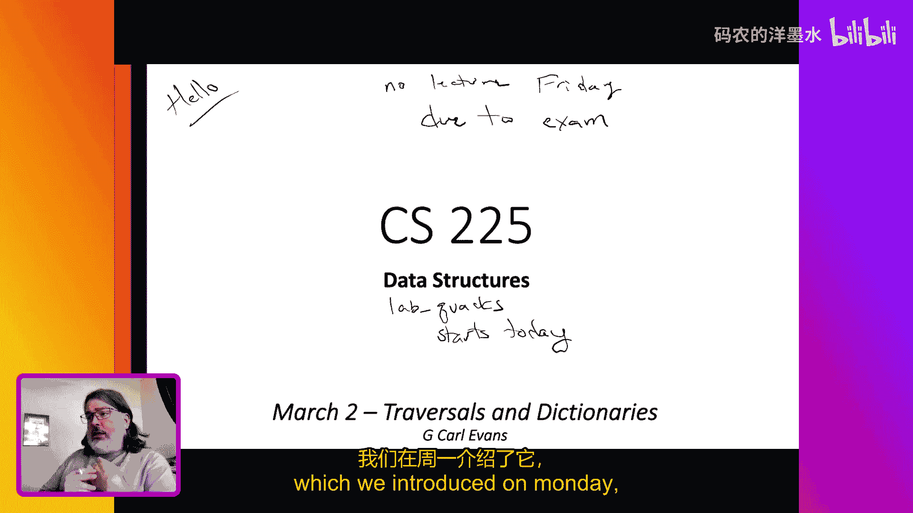

And then we're going to start talking about a new ADT that we're going to use for quite a while。

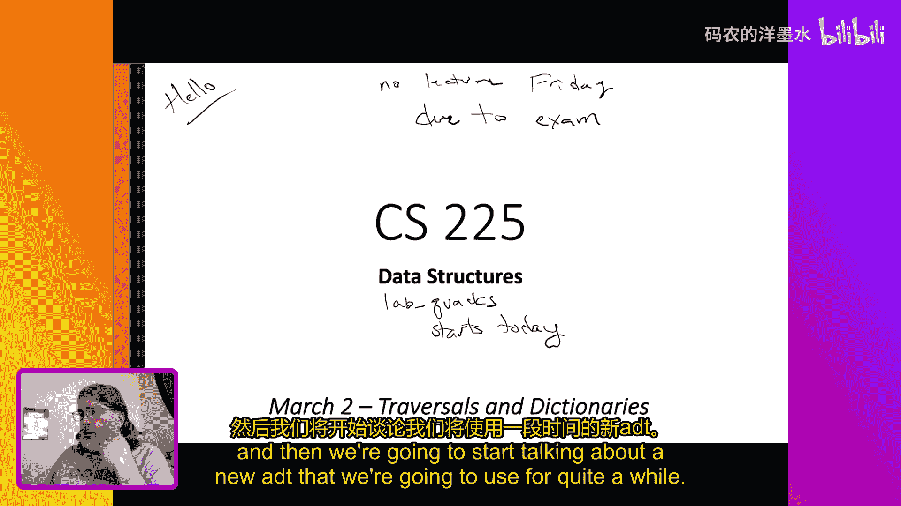

So right on Monday， we talked about the idea of wanting to traverse。A whole tree。

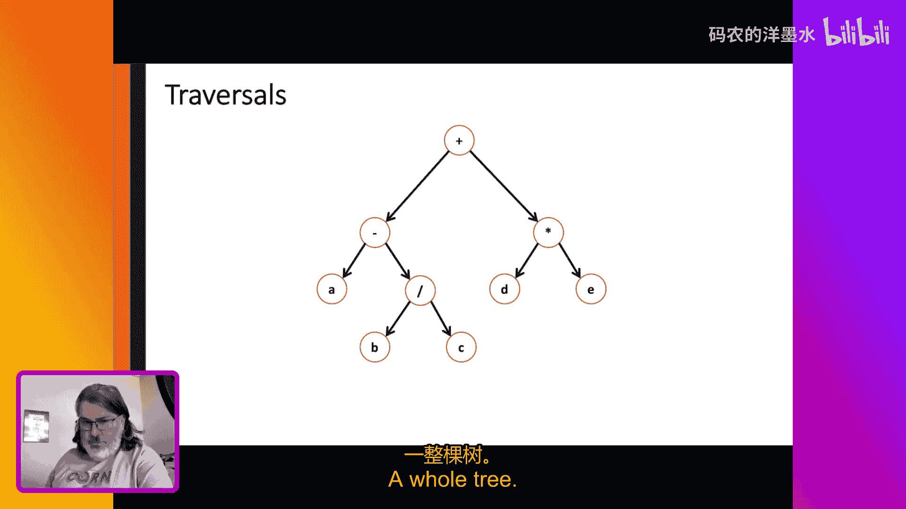

And we started and worked through the idea of a preorder traversal， right。

 where we visited the node first and then recursed to the left and then recursed to the right。

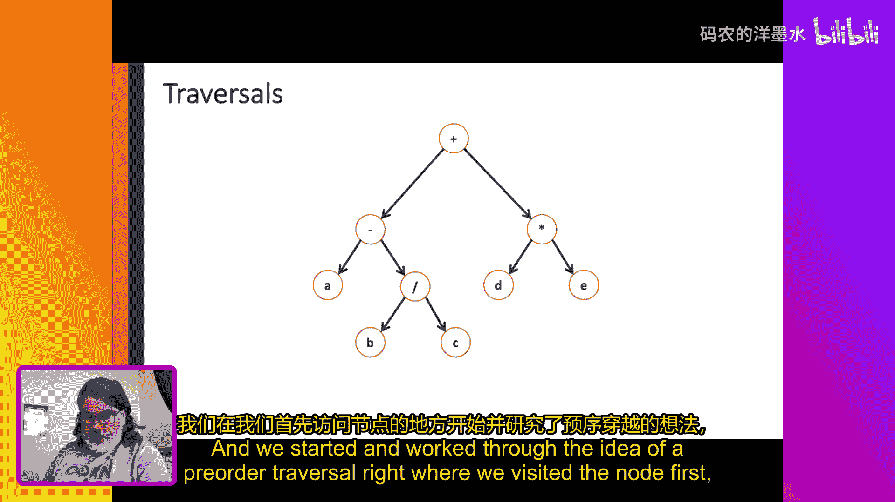

So。And we can pretend I wrote preorder here， but let's look at some of the other traversals。

 So instead of preorder， what could we do。

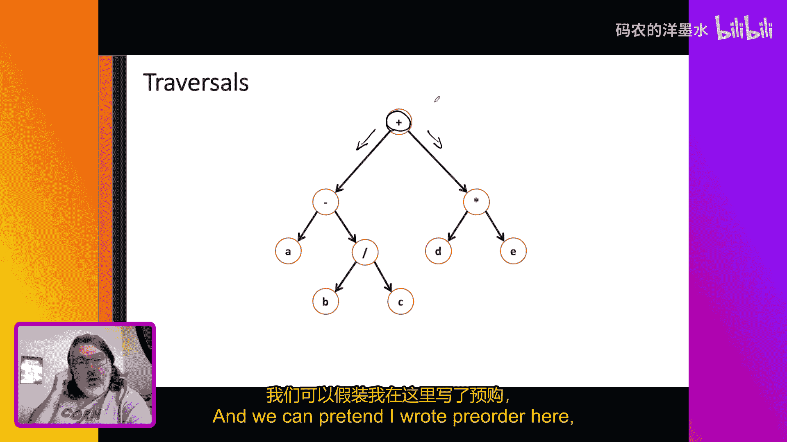

Let's see we could do。Post order。So that is you recursse to the left， recursse to the right。

And then do it。 So how do I write it， I If not， equal， null， do nothing， then post。

Order traversal to the left。Post order， traversal to the right， and see out。嗯。Arrows data。

So what's that going to do， Let's see we' are going to do start the route。 we recurse to the left。

 recursse to the left。 Then we print a。Right。And then we go up recurse to the right。

Recursed to the left。Print B。Because we recured down。 recurse off， recured down。 we print C。Go up。

 finally get the slash。Go up， get minus。Go up， go down。Di。All right， because we are down， down， up。

 down。Yi。Star。And plus。So。All of these traversals are more like depth first than breath first。

 and we'll actually talk about that in a moment。But so we go all the way to the bottom and examine what we're at and then get it on the way up。

So the real difference。 and let's let's actually go back。 this was our preorder。

 and I'm not going to write out the code， but in preorder traveral， right， we visited the node。

 so plus。Recur。Visit recur。A recur。Bi。Recurs。Xi。Get the star。Get the D。And then， the E。

And one of the things you can do。 you can see is that。These two。In some ways。

 are reversals of each other， but they're not fully， are they。

 because they're reversals in a sense of each little tree。But so the root here。Appears first。

 and here the re boot appears last。

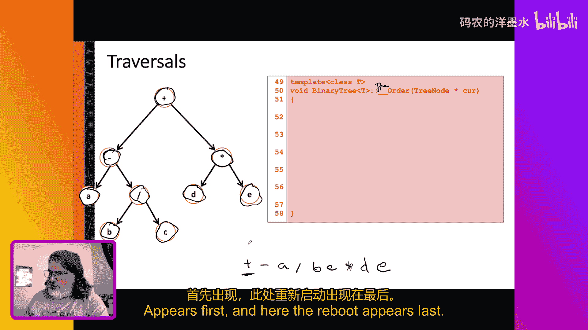

What else can we see， We can see that。Everything from here is inside this tree。

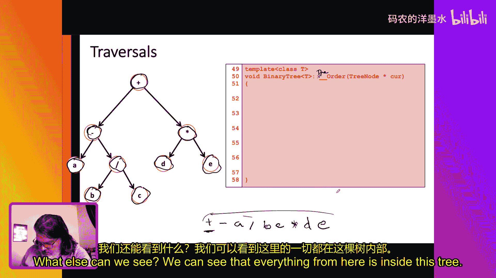

But then it gets trickier。 Everything in the slash。How do we find the end well。

End up with these are trees。Then this is a sub tree。This is a sub tree。There's our trees。

Are trees doubly linked， or is it not really needed to do that？

 Trees in general are not doubly linked。 They're only down。

 And you would use the recursion to return up。There are tree data structures that have uplinks。

 but very commonly trees only know about their children， and in fact。

 the data structures we're going to use， I believe， all work that way。

Will we start left or are there cases we're starting from the right， Well。

 the default when nobody says anything for a traversal is to do the left traversal first and then the right traversal。

 But absolutely， there is a complete traversal of the tree that works left and right。

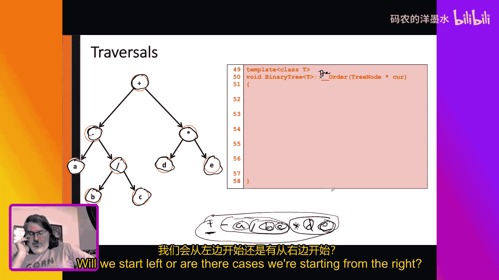

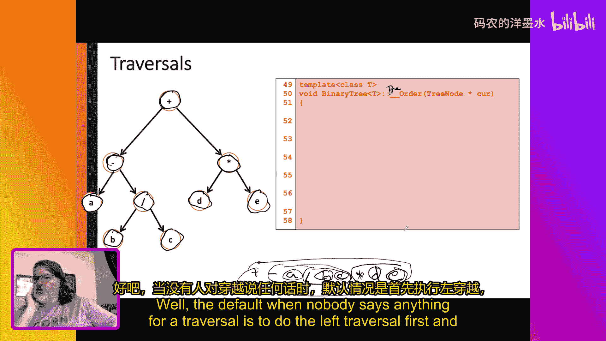

I don't get this sequence of post order。 Well， let's watch it again。 So post order。

 we go all the way down to the left， right， and visit something。And then we go up。So we recurse up。

So we go down， down。Up。down。down。Finally， we get to the bottom， right。

 so this is the first thing we visited。

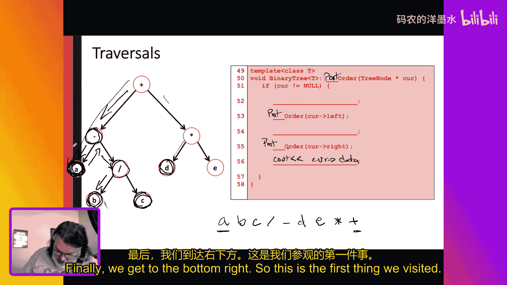

Is the A， which we printed。 And now we're down at the B。And we see the bunch of knolls。

And we print out the be。We return up。 We go down。Down， down， print the C。Right。

 so the last thing you visit is the root of the tree。

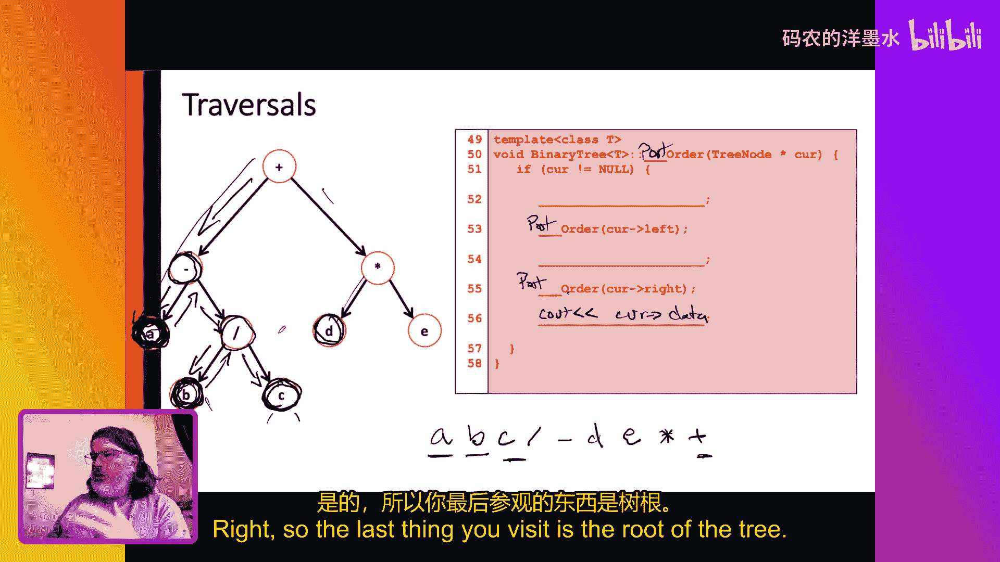

Right， so post only sees after youve， after you visited the entire subree at the root。

 post order goes， hey， I see the route。

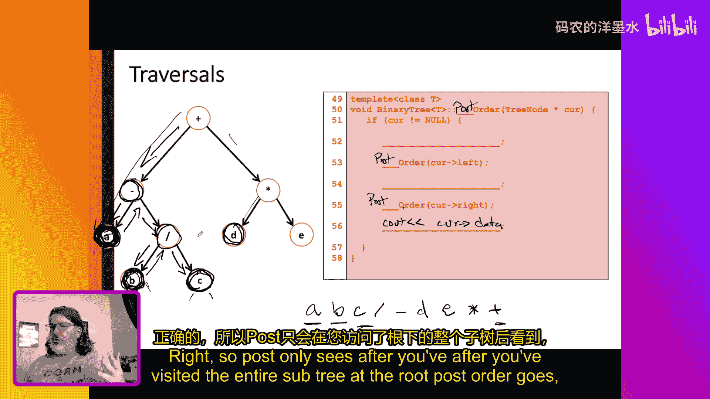

So that's why the roots of the tree is last and all of the subre went before it。Well。

 this is the code for post order。If I change post to pre and move it。

There I would have the code for preorder， right。And let's look at one more watering。

 and we'll walk through this a little bit more carefully。Is post the same as going right。

 but printed backwards， no。Post is still left， right？ We went to the left， first。The left first。Then。

 the right。Then， the root。H。Maybe you have to think about that more。Okay。

Let's talk about one more and this one's the one that I think is funky myself。

 but this one's really powerful。The only difference is printing first， or last。

This is the difference。It's whether you print first or last。So here we have again， the same code。

 and this is going to be what we're going to call in order。And we call it in order and in order。

 So we're recursing through。 And while， we had printed first and we printed last。

 What if we print in the middle。Okay， if we print in the middle， let's see what happens。

That seems sort of weird， but okay， so we start at the root， we call in order traversal。

 which calls in order traveral on the left， which calls in order traversal on the left。Which returns。

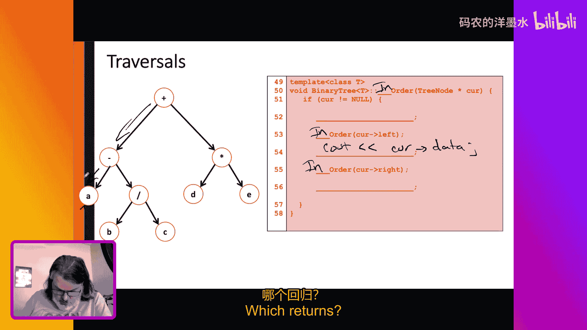

So we print a。 Then we check the right side of a， which has nothing。 We return。 We print minus。

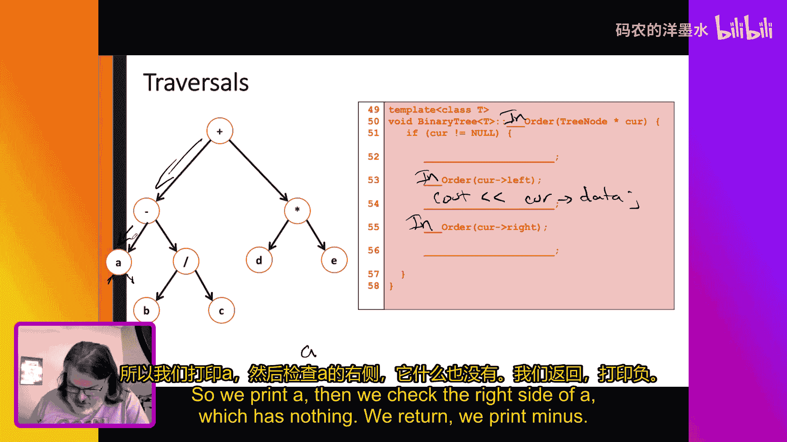

And then， we go down。And then， we go down。We check this return B， we go up。Goodvi。We go down。We go。

 see。We go up。We go up。We go up。We go， plus。We go down。We go down。 We go down。We go up， we print D。

 we go down， we go up， we print star。We go down。We print E。Up， up。Dong。He。Now。

 this one now looks like it shows something。And this is showing。A mathematical expression， right。

 we have something that looks useful here。And what's the structure of our tree say， well。

Conceptually， and this structure is actually used by compilers is when it sees this expression。

 it's going to build what is called an expression tree。Zi。And what is it got。

 It says we're going to compute this。And then we are going to compute this。

And we're going to compute this。And finally， we compute the full tree。And right。

 this is exactly how a compiler thinks about code。It takes this expression and turns it into a tree of what work do I have to do to compute this expression。

I have to compute， B divided by C and take that result， which conceptually is here。

And apply that to a minus that result。And I do the same thing with the other subt。

And I compute that result。Pretty cool。So trees are really useless in this case I'm saying it's an expression tree。

 an abstract syntax tree handles things besides expressions。

 so absolutely there is also something called an abstract syntax tree。

 there are concrete syntax trees， there's a whole bunch of trees that get used by compilers。

 but here I'm sticking to only the case of things that are expression。😡。

And not everything in your code is necessarily an expression， but yeah。And。

If you have that tree and you do the in order traversal， you're getting back out what you expected。

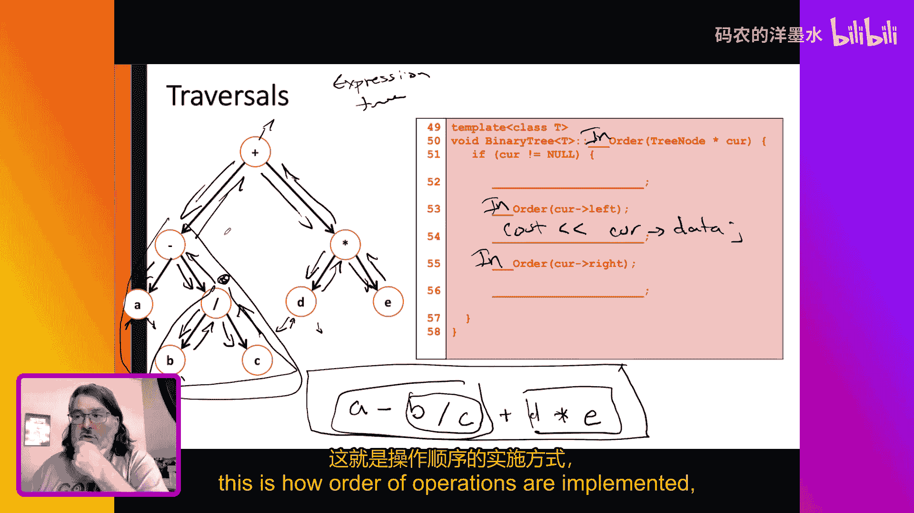

This is how order of operations are implemented sort of。

 it's a little bit more complicated that the text will cause you to build the tree you want。

 so you don't actually write the input of your program is not a tree。

 it's a string and that string it turns into a tree。

 and the rules it follows for how it builds that tree are based on order of operations。😡。

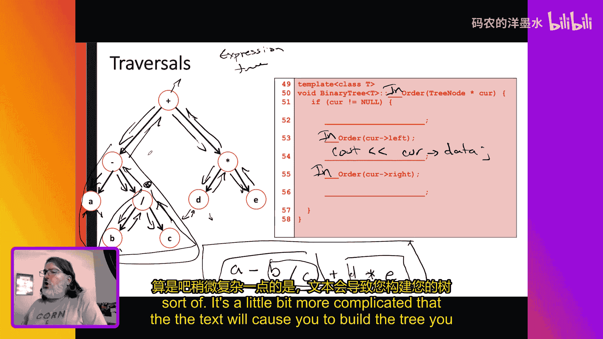

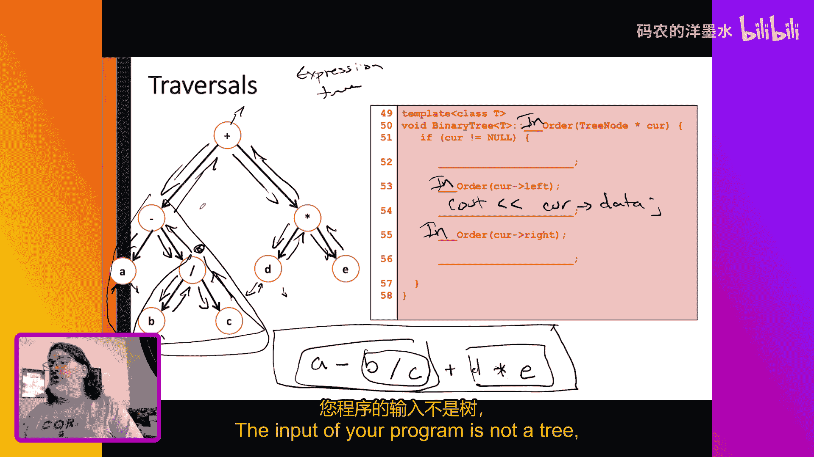

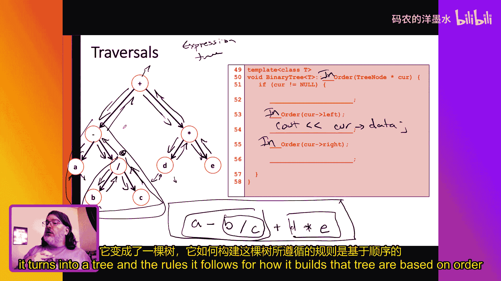

Right， because I could build this same tree in a different way。Right。

 that if I wanted to change this tree and say the last thing that happens was the star。

 all I have to do is rewrite this tree with with the multiplication being the root。Right。

And then my tree would say that I do A minus B， and then it would be the plus would work on the D。

 And finally， I'd do the star。So you could reorganize how you do stuff。

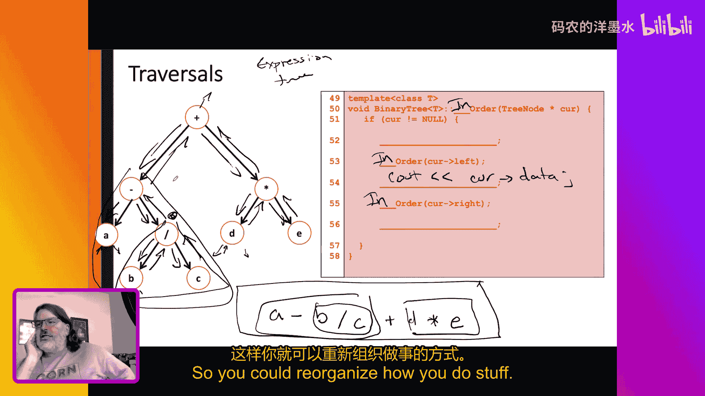

And it would have a different tree。But once it takes that string and turns it into the structure inside the compiler。

 it is a tree。

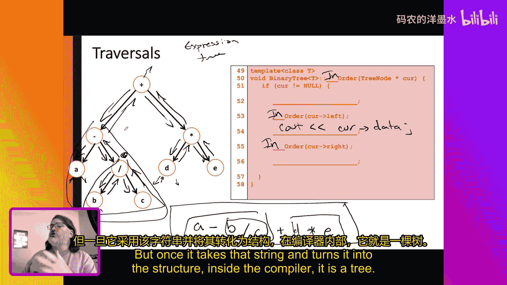

And I think that's really pretty cool。So these three traversals。Preorder， post order and in order。

Are really useful。And show up in various ways。

And are the basic ways we can do a recursive traversal are code files plain text absolutely。

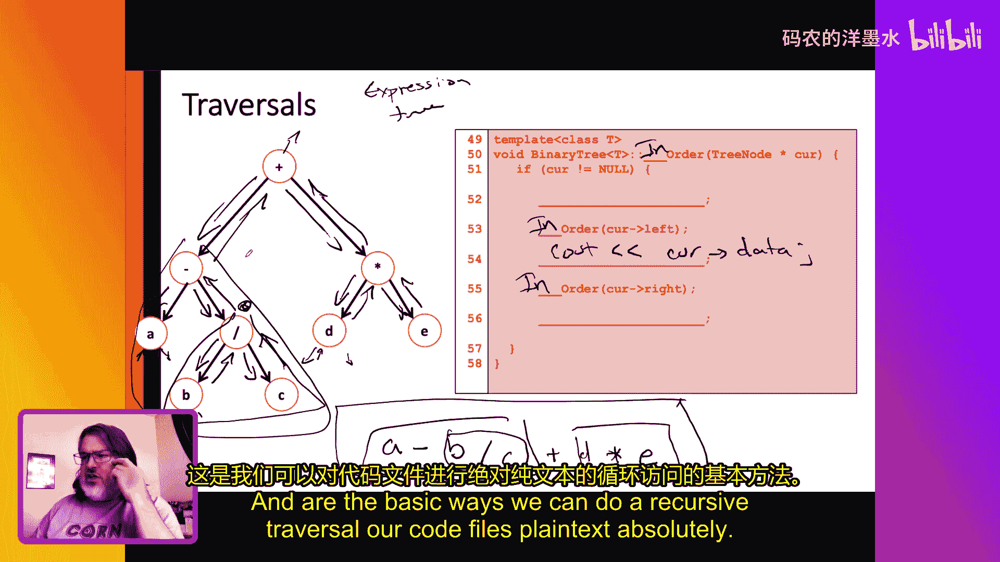

Any code files。c。cpp。 whatever they're just。Text。In pretty much all computer languages。

 that's not the。The case。In this class， we basically are only talking about binary trees。

 but there are other trees and abstract syntax trees include non binary trees。

Are there trees in Python absolutely the Python expression language does the same thing。

 it turns it into trees， how it stores it and how you think of it is a slightly more complicated question。

But in this class， the trees we're going to look at are binary。

 but there absolutely are non binary trees， and they show up in compilers。 In fact。

 you can think about it。 There is a C plus plus expression that requires a non binary tree， right。

There is the question mark。Colon operator。That is not a binary tree， the ABC， right。This operation。

Cannot be expressed in a binary tree。It is。 well， it can be。

 but it is not usually expressed in a binary tree。 It's expressed in a tree with three children。So。

Okay。So we've done recursive traversals。

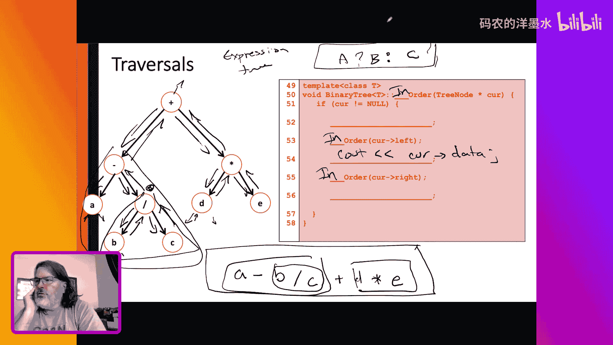

Are recursive traversals the only traversals？What if I wanted to visit everything in another way？

Well， recursive is nice， and we're going to use recursion a lot in trees。 And， you know。

 we could turn it to iterative。 But is there a sequence of visiting all the nodes in my tree。

That don't isn't really recursive。There's a bunch of sequences I could come up with。Yeah。

 by level seems like a pretty useful sequence。But I don't have an obvious way to。

Think about visiting this tree in level order。That's recursive。I'm sure someone one will tell me。

 but， you know， anything you can do with iteration， you can do with recursion。 And well， that's true。

It's not particularly useful。Because the algorithm to do a level order traversal。

Is not going to really be recursive。 So let's think about this。How is this going to work。

 We want to visit。Plus。Then， minus。Then， star。Then A， then slash， then D， then E。Then， B and C。Right？

My argument is not whether you're allowed recursion or not， and since anything that is iterative can。

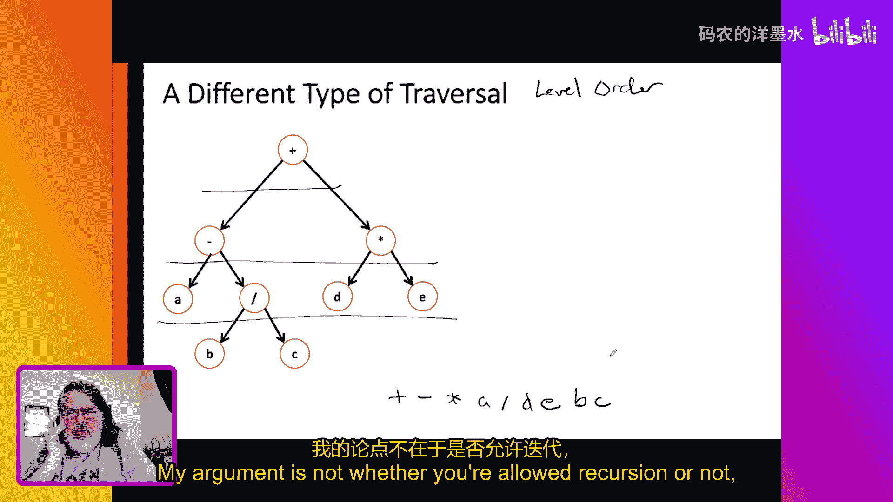

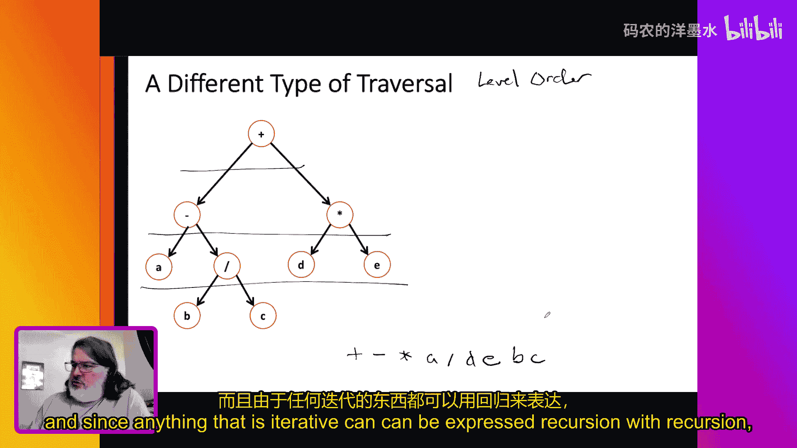

Can be expressed recursion with recursion。 My argument is， conceptually。

 this algorithm isn't going to look recursive。 So let's try and come up with an algorithm to do of a order。

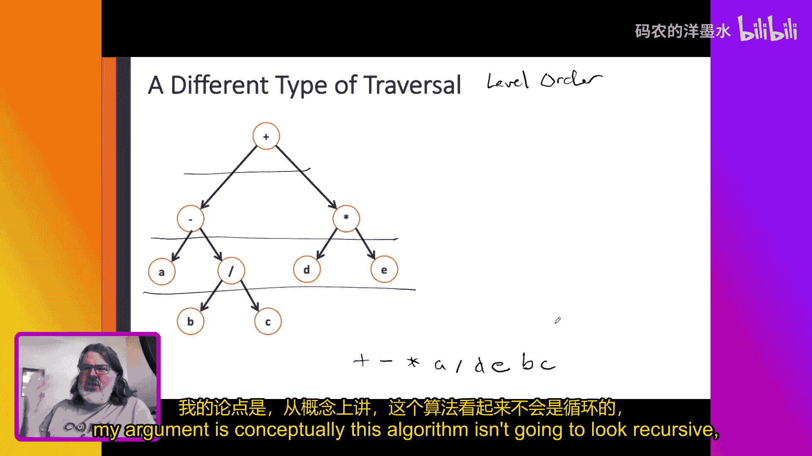

And here's my proposed algorithm。Makeake。An empty queue。Qu。Which is going to be our work list。Qu。

Initialize。With。The root。Okay， so there's our setup。 We're going to make an empty queue。

 and this is what we want to see happen， right， We want this sequence。

And we're going to start by putting plus in our queue。Work。Okay。

And then what I'm going to do at every step is remove the node from the queue。

If that node is not null， I'm going to visit it， so I'm going to print it。

And in Kit' children left then right。Okay， so。We have a plus。I'm going to remove it。 so I write plus。

And then I incu its children， which will be minus and star。Right？Okay， I'm going to Dq minus。

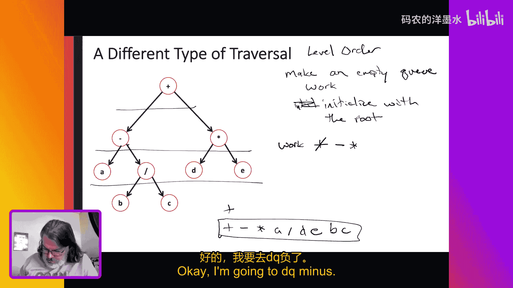

I'm going to print minus， and I'm going to in queue minus his children， which will be A and slash。

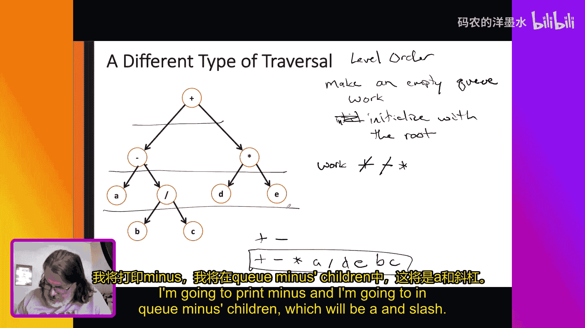

I'm going to deque the front， which is star。I'm going to print star。

And I'm going to enq its children， which are D&E。I'm going to。Du the front， which is a。

I'm going to incu its children， which are null and null。

 I'm going to leave those out for simplicityimp's sake at the moment。

And then I'm going to Dque the next work unit。And we get the flash。I'm going to incu its children。

 B and C。I'm gonna de you the front。Di。Incu its children。Which are nothing。

 I'm going to get the front， which is E。Incuit's children， which are nothing。Get the front。

 which is B。Into the children， which are nothing。 get the front that is seat。

And then my queue is empty。I'm done。Okay。So somebody said that this was breath first。

Or it was saying that the other ones were depth first。 And this is breath first。So。

Any idea how I could change this into one of the recursive forms。

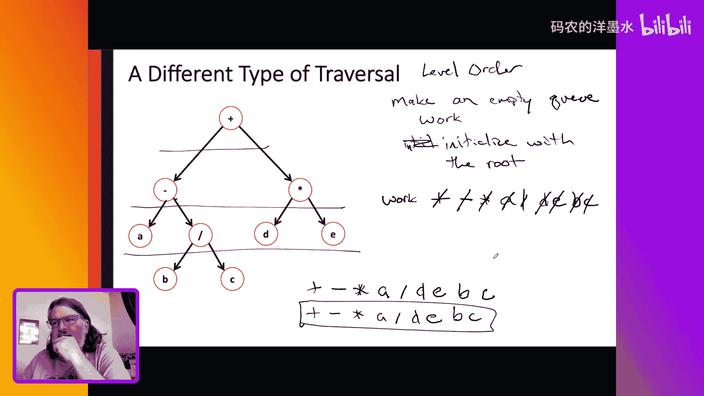

How is this useful？We examine everything that is at distance0 from the root before anything that is at distance one。

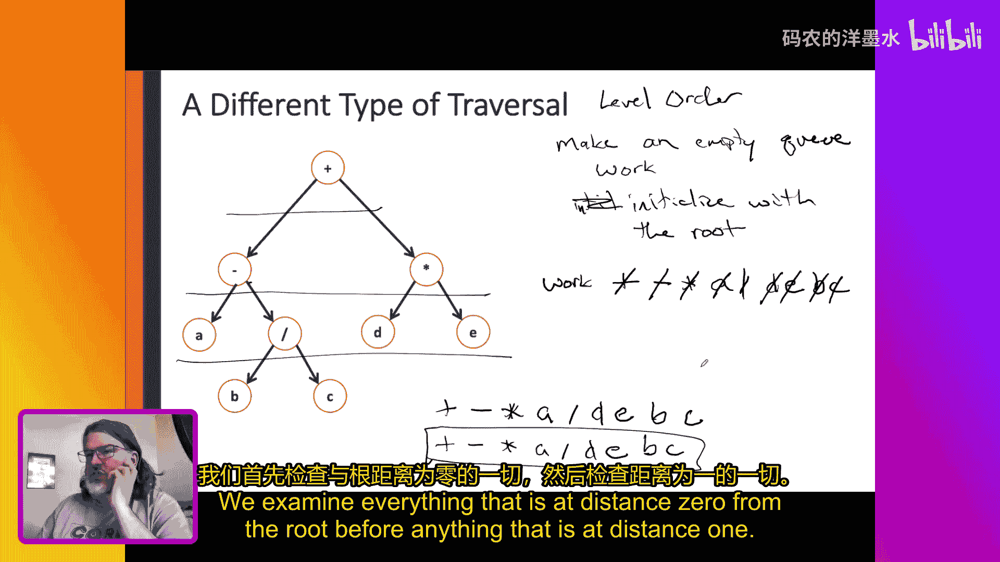

Then we examine everything that is at distance1 before anything that is at distance 2。

 What if we are looking for the value that is matches something that is closest to the root。

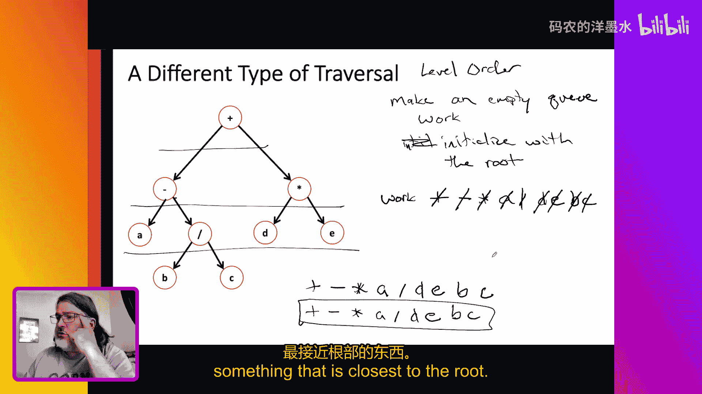

How long do you need to make the queue， We know how to make a dynamic queue， right？

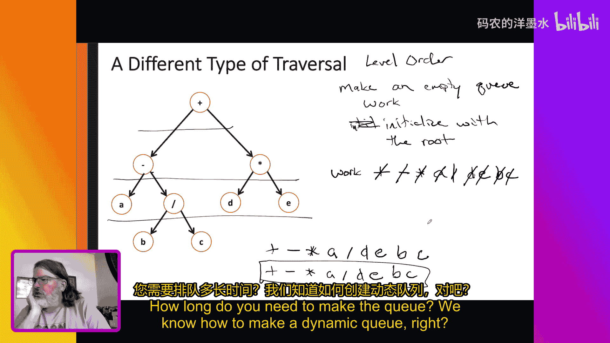

Can we tell you how big the queue will be， The cu will be at large。

 the largest size of any level of the tree。Yes， you've。

The you could do this recursively by passing the Q as a parameter。

 You've shown how recursion can be a general computation。

 but it's not really recursive in the sense of making a smaller problem。

 You're just showing that we can do anything iteratively recursively。 and that's fine。

 It is an important thing to understand。But the size of the cu we know。

 will be the size of the largest level in my tree， but I don't know what that is。 But again。

 we know how to make a cu of an arbitrary length， right， We did that with list。

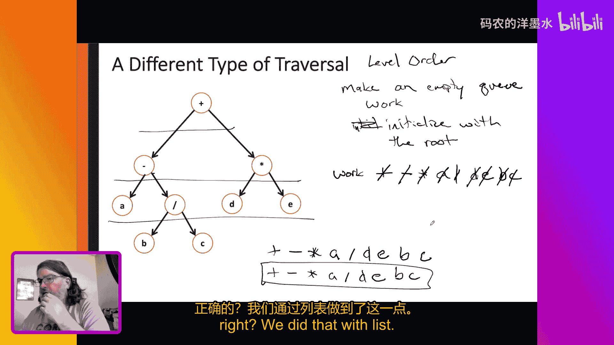

We can make a queue that is constant time operations for every operation that works on an arbitrarily large input。

 And I don't need ahead of time， no。

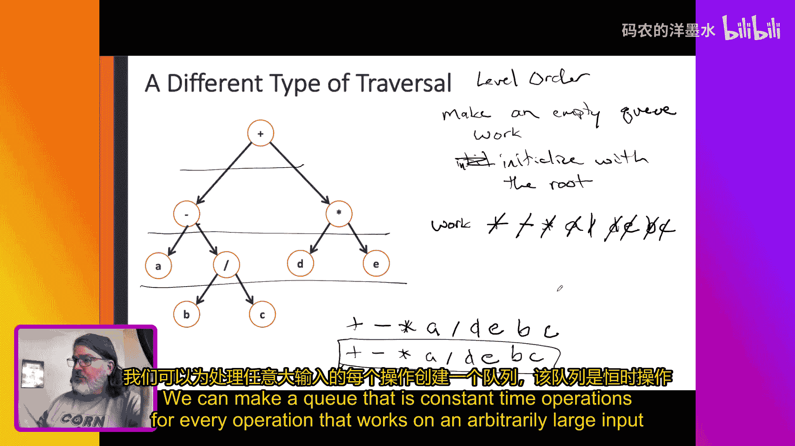

But my question was， how would I change this into one of the recursive traversals。

 not how would I make this traversal recursive？

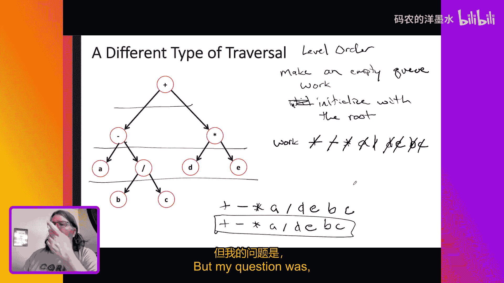

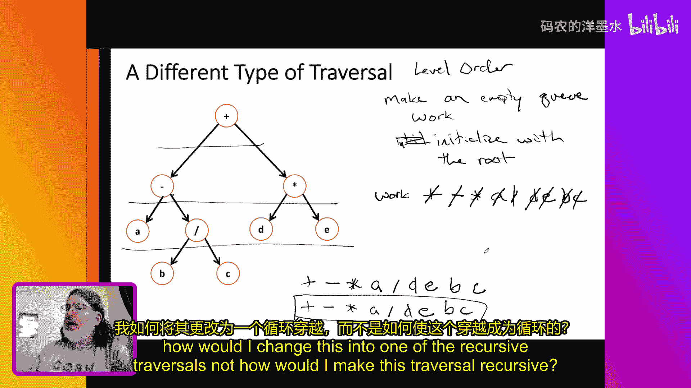

I can change one word。In my problem description。And I now have a。One of my recursive traversals。

What word do I change。Yeah， I'm going to change Q。Stack。And now I have pre order， right？

If I change Q to stack， I now have a preorder traersal。 What do I do， I put the plus on。

I immediately remove it and put its two children on。Yeah， I can't read the code without bot spacing。

 But right， if I just change my cue to a stack， I now have one of my recursive versions。

 and I have now changed what we would call a breath first into a depth first traversal。

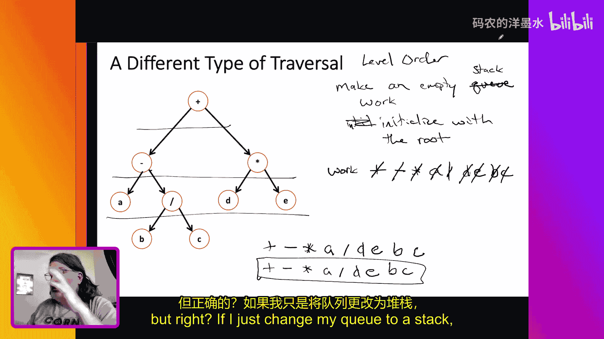

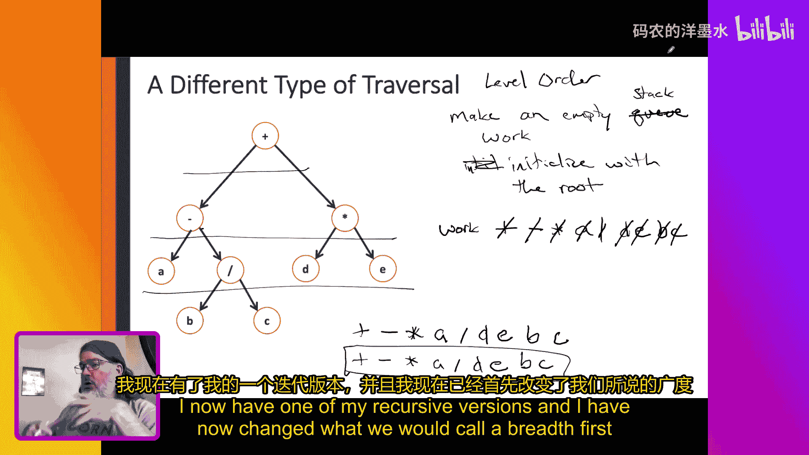

So our level order traversal and our。Om。Pre order， post order， and in order。

 traversals are incredibly close。Blet。This one change drastically changes the behavior of the algorithm。

 Let's now try and knock down the concrete implementation。

 So we have our level order traversal that takes a route。 Was it needed do First， it's going to have。

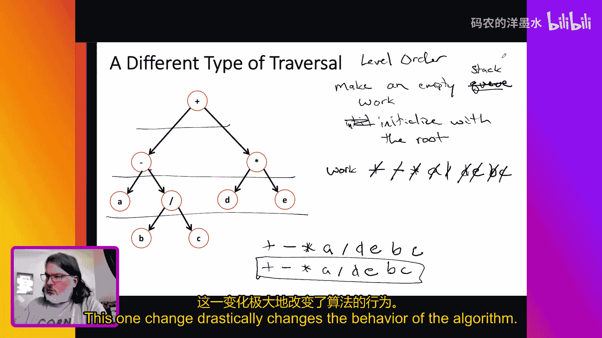

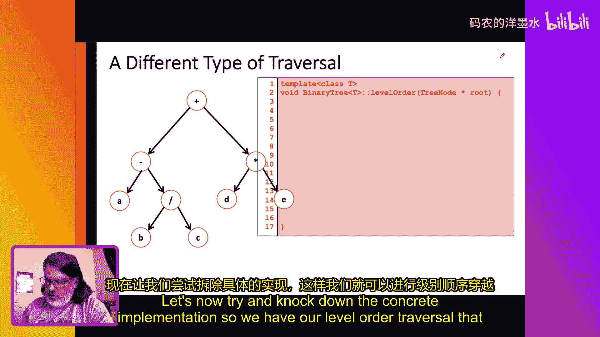

A queue。Of ths。Nodess。Okay。We will get to what breath first and depth first is and more different。

So here is our work list。Then what do we do？Wo。And then we want to put the root on， right？

This will be trino pointers。You know。While。Work。Dot size。Do the work。Yeah。

 it should be a tree node pointer。It's just too hard to fit it all in。

And what do we have to initialize， we do work。Dot Nq。Root。Okay。What do we do we do。No， PR。

Is a tri node。Pointer。Equals。Work。Dot front。Dq。Work。Do DQ。The out。Peter。Arrows， data。Work。The Nq。K。

Heros laughed。Work。Dot Nq。K。Heros， right。And this should be。If not all。What is curve pointing up。

I should have called this。I'm going to call this cur， which is what I should have done。K。

Curt should be what we we。You're right， I switched。Okay。This isn't quite code。

 That's going to compile。If we change the Q to a stack。

 we would then instead do a preorder traversal here， right， We would start with plus。This is our cu。

 If we made this cu a stack， what would happen， let's walk through the work list。

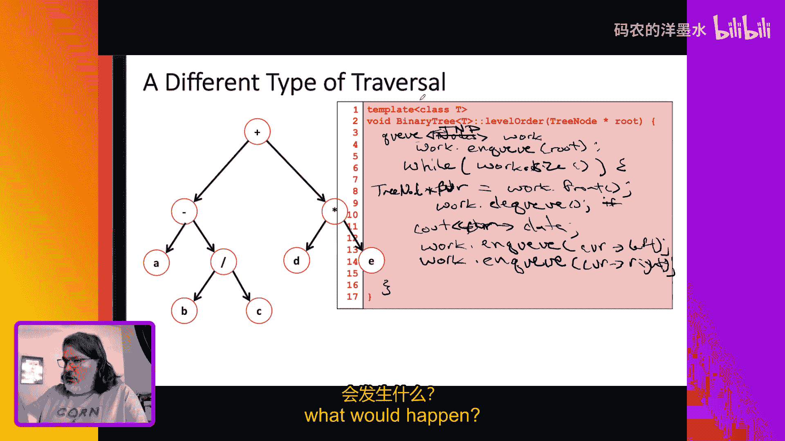

If it's a cu， we got this behavior。 We saw that。 And if I then did， instead of Q， went stack。

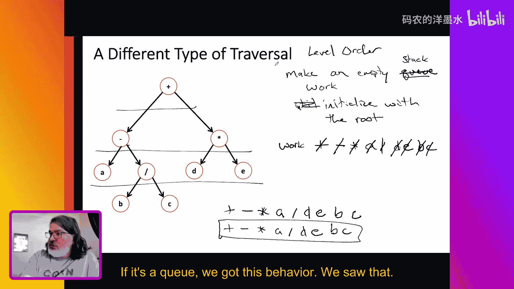

And changed N Q into push and pop， right。Here， we put something in the root。 then while。

There's anything in the work list。Get the front thing off the work list。It'sThese two pieces。

Print the data。And in cuit two children。

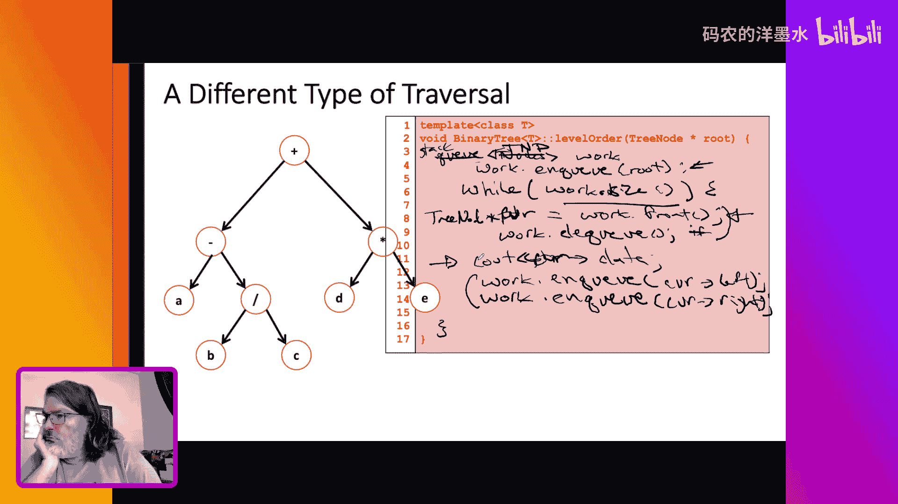

I'm missing the bit of actual code that would need to not in queuee the children if they're null。

 but otherwise we're done。

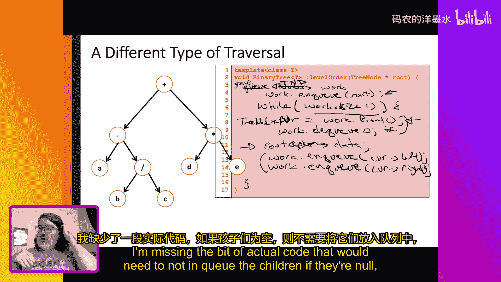

What's the difference between a queue and a stack？First in， first out versus last in， first out。Okay。

So this is all of the major kinds of traversals。But we're going to talk about something else。Often。

 we talk about traversal， but often we talk about。

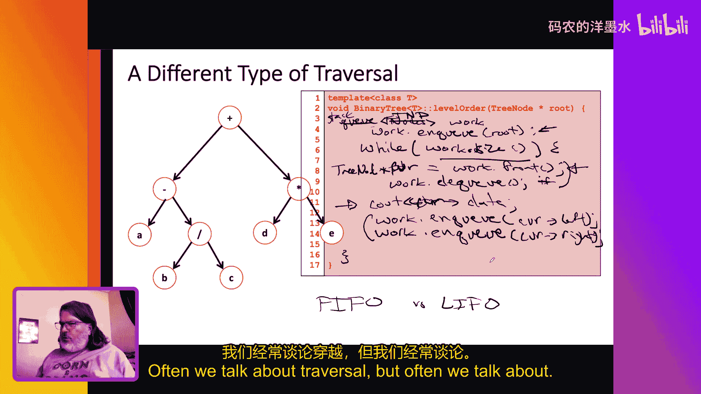

A search。So what's the difference between a traversal and a search？Okay， in a traversal。

 we what we must。Visit。Every。No。Yinchi。Okay。By definition。

 we want something that visits every node in the tree， we can come up with lots of different ways。

Why is vector not an option， Well， I can implement the Q ADT with a vector。

 I can also implement a stack ADT with a vector， so I can use a vector。

 But what I'm using that vector is is as a Q or a stack。😡。

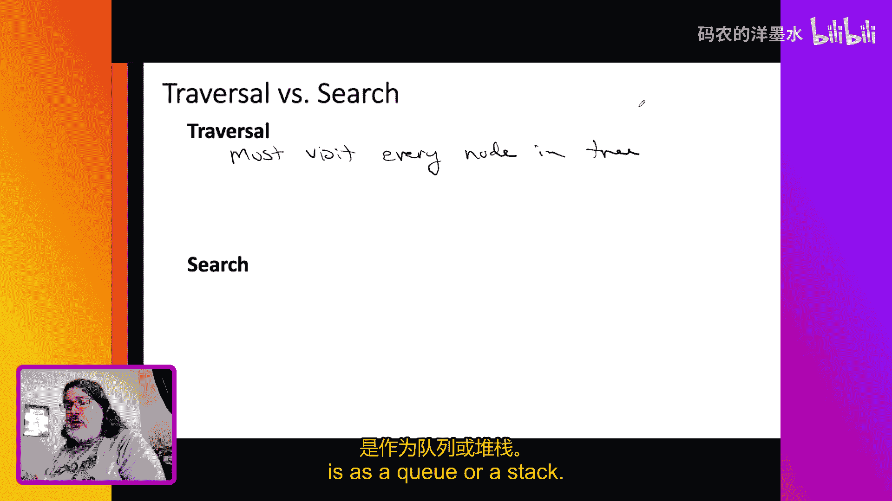

In fact， if you look at the STL implementation of Q and the STL implementation of stack under the hood。

 they have a vector。

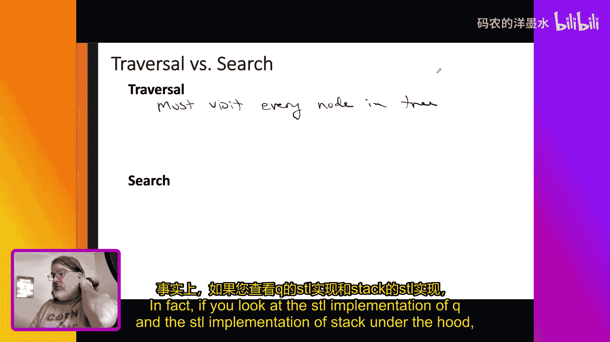

So there you go。But。I'm not using a vector。 I'm not using an array。 I am， in fact。

Using a queue or a stack。How I implement that is a different question。Right。

 and we talked when we talked about how to do Q in stack。

 we talked about implementing them with a vector or an array。 And absolutely。

 that's the thing you could do。But instead， you could just do Q or stack。

But let's talk about traversal。 So in this。In a traversal， you must visit every node in a tree。

In search， what we have to do。Find。Enode。That。Mey。Be in the tree。So。

What is going to be the running time of these， Well， the running time of traversal。

 we've done a couple。And all of them were。Big O of n， right。

And that's the best you can possibly do with a traversal， right？That if we are looking for。

 if we want to visit every node and there end nodes。😡，No matter what we're going to take end time。

What about search， What's the running time of search worst case。

Does search depend on if the node was in the tree or not。

Login worst case when we talk about running time， we're always asking the worst case。Wg in， man。

 I've like login。But why。Oh， some sort of sortdid binary。But right now， we have a tree。

 The only thing we know is our tree is binary。Yin。Bineary tree。In。Search。

 the worst case is if we look for something that is not in the tree， right。Sou。

Worst case running time is order N run time。In a binary tree。The only well a to tell that we。

Don't have something in the tree is。Order N， that's actually a really useful comment。

 The best case is constant。 So in traversal， our best case is order N because we have to visit everything。

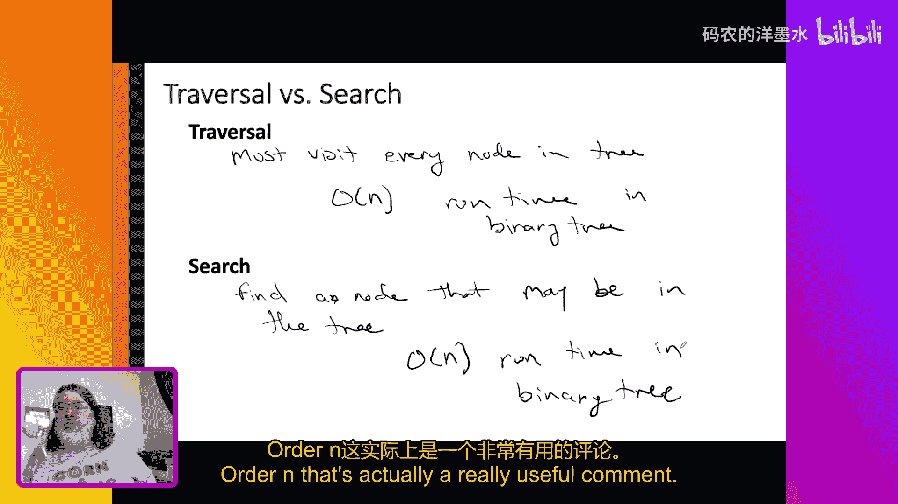

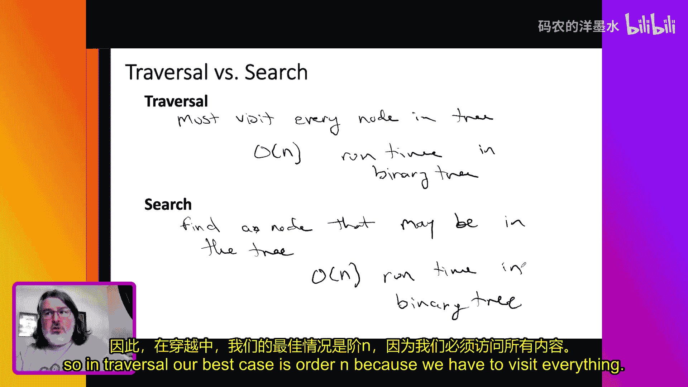

But in search， are best case is constant， wouldnn't it be great if what we were looking for was always at the root。

Sounds good to me。 You like that plan。 Let's just arrange our trees。

 so the thing we want is always at the root。I really like that idea。

 There's a tree that we're not covering in this class called a splay tree that works under that idea。

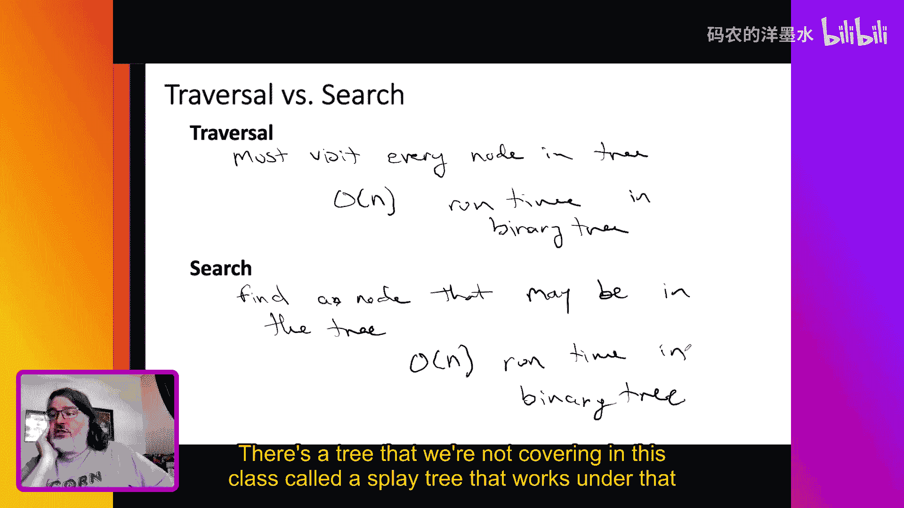

What it does is it has a operation called S that puts the thing you're looking for at the root。

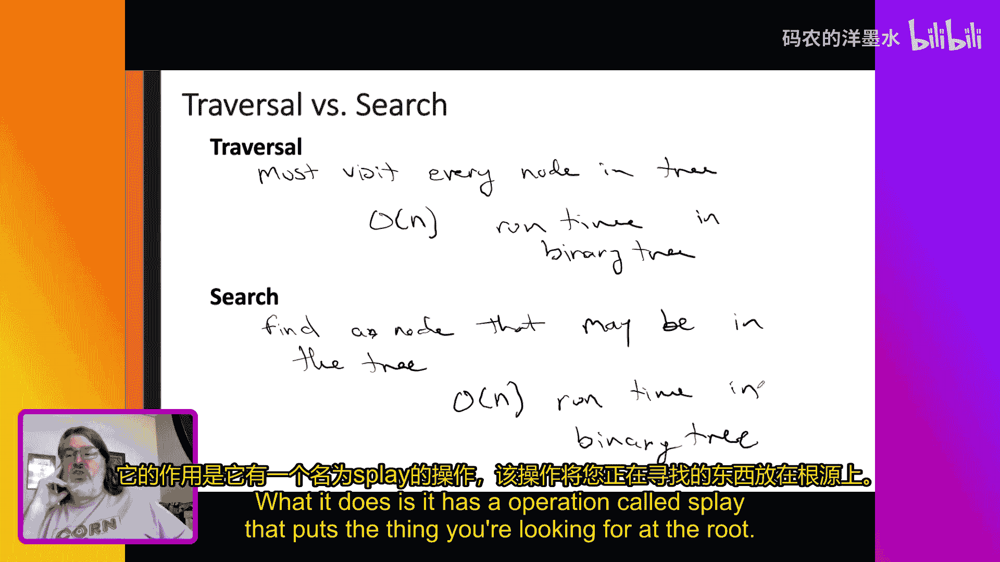

And then search is always s and then return root， because that's it。 You just。Well。

 put the thing at the root， It's at the root。The actual return is constant， but then the question is。

 how much time does it take to do display。

The analysis of S is complex and it is。It is going to be log n。 We're not going to talk about it。

and there's a lot more we're going to do some other trees that do nice things， though。

But so what are our ways of searching and we've mentioned them already？

There are two fundamental ways of searching。 There is breath first search or B。

 FS and depth first search。So what does Breford search do， Breford search says。Look。At。Ner。Nodes。

First。Right？So breath first search says first I'm going to search everything that is zero distance from the route。

 then everything that is one distance from the route。

 then everything that is two distance from the root。

 then everything that is three distance from the root okay。Ven。Look farther。

Depth first says。I'm going to hope that I choose the right direction。

 and I'm just going to go way down the tree until I get to the bottom。 And if I find it great。

 and otherwise， I back first， back up。

So these searches are just traversals with exit conditions。They're just traversals in the worst case。

 but they could end early。 Death forert says， look。To the end。Of one path。Then， back up。So。In fact。

If we wanted to take our traversals and I'll get to you what the benefits are。

 this is conceptually level order。Right。And this is pre。Post。And。Om。In order。Though。

 most specifically pre。Is usually what people mean when they say depth first search。

 But you can make a strong argument that post in in order are。Deep for search。

 and we're not going to split that hair。So why on earth do we have two versions？Well。

 it depends on what we're doing。Dept first search is kind of nice。

 What things are good about depth first search。How much memory does depth first search。

Yes， that if we have smarter trees， we can maybe do better， but right now we just have trees。

No advantages。No。

It's not constant memory because we have a in depth research search。 we have a stack， but memory。

bound。By depth of the tree。Right？So。If our tree is like most trees relatively wide。It's。Fairly small。

 So you're saying it's log n。 That's assuming that we have。Something close to a perfect tree。

In both cases。We can have the worst thing。

Yeah， when we go down the tree， once we go up， we don't need it。

Even if we have to search the whole tree。Here is memory Bo。Bow。Number of nodes。At level。So。

Let's consider something like a chess AI。

So we're mostly talking about binary trees， but these search algorithms work。

On trees that are not binary。So。In a chess board， you have a very large number of moves， right。So。

The breath， the way that tree is growing。Right， is the branching factor。

 the number of children on my tree。To the depth。So on a binary tree， we have two to the end。

But in something like a chest， I believe it's like 64 or 128 or something to the M。

So the branching factor drastically increases。So okay， in general。

 depth first search uses less memory。But。What if my tree is。Very deep。

When they say depth equals 15 moves is how far they're searching， though in general。

 they will talk about ps which are not moves， there's a bunch of terminology。😡。

So what if my tree is infinite？Will either of these algorithms guarantee to find the thing if it exists。

If it doesn't exist in the infinite tree， we can never find it， right？But if I have an infinite tree。

Will either of these algorithms find it in some fixed time if it exists。Yeah， breakfast search will。

Works。On。Infinite trees。Now， we'll run out of memory。 You could argue。

 but breath for search will work on an infinite tree because if something is in the tree。

 despite the tree being infinite， it is a finite distance from the root。But if my tree is infinite。

 depth for search。 If it doesn't take the right branch every time it goes and just keeps getting farther and farther away。

And I can tell a lot of your thinking who cares about infinite trees， these don't show up。

What they do in practice？Because in practice， a lot of what search is doing is looking for a solution in a problem and potentially。

 like the number of moves in a chess game， is， if not infinite。Fundamentally infinite， right。

 that the chess moves。Keep going until the game is over。

And if we had a game that didn't have a stall condition， then it would be truly infinite。

 so chess modified without the returning to the same condition。

You can like in an incident tree to be a really big tree in practice， yeah， but again， at some level。

We have cases where we have an algorithm like chess moves that tell us how to build this tree。

And we could keep going。Right， so if we have chess without the recurrence condition。

 there is an infinite chss c space， right。

Because if you could keep having the board reappear again and again， you can keep going。😡。

Okay， so breakfast search works on infinite trees， but memory problems。

Right because if I have an infinite tree， I'm going to have this infinite list， so yeah。

 more like a generated tree， our tree data structure doesn't need to actually be all there in memory for us to run an algorithm on it We just have to have a way to talk about it。

So there's one more kind of search that I want to briefly touch on。

 which is kind of a best of both worlds， which is。Iterative。Deepening。So iterative deepening。Says。

What if rather than doing breath first search， which if my tree is very wide， uses a ton of memory。1。

 if instead。I do depth first search。But。I only search to a particular depth， and then I run it again。

So iterative deepening does depth first search bound by depth  zero。

 the depth first search bound by depth 1， and then depth first search bound by depth 2。Well。

How does that work？How much memory does that use。Memory。Limit。Distance。From root。

So the memory that is needed for iterative deepening。

Is the distance from the root to whatever you're searching for。 I never need more memory than that。

It's not squared， it' is depth， right？Thathan at any time， the most。

I need a store is the distance to the route。What about runtime， I mean， I'm doing lots of extra work。

Well。That's pretty easy， right？ I start out with 0， and every time I recurse down， I subtract。

 the first time I don't recurse down at all， that I recurse down once， Then I recurse down twice。

Yeah， it's a depth for search， but I run to depth 0 then to depth 1。 And I keep doing this。

 So I sort of am doing depth for search， but stop if the depth is greater than。

A given doubt。And then repeat so。I keep going up。Right， every time I recurse up。

 I keep losing it and I can be doing this with a stack instead of recursion。

We always are clearing up memory as we go up。We only have to store the， the distant， the call stack。

So how much extra time am I using？Yeah， those first few layersir we visit many， many， many。

 many times。What's the worst versus breath search where we would only visit them once， right？

How much extra work is are we doing？And squared。You're getting closer。Yeah。

 you could do intervals of depth to1， depth to5 of depth to 10， but that doesn't matter。

Let's think about it。If my tree has lots of nodes and is wide。 So the worst case， right。

 the worst case of search is my tree is very large。And。If I search a tree。

 let's think of a binary tree。How many extra nodes did I search。Now， think about it for a while。

We're not going to do it。But it's interesting， And it's not as bad as you think it is。

Because each level。Isn't adding that much。You can think of the summation and you're going to notice that it looks a lot like a summation we saw earlier。

Right。That what I got for today， I'm out of time， I'll stick around and talk。

