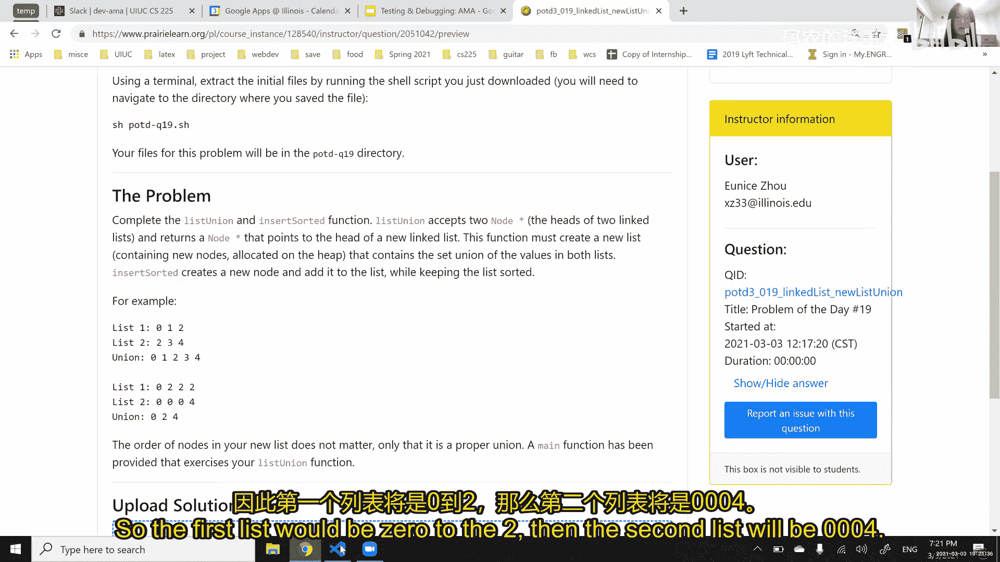
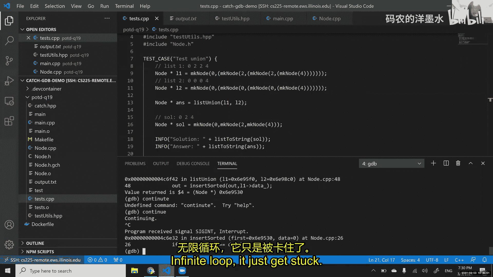
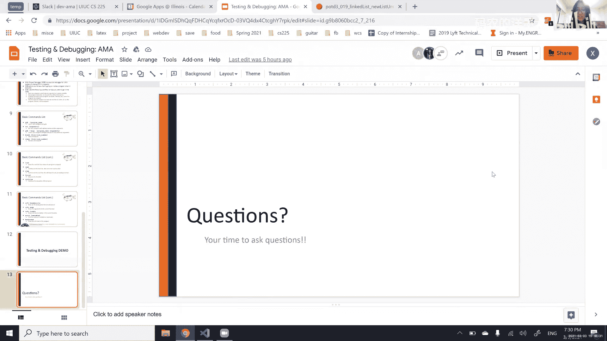

# 【全集】伊利诺伊大学 数据结构与算法 中英字幕 1080P p16 Lecture 16 - 测试与调试 -BV1t9FHzdEYL_p16-

I guess I should share my screen。我。Can guys see the screen？😊。

You， yes。Right。Keep it there。All right， so this is an AA for testing and debugging。

So so in this andA will specifically talk about G and catch testing， so we start with catch testing。

 we'll talk about what it is and why do we need it。

So catchch is the unit testing framework for CS+ if you have use like if you have done unit testing in Java using the unit it is very similar to that so it allows you to like test each units or individual function as opposed to just a whole program it makes debugging much easier because it allows you to just run like part of like a program and then make sure just catch any bug as early as possible catch has like a set of macros that can make testing much easier we'll go over some of the common macros s in the slides。

Cch can also divide test cases in two sections and then we can run the different section in isolation overall it is pretty easy and straightforward to get started we'll give you some example of a tab of a cache test case and then we also show you how to write a simple one。

So here are some of the important cache macros I think they're only for you guys really happy now so the first one is required it is similar to a certain python if you guys have ever used that so it takes in an expression evaluates it to a boolean and then is the expression evaluates the false and just support and fail the test kit so。

For example， if you know the expected output of a function。

 you can use required to check your function output against the solution output and then require them to be the same。

So the next one is the test case， so as the name suggests it is it defines the test case with the test name specified in the first argument and then you can provide any additional tags if you want。

嗯。Sorry oh that's just me just informing people to ask questions at the chat because there are a few new people who joined you keep going sorry oh is there a way for me to like see the chat or okay I'll let you like monitor this I'll monitor it don't worry about it yeah thank you okay so the next one is section so section is like a subset of tests and it is nest inside a test case so normally is for organization on the test case you can divide a test case into multiple section where each section can test a specific feature or functionality。

😊，So the last one is info so what it does is that it logs a message in telescope so it is equivalent to make a print statement like I always just say add it like add a bunch of like info in my test case to make sure like which steps it has like rich so if you want to like get any additional information of a test case you be use info。

So， now。So here is an example catch test。So we can see that we have a bunch of the macro we mentioned earlier so test case online for it defines a test case to test the size and resize method for vectors。

 So in the test case， we just first。Creates a vector of five integer and then we have two assertion requiring that the size of the vector to be equal to  five and then the capacity of the vector to be greater than equal to  five and then after that we have a section to specifically test the resize method of vector so inside a section we resize the vector to 10 and then we have two additional requirement for the size and the capacity。

So and here we'll cover some of the useful way to run tap run catch。

 so by default if you don't pass any arguments or flags on catch will run the entire test suite。

But you can also just run a single test case by specifying the name of a test。

So that's the second one and if you want to see like a list of all the tests available。

 you can use the dash L flag that will just list all the tests。Like。

All the test cases in the test file。And you can also use the dash S flag to display the output of test because by default。

 like successful test output is not shown。 so you have to use this flag if you want to。

See the output for any tests that have successfully run。The last one。

 you can redirect all the output。Oll a test case to a file instead of just printing them out in the terminal。

 so to do that use the dash O and then specify the file name and that will send all the output to a file。

Yeah， so that was a very quick overview of cash testing now let's talk about GDP。

So GDV is which stands for the GNU project debugger。

 it is a very popular debugger for Uni system to debug CNC close+ programs it allows you to see like what is going on inside the program when it executes like at first it may seems like a bit intimidating with like other complicated output but actually is is very helpful to debug because it gives you like more control over the program execution compared to v so with VR when you run it you have to run the entire program。

un it finished or until it runs into a bug and just crashes but with GDPDB you can stop like the execution of the program at any point by using breakpoint and then like once the program has stopped you can examine the state of the program like by printing out any variables or like anything in the memory like on a stack on the heap to make sure your function is doing what is's supposed to do。

And you can also step through the program like one line at a time and just execute it line by line。

You can use this in combination with a printing to like get more information in a program to make sure it is doing。

Like what is supposed to do？So we will show you some of the basic command that。

People normally use for GDP so so to launch your program with GDP will'll just do GDP and then pass in like the name of the program or executable then to run to run the program we just do run or I think thebbreviations are you want to run it。

And then so the first two command is equivalent to the third one where you can just start launch GB with the argument。

And then， you can。Like separate wine。By using break and then you can specify the file and then which line number to set a breakpoint。

 I think you can also just like set a breakpoint like at the beginning of the function by like just putting down the function names so for example。

 if you do like break main， that will set a breakpoint at the beginning of the main function。

And then you can remove the breakpoint by using clear command。

And then list is for showing like where the program has stopped and then just like you few like before and after it。

Then you can so as we mentioned earlier， you can like step through the program and then just executeQ length and lines of both next and step does that。

But like the difference is that next does not go into any function or step will take you into a function。

So want to and then if you want to step out of function。

 you do finish and then continue let you continue the rest of the execution of the program。

And to like get to get some for information for the program you can use like info and print。

 so info breakpoint will show you the list of all the breakpoint that has been said。

Then info R will show you the arguments in the current function info locals we will show you all the local variables in the local in the current function。

 and then you can also like print out any variable or like you can print out the value or the expression of the variable。

 and then you can also do。Like a back trace to show the call stack of the program so that's like some of the common comments so for a list of more detailed commentss you feel free to check out this link。

Yeah。So that was kind know like the MA's pretty short so we will now do a demo but before that does anyone have any questions so far you me check the chat yeah feel free to unmute and then just speak up or you can also just。

Ha the question in the chat。I guess that means we don't have any questions so far。 So。

I guess we should do the demo。嗯。This GDP recompile went adding break point。I don't think so。

Imcor if they' wrong， but I don't think so。I question。All I guess I'll just start a demo so。

So the code of the demo is taken from one of the POTD so to give a really quick summary we have like a really simple link list。

 one that's different from the MP but would be helpful so we have like implement this function called this union which takes in two link list and try to take a union of the link list while keeping it sorted。

So here we have like two example output for。The linkless。

 so we will show you a test cases for the second example。

So the first list will be 02 to2 and the second list will be 0004。

Here is。That's case， so。Here with the final test case， calledt Union。

So first we will like create two link lists to the first one， so which two link list L1 and L2。

 and then we will try to call our list union function。

And then so whatever return in the answer variable。

And then since we know like the expected output for the function。 So we will make。

A third link list for the solution， which is zero to4 and here you can see that we are using the。

The info macros。To print out the solution and the answer。 So this to string is a helpful function。

To pretty print a link list， when you write your test。

 feel free to like include like add any helper function that may be helpful。So and then lastly。

 we just require。The answerling is to be equal to the。

Solution the is equal is also a helpful function that。

Go through tooling list to make sure they store the same。Same data。So。You can try running the test。

Go to place。You guys can see the terminal well， right， should I zoom in a little bit？

I think it's good， Okay， cool。Alright， that's。Make the test。は。I think I have to put the module load。

😔，Al right so the compile service。Wants。Yeah so everything works so the test cases pass so right now we only have one test case but so if you have multiple test cases you can like specify。

The name and then just run that one single test case so we can just like just run like the test union test case。

But in this case， we only have one test， so it's the same so you can also list。All of the。

Test case available by using the batch out， so here it shows that we only have one test case test union。

I think another things you can do is that so if the output is like。

Like huge and then you it's hard to like read through all of them in the command line。

 you can also direct output。By using the dash or flag to a file。

 so let's do it to like output dot TX file。 So if you do that， it will create。我 file。

Howll up the TXE。Yeah， we can actually。Right， since all the task case is successful。

 it's not outputing anything。嗯。Add info so we can use。The flag dash as。Do you show any。

Output if you're curious， so we can see that。The info output is shown here in the file。

 so the solution and the answer Microsoft。Yeah， so。I think that was all the commands for。

The catch and I think now we can try out the GB。はい。No。

So actually let's try to introduce a bug in our code and then use G to help us figure out。

Let me try to。Do something to our this union function， so。Here， let me just come in out this line。

Like we know it will give us an infinite loop because the condition。

 the stopping condition for the while loopbe uses L1， but then if you're coming out of line 49。

 we never update L1 so well just get stuck in this while loop。怎咪。Like。So if you run tests。

 you can see that it gets stuck。And then。Let's try that with the GDP。So you do GDP dot s task。

 we will load the task with GDP， you can see there's like a bunch of output before。

And then it brings you in the GDB command prompt。So let's set a break point at the beginning of the。

Les union function so can use break or the abbreviation B。And let's do this union。

And it shows that we have set of break。In the file node SVP at line 45。

You can also just like see all the breakpoint you have said so far using info breakpoint。

Here you can see that we have only one break point， so we can now run the program。

And then it should stop at the breakpoint。 So here we stop and know that CPP line 45。

 which is the beginning of the list union function。

So we can use this to show like the code before and after。And then we can step through it。

 using think next。Or and。To see the next line。 So if you do it a bunch of time。

 you can see that it just get stuck in this mood because we are always just。

Going through the same thing。 So let's try to print out what is happening with one。

 So if you do print at want。You can see that this is the。Whatever store in El and then that's。

Go through the next iteration of the loop， and then when you print out one again。It's the same thing。

 so hopefully that gives you some hint on where the bug might be because。

You can check that our one's the same and then you never got change。So。

That may be the reason why you get stuck in an infinite mood。

So that I think that is most the command for yeah， I think so some of the other can use is like info。

I think arts that shows you like。The argument of the current function， which is this union。actually。

 I want to show like the step。Let's。Let's go here so the difference between next and step is that next we just like continue to the next line without stepping into any function。

 but then let's say you want to go into insert sorted and then see。

If there's anything wrong with it you use asked and that will take you inside the insert to function。

 you can see that it's like。And then know that CPP file Line six that the beginning of the insert sorted function。

 you can continue。When things out。Check everything looks al right and then if you are done with the function。

 you can step out you finish。And then， that would take you。

That would like take you from the function like back to whatever function function that calls it。

 which is this you。So。So we can do continue。To continue with continue。

She continue to rest of the program。And then we since we have。In finish loop， you just get stuck。

So I think I have cover。

Most of the command。Let me know if I miss any。Yeah， so that will just say really quick demo。嗯。

I know this MA is pretty short hopefully it gives you some reference on how to do developinging testing for the MP and any future assignment does anyone know it's time for questions does anyone have any other question。

