# 【全集】伊利诺伊大学 数据结构与算法 中英字幕 1080P p17 Lecture 17 - 二叉搜索树(BST) -BV1t9FHzdEYL_p17-

Okay， welcome back to CS225， and we are going to be today moving on to instead of trees is an abstract idea of more concrete trees。

So。Let's talk a little bit about finding things in trees。So here is an example tree。Right。

How would we do find。Say。Hian。Let's think about this If we want to find an in the tree。

How long is the running time do you think of any algorithm？Log n， how am I going to do log n。

 I like N， I'd like it to be log n。Okay， so we have an algorithm if node equals n return L search right search left。

 which I agree is a correct algorithm， but the running time of that algorithm is going to be N。😡，Oh。

 we're assuming it's a binary search tree， this is just a tree right with it's a binary tree。

We have not made a binary search tree， I don't know what that is yet。So。I think that。

The way I have to do this， I potentially have to search every node， right？

So it's certainly not a log n。 if it's sorted， it's login。

 I'm not sure I agree with that this doesn't look sorted， so I think the best I can do in this is n。

Right， since if I do find。Zi。I have to go through the whole tree， right？That Z doesn't exist。

 but the only way I can write an algorithm， because the algorithm doesn't know the contents of the tree。

 it could know structural properties。 It knows it's a binary tree。 But as I said。

 that's the only property we have is that it's a binary tree。 So to find something。

 It's going to take order N。 So this is no better than what we saw in a list， right。

 Find a element that contains something in a list we could do order N。

 So maybe trees aren't any good。Well。That's not going to be the answer。But。嗯。

Let's think for a moment。We're going to probably want to restructure this tree。But also。

 we want to talk now。About an abstract data type。Now with trees， there are lots of things you can do。

And a general tree is very general。But there's one abstract data type that we're going to spend about half of the remaining semester talking about。

Which is the dictionary。The dictionary abstract data type is a super useful data type。

 it's so useful that some modern languages have it built in。

And it organizes data into keys and values， as in， well。

 the words and the definitions in a dictionary， right？ So if I know the word。

 I can look up the definition in the dictionary。 On the other hand。

 knowing the definition doesn't help me find the word。So。It is a key。Value pair。

And it shows up everywhere， right， so the name comes from dictionaries but。Well。

 we could have the course number to the lecture and lab schedule。So is it like a map。

 a map is a concrete implementation of a dictionary。In some languages。

It maps the idea of from the keys to the values。On a graph。

 we'll talk about from a node to the incident edges， which are right。

 we just were're reviewing some of the graph material， the edges that are connected to that node。

In an airline system， we have flight number to arrival information。And in fact。

 the entire internet can be thought of as a dictionary， which maps URLs to HTML pages， right？

So this thing's everywhere。What are all the operations we want and we're going to do this。嗯。

Can there be multiple keys， Well， a dictionary has multiple words。

 Can multiple keys point to the same definition， Absolutely。

 Could the same key appear multiple times， not in our particular description of the dictionary。

That is to say every key is unique， so that's a good question。

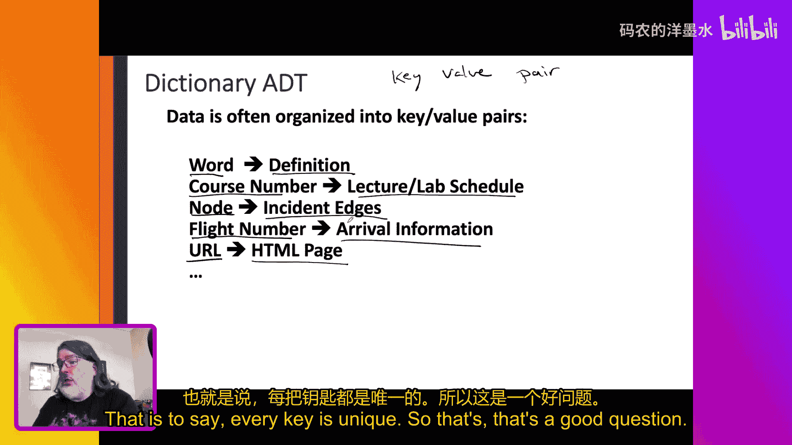

So I'm going to work through the abstract interface here along with functional。😡。

So first we want to have find， right that it's what we already said we did。

 we look upward wordss in a dictionary， so the most basic thing we have is find。😡。

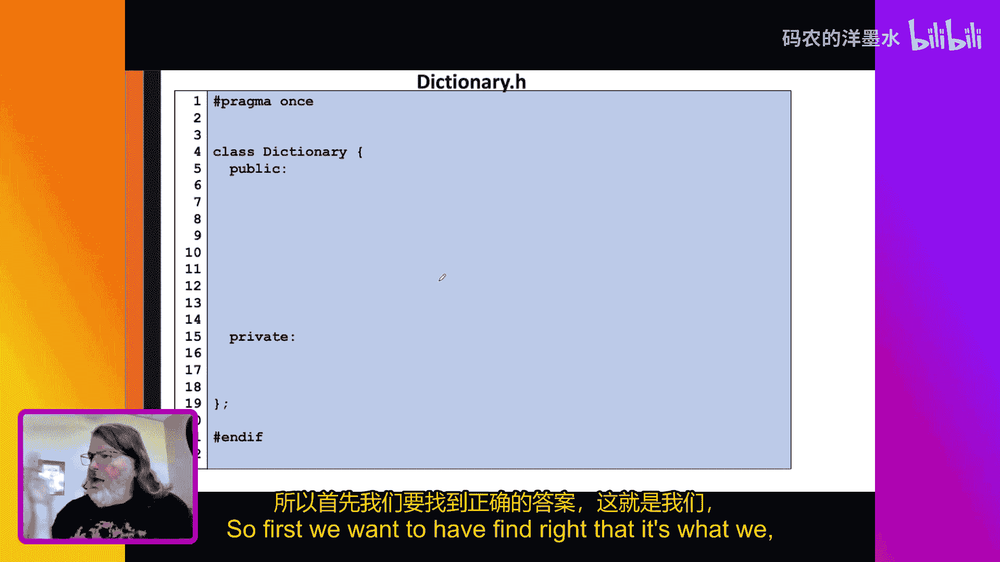

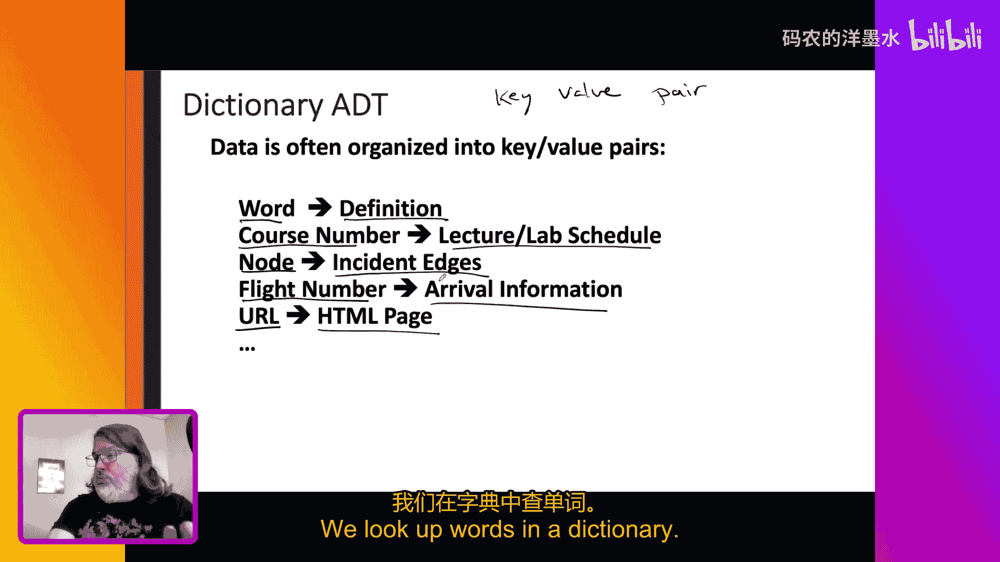

So， find。Ti。And return。Value。The very most basic alarm operation。Okay。

 we could do this concretely in a couple of ways。I'm going to use the function find。

 but in many C++ implementations， what you'll see is square brackets right， and in fact。

 actually in many languages that have dictionaries built in by default， the square brackets operator。

 which we've been thinking of as array access is really dictionary access。So let's try and think。

 what do we need here。 Well， we want our dictionary to be templated， right。

 So we're going to have template。Type name。In a sense。

 an array is a So an array is a kind of dictionary。 I agree in a lot of ways。

 an array is a dictionary。 It's not quite。What we're doing， a dynamically sized array。

 I would say would be a dictionary。The thing with an array is。

All of the indexes need to be contiguous right that if we have index 1 in index 57。

 we have to have index 2，3，4，56 on up to 57 and that that is something an array requires that a dictionary does not so type name right？

😡，And I'm going to have the type name of the key。Right， so we're going to do find。Cot。Rph。Ki。Right。

Is there a way to order a dictionary like if we had a custom way to order keys。

 This is an interesting question。 The dictionary ADT does not require it to be ordered。

 but some of the implementations we choose are going to produce ordered dictionaries。

 So you can think of a dictionary as ordered or unordered and we haven't really got to how that's going to come off。

 but it's an interesting thing to ask。 is the contents of a dictionary in order or not。😡。

But what's fine going to return？I've given you a big hint。Well。

So we're temptized under two different data types， we're going to return a value。

So there's a possible concrete implementation。Okay， so find， I think。

 is the most primitive operation that it's not very useful without。

Actually having a way to put things in， so we better have insert。So。Insert。To dictionary。

We're going to have void。Insert。Can't。Rph seems good to me。K key。Const。Rph。V value。Okay。

Should find be a const function。That's a very interesting question that I'm not going to answer right now。

And it really depends on how you've implemented find and what you do when you do not find something。

 and that's a design decision that I'm not touching right today。Remove。Its gonna to be。Remove。

It's going to be something like void。Remove。Can't。Rph。ケキ。Again， was it doing it。

 it here is always returning something。 So what do I do if I can't find。Well。😮，I would。

What do you mean insert at the back， it inserts in the dictionary。

 we access things in the dictionary by key。If I built my dictionary with a list， pushback seems fine。

If I built my dictionary with something else， perhaps I'm going to do something else。

The concept of inserting at the front of the back doesn't matter because the way I get things out of the dictionary is with find。

 So how the dictionary is storing this data we haven't talked yet。

We could imagine that if I just keep it in an unordered list， I go through the whole list， I find it。

 I can return it， I can just insert。Again， we haven't talked about an implementation。

 We can't talk about how the keys are sorted。 We can't talk about these things because we don't have。

Anything to do。 So it should have constructors， deors， all of those things。

I would argue that the way of written find is a very common way to write find。Would we want a size。

 we might， we don't need that from the point of view of。The basic type。So。

There's one last thing we want， which is。Tversal。So， using。Iterators。

So we have a way to get all the keys out with a traversal。And I claim that's really all we need。

 right？Would we like other things， I think size is a fine thing to have， I think that。

Check to see if the key exists is a fine thing to have， which is different than find。

And we could talk about that maybe Fne should return something else。

 like perhaps an iterator to pointing at the element it found at which point we can do it。

 But I think this is the basic idea。Okay。So we want to do find， we want to do insert。

 and we want to do remove and we want to be able to go through the data structure and finally initialize it。

So。We could implement this dictionary， and I could tell you right now your lab is go write a dictionary using a linked list。

 right， and you could do it。 It would not be efficient。 Let's see。

 what would running time of finds be on our linked list。😡，I think you would be order N， right？

Insert could be constant time。Remove would be order n because I have to find the element to remove and traversal is order n。

 so we would have， if implemented with a linked list。😡，嗯。It's very straightforward。

 and we know how to do it， right， It would not take you long to do it。But we're talking about trees。

 so maybe we want something better than order N。So let's talk about a binary search tree。

 which is something we're going to use to implement a dictionary。😡。

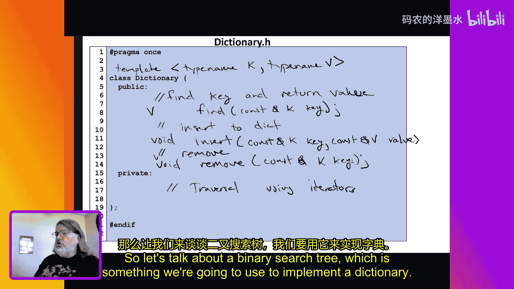

Data structure。So， okay。So here is a binary search tree， What's true about it？Our binary search tree。

Is。Going to be ordered。Could you implement a dictionary with an array， sure。

It's going to be ordered such that。Everything to。The left。

 we want smaller and the right we want larger。 That's not what we have here， is it。There's no order。

 This was our binary tree。 So right now with our binary tree， we do nothing better than。

We did with a list。But what can we do with a binary search tree？Or a binary search tree or a BST。

Is a binary tree such that either it's empty。Or。Right。And。Root。Of T L。Qiyi。Less than R。Root。Of T。

 R key。Greater than R。And。T， L and T， R， R， B S Ts。So。😡，Binary search tree。

 So is this a binary search tree， If I look at it， it looks like it is， right，38 is the root。

Everything to the left of 38 is less than。Everything to the right of 38 is greater than。

Can we implement binary search tree using can we implement a dictionary using a binary search tree if we don't have a comparison operator。

 No， because we can't have a binary search tree if we don't have a comparison operator。😡。

If we don't have at least less then。We cannot or greater then。It's not a binary search tree because。

A binary search tree is defined by the ordering of the values。

I mean 13 is less than 38 and 51 is greater than 38。H， that does seem a problem。

 we would do something。I'm not going to worry about it right now。Right now。

 with a binary search tree， we cannot handle all data types。 We can only handle data types that are。

Ordderable。If the child of 25 was greater than 38， would it still be a binary search tree， no？No。

 it would not。What's the advantage of this over assorted list in array we're going to get there。

But so there is our structure。

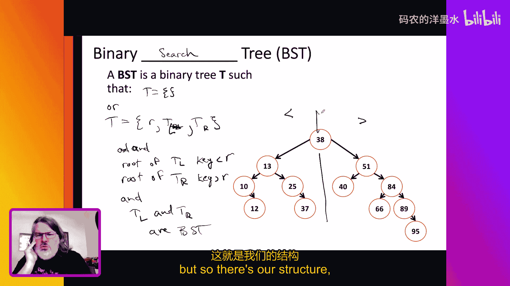

Okay。So here is our binary search tree。It has a tight and it's looking like the dictionary， right。

 it is a binary constructor， it has insert that takes a key and a value。

 it has remove our remove version is going to return the value， given the key。Find returns of value。

Tre iterator。Doesn't change things。And our tree looks like what every tree node has a left， a right。

 a key and a value， and has a constructor， and it starts with a head。

Why do we want key as a reference。 Some can be references。 Some can be not。

What is the key and valueal in a BST， or what are you putting in in this BST。

 which is how we're going to talk about the most of the time。

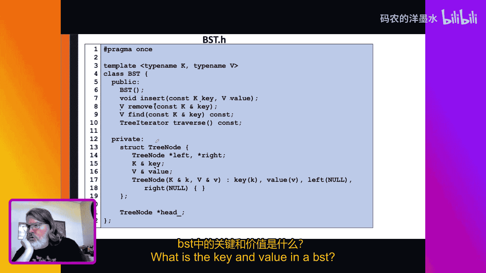

U。We are showing the keys because that's what matters， right， A BST is ordered by keys and the value。

 who cares， the values in a box。It's somewhere in a box and you can get it out。So。

This is actually worth spending a tiny bit of time about because from now on。

 we're going to be almost always talking about a key value pair。That we're going to have keys。

 And then somewhere there'll be a value。 Well， what's the value。 We don't care。

 So when we draw our data structures， we're going to just draw the keys because if I put a bunch of values in this node。

 it would just be harder to read， and it doesn't affect our algorithm at all， right。

 all of our algorithms on our binary search tree， which we're using as a dictionary。

Are only going to care about the keys。 The values are just things you hand to somebody。

 Somebody gave you a value， you put it in a box when you're done， you give the value back， okay。

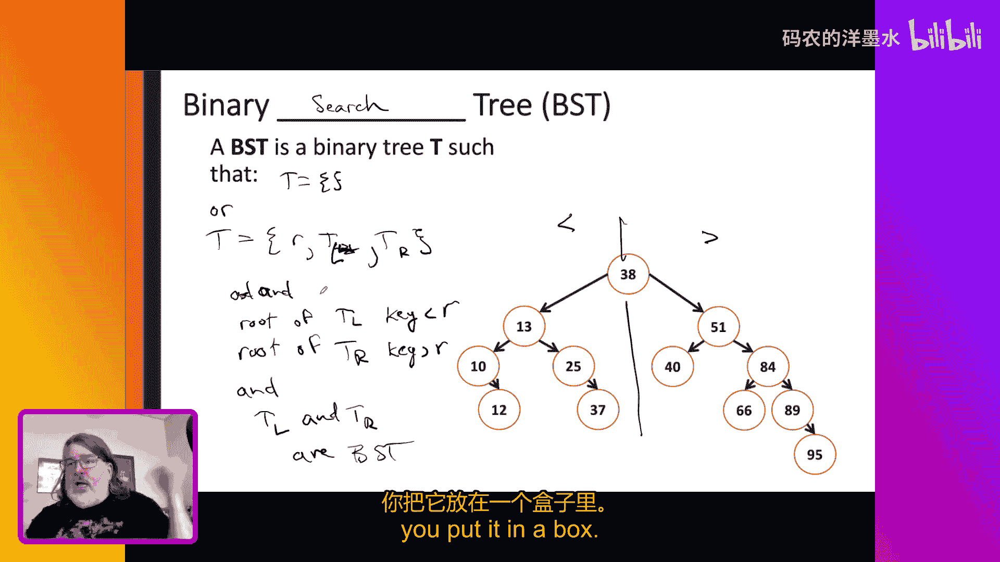

So let's try and write some of these functions。

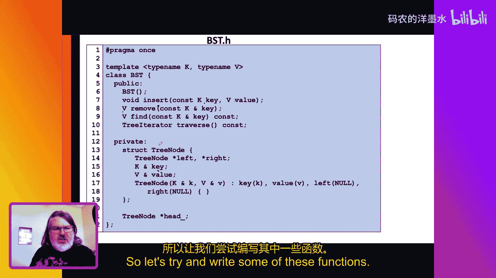

Let's see。 Let's work on find。 How do we find。In a binary search tree。

Can we get constant fine times in a binary search tree， I don't think so。U。

I don't think we're quite to log in yet。I would like us to be。

 it would be great if this got us to log in， but let me show you a binary search tree。 let's see。

 Here is my binary search tree。

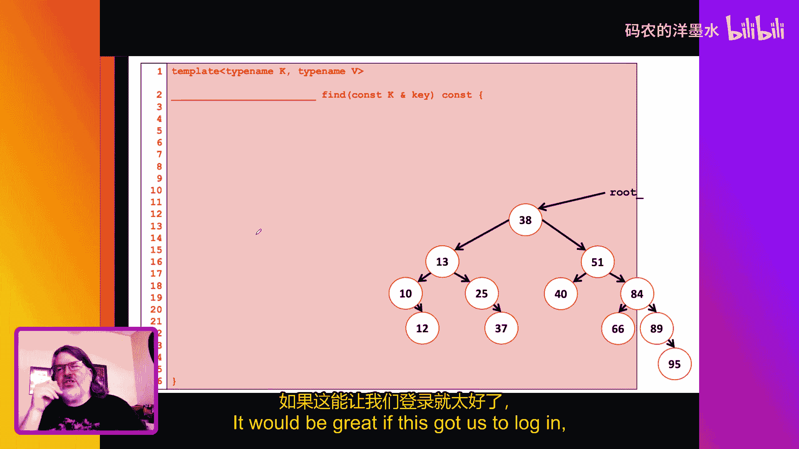

That's still a binary search tree。So。Our binary search tree is not quite perfect。

 but it's a really good place to start。

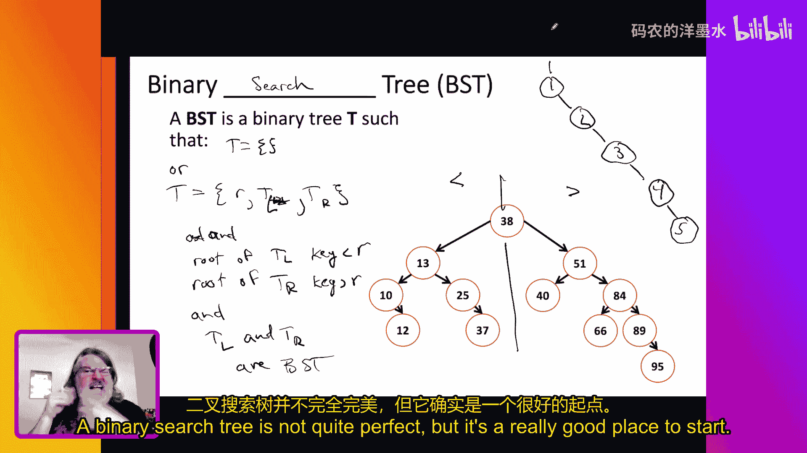

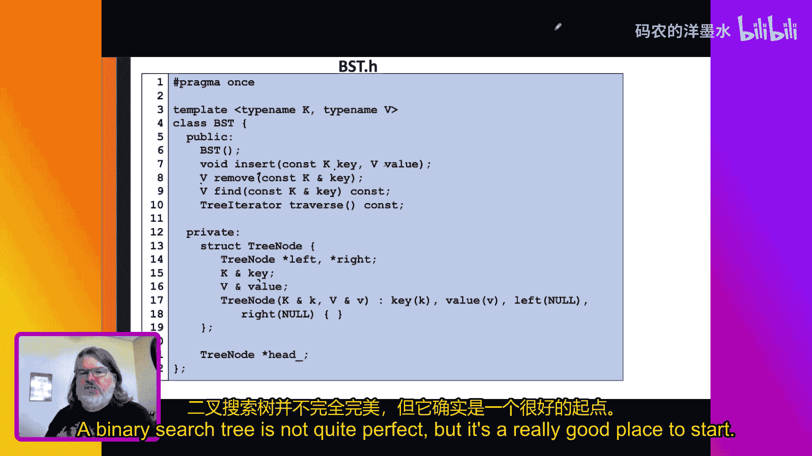

So how does find work？So we're going to start at our route。 and let's say we want to do find。Of。25。

Okay。Find of 25。 So let's see it's going to take a key and it's going to return something。Well。

 I think we probably want a helper function here。So， find。Is going to。Let's see。 It's gonna do find。

So I'm not， I'm intentionally using auto here to hide what finds helper function is going to。嗯。

Do for us。So， okay。So we have our helper function。 Our helper function is taking。In the other order。

It's taking a。Root。And the key。Auto gets its type from what it's initialized。So。

We're taking our root and our key。And now let's start trying to actually write this function。So if。

What's our base case？About what can happen here？What could go wrong。

 What is our base case going to look like。Let's see if root is null。 Yeah， because we've。

 we need to have if root is null。If root。Equals equals null。Right。Or no pointer。What do we do。We do。

Return it seems like the thing to do， right？So now I know。What the type of my function needs to be。

 right？ It needs to be a tree node。Noode。Pointer。A helper functions going to return the pointer。

It is。Okay。So how about a more useful case， What else can we have， We have if。If roots not null。

 we can do stuff like root。Qi。Equals equals。Aqi。Right。Yeah。

 root is a reference to a pointer to a tree node。So if roots key equals key， well。

This is kind of our other base case， right？Because。Writing on slides is inconvenient。Is。Okay。

So kind of our second base case is we've found our node。😡，Okay。So now what's our recursive form？If。

Root。Arrows， key。Is greater than key。Let's see if key if the root is greater than the key。

 that means the key is smaller， so we go left， right？Return。fin。Root。Arrows left。Kma key。Else。Find。

Root。Arrows， right。Ka。😔，Okay。So if the root is larger， we go left， if the root is smaller。

 we go right。Okay。So what do we do， We have to get a little bit of pieces here。 We got to say。

Arrows temp。Arows。Value。But we now need to deal with if。U。Temp。😔，Do that else。Or you turn。No。W。

We're returning a value， so we will return a V constructed by default。Okay。Now。

 could we decide other things， we could instead return an iterator？

What's the point of the find without the underscore？

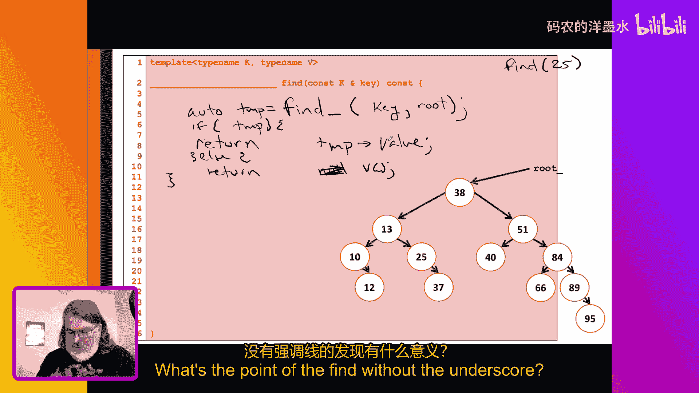

That's the public find， right， as the user of my BST dictionary。I don't know what root is。

 Root or head。 None of this makes any sense to me， right， That's not a publicly available thing。

 I can't call find on route。Root is hidden inside the BST。

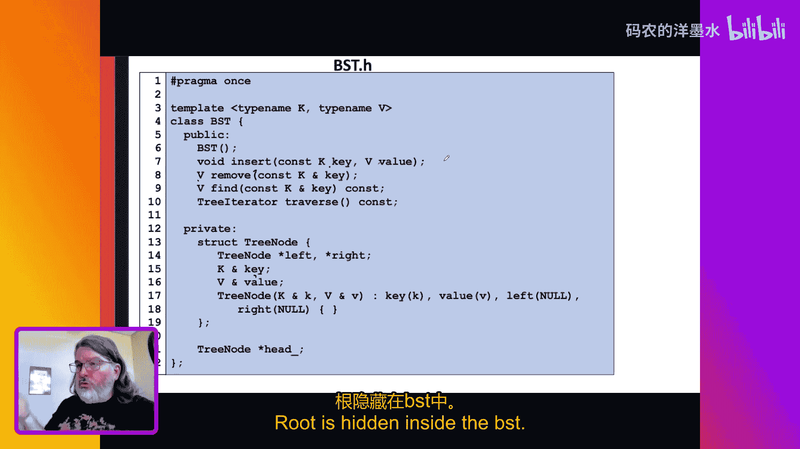

And this outer find。Users。Uses the route internally。Right， our public interface。

Our private interface。Right， so when we're recursive， we almost always。Okay。

Auto will automatically type the。At this point， we are returning a V， right？

We return a default value， right， we're templated， so this constructs a default object of the type V。

 and we return a value。Well， then we would be returning a pointer if we wanted to be able to return null。

 and we don't really want to return a pointer。Auto X5 doesn't quite work because5 is an incomplete type。

When do you need a helper function and when not， well。

 recursively usually we want to helper function because the external doesn't know。

I could instead of saying this， I could say tree， no。Pointer。What does， if temp means， Well。

 if temp is no。Then this is false if it's not nu， it's true。If we cannot find the node in the tree。

 we。Will return the default value。 Yes， auto knows the type returned by。The find helper function。

 What is Vve。 This is calling on the type V， right。A default constructor。

You can always use iteration instead of recursion in a tree because of the way in general heights are controlled。

 recursive solutions tend to be clean and easier to write。In other cases， it's less clear， so okay。

So fine just searches through the tree and finds the correct node with the key。 That is correct。

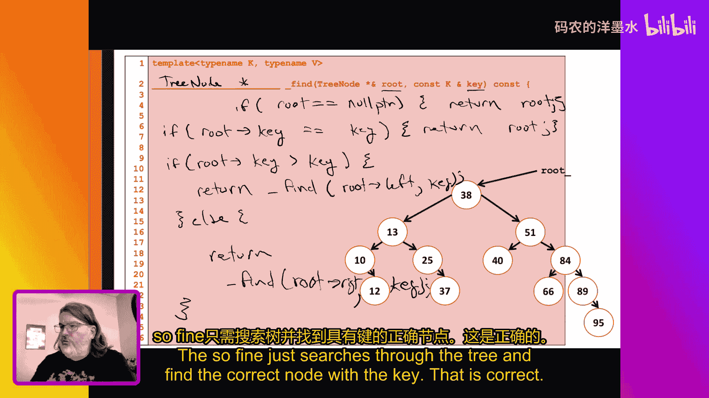

So， if we do our find。Of 25。Well， this is the worst pen ever at the moment。 our find of 25。

 What do we do， We call our helper function。We call 38， 25 is less than 38。 we go down， we call 13。

 13 is。Sorry，25 is less than 38 yes， then 25 is more than 38。 we go launch。

 we compare and we're going to the helper function is going to return。This pointer。Okay。

If we don't find it。So， if we do find。Of say。89。89 is larger than 38 we're now going to be calling on this one and then this one and then this one and we're done。

Okay。So find is pretty easy。What is our running time of find？So is the worst case。

 the height of the tree， Yeah， so our running time of find， the most precise we can give is order H。

Where H is。はい。What？Heightth is kind of internal。 If I don't have access to height， what's the。

Tightest bound I can give for the running time of find。

So if I can't say height and I agree height is the most precise thing I can say， yeah。

 unfortunately as cool as a BST is， the best we can get is N right， because my BST could be a list。

So BSTs are great。So how do we？Now deal with a case of 59。 Well。

 let's talk about the next thing we want to do。 We want to do insert。

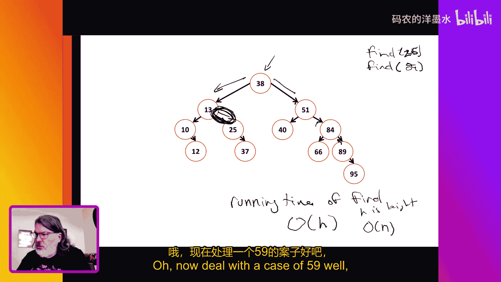

So let's try and figure out how we do insert。😡，How do we do insert？Well， I'm going to propose first。

Two changes to our helper function。Let's go back and look at this helper function Well this is con。

I don't really like that being constant。We probably want a cons version。

 but I'm going to write one that's not cons。And instead of returning a pointer。I'm going to return。

A reference to a pointer。Right？So。I've made one tiny change。

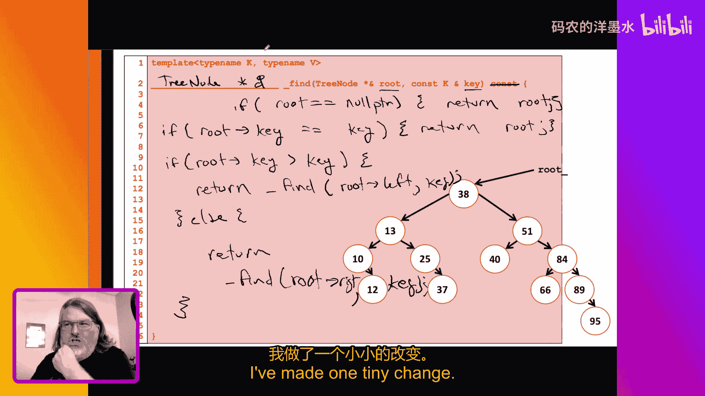

If I did find on this tree。Find。Using my internal helper here， right。And I did find。

 and we'll use the number that somebody was asking。 What about 59。So 59 is not in the tree。

What's going to happen？What is Fs helper going to return？Let's see find is going to do find of 38。

59 is greater than38。 so we go up。Well， I agree the value of what gets returned。

 it's going to be a reference to null。And there are a lot of knolls here。

 So which null is it going to return？Yeah， so it's going to go。59 is greater than 5038。

 it's greater than 51， it's less than 84 and it is less than 66。

 and it's going to return that pointer。That is no。Right， so this is find。Of 59。

Is going to return a reference to that pointer。Well， if I want to insert 59。Where do I put it？Yeah。

So。Right of 51， right of 51 already has 84。 So left of 66 is exactly where 59 has to go， right。

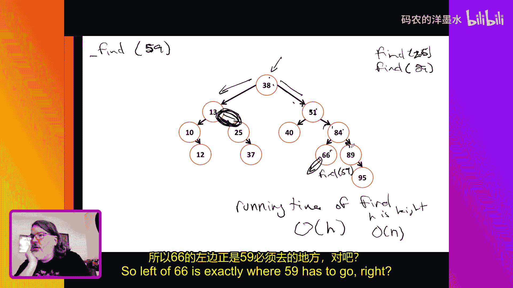

Yeah， so how do I write insert， insert with the assumption that。All keys are unique。Will be。

And we can write this in a couple ways， so I'm going to write this the confusing way first， I think。

Find。Of root。Qi。And we are missing a little bit here。Maiaoyu。value。And percent V that way。New。

Treeode。Inconsistency with our naming scheme。Is the answer。What you think of that？あ。

Insert the helper function takes the root as the first parameter。

 and the key is the second parameter。Public insert doesn't take root as a parameter because public doesn't know about root。

Is find useful on a key that has not been inserted， not particularly as we defined it。

Should we delete the previous node in its place， so we could decide how we want our dictionary to work。

 and there are a lot of different choices here。😡，嗯。That。We。We could make it work。

Such that it was wrong if you inserted the same key twice。

 much like the standard C++ array is wrong if I access out of bounds and it's just terrible or we could make it do something else。

Why would I leak memory？It seems like there's a memory leak If you did it like this。

 What's the memory leak。 Find is going to return。 So if we are doing insert。Shirt。Root。

And this gets called with a usual wrapper， so we're going to insert 27 and some data。

So 27 find is going to return what？I'm not removing a tree node。

If we insert a key that already exists， this will be corrupting。We were trying to insert 27。

 if it in exists， it'll be left。 So find is going to return this pointer。 And what am I doing。

 I'm updating that pointer to point to a new node that is 27。

So find is become this pointer and it can be on the left side， and I allocate a new node here。😡。

And I'm there。If there was a node at that location you replaced it without deleting it。

 I would have a leak if I did it to say 51。 so if I did insert of 51 on this data structure with this thing。

 I would actually lose all of the subtree of 51， wouldn't I So this version of insert。😡。

Only makes sense if you have already guaranteed that the key does not exist in the tree。

Before we called the insert helper function， we could do something to verify that it does not exist。

Yep， we could check if find was no and if it was not nu， we would just do nothing。 We could。

The key for 51 is 51， yes。I'm only writing the keys because the values don't matter， right？

The values are just a box somewhere。 There's a V here， but I don't care。

 The only thing I'm going to write in these trees is the key of the node， because algorithmically。

 the only thing we ever look at is the key。It's the only thing that's interesting from the algorithms。

So I could change this code to make it not corrupt， or I could wrap this code on the outside。

I could change this code to if the key already exists， I could replace it or update it。😡。

Those things are all fine changes， you could imagine。

But I wanted to show writing it this way because this shows something that's a little bit unusual and often bothers students that this function is on the left hand side of an assignment。

Why do we take root as a reference to a pointer here you'll， you'll note we didn't need it。

 did we that I could have written this as a recursive function， right。But， I simplified my life。

If I took it as a reference to a pointer， I could write this whole function recursively。

 right by taking all of the code from find and copying it in to。

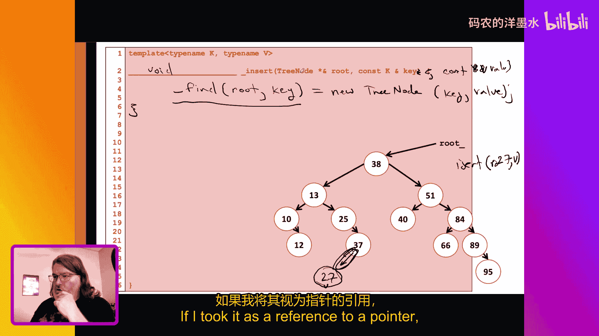

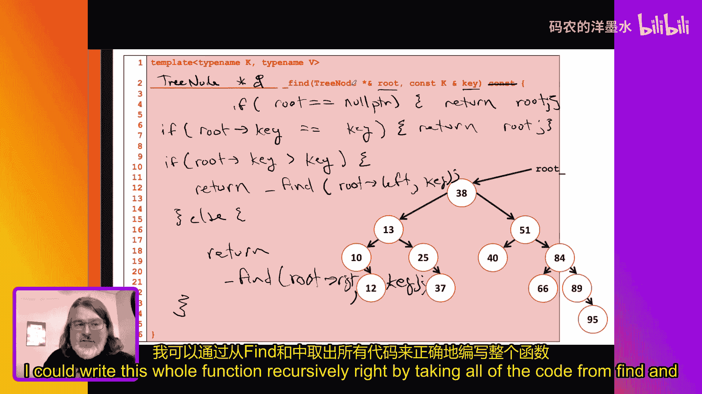

Insert。At which point I would need a reference， So here I don't actually need it to be a reference to a pointer。

 that is a good point。😡。

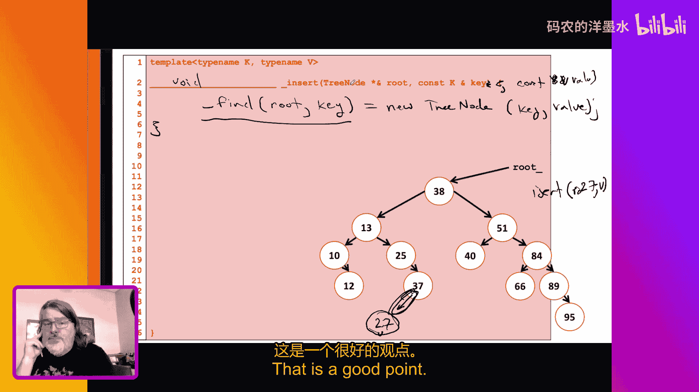

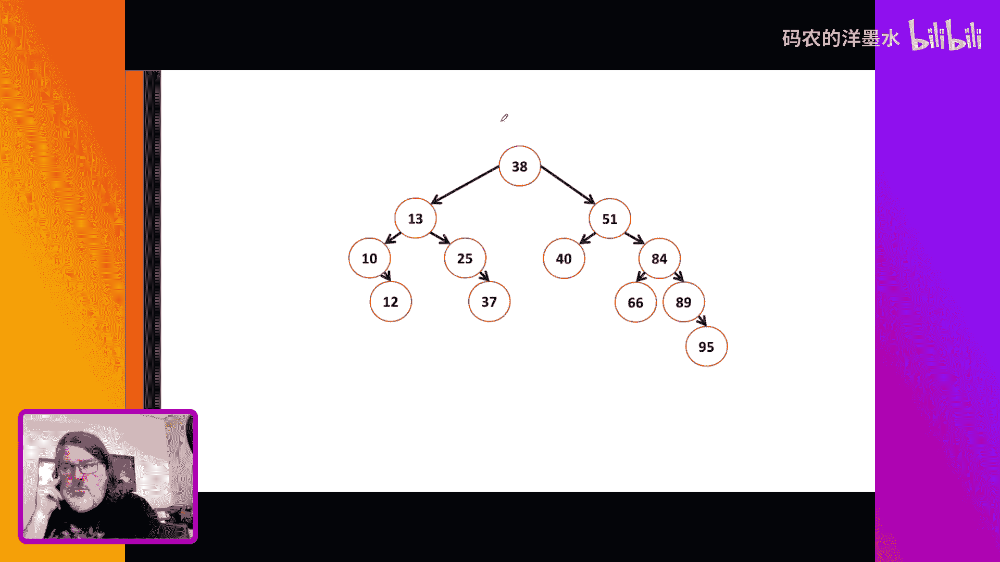

Okay。So inserts pretty easy。If we had kt at the end， we'd not be able to assign a new tree node。

 right， if if there was cont at the end of insert， it wouldn't work。

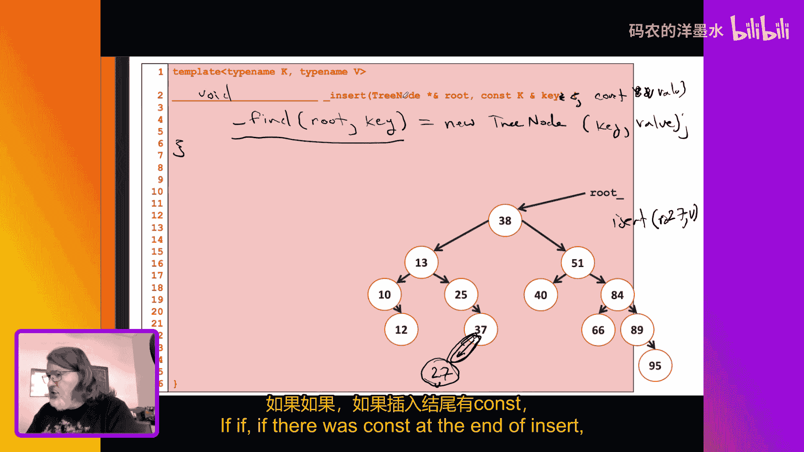

If there is con here， we couldn't return the tree node pointer by reference。😡。

Is using a helper function any slower than writing the code in the original function？😡。

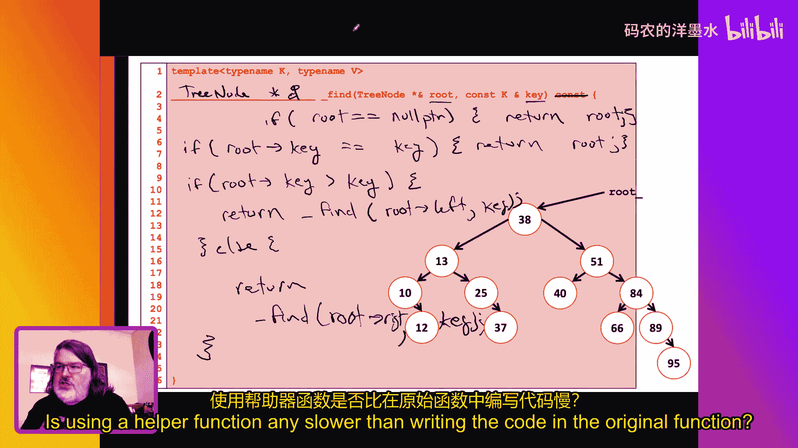

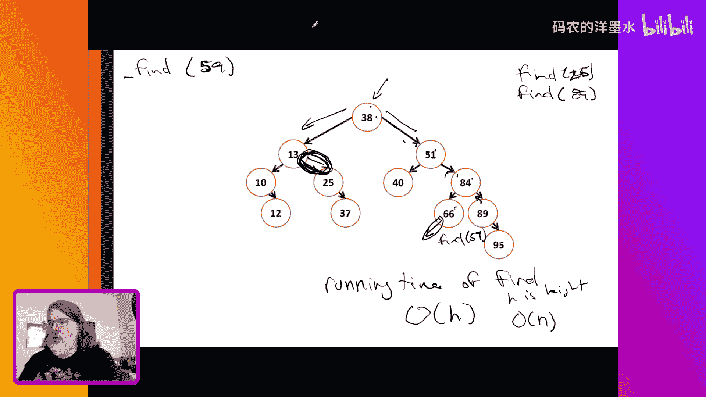

No， effectively。Yeah， remove is pretty easy， but remove。

 I'm going to wait until Wednesday for because remove is going to take a little bit more。

Don't I need to check it？That the node is null。 No， I'm just like， as I said。

 that when we think about an array， right， if we insert into an array index that is not there。Then。

That is an error， an error right。 So if I allocate an array and then I try to insert and to pass the original。

F。Find what is find returning。 Let's walk through。 Find does。

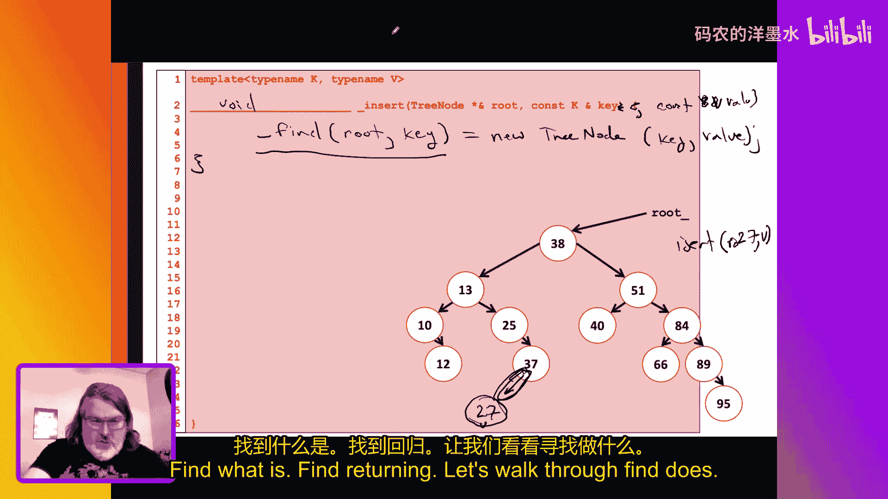

Recursively， start the route。 Let's try it。 We're going to try insert。Of。Let's try 29。

I don't know if that's one I did before。So we call find helper here， find helper says。

The root is not null。29 is not equal to 38， 29 is less than 38， and it calls fines on this pointer。

Find recurs again， it says the root is not null。29 is not equal to 13。

We are going to recurse 29 is greater than 13， so we call recursive find on that。Um。

Find recurs again， says 25 is not null， 25 is great less than 29， so we recurse on this。

The root is not null，2037 is not equal to 29，37 is greater than 29。

 and we return this and insert returns or find returns this pointer。 We change this pointer to be 29。

So what happens， let's look at the broken case。If we did insert。Of， let's say，51。

 because this is going to go badly。So。Insert of 51 says， well， we start on route。

51 is greater than 38。 We have found 51， and it's going to return。This pointer。

 what are we going to do， We are going to change that pointer to now point at a new node 51。给。

We have lost。Leap memory。And lost。All。This。So it's an error。Just as I say。

 like if you have a vector and you try to read the value at 10 plus the end of the vector。

It's going to just crash on you， right， you're going to get a seg fault。And this is the same thing。

Now， could we choose a different method？

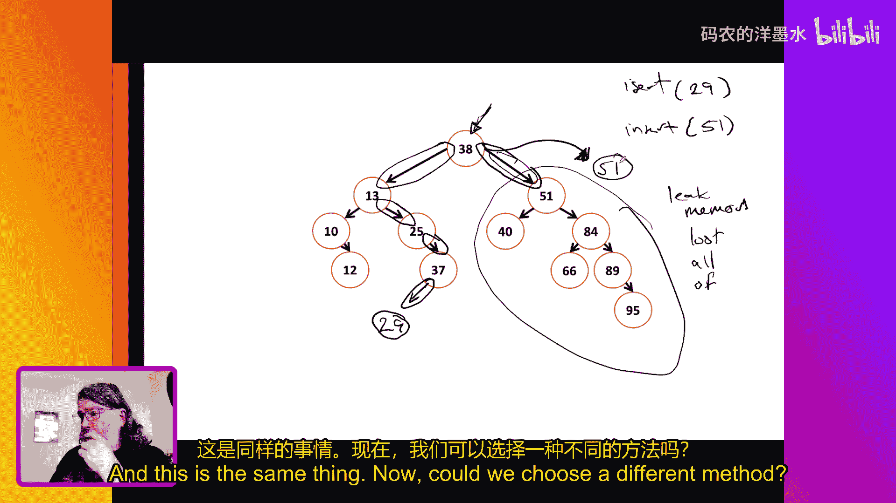

We could， we could update this code to look at find if find is null， we do this， if find is not null。

 we update value。😡，Right？And it all depends on how you define your data structure。

The problem with updating the value is if those values are constant。

 I can't do it easily and then we'll have to talk about replacement and we'll get to that on Wednesday。

 we will talk on Wednesday about removal from the data structure and about how to handle these more complicated cases。

😡。

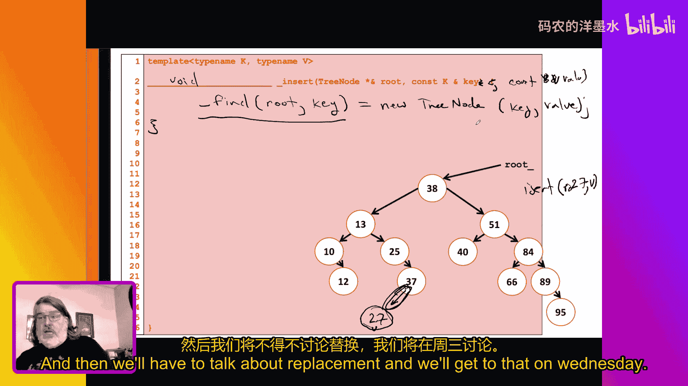

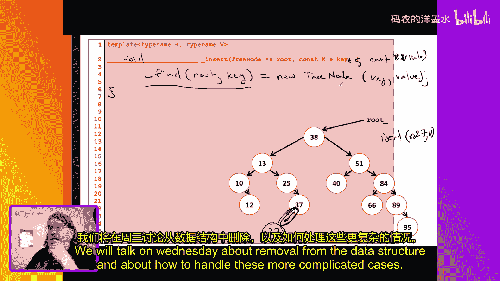

So right now， we know how to do find and we know how to insert。

 So as long as we only add to our dictionary and we only put things in uniquely， we have a。Arguably。

 better dictionary。But not that much。

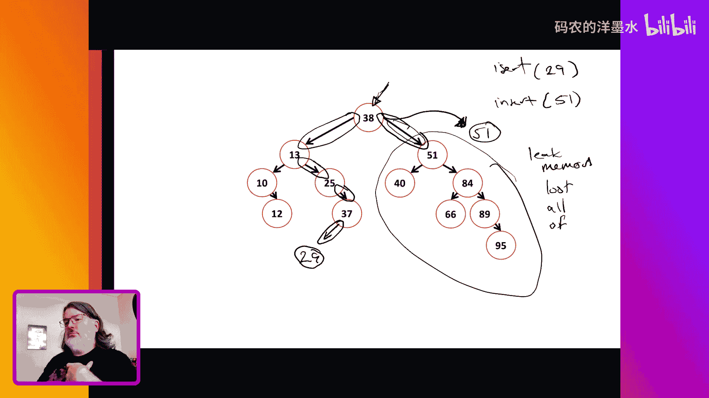