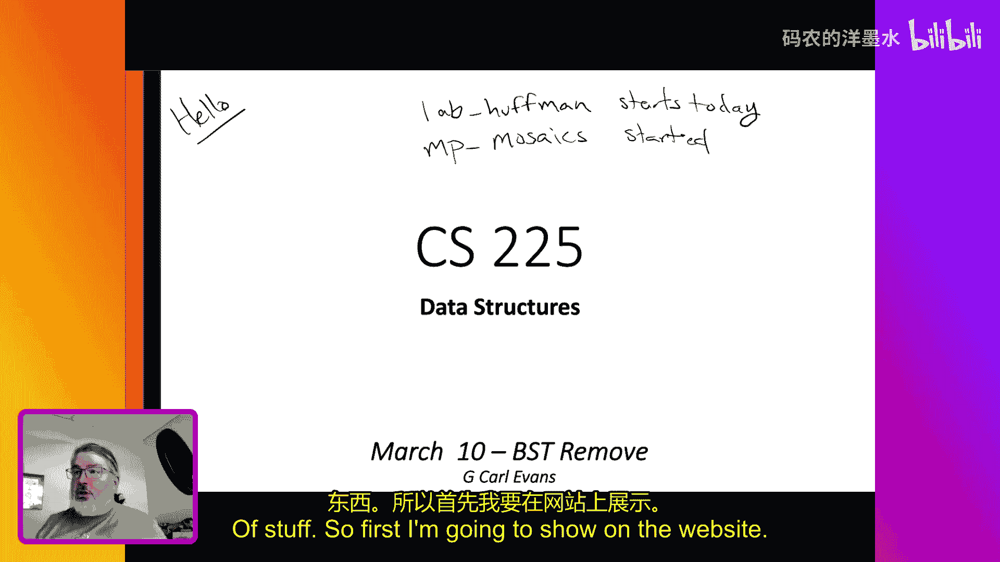

# 【全集】伊利诺伊大学 数据结构与算法 中英字幕 1080P p18 Lecture 18 - 二叉搜索树的删除操作 -BV1t9FHzdEYL_p18-

Great of stuff， so。First， I'm going to show on the website。

We have now released。The final project so there's nothing you have to do right this moment。

 but details of the final project are up， you can look at it and the one thing you have to do fairly soon is either decide that you're just going to get a randomly assigned team or find a team of three to four people that you want to work on the project with so that's。

UIn the answer to the question about 40 points for PTDs and GO。T of the weeks。 Yeah， that is a cap。

 There are about 60 points total。 So I wanted to point out the project because we're getting closer to it。

 It's a while before you would be expected to start really working on it。

 But there's a lot of sort of administrative stuff at the beginning。 So I wanted to point that out。

With that， let's go on to。The rest of the administrative stuff that I have。So there's been a。

Lot of questions。About the MP extensions and such， So I want to clarify that this semester。

 we do not have any automatic 24 hour grace period。

 What we have is on up to two times you can ask for a 24 hour extension to your MP。

 you'll get it automatically。Um， and you u have to get it by sending to CS225 email。

You'll still see the normal deadline run happen and the grading for the extension will happen later how much later I don't know。

 I do promise that it will happen before。Dead to decide what MP you want to have a redo because the other thing we have is a redo。

That had been announced， but not very formally， where on reading day。

 we will be regrading  one MP of your choice。And you'll select that before reading day。

 we'll grade whatever you turned in the last day of class， the day before readinging day。

Whatever's in your repo there we'll grade it and we' update your MP grade to be either your old grade or 90% of your new grade depending on which is worth more。

So we added this chunk here。Because we felt that。It was still rough this semester。So。we go。Yeah。

Any one's going to do it okay， so。The MP redo does not affect extra credit。That's correct。

 We won't be opening the final project survey for a while。Speaking of MP Reds and MP final stuff。

 I have one thing I want to point out that today we have for MP Mosaics。

 which is the new MP that is just started。 We have an AM where they're going to walk through and work through all of the ideas in。

嗯。How to do thismp， thismp， unlike lists。Well， has a fair amount of work has a lot of conceptual stuff and so。

We're going to do that。So。I strongly recommend it if you can't see it tonight。

 it will be posted on MediaSp and Class trascribe right where the other MP was posted I am sorry that it does overlap with some labs there is ended up being nothing we could do about it this time。

😡，We're going to have an EMA for the remaining MPs， I don't think this MP is particularly hard。

 I don't think it's easy， but the remaining MPs are much more conceptual the remaining MPs a lot of the work of the MP is deciding how you're going to write the code so。

😡，It depends on what you think is more challenging coding details， probably detail wise。

 the most complex MP we have is the one you've just finished。

 conceptually probably the hardest MP is mosaics， design probably the hardest MP is mazees and understanding how it works。

 the hardest MP is probably traversals。Okay。With that said。

 let's return to talking about binary search trees。So we talked about insert， right， and we said。

 look， we could do insert by using find and。A reference。And then we could update it。Right so this。

 we walked through how to get insert to work， find would return a reference to root and from that we would be able to go。

Okay。So what about remove？Let's think about remove。Can we write remove？Well。We want to do find。

 right again。And then delete it。Let's see， let's think through remove。

Let's look at what's going to happen in this case。If I want to remove。Noode 40。

So I call remove on the key of 40。Find is going to find the pointer that points at 40， right？

So what do I need to do？We do find。0，40。Then。We have R equals， right？

And then we kind of wanted to delete。R， right， to free the memory up。

And then the last thing we want to do is， yeah， r equals null。So finds really easy， right？Great。

We're done with fine with delete。 That's the whole thing I was going to talk about today。 I've done。

 It's great。Anyone have a different one I should try。Easy if it's a leaf。Yeah。Yeah， so this is。

 this we're also going to call is a zero child。Remove。So it's easy if it's a leaf but。Let's see。

 let's， let's try another one。 Let's use another thing。 So let's see we have a suggestion of 84。

 or I don't want to do 84 just yet。Let's do 25。我。Cause。25， if we did what we did here， right。

 if I found this pointer。If I deleted it。And set it to null， I've got a real problem。Right。

What do we want to do yet， we want to delete 25 and we want 37 to become the child of 13。

 So how do we do this？So let's see again， we're going to have。R equals find。Of 25。

 we still like this。And then。If。Where。Equals or sorry。 If our arrows left equals null pointer。Then。

Delete， then we want to do T。Equals what？Our arrows right。Deleelete。Or。And then R equals T。

Otherwise we want to do the same。So what do we do？Let's do it as a drawing。We want to。

Change this to point to there。And then delete this。Or the other way around。Okay， so this is。

How I sketched out the code。And then we would have a elsesier。So this is the one child case。

Right R is this pointer。I am deleting 25。 I've so stored off 37， and then I point it。

This is just a squrigle。So。Okay。Again， from the drawing， it's pretty clear how it works。

We either store a pointer to where we're going， a store a pointer to what we're deleting。

 and then move up。😡，Here I did is equals equals no pointer under the assumption that I already have decided that I am a one child case。

Again， I'm not trying to give you the code to copy down。Okay。But the process， right。

 so let's say I was going to then delete 12。If I'm going to delete 12。😡，12。

 I'm going to need to save a pointer to 12。 Here's T。Let's do it with 12， we have this。

Then we delete， sorry。12l isn't going to work， 12 is easy。哦。

My brain picked something that was nicely， so let's not do it on 12。Let's do it on 89。

 so let's say we then willll dry this again， we'll do delete。Or remove。Of 89。

I'm not going to try and write the code。We start by find， which gets us this。

We then use that to get T。We delete 89 and we update that to that。1。To。3。Right。

 we we have to to do this， either have already determined we're in a single child and go through the process with single child。

And then we would have else that if the if we know we have a single child， if the left doesn't exist。

 the right must。If we don't know， we have a single child。Right。

 the else would be the only the left child。In our BST definition， we do not allow for duplicate keys。

So， okay。Single child isn't bad， right， you're pulling the thing up， it's pretty straightforward。

Why would we recurse anymore more， We're done。 We've removed the thing we want to。

This will always still be correct， right？Is there any way that this is not correct。

 let's look at another one right， that what does the BST property say？

Because this is the thing to work about。We haven't dealt with a two child yet and a two child we're going to have to think of。

 but this is always going to maintain our correct BST property。Delete on on 38。Again。

 that has two children， right， we can't we don't know how to use that。

But we maintain our B S T property， because。What are we doing， we're pulling the one child。

Of a node up to where the node is。And the BST property guarantees that everything in that sub tree belongs on that side。

 so it is always safe to pull up。Right。So we have T， this update。

And we're always going to still maintain a BST tree。Similarly。

 removing a leaf was always maintaining a BST tree。But there is the two child problem。Apparently。

 people can have two children and we can have two children on our tree。So what do we do here？

What do we do here？We're want to remove 13 in this case。Mam。Make the bigger one the root。

 iss that always going to work， right？But what about？If the child's child has a bigger one。

 this seems really problematic。嗯。So how can we do this。Well， I have a suggestion。Yeah。

 our child might have two children already。Just throw an error。

Well but and then we sort of do some recursively sucking things up， so if we want to remove 38。

 we'll remove put 51 up and then 84 up and 89 up and is that correct？嗯。I don't know。What if？

66 should not be that rightly can't just pull it up。

We're going to have to do some make a whole tree now that algorithm actually works。

 so here's an algorithm， right， we take everything out of the tree。

Throw out the node and put them all back in a new tree right we use traversal。

 we have our traversal system。 So how can we do this。Make a new tree right Okay， that would work。

 What would the running time be of make a new tree？To on。Is an order in？No。

 because we could have them in order， it could be n squared， right？N squared。

 I don't really like n squared remove。So， okay。Let's try and find something that's better than an n squared running time for remove。

You someone's got really close to my suggest what we're going to do。Here's what I want to do。

I only actually ever want to write one child and two child or move Those seem pretty easy to write。

But how can I find a node to swap with？So what I'm going to do is。Instead。

I want to pick a different node that I can put in the place of 13。😡，And once I've done that。

I wanted to remove 13。So I want to swap two nodes， I want to swap 13 with a node that is either a leaf。

Or a child。 Or a one child。How can I know that I can easily and efficiently find one？😡，Well。

What is true of a BS T tree。If we do an in order traversal of a BST tree。What is the order？

In an in order traversal of my BST tree。Are my， yeah， we're in sorted order。So。What do I have？

What is？The thing that I know that I have。I know that I have a node。That is。

An in order predecessor or an in order successor。So。Let's see。If we do 30。13。Can we find that。

 How do we find that？So if we want to find， we want to swap 13 and something else。

 So our thing is find node to remove。You move。That we know how to do。Swap。With。Another node。

 which is either the IO。Or the i O S。So the in order predecessor or the in order successor。

Does this always exist？Let's see， since I have two children， right， I either have to have。

 I must have both an in order predecessor and an in order successor。So I found 13。

I'm going to then swap 13 with either my I O P or my Ios。 How do we do find。IO。What do we do？

The in order predecessor of 13 can be found by。Go。left。Then， right。Weunqu。Right。Is no。So it's left。

 right， right， right， right， right， right， right， right， right， right， right， right or。IOS。By go。

Right。Then。Left， until no。And both of those have to exist， right。

 because this is in the two child case， so I always can at least go left。

 and I always can at least go right。I'm guaranteed to do that。Well， because my left。Right， right。

 right， right， right， or my right， left， left， left， left， left is a node that I can put here。

So take any node。That has two children。What is a node that I can put in that space。

 I can swap 13 with 12， right， if I put 12 year and 13 there， other than 13 that I'm about to remove。

I have a correct binary search tree。If I do it here， let's try with 51。's， I'm going to go right。

 left， left， left， left。 Well， so I go right， left， left， left， left， and I get 66。I could try 25。

 25 doesn't have two。Children， so it doesn't matter， I don't need to do this。If I get。

 so this is the IO P。Of 13。And this is I of 13。So since this is the node that is next in the sequence。

 I can always put it there because I'm getting rid of the node。😡，Right。So I swap them。

I either put 25 up here。 We've done it。 Let's change to black to make this a little bit easier to read。

So I swap the nodes。So I make this 13 a 12。And make this 12 a 13。

And traditionally I do this by pointer manipulation， but I can do that right。

 it's a little bit of a pain， but it's not that much harder than what we were doing with lists。

And I only have to do two nodes， right， I take this node， I replace， I make this point at that。

 I make its children point at what that did and I make this point there。Okay。I swap it。

And then I remove it， What else is true about my in order predecessor and in order successor？

What is another thing that is true？How many children， yeah， it'll have zero or one。Most。Have。

0 or one child。And must exist。In my two child。Well， I already know how to remove a zero or1。

So then I use the code to remove zero or one。Bu。I'm done。So my steps are find the node to remove。

Swamp with the Iop or i。Which must have remove。No。I already know how to remove a zero or a one child。

How am I going to swap the IOP in the head？In order， predecessor。Yin。Order。Predecessor。

Or in order successor。Right， so I'd have a function that knows how to remove a node with a zero or1 child。

I write that as a function。I。Which one do you choose in this class， we will either， if we care。

 willll tell you。But it doesn't matter if it needs to be the IOP and the I。

 there's no correct answer in general。 We will tell you if we care。😡，But they are equivalent。Well。

 what logically does in order predecessor and successor mean Well。

 in order traveral our predecessor or in order to traveral our successor。

 which is since our list is our tree is in sorted order。That's the whole trick。

 So this guarantees that we can remove the node we want。And。

We still get a correct binary search tree。So we know how to remove the zero child。

 that one was really easy。 we just delete and set to null the one child is pretty much the code we did on a linked list。

嗯。And the two child， well， we don't really want to do that， so we swap it。

Is there a situation where in order successor or in order predecessor is preferred？UYes。

 you could choose to do that to try to make the tree nicer shaped。

 but there are other ways you get it。A binary search tree is sorted by definition。

 it could be a list， but a list is then single。Okay， so which is easier to handle。

 but here's the thing。I would argue that if we had a choice。

 we actually want to choose the one child one。Because that makes more things shorter。

Do you swap nodes or individual values Traly the algorithm is described as swapping nodes。

 but you could swap values if that was allowed in your data structure right。

 but values might be really large， what if my values were the class roster。😡，Object and it contained。

 you know， a bigger array。 So it depends in general。

 we swap nodes because that's guaranteed to be efficient。 If you had a specific implementation。

 you could swap values。Because the thing you might likely have is a tree that has indexes that are integers of some sort and has data because remember these trees are implementing dictionaries and all we're talking about here is the keys。

 but we would also have to swap the values and those values could be something large like a PNG。

 so copying that could be really expensive。Okay。So we find the node， find swap with the IOP。

 which is easy to find what's the running time of this algorithm？

Isn't this still order and in the worst case it is。But that's。

But can we give a tighter bound than order in？And orderN is a lot better than our n squared algorithm。

Yeah， this is order H， right？Order。Each。Which at the moment we can only bound to order N。

Because the find goes down the tree。The swap goes down the tree。We don't have a bound that makes H。

Any better than N， but it is order H。Why my tree could look like this， right？ There is no guarantee。

There's no guarantee that my tree is nice and bushy。It's a binary tree。

 but it's there's no guarantee it's perfect or complete or anything else。

 it's just guaranteed that it's a binary tree。But order H is really nice。

UIs it order H because we only want to swap with leaves？嗯。It's still order age because。

I could always have。Find， take order each time， right。

 that I could always have to go to one less than the lowest level of the tree that if my tree was perfect。

 for example， and I was always searching for something that was one near the bottom。

How is it n squared， Well， consider how is recreating the tree n squared？

Removing a node from the tree。Takes order end time， potentially。Right。

 because I could have to always be pulling off a leaf。 in a sense， I always need to。Um。

 and inserting， so imagine if I did an in order traversal。And inserted into a new tree。

 that tree I made would become a list。Can I express H in terms of and order H is less than or equal to order n at the moment。

That's what I can say。There's no logs available yet。 I know a lot of you have seen。 but with trees。

 things are log in and we'll get there。But they're not automatically， not for free。

 we need to do some more work and that's what we're going to be doing later this week and into next week。

But yeah， there's our bound。So let's now talk about more of this。So。What's fine？Well。

The worst case of find is。Order。H， which is。Less than or equal to order。 And we already saw that。

 right。We we'll get to what we need and there are trees that would have such a bound。

 but a perfect tree has a problem， doesn't it？I can only have a certain number of nodes in a perfect tree。

What if I want to store 11 nodes in my binary tree， I can't make a perfect tree with 11 nodes。

So okay， what's the running time of insert？Well， how did our insert algorithm work， it did find。

Right and then it did a constant amount of work。So insert was order H from find and again less than or equal to order n。

Okay。Well， delete we just showed。That the delete did find and then a constant amount of work。

Except for in the two child case where it did find and then kind of did find again。

 so you could argue it was order H plus order H。Order H for the find and order H for the in order predecessor。

 You can actually make an argument that the total running time of find and find in order predecessor is old order H。

 but again， we get order H plus。And what about traversals Well。

 we've seen that all of the traversals we saw the in order pre order， post order traversals。

 level order trariserssals were all order in。But on a traversal， you can't do better than order in。

So what does this tell me？Right now， my binary search tree， my worst case running times。

 have not improved over a list。That's really rough。But。I have a hint。

This chunk tells me if I can make if。If。Trees。Are short。Running time。Fast。

So if I can make the tree short。I can have a good running time。I don't get anything amortized。

So if we could just make our trees short and fat。It would be great。So can we bound Anne okay？

Let's do a little bit of thought。Okay， so。Every operation on a BST that we care about。

Is on the height。So what we want， we really would like to have a way to say that if we can make the height。

Yiuo。If。Height。Ci。Is less than or equal to order log n。

All of a sudden we would have a running time of log in on everything。

Could we build a trinary tree instead of a binary tree。

 I'm not sure what sorted would mean on a trinary tree。

So there are non binary tree data structures and we will see one later。

 but right now let's stick with a binary tree。But we get log in so if we can what we'd like to do is do this。

😡，Well。A number of people have noticed that。The maximum number of nodes in a tree with a height is going to get us the login。

So I'm going to skip forward through some of this because we're not going to do it。All。

 but so the number of nodes in a tree of height H， the maximum number of nodes in a tree of height H is going to be。

So what is our upper bound， our upper bound。So。Our lower bound is。Hite。Is login。

That's as good as we can get。Upper bound， how bad can it fit？Okay。So best case。

Because even if we pack a tree fully， we can't do better than。Logan。Worst case。

A binary tree that is a list is still a binary tree， and that's ordering。Okay。

This doesn't seem very optimistic， does it right， if the best I can do is log in and the worst I can do is in。

 why do I think I can get log in？Ass a running time。That seems a little bit nuts to me。Okay。

Let's think about this。What's the difference between this？

If you have a bunch of trees that are holding the same data。Well。

 pick a good good route is a good start。But。What's the difference between the trees。

I'm going to argue that if nothing else happens。If I put the same data into two binary trees as we've seen。

 we're going to build different structures based on the order。 So if I choose the order。

 let's see what happens。 So if I choose to insert my data as 1，3，2，4，5，6，5，7，6。

 what is this binary tree look like。 Well， we have one。 and then we do insert of 3，3 is larger than1。

 So we insert here， right。We do an insert of two， two is larger than one， it is less than three。

 we insert there。Right。We do an insert of four，1， four is larger than one， four is larger than three。

 we insert there， we do an insert of five，5 is larger than1， it is larger than3， it is larger than4。

 we insert there，6， sorry，7，7 is larger than one， it is larger than3。

 it is larger than4 it is larger than5， we insert there。We do a six， larger than one。

 larger than three， larger than four， larger than five， less than seven， we do a six。Okay。

So that's not a very nice tree， is it， it kind of looks about like a list with sort of some little stuff dangling off。

Let's try this other tree。Well we insert four。Two is less than four， so we insert here。

 three is less than four， but more than two， we get this one。We do an insert of six。

 six is more than four。We do an insert of seven， seven is more than four is more than six。

We do an insert of one， less than four， less than two， we do an insert of five， more than four。

 less than six。Hey， this is beautiful。So。If we could just control。

The order that stuff works gets inserted in。We'd be great。

But how many different orders are there and right we don't control who's adding stuff to our tree。

How many different orders are there that you can insert into a binary tree？And factorial。Wow。Yeah。

 so the concrete tree we did was seven factorial， but in factorial different orders。Okay。

So our next question is。Yeah， how many with height log n。

 how many with this is hard we could do it with strict counting。

 but we would need kind of sort of a probabilistic proof。

UThe techniques to do this proof are beyond the expected math for this class。But we can say what is。

 but people have shown that， in fact， the average height is。On the order of log in。

Why is it in factorial orders？We can put one。Through n is the first thing we insert。

 then there are n minus one things to insert second choice。

 n minus-2 to insert third n minus-3 to insert third。 Yeah。

 that that should be coming from your your discrete math prerequisite。

 but it's worth remembering right， we have n choices for the first n minus1 for the second n minus2。

This one we're not doing the proof of。But it turns out people have。So if the data is random。

We're going to get an expectation of height login。So that's pretty cool。Pretty cool。

So now all we have to do is make sure that our data is inserted randomly。Isn't log n the best， it is。

That's pretty amazing。So。Let let's do a little bit more intuition of， isn't login the best。

 How many different trees。Let's think about how this this result happens。 How many different。

Sequences are going to end up with。A height of 7。Or of an。Only two， right。

 either all getting larger or all getting smaller。There are only two。

 how many different sequences can end up with the height of loggan？A lot， right。

 if we start with the first thing being the middle of the tree。

This whole subt and this whole subt could be any shuffling。I don't care once I've inserted four。

I don't care。How six， seven， and five are inserted relative to two，3， and one。

So any shuffling of these chunks？Is completely independent。So I could go2，6，3，7，1，5。

 I get the same one。 I could do4，6，2，3，7，1，5。 I could do right。

 this six only cares about being in front of five and7。We only care about the compared order， right？

Yeah， so if we have all the data up front， yeah， quick select gets you what you want。

So if our dictionary is built once and read a lot， we can actually guarantee we get an optimal tree。

 right？😡，That's actually a really cool idea that we can use click Selectlect。

 which we're asking you to write on the MP to pick the media value， do that。

And then do that on both sides and keep doing this。 It'll take log n time。

But then you have a perfect treat。So if you have all your data up front。

 you can build this tree that is optimal height every time。

But we want to deal with cases where we don't want to deal with。um。Yeah。

 we can make an optimal tree in analog log end time。Absolutely。

There are a lot of ways we could do that。We can make an optimal tree in analog log end time。

But that's only if we have all the data ahead of time。😡，When you write a program。

 do you know everything people are going to put into it？No。

So we also want to work in a dynamic situation where the person using our data structure is not telling us everything they're going to insert into it ahead of time。

 just like we want to be able to have by dynamic arrays。😡，And on Friday。

 we're going to talk about what do we have to do to guarantee that this average happens all the time？

So that's what I got for today。We now know how to make a binary search tree and if we're lucky。

Things work out。We can use the code that we sort of work through， and we have a data structure that。

If we're lucky， gets us there， but we don't like having to be lucky。We want to be good。

And on Friday and next week， we're going to talk about how to show what we have to do to guarantee we are always good。

😡，I think it's useful if you do not have a lab would I would really encourage you to go to it。

 on the other hand it'll be recorded and this one we will get up early so the AMA I think is really useful。

 it helps you think about what has to happen and it'll get up there but we will get it posted soon。😡。

We are going to change the tree structure as。We insert， it's at seven today。So the AMA。

ThereIt's at 7 PM today， and。I recommend trying to go to it。Why is the lower bound best case？Log in。

 think of the height of a perfect tree with end nodes。

