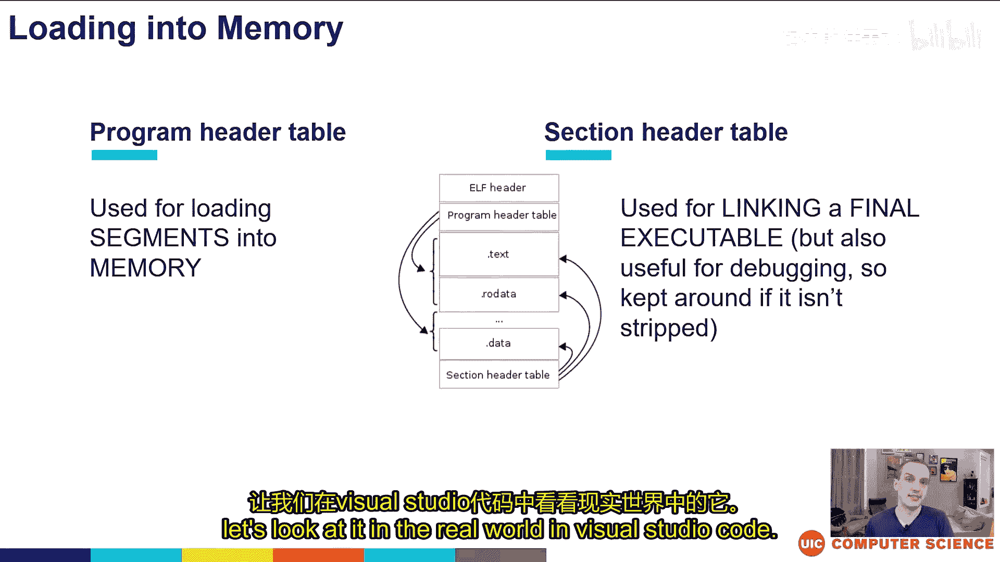
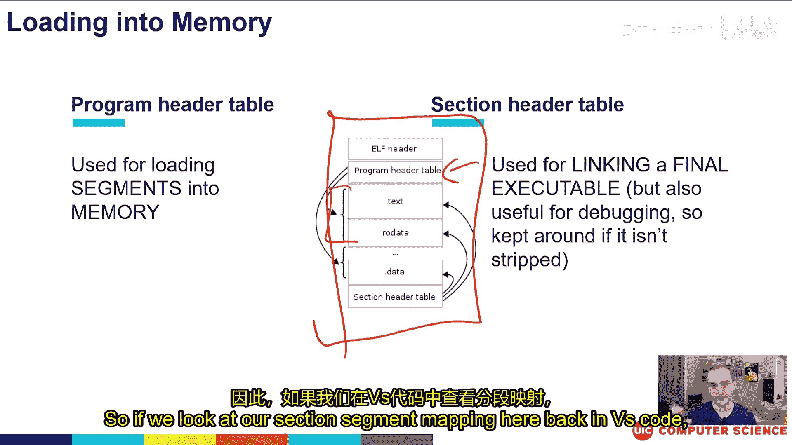
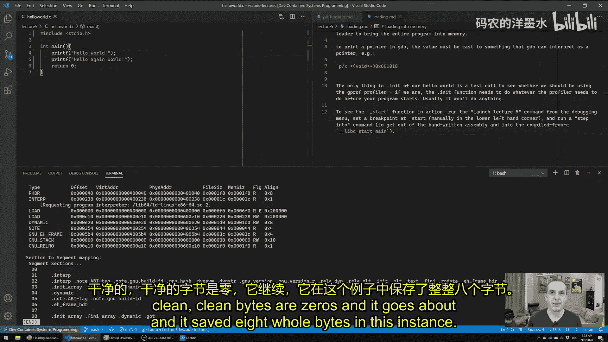
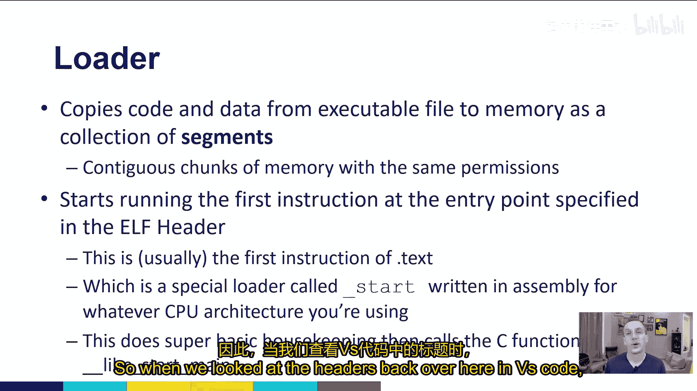
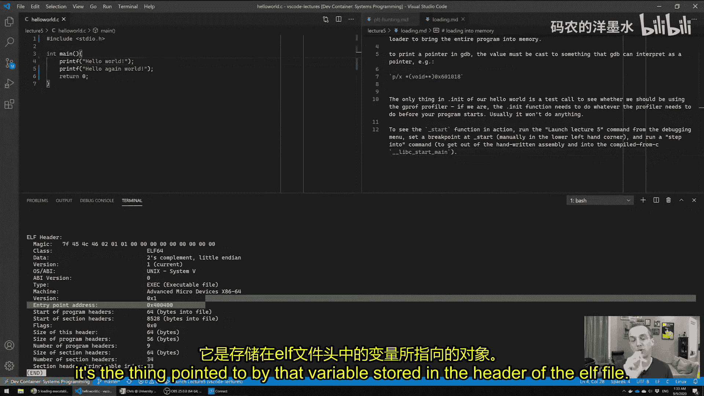
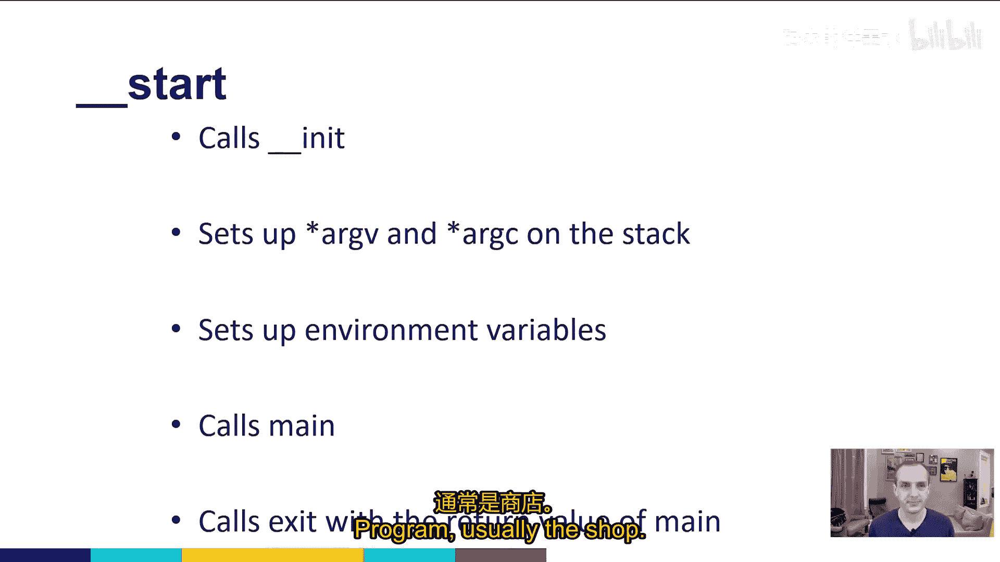
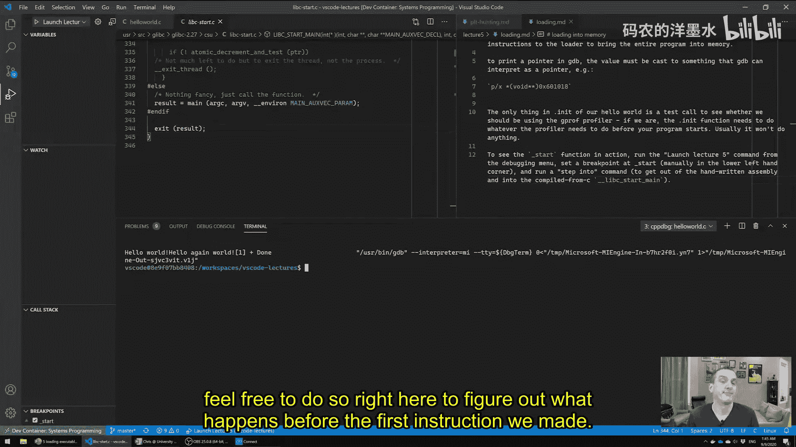
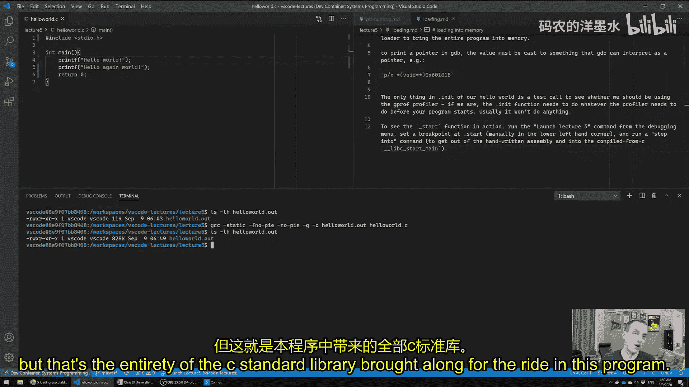
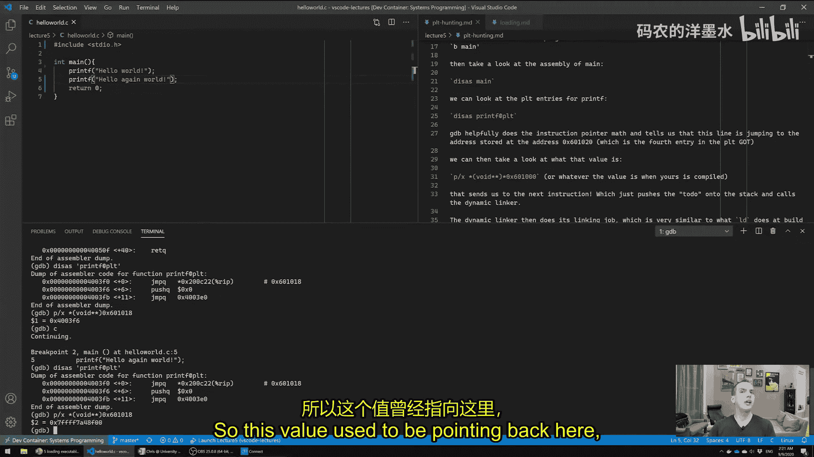
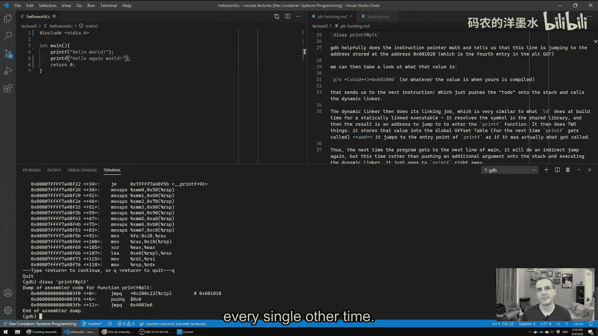

# 001：动态链接原理 🖥️

在本节课中，我们将学习可执行文件如何从磁盘加载到内存中运行，并深入探讨现代程序加载的核心机制——动态链接。我们将了解静态链接与动态链接的区别，以及动态链接库如何通过位置无关代码、全局偏移表和过程链接表等技术实现高效、灵活的代码共享。

## 从磁盘到内存的加载过程

上一节我们介绍了课程概述，本节中我们来看看可执行文件从磁盘加载到内存的具体过程。



当程序存储在磁盘上时，它遵循 **ELF**（可执行与可链接格式）文件格式。这个格式规定了如何将磁盘文件中的一系列字节，转换成一个正在运行的进程内存空间中不同位置的一系列字节。最重要的区别在于，磁盘文件中的字节是紧密排列在一起的，而加载到内存后，它们会被放置到进程地址空间中非常分散的不同段里。

一个核心概念是**地址空间**。即使我们有从0到2^48-1的巨大地址范围，我们也不会实际使用每一个地址来存储数据。实际上，只有当前正在使用的部分（在幻灯片中显示为灰色区域）才会被加载到计算机的物理内存中，其余部分暂时并不存在。

加载器（loader）的首要任务是解析ELF文件，确定需要将文件的哪些段（segments）加载到运行进程内存空间的哪些地址上。这个内存布局通常被称为**内存映像**（memory image），它包括向下增长的栈、向上增长的内存映射区和堆等区域。


## 解析ELF文件头



上一节我们了解了加载的宏观概念，本节中我们来看看加载器如何通过解析ELF文件头来获取加载指令。

让我们通过一个简单的“Hello World”程序来实际观察。使用 `readelf` 命令可以查看ELF文件的头部信息，这些信息指导加载器工作。







以下是查看程序头（Program Headers）的命令，它列出了需要从文件加载到内存的各个段：

```bash
readelf -l hello_world
```

输出会显示多个程序头。例如，第一个可加载段指示加载器：从文件偏移量0开始，读取 `0x6f0` 个字节，并将其放入新进程内存地址 `0x400000` 处，并标记为**可读且可执行**。这通常就是程序的代码段（.text）。



另一个段指示从文件偏移 `0xe10` 开始，读取 `0x220` 字节，但实际在内存中分配 `0x228` 字节的空间，起始地址为 `0x601e10`。多出来的空间是为 **.bss** 段预留的，该段用于存储未初始化的全局变量，在文件中不占空间，但在内存中需要被分配并初始化为零。

ELF文件中包含两种重要的表：
1.  **程序头表**：指导加载器如何将文件段映射到内存段。
2.  **节头表**：描述了ELF文件内部的各种节（sections），如 `.text`（代码）、`.data`（已初始化数据）、`.bss`（未初始化数据）等。链接器（如GCC）关心这些节，但加载器只关心如何加载整个程序头指向的段。

## 程序的启动：_start 与 __libc_start_main

上一节我们看到了如何将程序加载到内存，本节中我们来看看程序加载后是如何开始执行的。



在ELF文件头中，有一个关键的字段叫做**入口点地址**。这是操作系统将控制权转交给新进程时，第一条要执行的指令的地址。通常，这个地址指向一个名为 `_start` 的函数。

`_start` 是一个用汇编语言写成的、与平台相关的非常简短的代码。它本身并不执行用户逻辑，其主要职责是调用C语言库中的 `__libc_start_main` 函数。`__libc_start_main` 则会进行一系列初始化工作：


*   设置 `argc` 和 `argv`（命令行参数）。
*   设置环境变量。
*   调用全局初始化函数（如果存在，例如用于性能分析工具的初始化）。
*   最终，调用我们编写的 `main` 函数。
*   当 `main` 函数返回后，`__libc_start_main` 会进行一些清理工作，并将 `main` 的返回值传递给操作系统（通常是shell）。



通过调试器，我们可以观察到这一过程：在 `_start` 处设置断点，单步执行就会进入 `__libc_start_main`，并最终跳转到我们自己的 `main` 函数。

## 为何需要动态链接？

上一节我们追踪了程序的启动流程，本节中我们来探讨静态链接的局限性以及动态链接的必要性。

在静态链接中，所有库函数（如 `printf`）的代码都会被直接复制到最终的可执行文件中。这带来一个明显的问题：**空间浪费**。

例如，一个简单的动态链接的“Hello World”程序可能只有约11KB。而如果将其静态链接，由于需要包含整个C标准库的代码，其大小会膨胀到约828KB。如果系统上每个使用C库的程序都这样做，将极大地浪费磁盘空间。

更严重的是内存浪费。当多个静态链接的程序同时运行时，它们各自的内存中都有C标准库的完整副本，无法共享。这不仅消耗了大量物理内存，也挤占了宝贵的CPU缓存空间，导致程序运行变慢。

动态链接的核心思想就是**共享**。将常用的库（如C标准库）编译成独立的共享库文件（在Linux上是 `.so` 文件）。多个程序可以映射到内存中的同一份共享库代码，从而节省磁盘和内存空间，并提高缓存利用率。

## 动态链接的挑战与解决方案：位置无关代码

上一节我们认识了动态链接的优势，本节中我们来看看实现动态链接所面临的首要挑战及其解决方案。

挑战在于：一个共享库（例如 `libc.so`）可能被不同的程序加载到各自内存地址空间中的**任意位置**。库内部的代码（`.text`）在编译时并不知道自己最终会被放在哪里，但代码中可能包含访问自身全局变量（`.data` 或 `.bss`）的指令。如果使用绝对地址，一旦加载位置改变，这些指令就会指向错误的地方。

解决方案是使用**位置无关代码**。PIC的核心思想是：代码段中所有对内部数据或函数的引用，都使用**相对于当前指令指针**的偏移量来计算，而不是使用绝对地址。因为无论库被加载到何处，其代码段内部各指令之间、代码段与数据段之间的相对距离是固定不变的。

通过编译器选项（如 `-fPIC`）可以生成位置无关代码。这样，共享库就可以像“乐高模块”一样，被灵活地放置到进程地址空间的任何位置而正常工作。

## 处理外部引用：全局偏移表

上一节我们解决了共享库内部的引用问题，本节中我们来看看共享库如何访问其他库或主程序中的全局变量。

位置无关代码解决了内部引用，但共享库还需要访问外部的全局变量（例如，一个数学库可能需要访问 `errno` 这个在C库中定义的全局变量）。问题在于，编译共享库时，我们无法知道这些外部变量最终会在宿主程序的哪个地址。

解决方案是引入一个间接层：**全局偏移表**。GOT位于共享库自己的可读写数据段中。对于每一个需要引用的外部全局变量，GOT中都有一个对应的条目。

其工作原理如下：
1.  在编译共享库时，所有访问外部变量的指令都被修改为：**“去GOT中第X个条目里取出地址，然后访问那个地址指向的内存”**。
2.  在程序加载时，动态链接器（`ld-linux.so`）会计算出所有外部变量的实际地址，并填写到GOT的相应条目中。
3.  这样，当库代码运行时，它通过GOT间接地访问到了正确的变量。


这个过程发生在**加载时**，因为此时所有模块（主程序、各个共享库）都已确定在内存中的位置，动态链接器可以完成最终的地址解析。

## 延迟绑定：过程链接表

上一节我们了解了如何解析全局变量，本节中我们来看看动态链接中最精妙的部分——函数调用的延迟绑定。

对于函数调用，我们同样面临外部引用的问题。一个朴素的方案是在加载时像处理变量一样，通过GOT解析所有外部函数的地址并填好。但这存在效率问题：一个共享库可能包含数百个函数，而一个程序可能只调用其中的几个。在启动时就解析所有函数地址是一种浪费。

动态链接采用了**延迟绑定**策略：将函数地址的绑定推迟到该函数**第一次被调用时**。这通过**过程链接表**和GOT的协作来实现。

以下是PLT的工作机制：
1.  当程序第一次调用 `printf` 时，它实际上跳转到 `printf@plt`（PLT中的一个条目）。
2.  `printf@plt` 的第一条指令是跳转到 GOT 中对应 `printf` 的条目所存储的地址。**在第一次调用时，这个地址默认指向 `printf@plt` 条目中的第二条指令**。
3.  接着，`printf@plt` 会将一个代表 `printf` 的标识符压栈，然后跳转到 `PLT[0]`（一个特殊的条目，它会调用动态链接器 `ld-linux.so`）。
4.  动态链接器根据栈上的标识符，找到 `printf` 在内存中的实际地址，然后**用这个真实地址覆盖掉 GOT 中对应 `printf` 的那个条目**。
5.  最后，动态链接器跳转到 `printf` 的真实地址开始执行。
6.  此后，任何对 `printf` 的调用，都会再次走到 `printf@plt`。但此时，GOT 中存储的已经是 `printf` 的真实地址。因此，`printf@plt` 的第一条指令会直接通过 GOT 跳转到真实的 `printf` 函数，无需再经过动态链接器。




这种设计的精妙之处在于**“使常见情况快速”**。函数在第一次调用后，后续所有调用都只需一次间接跳转，速度极快。而“第一次调用”这个不常见的情况，则承担了地址绑定的开销。

## 总结

本节课中我们一起学习了可执行文件的加载与动态链接原理。

我们从ELF文件格式出发，了解了加载器如何将磁盘上的程序段映射到进程的内存空间。我们探讨了静态链接导致的空间浪费问题，从而引出了动态链接的必要性。

为了实现动态链接，我们学习了三项核心技术：
1.  **位置无关代码**：使共享库能被加载到任意地址。
2.  **全局偏移表**：通过间接访问解决外部全局变量的地址引用问题，绑定发生在加载时。
3.  **过程链接表**：实现函数调用的延迟绑定，将函数地址解析推迟到第一次调用时，极大地优化了程序启动性能和内存使用。



动态链接是操作系统和编译工具链协同工作的一个经典范例，它通过在复杂度与性能、空间效率之间取得平衡，为现代软件的高效运行奠定了基础。