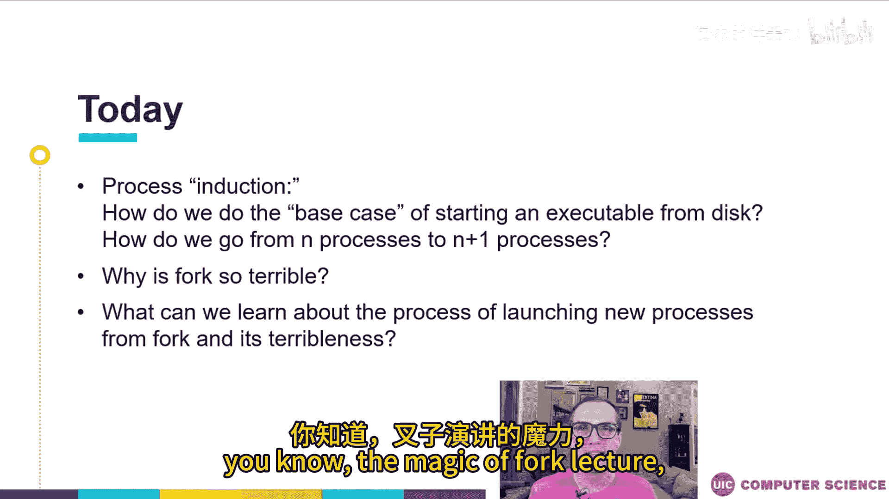
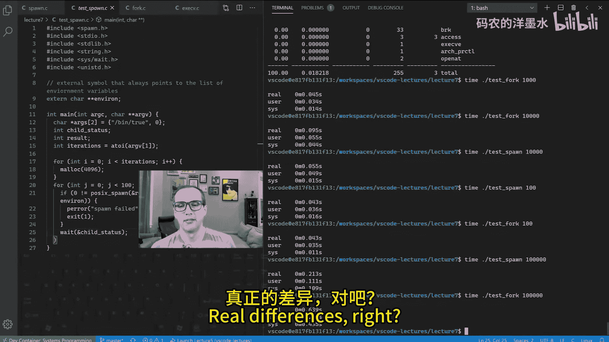

# 005：进程创建进阶 🚀

在本节课中，我们将学习如何在操作系统中创建新的进程。我们将从最简单的程序替换开始，逐步深入到更复杂的进程创建方法，包括 `fork` 和 `posix_spawn`。我们还将探讨这些方法背后的核心概念、它们的工作原理以及各自的优缺点。通过本节课，你将理解如何从一个进程衍生出多个进程，并掌握在Unix/Linux环境中创建和管理进程的基本工具。

---

## 进程与执行上下文回顾

上一节我们介绍了进程的基本概念，本节中我们来看看进程创建的具体方法。



进程是独立的执行上下文。它们被调度在CPU上运行指令，用于支持多用户、多任务，并允许操作系统和程序员将任务分解为独立的执行单元。

进程拥有自己的状态，包括：
*   **内存布局**：存储可执行代码、全局变量、堆和栈。
*   **执行上下文**：由寄存器和栈定义，记录了程序的执行历史。
*   **操作系统配置**：包括打开的文件、信号处理程序等元数据。

现代Linux操作系统采用**抢占式调度**。内核设置一个定时器，在时间片用完后，无论用户级代码是否自愿让出CPU，内核都会接管并决定下一个运行的线程。

这里需要区分几个术语：
*   **线程/执行上下文**：指一个独立的控制流。
*   **进程**：包含一个线程/执行上下文、其内存布局以及操作系统级别的配置（如信号处理）。进程封装了执行上下文，但概念上略有不同。

---

## 程序替换：`exec` 家族

在深入创建新进程之前，我们先看看如何将一个正在运行的程序**替换**为另一个完全不同的程序。这是进程“归纳”中的基础情况。

`exec` 系列系统调用用于此目的。最基本的版本是 `execv`。

```c
#include <unistd.h>
int execv(const char *pathname, char *const argv[]);
```

它的作用是：用名为 `pathname` 的新程序，**完全替换**当前进程的代码、数据、堆和栈。新程序从它的 `main` 函数开始执行。

以下是 `execv` 的关键特性：

*   **参数传递**：`argv` 是一个以 `NULL` 结尾的字符串指针数组，类似于 C 程序的 `argv`。它允许向新程序传递任意数量的参数。
*   **环境继承**：默认情况下，新进程会继承父进程的环境变量。也可以使用 `execve` 指定新的环境。
*   **成功不返回**：如果 `execv` 成功，它**永远不会返回**到调用它的代码，因为原进程的上下文已被完全替换。
*   **失败处理**：只有失败时（例如，指定的可执行文件不存在），`execv` 才会返回，返回值是 `-1`，并设置全局变量 `errno` 来指示具体错误。

检查 `exec` 调用失败的标准模式是使用 `perror`，它能将 `errno` 的值转换为人类可读的错误信息。

```c
if (execv("/bin/echo", args) == -1) {
    perror("execv failed");
    // 处理错误
}
```

**总结**：`execv` 替换当前进程，不创建新进程。若成功，永不返回；若失败，通过 `errno` 报告错误。

---

## 创建新进程：`posix_spawn`

上一节我们介绍了如何替换当前进程，本节中我们来看看如何创建一个全新的、独立的进程。`posix_spawn` 是一种更直观的方法。

`posix_spawn` 函数创建一个新的进程，并让其执行指定的程序。父进程和子进程是独立的，同时运行。

```c
#include <spawn.h>
int posix_spawn(pid_t *pid, const char *path,
                const posix_spawn_file_actions_t *file_actions,
                const posix_spawnattr_t *attrp,
                char *const argv[], char *const envp[]);
```

对于初学者，我们主要关注以下参数：
*   `pid`：指向一个变量的指针，创建成功后，该变量会被填入**新子进程的进程ID**。
*   `path`：要执行的可执行文件路径。
*   `argv`：传递给新程序的参数列表（类似 `execv`）。
*   `envp`：传递给新程序的环境变量列表。

创建新进程后，父进程通常需要等待子进程结束，这通过 `wait` 系统调用实现。

```c
pid_t child_pid;
int status;
// 创建子进程执行 /bin/echo
posix_spawn(&child_pid, "/bin/echo", NULL, NULL, argv, environ);
// 父进程等待子进程结束
waitpid(child_pid, &status, 0);
```

**工作原理**：`posix_spawn` 在内部通过一系列系统调用（最终是 `clone`）创建新进程，设置其内存空间，然后让其执行 `exec` 来加载目标程序。父进程和子进程有各自独立的内存空间。

这种方式与Windows的 `CreateProcess` 思路类似：告诉系统“创建一个新进程，并直接运行这个程序”。

---

## 传统的进程创建：`fork`

最著名但也最令人困惑的Unix进程创建方式是 `fork`。它的核心特点是：**调用一次，返回两次**。

```c
#include <unistd.h>
pid_t fork(void);
```

当 `fork()` 被调用时，操作系统会创建当前进程的一个**几乎完全相同的副本**。这个副本称为子进程。从 `fork()` 返回的那一刻起，系统中就存在两个独立的进程：父进程和子进程。

以下是 `fork` 的关键行为：

*   **返回值区分角色**：
    *   在**父进程**中，`fork()` 返回**新创建的子进程的进程ID**。
    *   在**子进程**中，`fork()` 返回 **0**。
    *   如果创建失败，`fork()` 返回 **-1**。
*   **状态复制**：子进程获得父进程当时状态的**独立副本**，包括：
    *   完全相同的内存内容（代码、数据、堆、栈）。
    *   相同的程序计数器（即将执行 `fork()` 后的下一条指令）。
    *   相同的打开文件描述符表、文件系统状态、信号处理设置等。
*   **写时复制**：为了提高效率，现代系统使用**写时复制**。父子进程最初共享物理内存页，只有当任一进程试图修改某个内存页时，系统才会为该进程创建该页的独立副本。这使得 `fork` 通常很快。
*   **执行顺序不确定**：`fork()` 返回后，父进程和子进程谁先被操作系统调度执行是**不确定的**。不能依赖任何观察到的顺序。

一个典型的 `fork` 用法模式是：在子进程中调用 `exec` 来运行一个新程序，在父进程中等待子进程结束。

```c
pid_t result = fork();
if (result == -1) {
    perror("fork failed");
    exit(1);
} else if (result == 0) {
    // 子进程：运行 /bin/echo
    execv("/bin/echo", argv);
    perror("execv failed"); // 只有execv失败才会执行到这里
    exit(1);
} else {
    // 父进程：等待子进程
    waitpid(result, NULL, 0);
}
```

**`fork` 的问题**：虽然功能强大，但 `fork` 的语义复杂。它复制了整个地址空间，但最常见的用途（紧跟着 `exec`）却会立即丢弃这个副本，造成不必要的开销。此外，在复制状态下运行自己的代码两份，容易引入逻辑错误。

---

## 底层机制：`clone` 系统调用

无论是 `fork` 还是 `posix_spawn`，在现代Linux中，其底层都通过一个更通用、更可配置的系统调用 `clone` 来实现。

`clone` 允许精细控制新进程（或线程）与父进程共享哪些资源。

```c
#define _GNU_SOURCE
#include <sched.h>
int clone(int (*fn)(void *), void *child_stack,
          int flags, void *arg, ... /* pid_t *ptid, void *newtls, pid_t *ctid */ );
```

`flags` 参数是一系列选项的位掩码，决定了共享行为：
*   `CLONE_VM`：父子进程共享同一个内存地址空间（用于创建线程）。
*   `CLONE_VFORK`：父进程被挂起，直到子进程调用 `exec` 或 `exit`。
*   `CLONE_FILES`：共享文件描述符表。
*   等等。

**`fork`, `posix_spawn` 与 `clone` 的关系**：
*   `fork()` 相当于调用 `clone()` 时使用一系列默认标志（不共享内存，不挂起父进程），从而创建具有独立内存空间的子进程。
*   `posix_spawn()` 在实现时，可以使用 `CLONE_VM | CLONE_VFORK` 等标志调用 `clone()`。这创建了一个与父进程**共享内存**的子进程，并**立即挂起父进程**。然后子进程立即调用 `exec()`，在替换自己内存空间的同时，也解除了对父进程的挂起。这种方式避免了复制大量用不到的内存，效率更高。

`clone` 是Linux特有的，提供了极大的灵活性，是实现容器（如Docker）等技术的基础。

---

## 性能比较与实践建议

为了理解不同方法的效率，我们可以进行简单的性能分析。

考虑一个场景：一个进程已经分配了大量内存（例如，通过多次 `malloc`），然后它需要多次创建子进程来运行一个简单命令（如 `/bin/true`）。

以下是核心发现：



*   **`fork` 的内存开销**：使用 `fork` 时，即使有写时复制优化，内核也需要为子进程复制内存映射结构（页表等）。**父进程已分配的内存越多，`fork` 调用的开销就越大**，即使子进程立即 `exec` 丢弃这些内存。
*   **`posix_spawn` 的效率**：`posix_spawn` 通过使用 `clone` 的 `CLONE_VFORK` 等标志，避免了复制父进程内存映射的开销。因此，**其创建进程的时间开销更稳定，与父进程已分配的内存大小关系不大**。
*   **实践建议**：
    *   对于简单的“创建并运行新程序”任务，**`posix_spawn` 是更简单、更高效的选择**，其API也更直观。
    *   `fork` 在需要完整复制进程状态（例如，实现服务器的工作进程池，其中子进程需要继承父进程的完整连接状态）时仍然有用，但这种情况相对较少。
    *   理解 `fork` 的语义对于阅读遗留代码和深入理解Unix编程模型至关重要。

---

## 总结与展望

本节课中我们一起学习了进程创建的核心机制。

我们首先回顾了进程作为独立执行上下文的概念。接着，我们学习了 `exec` 系列调用，它可以将当前进程**替换**为一个全新的程序，但不创建新进程。

然后，我们探讨了两种创建**新进程**的方法：
1.  **`posix_spawn`**：一种更现代、更直观的接口，直接创建新进程并运行指定程序，效率通常更高。
2.  **`fork`**：传统的Unix方法，通过复制自身来创建新进程。它功能强大但语义复杂，在常见的“创建-执行”模式中可能效率较低。

最后，我们揭示了底层的 `clone` 系统调用，它是现代Linux中实现进程和线程创建的通用、可配置的基础。

我们还了解到，新创建的进程会继承父进程的许多状态，如打开的文件描述符和信号处理设置。这引出了下一个重要话题：**进程间通信**。

在下节课中，我们将学习如何利用这些继承的状态（特别是文件描述符）在进程之间建立通信渠道，以及如何管理信号，从而构建出像Shell那样能够协调多个进程协同工作的复杂程序。

---


**本节课中我们一起学习了**：进程的替换与创建。掌握了 `exec`、`fork` 和 `posix_spawn` 的基本用法与区别，理解了写时复制和 `clone` 系统调用的核心思想，并对不同方法的性能有了初步认识。这为我们构建多进程应用打下了坚实的基础。