# 006：Linux中的信号处理 🚦

在本节课中，我们将要学习Linux操作系统中的信号处理机制。信号是一种允许内核向进程发送简短消息的机制，用于通知进程发生了某些系统事件。理解信号对于掌握进程控制、异常处理和进程间通信至关重要。

---

## 信号的基本概念

上一节我们介绍了信号的整体作用，本节中我们来看看信号的具体定义和类型。

信号允许内核向进程发送一个简短的消息，这些消息对应着不同类型的系统事件。信号机制与我们之前学习的异常控制流（如中断）有相似之处，但也有关键区别：信号的处理通常发生在进程从内核模式切换回用户模式时，而不是立即中断当前指令。

以下是一些常见的信号及其含义：

*   **`SIGINT`**：当用户在终端按下 `Ctrl+C` 时发送，通常用于中断前台进程。
*   **`SIGKILL`**：强制终止一个进程。此信号不能被进程捕获、阻塞或忽略。
*   **`SIGSEGV`**：当进程进行非法内存访问（如段错误）时发送。
*   **`SIGCHLD`**：当一个子进程终止或停止时，内核会向其父进程发送此信号。
*   **`SIGSTOP` / `SIGCONT`**：分别用于停止（挂起）和继续执行一个进程。
*   **`SIGUSR1` / `SIGUSR2`**：用户自定义信号，没有预定义含义，可由程序员自行定义其用途。

---

## 信号的发送与接收

上一节我们了解了信号的类型，本节中我们来看看信号是如何发送和接收的。

信号的发送和接收是异步的。当一个信号被发送给一个进程时，内核会在该进程的**待处理信号集**中设置相应的位，这类似于升起一个“小红旗”，表示有一个信号需要处理。但信号并不会立即被处理，而是要等到该进程**从内核模式切换回用户模式**时（例如，在系统调用返回后），内核才会检查待处理信号集并决定是否递送信号。

以下是信号发送与接收的关键点：

*   **发送信号**：使用 `kill` 函数（注意：`kill` 函数用于发送各种信号，不仅仅是 `SIGKILL`）。
*   **接收时机**：信号在进程从内核模式返回用户模式时被检查和递送。
*   **进程组**：信号可以发送给单个进程，也可以发送给整个进程组。这在管理由多个进程组成的“作业”（如管道命令 `yes | rm *`）时非常有用。

---

## 安装信号处理程序

上一节我们知道了信号何时被处理，本节中我们来看看进程如何响应信号。

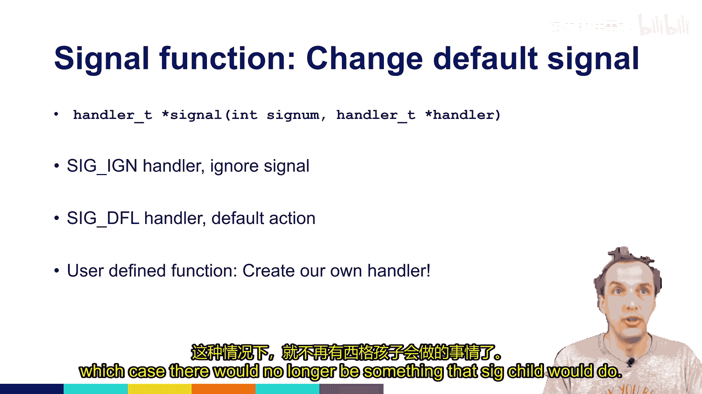

默认情况下，每个信号都有一个预定义的动作，例如终止进程、忽略或生成核心转储文件。然而，对于大多数信号（除了 `SIGKILL` 和 `SIGSTOP`），进程可以自定义其处理方式，即安装一个**信号处理程序**。

使用 `signal` 函数可以安装信号处理程序。请注意，`signal` 函数用于**安装**处理程序，而 `kill` 函数用于**发送**信号。

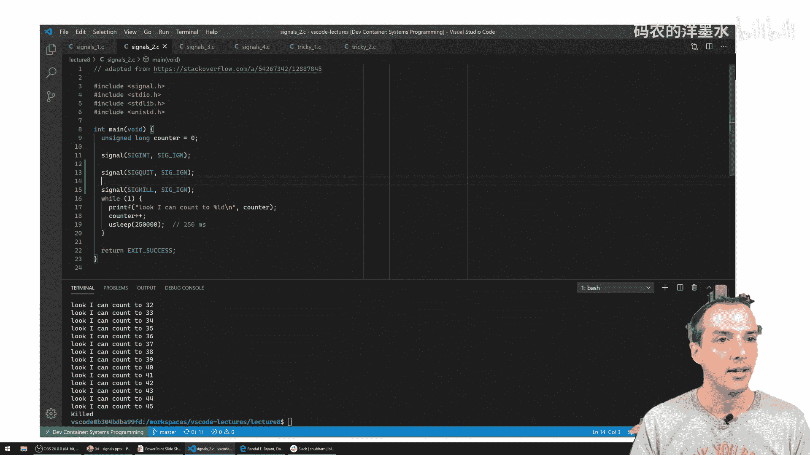

以下是安装处理程序的几种方式：

*   **自定义处理函数**：指定一个函数，当信号递送时调用该函数。
*   **`SIG_IGN`**：忽略该信号。
*   **`SIG_DFL`**：恢复对该信号的默认处理动作。

**示例代码：安装一个简单的信号处理程序**
```c
#include <stdio.h>
#include <signal.h>
#include <unistd.h>

void handler(int sig) {
    // 这是一个简单的信号处理函数
    write(STDOUT_FILENO, "Signal received!\n", 17);
}

int main() {
    // 安装信号处理程序，处理 SIGINT 信号（Ctrl+C）
    signal(SIGINT, handler);

    while(1) {
        pause(); // 等待任何信号
    }
    return 0;
}
```

---

## 编写安全的信号处理程序

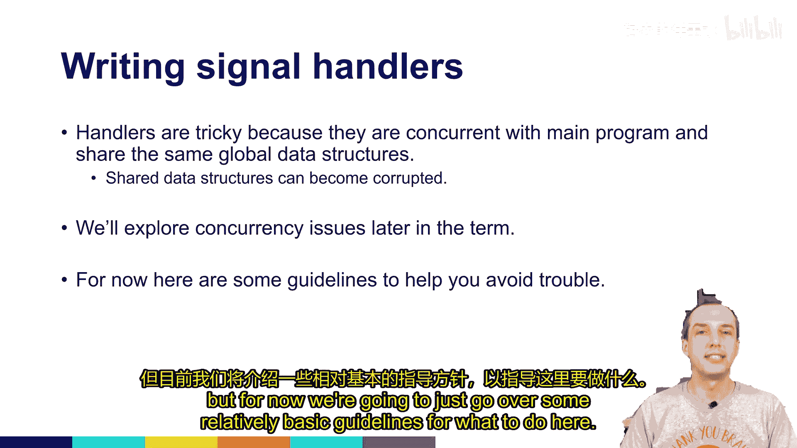

上一节我们学会了如何安装处理程序，本节中我们来看看编写处理程序时需要注意的安全问题。

编写信号处理程序是棘手的，因为信号是异步发生的，它会中断程序的主控制流。这引入了**并发**问题：你的处理程序可能会在主程序执行到任何位置时被调用，并修改共享的全局状态，导致难以预测的行为。

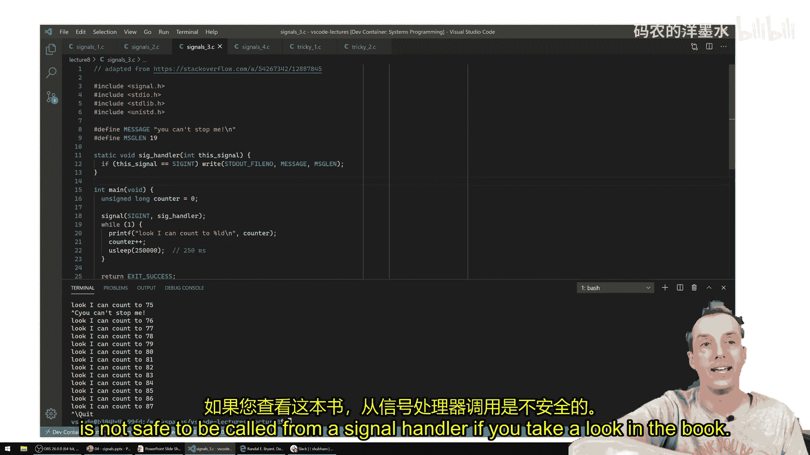

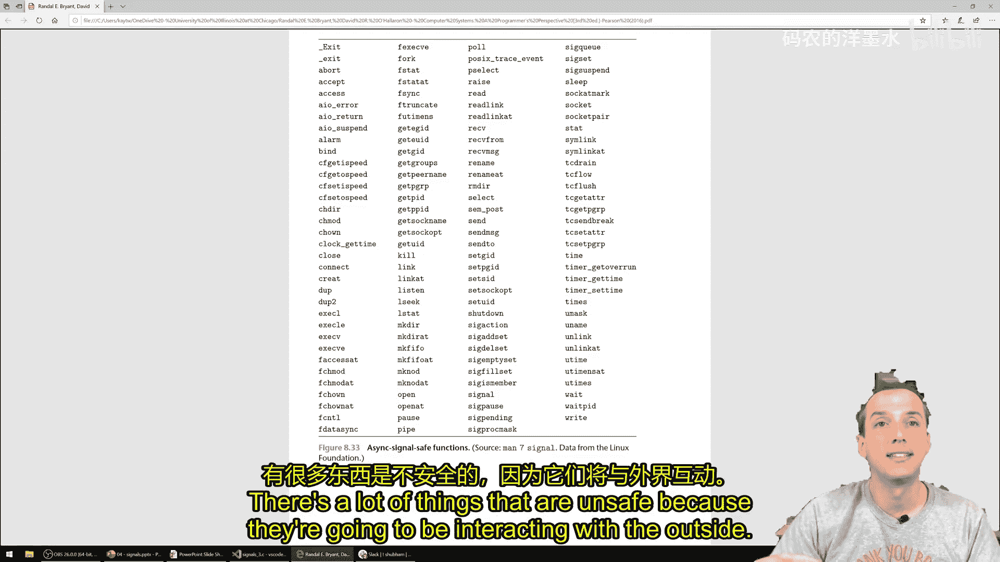

因此，信号处理程序应尽可能保持简单。以下是编写安全信号处理程序的指导原则：

1.  **处理程序要简单**：最好只设置一个全局标志，由主程序稍后检查并处理。
2.  **只调用异步信号安全函数**：在信号处理程序中，只能调用那些保证能在信号处理程序中安全执行的函数（如 `write`）。许多标准I/O函数（如 `printf`）是**不安全**的。
3.  **保存和恢复 `errno`**：许多函数在出错时会设置全局变量 `errno`。在信号处理程序入口先保存 `errno`，在返回前恢复它，可以避免干扰主程序的错误检查。
4.  **临时阻塞信号**：如果处理程序需要访问共享数据结构，可以考虑在处理关键部分前阻塞相关信号，以防止重入。
5.  **使用 `volatile` 声明全局标志**：这告诉编译器该变量可能被异步修改，防止编译器进行不安全的优化（如将变量值缓存在寄存器中）。
6.  **使用 `sig_atomic_t` 类型**：对于像标志这样的简单全局变量，使用 `sig_atomic_t` 类型可以保证对该变量的读和写是原子的（即不可中断的）。

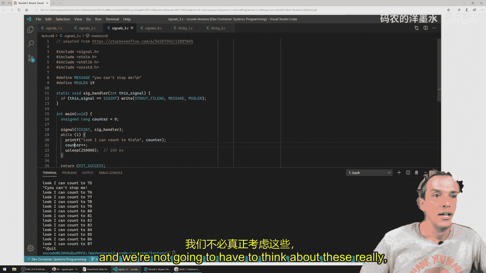

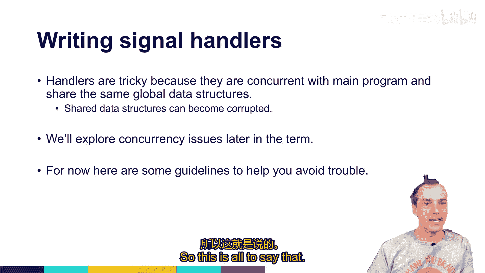

**示例代码：一个安全的信号处理模式**
```c
#include <stdio.h>
#include <signal.h>
#include <unistd.h>
#include <stdatomic.h>

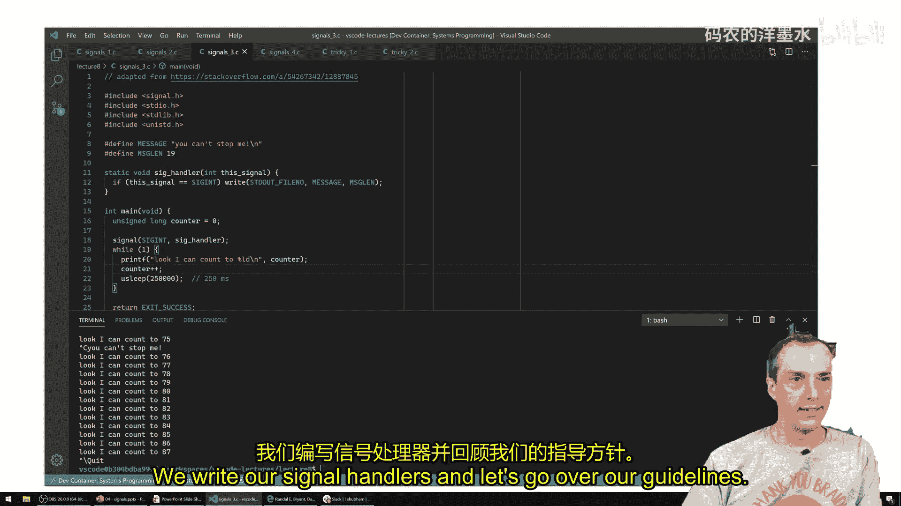

// 使用 volatile 和 _Atomic 确保安全访问
static volatile sig_atomic_t keep_running = 1;

void handler(int sig) {
    // 安全操作：只设置一个标志
    keep_running = 0;
}

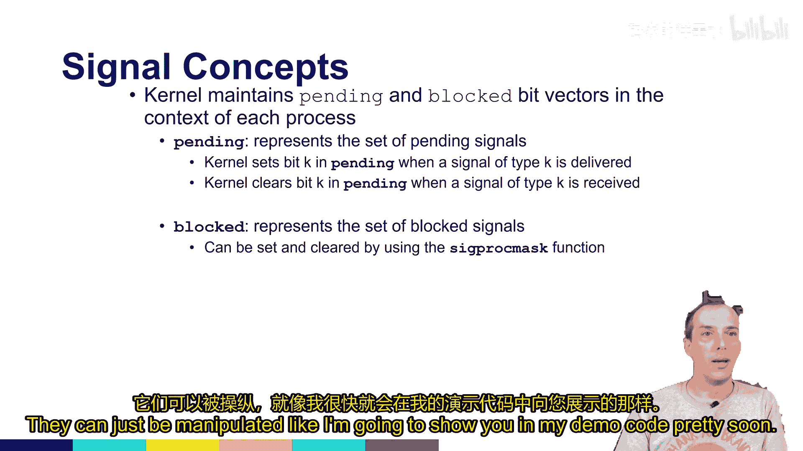

int main() {
    signal(SIGINT, handler);

    // 主循环检查标志
    while (keep_running) {
        printf("Working...\n");
        sleep(1);
    }

    printf("Shutting down gracefully.\n");
    return 0;
}
```

---

## 阻塞与等待信号

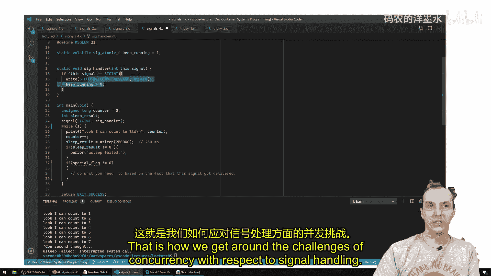

上一节我们关注了处理程序本身，本节中我们来看看如何控制信号的递送时机。

进程可以显式地**阻塞**某些信号。被阻塞的信号会保持在待处理状态，直到进程将其**解除阻塞**。这用于保护代码的关键部分不被信号中断。

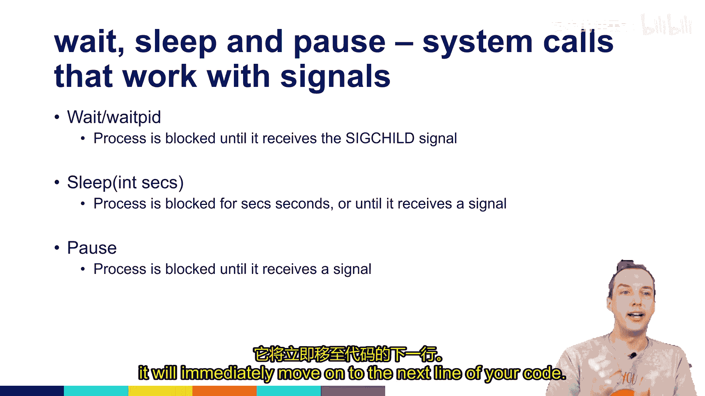

此外，有一些系统调用可以使进程主动等待信号：

*   **`pause()`**：挂起调用进程，直到**任何**信号递送。
*   **`sleep()`**：使进程休眠指定的秒数，但如果**任何**信号递送，它可能会提前返回。返回值会指示剩余休眠时间或被中断。
*   **`wait()` 系列函数**：等待子进程状态改变，这通常与 `SIGCHLD` 信号相关。

需要注意的是，当信号导致一个**慢速系统调用**（如 `read`、`write`、`sleep`）中断时，该系统调用可能会提前返回，并设置 `errno` 为 `EINTR`（表示调用被中断）。健壮的程序需要能够处理这种情况。

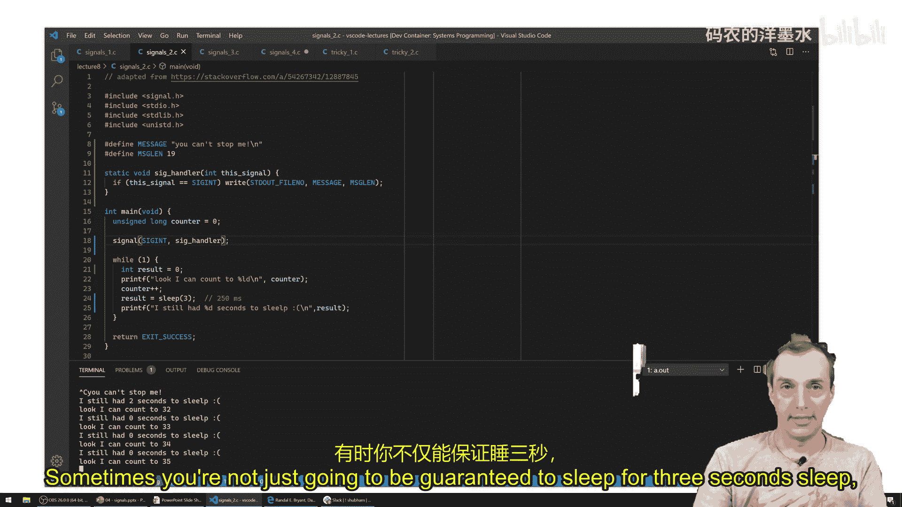

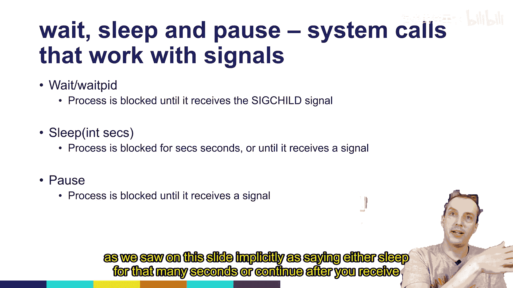

---

## 总结

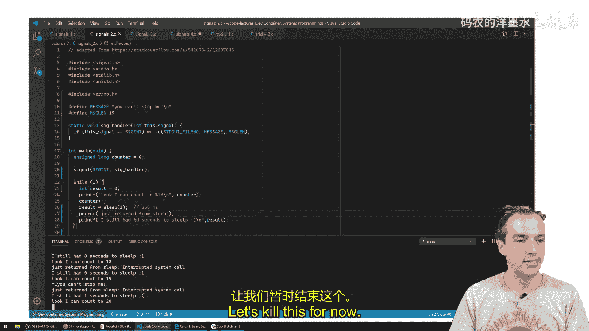

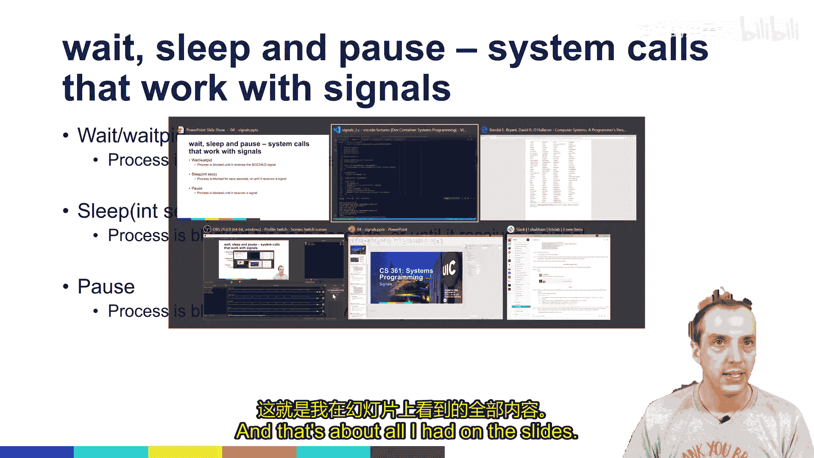

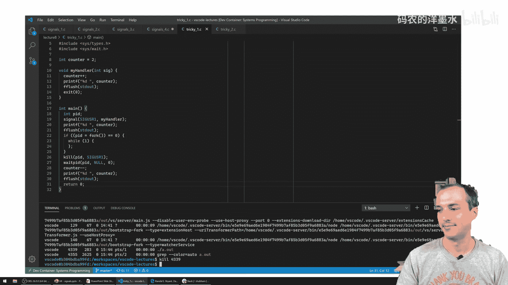

本节课中我们一起学习了Linux中的信号处理机制。我们了解了信号是内核通知进程系统事件的一种异步通信方式，学习了常见信号类型、信号的发送与接收时机，以及如何安装自定义信号处理程序。最重要的是，我们探讨了编写安全信号处理程序的挑战和最佳实践，包括处理并发访问、使用异步信号安全函数以及正确管理全局状态。信号是系统编程中一个强大但需要谨慎使用的工具，是理解进程控制和并发编程的基础。