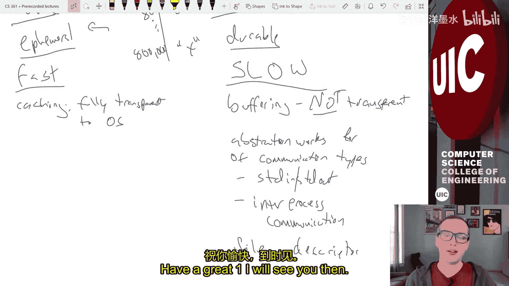

# 007：Linux中的文件抽象 📁


在本节课中，我们将学习操作系统中的一个核心概念：文件。我们将探讨文件与内存的异同，理解文件作为**顺序存储**和**持久化**媒介的特性，并介绍文件描述符这一关键抽象。通过学习，你将明白文件如何作为通用接口，用于与磁盘、键盘、屏幕乃至网络进行通信。

## 文件与内存的异同

上一节我们介绍了课程概述，本节中我们来看看文件的基本概念。文件的核心操作与我们一直处理的内存操作在本质上是一致的：都是**读取和写入字节**。无论是从内存加载字节到寄存器，还是将数据写入文件，底层都是对字节流的操作。

然而，实现这些操作的方式存在根本性差异。内存是**随机访问**的，我们可以直接通过地址（例如 `load [800]`）获取任意位置的字节。文件则被设计为**顺序访问**。当我们从文件读取时，系统会从一个“光标”位置开始，按顺序返回指定数量的字节，然后移动光标。

以下是导致这种差异的两个主要原因：
1.  **历史原因**：早期存储介质（如磁带、磁盘）的物理特性决定了数据必须按顺序读写。跳转到遥远的位置需要物理移动（如移动磁盘磁头或快进磁带），速度极慢。
2.  **使用模式**：我们通常按顺序解析文件内容（例如，逐行读取文本文件），随机访问特定偏移量的需求并不常见。

因此，文件的顺序字节流抽象非常实用，这也是我们将要探讨的一大区别。

## 文件的持久性与速度权衡

我们了解了访问方式的差异，现在来看看文件的另一个关键特性：**持久性**。与易失性的内存（RAM）不同，文件内容在计算机关闭后依然存在。这是一个巨大的优势，确保了数据不会因程序崩溃或断电而丢失。

但持久性也带来了责任和风险。存储在文件中的数据通常非常重要，数据损坏或丢失可能是灾难性的。因此，在操作文件时必须格外小心。

与此同时，文件的持久化带来了性能上的代价：**文件操作比内存操作慢得多**。从磁盘读取数据的速度远低于从内存读取。为了缓解这种缓慢，系统采用了多种技巧，其中最重要的是**缓冲**。

例如，当从硬盘读取数据时，驱动程序不会一次只读一个字节。它会一次性读取一个块（如1024或4096字节）到内存中的缓冲区。这样，当程序请求下一个字节时，可以直接从快速的内存缓冲区获取，而无需等待缓慢的磁盘操作。这与CPU缓存的思想类似，但关键区别在于，文件缓冲是由操作系统显式管理的，对程序员是可见的。

## 强大的流抽象：超越磁盘

文件不仅是磁盘数据的抽象，其**顺序流**的模型可以映射到多种通信场景，这体现了其设计的强大之处。

*   **标准输入/输出**：在程序中，我们通过读取名为 `stdin` 的文件来从键盘获取输入，通过向名为 `stdout` 的文件写入来向屏幕输出内容。我们并不直接操作硬件缓冲区。
*   **进程间通信**：两个进程（如父进程与子进程）可以通过共享一个文件描述符进行通信。一个进程向“文件”写入，另一个进程从“文件”读取，实际上就完成了数据的传递。
*   **网络通信**：这种抽象甚至可以扩展到网络。一个网络套接字（socket）在程序中也被视为一个文件描述符。浏览器与远程服务器之间的数据传输，也可以使用 `read` 和 `write` 这样的文件操作接口来完成。

这种统一的接口使得编程模型变得极其简洁和强大。无论数据源是本地文件、用户输入、另一个进程还是网络上的另一台计算机，我们都可以用同一套方式来处理。

## 核心机制：文件描述符

要实现上述所有强大的功能，操作系统使用了一个核心概念：**文件描述符**。文件描述符是一个由内核维护的、用于代表已打开文件的整数句柄。我们通过这个整数来执行所有的读写操作。

例如，在C语言中：
```c
int file_descriptor = open("example.txt", O_RDONLY);
char buffer[100];
ssize_t bytes_read = read(file_descriptor, buffer, sizeof(buffer) - 1);
close(file_descriptor);
```
程序通过 `open` 系统调用获得一个文件描述符，然后使用 `read`、`write` 等系统调用通过该描述符操作文件，最后用 `close` 关闭。标准输入、输出和错误也有预定义的文件描述符（分别是0、1、2）。

文件描述符是连接用户程序与操作系统各种I/O资源（文件、管道、套接字等）的桥梁，正是它使得“一切皆文件”的哲学得以实现。我们将在后续课程中深入探讨文件描述符的细节。

## 总结

本节课中我们一起学习了Linux中文件的抽象。我们认识到：
1.  文件与内存的核心操作都是字节的读写，但文件是**顺序访问**，而内存是**随机访问**。
2.  文件具有**持久化**特性，能长期保存数据，但操作速度远慢于内存，因此系统广泛使用**缓冲**技术来提升性能。
3.  文件的**流抽象**极其强大，可以统一表示磁盘文件、标准输入/输出、进程间通信通道乃至网络连接。
4.  所有这些功能都通过**文件描述符**这一统一的整数句柄来访问和管理，这是Linux系统“一切皆文件”设计哲学的基石。



理解这些基础概念，是后续学习文件系统实现、I/O多路复用等高级主题的关键。