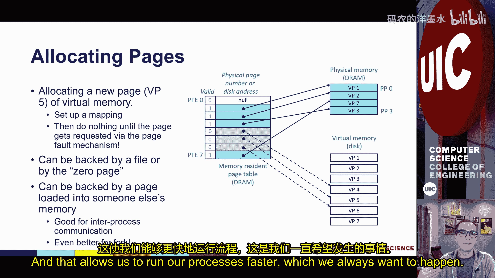

# 010：页面故障详解 🖥️

在本节课中，我们将深入探讨虚拟内存如何实现物理地址到虚拟地址的映射，以及如何处理页面命中和页面缺失。我们将从虚拟内存解决的核心问题开始，逐步讲解页表、页面命中和页面故障的具体机制。

## 概述

虚拟内存是现代操作系统的核心机制，它解决了程序运行时的地址定位、内存保护和空间管理三大问题。通过将物理内存和虚拟地址空间分离，操作系统可以为每个进程提供一个独立且受保护的地址视图。本节课将详细解释这一机制的工作原理，特别是当程序访问的页面不在物理内存中时，操作系统如何处理这种“页面故障”。

## 虚拟内存解决的三大问题

上一节我们介绍了虚拟内存的概念，本节我们来看看它具体解决了哪些核心问题。

### 1. 地址重定位问题

程序在编译和编写时，无法预知其代码和数据在物理内存中的具体位置。虚拟内存通过引入虚拟地址空间解决了这个问题。编译器和用户进程只需处理虚拟地址，而由CPU和操作系统的内存管理单元负责将虚拟地址**动态翻译**成物理地址。这个过程对程序是完全透明的。

### 2. 内存保护问题

操作系统需要隔离不同进程的内存空间，防止它们相互干扰。由于每个进程只能通过自己的虚拟地址空间访问内存，并且这个映射由操作系统控制，因此一个进程无法直接访问或描述另一个进程的物理内存。这自然实现了内存隔离和保护。

### 3. 空间管理问题

有时物理内存可能不足以容纳所有进程所需的数据。这时，操作系统需要将一些暂时不用的页面“换出”到磁盘，为新的页面腾出空间，这个过程称为页面置换。虽然在现代系统中，由于内存容量增大，频繁的页面置换已不常见，但它仍是虚拟内存设计的基本组成部分。

## 核心概念与定义

在深入机制之前，我们需要明确几个核心概念。

*   **地址空间**：每个进程都有自己独立的虚拟地址空间，范围通常从0到一个很大的数（例如 2^n - 1）。
*   **虚拟地址**：进程视角中的内存地址，只是一个数字。
*   **物理地址**：实际内存芯片上的硬件地址。
*   **页表**：由操作系统维护的核心数据结构，它存储了虚拟页到物理页的映射关系以及其他管理信息。**页表条目**是页表的基本单元。

一个简化的页表条目可能包含以下信息（索引是隐式的）：
*   **有效位**：表示该映射当前是否有效。
*   **物理页帧号**：如果有效，指出对应的物理页是哪一个。

## 页面命中处理

当进程访问一个虚拟地址时，硬件（内存管理单元，MMU）会查询页表进行地址翻译。

以下是页面命中的处理流程：
1.  CPU发出一个虚拟地址。
2.  MMU根据虚拟地址中的页号部分，找到对应的页表条目。
3.  检查该条目的**有效位**。如果为`1`（有效），则获取其中的物理页帧号。
4.  MMU将物理页帧号与虚拟地址中的页内偏移量组合，得到最终的物理地址。
5.  使用该物理地址访问物理内存，完成读/写操作。

这个过程完全由硬件完成，速度非常快。操作系统负责在进程启动或需要时，正确设置页表中的这些有效映射。

## 页面故障处理

如果MMU在页表条目中发现有效位为`0`（无效），则会发生一次**页面故障**。这是一种由硬件检测并触发的特殊异常，它会中断当前用户进程的执行，并陷入操作系统内核。

以下是页面故障的处理流程：
1.  **触发故障**：CPU执行指令时，试图访问一个无效的虚拟地址。
2.  **陷入内核**：CPU自动保存当前进程状态，并跳转到操作系统预设的页面故障处理程序。
3.  **操作系统介入**：
    *   操作系统检查故障原因。通常是因为所需的页面尚未加载到物理内存中（可能还在磁盘上）。
    *   操作系统从磁盘（或交换区）读取所需的页面数据。
    *   在物理内存中找到一个空闲页帧。如果内存已满，则可能需要选择一个现有页面进行**置换**，将其写回磁盘。
    *   将磁盘上的页面数据载入找到的物理页帧。
    *   更新页表，使对应的虚拟页映射到新的物理页帧，并将有效位置为`1`。
4.  **恢复执行**：操作系统恢复之前被中断的进程状态，并重新执行那条引发故障的指令。这次，指令将遇到一个有效的页表条目，从而正常完成页面命中流程。

需要强调的是，**页面故障机制并不仅仅用于内存不足时的页面置换**。它更常见的作用是实现**按需分页**。

## 按需分页与零页

按需分页是一种“惰性加载”策略，它极大地优化了系统性能。

*   **惰性加载的优势**：操作系统在启动一个进程时，并不立即将其所有代码和数据加载进内存，而只是为其设置好虚拟地址到磁盘文件的映射（但标记为无效）。只有当进程实际访问某一部分时，才会触发页面故障，从而将该部分加载进内存。这避免了加载可能永远用不到的代码（例如错误处理例程），节省了内存和启动时间。
*   **零页的妙用**：当进程通过`malloc`或`brk`申请大量内存时，操作系统并不会立即分配真实的物理页面。它只是将这段新虚拟地址空间映射到一个特殊的、全零的**零页**，并标记为“只读”。当进程首次尝试**写入**这块内存时，会触发页面故障。此时，操作系统再分配一个全新的、私有的物理页面，复制零页的内容，并更新映射。这避免了对大量未初始化内存进行不必要的清零操作。

## 虚拟内存的其他优势

除了解决问题和实现按需分页，虚拟内存还带来了其他重要好处：

*   **内存共享**：多个进程可以将自己虚拟地址空间中的不同区域映射到**同一个物理页面**。这常用于共享只读的代码段（如C标准库`libc.so`）或进程间通信。这显著节省了物理内存。
*   **简化内存管理**：程序员和编译器无需关心物理内存的布局，只需在连续的虚拟地址空间中工作。内存分配、保护和共享的复杂性都由操作系统和硬件通过虚拟内存机制透明地处理。

## 总结

本节课我们一起深入学习了虚拟内存中页面故障的详细机制。我们回顾了虚拟内存如何解决地址重定位、内存保护和空间管理三大核心问题。我们明确了页面命中时，由硬件MMU通过页表快速完成地址翻译。重点在于，当发生页面缺失时，会触发页面故障，操作系统介入，负责将所需页面从磁盘加载到内存，更新页表，并重启指令。这一机制不仅是处理内存不足的手段，更是实现“按需分页”这一关键优化策略的基础，它通过惰性加载和零页技术，极大地提升了内存利用率和程序启动速度。最后，我们还看到了虚拟内存如何优雅地支持内存共享，从而进一步优化系统资源的使用。