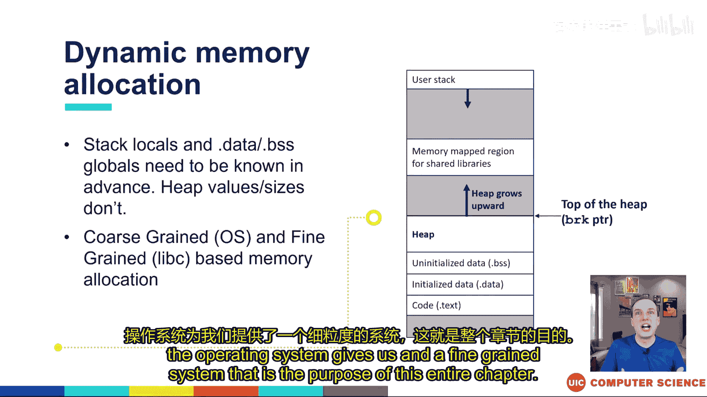
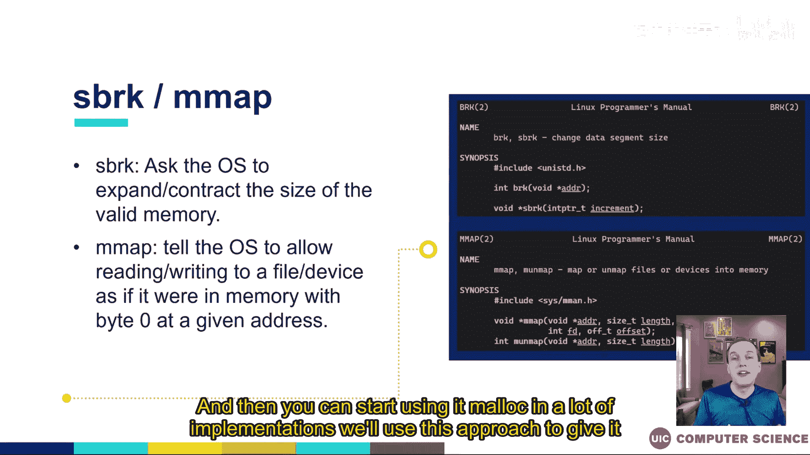
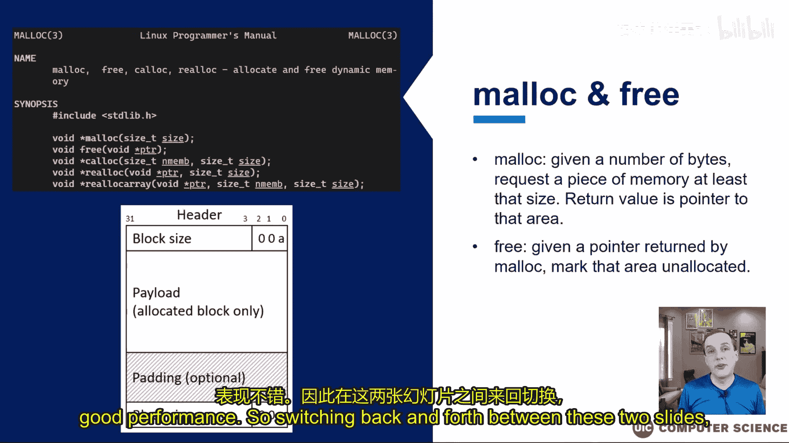

操作系统：第13讲：动态内存分配器 🧠

## 概述
在本节课中，我们将学习构建动态内存分配系统的动机与核心概念。动态内存分配器设计涉及多种权衡，关键在于明确需要优化的场景。这是我们在本课程中一直努力构建的系统设计思维的绝佳范例。我们将从问题定义入手，探讨如何实现一个高效的内存分配器。

## 动态内存分配的必要性
我们知道，动态内存分配是必要的，因为栈和全局变量在编译时就已经确定。程序运行时的工作负载可能要求我们使用更多内存，而这些需求在编译时无法预知。因此，动态内存分配允许我们在运行时申请所需数量的内存。

从高层次看，内存分配包含两个层面：操作系统提供的粗粒度系统，以及本章将要讨论的细粒度系统。

## 细粒度分配系统与API
我们的细粒度系统使用以下API，这在显式内存分配器中非常常见：
*   `malloc`：用于申请新的内存块。
*   `free`：用于释放不再使用的内存块。

这与Java、JavaScript或Python等语言不同，那些语言的运行时会自动跟踪对象。C语言则允许直接操作原始指针。只要指针指向一个有效的内存区域，就可以访问它，没有任何限制。因此，我们需要显式地管理`malloc`和`free`。虽然这很容易出错，但它赋予了我们完全的控制权。

这里需要明确一个术语：当我们谈论一个“块”（block）时，指的是从`malloc`返回的**有效载荷**（payload），以及围绕它的任何**填充**（padding）和**元数据**（metadata）。因此，一个块的大小指的是整个实体的尺寸，而不仅仅是用户请求的内部部分。

## 系统调用基础：`sbrk`与`mmap`
`malloc`和`free`是我们想要实现的细粒度API，但它们建立在更底层的系统调用之上。

`malloc`通常构建在`**sbrk**`系统调用之上。每次调用`sbrk`都会在用户模式和内核模式之间切换，产生一定的开销。因此，我们并不希望在每次内存分配时都调用操作系统。一个在用户层处理字节级分配的库会高效得多，它可以在不切换模式的情况下分配和回收内存。

这种粗粒度与细粒度的划分不仅是设计上的复杂化，也是空间和时间效率上的必要。操作系统只按页（page）的粒度管理内存，而频繁的系统调用在时间上也不划算。现代分配器通常结合使用`**sbrk**`和`**mmap**`来获得最佳性能。

*   `sbrk`：以页为粒度，调整堆的边界，决定哪些堆地址是合法的。
*   `mmap`：允许我们将文件映射到内存的任意地址，或者请求操作系统分配一块填充为零的新内存区域。许多`malloc`实现使用这种方法来提升性能。

综上所述，`malloc`和`free`是我们要实现的用户层API，而`sbrk`和`mmap`是它们所依赖的系统调用。`malloc`作为一个库函数，利用这些系统调用来获取大块内存（例如几KB、几MB），然后再将其细分并分配给用户程序。

## 分配器的设计目标
要让分配器良好工作，需要满足几个关键目标：

**1. 正确性**
这是最重要的部分。分配器必须是正确的。一旦分配了一块内存给用户，在该用户明确释放之前，这块内存必须保持有效且不被其他任何人触碰。正如一句经验之谈：**让程序更快能让你获得赞誉，但让程序正确才能让你保住工作。**

**2. 时间效率**
我们希望分配和释放操作尽可能快，以最小化对用户程序的干扰。这里的“快”不仅指平均时间或最短时间，还包括避免出现**巨大的延迟峰值**（jitter）。例如，在Java或Python等使用隐式内存管理（垃圾回收）的语言中，有时会出现“垃圾回收暂停”，程序会突然停止运行以整理内存。如果一个通常只需几微秒的`free`操作突然需要20毫秒，这种差异是巨大的。对于需要低延迟响应的系统（如股票交易平台），这种抖动是致命的。

因此，在专业环境中，我们常关注第95、99或99.9百分位的响应时间（即最慢的那部分请求的耗时），这被称为**尾部响应时间**。我们希望即使在最坏情况下，操作也能在可接受的时间内完成。

**3. 空间效率**
我们同样不希望占用过多内存。这涉及到我们上周讨论过的**内部碎片**和**外部碎片**问题。

假设操作系统通过`sbrk`给了我们一大块连续内存空间。我们将其中的部分分配出去后，剩余的空间可能被分割成许多小块。当一个新的内存请求到来时，可能没有任何一个空闲块足够大来满足它，尽管所有空闲块的总和是足够的。这就是**外部碎片**。

一旦我们将地址交给用户程序，在它们主动释放之前，我们无法收回。因此，我们需要精心安排内存块的放置位置，以更高效地利用内存，减少向操作系统申请更多内存的次数。

## 核心权衡：时间 vs. 空间
我们需要在时间效率和空间效率之间进行权衡。
*   某些设计可能非常快，但会浪费大量空间（例如，采用最简单、最快的策略）。
*   反之，某些设计可能最大限度地利用了空间，但分配和释放操作较慢。

由于我们无法预知程序将如何请求内存，碎片化几乎必然会发生。在实际的内存分配器设计中，开发者通常会针对常见的、特定的使用模式进行优化。虽然我们在课程中不会深入这些细节，但了解真实系统（如`glibc`的`malloc`）如何工作是一个很好的学习方向。

## 课程内容预告
接下来的课程将涵盖以下内容：

**1. 抽象设计与实现**
首先，我们将从抽象层面学习如何设计一个显式内存分配器。在获得操作系统提供的内存后，我们如何组织它，以实现时间和空间上的高效。

**2. 具体实现剖析**
接着，我们将更具体地了解如何利用`sbrk`来增长和收缩堆，并通过操作字节和位来实现`malloc`和`free`功能。我们将看到其中的各个组成部分，以及如何优化空间和时间，在保证正确性的前提下做出设计决策。

**3. 作业相关演示**
我们还将通过代码演示，更仔细地了解作业4（构建一个分配器）是如何工作的。

**4. 补充学习材料**
此外，上周的讨论课深入讲解了垃圾收集器的工作原理。结合本周的实验课，你将能很好地理解完成作业所需的知识。建议在开始作业前回顾这些内容。

## 总结
本节课我们一起学习了动态内存分配器的核心概念。我们明确了动态分配的必要性，介绍了用户层的`malloc`/`free` API及其底层的系统调用（`sbrk`/`mmap`）。我们深入探讨了优秀分配器的三大设计目标：**正确性**、**时间效率**和**空间效率**，并理解了在时间与空间之间进行权衡的重要性。最后，我们预览了后续课程将如何引导我们一步步设计和实现一个自己的内存分配器。