# 【全集】伊利诺伊大学 操作系统 中英字幕 1080P p01 Lecture 1 - 动态链接原理 -BV1AEASzNE3z_p1-

Hi， everybody。 I'm Chris Ka and。 This is C 361。 System programming。

 Today's lecture is about loading executables specifically using dynamic libraries while loading those executables。

 Today's video is kind of a twofer。 We're gonna to be covering both that entire process of going from a file on the disk to a running set of instructions and data that are ready to be used by your program。

 as well as how modern executables are loaded， which is a little bit more complicated than just bring everything into memory and get started。

 It has a lot more to do with how we're going to use dynamic linking and dynamic libraries as a way to make our programs a little bit more complex but a lot more performant。

 So the first step here is the overview of going from on disk to in memoryory。

 When we're on the disk。 we have an ELF file format and that will dictate to us how we will go from a bunch of bytes that are stored in a file on a disk to a bunch of bytes that exist。

😊，Different places within memory of an individual process the most important part here is probably that the things that are in that executable file and disk are going to get loaded into very different places in memory in the running executable the most important part about this difference is that while all of the bytes in the file on the hard drive are kind of packed together in whatever that file format dictates as the format for an EF file when you go into memory things are laid out in a very。

 very different way rather than just talking about a specific set of bytes in a specific place we're talking about lots of different segments of memory that are stored all over the place within that process address space。

 One of the really important concepts that we're gonna cover over time in this class is this concept of an address space and how even if we have an address from zero all the way up to2 to 48 minus1 Bnkker's big number that I don't even know the name for we're not literally using every single one。

😊，Those addresses to store a byte of data we got this byte addressable data and once we get two sections further in class。

 we'll see that not all of this memory is actually loaded into the memory banks in the chips in your computer we're only going to load in the parts these gray parts in this slide that we're using at that moment in time and everything else just doesn't even exist in memory yet we'll see how that trick gets played later on but for now the important part to remember is that when things are stored in a ELF file they're all contiguous in that disk space there's byte after byte after byte of useful information when it gets loaded into memory specific chunks are loaded in specific places and those are not necessarily going be close to each other they're not necessarily going to be contiguous some of them are going to be hundreds of thousands or trillions of bytes away from each other but that doesn't mean we're using all those bytes we're only going to be using the chunks that we have actually in use for lack of。

Return。So when we're loading these in， that first thing that the loader is going to do is figure out which segments of the ELF file need to be loaded into which。

Addresses in the running processes memory space in the memory image。

 I'm going to use lots of different terms to refer to roughly the same thing。

 I might talk about the memory space， I might talk about the memory image What I'm talking about is again this thing from the previous slide where we have this drawing here where we've got our stack that grows towards lower addresses。

 our memory map region growing towards higher addresses， our heap growing towards higher addresses。

 things along those lines。So so rather than just looking at this on a slide。

 let's look at it in the real world in Vi Studio code。

 So we have on the screen here iss just a bonkers simple hello world program and it has two calls to printf because we're going to be showing off how the dynamic linker works a little bit later on in this lecture right now。

 we're just talking about loading the executable So if I do a ReadDLF。😊。

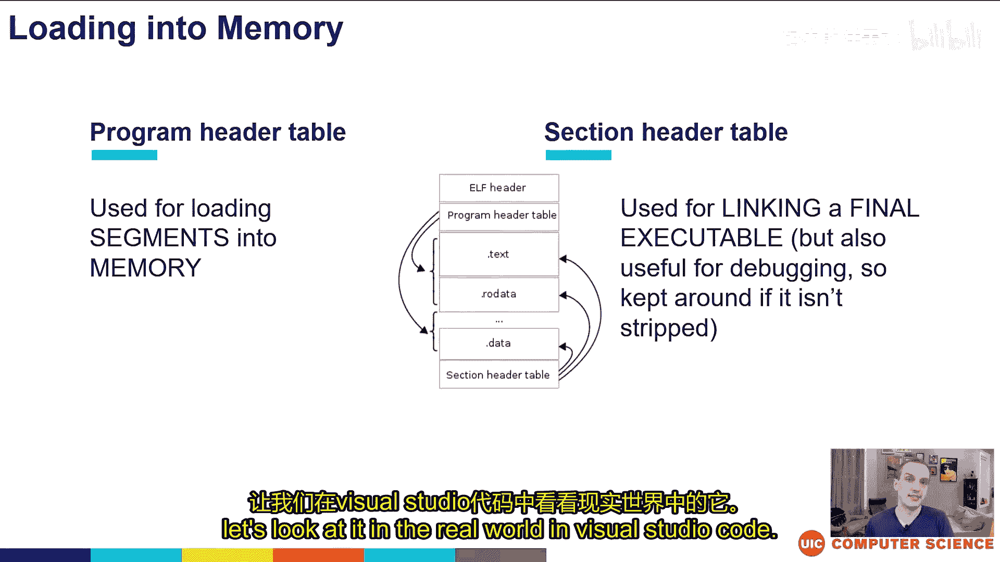

Of LW。 this is going to show me all of the headers that instruct the loader for where to put what bytes from the file into what bytes in the entire address space of the program。

 I'm getting a little ahead of myself。 if we really want to start from the absolute beginning we can run readLlf H。

 which gives us the headers of the entire thing。 This is starting from the very beginning of that EF file。

 Anything that reads a file is almost always going to read it from the very beginning to figure out what format it's in to figure out what's important and the important thing we want to get from here is a。

 we have this magic chunk of bytes， which means that this is a Elf 64 format file And then we know eventually when we get started with the code in this running program。

 we're gonna to jump to the instruction stored at hex 400400 and we have a bunch of。😊。

Program headers。 We have9 to be exact。 The headers are each 56 byte and they're going to be interpreted in a certain way。

 So if we come back to our headers， we see these nine different program headers。

 So these are the9 different locations that the loader is gonna pick up out of this file and put down into memory at a given space。

 This first one is saying， put the header in the in memory where you want to put it。 The second one。

 this interpret section is special for dynamically linked libraries。

 We'll talk a little bit more about that a little bit later on。

 So these next two lines are probably the most important ones for us understanding how do we go from everything we're seeing in the PowerPoint to how do we go with an actual program that's actually running on our actual machine。

 This first chunk here is loaded in as readable and executable It's loaded in at address 400000 and it's loaded in from offset 0 within the file。

4 hex 6 f 0 B。 So what this tells the loader is start at。😊，Beginning of the ELF executable file。

Pick up 6 f0 bytes and shove them down into the memory address base of this newly about to be running process at address 400000 400。

 That's what that part needs to do。 And it says it's going to make it readable。

 not readable and executable。 you'll probably guess what this is going to end up being The next part gets loaded in from offset E10 in the file for 220 hex 220 bytes。

 but it's actually going to load in 228 bytes into memory there。

 This is where maybe we'll figure some interesting things out here as well。

 So we're loading in more bytes than we would have otherwise needed to pull in。

 And we're going start that load at memory address Hex 6010。

 These are all just numbers right but what's important is how they're all going work together when we start using the program。

 So let's switch back over to our slides really quick。 We see that in the ELF file in that。😊。

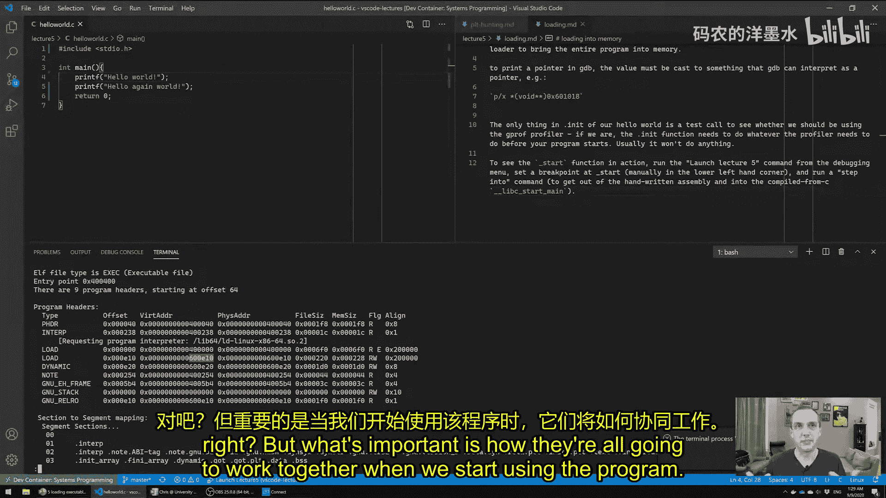

Enre ELF format program， We have the program header table。

 which is what we're reading right now in VS code that tells us where each of these different segments exists and how to load them into memory。

 That's the information for the loader。 The other set of information that's in here is the section header table。

 The section header table actually tells us which of those sections of that ELF file correspond to which chunks of the ELF file。

 This is basically saying ELF has a specific format。

 and there's lots of different types of section that go into that format of an executable。😊。

What's really important here is that sections like do data dopss and do text are relevant for linking and Gcc and stuff like that。

 but they're not explicitly relevant for the process of loading that program in the loader doesn't care whether something is in dot text or in R data。

 It knows that it should be loading those things read only at a specific offset that entire chunk of memory in that entire segment is loaded in all as one chunk of stuff So if we look at our section segment mapping here back in VS code。

 we see that01 offset2 is going to have all these different sections in it。

 so it's got the inter section， which is a set of instructions for how to start using a dynamic loader and the important ones we have here are T do text and R data those are the read only sections that we know we need to have in there to hold。

😊。

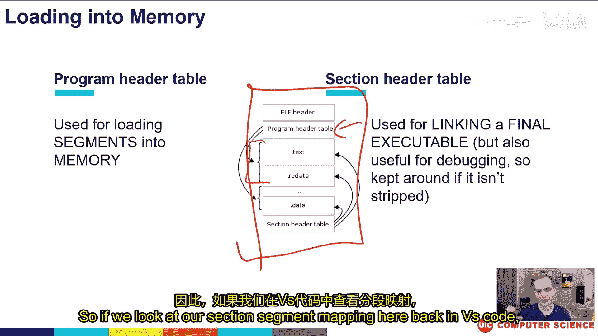

The instructions of our program， as well as any read only constants that are global variables in our program。

Likewise， offset three here includes the data and BSS sections。

 This BSS here is why even though we are loading in hex 220 bytes from the program from the program on disk。

 we're loading it in as hex 228 bytes in the running program。

 This is because the BSS section doesn't take up space in the file。

 but it still exists in there and when it gets loaded in。

 it needs to have that space expanded out and when gets expanded out。

 it's getting fresh clean bytes from an operating system。

 all those fresh clean bytes are zeros and it goes about and it saved eight whole bytes in this instance。

 So now that we've done that loading process。 we're gonna move on to how do we actually get started with this program as it starts running。

 So when we looked at the headers back over here in BS code we saw that one of those elements that's always going be in an ELF header is the entry point address。

 This is the。😊。

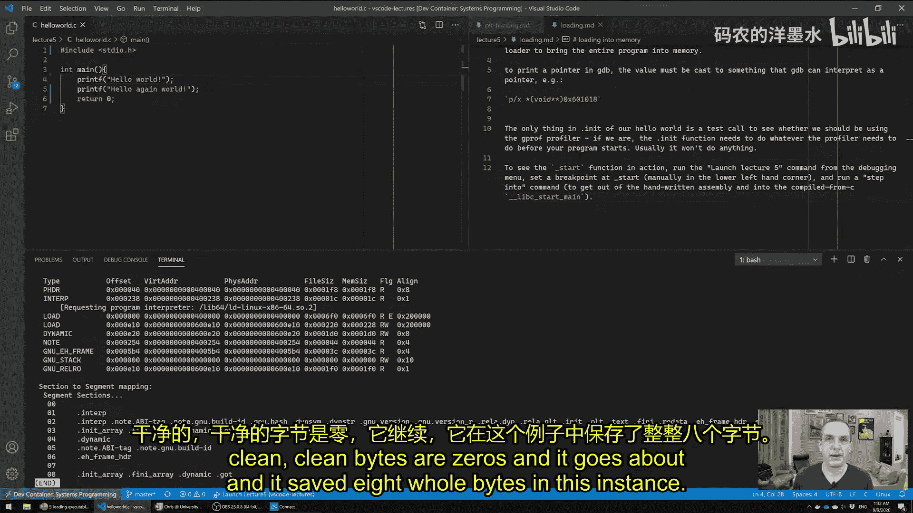

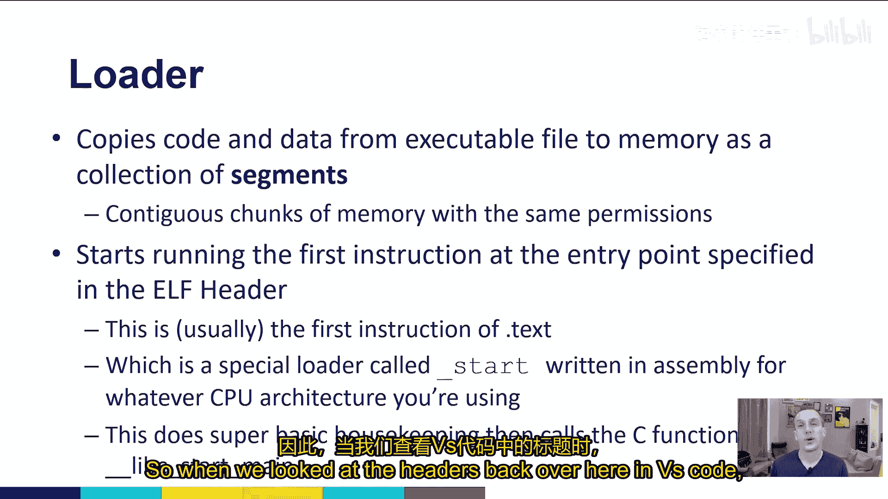

FirstAdd that gets jumped to when this program actually gets started。

 So if you ever wondered what's the very first assembly instruction of our code。

 it's the thing pointed to by that variable stored in the header of the ELF file I'm going show you really quickly in the slides what it is we're doing then we're going move on to actually looking at it in BS code in that hello world program that we have in our open window So almost always that first hex in this case。

 Hex 400400 is going to be the very first instruction of an underscore start program which is just a handwritten executable program that will load a compiled version of the LibC main function and it just does some super。

 super basic housekeeping then it goes ahead and loads the compiled version of that Lib C start main。

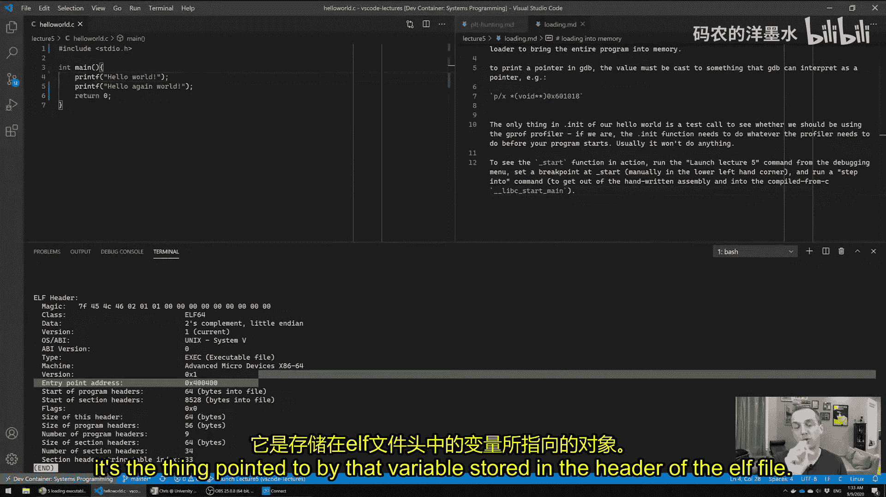

In addition， so what LibCstar mainine is going to do， it's going to call the in function。

 there's also a dotfi andi for like finishing up so this basically allows you to load specific things that need to load before absolutely everything else in your program and then there's going to be a fny section for running code at the absolute end of your program and this kind of doesn't make too much sense is like why would I want to load code that wasn't compiled into my program specifically well one really important useful thing that you can do with all of your code that you ever run is profile it you can say。

 well， I wrote this program and it is compiled and I want to not just run it but I want to measure exactly how long different functions take exactly how many different functions get called and I basically want to instrument that to figure out how my program is running。

 which parts are fast， which parts are slow， which parts are common which parts are rarely or never called and I can't do that successfully with。

profilefiling the code so one thing that you can do in that in section is initialize the profiler and just jump to the profiler and do what it needs to do。

After that has been done， the Libsacy start main will finally call main， mainine will return。

Liib C start main will return and that underscore start function will halt it'll stop the entire process So a few other specific things that Lib C start main will do is it's going to set up ArgC and Rv on the stack。

 it's going to set up the environment variables and then it's going to call main It's going to take that return value of main and it's going to send it back to the shell or whatever the parent process was that called this process that created this new program usually the shell So because I have a configuration file that will launch G and pulling it at the right header files to allow us to do a little bit of extra fancy debugging once I open this dev container up and let it build dev container and follow the instructions in homework I think lecture 5。

 Md I can hit my F5 button to start the debug task and the debug task also stops at the first instruction of main it has an option stop at entry and the very first thing here is print up hellello world。

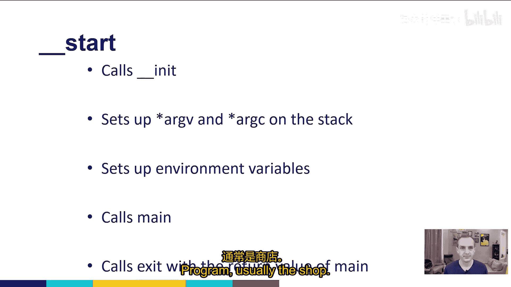

So this debugger session has。Stop before I ran print of hellello world。 So if I continue it。

 it's going print to the screen twice with no new lens because I forgot to Adam。

 then it's going quit。 So super basic， that's a GDP execution。 Not that big a deal。

 If we want to see how start works， I can go into the debugger， and I can create a new break point。

 And this new break point is going to be on that underscore start function。

 So whenever my program finds that underscore start function， it is going to。😊，Pause。

It's going to break， so let's start over。So we broke on that start。 We are sitting there。

 but there's an unknown source， right， There's no way for you to actually see what that is。

 But recall from a few slides ago that real underscore start is handwritten assembly。

 that is a very small amount of code that is explicitly specific for X 86，60 polar Linux variance。

 What I would prefer here is I want to write as much C is possible that's going to be cross platform。

 And I'm only going to write assembly when I absolutely need to。 So this underscore start is a very。

 very basic dot O file。 that was handwritten。😊，Assembly code that's specific to x8664。

 we'll see in just a moment， but the basic idea here is。You have no idea what's going on。

 And the important thing and I have it in the notes is to do a step into。

 and this is going to step into Lib C start main。 So now that I've jumped past the assembly only code in underscore start。

 I'm in the C code of Lib C start main。 that function that is actually doing the real work of the underscore start function that sets everything up。

 So what this is going to do， it's going to take as its arguments， things like the location of main。

 the location of in knit， the argc， which is the count of arguments in thev。

 that vector of string constants that are all the arguments passed into that function。

 and it's going to do what it needs to do to get everything set up。

 it's going to set up the environment。 it's going to start the dynamic linker。

 it's going to do all of these different things and then it's going to jump into main。

 So you if you want to you can step through this function and see it do the D linking。

 you can see it try to call in knit， you can see it try to set up the add exit handlers。

 So add exit is。😊，This thing where you can say before my program ends， however it ends。

 whenever somebody calls exit to just kill the program。

 run this thing first and maybe that's gonna do some debugging output。

 maybe that's gonna do some cleanup whatever heavy you can call that exit to basically install a function that gets called before your program ends。

 And so that's some one thing that this is setting up and you can just keep on going through so it says oh。

 if in it is there then call a it there isn't in it that I think we can yeah we don't jump into it in this case keep moving through these calls and eventually we will get to that call domain and I totally step past it and now we exit and we're not。

So if you want to take a closer look at how Libpsy star main works and what it does。

 feel free to do so right here to figure out what happens before the first instruction you made。

 That's a know computer science parlor trick I've ever heard one。

 So let's go back to dynamic linking right that's the other big part of this is about。

 So in that run of the underscore start function。 we were hitting the dynamic linker and it was doing a few things at the very beginning of the running program。

 but we didn't really go into too much detail what's going on。 There's a lot that goes on there。

 exactly how all this works。 but we're gonna to hit on a few important topics right there that are mainly the ones covered in the book。

 So we've looked at so far is static linking where we take every single library function that we've ever needed and we put it all into one happy executable and then we've got our data section。

 We've got our text section and more or less， that's all you need。

 you've got your variables you've got your heap you've got your stack and you've got your text。

 You're done。 You're good to go。 That's not the best way to do things。😊。

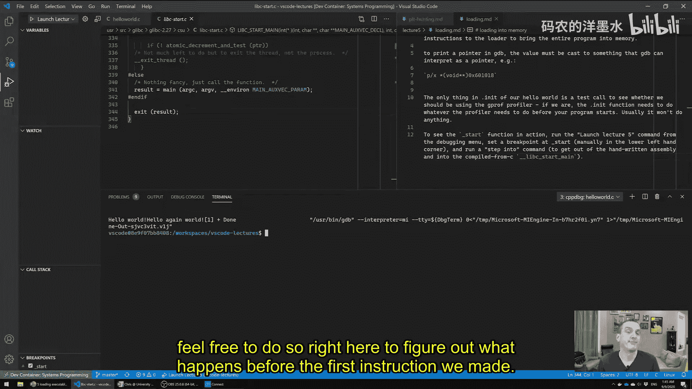

It's probably going to be better if we keep our libraries that are really。

 really common to all of these programs separate from the actual unique code that we wrote to make our programs do what we want our programs to do。

So we do this using shared libraries。 shared libraries are libraries like we saw before that have things like printf or puts or cosine or signine or whatever have you。

 and we put them into the special format that allows us to linken either at build time or at load time。

 So there's some pluses and minuses to these things。

 most of what we're going to go over is the pluses that come from this additional complexity of using the dynamic linker。

 but there are a few pluses to the static side。 So with a statically linked executable。

 no matter which Linux machine you're on， if you have compiled something for 64 bit Linux and it's not using any special features of the kernel。

 it's just going to work。 It's not relying on anything but itself to get loaded and get run。

 And that's actually really， really powerful。 You don't have to worry about oh。

 do I have the right library installed， do I have the right version of library installed blah blah b but in most cases。

😊，That benefit is not going to get outweighed by all of the downsides using static linkers。

 So if we go over here to our executable。 So if we pull up。

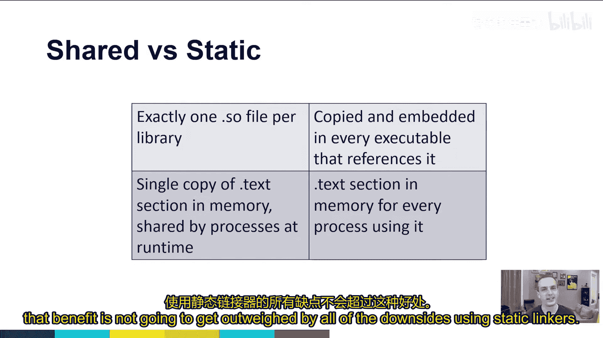

Our shall。And we look at。The file， this hello world not out。It's 11 kilobytes。

 and this is our dynamically linked version if instead of we were to say hey， Gcc。

 how about you compile everything you need into that program， It's just perath。

 how bad could it be Well， we can do exactly that。Can run this code and any guesses as to how big that's going to be。

 I'll show you right now， same line。828 kilobys， so the better part of a megabyte is needed for us to run Ho world twice。

That's only slightly ridiculous， but that's the entirety of the C standard library brought along for the ride in this program。

 So as I mentioned in the previous video， this is ridiculously inefficient。

 Not only am I putting that 800 sun kiloby in my Hello world dot and out。

 I'm putting it in bash and L D D and this and that。

 every single thing I compile with the standard library of Gcc。 I get an extra。😊。

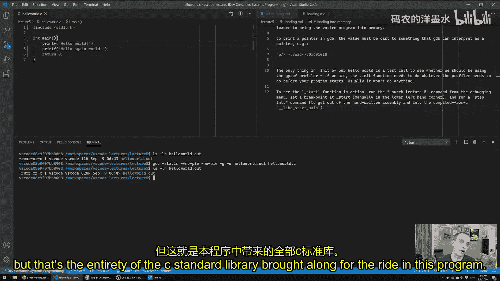

Almost megabyte of storage used on my hard drive。 And there's lots of executables on your hard drive。

 And even worse than that。 there's a lot that you load into memory。

 If you can't share that memory among different places， you're very。

 very quickly going run out if you're running lots of different programs that use the same libraries。

 It's the same stuff。 but it got linked into different statically linked executables in different places。

 So it' would be a lot better if we had one copy that we could keep some place in memory。

 and then just refer to it from other places。 not only will this save us disk space。

 it'll save us memory space。 And when we save memory space。 remember that makes our program faster。

 The less memory that gets taken up with this copy of the C standard library or that copy of the C standard library。

 the more of the meaningful stuff can stay in L1 or L2 cache and go super， super fast。

 So where do we put all the stuff in memory。 This is one of those big challenges。

 We are trading a modern amount of complexity for a lot of performance in specific situations。😊。

But we've got to figure out how to do it correctly。 Remember， this is our most important thing。

 If we don't make it correct。 we don't have a job。 So we need to make this work properly。

 even though there's only one copy and there's going to be a few challenges that come to mind。

 This is gonna be another really great example of what the challenges are that we see as system designers。

 We see that there is a problem。 We're using way too much memory。 and we'll use too much memory。

 Our programs are slow。 We run out of disk space。 We run out of memory。

 We can't run as many programs at the same time。 There's lots of reasons we want to use much less memory。

 And we saw， hey， there's this opportunity。 We're taking the same thing and we're copying it over and over and over again into different places in memory and in theory。

 we don't need to have all those。 And that's our challenge。

 That was the insight that somebody said when they invented dynamic linking。

 there's got to be a better way。 We can't keep doing this stupid thing of loading the same thing in different places。

😊，But that it's not just like， oh， just load in the same place。 boom done。 right。

 It's a lot harder than that。 And we're just going to see the final answer。

 But what we want to try and develop in this class is our ability to see a problem like that and say。

 aha Here are a few of our rules of thumb for building a system， designing a system。

 whatever have you。 Here's how we're gonna approach a new problem that we've never seen before。

 So we're just going to cover the story of how does dynamic linking work。

 And hopefully you'll be able to approach problems you've never seen before。

 and use the same approach。😊，So how do we make it correct， How do we make it fast。

 So our first problem with how to make it correct is that in a statically linked executable。😊。

All of our text is in this text section。 All of our global variables are in this data and BSS section。

 That's everything that's coming out of that executable file on disk and getting shoved into the segment of virtual memory as gets loaded in the program image when we're loading things into this memory mapped region。

 we're doing pretty good。 We've got a place of memory。

 which like this is where our shared libraries will go。

 But different programs are going to load them in different places and maybe even the same program is going to load them in different places at different times。

😊，So our first challenge here is that everything in this text section has to refer to not only its own global variables。

 but possibly global variables it uses from other libraries or global variables getting used from the main executable。

Correctly， and it doesn't know where it's going to be。

 So we can't use any absolute addresses in that process of talking about anything。

 whether it's in our data section of our own individual library or it's a global variable that was an external。

 So maybe Lib vectorctor。O relies on the C standard library， in order to get its job done。

 and maybe it calls things in its text， maybe it uses a global variables from LibC。O。😊，That's legal。

It's a symbol that gets resolved， but the problem here is that those symbols aren't necessarily going to live in the same place at the same time。

 but this text is going to be set in stone as soon as you compile that soon as your Gcc C on Libvector do C。

 you've got an executable。 That thing needs to work whether it's loaded into my program or your program or somebody else's program and it might get loaded into different places。

😊，The solution to this is relatively straightforward。 And we've already seen。

 know a few hints about how this works。 What we're going to build here is what's called position independent code。

 We are going to create segments of。😊，Code such that no matter where they are in the address layout of a running program。

 they will always function correctly。So we don't know what address offset it's going to be at。

 but this thing that gets loaded into memory， if we go back over here。SoLipsy。

so can't be sure about where it gets loaded in memory。

 it can't be sure about what program is loading it。

 but what it can be sure of is what it can control， right？What it can control is its own layout。

 its own text and its own data。 So what it's going to do。

 it's going to say whatever I refer to something in my own data section or in my own text section。

 I am going to refer to it using PC relative addressing because if I know where I am in the text。

 I know how far away a specific variable is in my own data。 I know how far away。

Any of those things are， and I'm going to use my own data section and my own text section to talk about things in this relative manner so that I can be positioned anywhere that I want within the memory layout of that running program。

So we know all these distances between things， we can always use PC relative addressing。

 So by compiling our libraries with position independent code。

 we will be able to make sure that all of their references internally will be consistent。

 They will all work regardless of whether they are loaded in any given address。

 This is going to be the solution for local references。

 So anything static is always going to be fixed purely by adding position independent code。

 But unfortunately， we're not out of the woods yet。

 we also have to talk about those references that go across the boundaries between different libraries。

 Remember that it's legal for you to have an external that comes from another library or have an external that comes from the main program out into a shared library。

 So let's talk about how we get all this stuff to work。

 So remember that our linker is going to do these two different things。

 It's going to resolve the symbol is's gonna to figure out which one it needs to use and then it's going to relocate based on that。

 Normally， what we've been talking about so far is we'。😊，Kiing during build time。

 when we know that we're creating something that's all special， just built for just us。

But in the dynamic library world， but in the dynamic library world。

 we need to split this process up into two segments。 One。

 we've got to find those functions and find their。Signatures so that we know how they're going to be called。

 what library they're going to be called from and load those relocation entries in saying here is where a function with this many arguments of this kind is eventually going to be put and we're going to add a interpret section that will start this entire process of eventually linking up the procedures and the global variables that are part of that dynamically linked library so then when we load the entire program。

 the dynamic linker is going to relocate the text and data based on wherever it's supposed to end up based on how that dynamically linked executable was created。

 and then it's going to relocate the references to any symbols that are shared in that。Library。

 so here's an overview of how the whole entire thing is working。 when we're doing dynamic linking。

 what's really important here is that there's things happening at build time and there are things that are happening at load time。

 So at build time， we need the relocation and the symbol table information。

 We need to know that these symbols exist here。 We need to know how big the symbols are。

 We need to know that they will eventually be included。 so we can't do the linking process。😊。

At build time， without access to the libraries。 But the important thing is that while we do need the symbol table information in the relocation entries。

 we don't need the actual text or the actual data that's going to go into memory。

 That stuff is going to get pulled in later at load time by the loader itself。

We need to have access to the entire library then because obviously we've got to pull it in from that library。

But the main thing to remember here is we only need that relocation and symbol table information at build time。

 we don't need what the information is inside them。

 we don't need the actual instructions of those programs or the actual data that's in the global variables we only need to know how big they are and what their names are so it will eventually be able to put them into the symbol table of the final executable and then once that final executable is on disk。

 it knows that it will eventually pull in the。😊，Code and the data of that program at load time that's done after the program has started by this LD Linux s estimate。

 So the next big thing we're going to cover is actually how we pull this stuff in and these two things we're going to pull in are going to get pulled in very differently we're going to pull in variables and we're going to pull in procedures pulling in variables is the slightly easier thing So this happens at load time right when the program starts running。

And it's going to be done using this thing called a global offset table。

 There's this great line that I've probably talked about so far that all problems in computer science can be solved by adding an additional layer of indirection。

 This global offset table is a layer of indirect between the dynamically linked library code and where those individual variables live。

 What the dynamically linked library has is this readr area within its own data section called its global offset table。

 It always knows I need to load things from the global offset table when I need to access a global variable。

 It's basically a little to do that says。😊，When you slow this program。

 then you're going to know where these symbols are。

 Then you're going to know where this global variable is。

 So what you need to do is update the reference to now point to that global offset table entry。

 And so what this eventually does is。At load time， the dynamic linker is going to say。

 I need to go fix all of these locations， and I am going to have my global offset table that has all of those entries in it。

 and I'm going to go find hey， where is the address of X。 Hey， wheres the address of Y。 Hey。

 wheres the address of Z， Because we didn't know what they were when we were just talking about a dynamically linked library。

 But now that we do have a fully running executable， the simple resolution process is finished。

 And I know where in memory X is eventually going to be。😊，Now that we have that location。

 we're not done yet， right， because we have that read only code that we can't change that's part of the text that's maybe going to access X。

 So in this case， it's incrementing x by one What we're going to use here is that layer of indirect。

 We're just going to use an indirect pointer to say load the value in。

Offset three of the global offset table into a register and then。

Increment the value that is stored at that address in RAX。

And then save it back to wherever it's supposed to go This is basically dereferencing pointers。

 this is like 261 stuff that we're not going to cover too much。

 but the basic idea is that we have addressing modes for our instructions that allow us to say rather than increment the value in this specific register。

 we're going to increment the value in memory pointed to by the address stored in this register so we're going to load the address into the register we're going to do the thing through the register using our addressing mode and then we're going to save it back once it's done。

Just like you would any other normal global variant。嗯。

So the next thing that we're going to cover are。Position independent code for function calls。

 This is where it gets a little bit trickier， but I do have some live demos。

 And so we should be able to figure out how this works and see basically how， how it's going to go。

 So the first important thing we need to know about position independent function calls is that they're only bound at the last possible moment and。

😊，The insight here， and this is going to be another one of those really important concepts for the entire De class is that the operating system doesn't do anything that's useful in and of itself for the user。

 It's always doing things on behalf of the user's code that does what the user wants。

 So if you don't need to do something to support what the user is trying to do， don't do it at all。

Lazy binding of function is one way to do that。 If we only bind the function。

 the first time it's called， if I have a standard library that's 800 kby big and has hundreds of hundreds of functions in it。

 I'm not going to waste any time linking this function in that function in the next one。

 the next one the next one that never get called by a program。 All that my program needed was print。

 I don't need to link all of those other functions in。

 I just want to link that one individual function。😊，So we save a lot of time。

When we don't link those things。If we're never going to use them。

 but we're going to use a lot more time。At runtime for those specific things that we do use。

 it's going to take a little bit more time for us to do that in initial linking of those functions that we are using。

 And we've got to deal with the complexity of the first time we call it from this read only text。

 we needed to do one thing。 but every other time we call it。

 we needed to do something else and making read only code do different things at different times。😊。

At least to me sounds hard， so let's figure out how it works。Yeah。

 and it works using the procedure linkage table， the procedure linkage table has a few special entries where it has PLT sub1。

 which is what runs right at the beginning， it has PLT sub0ro。

 which actually points to the dynamic linker that will find our library functions and store the references to them into memory at the places that they're supposed to be。

And it also interacts with the global offset table， which we already were using for global variables。

 we're additionally going to use this to store the addresses of the functions we're looking for and we're going to jump through to those to see what we're doing so the high levelvel way we're doing this is roughly the same as finding the variables we're going to find the thing we're going to put the address in the local in the correct place and we're going to jump through an address to get to it。

😊，The hard part is how do we do that linking the first time that the function is called and not every other time after that。

 and that's what the PLT is for。So PLT entries are three assembly instructions that are very specifically designed to work fast and correctly at doing this task。

 What PLT entries do is their first instruction jumps to an address stored。

In the global offset table， which is itself readrite。It pushes a function identifier onto the stack。

 and then it jumps to the procedure linkage table sub0， which is the。

 which is the dynamic link itself。 So those that second and third thing are the job of。Doing the。

 the linkage。 So that's the thing that we definitely want to run the first time。

 But that first part is a jump to an address stored in a read， write region of memory。

 So that's the thing that we can change。 So that very first instruction kind of。

Can do different things based on different states of the program。

 but those next two only do one thing， remember this is read only code。

 it's going to push an identifier for a function on the stack and it's going to call the dynamic linker it's like。

 hey， dynamic linker， do your job。So our challenge here is what do we set that global offset table entry to in the beginning to make it work？

In the first case， it needs to fix the address and in every other case it needs to just as fast as possible。

 go call that function， So we're back in our VS code window and here we're going to find out how to call that function。

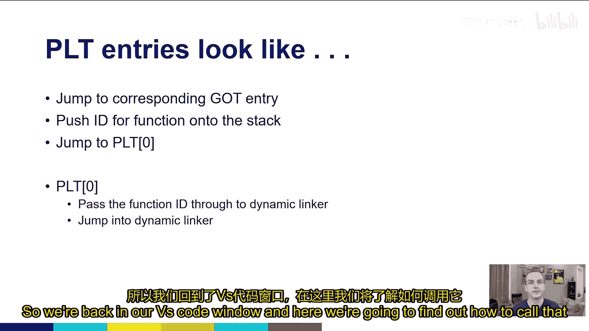

Let's go back to my notes that I can't see， but still work。

 So we're going to recompile this dynamically。 So let's get rid of our static。

So we recompilile this dynamically， I've also got this no PIe in modern Linuxes by default it makes absolutely everything position independent because position independent is already a good idea。

 it's actually useful for a security measure called addressbased layout randomization which well cover a little bit much later on in class but the basic idea here is that this makes it a little bit easier for us to step through and see exactly what's happening So if we want to see the addresses of the PLT and the GT and all of those other things。

 we can do a readDLF。Of capital S W。And so in here。😊。

So in all the sections of the program we can see a few useful things like the PLT starts at 403 e0。

 we've got the global offset table which starts at 600 FF0 and we're eventually going to use those later the GT PLT here basically an extra pointer to where the procedure entries in the global offset table start so it kind of overlaps right so the entire global offset table exists and then the GT PLT is a subset of that entire thing。

Next thing we want to do is。Bang out our GDP。So we're GDPing and I am going to break on Ho World4 and I'm going to break on Hello world5。

 So let's run we're on line4 of hellello world in Maine。 And so just to get our bearings。

 let's take a look at all of the assembly code of mainine。 So let's just assemble mainine。

So here we've got this， whatever this is 10 instructions of mainine and the important things that you want to see is that we have got two calls to。

 again， the same exact address both times， it knows that it needs to call to a specific address in the procedure linkage table。

Now， if I want to see what is there， I can disassemble printf at PLT。

And this is what it would jump to when it ends up going to that location。

 so here it's going to jump there and it will hopefully sort of G will hopefully tell us that this offset from the instruction pointer is 601018。

 so let's open another terminal and get our VDLF up again with SW。

So that in this window we'll keep track of our addresses and。In this window。

 we will keep track of our assembly code。So 601018 is a location。

 601018-601018 is an address in the PLT， okay， so that makes sense right let's go back over here and take a look at what does that location have。

 So the very first time we come into Kath。We're going to immediately jump to this PLT。

Entry this PLT entry has these three instructions for it。 We're going to jump to a specific location。

 We're going to push an address， and we're going to jump to the beginning of the PLT。

 What this does is it goes up to PLT sub0。So when we come in here， the very。

 very first thing that we're going to do is we are going to find the。Address stored at this。

Memory location。 And we're going to jump to it。 So if I want to find the address stored there。

 look at our cheat sheet。We want to print。Inha， the value stored at the pointer。Zero x601018。

And that is。Hex 403 f6 Hex 403 F6 just happens to be the very next address of the PLT entry。

 So what we did is' super it sounds illogical right we jumped all the way down to the PLT and then from there we're jumping all the way up to some address in the global offset table There's some address pointeding to by the global offset table and it tells us all to come all the way back down to the next instruction。

If we wanted to get to the next instruction， we could have done literally anything。

 we could have done a Noap， we could have done an add immediate of this to that or whatever he we can do a million different useless things just to go from one address to the other。

 why the heck did we do all that work for nothing。Well。😮。

Because the first time through we want to run that first instruction of the PLT entry。

 then the second instruction of the PLT entry， then the third instruction of the PLT entry What the third instruction of the PLT entry does is it goes in and calls the dynamic link what the dynamic link is going to do it is going to find the global offset table entry for printf and instead of putting that next address in there it's going to put the real address of where printf actually is in 601018 so。

😊，This is the first time we call it。And if I continue， I'm going to end up on Hello world again。

 So this is before we call print for the second time。 So if I disassemble print PLT again， again。

 read only code no surprise， same exact exact stuff。 We've got a jump， a push and a jump。😊，However。

 the important part here is that if I。Print。This address， again， it no longer shows me。

What was that 4003 F6 Now it's showing me this thing that's way far away so this value used to be pointing back here right into the text of the program to just look at that next instruction。

 but now it's actually pointing into that memory mapped region。

 which is where we bring all of our dynamically linked libraries in So what the dynamic linker did in addition to fixing this was bring printf in and put it in the right place from a file on disk where LibC。

so exists。

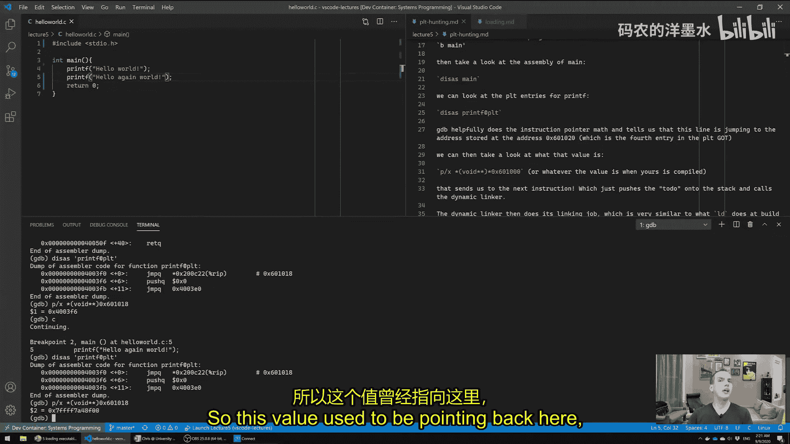

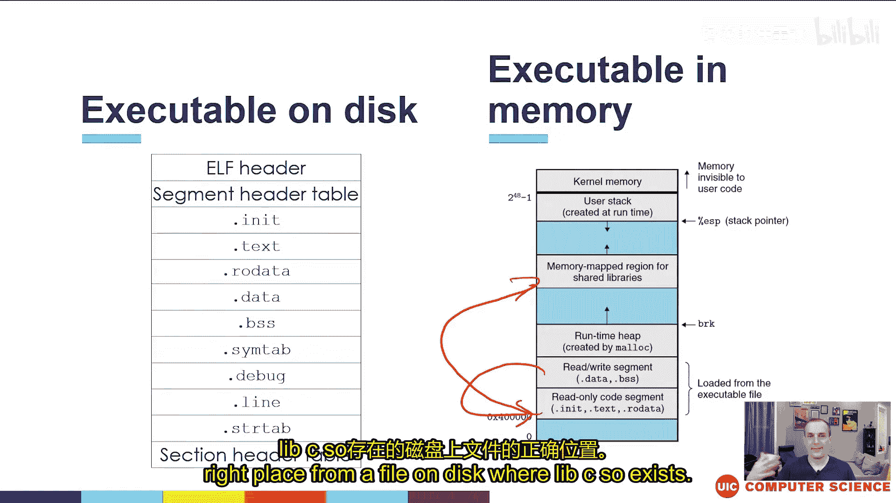

So if we disassemble。The function， if we say G， pretend that this is the beginning of a function。

 disassemble it and show me the code for it。 Not only do we start seeing， oh。

 these are instructions that look like real instructions。 So this disassembly was believable。

 We also see that this just so happens to point to a symbol。

 That symbol is underscore underscore printf， which is where printf exists。

 So we have successfully linked our procedures。 And the really important part here。

 is that we're making the common case fast。 I can't stress this enough。

 if there's one thing I've learned about system design and making things fast in general。

 it's that different things happen at different。😊，Frequencies， right。

 which is going to happen more in any program that doesn't call printf once。

Printf being called the first time or printf being called every single other time it ever gets called。

The system designer said， okay， I want to make the common case fast。

While I'm doing this dynamic linking thing， or I've got to do this extra stuff。

 The super naive way that we could have done our。Dynamic linking was to say， and if then else， right。

 if this is the first time， then fix it else。Just jump to it and that would be super。

 super inefficient because we're always hitting that true branch and not hitting that false branch a little bit better would be to say if it's not fixed yet。

 then go to fix it a slightly more efficient way to do it would be to say if it's already fixed。

 then just jump to it。Otherwise， go fix it。 And while that is better than the opposite direction where we always hit the untaken branch or where we where our common case is hit the false branch rather than hit the true branch。

 it still is inefficient。 We've already got to do that。 compare， then do the jump。 do the compare。

 Then do the jump。 That's not as efficient as just doing one indirect jump。 So this。

 this is really clever here， right， where we say， no matter what jump to the address stored in this place。

 the designers knew that these indirect jumps through other locations in memory are very efficient。

 Like the processors designed to do that well。What the designers of the P LT said was， okay。

 I'm gonna take advantage of that fact。 and I'm always going jump through this specific address and memory to a location。

 The first time I jump to it， I'm going to do this weird thing。

 or I just jump to the next instruction。 And I'm gonna to fix things。

 And I'm ready to go yada yada whatever。 But every other time after that。

 The common case is every other time you call print。

 And in that common case you only do this one indirect jump。 You don't do any branches。 you just go。

 go go Fewer branches mean faster code because your branch predictor doesn't have to work。

 It's just going to start loading and loading and loading。 And it gets the job done fast。

 So making the common case fast。 again， super， super useful， super， super important。😊。

ruleule of thumb to keep track of when you're trying to apply systems thinking to any problem that you're solving。

 even if it's not coding related， you want to make the thing that happens the most as fast as possible。

 That's always going to be useful in any process that you're trying to design。

 The other important thing I want to talk about here is the wise of this problem。

 So I want to leave you with a few questions that I'm not going to give the answers to immediately。

 But you should definitely think them over is if it's such a good idea to link these things just in time right before they get used。

 why don't we use that for a global variables as well。And my other question is。

 why don't we link functions the same way that we link global variables。

 but I've already kind of talked through。The insights there right we're making the common case fast and most importantly。

 that the answer to that first question on the slide is basically we're not necessarily going to use all of these functions when we bring in hundreds and hundreds of functions from a shared library a lot of them are probably going get to use zero times and an operating system is supposed to get out of the way and let the application code run as fast as possible。

 That means that doing extra work before it's actually needed is always always going to be wasted because you as the operating system where you as the library writer don't know what your user is going to want to do。

 maybe somebody uses every single function in the C standard library。

 but we're probably they won't So that's one of the reasons why we're not going to link at load time because there's lots and lots of functions in lots and lots of libraries and we're probably only going to use a few of them So we don't want to waste that time at programs start up to maybe save time if lots of those functions get used and。

Because we've got this really really clever procedure linkage table。

 we only really pay a big fee in terms of time the very first time a function is run every time after that we have a very clever setup such that it's going to be very fast to run every single other time that's what I've got for you today Thanks so much for watching and I'll see you next time。

😊。

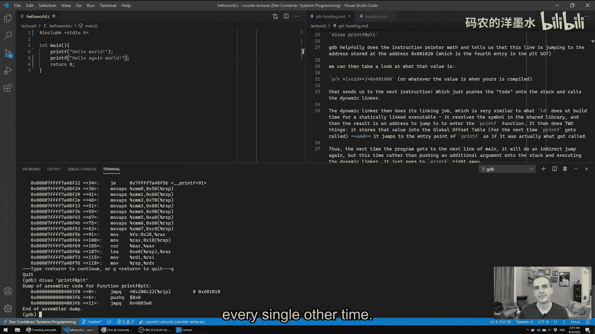