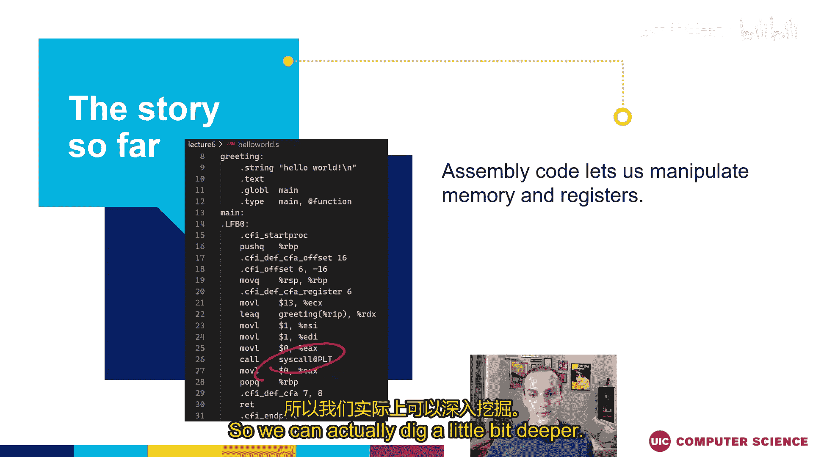
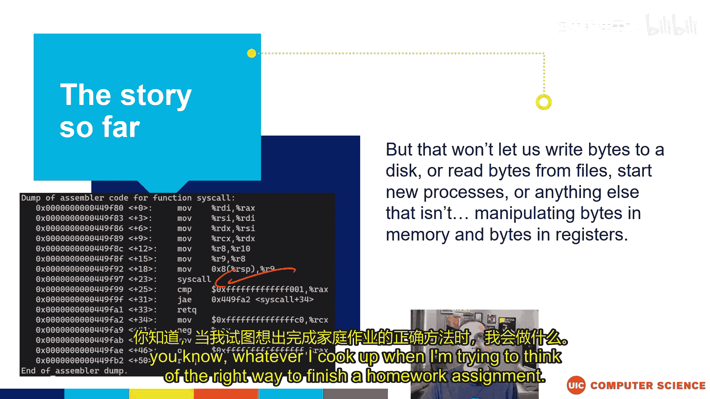
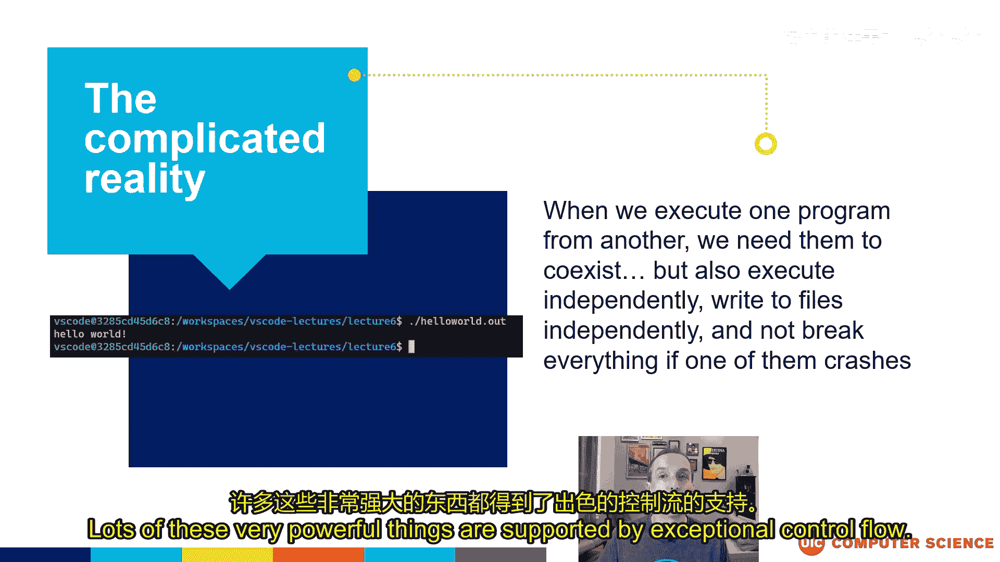
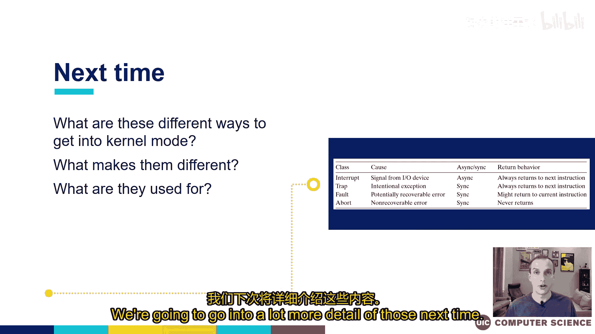

# 【全集】伊利诺伊大学 操作系统 中英字幕 1080P p02 Lecture 2 - 异常控制流 -BV1AEASzNE3z_p2-

Hi， I'm Chris Ka and the CS 361。 System programming。

 Today's lecture is about exceptional control flow， which honestly， high of sounds kind of boring。

 but it goes way deeper than that。 What we're gonna to be talking about right now is fundamentally one of the most powerful tricks that the computer is going to play to allow us to actually run programs。

 So rather than talking about this as exceptional control flow like kind of like talking about it as using the computer to actually do things。

 The techniques that we're learning about are all supported by this idea of an operating system and what that operating system is doing is suspending and resuming different programs as fast as it possibly can so that we can't even see it happening。

 allowing multiple programs to run seemingly simultaneously allowing the programs to actually do interesting things by interacting with the outside world rather than just interacting with the registers and their memory locations and the results of their operations。

 and it's actually going to do what we always want with。😊。

All of our computers to affect the outside world so what we've been building on so far over the course of chapter 7 is everything else that we've done in our CSs degree is writing code which manipulates memory addresses and registers it goes through an ALU or an FPU and it does some operation and that operation has some result that either goes into registers or it goes into memory if we think about that we can say well yeah that's。

True and that lets us do interesting things like red bubble sort or whatever have you。

 but the end result is still just different elements in memory。

 And if we think about other things that we do like oh yeah we do hello world what is hello world exactly like is it writing special things into special memory addresses。

 what is actually happening there。 So the code I have on screen right here is just a very basic hello world program and we can see that there is a cis call that goes into the procedure linkage table and it finds something and it's going to do something for us。

 this is just a basic hello world program and everything besides this call to cis call at PLT is just setting things up to actually run this function call called cis call so we can actually dig a little bit deeper we can go and disassemble that function call cis call and we see that it puts some arguments into registers that it's going to use to do some sort of function call。

And then it runs an assembly instruction called says call， and so Is say， okay， that。

Different right so that's fundamentally what we are going to be doing in many。

 many situations when we are interacting with the outside world， our code。

 which simply has access to its own registers and its own memory and interact with the outside world in and of itself。

 It's actually got to use the operating system to create an ability to affect the outside world because we don't want every individual program to have that responsibility。

 we only want that to be taken over by a more trusted piece of code that's not just you know whatever I cook up when I'm trying to think of the right way to finish a homework assignment。

 So this gets a lot more complicated than just finding a way to write characters to the screen or in this case a virtual terminal。

 What we're going to do is cause multiple programs to coexist let them write to files independently not break everything when one individual program crashes Lots of these very powerful things are supported by exceptional control flow。

Before we dig into what ECF actually means， I've got a few terms that I want to define a little bit more clearly than they're defined in the book that a process。

 exception and current， a process is a running instance of a program what a process consists of fundamentally is a memory layout。

And a collection of values stored in registers。 That's all you have when you're actually doing a program。

 You've got what is its memory and what is its registers。

 If you are going to take a program and just closet in time and look at everything that's relevant for that individual running process。

 that instance of a program， that's what you would have。

 you would have its memory layout and you would have its registers。

 there's extra information that the operating system will keep track of。

 but from the perspective of the running process itself。 that's what it sees as its entire world。

 That is the state of an instance of a running program on the other side of this where this concept called the kernel。

 Now， when we look at an individual running process， it has both its user level memory。

 as well as its kernel level memory。 And these are part of that full running process。

 Part of everything program that's running as a process on your computer is the code that the person who wrote that program rope that's the。

codeode for PowerPoint or the code for Chrome or the code for whatever have you。 On the other hand。

 every single one of these processes has an extra hidden half almost that is all of the text of the operating system itself。

 This is a little bit of a tricky topic that a lot of people get tripped up on。

 but the basic idea is that there is no concept of a process that can be running。

 and on the other hand， a kernel。 The kernel itself is a collection of exception handlers and privileged code that will always be running on behalf of an individual process。

 even if that's a special process like the init process。

 which is a special process that the operating system starts at Buha。

 The kernel is always running in the context of a given running user level process。

 It has access to extra things。 and it will only be running the text of the operating system。

 But there's never a kernel without a user level process connected to it。 Then the fundamental。😊。

Part， which is the topic of class for this week is exceptions and exceptional control flow What we're going to be covering in class this week is not only the abstract concept of exceptional control flow when we for instance jump not equals to do a conditional jump as a result of a for loop or something along those lines。

 but when we move from one protection domain where we're running the user levelvel code and jump into the kernel that process of going from running normal code to running the kernels code is the entire topic of what we're gonna be talking about this week and is accomplished using exceptional control flow So exceptional control flow is actually really powerful it allows us to accept network packet。

 create new processes kill other processes duplicate processes。

 bring information in from disk deal with instructions。

 debug our programs dozens and dozens of interesting and fundamental things that are all about using the full。

Cpailities of the computer rather than the abstraction of a memory address layout and a collection of registers。

 which is what our assembly code is capable of doing。

 So if we stick with this abstraction of a regular process a little bit longer， we can see that。

A process is really defined by this box， which is a collection of text and a collection of memory addresses and the set of rules for how to use registers and the CPU to run each of these instructions。

 maybe you jump up to another one， maybe move on to the next one those are the two types of movements that the instructord pointer can make it can go on to the next one in memory or it can do a instruction that is explicitly about jumping to another location and memory possibly conditional on the value stored in an individual register。

 but at the end of the day if we want to affect the outside world besides the by stored in the RA of our computer。

 we need to actually be able to affect the system state。

 we need to have some way to change what's showed on a screen or create a packet and send it out on the network or interrupt a running program without that we can't actually have effect on the outside。

And're trying to and that's what we're digging into this week。So this。

Affecting of the outside world is going to be done。

Primarily by the operating system itself as part of the kernel。 Now I'll talk about the kernel。

 I'll talk about the operating system。 Usually those ideas are the same。

 one last point I forgot to mention here is that colloquially。

 when we talk about an operating system， we're also kind of talking about all of the extra stuff that the OS is doing usually in other user level processes at the same time。

 one of the most wellknow。Components of that is the init process。

 which is kind of the parent process to every single process that runs on our machine。

 This is something that gets started as part of boot up。

 and it always exists as part of your running。Computer。It doesn't do anything itself。

 but it does a lot of housekeeping so that the other user level processes can do the useful things that you want to do with your computer。

 So if we look at it like a Venn diagram， we've kind of got the kernel is this part there's the OS itself and then there's also lots of other things that intersect with the kernel remember that every running user level process has a kernel component to it。

Remember in this drawing， we've got kernel side， user side。

Every one of these individual processes like in or processes that keep track of memory and swap files and things along those lines has a kernel side and a user level side。

 but a lot of them are spawned by the in process to just keep the entire computer running。

 They aren't there for individual user level benefit directly So exceptions are our doorway to get from user level to supervisor level and there's a few different ways for that to happen。

 The one that I showed in the example at the beginning of this video is an intentional way to get in there where we say yes。

 I want to write bytes to the screen which I'm effectively going to do by writing them to a virtual file but there's a lot of other ways that this can happen this can happen as a result of an error。

 this can happen as a result of just as normal operation of regular old instructions on the CPU and understanding the different ways that we can get in how they work what they're for。

 etc is the point of。😊，This chapter。 but in general。

 what we're doing is we're going from running the user level code within the user level process at the unprivileged level to running the kernel code with extra privileges in the OS level。

 Each of these individual exceptions can either just do something temporarily and then go back to that running process。

 do something temporarily and then rerun the instruction that caused the exception or do something temporarily and then kill the process and move on to another one。

 So another kind of important topic here if we go back to our our Venn diagram where we're talking about the OS and we're talking about the kernel is part of the OS within the kernel is part of the OS。

 the kernel is not necessarily the same thing。The kernel is not necessarily the same thing as running as root or administrator or UID zero or whatever you want to call that。

Heightened level of privilege。 That level is fundamentally different。

 Those are still user level processes doing things at user level。

 They just have a specific set of permissions that allow them to say。

 open files regardless of who owns them or start on arbitrary number of individual processes。

 that is still user level code that has heightened privileges。

 which is a fundamentally different thing than running in supervisor mode。

 A really quick way to kind of understand the difference is that root is。😊。

Elevated privilege determined by the operating system in terms of what it's able to do。

 whereas kernel mode is elevated privileges defined by the processor itself the processor has a bit that says I am running instructions in privileged mode or I am running instructions in unprivileged mode。

That is the kernel privilege versus unprivileged supervisor mode versus user mode when it comes to administrator mode versus regular user mode。

 that's enforced by the operating system and not by the CPU itself when you're running a root shell。

 you're not running in the kernel， you're just running a。Elevated privilege user level process。

So I was really racking my brain about what to use for an analogy here between user level processor and supervisor mode。

And the best thing that I could come up with is to talk about user level processes as like Clark Kent and。

Supervisor mode as Superman and the CPU itself is like the body of the person called Clark Kent there's only one body that is either performed by Clark Kent who's just a regular guy or performed by Superman who has all the privileges of a white man。

 I guess we could say so fundamentally we have both the both of these are present。

At any given moment in time， it's just a matter of which one is being actively run at any given point in time。

 So the kernel is fundamentally a collection of code run via exception handlers。

 It has the ability to work closely with hardware。 It can directly send messages and receive messages from。

 say peripherals on the universal serial bus or the robots of the hard drive that you have connected to your machine。

 And this privilege is incredibly important。 You could very easily mess things up for your entire running computer if you start writing the wrong garbage to your hard drive。

 for instance， This capability is very sensitive So it's only given to code。

 which is running at this supervisor mode and whether you're running in supervisor mode or user mode is determined by the processor itself。

 The processor is going to be in control fundamentally because it is the body that is running these things。

 whether it's the Clark can version or the Superman version。

 but a really important part here is that you've only got one。😊，At a time。

 you're never gonna have both of them active at the same time。

 You're either running in user mode or you're running in kernel mode。

 So another important implication of the fact that we've got the user level code and the kernel code all running on behalf of individual processes。

 there's no special thing that allows the kernel to take over when the user level code is running。

 the only way that we can allow that to happen is when the kernel。

 before it transfers control over to the user level code says he CPU I'm going to set a timer when this timer fires。

 you need to evict the user level code， whatever instruction it's running and transfer control back to me that process is called exceptional control flow that is how we can let one process run for a certain amount of time and then evict that。

Current threat of control， you know which instruction you're on， which stack frame you're in。

 etc cetera。 and switch over to some other code。 That's effectively what the kernel is doing。

 If there's one other thing that I want to explain here over the course of this entire class。

 It's that the kernel is never going to be running independent of individual processes。

 it's always going to be running on behalf of an individual user level process， but we can。

Restrict the capability of those individual user level processes through the help of the CPU right。

 the CPU is really the part we care about here， where it is going to be cooperating with the kernel to a certain extent to evict the user level code and bring the kernel back in。

 The kernel can't bring itself in by itself。 It has to be working with the CPU to cause a timer to fire。

 which causes an exception to happen， which causes the kernel to start running again。 This again。

 kind of tricky stuff， but I'm trying to fill in what。

I think from the reading doesn't really get a whole lot of。Focus。

 even though it's the hard important parts of these concepts。 So as I was mentioning。

 the kernel is nothing but a collection of interrupt vectors that the CPU knows how to invoke based on what type of exception happens。

 each of these。Exception handlers has a pointer to some collection of assembly instructions that run in privileged mode based on what has happened on CPU。

 They just get stored into memory in the most logical way possible。

 We have this collection of interrupt vectors。 where we basically say， was this interrupt one。

 go here。 It was interrupt 2， go here interrupt3， go here， et cetera， et cetera。

 These are basically the very first。Instructions that start running when you have switched from user level code to kernel mode code。

 you've got to figure out which part of the kernel you're going to start running。

 And that's what the interrupt vectorctor is for。 So there's dozens and dozens of exceptions that you have access to。

 We don't just have one exception handler that handles the entire operating system。

 There's lots of these different ways to start running the code of the operating system。

 And all of them are invoked based on what caused the exceptional control flow to happen。

 The CPU transfers control based on which。Instruction of the kernel is listed in the interrupt vector。

 It also sets the supervisor mode bit that all the CPU is in charge of at that moment in time。

 The kernel will then take over in running instructions that are relevant to handling whatever exception it was that had just happened。

These exceptions fall into four different categories that we're going to go into a lot of detail about over the next couple of videos they' interrupts。

 traps， faults and aborts， they're all used for different things。

 this is a great table that I pull right out of the book that is a good thing to refer back to they're used for different things they are operated in different ways and they cause different side effects we're going to go into a lot more detail of those next time thanks so much for watching and I'll see you next time。

