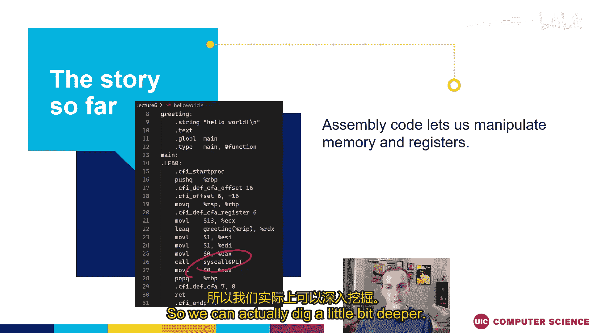
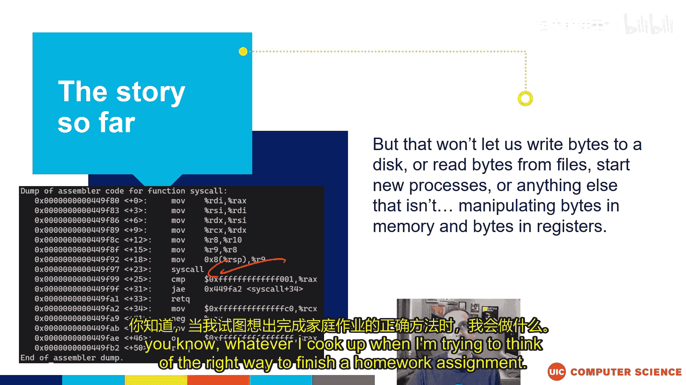
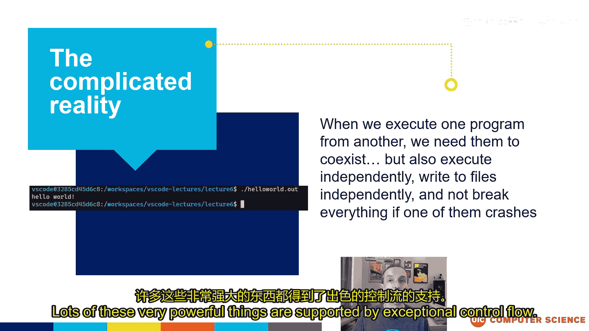
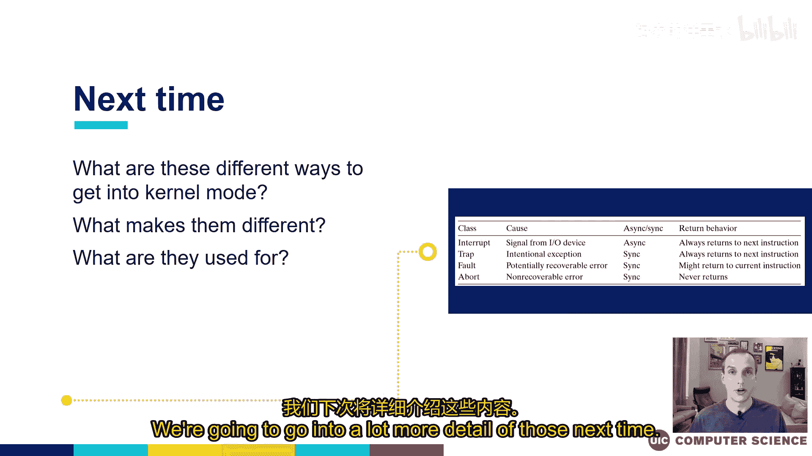

# 操作系统：第2讲：异常控制流 👨‍💻

在本节课中，我们将要学习**异常控制流**。这听起来可能有些枯燥，但其内涵远比表面深刻。我们将探讨计算机如何利用这一核心机制来实际运行程序。本质上，我们将学习操作系统如何通过快速挂起和恢复不同程序，来实现多任务并行、程序与外部世界交互等强大功能。

## 概述：从程序到进程

到目前为止，我们编写的代码主要操作内存地址和寄存器，通过ALU或FPU进行计算，结果存入寄存器或内存。这让我们能实现排序等算法，但最终结果仍只是内存中的不同数据。

那么，像“Hello World”这样的程序是如何与屏幕交互的呢？让我们看一个简单的例子：



```c
#include <stdio.h>
int main() {
    printf("Hello, World!\n");
    return 0;
}
```

这段代码的核心是一个对`printf`的调用，它最终会通过一个特殊的指令与操作系统交互。程序本身只能访问自己的寄存器和内存，要影响外部世界（如屏幕、网络），必须借助操作系统这个更受信任的实体。异常控制流正是实现这种交互、让多个程序共存、独立写文件、在程序崩溃时不导致系统瘫痪等强大功能的基础。

## 核心概念定义





在深入探讨异常控制流之前，我们需要明确几个核心概念。

### 进程

一个**进程**是一个正在运行的程序实例。从本质上讲，一个进程由两部分构成：
*   一个**内存布局**。
*   一组存储在**寄存器**中的值。

对于一个正在运行的进程而言，这就是它的整个世界，也是该程序实例的运行状态。

### 内核与用户空间

每个运行中的进程都包含两部分：
1.  **用户级内存和代码**：这是程序员编写的代码，例如Chrome或PowerPoint的代码。
2.  **内核级内存和代码**：这是操作系统本身的代码，对用户进程是隐藏的。

一个关键点是：**内核总是在某个特定用户级进程的上下文中运行**。内核是一系列异常处理程序和特权代码的集合，它拥有访问硬件等额外权限。不存在一个独立于所有用户进程而运行的内核。

### 异常与异常控制流

**异常控制流**是我们本周课程的核心。它不仅包括像条件跳转这样的常规控制流改变，更重要的是指从运行用户级代码（非特权模式）跳转到运行内核代码（特权/监管者模式）的过程。这个过程就是通过**异常**来实现的。

异常控制流非常强大，它使我们能够接收网络数据包、创建新进程、终止进程、从磁盘读取信息、调试程序等。它让我们能利用计算机的全部能力，而不仅仅是汇编代码所抽象的内存和寄存器。

## 用户模式 vs. 监管者模式

上一节我们介绍了进程和内核的概念，本节中我们来看看权限级别的关键区别。

### 根本区别

这里需要区分两个容易混淆的概念：
*   **Root/管理员权限**：这是由**操作系统**定义和管理的更高权限级别。拥有此权限的用户级进程可以执行如打开任意文件等操作。这仍然是**用户模式**的代码。
*   **内核/监管者模式**：这是由**处理器本身**定义和执行的更高权限级别。CPU有一个专门的位来标识当前是运行在特权（监管者）模式还是非特权（用户）模式。

简单来说，Root权限是操作系统层面的权限提升，而内核模式是CPU硬件层面的权限提升。当你运行一个root shell时，你并没有运行在内核中，你只是运行在一个拥有更高系统权限的**用户级进程**中。

### 一个类比

为了更好地理解，我们可以做一个类比：
*   **用户级进程**就像**克拉克·肯特**（普通人）。
*   **监管者模式**就像**超人**（拥有超能力）。
*   **CPU**就像是这个人的**身体**。

在任何时刻，这个身体（CPU）要么表现为克拉克·肯特（执行用户代码），要么表现为超人（执行内核代码）。两者不能同时激活，一次只能处于一种模式。

## 异常控制流的工作原理

理解了权限模式后，我们来看看模式切换是如何发生的。

### 内核的被动性

一个重要的含义是：内核代码无法在用户代码运行时主动“夺取”控制权。当内核将控制权交给用户级代码后，它必须依赖CPU的协作才能重新获得控制权。

具体方法是：内核在交出控制权前，会**设置一个定时器**。当定时器触发时，CPU会**中断**当前正在执行的用户指令，强制将控制权交还给内核。这个过程就是**异常控制流**。它使得操作系统能够在一个进程运行一段时间后，“抢占”它并切换到另一个进程或处理其他事务。

### 中断向量表

内核本质上是一系列**异常处理程序**的集合。CPU根据发生的异常类型，知道该调用哪个处理程序。这些信息存储在一个叫做**中断向量表**的数据结构中。

以下是中断向量表的工作原理：
*   它是一个指针数组，每个条目对应一种特定类型的异常（如中断1、中断2等）。
*   当异常发生时，CPU会根据异常编号，跳转到中断向量表中对应的地址开始执行。
*   同时，CPU会将自己的状态位设置为**监管者模式**。
*   随后，内核代码开始运行，处理刚刚发生的异常。

## 异常的分类

异常有多种类型，它们用于不同目的，操作方式不同，产生的副作用也不同。异常主要分为以下四类：

以下是四种主要异常类型的简要说明：

| 类别 | 原因 | 异步/同步 | 返回行为 |
| :--- | :--- | :--- | :--- |
| **中断** | 来自I/O设备的信号 | **异步** | 总是返回到下一条指令 |
| **陷阱** | 有意的异常（如系统调用） | **同步** | 总是返回到下一条指令 |
| **故障** | 潜在可恢复的错误（如页缺失） | **同步** | 可能返回到当前指令 |
| **终止** | 不可恢复的错误（如硬件错误） | **同步** | 不会返回 |

我们将在接下来的课程中对这四类异常进行更详细的探讨。

## 总结



本节课中，我们一起学习了**异常控制流**的核心概念。我们明确了**进程**是运行中的程序实例，由内存布局和寄存器状态定义。我们区分了**用户模式**和**监管者模式**，指出后者是CPU硬件级别的特权状态。我们了解到**内核**总是代表某个用户进程运行，并通过与CPU协作（如定时器中断）来实现进程调度。最后，我们介绍了异常的四种基本类型：**中断**、**陷阱**、**故障**和**终止**，它们是程序与操作系统及外部世界交互的根本机制。理解这些概念是掌握操作系统如何管理资源和执行程序的关键一步。