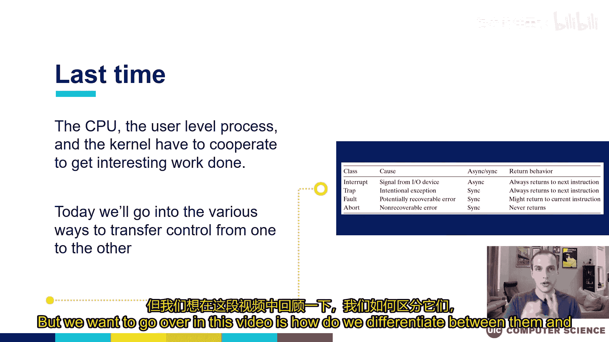
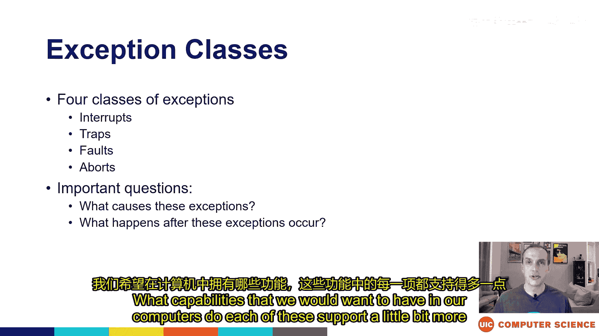
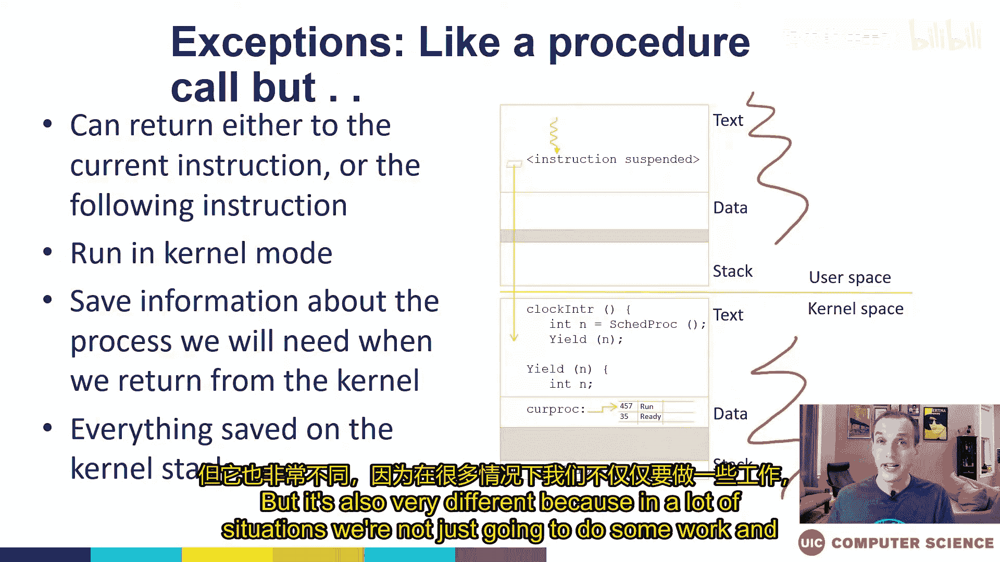
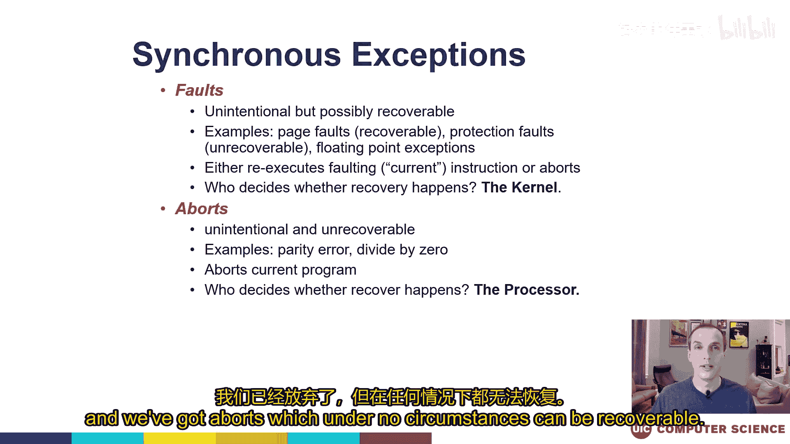
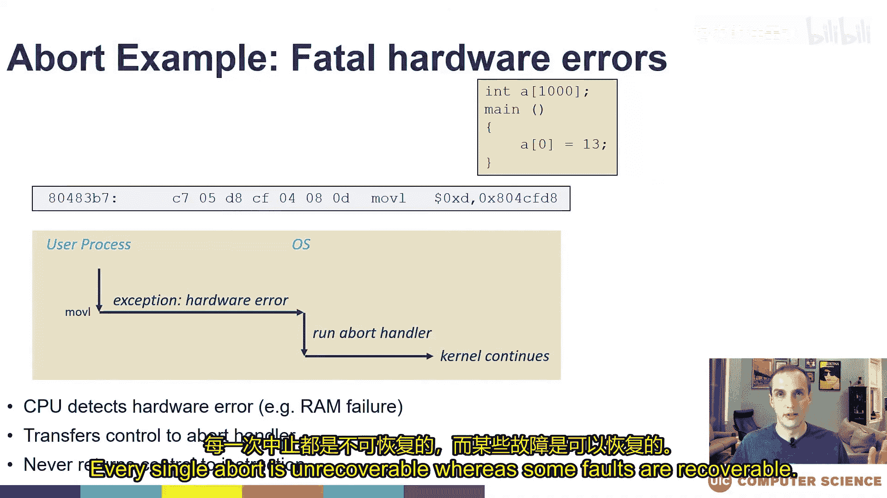
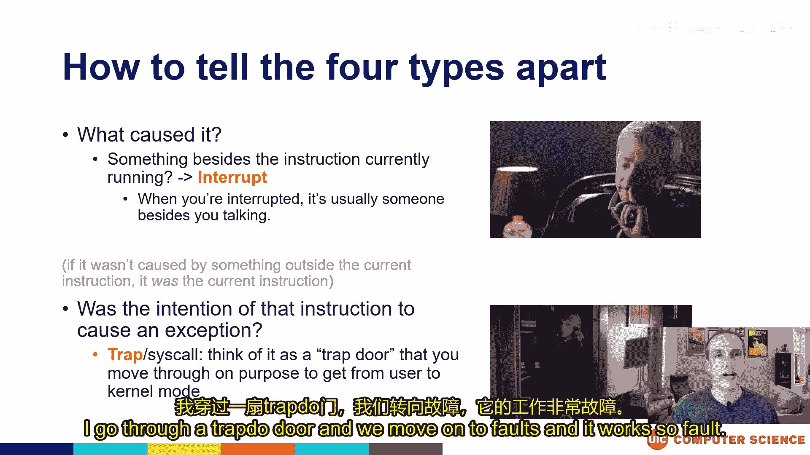
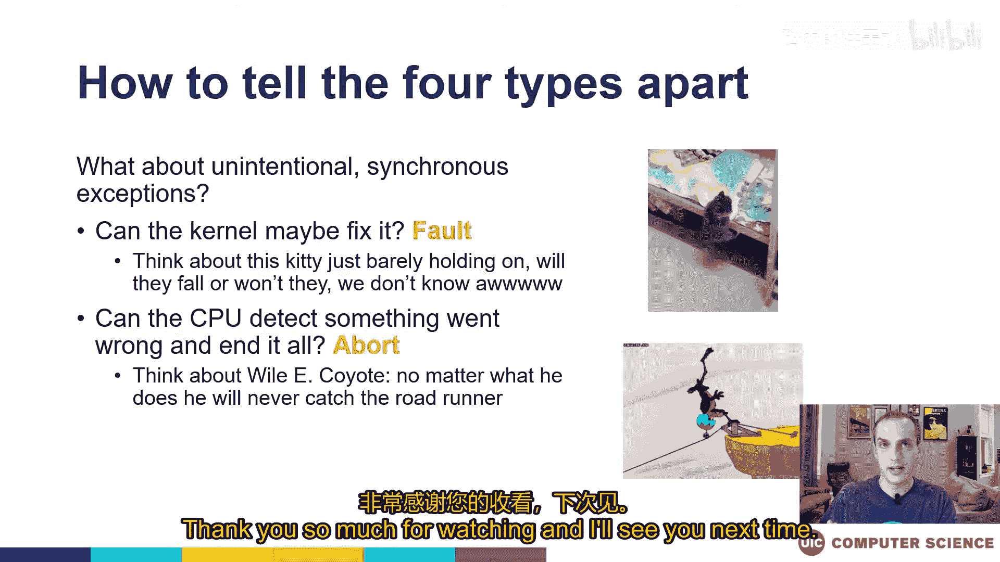

# 【全集】伊利诺伊大学 操作系统 中英字幕 1080P p03 Lecture 3 - 异常四类型 -BV1AEASzNE3z_p3-

Hi everybody， I'm Chris Kash and this is CS361 Systems programming Let's get started today we're going to be talking about the four flavors of exceptions。

So where we last left our heroes was this idea of exceptional control flow where we move from a user level process doing user level process stuff like running instructions and manipulating registers and memory to running supervisor mode code that has full capability of using the computer with all of its peripherals and all of its capabilities the process that we go through to go from running unprivileged code to running privileged supervisor mode code is called an exception there's four main ways that we move from being in one mode to being in the other mode。

 but we want to go over in this video is how do we differentiate between them and what they are each individually useful what capabilities that we would want to have in our computers to each of these support a little bit more about exceptions they're very similar to procedure calls except that rather than being one stack frame to the next stack frame one instruction pointer to some other instruction pointer they are。

One。Execution mode to a completely different execution mode。Within the same process。

 but no longer running the same code， the user level code is both the code that you wrote yourself directly and the code that you brought in as part of the libraries that you chose when you compiled your code into a user level hello world program or a user levell program like Chrome。

 the text and the data on the kernel side wasn't written by you。

 it wasn't chosen by you except insofar as you chose to use Linux or you chose to use Windows。

All of those kernel space halves of those processes are running the same coat。

 Every single one of them is the same exact text of the Linux kernel for my Chrome window for my bash for my PowerPoint for whatever。

 Likewise， the data of the kernel space is shared among all of these different processes and is used for keeping track of what processes should be running and other important things that the kernel is in charge of like memory。

 So the important takeaway here， is that when we move from an individual instruction through the exception handler into the kernel。

 it's similar to a procedure call in that we're saving the state and we're moving over to another location。

 but it's also very different because in a lot of situations we're not just going to do some work and then come back。

 So the first flavor that we have are asynchronous exceptions which are called interrupts。 Now。

 when we talk about asynchronous here， we specifically name not with respect to the。😊。

Individual instruction that's running on the CPU at this point in time。

 there's the entire world of things that can go wrong or go right or whatever have you with respect to an individual process。

 but an asynchronous exception and interrupt comes in from outside。

 It can be the result of a timer firing。 It can be the result of someone hitting control C on the keyboard or hitting the reset button on the machine itself or it can be a packet coming off of the network。

 the important part is that it was not caused by the instruction actively running on the CPU at that moment Now asynchronous exceptions are typically normal operating behavior of a computer right when packets are coming in off of the network that's not unexpected。

 that's not going to cause the currently running program to terminate。

What the operating system needs to do is it needs to handle that stuff so that it can be pulled out of the memory of the network card or pushed onto the screen for whatever reason。

So typically， interrupts don't cause the currently running process to terminate。

 They just get handled by the operating system， and then the currently running process is put back on and is allowed to continue with whatever it was doing。

 One important aspect of the fact that interrupts come from outside of the currently running process is that they aren't causing the currently running instruction to break in any way。

 the CPU is doing its pipeing and it finishes whatever instruction it was trying to finish at that moment in time。

 then the next instruction rather than being the next instruction of the user program is the instruction of the interrupt handler。

For this in this case， interrupt。 And once the operating system has finished running that interrupt handler and doing whatever it needed to do。

 it's going to transfer control back to the next instruction of the user level code。

 So as far as the user level code is concerned nothing happened。

 it ran instruction1 that in instruction 2 ran instruction 3 it ran instruction 4 from the perspective of the operating system or someone observing that entire computer running。

 it would see user level instruction 1， user level instruction 2 while user level instruction 2 is running and interrupt comes in that says。

 hey， you've got to。Read this packet off of the network and then the CPU transfers control over to the interrupt vector and it finds what text it needs to run to handle that interrupt。

 It pulls that information in and sorts into a buffer it does whatever it needs to do。

 and then it transfers control back to user level instruction3 and user level instruction4。

 etc cea runs after that。 So from the perspective of the user level code。

 nothing happened from the perspective of the kernel， it got woken up by the CPU。

 It did what it needed to do。 and then it just pulled like it went back to sleep and let the user level process continue running on CPU that's all that happened。

 The next flavor of exception， are intentional synchronous exceptions。 These are called traps。

 they are also called cis call effectively interchangeable terms。

 but I think the book is typically going to use traps to talk about this flavor of exception whereas cis calls are more of when we're programming these things that's what we call them and that's what we do saw。

A previous lecture that Cis call is just an instruction that you can view what you can do with Cis call as an instruction is you can store the correct information in the correct registers and on the stack。

To run a specific。Privileged instruction that only the operating system is allowed to do。

 and then you run that Cis call program， which basically like max your code out。

And wakes up the kernel and the kernel is going to do whatever it was you asked it to。

It's also going make sure you're allowed to do that and it's gonna to do it in the correct way。

 and then it's gonna transfer control back to you。 That's what hellello world is fundamentally doing。

 You're setting everything up to ask the kernel hity， I'm not allowed to write to files myself。

 I'm allowed to tell you to write to the screen， but I'm not the one that's actually sending those bytes to that specific file。

 I am giving control to the kernel to do that privileged instruction of writing to a file in this case standard out once the operating system has accepted those bytes to write to stand it out。

 it is done doing what it's supposed to do and it gives control back to the user Another important thing here is that nothing unexpected is happening and so I want to run instruction one instruction to cis calls instruction3 that puts your code to sleep the operating system wakes up the operating system is in supervisor mode。

 It does whatever that interrupt handler tells it to do and then the operating system goes to sleep and it transfers control。

to the user level code and it continues doing whatever it was going to do after printing hello world to the screen or whatever that Sys call was doing that Ss call can open files。

 it can send packets， it can create new processes。 It can change what process is currently running。

 There's lots of things that it can do but this is also normal expected behavior for that running process So there's no reason to do anything beside just run the next instruction that's effectively always what you're going to do The one kind of special exception is that there is a cis call called exit which allows you to terminate yourself as a running program So that's kind of like the exception that proves a rule。

😊，Running the exit cis call causes your program to go away and you don't return to the next instruction because there isn't an next instruction。

 whereas every other cis call effectively is just going to do something on behalf of that process that it wouldn't be able to do on its own and then transfer can fall back to the user level code The other two flavors of exceptions are synchronous unintentional exceptions that are not caused by us planning for a specific thing to happen。

 we've got fault which are potentially recoverable when we've got aborts which under no circumstances can be recoverable。

 So one example of a fault is a page fault， we'll see a lot more about these details when we hit the next module of this course but for now the important thing for us to know is that these。

😊。

Instructions cause bad things to happen that can be potentially fixed。

 So I guess the simplest thing that I can talk about here is say we're trying to use a dynamic linker and say we need to map a file into our address space that has the code of printf in it for us when we're trying to access that memory。

 It's not actually mapped into the physical banks of Ram in our Ram chips yet。

 It's still probably stored on a file someplace。What the operating system is going to do there is it's going to try to load those bytes of memory from a specific address。

 It's going to recognize that that load will not succeed because the page is not in memory。

 It'll say， okay okay that page is not actually in my memory banks yet。

 but but I'm just gonna pause you。 I'm going go find it。

 I'm going to put it in memory and then I'm going rerun that instruction for you。

 That entire process is recoverable most of the time most of the time that file does exist on disk and we are going be able to bring it in。

 but sometimes we won't be able to the important thing that sets it apart from aborts is that the kernel is in charge of figuring out whether this happens or not and it's possible that it will allow the instruction to run over again。

 So this is the one exception that can potentially rerun an individual instruction。

Remember from my example earlier。We just let the code run as fast as it possibly can because in the best case scenario。

 that page is already in memory and we don't want to slow down our running program。

 We just want it to run instruction 1，2，3， Fuller， etc cetera。

 But sometimes instruction2 could potentially cause a page fault where the operating system says。

 hey， remember how I told you that page was in memory。 I Chinaa didn't have it in there yet。

 I was just gonna to fix it as soon as I can。 And so it fails at running that instruction because the memory is not there for it to do a load。

😊，It says okay okay okay， I can fix it。 I can fix it。 It pauses it。 It pulls that stuff in。

 and then the super important part here is that it's going to rerun that instruction。

 It's going retry loading that piece of file from disk into memory。

 It's going retry performing a load from that specific offset。

 And this time probably hopefully usually it will succeed。 As I mentioned。

 sometimes it's going to succeed。 sometimes it's basically never going to succeed。

 say it's a completely invalid address like you're trying to load from address0。

 which we've all done many， many， many， many times。

 That mistake is detected by the same apparatus as this page fault mechanism that says aha this load is not going to succeed。

 I need to figure out why it didn't succeed。 It might be a page fault that can be recovered。

 It might be a protection fault because that memory wasn't writeable or that memory wasn't even readable。

 It was address  zero。 That is going to be something that causes you to try to load from a fully illegal address。

 in which case the kernel realizes yes。😊，I can load from a fully illegal address and it's just going to terminate that process。

 it's not going to transfer control back and rerun that instruction because there's no way that it could run legally。

 it just needs to be terminated。This is where we have a segmentation fault that that name comes from the fact that the valid areas of memory in our memory layout are kept in a segment table and if you're reading from one of those legal segments。

 you don't have a segmentation fault， but if you read from a address that is in between these legal segments。

You are causing a segmentation fault you are reading from an invalid signal The fourth and final flavor of exceptions is aborts。

 Abborts will cause the same thing as an unrecoverable fault。 The program will get terminated。

 but they're typically due to fatal hardware errors。

 they are something that the CPU itself can be sure that this program will never start over again。

 The difference is a little bit subtle and fundamentally at the end of the day。

 whether your program gets terminated because of a general protection fault or a segmentation fault versus a ra error is not really that useful because your program is still dead。

 but one flavor of this requires the kernel to figure out what to do next and one flavor of this is already understandable by the CPU itself knowing hey。

 something horrible went wrong， It's no fault of the code itself or the operating system even this is something horrendously wrong with the hardware itself。

 That's what。bored。Exception is the operating system is still going to try to recover from that and start running another。

Process， you know， if this is a really bad ramer， like so we rip the Ramm out， Yeah。

 every single one of those processes is just going to start accepting and hitting the a claim。

 dying pretty soon you're going to get a blue screen or a kernel panic or whatever have you， but。

The conceptual difference still exists。A abort is caused by hardware failure。 It is unrecoverable。

 no matter what every single abort is unrecoverable， whereasas some faults are recoverable。

 How to tell these four different things apart。 I came up with four。

Fun animated gs。That each individually have to do with a different type of exception so we got interrupt like when we get interrupted。

 it's because someone else is talking so that that will help us remember these asynchronous interrupt our some other operation happens outside of our running code and it doesn't break our code and so hopefully we'll be able to continue talking after this interrupt happens so we return to the next instruction。

😊，Traps the word trap comes from this idea of a trap door where you intentionally go through the trap door to get from one room to another or whatever have you' got a secret doorway that goes from user space to kernel space That's the way that I think about it and when I think interrupt trap fault board okay interrupt I get interrupted trap I go through a trap door and move on to fault and emors So fault Ive got this this little cat where you're not sure is he gonna fall is he not gonna fall Oh my gosh。

 we don't know， we don't know and that's just that's a fault。

 a fault is something where it might fail， it might not。

 but we won't know until the kernel actually checks it could be a segmentation fault that can't be recovered it can be a page fault because a page of memory hasn't been loaded from the disk into Ram yet we don't know until we run it。

And finally， an abort I just got some Wiily coyote in here because no matter what Wiily coyote always fails and usually it's not his fault。

 it's acme's fault or it's the roadrunner's fault， right。

 something happens that doesn't have to do with。😊，The code that's running and it will never， ever。

 ever succeed。Wlie Coyote never succeeds。 Abborts never succeed。

 That's the difference between assault and an abort。 Thank you so much for watching。

 and I'll see you next time。

