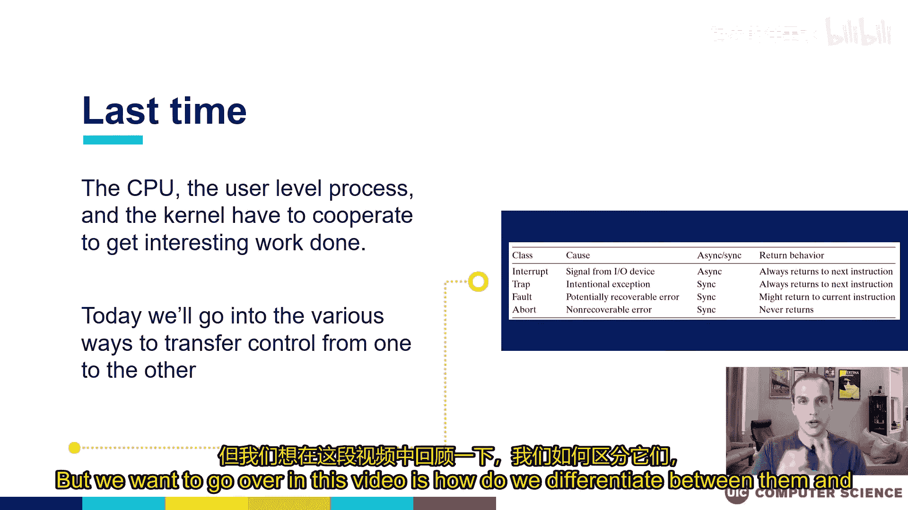
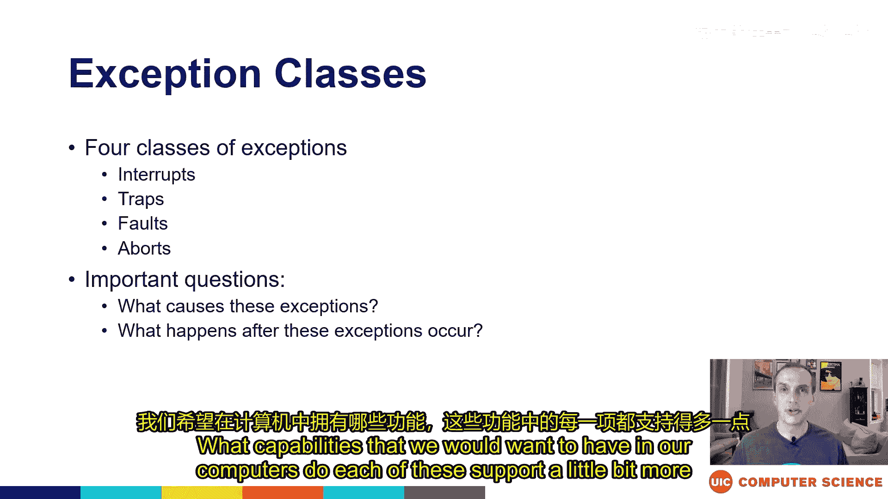
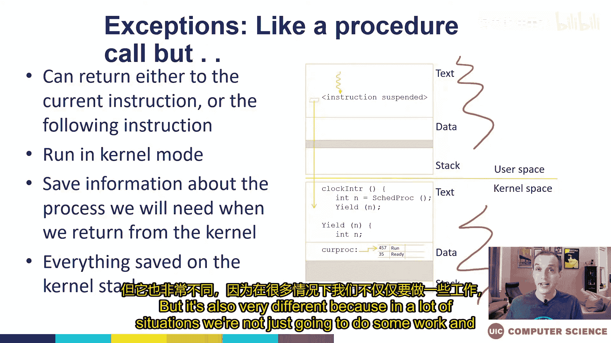
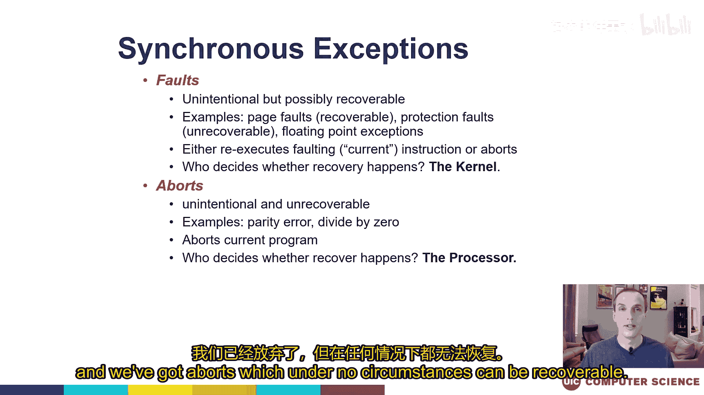
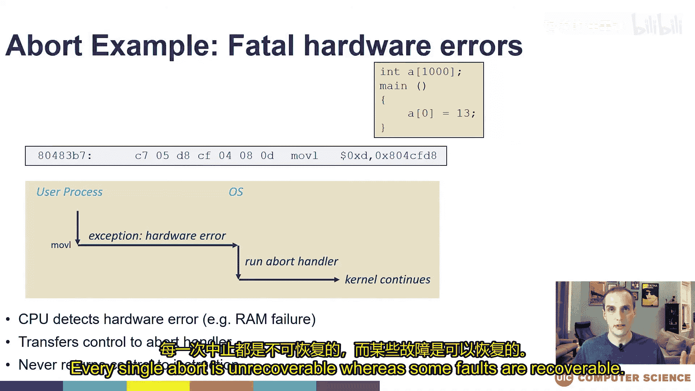
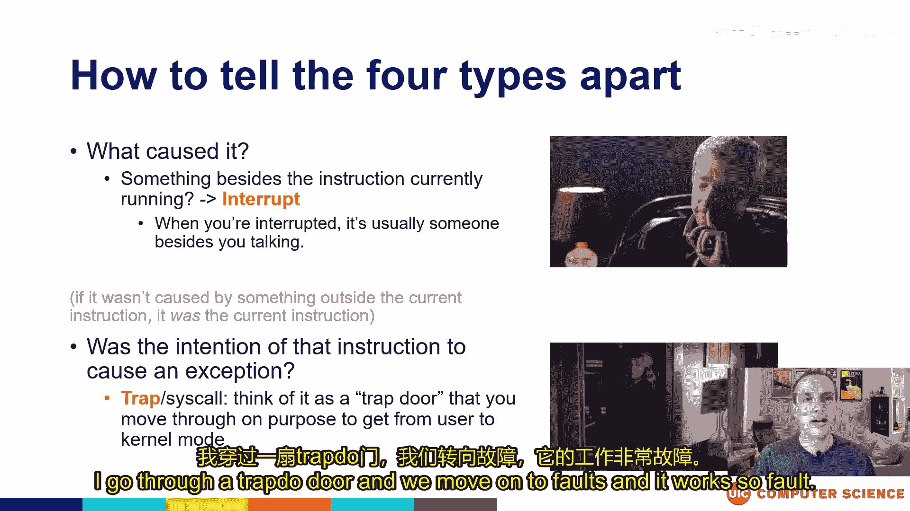
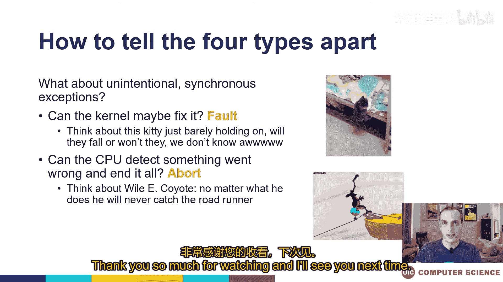

# 操作系统：第3讲：异常处理的四种类型 🚨

在本节课中，我们将学习操作系统中的**异常控制流**，特别是从用户模式切换到内核模式的四种主要方式。我们将详细探讨每种异常的特点、触发原因以及处理方式。

---





## 概述

上一讲我们介绍了异常控制流的基本概念。本节中，我们将深入探讨**四种不同类型的异常**：中断、陷阱、故障和终止。理解这些差异对于掌握操作系统如何管理硬件和软件交互至关重要。

---

## 异常与过程调用的异同



异常与过程调用有相似之处，但存在关键区别。过程调用是在同一执行模式下，从一个栈帧跳转到另一个栈帧，从一个指令指针跳转到另一个指令指针。而异常则是**从一种执行模式切换到另一种完全不同的执行模式**，尽管仍在同一进程内，但运行的代码已完全不同。

用户级代码包括您自己编写的代码以及编译程序时引入的库代码。内核空间的代码和数据则并非由您编写或选择，它由操作系统（如Linux或Windows）提供。所有进程的内核空间部分都运行相同的代码，即操作系统内核的文本，并且共享内核数据，用于跟踪进程状态和管理内存等。

**重要结论**：当通过异常处理程序从单个指令进入内核时，类似于过程调用，我们会保存状态并跳转到另一个位置。但两者又非常不同，因为在许多情况下，我们并非只是执行一些工作然后返回。

---

## 四种异常类型详解

以下是四种主要的异常类型，每种都有其独特的触发机制和处理逻辑。

### 1. 中断（异步异常）

中断是**异步异常**，其触发与CPU当前正在执行的指令无关。中断来自外部事件，例如：
*   定时器触发。
*   用户按下键盘上的 `Ctrl+C`。
*   按下机器上的复位按钮。
*   网络数据包到达。

中断是计算机的正常操作行为。操作系统需要处理这些事件，例如从网卡读取数据或更新屏幕显示。通常，中断**不会导致当前运行进程终止**。操作系统处理完中断后，会让被中断的进程继续执行。

由于中断来自外部，它们不会破坏当前正在执行的指令。CPU会完成当前指令的流水线操作，然后**将控制权转移给中断处理程序**，而不是执行用户程序的下一条指令。处理完毕后，控制权会返回给用户级代码的下一条指令。

从用户级代码的视角看，似乎什么都没发生。它按顺序执行指令1、2、3、4。而从操作系统或观察者的视角看，可能在执行指令2时发生了中断，CPU转而执行中断处理程序，完成后又恢复执行用户级的指令3和指令4。

**核心流程**：
```
用户指令1 -> 用户指令2 -> [中断发生] -> 中断处理程序 -> 用户指令3 -> 用户指令4
```

### 2. 陷阱（同步异常 / 系统调用）

陷阱是**同步且有意为之的异常**，通常称为**系统调用**。这是用户程序主动请求操作系统内核执行特权操作的方式。

通过系统调用，用户程序可以将正确的信息存入寄存器和栈中，然后执行一条特殊的指令（如 `syscall`），从而“唤醒”内核。内核会验证请求的合法性，执行相应的特权操作（如写入文件、发送网络包、创建新进程等），然后将控制权返还给用户程序。

这也是正常且预期的行为。例如，`printf` 函数底层会通过系统调用请求内核将字符写入标准输出。处理完毕后，控制流会返回并继续执行系统调用之后的下一条用户指令。



一个特殊的系统调用是 `exit`，它用于终止程序自身。执行 `exit` 后，程序不会返回，因为已没有下一条指令需要执行。这算是一个例外，它证明了规则：其他系统调用在执行完服务后都会返回用户空间。

**核心流程**：
```
用户指令1 -> 用户指令2 -> `syscall`指令 -> 内核处理 -> 返回用户指令3
```

### 3. 故障（同步异常，可能可恢复）

故障是**同步但非预期的异常**，它由当前运行的指令直接导致，但**有可能被修复**。一个典型的例子是**缺页异常**。

当程序访问的虚拟内存页面尚未加载到物理内存（RAM）中时，就会发生缺页异常。操作系统会检测到这次访问无法完成，于是暂停当前进程，从磁盘（如SSD）中将所需的页面加载到内存中，然后**重新执行**那条触发异常的指令。这次，指令通常就能成功执行了。

故障的关键在于，内核负责判断问题是否可修复。如果可修复（如页面在磁盘上），则重试指令；如果不可修复（如访问了非法内存地址），则可能升级为终止。

**核心流程**：
```
用户指令1 -> 用户指令2（触发缺页）-> 内核加载缺失页 -> **重试指令2** -> 用户指令3
```

### 4. 终止（同步异常，不可恢复）

终止是**同步、非预期且不可恢复的异常**。它通常由严重的硬件错误（如内存校验错误、电源故障）引起。CPU可以确定发生此类错误后，程序**绝无可能继续正常运行**。

终止与不可恢复的故障（如访问非法地址导致的段错误）在结果上类似，都会导致进程终止。但区别在于原因：故障通常由软件错误（如程序bug）引起，而终止源于硬件故障。发生终止时，操作系统自身可能也难以恢复，最终可能导致系统崩溃（如蓝屏、内核恐慌）。

**核心概念**：**所有终止都不可恢复**，而部分故障可以。

---

## 四种异常的对比与记忆

为了更好地区分这四种异常，我们可以借助一些形象的比喻：



*   **中断**：就像谈话时被他人打断。打断来自外部，处理完后我们可以继续刚才的话题（执行下一条指令）。
*   **陷阱**：就像通过一扇暗门（陷阱门） intentionally 从一个房间进入另一个房间。这是程序主动、有意地进入内核空间的方式。
*   **故障**：就像一只站在悬崖边的猫，它**可能**会掉下去，也**可能**不会。在操作系统处理之前，结果未知。可能是可恢复的缺页，也可能是不可恢复的段错误。
*   **终止**：就像卡通里的**歪心狼**，无论他计划什么，最终总会失败，而且通常不是他代码的问题，而是外部硬件（相当于“阿克米公司”的产品）出了致命故障。终止**永远不会成功恢复**。

---

## 总结



本节课我们一起学习了异常控制流的四种基本类型：
1.  **中断**：异步、来自外部、不影响当前指令、总是返回到下一条指令。
2.  **陷阱**：同步、程序主动触发、用于系统调用、通常返回到下一条指令。
3.  **故障**：同步、由错误指令触发、可能可恢复、可能需重试当前指令。
4.  **终止**：同步、由硬件错误触发、不可恢复、进程被终止。



理解这些异常类型，是理解操作系统如何管理资源、处理错误以及为用户程序提供服务的基石。