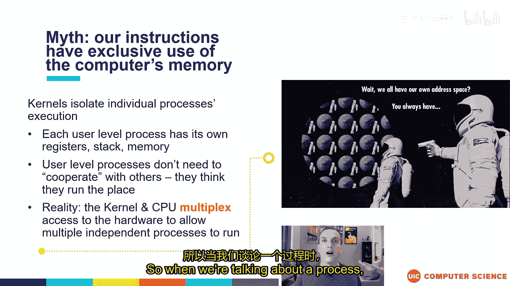
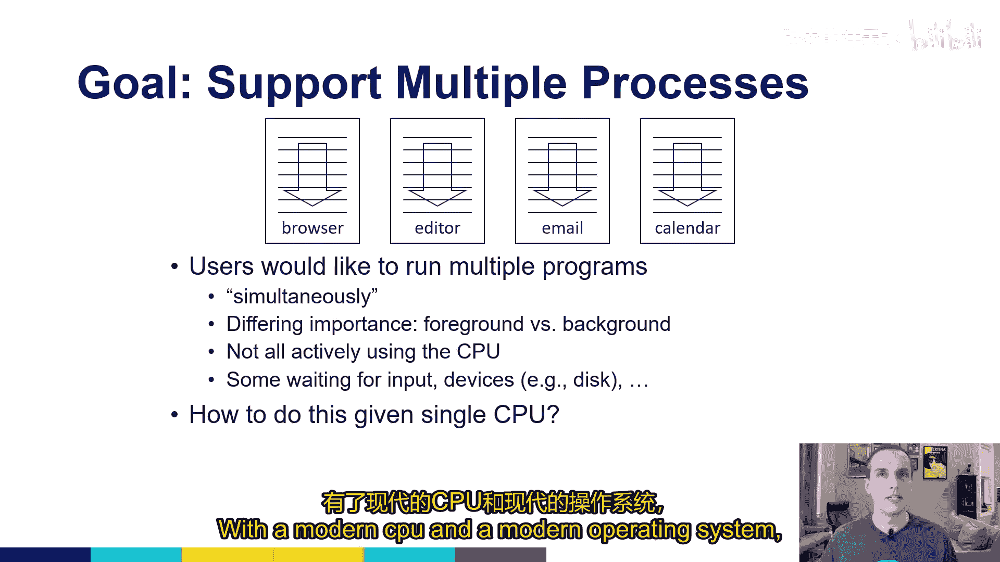
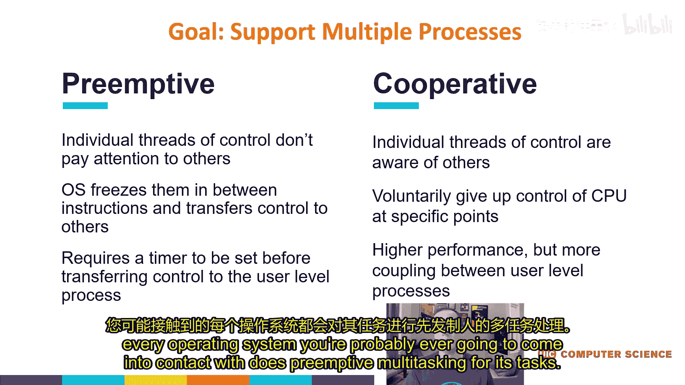
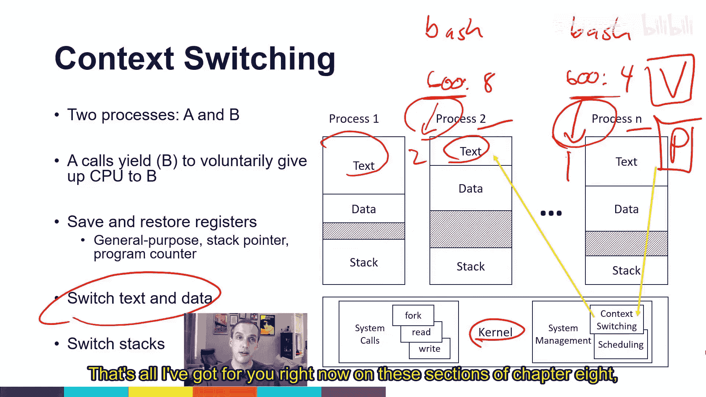

# 【全集】伊利诺伊大学 操作系统 中英字幕 1080P p04 Lecture 4 - Linux进程介绍 -BV1AEASzNE3z_p4-

Hi， I'm Chris Kensh and this is C361 System programming。 Let's get started。

 Today's video is about processes we're rounding out the idea of exceptional control flow one of the most important building blocks of running programs on a computer is this concept of a process and we're going start seeing a few of the different ways that the CPU and the operating system lie to your code to make everything work out correctly。

 So one of the biggest lies that we've been telling to your code is what addresses of the memory it is running at。

There is this myth that every single one of these processes has control of the entire address layout。

 everything from  zero to2 to the 64 minus1 and it's the only one that's reading or writing any of those bytes。

 so that is without a doubt not true we're going go into a lot of the ways that we actually make that work efficiently in the next module。

 but for now what we really need to keep track of is the fact that every individual running process has its own view of the world that simplifies things by allowing it to not have to intentionally cooperate with the other processes that are running on the machine。

😊，The reality here is that the kernel along with the CPU is multiplexing access to the resources of the computer in a way that allows each of these processes to run fast efficient and simply so that they don't have to worry about all of the other processes So when we're talking about a process we talk a little bit in the previous video about how fundamentally a process just consists of its memory layout and its registers here we've got that handydandy drawing we've seen of the memory layout of a running process and a list of registers from the X8664 manual In addition here I've kind of got the definition of a taskstruct so from the perspective of the kernel all the different processes are kept track of in their own taskstruct entry within an array of the different processes that are running on a given operating system So each of these processes fundamentally has state it has what's in its memory and it has what's in its registers it also has a little bit of metadata that the operating system is going to be keep。

track of like which areas of memory does it have access to and how do we translate between its crazy fake idea of what its virtual address space is and what are the actual addresses of the memory banks where those bytes are physically stored in chips of silicone？

In addition to that， every process can be in one of three different states。

 it can be running where it's actively on the CPU executing instructions， it can be ready。

 where it's in a queue which can start running instructions as soon as it is given access to the CPU or it can be blocked where it has gone to sleep either intentionally or accidentally and if it were given access to the CPU。

 it wouldn't be able to make forward progress in its program。

 There's no good reason to put that program back on the CPU at that moment in time。

 One reason for this happening would be a web server that is waiting for somebody to come and make a request it doesn't have anything to do because no one has made any requests or it can be your program like if your program needs to open a file from the disk。

 read in a bunch of bytes and then do some computation on it when it first says hey operating system。

 open this file。If that file is on an SSD or especially if it's on a rotating disc， it can be。

You know，10， 15 milliseconds before that file actually can be opened。

Millions of instructions can run in those 15 milliseconds。

 So there's no good reason for your process to just kind of sit there waiting。

 hoping it's going to finish， hoping it's going to open that file。

 It'd be much better for the computer overall to put that process to sleep wait for it to finish loading the bys from the beginning of that file or from the file system to figure out how whether it's allowed to open that file and then eventually start it back up and allow it to continue running whatever its next instruction is。

 so。😊，Our goal with having this process abstraction and having this task struck that keeps track of a list of processes。

 what we want to do with a modern computer， whether it has one CPU or multiple CPUs is run multiple processes at a time。

 multiple instances of programs that are stored on that computer's disk fundamentalamently。

 we want this execution to look simultaneous regardless of how many CPUs we have access to。

 because at the end of the day， most modern computing doesn't keep the CPU pegged with 100% of the time。

 it's possibly trying to do a little bit of this a little bit of that。

 And it's only going to be happening in。Response to some stimulus。

 whether it's somebody clicking a mouse or a packet coming in off of the network。 In reality。

 a lot of programs just don't have anything to do a lot of the time if they're not explicitly set up to be performing computation 247 So we got a few interesting questions about how we can actually achieve this with a modern CPU and a modern operating system。

 one of the most important decisions that we're going make both with respect to how an operating system does it as well as any situation where we're trying to do different tasks at the same time right so we're going to be learning about this with respect to operating systems coordinating the multiplexing of processes onto the hardware of the computer the same set of skills we're going to use to decide what design decisions we make and what implementation details we have are the same ones you would use if you wanted to multiplex the tasks of a。

serv or the tasks of a database engine， if there's lots of different things that are potentially coming in that all need to happen。

 that all need to happen that have a collection of instructions and I need to multiplex in。

 there's a few different ways that we can do that。One of the biggest decisions that you'll potentially make in the situation is whether you're going to be doing preemptive multiproces or cooperative multiprocessing。

 Pre-emptive multiprocessing is what we use in basically every operating system that you will come in contact with on a normal day- today basis even as a developer Preemptive multiproces posits that every program thinks that it has full control of the CPU for all time and full control of the memory address layout for all time that abstraction is incorrect that's not the reality of the situation but by exposing that reality to the process。

 it makes that process's job a lot easier like if you want to in a preemptive multitasking world compute a trillion digits of pi。

 you write your assembly code where you just make a random guess。

 see if it's in the unit circle make a random guess， see if it's the unit circle make a random guess。

 see if it's in the unit circle over and over and over。

 you don't have to do anything your process think。That it has full control over the entire computer It doesn not to coordinate anybody else if it doesn't want to。

 The reality is that the operating system is going to conspire with the CPU to yank your code off of the CPU every once in a while and allow other things to happen you do not have control over when your program stops running or not preemping something know literally in English means。

Getting in front of it and running before it runs。 That's what a preemptive multiprocessing world allows us to do。

 This is good because it makes things more simple。 It's bad because we need to find some way to effectively freeze something that isn't even aware this is happening and then resume it without having any sort of incorrect operation。

 But overall， it's pretty popular， especially for scheduling things at the operating system level。

 It makes running lots of programs written by lots of different people that don't know each other。

 don't speak the same languages， We't compiling the same languages to more or less cooperate by just not knowing each other exists。

 The other fundamental approach to running multiple tasks on the same computer is cooperative multitasking。

 This is where every individual process knows for some definition of knows about the other tasks that need to happen when it knows that other tasks are potentially going to happen。

 It needs to voluntarily seed control of the processor and allow other。😊。

cesses to run in certain languages like jascript。 This is just the way things work。

 your code runs for as long as it wants to run， and it won't get preempted。

 It will keep going until it decides to say， hey， I've had enough time。

 Let's check to see if other things need to be run。

 This sounds and it is a lot more complicated than our preemptive approach where there's a lot more coupling between task1 and task2 task 1 kind of got to know that task2 exists。

 might not need to know what it is。 but needs know it should check for it that has to happen in your code。

 in some way shape or form。 So that's a negative here，'s negative in terms of complexity。

 we're coupling the idea of multitasking with the user levelvel code of that process where in preemptive code our code doesn have to do anything with preemption The CPU and the kernel take care of preemption。

 Our code does it one thing does it as fast as it can It ignores the rest of the world。

 Cooperative code needs to know that it needs to do cooperative has to voluntarily do it as part of。

Instruction set。The advantages that we get out of cooperative code is that we're never going to get interrupted in the middle of something。

 So if we have some cash locality， if our code is running really fast because everythings an L1 cash。

 we can just do the。Processor intensive things that we need to do。

 And as soon as we're done with that chunk of code， we can say， aha， I'm at a good stopping point。

 I've got a lot of efficiency out of being able to run without getting interrupted。

 I'm going to let go。 I'm going to let someone else start。

That ability to control when we switch from one task to another allows you to have high performance processing。

 JavaScriptscript gets a lot of mileage out of this modern web servers get a lot of mileage out of this but it does come at a cost and that cost is increased complexity and increased coupling between the different responsibilities of the code and the operating system that are fundamentally supposed to be doing different things best case scenario。

 the operating system deals with scheduling tasks and the user level code takes care of the user level stuff that users care about every operating system I've ever used。

 every operating system you're probably ever going to come into contact with does preemptive multitasking for its tasks。

 So now that we have this idea of how we're going to share access to one specific CPU where either they're going to rip it out onbeknownt to the user level code or we're going to cooperatively switch from one task to another。

We need to know how we're gonna to do that conceptually what we're doing here is pretending there's one CPU。

 but it's just really ridiculously fast and I'm going to switch between running process one and I'm going to swap out I'm going to run process and'm gonna swap it out。

 I'm going to run process one and swap out and' going to run process3 whatever the heck it is because the CPU is so incredibly fast if these processes aren't trying to do really complicated things or if the operating system isn't configured such that each of those processes run for a super long amount of time。

 itll will look to a normal human being like those three processes are running simultaneously in actuality they're not running simultaneously one of them runs for a certain amount of time it gets swapped out and the one comes in runs for a certain amount of time swap out。

 etc。 if all three of those tasks have an infinite amount of work to do the operating system is going to give each of them what's called a quantum of time to run instructions what will fundamentally happen is at some point the kernel gets control of the processor the kernel。

Says oh， Car。I'm going to put myself to sleep and start process one， but in 10000 ticks CPU。

 I want you to cause an alarm to happen， which will transfer control back to me the kernel so that I can say hey。

 has this process used up its fair share at this moment in time If so transfer control over to a different process and run that one for 10000 ticks。

 then run the next one for 10，000 ticks， whichever one is ready to go。

 which could start running instructions as soon as it gets given access to the CPU。

 it's going to give control to that process and it's going try to be fair about sharing the time between the different processes that are potentially able to run at any given moment in time。

This gives the appearance of parallel computation， even if you have a system with one CPU when we generalize from one CPU to multiple CPUs。

We're kind of sort doing the same thing。 remember what I was trying to say before that the kernel never runs in and of itself。

 It's always running on behalf of an individual process if I have two CPUs and even if I'm in kernel mode on both of them I'm running in behalf of one process on one processor and on behalf of another process on another processor there was a lot of really hard work that went into translating Linux from a kernel that runs fundamentally on one CPU to a kernel that can run in multiple places on multiple CPUs but at the end of the day this concept of time sharing isn't going to change much when we go from one CPU to another because we're always running individual user level processor it is at some time we're running those processes in kernel mode on behalf of the operating system as opposed to on behalf of the user code itself So if we take our drawing and bring it a little bit closer to reality it's going to look something like this each of these individual processor is connected to the kernel。

Each of them has。A user level stack and potentially has a kernel level stack as well。 If。

 for instance， one process was halfway through using the kernel to open a file and it ran out of its time。

 it ran out of its quantum， the operating system can swap from running in kernel mode on behalf of an individual process to running in kernel mode on behalf of another one。

 then swap over to the user level code。 remember， there's user level text， there's kernel level text。

 And when there's text， there's going to be a stack。

 So you've got every single one of these has its own user level text。

 Every single one of them has its own user level stack。😊，But on the kernel side。

 there's only one text and each individual process can。

 but doesn't necessarily have to have a kernel side stack。

 If the exception handler hasn't been called yet， on behalf of that user level process。

 then there's nothing to be on that stack。 the next time we transfer control into the kernel on behalf of that process。

 it will create a kernel level stack frame。 But until then there just isn't one。 remember。

 the kernel is a collection of exception handlers that work as procedure calls and whenever those procedure calls。

 theres stack frames。 So as we continue to drill down into how we run multiple process on a operating system at the same time。

 we're going to get to this next concept called yielding。

 So this is when we go from running one specific process to running some other process。

 Sometimes this is going to happen because your process has used up its quantum。

 as we were talking about earlier。 say it gets's 10000 ticks to do jobs。😊。

And then it's somebody else's time for fair share。 The other way that a process will stop running before it 10000 takes are up is if it starts trying to do something that will take a long time but won't take up the CPU itself。

 So opening a file on a spinning disk is a good example of that you have another instruction and you are eventually going run it but there's nothing for you to do until that file gets open And if there's nothing for you to do until that file gets open。

 you're just going to voluntarily give up access to the process and the kernel is going to pick another process to start running this for lack of a better word process of going from running process1 to running process2 is called a context switch when we're moving from one to the other。

 we've got to save our state in process one and move over to process2。

 remember that this is similar to a procedure call where we're going to push things onto the stack and then we're going pop them back out into the registers we're going do the same thing here but rather than going from。

Stack frame to another stack frame we're going from one stack frame in one process to another stack frame another process。

 So there's a lot more we've got to save and restore than just our registers of our local execution context we've also got to say which process we're running what our virtual memory map looks like what instruction pointer around etc So fundamentally when we switch from one process to another。

 very similar to a procedure call and procedure call。

 we push our registers onto the stack to save them there and when we return from that procedure call。

 we pop them off of the stack back from this from the memory of the stack into the individual registers including importantly that instruction pointer that points to the next instruction to be run the same thing is going to happen here where in addition to saving our general purpose registers as well as our stack pointer and our program counter we're also going to switch which process is running So we tell the CPU rather than running with this map of what memory lives where。

AndWith this map of what memory lives with， that new map that is associated with that individual running process will cause the next instruction that runs on behalf of process two to access its physical memory rather than the original process's physical memory。

One kind of tricky but still elucidating example that we can do here is to think about two copies of the same exact program。

 So here we've got process 2， which is an instance of bash， and we've got process N。

 which is also an instance of bash。 if we're going from N to2， for instance。

 there's going to be some address like the global variable status， something like that。

 There's something called status and it's at address 600。😊，And the status of this process is four。

Now， because this other bash is the same program running in a different process。

 it also has a symbol called status， That symbol also lives at address 600。

 but this one's status is say eight what happens in a context switch is not only are we going to be saving our registers like in a procedure call we're also going to be switching the mapping between these virtual address。

 which we're going to learn a lot more about later on and where it is physically stored in the memory of the running computer So this map of what does this 600 map to。

 So this is our virtual address and this is our physical address So in this world we've got this 600 but that 600 is just a virtual address in actuality it maps down to some address one in memory Likewise in this other running process because their independent copies of the data section they each have to have their own copy because they' readr。

😊，This one might map down into address2。 So rather than swap out all the memory from one instance of bash to the other instance of bash。

 what the kernel and the CPU do is they swap out the mapping between the virtual addresses of the running process and the actual physical silicon Ram chips that are installed in your motherboard。

 That mapping is another incredibly important part。 So this switching text and data。

 What we're doing is not physically pulling all the text data out and shoving them into some other place。

 What we're doing is saying listen， every single process has an address layout and those addresses point to real physical places on real physical Ram chips What the CPU and the kernel do is they swap out that mapping such that when we're in process and 600 maps to one。

 But when we do a context switch all of a sudden600 maps to2 This mapping is something。😊。

Ha to happen for every single load in every single store， so it is supported by very。

 very fast memory in the processor and by the way that the processor was designed itself。

 the important things to remember about context switching is they work like procedure calls and that they pause one thing and move over to another you could imagine just like a procedure call it will be effectively the same exact process in reverse to go from running process2 back to running process then or running process2 to running process one eventually you're going to be popping the saved context of that process which is stored down there in kernel memory back into the registers。

You're going to you as the kernel are going to say hey CPU wake me up in 10。

000 ticks if this process is still running， you're going to set yourself to sleep and you set yourself to sleep by telling the CPU the next instruction should be this one of processed to or the next instruction should be this one of processed one at that point in time you switch from being in privilegeed mode back over to unprivileged mode。

 the kernel is no longer running it is completely swapped out it has no control over what's happening only the CPU and the user level process have control over what's happening until another exception happens until we go through this exceptional control flow again。

That's all I've got for you right now on these sections of chapter 8。

 thanks so much for watching and I'll see you next time。

