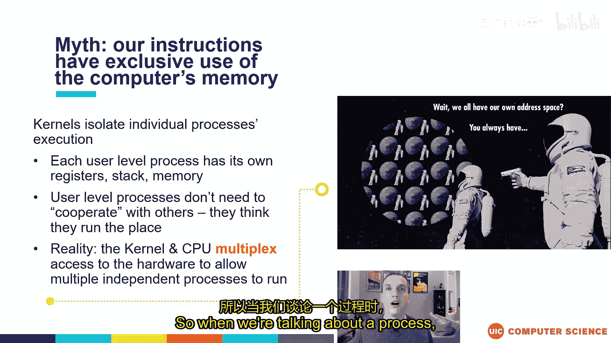
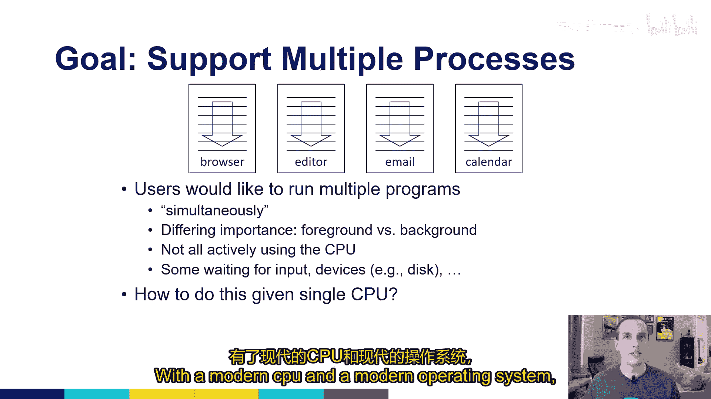
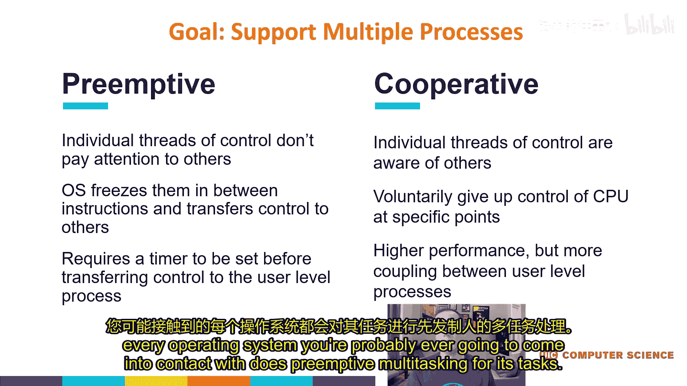
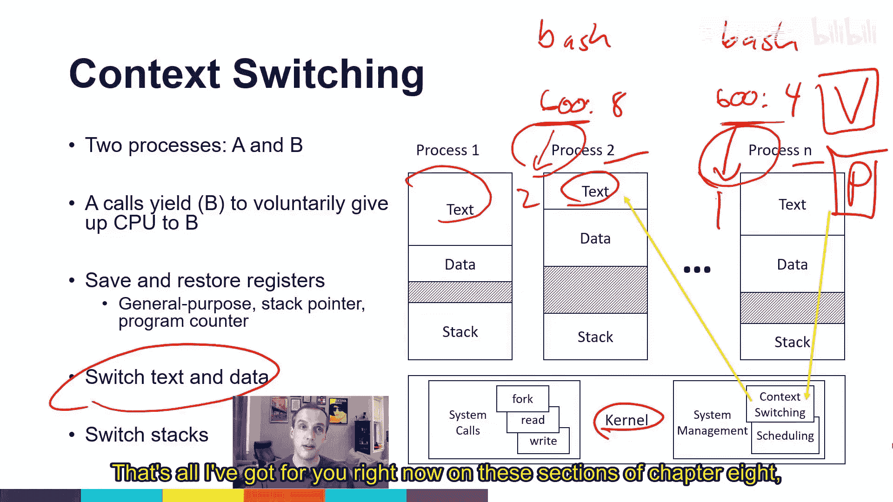

# 操作系统：第4讲：Linux进程介绍 🖥️

在本节课中，我们将要学习操作系统中的一个核心概念：**进程**。我们将探讨进程是什么，操作系统如何管理多个进程，以及进程之间如何切换执行。理解这些概念是掌握系统编程和操作系统工作原理的基础。

## 进程的概念与抽象



上一节我们介绍了异常控制流，本节中我们来看看操作系统如何利用进程这一抽象来运行程序。进程是程序在计算机上执行的一个实例，它包含了程序代码、数据以及当前的执行状态。

操作系统和CPU向你的代码撒了一个最大的“谎言”：它让每个进程都以为自己独占了整个内存地址空间（从0到2^64-1），并且是唯一读写这些字节的实体。这显然不是事实，我们将在后续模块深入探讨如何高效地实现这一点。目前，我们需要理解的是，每个独立的运行进程都有自己独立的“世界观”，这简化了编程，使得进程无需刻意与机器上运行的其他进程协作。

实际上，内核与CPU协作，以多路复用的方式管理计算机资源，使得每个进程都能高效、简单地运行，而无需担心其他进程。

## 进程的构成与状态

当我们谈论一个进程时，它本质上由两部分构成：**内存布局**和**寄存器状态**。此外，从内核的视角看，所有进程都通过一个称为 `task_struct` 的数据结构来跟踪和管理，它被组织在一个进程数组中。

每个进程都有其状态。除了内存和寄存器内容，操作系统还会维护一些元数据，例如进程可以访问哪些内存区域，以及如何在其虚拟地址空间（一个“虚假”的视图）与实际存储字节的物理内存芯片地址之间进行转换。



此外，每个进程都处于以下三种状态之一：
*   **运行**：正在CPU上执行指令。
*   **就绪**：位于就绪队列中，一旦获得CPU访问权即可开始运行。
*   **阻塞**：进程已进入睡眠状态（主动或被动）。即使此时给它CPU，它也无法推进程序执行，因此没有理由让它占用CPU。

以下是进程状态转换的一个简单示意图：
```
+---------+  调度/抢占  +--------+
|         |<----------->|        |
|   运行   |             |  就绪  |
|         |<--------+   |        |
+---------+         |   +--------+
     |              |
     | I/O或事件等待 |   I/O完成或事件就绪
     |              |
     v              |
+---------+         |
|         |---------+
|  阻塞    |
|         |
+---------+
```

进程进入阻塞状态的一个常见原因是等待I/O操作完成，例如从磁盘打开一个文件。在等待的十几毫秒内，CPU可以执行数百万条指令，因此让进程睡眠、等待I/O完成是更高效的做法。

## 多进程与调度策略

我们引入进程抽象和 `task_struct` 的目标是，在现代计算机（无论是单CPU还是多CPU）上同时运行多个程序实例。我们希望这些执行看起来是**同时**发生的，因为大多数现代计算并不会让CPU时刻保持100%负载，程序通常只在响应某些外部刺激（如鼠标点击或网络数据包）时才进行计算。

为了实现多进程并发执行，我们需要做出一些关键的设计决策，这些决策同样适用于服务器或数据库引擎等多任务场景。一个最重要的决策是采用**抢占式多任务处理**还是**协作式多任务处理**。

### 抢占式多任务处理

在抢占式多任务处理中，每个程序都认为自己始终完全控制着CPU和内存地址空间。这个抽象简化了程序的编写。例如，计算圆周率的程序只需不断执行计算，无需考虑其他任务。

然而，现实是操作系统会与CPU“合谋”，定期将你的代码从CPU上“拽下来”，让其他任务运行。程序自身无法控制何时被中断。**抢占**意味着在其他任务之前取得控制权并运行。



**优点**：对用户程序透明，编程简单。不同程序无需知道彼此的存在即可“协作”。
**缺点**：操作系统需要能够有效地“冻结”一个对此毫无察觉的进程，并在之后无误地恢复它。

几乎所有现代通用操作系统（如Linux、Windows、macOS）都采用抢占式多任务处理。

### 协作式多任务处理

在协作式多任务处理中，每个进程都知道（在某种程度上）还有其他任务需要运行。当它知道可能需要运行其他任务时，它需要**自愿地**让出处理器控制权。

某些语言环境（如传统的JavaScript）就采用这种方式。你的代码会一直运行直到它主动决定：“我已经运行了足够久，让我们检查一下是否需要运行其他东西。”

**优点**：进程永远不会在操作中途被意外打断。这有利于保持缓存局部性，实现高性能处理。现代Web服务器（如Node.js）从此模式中获益。
**缺点**：显著增加了复杂性，将多任务处理的职责耦合到了用户级代码中。用户代码必须包含主动让权的逻辑。

## 时间片与上下文切换

现在，我们了解了如何通过抢占或协作来共享CPU。从概念上讲，我们是在模拟一个“速度极快”的CPU，通过快速在进程1、进程2、进程3之间切换，给人同时运行的错觉。如果这些进程没有无限的工作要做，操作系统会给每个就绪进程分配一个称为**时间片**或**量子**的时间来运行指令。

内核会设置一个定时器中断。例如，它可能告诉CPU：“让我（内核）睡眠，启动进程1，但在10000个CPU时钟滴答后触发一个警报，将控制权交还给我。”届时，内核会检查当前进程是否用完了其公平份额的时间片。如果是，则切换到另一个就绪进程。

这种机制即使是在单CPU系统上，也能创造出**并行计算**的表象。当我们将此概念推广到多CPU系统时，本质是类似的：每个CPU核心都在独立地为其上运行的进程（或代表该进程运行的内核代码）执行时间片轮转。

## 上下文切换详解

从一个进程切换到另一个进程的过程称为**上下文切换**。这可能在进程用尽其时间片时发生，也可能在进程因等待I/O等长时间操作而主动让出CPU时发生。

上下文切换类似于过程调用，但规模更大：
1.  **保存状态**：将当前进程的寄存器（包括程序计数器PC、栈指针SP等）保存到其内核栈中。
2.  **切换地址空间**：切换CPU中用于虚拟地址到物理地址转换的**页表**。这是关键一步，它使得同一虚拟地址（如 `0x600`）在不同的进程中可以映射到不同的物理内存位置。
3.  **恢复状态**：将下一个要运行进程的已保存寄存器状态从其内核栈加载到CPU寄存器中。
4.  **切换执行**：将程序计数器设置为该进程的下一条指令地址，并可能从内核模式切换回用户模式。

**核心概念示例**：假设有两个独立的 `bash` 进程。它们都有一个全局变量 `status`，在各自的虚拟地址空间中地址都是 `0x600`。
*   在进程A中，虚拟地址 `0x600` 映射到物理地址 `0x1000`，存储着值 `4`。
*   在进程B中，虚拟地址 `0x600` 映射到物理地址 `0x2000`，存储着值 `8`。
上下文切换时，我们**不是**复制整个内存，而是**切换页表映射**。当CPU为进程A执行时，`0x600` -> `0x1000`；切换到进程B后，`0x600` -> `0x2000`。这样，后续的加载/存储指令就会访问正确的物理内存。

这个过程由CPU硬件（如MMU和TLB）高效支持，但对性能仍有影响，因为需要冲刷和重建缓存。

## 总结

本节课中我们一起学习了Linux进程的核心概念。我们了解到：
1.  进程是程序执行的实例，拥有独立的内存空间和寄存器状态。
2.  操作系统通过 `task_struct` 管理进程，进程状态包括运行、就绪和阻塞。
3.  现代操作系统通过**抢占式多任务处理**来实现多进程并发，为每个进程分配时间片。
4.  **上下文切换**是进程调度的核心机制，涉及保存/恢复寄存器状态和切换虚拟内存映射，其原理类似于但复杂于过程调用。
5.  即使是在多CPU系统上，每个CPU核心也遵循类似的时间片轮转逻辑来执行进程。



理解这些基础概念，是进一步学习进程间通信、同步和内存管理等高级主题的基石。