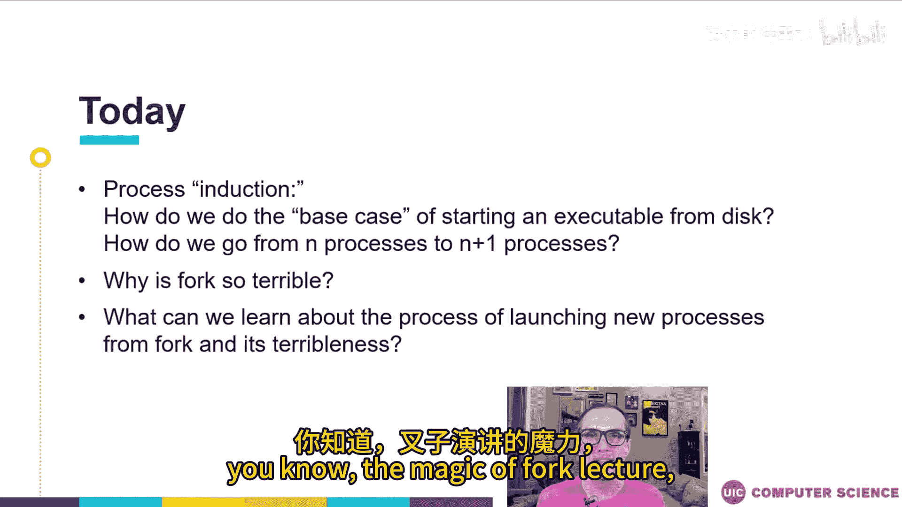
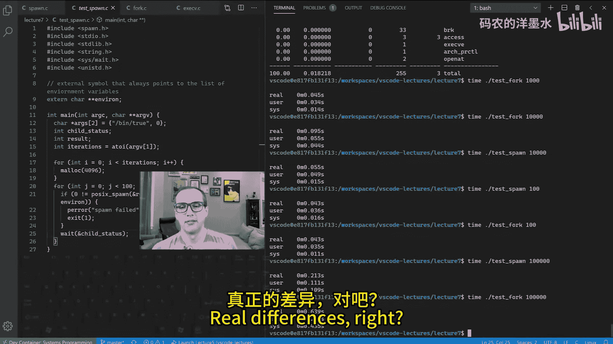
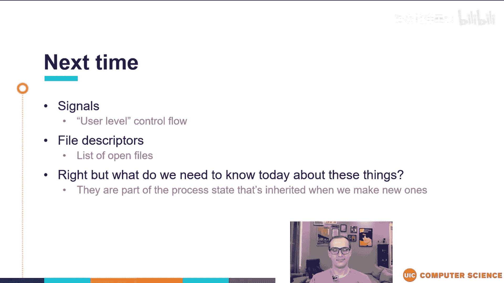

# 【全集】伊利诺伊大学 操作系统 中英字幕 1080P p05 Lecture 5 - 进程创建进阶 -BV1AEASzNE3z_p5-

Hi， everybody。 I'm Chris Kench， This is CS S361。 System programming。

 we're gonna to be talking about the magic of Fork Not exactly。

 but mainly we're gonna be talking about creating new processes。

 and Fork is definitely the best known way to create new processes in the Unix world。

 So as a really quick review。 processes are these independent execution context。

 They get scheduled to run instructions on the CPU。

 They get used to support multiple users on the same machine kind of like systems1。

 They allow you to multitask by tabbbing between Onenote VS code。

 and they allow the operating system and the user level programmers to break up whatever kind of tasks or goals are trying to accomplish into individual independently operating tasks that work as execution context or threads of control。

 recall that processes have their own state。 They have their own memory layout and their own execution context。

 And we're gonna to see a little bit next week that they also have their own set of open files and their own set of signal handlers and signal handler configuration。

 This is a lot of。😊，Metaadata that we don't care too much about exactly how it works this week。

 We just need to know that there are some configuration bits that exist in the kernel's memory rather than in the individual user level process memory that's going to become important a little bit later on So remember that that execution context is the history of what that program has been doing Aka at stack it has its set of registers。

 which defines where it's right at that moment， and it has its entire memory layout where the different pieces of the executable are stored。

 where it global variables are stored， where its heap is。

 where it's maled a bunch of information and it also has a lot of operating system configuration like which files it have open and what to do when the process exits what to do when different signals come in and things we'll be learning about a little bit later on but this is a lot of metadata about that one specific running process one important thing to remember here is a modern Linux operating systems scheduled the threads of control preemptively that is to say that the kernel sets a。

😊，Before it schedules a user level thread that says， hey， CPU， wake me up in 10000 cycles。

 if this process hasn't woken me up yet， the kernel then completely goes to sleep。

 The user level code takes over and knows whatever you program that code to do as much as it possibly wants to。

 It might give control over to the operating system voluntarily through a cis call。

Or it might just keep on running because that's the normal thing for it to do。 Once that timer fires。

 the kernel will take over， and then it will decide which thread to run next。

 It might continue to run that same thread of control。

 It might choose to run another thread of control。 One really quick thing that I haven't talked about too specifically。

 but I might as well cover right now。Is that I'll be using this term thread of control。

 that's going to be the same thing roughly as an execution context。

 And those are different from operating system level threads。

 which we're gonna to see later on in the class。 And they're also a little bit different from process。

 So when we talk about a process， we're talking about everything about a thread of control and its memory layout and its operating system level configuration about what it's supposed to do when signals come in。

 these things encapsulate a thread of control or an execution context。

 But they're slightly different concepts。 And we're gonna get a little bit more detail that today。

 as we see how these different pieces fit together。 So today's topic。

 it's kind of like process induction。 What we're doing here is we're learning how to go from one process to two or N processes to n plus one。

 and kind of a base case。 And if I want to run a different program。

 how do I actually run that different program。 Now， if we remember that concept of induction。

 once we have the ability to go from。😊，ToN plus1 and that ability to create a new program that we have all the functionality we need to create really。

 really powerful things like a shell that can just run as many processes as you possibly want。

 And addition addition to that， we're also going to learn why fork is actually so terrible it's really complicated and not that easy to understand when you're first getting an idea of how do I create new execution context。

 The very complicated way to just run a hello world program for instance。

 and finally we'll finish up by learning a little bit more about how fork is so bad and how the newer parts are better and how we've actually come to a better place designwise in at least in the Linux ecosystem So rather than this being the magic of fork lecture it's probably better to call it why fork is bad actually So let's switch over to this VS code window I have running right over here and what you'll see on the left side of the screen is the simplest possible program to do hello world but rather than doing it with a regular old puts or a printf we're doing。

😊。

Using the ability to run a different program。 So the first thing we'll see here is that running Ben echocho hellello world is the same thing as running a puts hello。

 So if I do Ben echo hello world at the command line， that does what we would expect it to。

 it echoes it out to standard out for us。 it writes it to that fine if I then run this program。

 this exact V program， Let's make just to make sure we read it already and I will run Ex V。

 it does hello world， just how I would expect it to。

 what is happening here is we are setting up the configuration for running that executable which we basically just need a list of arguments that is a null terminated list this is a char star star much like Rrg V right So if I were going to give arguments to this program。

 I would have an C in card C charstar R and V that would be the typical way to start a C program。😊。

And that way started C program is the same way as we have right here on the screen。

 This is a null terminated list of string pointers。

 So each of these strings is null terminated themselves。

 we don't have to say that in C it does' it for us and then we have a null pointer here。

 which means that it's the end of the arguments。 So that allows us to pass any number of arguments to this function Exec V in that Args variable and Exec V is just the most basic version of this family of cis calls。

 which allow us to run other programs and what it is going to do if you did the reading is just replace everything about this program。

 It's going to do an agentnt Smith from the matrix and just change this one running process from whatever it is right now to a new program that's run。

 So if we come over here and we do an S trace of exact V。

We will see a whole bunch of stuff happen and the most important thing on this screen right here。

Is the call to Exec VP， Where is So there's actually two calls to ex Vp here。

 So there's this first call to Exec V。Which starts this actual program itself because the shell also does the same thing that we're doing right here。

 the shell does exact V to start new programs。Likewise， when our program gets down to here。

 it's going to run that system call where it says， hey， operating system。

 I want you to replace my running process with this bin echo process。

 And we can see a whole bunch of other ci calls happen here。

 which are needed to actually start that up right so it has to pull in the dynamic linker。

 It has to create the pages of memory that this program needs to run。

 and then it is going to write hello world to the screen eventually。😊。

And then close its standard in and standard up and exit itself。That's pretty simple。

 So the important， interesting thing about exactly E is that it does not return unless something wrong happens。

 And that kind of sort of makes sense， right If I'm replacing the text of this program， right。

 if I were to。So I'm replacing the text of this program with a completely new program。

 There's no concept of returning from that。 right， If I switch from one thing to another。

 I'm not going to switch back ever。 I have wiped clean everything that exists about my process and replace it with a brand new process。

 There's no going back to what we had before。😊，However， it doesn't always do that。

 right if you remember from the quiz and discussion questions， it doesn't always not return。

 We've got this Pi here， which， as I show you in the comments here， if we do get to this line。

 something went wrong。 So if I were to come up here。 and for instance。

 change this to a file that does not exist and I make again and I run it again。😊。

With regular old run it again， it will say exactly failed with PR。

 So I didn't have to do any test here。 typically when you use PR。

 you do a test on the return value of the previous function， I know that if I get to this line。

 no matter what exactly errored because if exactly V is successful， it does not return。

 So I know that I have an error， and most of the C standard library stuff if it does give you an error。

 Yes， you can take the return value， right if I have an ant C close this。 and then I did a have。😊。

The term value of exactly。Like so。It will give me negative one， right， But what， what does that mean。

 that doesn't mean anything to me as a human being if I need。

 if I wanted to figure out what that meant， I'd have to go man and exactly V and go down to return value。

Down here and it will tell me what that means and it says， okay， well， there's an error。

 and then there going be a bunch of errors， and it even tells you right here that error no is set to indicate that error。

 and that's what P error picks up on what P error does for us。

So this return value doesn't even tell us what the error is。 right， So if we want to see， oh。

 error no is set to indicate the error。 Okay， well， let's， we can do this。 right。

 Re value to the vector V and error no， I believe if we want to use error no， we have to do include。

Aair， no do。Yeah that will bring in an external symbol for us。 I'm pretty thorough。Let's do this。

 Let's do。Arno of exact B， and this will be ano， which comes from the a node H。

And let's see what happens。 Let's make this again。And run over again。Yeah。

 so now we have this way more useful piece of information that the error no of exactec V the the failure mode that it was in。

 which error number it experienced is 2。 Oh my gosh， that's so incredibly useful。 right。

 We' got to go back into our man pages。😊，And it's going to say your air now is set。ああ。

And so it's not even and so on this page， it's not even going to tell us what those errors are。

 We have to go to the error specified for Ex E So man exactly the E errors and it's going to be one of all of these So we don't know what those are。

 I literally I literally don't know where these are defined What we care about here is that each of these is pound defined someplace So someplace in the source code probably for exactly E。

 there's some pound defineds for all these things。 So there's probably something like pound defined E no n to like that and what the source code will use it will'll say it'll return or it'll set error no to E no And when you're reading the source code。

 Yeah， that makes sense you can look at the man page and you can remember that E no end means that there's no entry entry T。

 whatever the heck that means。 but C is this compiled language that is for the computer。

 the computer doesn't care whether human understands it not。😊。

The computer is gonna to say Eno n is2 at E files3 and Eno Execs4 or some random arbitrary set of numbers that probably in an enum someplace。

 this is all a very complicated way for me to introduce P error here which takes the value that is stored in error no goes through the list of what those things map to and then gives you a super useful human legible human understandable result there So the basic idea here is that if you're using a C function that sets error no。

 it will almost always be a good idea to use P error to keep track of what happened And P this function here just lets you put a little string at the beginning and then after that string that you define P error will print the human readable description of whatever error is in the air no variable So let's go back to this version over here we' got we've got this new new still broken version made。

 And if we runject V it shows us that。😊，Output， so that gives us that nice human readable thing。

 It gives us whatever choice of words we wanted to use for ourselves to kind of tell us where we are in our own program。

 And that's way easy to understand than parsing the return value of those functions。

 This is stuff that's a little idiosyncratic to see。 But it's just the way the C world works。

 and it's good to learn how to make it a little bit less painful。

 Pierre is one of those things that makes it a little less painful。 Anyhow， big。

 important things here。 Exec the exactec family of functions will pass in a name of an executable。

 as well as a list of arguments。 It will either in this case。

 It most basic version right here with exactec V。 It will inherit whatever environment the parent process was using。

 So remember our environment is this list of。😊，Variable name equals variable value that are useful for keeping track of the environment。

 like what username we have， what our home directory is。

 a whole bunch of other just random pieces of important information that might be useful to a program which is running。

We can also use Ex V E to specify the environment， there's a whole bunch of other options we can pass to Ex V that are just slightly different if you get the job done in different ways。

 but they're all supported in the same way of replacing the entire running execution context and memory layout of a running process with a new execution context and memory layout that's what Ex V does。

😊，And if it's successful， it never returns， it just starts running that new program。

 If it's not successful， it sends you an error via error。 That's the TlDR。 Now。

 the next thing we are going to cover is not fork。 we are going to cover spawn。

 So let's move over to covering spawn。 This is more or less the most straightforward way I could think of to run a hello world program as a new process。

 Now， in our exact example， this is one process that exists in one version just the text of this program。

 and then it gets changed from my program to， well， in this program at errors。 But in this situation。

😊，So from my program， which is the code you see on the screen right here over to a different program。

 the B Echo program with the argument Hello in the world。 This doesn't create a new process。

 This just changes the one process that we do have from one thing to another。

 That's kind of like a base case in this fakey induction I'm talking about。

 but that that isn't useful， if I'm trying to create more programs， right， more running programs。😊。

What I want to do is create new running programs that are separate from my execution context。

 I want have two execution contexts where I only used to have one， and this is how we do it。Now。

 again， we're going to need to pass our environment to the call this spawn call that we have eventually。

 So I bring in this external chart environment。 This is the list of the。

Variable name equals variable value strings that define the environment。

 This is just an easy way for us to use it when we actually call spawn。

We have our same exact set of arguments。 We've got some integers we're going to use for our function calls。

 We're actually going to be passing both of them by reference so that they can be filled in by the calling function rather than being passed back as a return value。

 and we've got Po spa right here。 So Po Sp is this easy way to do things。

 There are two very complicated arguments in the middle here that we are not going to worry about today。

 We're going to learn a little bit more about them next week when we go over file descriptors and files and signals and stuff like that。

 But for now， we're going to worry about the first second fifth and sixth arguments。

 The first argument is going to be filled with what the process ideas of this brand new process that's been created。

 The next argument is that actual file name that is going to be executed。

 The fifth argument there is the entire list of arguments is very similar to the call Ex me that we saw before。

 then we also have our environment， which we need when we。😊。

Call Pos Sp in this way using this interface。Now when that happens。

 that will create a brand new execution context that will create a brand new memory layout and it will inherit some other things that will inherit things like which files are open。

 it'll inherit things like which signals are masked。

 you'll see both of those things later on next week。😊，And then it'll go off and do his job， right。

 So that will go do its job。 And our process will just keep on going through。 And you can see here。

 I use PR again。 I can say that spawn failed。 and then I can， you know， clean up。

 figure out whether wrong， stuff like that。 And then in my。Parent process。

 I'm going to wait for the child to die。 you know， kind of sad。

 but that's just the way that processes work。 I'm going to wait there。

 And if you remember from the reading， wait in this way， just says go to sleep。

 be blocked until one of your process terminated when it has terminated。

 W up and get given the idea of which process it was that got terminated。 You can see here。

 that's the last thing that my program does。 And it moves on to the rest of its life。

 So here you might not be surprised。 if we do a spawn。 we get hello right。

 So let's dig in this to this a little bit closer。😊，If we do a S trace of spawn。

 we will see the entire process of spawning this new process， but by default。

 Stra is only going to trace the process that we're talking about and not some other process besides this。

 So we'll see here we get down to that's called to clone。

 This is where the actual magic of creating a new process happens。😊，And。

This is a great time for me to go over the difference between S trace and L trace。

 So here I'm not going to see Posic。 Pos Sp is not a system call。

 It is part of the Pos specification， but at the library specification for how me。

 as a user level programmer， can use。😊，The libraries that are available to me。

 So if I were to L tracece on。I would get a very basic。

 nothing special set of library column I got my Pos Sp， which is successful and we get this value0。

 and we've got this weight， which also which gets a 21，1，9， something。

 which was whatever the the child process I was when Pos Spwn created its new process。

 So is relatively straightforward。 This is a way to creating a new process。

 tell it to go run a specific file off of the disk and just go kind of makes sense。

 So we dig down a little bit into what is happening here。 when we call Pos Spwn。

 Pos Sp does all this other stuff that we need to do as part of creating a new process。

 And we don't need to know too much of this right， you could make some guesses like， oh。

 it's gonna to be opening a file to actually execute it。 It's going to be Mm here is creating。😊。

Pages of memory and shuffling them around and getting them ready to go。

And protects pages of memory that whether they're shared or not between different processes。

And finally， we come to this clone call here。 So that clone call is something we're going to see a little bit later on。

Suffice to say， for now， this is a way to create a brand new process， but in a very flexible way。

 Now， the tricky part about what we're looking at here is that we're only seeing one half of it。

 because when we were S tracing。😊，When we were S tracing exact V， we saw everything up S S traced。

Soice exactly the。 So we're seeing everything here。

 every single system call that happens from the very。

 very beginning of this file all the way to the very， very end of this file。

 And the bin echocho file is in this list。 That is everything in that one process。

 because we didn't have to go to a different process。 We just kept going through that one process。

 Now， let me come over here to spawn。😊，Oh know， when we come over here to S tracings Spwn。

 we see that。We are not actually seeing an exactec B down here at all， we see this clone。

And then we see the weight。 And that corresponds very directly to what's happening in our code。

 But remember， once we have created a new process， it's a separate thing at the operating system level。

 If we want to S trace both R process， as well as our child processes， we need to do an S trace f。😊。

For spawn。And this will now show us the S trace for two processes rather than just one。

 We' got a super handy dandy。 Let me makes it a little bit easier to read。

 We've got a super handy dandy list here that tells us which Pd we're looking at to begin with。

 So when we only have one process we' attach that one process。 Okay， cool， that's happening。

 And then this clone causes S trace to realize an S attach to another process and watch this other process new system calls go through。

 And so now we have 2，1，4，1，8， which is the new process。

 and it's going to do a whole bunch of stuff as it gets started。😊，And then it is going to exact V E。

 So 2，1，4，18 is going to exact V E。And then the2，1，4，17 can then resume its job。

And you can see that these two different processes are running in tandem as they complete the rest of whatever it is they need to do right。

 so our child process is going to eventually write to the screen down here。

Our parent process is going to， have its weight resumed eventually。

 So that weight for was probably the last thing that 417 did。 Yeah， so the last thing that 4，1。

7 did was 4，1，7 started is called a weight。 And specifically。

 this is called weight forer because that the version of the kernel API that it's using。

And then it's basically say I'm gonna go to sleep until my child finishes。

 And if we come over here to spawn， we'll see that that kind of sort of makes sense。

 That's exactly what we did here。 We ran that program and the next thing that we did was wait for our child to terminate Our child terminated here。

 It exits and then our program here resumes pretty cool It resumed It was21418 was the process that that kept terminated All of this is kind of consistent。

 it makes sense based on what parts we're specifically focusing on。 Now the next one here。

 is for So this hopefully this is relatively straightforward。

 we're just creating respondwning the new process。 and this way of doing things is actually really similar to the way that Windows does things。

 What Windows has I believe it's called create process something along those lines is its way of creating a new process and it looks。

😊，Very similar to this， you tell it， create a brand new process and fill it from the very。

 very beginning with this other program rather than the traditional Uniix way to do it。

 which is the fork way and the forkway is a little bit annoying I will absolutely be the first person to say that。

 but I won't be the last。😊，Not until they heat up the body of the universe or fork。That。The big。

 fancy thing that everybody loves to talk about is that you call fork once， but it returns twice。

 Prety cool， right， And this gives you this idea of。😊。

A fork in the road right we are running our program。

 we hit Fork and Fork creates two identical copies of the running program。

 they are completely identical in that they share the same execution context they share the same entire memory layout and they share the same open files and the signal handlers that I was talking about with Spwn。

 which spawn also keeps track of。So in fourth， we have the entire memory copied。

 We have the entire program copied， the entire execution context， all of that has been。

Turned into two identical copies， which is cool in that we have this technology called copy on right。

 where we don't actually have to take the one and make a new one in reality。

 we're going to hit some of our future concepts right here。 This will become much。

 much clearer later on。 But let's pretend that my glasses are the actual memory bank to the actual silicon。

 Then I have my address space， which is pointing to where it is stored in memory。 Now。

 in the original program。 I have my address space pointing to an actual bank of memory。😊。

And you would think that I would have to have like two copies of my glasses if I had to make a complete copy of everything。

 But C and the Linux operating system and operating systems in general love pointers。

 They love being able to say， well， rather than copying this thing。

 I want to actually just have another pointer that points at the same thing。😊。

And modern Linux operating systems actually have a very。

 very efficient way to allow you to point two things at the same actual memory bank。

 But then as soon as one of them changes， then they have their own independent copies and they're identical。

 except for the little bits that have changed。 That's called copy on right sharing where there's one one identical。

Source copy that's actually stored physically。 And you have everything else just points at it at that moment in time。

 Then as soon as either of them right to it， then you get two different independent copies rather than one physical copy。

 that saves you space。 And remember when we save space。

 we actually make things faster because we have fewer things that need to contend for access to the fast layers of cache。

 Now， this is one of the important parts of fork that it copies。

 and it's good in that it is very efficient that it doesn't actually have to copy all of that information。

 but we still have these pointers， right， It's not free to copy pointers back and forth。 Well。

 we end up with is a situation that we'll talk about a little bit later on where this is much less efficient than it could be otherwisewise。

 So， so once we hit fork， we run fork once and it returns twice。😊，Between。

U running it here on line 11 and us hitting line 12。

 the operating system has created two identical copies。

 It just flash created a new copy such that line 12 is running in two different places。

 It's running in the parent process and in the child process。

 So remember when I said that there are two identical copies。

 the moment you run that system call you make two identical copies。

 Those two identical copies immediately start to diverge when fork returns。

 It's going to return in one of them and it's going to update the stack frame to have the return value of fork in this case stored into the stack local variable result in the parent。

 that stack local variable in that little bit of memory is going to be set to the child process ID D in the parent。

 we have it set to the child process I in the child， the return value。😊。

A fork is zero and I guess you know it。The the other important part here， as you might guess。

 by looking at my code， is that if the value is less than zero。

 that is an error state and we can immediately exit。

 we didn't actually create a new process in that situation。

 we just failed because we couldn't create a new process or something went wrong for whatever reason there's only one process still。

 we exit that process because there's no real way to recover in that way。

And we start from line 16 to actually do the logic of what to do when things are successful。

 So both the parent and the child are going to run that logic on lines 12， 13，14 15。

 and then the parent and the child are going to change based on what that value result is。

So that value result is the first thing that is the only thing that is different at this moment in time。

 However， we're going to use that one kind of piece of information that tells us。

 am I in the parent or am I in the child to cause the child to do something fundamentally different than what we do in the parent this。

Toy example here is really just running Hello world in a brand new process using for。

So what we have here is if the result is zero， we know that that means we are in the child process。

 so the child process is going to run the true branch of this if statement。

And the parent process is going to run the false branch of this if statement。

 the else branch of this if statement。So in the child。

 we exact V and just like in our exact V example， we P error if that exact V fails。And otherwise。

 the Pierre never runs。 We just replace everything with our bin echocohelello world。

 And in the parent， we're going to wait for our child。

 This program and this program do effectively the same thing。This program has all of these lines run。

 These lines run twice， and you got to keep track of that kind of for yourself。

 One other really important part about fork and it's going to be doubly important when we start talking about the inards of all this stuff is that after you have forked a process and create two runable process。

 the operating system gets to choose which one of those gets scheduled next。

 whether we're going to schedule the parent to run next。

 whether we're going to schedule the child to run next。 There is no guarantee of which one will run。

 You may try an example of， oh， I'm going to fork a process a million times and I'm going to。

Check to see whether the parent ran first or the child ran first， and it's very。

 very likely that in each of those 1 million different times， the parent runs first。

Just because it runs the first at once or 10 times or a million times does not mean that you have a guarantee from the operating system authors that that is actually going to happen。

 This is kind of a you know let's take a step back and think about computer science and think about CS systems programming and all that stuff type of moment where the application programmer interface is the set of human readable guarantees that the library author or the operating system author makes to the user of that library or the user of that operating system。

 There is a difference between the set of promises that they say they're making and how things actually work。

 It is very possible that the implementation if you go in and look at the implementation and say。

 oh hey， actually， the parent is always always always based on this code going to be the one that runs first and and that's。

😊，CoolAnd you might even start writing code that re on that fact。

 but there's a very big difference between what is the implementation specific artifact of how this works and what the API documentation says actually has to be there because there's a lot of things that are undefined in terms of what is supposed to happen or。

😊，Like like fork， for instance， there is no guarantee of Does the parent run first。

 Does the child run first。 that kind of messes things up。 But the ex specification。

 apost specification says there is no guarantee about whether the child or the parent runs first after fork returns。

 So I think that's everything that we care about with respect to fork。 let's take a look。

 So as I was mentioning earlier， Fork is is bad actually。What？Sticks out to me here。

 beside the fact that Fork is complicated and that you're running your own code in two different places at once。

 which is really， really complicated。 And there's a lot of these different tricks like we had in in the discussion questions about what that means and how you can keep track of how many of them are running and it's kind of cool or like puzzles to figure out because it's a very different way of thinking like all of a sudden I have to run this code in two different places and that's a useful skill to come up with。

 but I'm just trying to run programs this idea of taking my this program this fork dotC and creating two fork dotss with all the global variables and all of the text and all of the stacks。

😊，Just two， like five or six instructions later。 wipe out the entire stack， wipe out the entire text。

 wipe out all the globals， wipe out all the memory and completely replace it with something else。

And forcing people to do that manually。It'sK of dumb， right。

 And there's actually a fantastic paper that came out。

 I believe it was two or three years ago from a group of researchers who were saying we've been building new operating systems。

 and one of the hardest things for us to do is implement fork the way that people expect fork to work because it does this thing which isn't actually super useful。

 There isn't it actually a lot of useful ways in modern computing that we would want to go from。

 I've got one process to I've got the same process twice， Like when when do you do that。

 right I don't ever do that。 I would say， oh， I want to just duplicate my 17 Chro tabs。

 and I have two sets of the same 17 Chrome tabs， That's not a thing I ever do。

 I't do that with Microsoft Word or any of these things。 Maybe there's some situations。

 but in general。 That's not really a thing。 And so not only is that not really a thing。😊。

Being able to change all the memory and change all the signals and change all the files。

 all of these things all at once is really， really complicated because it's touching different parts of the operating systems responsibilities all within this one function call that isn't actually super efficient or super smart。

This is know the I'll post a link in the description of the video to that points to this paper。

 but in general it's fantastic。 it's definitely worth a read if you're interested in understanding a little bit more about whytor suck so bad and what our options are for improving upon it Now that is the research operating system side of the world if we just go into the Linux side of the world where a lot of development has happened。

 the Linux kernel and the Linux user space are under very active development we can see a little bit more about how that stuff works in actuality So in modern Linux both Posic spa。

😊，And fork are implemented using a ci call called Clogne。

So this is called called clone is a way to create a new process。

 but it's a little bit of a more modern version thereof It allows you to tweak。

 It kind of allows you to pick and choose which things do I want to create a copy of and which things do I just directly want to point at hey。

 I am a new process with a new thread of control but I'm using the same memory lamp So what clone does is it gives you a lot of these different like pick and choose。

 you actually get a menu of which things do you want to have shared with the parent which is like we're both pointing at the same exact thing or which things do you want to copy an independent copy of the thing that the parent has because if you have an independent copy of the thing that the parent has things get a little bit more complicated。

 we can use copy on write to make sure that we don't have to physically copy those bytes of memory。

 but we still got to fix up the pointers and make sure that we know that they're marked as copy on right。

 stuff like that。 It's easy if we say， you know what。😊，Sing the same thing。

 So all you really need is we need to create this new thread of control。

 and we're just going to point everything back at that original one we don't need to mark as copy on right。

 then everything is just going to stay shape， which is pretty simple so we can do things like。

Either have our own independent copy of the files or not have our own independent copy of where we are in the file system or not。

 there's a lot of other more advanced。不。Features of the Linux kernel that are specific in here。

 the clone actually allows us to do using things like C groups and namespaces。

 which are super useful for creating things like the Docker environment。

 which allows us to restrict these individual processes so that they run within their own container。

 we can clone the entire space of lots of threads of control that are all connected to one individual process and down here at the bottom we come to two pretty important options that we have available to us as part of the menu of options for clone。

 which is this clone V fork， which allows us to do something that looks like the V fork system call。

 which is beyond scope here， but you can definitely read into it So a high performance version of fork。

 which does not separate the address spaces and puts the parent to sleep until the child has。😊。

Turned itself into something else。 So you can imagine that the Vfork setting is very。

 very useful when all you want to do as soon as you fork。

 you immediately want to just exactly me into some other address space into some other program。

 What Vfork does is it allows you to say， you know what instead of making this copy。

 I'm just going to say， okay， I know eventually I want to have two things。

 but what I'm gonna to do here is I'm going to create a new one。

 but all it really is is a pointer to the information from the old one。

 what this one can do is it can just create is completely independent version of that process information that one will be completely separate。

 And I won't have to say if this version here， I'd like 17000 different chunks of memory available to it。

 I won't need to copy all of those pointers， I'm just going say okay， just point at everything。

 just don't change any of that setting when you create this new process object。

 And then as soon as soon as you start executing here， then。😊，Can allow this one to run。That way。

 they don't have to fight over the memory， and it can make the common case fast。

 One of my favorite things to say over and over and over again。

 what V fork does is it makes the common case fast of fork。 The common case。

 when we do fork is we create a brand new copy， then we change it into something completely different。

 If we're going to make a brand new copy and change it into something completely different。

 It doesn't make sense for us to copy all of those memory references。 We just want to make a very。

 very quick data structure copy within the kernel。 and then just wipe it out and allow it to exact V into a completely new environment of its own。

😊，So that's one of our options to clone and clone VM is another super important option here where we can say。

 hey， do we want to run in the same memory space or not if we do run in the same memory space。

 this is what I was mentioning here with VFork， we are going to just be pointing at their settings for their virtual memory。

 if we do not use clone VM， we're going to have our own copy on right copy of that memory。

And by default， when you run clone or when you run fork。

 you are not going to be getting either of those options。

 So overall clone is kind of this replacement for fork that the Linux authors came up with。

 they said you know what fork actually is a bad idea。

 this is going to be a much more configurable way for us to create new processes。

 because if we can make creating new processes， just a tiny bit faster。

 everything about running our computer is going to work much， much better。

 Now to go into a little bit more kind of showing that things are worse using fork than they are using Po spawn or using this clone setting。

 I'm going to go into a direct profiling process。 So profiling is a super important concept that everybody should know about which is to say yes。

 I can write my test code here and it will show you how it works and we can estrace through it and all that good stuff but。

😊，That's not nearly as useful as testing how fast things are going to work。 And what's really。

 really nice is that S trace is a pretty easy way for us to do a very， very basic。

Profiling of how much time our process is spending doing different system calls。

So what I have here on the left is a test program， and there's both a fork version and a spawn version。

 What this will do is it will spawn 100 sorry， I'm going to start saying fork can spawn interchangeably。

 You're going to create 100 new child processes。 Each of those child processes is going to exactly the most basic thing in the world。

 which has been true。 This is just a placeholder for you're going to run something。

 This is something that's nice and fast。 All it does is return zero。

 that's literally all that been food does。😊，But， but before it does that 00。Child process creation。

 It's going mal like a certain number of chunks of memory before we do that。

 And this is going to kind of simulate， oh， I've got a long running process that has a lot of memory allocated to it already。

 So if I were to run this program。 let's make sure we're made。 So we're going do test fork on say。

100。 And， you know， that's pretty fast， right， that actually did。😊。

Both do 100 mals of 4 kB of memory， and then 100 forks and bin trues in that much time。

 And I can indeed just test how long it takes to do that right there。 So pretty nice and fast。

 And if I don't believe that it actually works。 I can S trace it and do test  for100。

 And it's gonna show me all these clones and all that stuff that's happening。 Remember。

 if I am S tracing a fork， I'm only tra it， I'm only tracing in the parent not in the child。

 But you can see here， clone weight， clone weight， clone weight， clone weight all the way through。

 everything is making sense the way I expected to。 Now。

 the profiling comes into play here with S trace。😊，嗯。

Which will give us a summary of the system calls rather than giving us the play by play of all of them。

 So really， really useful here。 We see that we have both the number of calls of each of these system calls and the number of microseconds that it took for each of these。

System calls to call。 So this basically add up all the time it takes to run them。

 then divide by the number of calls， Bo the number of microseconds per call。 Now。

 if I bump this up to 10000 allocations。It's， it's taking about a quarter of of a millisecond， not。

 not super slow， not super fast。 And if we run over and over and again。

 we'll see roughly around the same mountain time。 Sometimes it'll be much faster， apparently。

 Sometimes it'll be much slower。But if we start pumping it up to 100000。

 we're seeing that it's taking a lot more time there， right，100000 is definitely much。

 much slower than 1000 here。 And that's because when we create this new copy， Yes。

 we don't physically have to copy the。10004 kilobyte chunks of blank memory that we got back from Malck。

 but we do need to copy the pointers that go from here's why I'm in the address space to here's where it is in the memory layout of that program and that takes time。

The worst part of this is that all of that copying of those things immediately gets wiped out by the fact that I'm running Ex V。

 So this fork is taking a long time。 I wonder if we can out trace stash see will that work。😊，Yeah。

 awesome， so L trace on test fork does take a certain amount of time。

 so you know half a microsecond to call fork， that's pretty pretty nutsps。

So to do the entirety of what Fork is telling it to do is going to take。663 microseconds per call。

 let's bump that up again， it's happening here。Now the Mals are。

Failing or waiting or something along those lines。 So at 10000， we are seeing about 1。

1 milliseconds per call to fork。 And what we would hope is that fork would take a different。

 would take the same amount of time per these。 Certainly we'd want this entire entire process to take roughly the same amount of time。

 regardless of how much memory we had allocated。 right。

 memory that's allocated and starting new processes are two different things。

 We would like it if they didn't impact each other so heavily。 So So here's test spawn is very。

 very similar。 We got our malik。 We're going mal a certain number of times。

 Then we're going to spawn been true 100 times and see how long that takes。Let's。Go crazy test spawn。

All right， so we are seeing here that it takes an absolutely bonkers amount of time。To do posec spa。

 But note that that posec spa is doing two things。 It's both going to be cloning。

 which is creating that new memory layout and the exec V。 So all of the time that gets。

Allocated to running Posic spawn in those different system files is going to be counted against it。

 This is another kind of like， oh yeah， that kind of makes sense。

 But this is the in and out of profiling our code。We're not really going to get a very。

 very detailed view of this because a detailed view immediately becomes overwhelming and very hard to see the summary。

 but here that's just an important part of how this is working。

 So let's do tests spa of 10000 Yeah there we go。So note another important thing with。

Profiling is that profiling will。Disturb your code， it will change the way that your code works。

In a way that the measurements that you take are not going to be exactly what the real running program is going to take。

 So if I were to Ltrace test spa here， this takes a total of 3。7 seconds。

 But if I just run time on test spa， it runs way， way faster。

 This is because every single time I go through the process of calling mallier。

 every single time I go through the process of calling Pos six spa。

 So I'm running out to memory every single time I started every read single time I ended。

 every single time I started， every single time I ended。

 and that will take time over 100000 calls to malick。So let's go back to S trace of testpon 1000。

Let's trace dash C。So here our clone call， which creates our brand new address space。

 is taking about 123 microseconds per call。And。115 microcycltons per call when there's  a thousand0。

when there's 10，000 or when there's 100，000， I'm taking 120 microseconds per call， much。

 much more efficient than when I was test4。We can see where that test fork is running into problems the more I run。

 the more time it takes to run that clone call， I think that my timer resolution。

 there is just one run where clone took zero。Microseconds per call。 And that's very unlikely。

 and pretty sure that the timer resolution on this version of Linux that's inside of Docker containers inside of Windows。

 probably isn't the best。 And so we're seeing very， very noisy values。

 but we're still seeing that there's a very big difference between running this on。

Fork versus running this on spawn were running the same exact thing。

So if we rather than profiling to see where all of our time is spent。

 if we just want to see how long it takes to do these things， I can just run time on test4。

 I can' do that with a big number。So it takes 95 micro。So it takes 95 milliseconds to run。

Test work with 10000。 Let's do a test spa with 10000 half as much time， right。

 So if we do 100 of one。And 10 of another， there's not really that big a difference。

 but once we start going up to the big numbers。That's when we actually start seeing that there are。

Real differences， right， It takes three times as long to do this with fork as it does to do the same exact thing with Spwn。

 So at the end of the day， we're seeing that the differences here have to come with。

How we are creating this brand new process when we S traced。Pork。We see that we're cloning。

 but we're not telling it to keep the same memory， we're telling it like a whole new copy of memory。

 make a whole new copy of basically everything and the memory part is really where we get slowed down here。

 the other parts are annoying for implementation's sake， but for speeds sake。

 this copying this creating the entire copy on right memory image is really the nasty part。Likewise。

 for spawn， we come down here， we're using the same system call right。

 all of these things are implemented using clone， which is the one way to create new processes in modern Linux So here we've got clone and here it's going to say don't create a new virtual memory layout。

 just share the same layout as the parent， don't make its own copy on right copy and it also says。

 hey， put the parent to sleep until I have started my own because we didn't make our own separate copy。

 if we made our own separate copy and we went over into this fork situation where we start changing what we're doing based on whether we're in the parent or the child。

 If we changed in the parent。After this call to clone， it would be visible in the child。 I'm sorry。

 this is confusing compared to fork in fork。 If I fork， then I change something in the child。

 but I didn't change it in the parent。 There are two different versions thereof right in this example。

 Reult in the parent is set to non0。 resultult in the child is set to 0。

 Those are different values that are stored at the same address。 but。

In different processes backed by different physical pieces of memory in the memory chips。

 So if we were to try this in using clone directly， using the clone Vm setting enabled。

 we would see that result couldn't actually be set to one thing or the other。

 It would be set to what there there's only one virtual memory layout。 There's not a copied one。

 There's only one and both processes point at that same copy of the memory layout and therefore changing result in one of them a cause result to change in the other one。

😊，What Posic Spwn effectively does is it just does this one。

 two punch of clone and then immediately run Z V to start the the next process。 So what what。

Pasic Spwn does is it uses clone with that clone VM and clone V fork options。

 which immediately causes it to go to sleep so that it doesn't mess up this shared memory。

 Then this other process takes over and says it says I will not change anything except immediately running the program。

 I was meant to run So we see here that this other process， this 2，8，9，8，8。

 is immediately going to Exec V E over into Ben echocho。

 When it Ex V is here because of the clone V fork flag。 The clone。

 The parent can can wake up and say， okay， I say， okay。

 I' am allowed to continue running instructions here because I no longer have two different processes pointing at the same memory range I have。

😊，Execcut E created a new process memory image for that child process so that we're no longer touching the same thing。

 we're touching completely different。Points in the membrane brain。Cool， awesome， Okay。

 so that was a whole bunch of stuff and a lot of gesturing and a lot of pointing at my glasses and a lot of all that good stuff。

 But hopefully we got a basic idea of。😊，Exactly and fork and Po Spwn and clone。

 which is the functionality provider that's underneath all of this stuff just to review visually really quickly here。

 fork。Gets called once and returns twice。 Each of these processes。

 The parent and the child have their own initially identical copy of the memory that the parent had at the moment that fork was called。

 But the return value of fork will be 0 in the child and nonzero based on the child process I D in the parent。

 They'll also have their own copy of the open file descriptor table。

 Their own copy of the file system state。 Theyre like what directory they're in。

 and they'll have their own signal handler settings， which will go over next week。

 And either the parent or the child can be scheduled next by the operating system to run。

 There's no guarantee on which one runs after that fork returned。

 Does it return and start running the child。 Does it return， start running the parent。

 No guarantees exist。 Even if the implementation that you're using at any given moment in time。

 Always does one over the other。 You can't。Howt on that guarantee。

 because it's not part of the API that the library and operating system authors provided to you。

 So what a Spwn do exactly， Spwn goes through a two step process of cloning in a different way and then doing exact V E to start the new process。

 It does both of those things at once for you， which is much easier for you as a user level programmer。

 but it works a little bit differently when Spwn calls clone。

 It does not receive its own copy of the memory。 It does receive its own copy of the open files。

 its own copy of the file system say in the signal handlers。

But the other important part here is that when the clone call within Posic spawn happens。

 you end up with two different processes。 They are both using the same memory addresses。

 So we' got these two different processes。 They' are both pointing at the same memory。And。

Based on the definition of clone。The parent will not run anymore more。

Instructions until the child either exact these or exits。 the parent is blocked until that happens。

And until then， there's only one copy of the memory。 So what Pasic Spwn does is it goes from we one。

Process， we call Poic Spong we have to pointing at the same memory。 I'm going to in the child。

 I'm immediately going to exact V myself， and I'm going to be a completely new process with my own memory。

 my own layout。 my own loader running and starting the first instruction on completely independent。

 That way I get around going through the copy on write process of making sure that all of these pages of memory aren't physically copied。

 but they still have all of these pointers maintained between the child process and the parent process。

 Even though that's fast。 It's not nearly as fast as not doing something that isn't ever going to be useful。

 So some caveats to using clone is that it's Linux specific。

 especially the ways that we can use it here。 It's not going to work on Macs。

 It's not going to work on free BSD。 This is something that runs in Linux。

 even though these other places are also unixes。 They aren't going to have access to this same thing。

😊，Because they're not part of the plastic specification。Pic Spwn， as its name might imply。

 is part of the Uni specification， but it's not always going to be implemented the way that it's been implemented here in Linux on top of clonene。

 In fact， clone fork itself， as we saw， is implemented on top of clone。

 Clone was a refactoring of the way that you create new threads of execution。

 the way that you create new virtual memory addresses the way that you create new entire processes to make it so that there's one way to do it that has a bunch of different configurations that makes it a little bit easier to reason about and make sure that our code is nice and efficient。

 So Posic Spwn is at least in my opinion， much easier to use than fork。

 it returns once there's a new process running with its own memory layout in its own program and it's completely separate from my parent process。

 and that makes a lot of sense。 But we're in not out of the woods yet。

 There's some problems that we're leaving for future us。😊。

Basically next week us to learn how to communicate between those processes and actually hook up the file descriptors for standard in and standard on so that everything flows the way that we want it to flow。

 And if we do some fancy input and output redirection we actually get that to work the way that we want to So we switch back over to our VS code window again if I go over to my spawn example。

 I've got these two null arguments in here。 Those are going to be a little bit not hard。

 but they're weird， they' complicated and not super intuitive but they're going to be a very important part of building a shell connecting different processes to each other so they can communicate with each other stuff like that。

 So that's all to say that in the future we're gonna to be going over signals they we're going to be going over file descriptors we're going to be going over all of chapter 10 in fact but right now we just want to know that those are pieces of the processes state that get inherited when new。

😊，Prosses are created， and we will use that inheritance as an interesting way for these different processes to communicate directly with each other。

 Thank you so much for watching， and I'll see you next time。😊。

