# 【全集】伊利诺伊大学 操作系统 中英字幕 1080P p06 Lecture 6 - Linux中的信号处理 -BV1AEASzNE3z_p6-

Hi， everybody。 I'm Chris Kaish， and this is CS S 361 systems programming。 Today。

 we're going to be talking about signals， and we're going be talking about things a little bit differently。

 Typically， I record a couple of videos，1，2，3， I。😊。

Cut them down and get rid of every oh andum and weird pause and false start。

 But today I'm gonna experiment a little bit with doing this in one take。

 just getting through the things that I want to get through。

 Let me know in class or however you want whether this was just as good as the other types of videos or whether you would like to go back to the more chopped in cut up videos。

 whether there's lots of cuts everywhere showing what I did wrong or getting rid of everything that I did wrong and going through right all at once。

 Okay now let's get started signals This chapter was long right it was quite a bit and signal handling is a relatively uncommon corner of systems programming。

 but it's still super important for our understanding of how process control works。 So without it。

 we wouldn't really be able to interrupt runaway processes。

 we wouldn't be able to allow processes to safely exit our shell or other programs that control other programs would have a really tough time。

😊，Actually figuring out what the heck is happening。 Signs are this fundamental thing。

 soll allow us to do interprocess communication between different processes。

 but in a very different way than you would when you're actually writing a program that just does work as we're gonna to see later on in class。

 There are a lot of ways for one process to send messages to another process very explicitly。

 and the signal mechanism is like that。 but it's a very specialized tool that's used in this interrupt drivenrin way rather than in an explicit。

 I'm going to wait to read something from process1。

 I'm going to send something over to process two type of way This is primarily for unintended unexpected things like my child died or a file descriptor became ready to read。

 These are things that you're not typically going want to deal with and the biggest probably trickiest part about this is that this is our first tiny little step into you。

😊，Useer levell concurrent programming， where we're running one thread of control。 For instance。

 our main thread in our program。 and then something happens。

 And then our code starts running someplace else。 And we explicitly have to make sure that those two pieces are working together the way that we want to do that。

😊，Okay， so。One other okay next thing。 This is where I get mixed up just a little bit。

 I'm gonna go through everything we got here in these slides。

 just go over some of these very important pieces of information about the concept of signals and this is going to be mostly review of the stuff that is in the book but overall it's going to be you the basics。

 the straightforward important stuff about signals so without further ado recall that we have exception。

 we have this concept of a user level process doing something， it's on a specific instruction。

 something exceptional happens and rather than executing the next instruction there。

 it goes and does something else， and then it's either going to return back and retry that。

 it's going to return back and do the next instruction or it's not going to return at all。

 This is what happens when there is kernel level exceptional control flow we switch over from being in the user space mode over to being in supervisor mode where we can do lots of stuff like kill processes。

😊，or create new ones or run system clause， all that stuff。

 and then we go back down into normalmal more， we go back to Clark Kent instead of being Superman。

With this， there's no way to tell the process。 hey。

 something happened outside of like stopping it and giving it this information。

 What we get out of the signal mechanism is something that allows us to send these messages back and forth。

 but it's not going to be as heavyweight or as disruptive as it is in the you know。

 typical interrupt style approach， but it's still going to be disrupt it's gonna to be disruptive。

 just not as disruptive。 So the signal like by you know the most basic thing we have here is that signals allow the kernel to send a small message to a process and signals correspond to different types of system events。

 there are user definedfined signals which we will use for examples a little bit later on today。

 but those are going to be less common， those are a weird way to use the signal mechanism where mostly what we're using signals for is。

Exceptional things that a process needs to respond to that is outside of their normal operation。

So some of the signals that we have here are things like signint so the most important things that we typically see are Sint S S V。

 SG kill， S quit SG Chil， these are all really really important ones signint is when you hit control C on the keyboard what's really important here've got a little aside I wanted to go over is that when you typically type on the keyboard。

 you're not causing exceptions to happen there's no exception there's no interrupt all you're doing is writing。

Individual。Characters to a file。 And yeah， writing characters to a file if you were in a user level program would actually cause a context switch It had to be a ss call。

 et cetera。 But the driver for the keyboard or the universal serial bus or the teletype the virtual terminal that you're using isn't going have to do that。

 it's just going to be reading these bytes in from this device。

 and they're gonna to show up in that buffer。 And as soon as somebody calls read。

 they're going to receive those bytes。 that read call is a system call。

 that is going to be exceptional control flow where we jump over。

 but it's very different from a control C on the keyboard。 When I hit control C on the keyboard。

 I'm actually triggering and interrupt to happen， and then this signal gets sent to the process。

 And we'll see a little bit later on， what happens when when I do that and it's fundamentally different than when I'm just banging on the keyboard normally。

😊，We can send this kill signal to processes that will instruct that process will instruct the。

Operating system， in fact， to stop that process， dismantle it。

 take it off the CPU market has stopped and never started again。 things along those lines。

 we receive a signal when we do an illegal memory access that causes a segmentation fault that is not something that just immediately zap our process right away instead it's something that gets reported to our process as a signal。

 and this is why when we're debugging with GDP， we can actually set a trap on that sigsv。

 what GDP can do， they can say， aha I am debugging this child process of mine。

 I am going to instruct the Linux kernel， hey， when this tries to do this illegal thing。

 don't just chill it like it was a normal running process。

 you should instead transfer control to me so that I can take a look at what the heck is happening and that's super。

 super helpful。And then Sig Ch will see that， I think we saw it a little bit already when we' were talking about additional processes。

 this is the signal that gets delivered to our process when one of our child processes has died as accident。

Now we're going to get a little bit into this idea of sending signals。 There are a few very。

 very important concepts that I want to talk about here because when we first think about it。

Signals and interrupts sound like there's thing that is immediately going to get sent to our process as soon as physically possible。

 right like we've been talking about interrupts and exceptional control flow and interrupting running instructions。

 but all of a sudden we're switching over to signals which sounds similar and is being used in a similar way。

 but the way that it actually gets implemented by the operating system is very。

 very different when a signal gets sent to an individual process。

 it will like sending the signal raises a flag If you think of old tiny mailbox where you've got that nice little red flag on the side。

 sending a signal raises a flag that says， hey， there is something in here that you have to take care of It does not immediately cause the mail carrier to show up and take it out that the mail carrier doesn't teleport to your mailbox。

 The mail carrier only comes around and takes a look at it whenever it actually。😊。

Hands your running process。 And if the mail carriers in the process of like sorting the mail outside of your house。

 they're not going to immediately stop sorting that mail to look at your sweet red Fl that you've just put up So let's think about this mail carrier analogy because I do think it maps onto signal pretty well and there are very important differences between what we've seen already of exceptional controlflow immediately taking over and signal handling。

 which only happens on on switches from kernel mode to user mode that's going to be the key cruing if there's one point that I think a lot of people get tripped up on with signals is that signals only get handled when your user level process does a context switch or from another process to yours or when you do a context switch from going into the kernel say for a system call and then back out of the kernel。

To end that system call， when the kernel gives control back to your user level code。

 that is when it decides to actually process that signal by calling your signal handling code。

I'm getting a little bit ahead on myself， but I can't stress this part enough。

This is where our analogy breaks down a little bit right I so there's just one little red flag and you can raise it lower it and that says whether or not a signal needs to be delivered there's actually lots of them that I think there's 255 I'd have to double check but you can have lots of different pending signals for a process that have their flags raised and each of them does need to be handled by that。

Running process before it moves on and does whatever else it wants to do。Yeah。

 so this is something that always always happens to me。

 I explain the thing that's on the next slide because I forget what it is I had on that slide。

 but yeah here's in text what I had already mentioned on the previous slide when the kernel when the process switches back from kernel mode it checks to see whether there is a pending signal and it checks to see whether it needs to do something based on that pending signal so we can take a look at this example here。

 we've got one process on one side， we've got another process on another side so say the process on the left is the actual kill command that you have from the command line on dash。

 you can just type kill space and then like dash P or something along those lines。

 but in this case we're trying to send the kill the S kill signal to process 35 when we do that。😊。

In our kill process， we don't immediately go over there and say， hey， suspended process 35。

 I'm gonna to kill you right now。 Pro 35 is it gonna sit there waiting until it's going to run。

 usually it' will run very， very quickly but it's not going to actually be received until the process 35 gets given access to the CPU again。

 So what will happen here is I to perform a ss call inlash binlash kill。

 It is send the signal Sigki to the process 35。 I return from the kernel mode back into user mode in the current process because that process has not used up its quantum yet every process if it has more work to do it will be given up to I think100 milliseconds。

 it's user configurable and I think we can dig into like systems1 or your virtual machine to figure out how much time each quantum is。

 but let's just pretend it's。100 milliseconds so if this process has 100 milliseconds of work to do and nobody else has also has work to do。

 it's going to be given all of that work so it does all that work it does all that work and then eventually the other process 35 will be switched to so eventually it's going say you've used up your time it's time for me to go over to the other instruction and figure out。

😊，I'm sorry。 it's time for me as the kernel to determine which process to run next。

 I'm going to decide， oh， let's run process 35 next。 And so I'm gonna to say okay。

 let's go over into the context of process 35。 When I get over into the context of process 35。

 The last thing I do is I set a time or say， hey， CPU If I haven't woken up in the next 10 milliseconds。

 W me up or 10 milliseconds or however much it's supposed to do based on in scheduling algorithm。

 And then it gives control back to whatever the next instruction is in this situation。

 This is where the signal handling actually happens。

 instead of doing a context switch back into user mode in process 35。 the kernel says aha。

 I have a waiting signal to deliver to this process。 I have to send it this Sig kill signal。

 When I see that I have to give it this Sig kill signal。 instead of running that next instruction。

 I'm going to run the exception handler for that specific signal。😊，嗯。Anyhow。

 my next slide previous slide somehow broke sorry okay。

 so signals indicate to a process by setting it some bit that says， oh hey。

 this is the signal and if it receives signal， the signal bit is one and each process has an interrupt vector that that indicates what to do for each of those individual signals。

 some signals the user level process can't control what runs on their behalf when the signal handler gets called。

 but most in lots of cases in almost all except for two cases。

 they can define what their process is supposed to do when it receives a signal of a specific bit。

Yeah， and so these actions have defaults。 There， There are certain defaults like Se squit Sil that will by default。

 terminate the process。 So if you as a usual level coder have not yet said， hey。

 I want to do something special when this。😊，Signal comes in。 It'll just kill your process。

Certain things like Sig kill and Sig stop will only cannot be changed。

 You cannot change what your user level code is going to do as a result of a Sig kill function or as a result of a Sig stop function。

 Your process will be put to sleep in the Sig stop situation。

 your process will be terminated in the Sig kill version。

 if you've heard jokes or heard about kill 9 as a way to like kill something no matter what9 is the Id of Sig kill。

 And when somebody says， oh， I'm going to kill 99， that thing is like I really absolutely positively need to have that process terminate。

 I cannot allow it to run under any circumstances anymore。 So that signal cannot be blocked。

 It cannot be ignored， it cannot be handled in a custom way。 It has to terminate the process。

There's some that will terminate the process and then also dump the core So if you have the memory image of your program and it does a Seg fault it's like well。

 one really common thing that I would want to do there is take a look at what was going on I can actually load that core into GDP and it will say oh here's what the stack look like here's what the variables look like here's what it tried to do when it caused a segmentation fault that's really really useful when you are in the process of debugging a program and if something makes a bad memory access it probably a good reason to especially if it was running in production it's a fantastic idea to figure out what the heck went wrong because that is a bad。

 bad buck。Yeah we can also do a stop and continue that's what say stop and say continue for this is foregrounding and backgrounding jobs I think I showed this in office hours on Tuesday or last Thursday something along those lines。

 there's also default action of just ignoring those signals like by default， if a child of mine。

 like this gets so bad by default， if a child process has terminated。

The operating system will send me an signal that says， hey， that child process has terminated。

 And then by default， nothing will happen because I don't really need to do anything about that。

 Like， yeah， it will stick around in the。It will stick around in the process table until I actually call weight pit on it。

 but there's no like hey hey， you need to stop what it is you're doing and handle this child terminating。

 It's not as that's not really a logical thing to do when child process is terminating is a typical expected thing。

 I don't want to stop what I'm doing I just I don't want to pause everything I'm doing and go over here and handle the fact that this process exited normally so by default ignoring SG child is relatively logical and then there's weird esoteric things like the window size changing there's user defying signal like Sig user 1 and Sg user 2 that don't have anything semantically involved with them。

 I basically say hey if process one wants to signal the process2 and arbitrarily define what it's supposed to mean use user one and Sg user 2。

 that's what those are there for。 Now when you can So except for Sig stop and Sgco you can define a new way to handle that signal。

And that's what the signal function does。 There's a little weirdness here and I love catching people on these things。

 The signal function does not send signal， the signal function install signal handlers The kill function does not always send the kill signal the kill function is used to send signals。

😊，Hard， annoying。But we will deal with it right we can handle this Now。

 when we're installing these signal handlers， we can install special specially named ones like SIigigGN and SIigDF。

 So if I install a signal handler called SIigiggN that just says ignore this signal。

 I don't want to do anything as a result of the signal or I can set the handler back to the default action。

W which， you know， if it was st is terminate the program， if it was SG user one。

 it's do absolutely nothing， SG child， do absolutely nothing。

 you can set it back to whatever was supposed to happen after you have defined it to something different。

You could， if you wanted to just have your default action be right I could say。

 oh when my child process dies， I want to die too。Getting ridiculous， but in terms of the analogy。

 but that is the thing that you could do and you could say， maybe on second thought。

 that's not a great idea。 you could set it back to Sig DL。

 which case there would no longer be something that Sig childild would do。

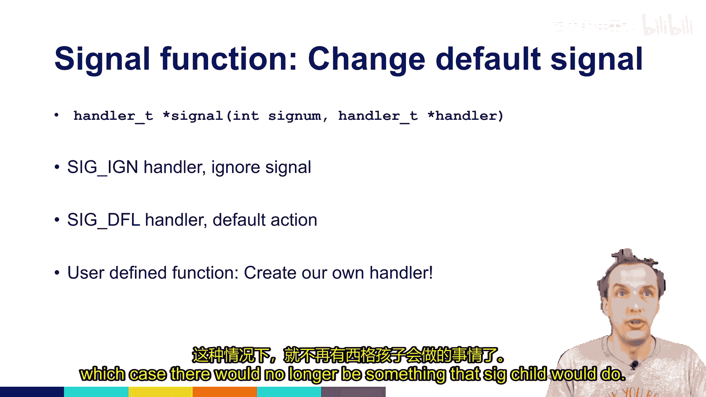

Let's switch over to our lectures， so here this is our most basic possible process and if I GCC this guy one。

A that out， so this is a process and I can send it the sign。By hitting control C on my keyboard。

 If I were to run this and I just start banging on my keyboard， it just keeps on running。 right。

 This is a normal process。 Now， if I were to come over here and I add this signal。

 So I can say when I， when this process receives the int signal， I want to ignorerant。 I can do that。

 I can just say ignore ignore。 So if I Gcc this guy， and I run a do out and then I。

 I bang on the keyboard， that's expected。 But if I click control C here， nothing happened。

 So I am stuck in here， and I need to send a different signal to that process to stop it。

 I know that control backslash if it doesn't pull up my。Password manager。

 let's kill the password manager so it doesn't take over control C or control backslash。 Yeah。

 so control backslash then Sig quit。 and I did not cause S quit to be ignored here。

 We can be even funner It can be a total jerk wd and no I not Stail。 I want to do S quit。

And I can both ignore in and quit。So if you want to like annoy your friends and have processes run that they can't kill。

 so I can't kill this with control Sno， I can't kill this with control backslash now， in fact。

 I need to go over to another window。T clean that out。So I've got to process 80 out here。

 so there's 2614， if I want to stop this process， I can terminate its parent and it will no longer it'll error out because it tries to write to standard out。

 which standard out doesn't exist anymore and then it doesn't know what to do in it。

I can come over here and I can send the till signal。2，2，6， one，4。

And that one will definitely kill it。 So here there was nothing my process could have done。 Let's。

 let's be fun。 Let's do an actual demo of this。 So to say。😊，Well， this will probably not work。

 but I didn't try it beforehand。So here that doesn't work， that doesn't work， come over here。

Check for what its process idea is。 Ki dash 9 of 26， not5。 come back。 and it was killed， right， So I。

 even though I told it， he， I want to do something different when I kill a signal， it doesn't。

 That doesn't work。 right I cannot mask block， Pre， ignore the S kill signal。

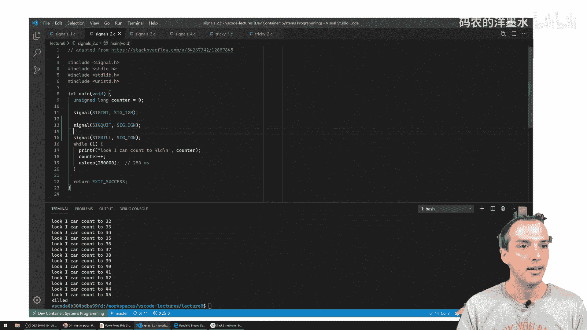

not only that， but we can do our user level process。LetSee， so we can block。

 I'll go back over and show a couple more demos in a moment。

 but just to cover a few more pieces of the ideas here。

 sometimes we can block signals in addition to changing what we do with them。

 that implicitly the kernel is going to block signals being delivered to your process if it is running that process in kernel mode because we don't want really important operating system stuff to be disrupted by the fact that some。

Excuse me， Use level signal ended up showing， showing up。 So if I block signals。

 that's kind of like me。 I don't know。 Where does my。My mail carrier analogy show up here。

 This is like some jerkqud coming in front of your mailbox。 and like holding the door closed。

 It's like the signal， the flag can go up and we can say like。

 oh we're going to send the signal and it's gonna be pending。

 It's it's going to be something we want to deliver and I'm gonna keep that flag up。

 but I'm just going hold that door to my mailbox shut。

 You can't open that mailbox until I have unblocked the signal。 So those signals become pending。

 but they're not received until the signal handle returns。

 The mail carrier cannot come and open that box until you have taken your hand away and allow them to you pick up your ballot or whatever if we really want to get topical about this。

So while we are handling signals in user mode。We can receive other signals while we're receiving that one signal。

 I don't even want to try and make an analogy for this。

 but the basic idea is if we have two different signals that can be delivered to our process and the world exists such that we could receive the signal。

 is remember， we only receive our signals when we receive the。Sorry。

 I started thinking in my head instead of talking about what I want to talk about。

 we only receive signals when we transfer over from kernel mode back over to user mode。

 So if I'm handling a signal and I'm just doing user level stuff and somebody sends me a different signal。

 I'm gonna keep doing that user level stuff。 until I do a system call or until I get swapped out due to a contact switch when I get swapped back in rather than going back to where I was in that。

Signal handler， I'm going go over to the other signal handler。

 So if I had 50 different signal handlers。 and I just happened to make it work。

 so that the timing all worked out， that I switch back in before I finish the signal handler。

 instead of going back to the next instruction I was supposed to run。

 I'm going to go to some other instruction。 This， This gets really tricky for different signal。

 this can happen。 But when I am handling a specific signal like the signal for S right or。😊，Yeah。

 so when I'm handling signal S， I cannot receive signal S again。

 I don't I't want to create like an infinite loop of signal handlers of the same exact signal。

 But if I have a different signal show up， I will start handling that。

So by default S gets blocked when you are handling S。

 but other signals are not blocked while you're handling S。

 every other signal could still interrupt your currently running code。

Signals aren't just sent to an individual process， they're sent to an entire group of processes and every process belongs to exactly one process group。

 this concept comes from the fact that we want to create。

Jobs and in the UniX model of running lots of different tools that you compose in interesting ways using standard in and standard out。

 this kind of makes sense to have this concept of a process group where I want to say this whole entire job needs to stop or this whole entire job should terminate。

So I can send a signal to the entire process group and these process groups are used when you're indicating that a bunch of processes work together。

 children belong to the same group as their parents and they can change their group ID explicitly by calling a system call so when I if I wanted to run a program called yes and I wanted to and that just sends the character why as much as it possibly can to whatever process is connected to its standard out I can link those processes together and then I want to remove every single file and I want to say yes to whatever prompt RM gives me I can pipe that process yes to that RM star these are linked together in a single job and there's lots of very very powerful things we can do using things like said and A and Gr and S and all of these and XAs all of these different tiny little programs can be composed。

😊，To do very， very complicated things very， very quickly at the shell so a little bit out of context or out of scope for this class。

 but that is this Unix philosophy is very important。

 powerful mechanism if you're doing a lot of data-driven system administration developer work at the terminal very。

 very powerful mechanism， but that gets represented in Linux by this concept of a job where you have lots of different processes that are connected in some way。

 like yes and RM here are two different processes that are connected by standard and standard out。

 but more importantly they are a thing that a user wanted to do。

 they're a task they're a job that is one big unit。Now we have foreground jobs and background jobs。

 there's some situations where we want to just cause something to run and we don't want it to take up our terminal。

 we just want it to continue running in the background and we'll keep doing our work we put our ampersand there in front of at the end of a command line。

 which says rather that the shell should create fork itself， it should exact this other program。

 but then instead of waiting for it to end and then giving control back。

 it should just immediately give control back to the shell so the shell can keep doing what it wants to do So if I wanted to do like VS code and I was on a Linux machine I would fork it off like this I want to launch it from my terminal and it's gonna to be some window by itself but I want to keep running GCC or V or whatever the heck is else I want to do at that terminal I don't want that terminal to just be frozen until this program terminates。

So every terminal every one of these virtual terminals has one foreground job and any number of background jobs。

 so that foreground job is the thing which is intended to be writing to standard out and reading from standard in at that moment in time know we already talked about sending sending signals with the kill function what I want to get to there's a few other important pieces of information in here。

Yeah yeah， so writing a signal handlers is tricky。 This is hard part。

 this is probably the next section， next important section of this video。😊，啊。

So we're going to explore concurrency， like actual concurrency issues a little bit later on in the term。

 but for now we're going to just go over some relatively basic guidelines for what to do here。

 So I'm going to switch back over to my demo stuff。

 So in addition to installing signal handlers like we have here we can also I'm sorry in addition to installing like ignore signal handler like we have here we can also install a signal handler that does something in and of itself So here Im going to install this function。

 so I'm passing a reference to this function。 remember this is just a symbol and that symbol refers to a location in memory that location in memory just so happens to have an assembly instruction that is the beginning of a function。

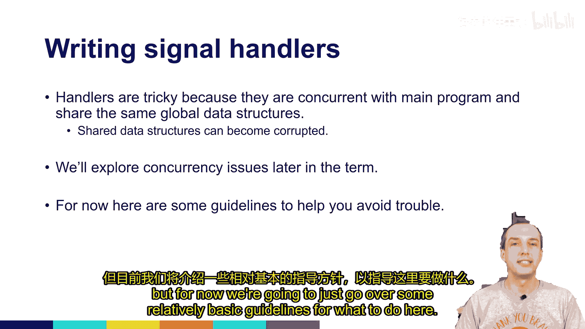

So if I were to GCC this。This one right here signal is three， and I want to run8 do out here again。

 I'm pounding like four times a second of what just for fun， I guess And if I hit control C here。

 I will send a I'm going to write to standard out this message you can't stop。

 So if you want to be a total jerk w， you can be that。 And of course， again。

 we can pinfill backslash right here。 what's really important。

Is that there are two theres three places where this signal could potentially be delivered to this process。

 It's going to be after a system call like printf， if I printf will eventually call right。

 and if the signal was sent if I hit control C during the few microseconds that it took to run the right system call。

 then as my code transitions back to user mode at the end of the printf statement at the end of that right system call。

 instead of running the next instruction of my code right here in main， however that got compiled。

 I am instead going to run the first instruction of signal handler。

 which is a little bit tricky because while I am going to get my own stack frame in signal handler so that it can have its own local variables。

 I don't have my own。Global variables， I don't have my own anything really to do stuff on like independently of the main thread。

 And this like immediately to me it's like oh， that's not a big a deal right。

 Like just do whatever you need to do。 But there's a lot of functionality that relies on global variables。

 There's a lot of things which you cannot do here。 I had to write this right system called basically manually here so that I didn't do something that is not safe to be called from a signal handler。

 if you take a look in the book。

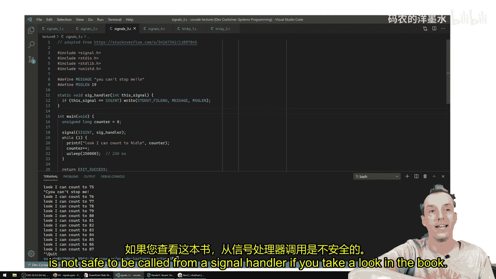

There are many， many library functions。 The standard library has。A small handful。

 and there's hundreds and hundreds of functions in the standard library。

 These are the only ones that are safe to be called from a signal handler。

 You can see right is in there。 but printf Sn printf F gets F puts， puts Gitar Gitchar。

 all of that stuff is not in there， there's a lot of things that are unsafe because they're going to be interacting with the outside the outside world of your user level process outside of just your own individual stack frame。

 And so that's one of the big hard parts about signal handling is because I interrupted this code instead of running line 21。

 because when I think about programming。😊。

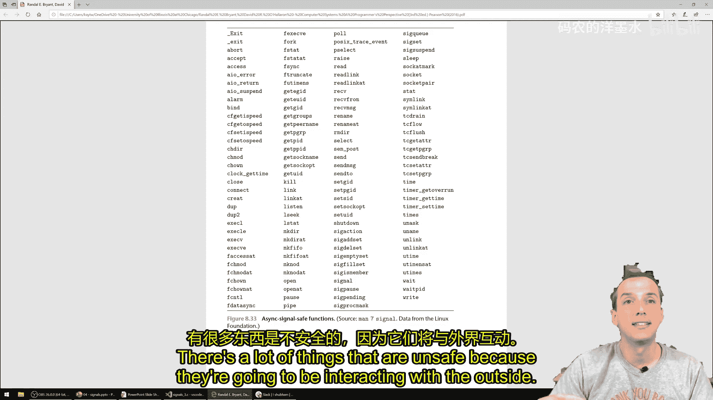

In a normal world where this didn't exist， where I didn't use a signal handler。

 If I ran this line printf， I know as the programme。

That one of two things is going to happen next either the assembly instruction that increments counter will happen next or my program is going to die right those are the only two things in the normal non-signal handler world that could potentially happen next and if I modified counter in that signal handler then counter might get bumped up by two instead by one or it might get set back to zero or something and if I'm reasoning about my program and what it's supposed to do like if I wanted to sorry if I was reasoning about my program and what it would do in a normal world I can be safe like I can know without a shadow of a doubt that if I run this code this is going to print a number and then that same number is the number that's going to get incremented here。

If I had access to counter up here in this signal handler。

 I could change it to minus million like a million or0 or some value arbitrarily。

 And this code would no longer have the invariance that it expected that's the super hard part about concurrent programming when you have different threads that are going threads of control that are going to run at different points in time and you can't be sure of when which one runs and when which other one runs。

 Now when we get over to the final module of class。

 we're going to learn how to actually really solve that problem。

 but for now we're kind of going to say the best thing to do to prevent that from being a problem is that when we run our signal handlers we're only going to do things that don't have unexpected impact on the outside world。

 if we only work within our own little stack frame of say our signal handler。

 then when it gets thrown away because。handler returns。 It's not that big a deal。

 We know that things are going to work the way that we want them to。

 and we're not going to have to think about these really， really gnarly problems of。

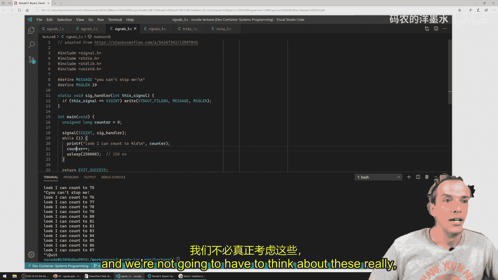

Concurrency。So this is all to say that。

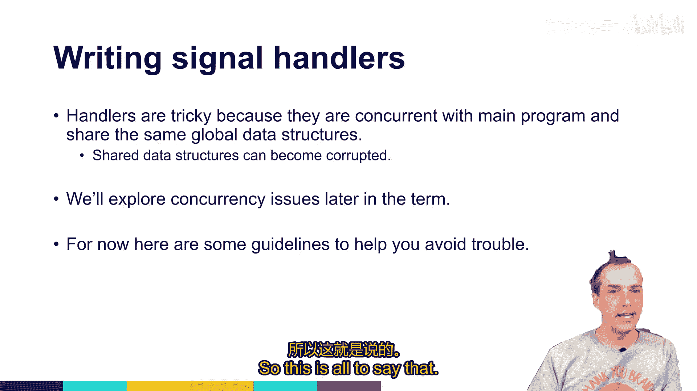

Yeah， we're gonna have our guidelines。 We write our signal handlers。

 and let's go over our guidelines。 So these are the same guidelines we have in the book。

 These six things telling you to keep your signal handlers simple。 Call these ay signal Sa functions。

 save and restore air no。 Remember air no is a global variable that the C standard library uses to keep track of what the。

😊。

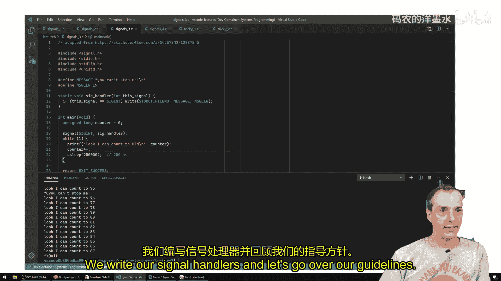

Error state of a specific function is if it's return value can't give you a real error code。

 Like if the return value has to give you how many bytes were red and you can't send a specific error because if there's 17 different errors。

 like what do you do， you want to say， I sent， you know，7 characters means a special thing。

 you can't do that。 So instead， what the C standard library does is it uses a global variable error no。

 which you can then interpret using those P error STR error functions。诶。

You can if you're doing something that is going to deal with very important data structures。

 you can temporarily block signals this can say know listen all these other signals need to stop I'm going to do something that's very important that is going to manipulate the status of this process if you do an S trace on your shell when it launches a new program you'll see a lot of SigProC mask and that is masking off signals basically preventing them from being delivered until it finishes a very important chunk of code。

When we declare global variables as volatile， this prevents the compiler from storing them in a register。

 This means that we if we're ever going to manipulate the value in this variable。

 it must be immediately persisted to memory。 It cannot be stored in a register until it gets persisted back to whatever address it lives in。

 typically you don't have to do that。 the compiler can optimize to rather than keep something on its stack frame。

 it's just going keep it in a register， which makes things much much faster。

 Remember that registers are just amazingly faster， than even your L1 cache。

 So it's a really good idea to not just use volatile left right and center。

 you don't want to use that everywhere。 but if something has to always have the correct value stored in memory no matter what you can set it as volatile。

 and there's also the sotomic T， it basically means that not only is reading that value out of memory。

 always going to give you the right value but writing。😊。

It is also always going to give you the right value， it's an atomic right。

 which means that whatever you do to write to that variable happens in one instruction。

 no matter what。So flags that are installed this way don't need to be protected with any synchronization primitives they don't have to be protected with blocking signals。

 they can just be manipulated like I'm going to show you in my demo code pretty soon so let's go back over to our demo code So if we go over here to this is a decent safe way to receive a signal and then do something based on that signal So first we have a volatile satomic T So this volatile here means that keep running will never be stored in a register it will always have its correct value in memory。

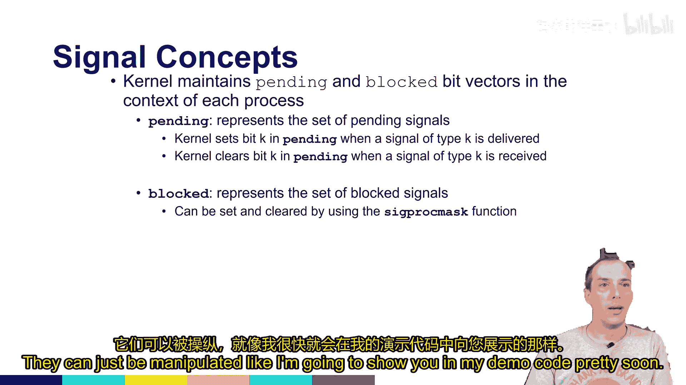

The siggaomic team means I can write to it， and it won't cause some inconsistent scenario。

 And we make it static because we， we don't want anybody else outside of us to have their own keep running。

Excuse me， manipulated by our own key product， right， we know that this is only for us to see。Now。

 when we write our signal handler。we need to do async signal safe things and that means async signal safe system calls like right。

 I guess this is a library call technically， we can do if statements based on these things I can set a value to keep running。

 that's also safe to do and the most important high levelve bit here is that I'm not going to do things like exit this process in the signal handler。

 I'm not going to clean up I'm not going to fix whatever went wrong。

 I' am purely going to say if this signal got delivered。

And it's something I need to eventually take care of。

 I'm going to set a flag in my code as opposed to in the kernelel's process table that says， hey。

 you need to do something when you get around to doing it in the main execution thread。

 That's fundamentally what we're doing here。 and what we'll be doing in some other assignments later on in class。

So here we install our handler for a second， and we check this flag to see whether we're supposed to keep running or not。

And we do everything that we were doing before and know we peer if our sleep fails and if I Gcc this sucker right here signals4 and I run it I can control C here and I can do things in this signal handler and I can keep I can tell it to stop running and then I actually check it in the main thread。

 So every single time I go through this while loop。

 I am checking whether keep running is true or not and I only keep running if keep running is there you could imagine that you could use rather than this。

 you could have something like well true， and then you could have， you know。

 if a special special flag a bang equals0， then you know do what you need to based on the fact that this signal。

😊，Got delivered。Right， so what we can do is we can say， aha， thank you。

 operating system for interrupting us in the middle of our program and delivering this signal。

 I'm going to deliver that to the main thread when the main thread is ready to handle it。Until then。

 my signal handler will be done， and that's a safe way to do do things like this。

 but it would not be safe to do， it'll almost always not be safe to do whatever special things you need to do in your signal handler。

 That is how we get around the challenges of concurrency with respect to signal handling。

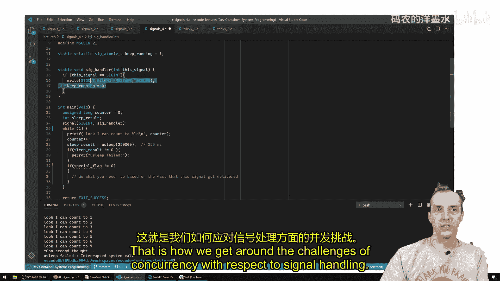

I think that's about what I wanted to have there。Okay， now how signals actually get delivered。

 This is probably the next main section of the video right here。

 The kernel is going to maintain these pending bit vectors and blocked bit vectors for every single process。

 Each bit corresponds to an individual signal and their bits， that can be set to zero。

 which means there's no signal pending。 They can be set to one， which means there's a signal pending。

 What's really important here。 is that you can't set one bit to two or three or four。

 So I can't say I delivered this signal seven times。

 There's no way for the operating system to keep track of the fact that that signal got delivered more than once。

 can or got sent more than once。 It' really hard to keep all these， all this terminology separate。

 So you send a signal that raises the pending bit when you deliver the signal。 That's when the。😊。

It gets set from one to zero and it actually gets handled by the user level process。

So you could only have。Pending set to one， you can't have pending set to two or three or four for a specific signal。

 you can only have it pending once， no matter how many times someone has tried to send you Sig user1。

 you can only set that bit to one。You can't send it to。1 really hard， right。

 So I can send 17000 different se user ones， and only one of them could potentially be delivered。

 That's the trick that we're worrying about right here。 spoilpoer alert Likewise。

 blocked is also a bit vector， but that's a lot more。Semantically consistent。

 who want to be fancy about it。 right that means that this process has said I do not want to receive this signal。

Right now， so if that signal is pending， the kernel is going say don't care。

 I can't deliver it until it has been unbed once the user of process has decided I am willing to receive the signal now then the kernel can just be like。

 gotcha， you got this signal that you have to take care of and then it'll take care of it but until then it doesn't worry about it。

So the things， the system calls that deal with signals， the most common ones here are weight。

 sleep and pause， so weight allows us to block our process until we receive the SG child signal so this puts us to sleep until a specific signal is ready to be delivered and then it just gets delivered so you can use weight like we did in last week's lecture without installing a signal handler right we get blocked until we return and SG child gets ignored but in this case it gets ignored and then your program continues running。

 which is super useful sleep not use sleep that we just used but the sleep system call will block our process until one of two situations either a the number of seconds that you asked to sleep has finished or B any old signal at all got received it will immediately move on to the next line of your code。

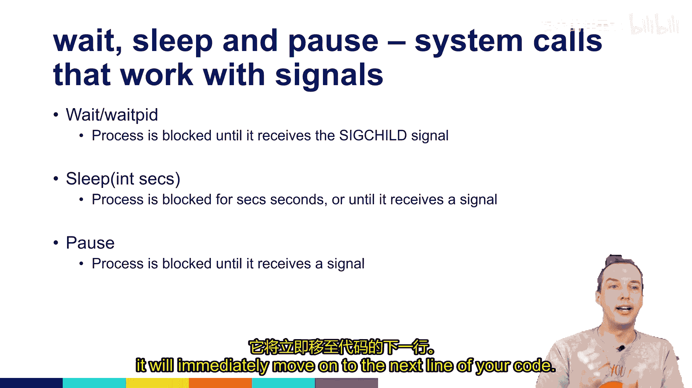

So I can show something a little bit maybe unexpected。 So I come over here to my most basic。Example。

 let's do this。 and then let's do。Sleep for three seconds。And then。Let's do in result of zero。😔。

Re equals this。Pronounce。H still had。Ply seconds to you sleep。On a result。Yeah， result。

Printe is buildinglding correctly。And then you see these signals too。😔，So if I send。

So that makes sense， I still had zero signals。waitai。

 oh this is the one I've got to kill from another window， fantastic， Chris。Kill，4，3，3，9。

 and if seek kill doesn't send kill， or it does。Sig term。 that's in Sig term。

 which can also be masked by by default kills and Sig term， which is different from Sigquit。

 which is different from Sigqui， which is different from Sint。

 There's lots of different ways to stop a signal。 So let's nuke all of those。

 make it again run it here。And se is not。Ignoorreed and therefore again， terminates the process。

 So I do want to。Only have that one。 GCC， this sucker。对， come on。Why is this？啊对。

We're in the middle of the sleep。I guess when I ignore it。It doesn't even stop this sleep。

Interesting。啊。Let's say。I had an example where this was actually working。啊嗯。Wow，Let's。哦。

This and here。And set this to。Say handler。See if this knows what I want to。Yeah， okay， so that works。

So。If I handle that signal and I return control back。

What's really So this is actually really interesting example I have right here。 First。

 I second at typing when I'm really， really trying to go fast。 Second， I am trying to count。

 And third， I have sleep returning here。 So what can happen to system calls is that sometimes signals can cause them to return prematurely。

 So sleep here gets returned prematurely， and it doesn't retry that system call。

 We can sometimes ask to retry a system call if it is retryable。

 There's some stuff at the very end of 8。5 that talks about this but the basic idea here is that。😊。

I was running the sleep system call and I said， please sleep for three seconds。

That sleep for three seconds did not complete because。系。Lost my face cam。All right。

 hopefully this didn't overheat kill itself。嗯呃。Yeah， anyway。What's going on next？Oh， we're okay。

 we're okay。So。Where was I？You go into the kernel because you called sleep。

 Sometimes you're not just gonna be guaranteed to sleep for3 seconds。 Sleep， as we saw on this slide。

 implicitly， is saying， either sleep for that many seconds or continue after you receive a signal and handle it。

 So that's the important part here。 There are some system calls that are going to be interrupted and they aren't going to finish what it is they were supposed to finish。

 They're going to instead go back and do something else。 Usually they will tell us， hey。

 this got interrupted。 There is a specific error no， like E enter。 What does it like it's E I N T。

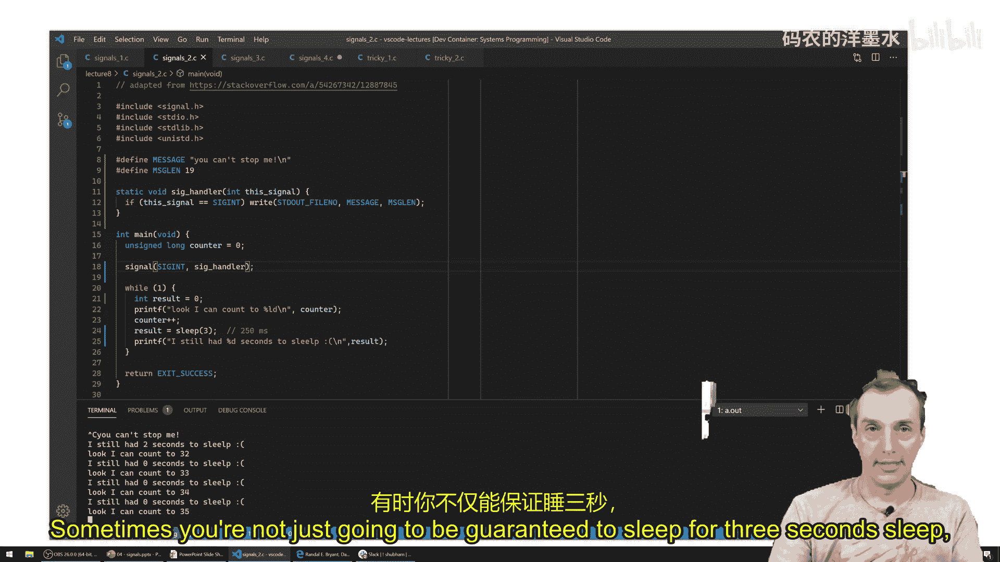

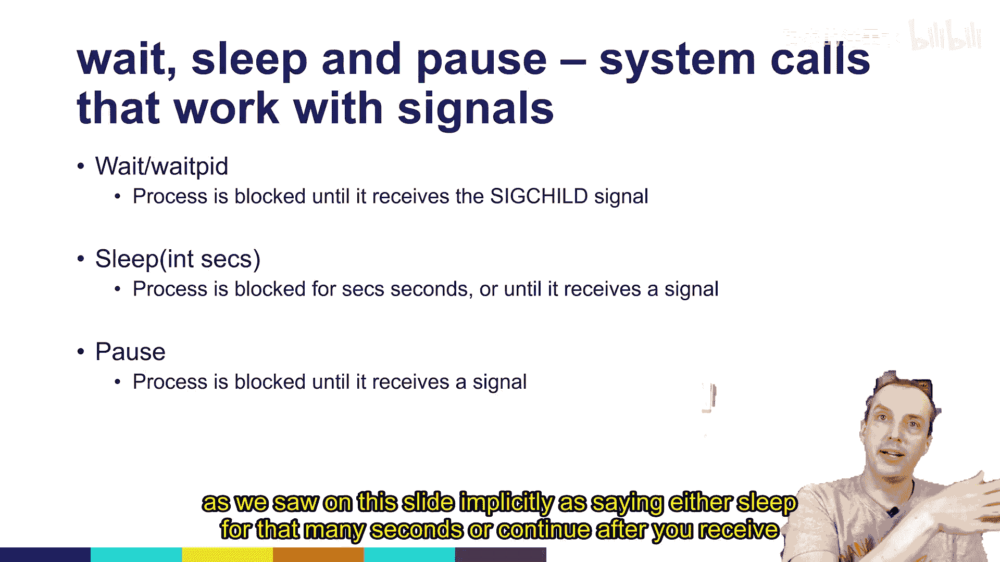

啊。I don't think I have air no。大说です。Yeah， so EI and TR is the error that means that your system called gott interruptted。

 that is probably what would happen as a result of that So if I do a P error here。呃。嗯。

Just return from sleep。Yeah， so there's success in that case right error no is not set to anything。

 but if I control C this， I get EI and TR， which Pire will hopefully tell us means the system call got interrupted。

 So sometimes if you receive a signal， It can stop a system call that you're doing。

 You are reading from a file and it didn't finish all of what it needed to do， it got interrupted。

 you'll get an error that says that that happen。 And then sometimes it can be re trieded。

 you can ask the system to retry it。 but sometimes it's just not going to to work。

 So you when you are sending and receiving signals and trying to handle them instead of just letting your program die。

 which is what you typically signals do like you control C and it kill your program。 Okay， you。

 big deal。 I guess I didn't need that programming anymore。That's not that big a deal。

 but when you're actually trying to recover from the fact that you receive a signal。

 this is another thing that you need to be aware of。Let's kill us for that。 Okay。

 so pause blocks us until we receive any signal。 So that's kind of like sleep infinity wait。

 you know， puts us sleep until we get our child signal。 And that's about all I had on the slides。

 Let's switch over to tricky 1 and tricky2。😊。

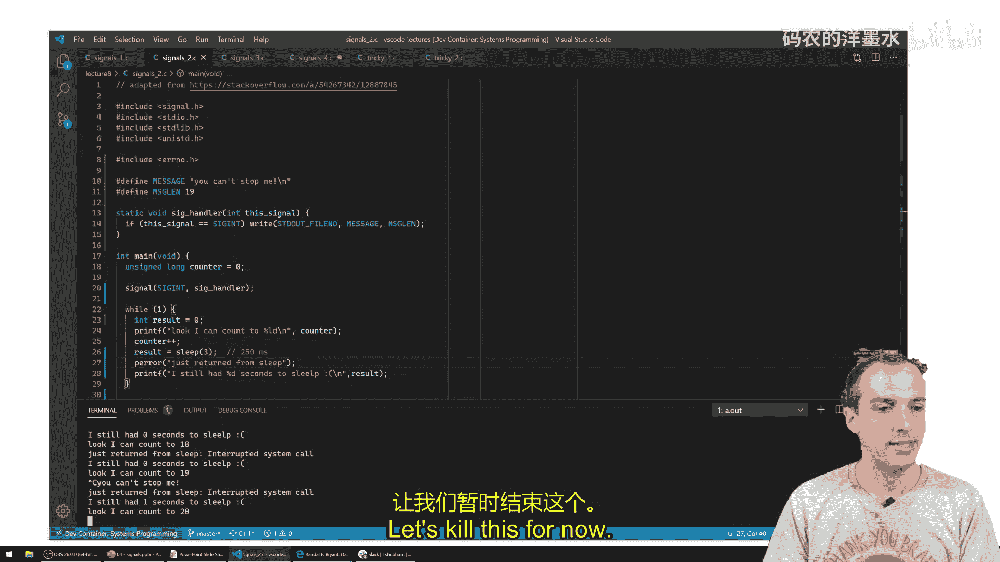

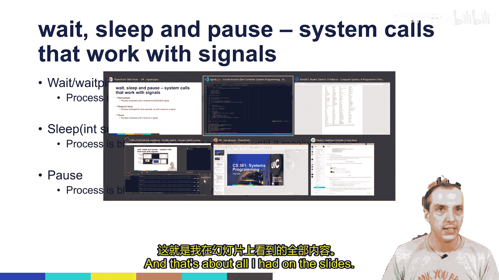

For now， so this， these are examples that are in the。Discussion questions。

 And I'm not going to go over them in the videos because I'm going straight up give you the answer。

 But if you do want to experiment with these from the discussion questions。

 you're more than welcome to actually take a look at it。

 We'll talk about these during discussion during qui quizlet during。😊。

What's it called Kaot Kahoot time and if you want to experiment with them right now they are in this VS code lectures repository thanks so much for watching again let me know whether this off the cuff version instead of the fully edited version seen just as good I ramble a little bit more but when I'm on camera alive I can usually keep the rambling to a minimum so thanks so much and I'll see you next time。

😊。

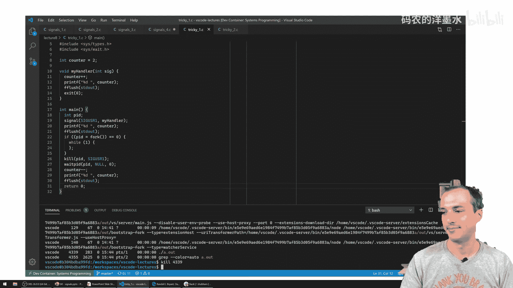