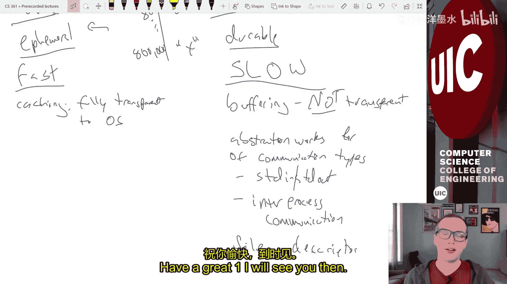

# 【全集】伊利诺伊大学 操作系统 中英字幕 1080P p07 Lecture 7 - Linux中的文件抽象 -BV1AEASzNE3z_p7-

Hi everybody， I'm Chris Camdge and this is CS361 Systems programming Today we're going to be talking about files。

 let's get started。So without further ado， the idea here behind files is very。

 very different than what we've been talking about before。 But at the same time。

 we're just going to be doing the same things that we have always been doing Fies are just ways for us to read and write bytes to things that store them that that is still the same thing that we've been doing with memory this whole entire time and。

😊，Not a huge amount is going to change there。 There's no fundamental difference between writing bys to a file and writing bytes to memory。

 but they are going to be accomplished in very， very different ways。

 And what we're going to see over the course of this lecture in the next couple of videos is that these abstractions of how we interact with files are very。

 very powerful ways that we can do lots and lots of different things that are very useful for our computing process。

 like just doing computing。 So the。😊，The ways that they are the same is you know they're just reading and writing bytes when we think about memory。

 we're loading bytes from RAM into a register， we're storing bytes from a register or from a computation into a byte。

There we're gonna to see one of our very first big differences in that when we're reading and writing memory。

 it is random access memory that's kind of right there literally in the name。

 We can ask for a specific byte。 and we always ask for a specific byte。 We never say， hey。

 load the next byte。 We're always saying load the byte， which is stored at this specific address。

 We have my my super favorite drawing of our L values and our R values。 where we have， you know。

 address 800， address 801，802， etc ceter。 And I can store the character A。

 I can store the character B， I can store the character C， and reading byte 800。

 and then reading byte 801。 You just do load for 800。 You do load from 801。

 When you want to load from 800 then load from 800000。 You could say， I'm going to load from 800。

 And now I'm going to load from 80000， I can just do that in two different assembly instructions。

 and there's no fundamental。😊，Difference between doing those two things。But with files。

 we're not going to get that files are very explicitly meant to be sequential storage。

And there's two reasons for this， one is historical。In back in the day。

 when you were storing things outside of memory， you were storing them physically in an order。

 you were storing them onto a tape drive or you were storing them onto a hard disk that has spinning platters and you store them in a line on or in a series of coned circles on that disc。

What you end up with is if I want to read a specific byte， say byte 800， which is stored here。

 and then I want to read byte 801。 Well， that one's just gonna come right out of the disk as I'm moving through all of these bytes。

 But if I wanted to read byte 800 and then read byte 800000。

 I would have to read byte 800 and then tell the hard drive， hey。

 will you please move the arm of your hard drive out to the track where 800 is and wait for that spinning disk to come around and then grab that bitete from 800000 just a fundamental difference there between random access of just picking what you want and。

Waiting for the hardware to actually do what it needs to do to get to that piece。

 right If this is where a tape drive， you couldn't just wait for the arm to move。

 You'd have to spool all of that tape all the way through till you got to 800800000。

 then if you said， okay， great， now I want byte 801。 then the tape drive would be like。

 are you freaking kidding me and then roll it all the way back and then you get byte 801。

 This is historically why one of the reasons that files are sequential。

 But if we also think about how do we usually parse things if something has arbitrary length。

 we're probably just going to parse the first few bytes， parse the next few bytes。

 parse the next few bytes， if I'm reading a C file， Im not saying I want byte1， then 800， then two。

 then 676。 there's no likelihood， that that's the actual way you're gonna be accessing that file。

 This sequence of bytes。😊，Abstraction is super， super useful for files。

 and this is going to be one of the big differences we get out of。Filees themselves。

 right where in memory we do a load from an address in files。

 we are going to just perform a read from a specific file descriptor。

 So we're going to ask for a certain number of bytes。

 we get 100 bytes and the operating system is now 100 bytes further and its's cursor of what it's looking at。

 And if I just ask for 100 bytes again， I'm going get another 100 bytes。

 This is the way that files work This is kind of a lot of you probably intuitively understood that there's some difference between these things。

 But if we can talk about it explicitly here。 will'll be able to build an understanding of how files are implemented how files actually work and all the tricky parts that we're gonna to see over the next two lectures。

 Another really， really important thing about Ram is that it is ephemeral random access memory。

 you turn that computer off， all that Ram is gone。 You are not going to read it back out whereas。😊。

Fileles are durable。 And this is a blessing and a curse at the same time。

 The tricky part here is that I was working on something and my program crash。

 all of that work is lost。 but we all kind of write our programs knowing that if I was working on something and I read it into memory and my program crash is not like。

 oh immediately， my entire hard drive is gone， nothing is there。

 I have known my data that I've had for the last 10 years， but if your hard drive crashes。

 You know that's bad。 Like you turn off your power， not a big deal。

 Your hard drive is almost certainly going to be completely fine whereas if you lose access to your hard drive。

 that's catastrophic， you lose everything that you had there。

 you probably you maybe you didn't have another copy of it。😊，So this durability makes files better。

 but it makes them more dangerous because we keep things that are super。

 super important there if there's one thing that you'll probably learn on the job at any professional。

 you know internet company that deals with data，Losing user data， losing customer data。

 losing company data is a catastrophic， horrible， no good， very bad thing。

 Having your program crash is a completely different thing than losing data， right。

 we have that durability and that's good。 But we keep really important things in there。

 And so if we corrupt that data or otherwise wipe it out， That's bad。

 we want to make sure we don't do those things when we are manipulating files。

 The next thing I want to talk about is that files are qualitatively going to be a different league when it comes to how fast you can read and write them。

 So compared to memory files are slow。 And I cannot write this any more capsy caps locky than than I already did。

 Memory is comparatively so much faster than files。 I'll post a link or a picture right here of。

If you compare the distances in the solar system to the amount of time it takes to read from disk versus memory versus registers。

 you see that there's planetary differences in this amount of speed and this is important because we don't want to do everything in files like you say like oh I want to keep things from being lost if my computer dies immediately okay yeah that's good but nobody would use a program that just read all of its information off the disk and then wrote it back onto disk that would just be monstrously monstrously slow so we need to play a lot of tricks to hide that slowness and one of those slownesses is buffering now I had this drawing up here of the swirlly drawing of the disk if I am reading these bytes off of a hard drive the next thing that I'm almost always going do as the person the driver author for that hard drive is I'm going to transfer them from that disk into you know 1024。

096， some small number of bytes that I'm storing in memory until I give it to the user and I can prefetch things。

 I can keep them there until the user actually pulls them out。

 And that's a very common thing that you're going to see in file because it's necessary。

 if we ask for a specific byte got a specific byte Okay move out of the next byte ask for that byte get that byte it would be super。

 super solid。 This is the same strategy that we see in caching where if I pull in this byte。

 Well the cache is smart enough to know， oh， I should probably pull in the next28496 bytes。

 whatever so that I can have faster access to them in the cache rather than waiting for the user to pull them in the big difference here is that when I do caching at the cache level at the processor's cache level。

 it's completely transparent to the operating system the CPU knows that it's doing this and things are just gonna to be way。

 way， way faster when they're in this cache， but you don't have to。with it right。

 You don't have to have any concept of what's going into that cache， how much is getting pulled in。

 It's all completely transparent to you。 The operating system does not know that that caching is going on。

 whereas the operating system is basically managing that caching when it comes to using files。

The the last probably super， super powerful thing that we have with files is that they are these streamoriented communication where we're going to be pulling these things in。

 but we can map that stream orientation right so sometimes I'm going to talk about as sequential access。

 Sometimes I'm going to talk about it as streambased and these two words are going to mean slightly different things in important ways。

 but more or less we're talking about the same basic thing where files are largely referred to sequentially and memory is largely referred to in a random access way with files。

 we can map this abstraction。Onto lots of so this this abstraction works for lots of communication styles。

 So not only can we communicate with a disk by writing bytes out to it or reading bytes in from it。

 we can also communicate with something like standard in and standard out right。

 standard in is connected to my keyboard and when I type things in on my keyboard， I don't have to。

Access some bytes of memory someplace。 I just read from a file called standard In that's mapped onto the input coming from the keyboardword。

 Or if I want to display things to the screen in the most basic way。

 I don't display those things to the screen by writing bytes or characters to a screen buffer。

 I just say， you know， send these next seven bytes。 send this bytes and this new line byte。

 that means move on to the next row。 These things are super， super powerful。

 And we can map them onto things beside just standard in standard out， right， so that the file。

 the stream oriented communication。😊，Worked well for standard in and standard out。

It also works really， really well for inter。Process。

Communication and the really awesome part is that those two processes can be on the same machine like I've got a parent and a child。

 they can share file descriptor and they can send bytes back and forth simply by saying， oh。

 I'm gonna write into this file but what I'm actually doing is sending bytes to my child and what the child can do is let mean I'm reading from this file but what I'm actually doing is receiving bytes that were sent to somebody elses sent to me by my parent process that could just as easily be a web browser on a phone talking to a web server millions of miles you know hundreds of thousands of miles away。

Thousands of miles away。 How big is the earth Again， I'm really bad at these things。 Yeah。

 so that's a super， super powerful abstraction。 And we're going to do this through the concept of a file descriptor。

😊，Which is what we are going to talk about in the next video。 have a great one。

 and I will see you then。

