# 【全集】伊利诺伊大学 操作系统 中英字幕 1080P p08 Lecture 8 - 在Linux中与文件交互 -BV1AEASzNE3z_p8-

Hi， I'm Chris Kench， and this is C S 361 System programming。 Today。

 we're going to be talking about how to use past file files in C。 Let's get started。

 So the the big five different Apis that we're going to use to interact with files are the ones we've got here on the screen。

 We've got open， close， read， write and see。 The everything else that we use is going be more or less built on top of these。

 even when we aren't interacting with a file that is on a hard drive。

 These are going to be the ways that are user level process communicates with the operating system and tells it what it wants to do with files。

 So we switch over to our。😊。

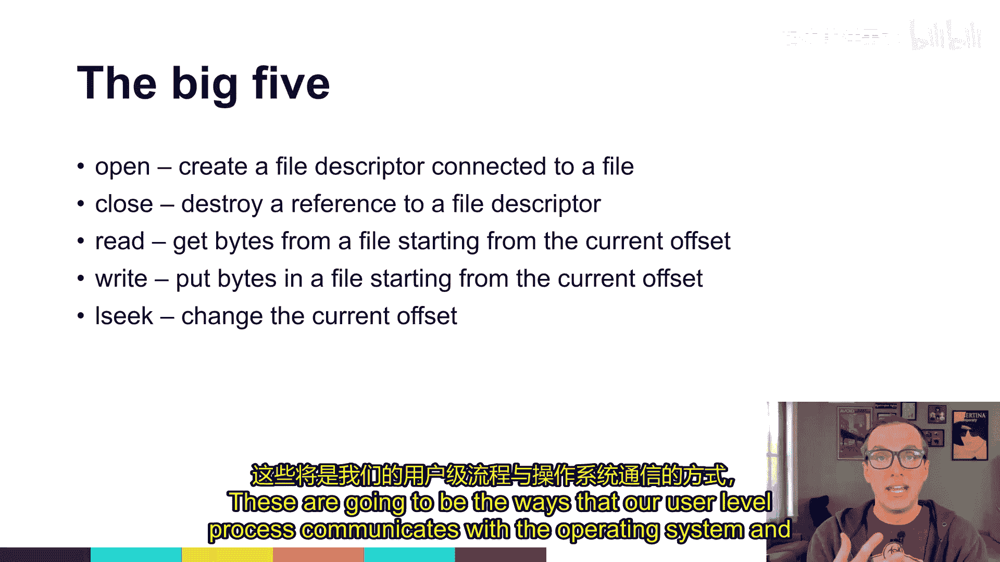

Handy dandy Vs code window here。 We want to do man to open section 2 gives us the system calls in in the Unix programmers manual。

 So if I were to say man open， it's gonna give me some other information here like about links But instead what I want is the stuff in section 2。

 So when you're looking at open， close， read write if it doesn't show you what you expect。

 just do a man section 2 and then what you want to open。 So anyway。

 here we have the prototype for open。 most commonly one that we're going be talking about in class and using takes a path name on file system。

 it takes a set of flags and it takes a set of modes for that file。

 This is your program telling operating system through a system call。 how it wants that file open。

 what it wants to happen when it interacts with that file in that streambased way of interacting with。

A fire。So the really one the first super important。

 really great big conceptual thing that we get out of the file。

Approach to interacting with the computer is that we're going to be using file descriptors， right。

 So that it's a file descriptors are how we。Refer to specific open files， right。

 so you can think of a file descriptor as a ticket that tells you， hey。

 the operating system is going give you this ticket。 That's literally just the integer。

 It's just a number。 And you say to the operating system Every time you want to operate on a specific file。

 you hand that ticket saying， hey， this file that you open for me， you know，20 milliseconds ago。

20 minutes go whenever， this is the 1 I want you to read bytes out of。 And the operating system says。

 okay， Yep， they want to read bytes out of。File descriptor zero and that's typically standard in by default and that operating system then chooses。

 okay I'm going to read those bytes in from that terminal or that file。

 whatever is connected to Standard in and I'm going to give them to that operating to that user level program so file descriptors are tickets for a specific open file that you hand to the operating system via these system call interface。

The system。Okay。So that's the return value that we're going to get out of here。

 And we get the same really annoying Uniixi type thing where the return return value is either going to be the integer value of the file descriptor or negative one if there was some error and we can check our global variable error error no using P error using STR error just printinging out the variable error no if we want to know what the heck went wrong and there's all sorts of different ways that things know wrong。

 but we're not going to worry about that too terribly much here here we are we're going to receive a file descriptor。

 this is our ticket and we're going to tell the operating system I want to open a specific file with a specific set of flags and with a mode now what are flags That's what we have up here The flags overall are about how you want to interact with the file that you are opening Do you want to read from that file Do you want to write to that file you want to do both do you want to create that file that doesn't exist。

 These are all options you're going to state to the operating system saying I want to interact with this file。

😊。

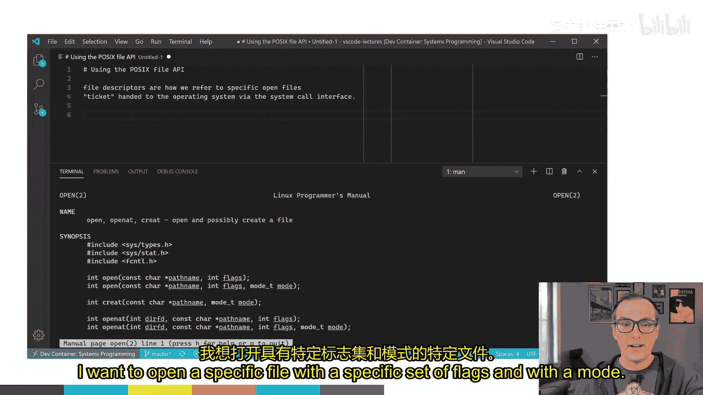

In this way。And so I can open it just to read it out， I can open it just to write it。

I can create it if it doesn't exist。 I can append to the end， I can truncate it if it already exists。

 So just to give you a quick overview of what these could potentially be used for。

 you can be truncating a file if when your program starts。

 you have some scratch space that you just use for various pieces of information and you want it to be blank every time you open it It's just a temporary file。

 it isn't really super important。 just when I open it。

 I want to have a brand new empty file and so you trunccate it。

 you tell the operating system no matter what's in that file when I open it to write into it。

 I want you to give me every give me a blank file， just delete whatever was there and let me start over clean。

😊，AndSo that does make sense in some situations。 Likewise， Oh append allows us to say。

 you I want to write into this file， but I just want to add more stuff at the end of it。

 I don't want to open it for and start writing to the beginning because by default when you open a file。

 you open it to the very first byte。 The first thing that you read out is the first byte of the file or the first thing that you would write in writes in the first byte of the file。

 Another really important aspect of file usage in Uniix。

 And I think most programming languages when you write to a file you are going to be overwriting whatever bytes are already there。

 There's no such thing as opening a file to write。At the very， very beginning and say， okay， well。

 there's， there's 400 B already in there。 And I want to just add things to the beginning。

 and have those other 400 Bte still exist。 All these bytes exist at a specific offset from the beginning。

 And you'd have to write your own code on top of it to kind of scooch in 100 Bte at the very beginning and push everything else back。

 So by default， things get overwritten by default when you open a file。

 whether it's reading or writing， you're gonna open it at the very beginning。

 unless you ask the operating system to do O aend。And so that's what we have for the flags。

 some of these don't make sense together， they're just completely illogical and a lot of them actually can be combined。

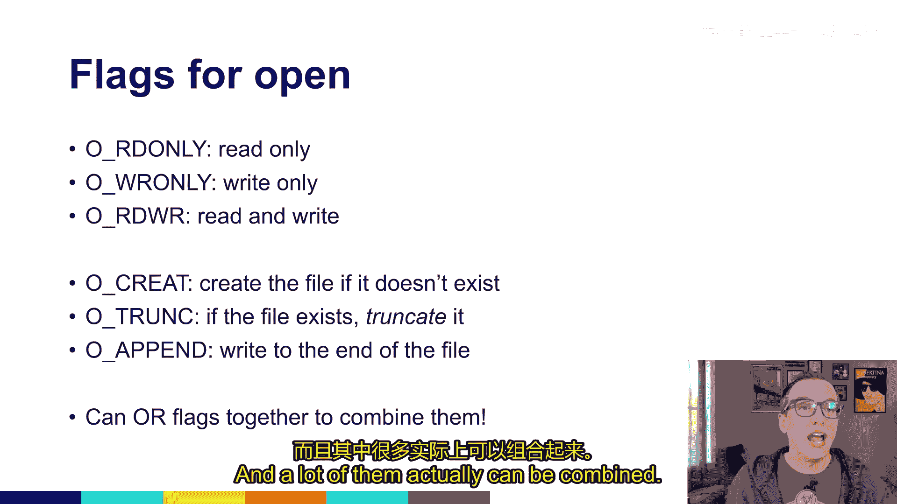

So the next thing we have in our prototype for open is this mode that we can open it with and we don't have to set a mode。

 we can just receive whatever mode is the default for the environment that we're in but if we want to say I'm going to create a file and I want to give it specific permissions I can do that here So what I was talking to a couple students in class the other day last week and they said that oh we never went over Schmodd or the Unix permissions model in any other class。

 so we're gonna to do it right now So in a Uniix LS L。

 you are going to receive a long listing with lots of information about the file the important things that we care about here in this listing are this information right here which Rs Rs。

 Rs， whatever So every file in a UniXbased operating system has a set of access permissions。😊。

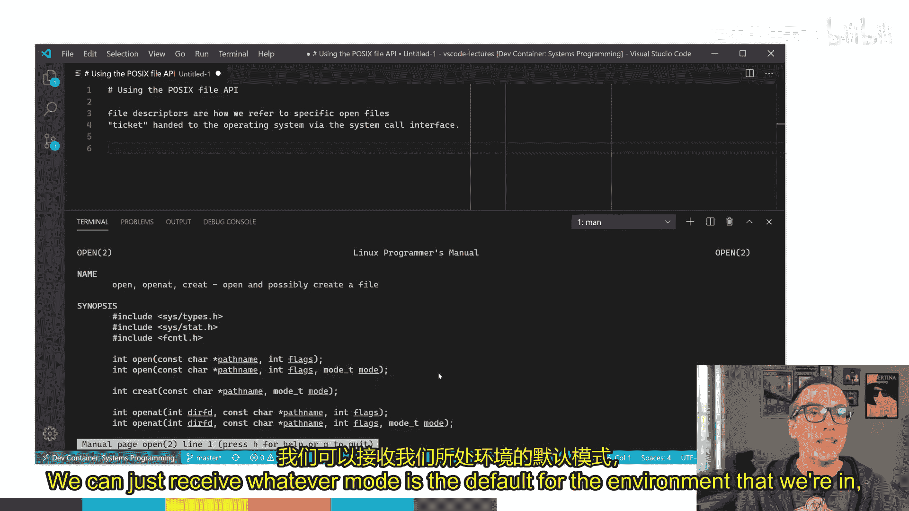

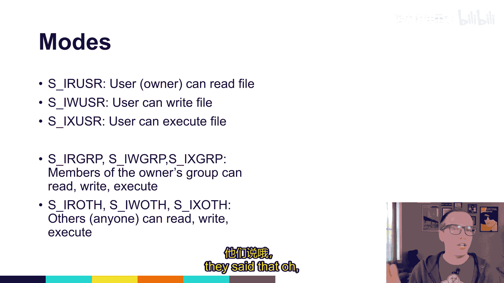

And a setting for whether it is a aisle or a directory。 And when you do a long listing like this。

 you get given all the information about those permissions。 When I see a D in this first column。

 that means that the thing that is being listed is a directory。 period is this directory。

 period period is the parent directory。 And both of those are directories。 The next 9 of these are。

3 triplets。 There's the triplet。 Each of them is read， write and execute。

 So read is whether the specific entity has the permission to read that file。

 or they have the permission to write that file， whether they have the permission to execute that file。

 This is whether you' are actually able to load it using the loading system to run it。

 You can make a file readable。 and it can't be executable。 but and you can also do vice versa。

 you can say， oh， this person is allowed to execute this program， but they can't see what the bytea。

 That is a thing that you can do in the Uniix world。 And likewise。 So we got read， write， execute。

 And you can see here that there's that thing repeated three times。 So the first three here。

 are for the owner of the file。 And the owner is what's in this column。

 The second three are for the group。😊，Which owns that file。 And then the third three are other。

 So any user that's using this computer has those permissions。 So let's see if I go to a server。

 like。Bert。And I L us in here， you can see that I have a bunch of files in my home directory that are owned by me and they're in the faculty group so a file like this request here。

 and I have no idea what I put in there two years ago is readable by any member of the faculty I can write to it。

 but anyone on this machine can read it， anyone who's a faculty member can write it。

 and another important component to this is that we can change these we can change the mode because we're talking about mode with the super hopefully named Schmoud。

😊，Program， I don't know how other people pronounce it。 I pronounce it slo。

But we're changing the mode。 So if I want to refer to things， I can do the。

 I can talk about the user， the group or the author。And then I can add or remove。

 rewrite and execute。 I'm going to pick one thing from this first one or more things from the first set。

One of either add or remove and then one or more of the things from this lesson。

 So if I wanted to remove the other user's ability to read this file， I would say， oh。

 minus R request。And if I L again， we'll see that。Request is not readable so a student or just any old random user would not be able to read this。

 but I and any other member of the faculty group would be able to read that file。

 I wanted to remove it from faculty so that only I can read it， I can do the same thing。

 but say G minus R。 and here I see that the group can't read it anymore。

 the other can't read it anymore， only I can read it and write it。And likewise， you know。

 I can set it back by saying GO plus our on request。

And it will go back to where we started so those are file access modes they were invented for multius machines and so that's why they have username connected to them and group names that was just the way that we did computing and how we shared files on a specific file system。

Not as useful anymore， but still important， different users have different permissions to access different things。

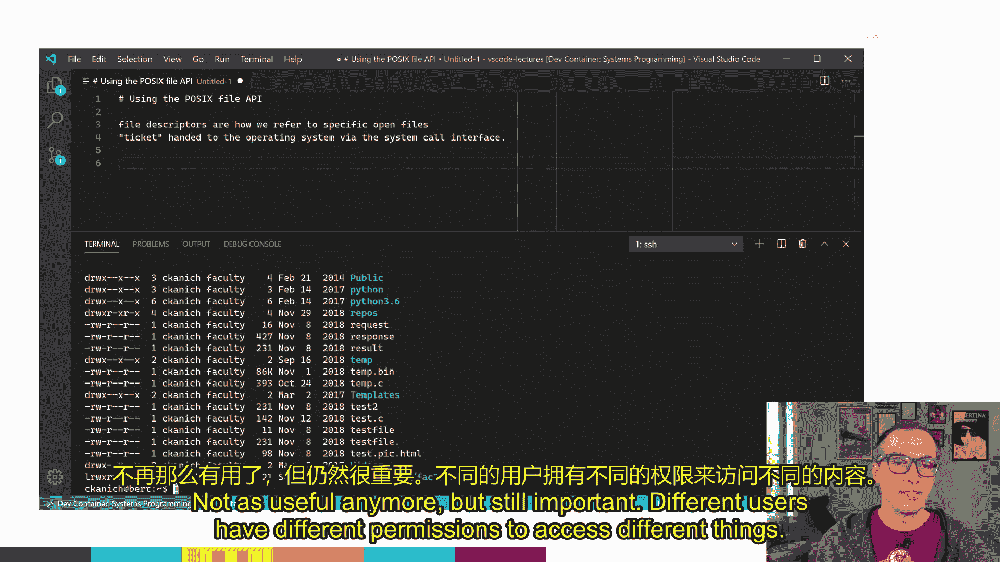

That's just the way the world works。So we are talking about modes。

 We can set our modes for our file when we open it so that when we create that new file。

 if we are creating that file， it would be created with the specific mode。

 and it'll just be the user， the group or the other can rewrite or execute。

 So that's what these nine different flags or for。 if you want to set what those modes are。

 you can do that。 There's also a u mask capability。😊。

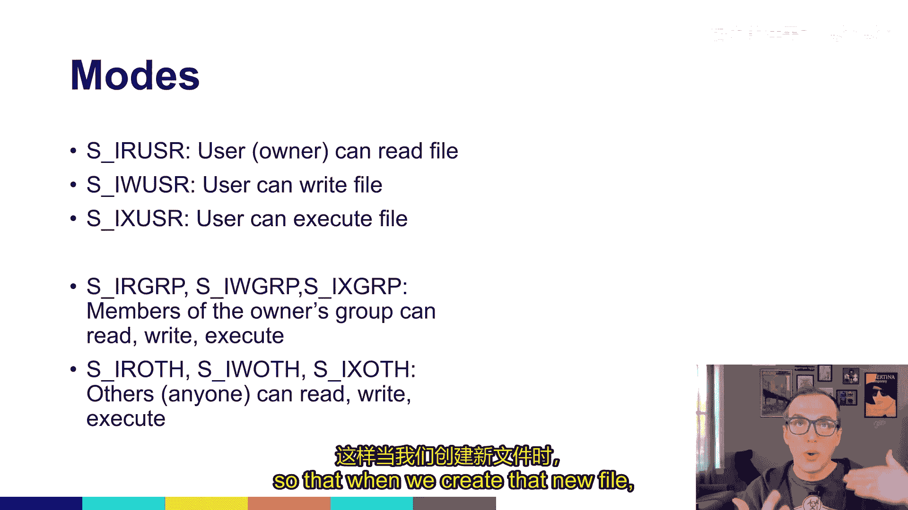

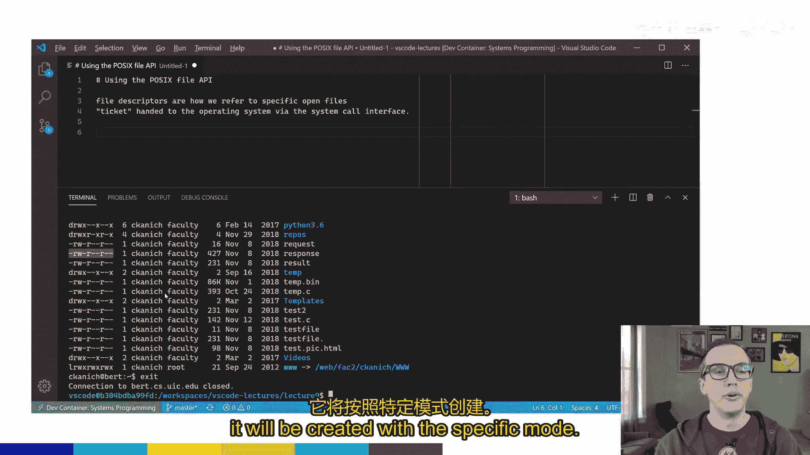

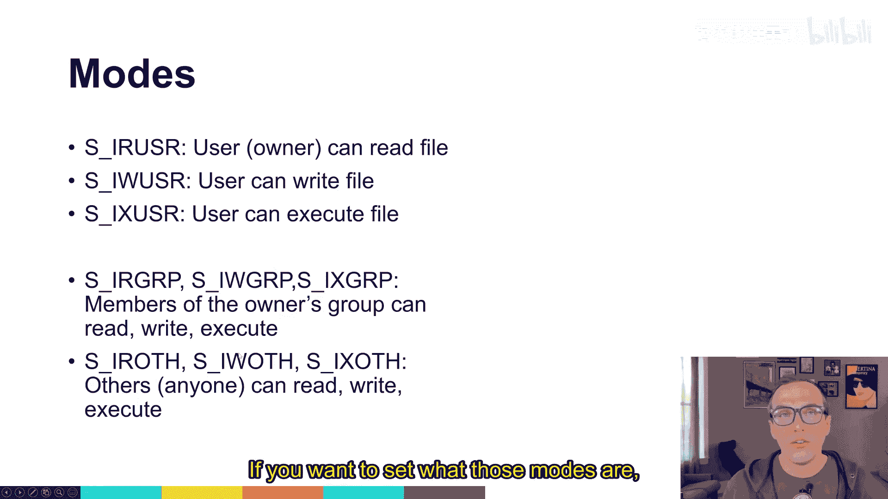

That will allow you to mask off those you can set the default mode things along those lines will manipulate how files are。

Permissioned when they get creative。And so you can see why that's why when we do。Open here。

 sometimes you can just open and say I don't care what the mode is， just whatever my shell makes it。

 that's what it'll be。 If I were to create a file in this called touch new file。

 it's going to get the default mode。 and here it's just readable and readable by myself and then readable by group and readable by world by other other in world are typically used interchangeably in that situation。

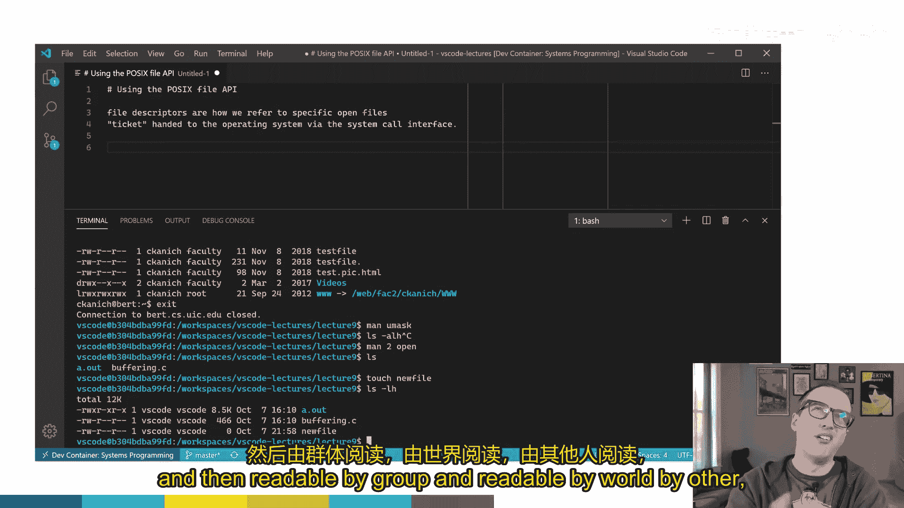

So a note on opening files， so that's what we're talking about here。

 we're talking about how we open them with respect to what we want the opportunity to configure it as and then what we want the permissions to be if we create that file。

 there's also a lot of useful information about。Standard in and standard out and standard error。

 So every time you open a process in Linux。Everyone was written with the assumption that it will have three file descriptors open by default unless you wrote your own special program that does something that's not the default。

 every program just kind of expects， it can read from standard in。

 it can write to standard out and it can write to standard error。

 that's just the way that things are set up before you go into that environment as a running program。

 Standard out is typically what you would think of as the output of the program and then standard error is stuff that doesn't get fed through to the next part of a pipeline of commands that are chained together as part of the job。

 So if you wanted to write some debugging output or some error output。

 it won't go into the pipeline that goes to the next program but it will go to the screen。

 So if somebody's using that program they can see what the heck went wrong。

 That's literally something that I didn't deeply understand until very recently with respect to how Unix does files。

But it's pretty useful Anyhow， The fact that we have these standard input standard output we have one thing coming in。

 one thing going out allows us to treat writing to the terminal and reading from the terminal the same way as we would be writing and reading files。

 I can use the read and write system calls to read from a file that I opened off of the disk。

 just the same as I can do to read bytes that were written by the user at the at the command line。

 which is pretty awesome。 One other really important kind of subtle point about doing reading and writing is that。

😊，These things are going to be buffered。 right in the last video。

 I talked a lot about how buffering is a thing that you need to do it when you read something off of a disk。

 you're not going just spin the disc， pull the one bite。 you need to give it to the user and be like。

 oh right， well， let's wait for this。 This just turn around。 And Okay， I got the next bitete。

 Let send to the user， et cetera， et cetera。 We want to read a whole bunch of stuff。

 Keep it in memory in the kernel and then give it to the user the way that they want to receive it。

 and。When we're dealing with a terminal， we're very often by default going to have stuff set to line buffering。

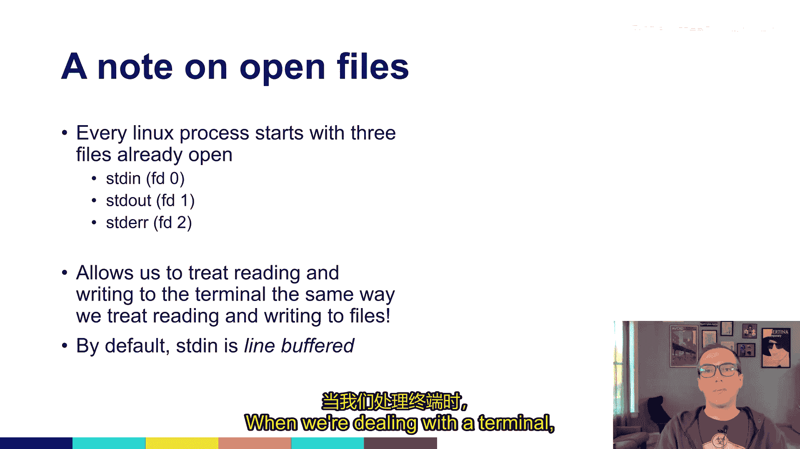

So the terminal is different from files where we have line buffering for the input and for the output。

 So you ever seen me put lines in my explanation code where I say a flesh standard out that is basically telling the operating system。

 hey， I want you to disregard how your buffering works。

 and I want you to actually send whatever it is I put into that file descriptor to the screen right now。

 So if I wanted to write half of a line and then finish the line later without moving on to the next line。

 and my output is line buffered。 I'd have to say a flush standard out before actually seeing that stuff get sent to the screen。

 So this is one component where this buffering is very。

 very visible to the user right like you would think of if I'm writing to memory or reading from memory I want it to be shown no matter what immediately。

 but files work very， very differently A lot of the times stuff is going to get collected and then sent to the user。

😊，So if I'm writing a shell， like if I was running fork shell or spawn shell I whatever right here。

 And I type to everything in， your code would still be sitting at the read call that was waiting to read or probably an Fs call that was waiting to read from standard in until I hit enter your code is still blocked there because the terminal program hasn't even delivered those bytes yet。

😊，And that kind of makes sense because that I type all this， you know， garbage in and then I'm like。

 oh wait， no， that's not what I meant。 And I type in， you know， echo hello world。

 Your program probably doesn't want to see all that garbage that I wrote that and then back to space back so line buffering makes sense when you're reading in command like we do in a shell。

But it isn't always gonna be the right thing。 And sometimes I want to flush that。

 So when I'm writing output， I have control over what gets delivered when when I'm reading input。

 I kind of only receive the bytes when the bytes become available to me So I can flush standard out。

 It doesn't make too much sense to a flesh standard in because you're not the one writing to it。

 If you're writing to it and you just I definitely want everything shove through the other side。

 you can flush the output。 and likewise， when you're reading in from the input。

 when those bytes get delivered is a very important aspect of how things work。

 You're not gonna be able to see those bytes until the。Other side sends them。

 and just because they type them in does not mean they got sent to the program yet。

They're not even invisible to your program until you hit enter， okay。

Next thing we want to talk about here。 So if standard out is line buffered。

 there are two other ways for us to buffer that we can do like a blockbased buffering so or we can do linebased or they can do unbuffed like they'll still be buffering But if you're reading from standard in and you say no。

 I want to set this terminal up such that every single time somebody writes a bitete to that input I can immediately write it out or read it out as fast as possible。

 You can set your terminal to not be line buffered。 you can set it to unbed。

 I think the probably called character buffered where every single time you send a character the program that is reading those characters is going to receive it the system call is going to finish if they were doing get cha。

 something like that。 and they'll do whatever is they want to do based on that character。

 And so if you wanted to like see what somebody typed before they backspace over then you would be able to see that。

 which is。A trick that I used when I was a kid。 and I was like chatting with people。

 you could actually set your chat program， believe it or not to character Bford versus Lford。

 So you can see somebody type something in like like， hey， Chris， you are super annoying。

 And then you can see them like get rid in that。 And then they would say super awesome。 Yeah。

 smile only face not reallys pretty totally wide。 not wild， not a real good idea。

 but it was something I'm like it's very like a tangible reminder of the very big difference between something that's character Bford and something that's line buffer。

😊，In my in my experience。Yeah and then like blockbased sometimes when you're writing things out to a file。

 you're gonna to say， I don't even want to write out every single time I get a line。

 I want to write out every single time there's a new chunk to put onto the hard drive。

 And sometimes like usually your chunks are like 4 kiloBte。

 And so even if you're writing lines of output。 if you want to be very efficient and how many times you hit the hard drive。

 You can say I'm writing megabytes and megabytes of stuff。

 I only want to write every time I have a full block。

 You can set your file up so that so that it buffers everything that needs to go out to that file until it's received know 4096 bys and then shs it out to the file。

 that's another way that you can buffer。 And all this has to do with the efficiency of writing to the disk。

 the efficiency of keeping it in memory。 you as the engineer。

 the software engineer are going have to make those tradeoffs of saying what will achieve the goals of my program the best if I'm writing just huge。

 huge amounts of data。 I probably don't want to say， hey disk， here's 200 Bte。 Hey disk， here's 20te。

Here's 200 mites because you're writing you know， a gigantic， you're copyping a novel line by line。

 you wouldn't want to hit the disk that much because it'll just be slower than hitting it less often with more bytes each time。

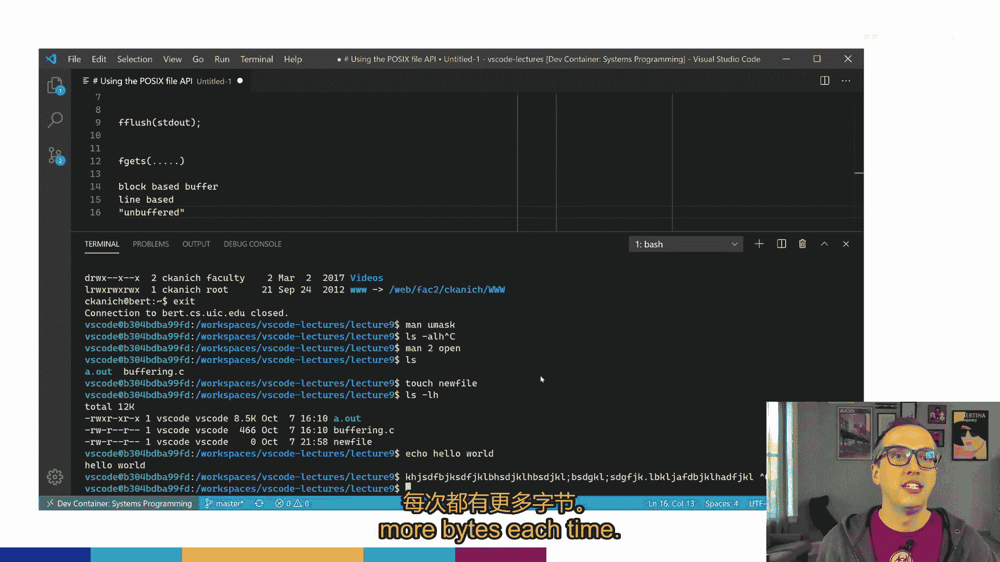

As long as you have the memory for it。Okay， so read the absolute workhorse here。

 We are going to pass the operating system a ticket saying， hey。

 here's the file that we open that you open for me that I want you to read from a place to put that information and how many bytes to read you will receive back what you put not necessarily what you put in in terms of the number of bytes to receive almost always you will pass in this end here。

 either as the number of bytes you want to read in or the size of the buffer that you have available to write those bytes into。

 you're just going to pass a pointer that points to a certain area of memory and you absolutely gotsh I better be sure that the amount of memory you give is at least as big as the number of bytes that you said you are trying to read in。

 otherwise you would have a buffer overflow vulnerability。

 which is no good which is totally bad news bears and the most important interesting。

 tricky part about read is that the amount that gets returned is not always going to be the number。

bytes that you ask for。 if I ask for1 thousand0 bytes and the user types in hello and hits enter。

 you're gonna get seven byte。 you're gonna get a hello plus a new line。 if I can count this is very。

 very important and interesting。 And if you want to read a full amount of information from a user you need to keep reading until you know you have the right number。

 It's not always certain， so another situation where you do a read and you wouldn't get as many bytes as you asked for is that you're at the end of the file。

 it could also be that you are reading from the network and a certain number of bytes hasn't been received yet。

 you're reading from the terminal and you only receive a certain number of lines in the buffer because the user type things in and hit enter you're very there are many。

 many situations where the number of bytes you get back is not the same as the number of bytes that you asked for。

 This is normal operation and it's just something that you have to。

Expect when you are reading from files。Okay， the other part here again， it's Unix。

 So not only do we use our return value to talk about the number bytes we've received。

 we also give the number of or like whether there is an error or not。

 and the really annoying part is that there's another special value called the end of file indicator。

 So let's do a man to read。😊。

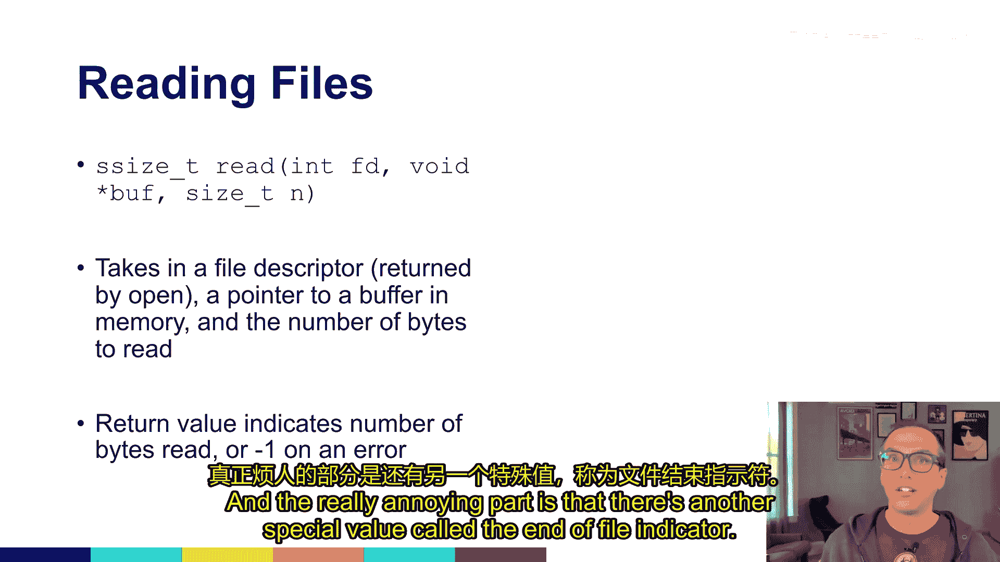

Yeah， so。If you are at or past the end of the file， read return 0。

 This is a special thing which says， hey， you have reached the end of this file。

 If you want to read a file until it is done。 You will not get some special exception。

 You're just gonna to get this special piece of information。

 that is there's 0 bytes available for you to receive on this file anymore。 Now， that is different。😊。

From。Not receiving anything right？ So if you think about the reading from the terminal example。

 if I'm typing all this information and I don't and I hit enter， then know echo hello world。

 It received all of those bytes and it received them and parse them I did what it wanted to。

 I did a F gets system call， it returned successfully and gave me those bytes back。

 that is let's say I did that with read instead of with F gets。 if I did that with read。

 and I didn't get anything back。 like there's no such thing as receiving no bytes that doesn't mean here at the end of the file。

 right there are a few different things that can potentially happen when you do a read。

 you can do a read and there is an error like the the file God deleted or it got corrupted or the file that you were connected to unexpectedly you know。

 close the file descriptive。Were connected to unexpectedly closed because the network connection got broken。

That is going to be fundamentally different。 That means something different than receiving that special0 value。

 you only receive that special0 value to a regular read when you reach the end of the file。

 you do not receive it because there's nothing there yet， but that it might be something later。

 That would almost always be a blocking call， or it would be a。

 I didn't receive anything in a non blocking call to read， which basically means hey。

 this file is still open， but there just isn't anything to receive from it。

 This is where if I redirect standard in from a file， I can send the。Let's do S H。

 So I can send the end of file character to a shell。

 And that basically means this is the end of the input。 Like there is no more input coming in。

 So there's a very big difference between me setting Ls here or me hitting control C or me hitting a blank enter and me hitting control D。

 which sends the end of file character to the terminal。 What that means is。Im。

 I was giving you standard in。 I was giving standard in to this S， H program using the keyboard。

 And then when I hit control D， the important thing there is that that sends the end of file character to the。

Other side。 And this is like a control character。 So it's not actually a byte that is gonna go into the file。

 It is a special message that basically means to the shell， Hey。

 that this user has finished giving you their input。 They are done sending input。

 This is the end of all of the input that will ever come out of this open file。

 That's what it means when you receive EOF on standard in。

 That's what it means when you receive EOF on a network connection you're done that This is all just very roundabout way to say that there are three classes of return values for read and the read like system calls。

😊。

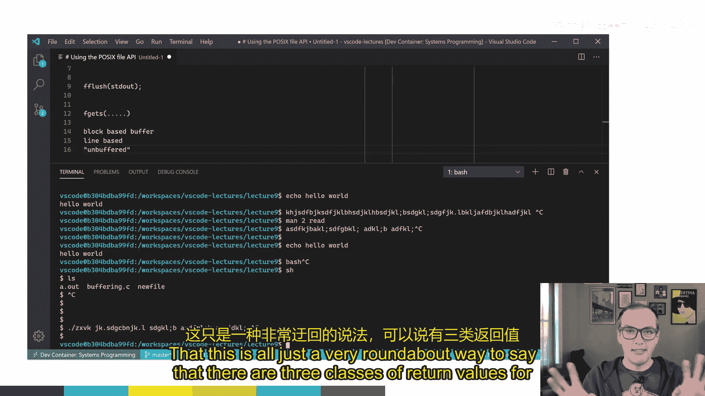

You can receive a certain number of bytes。You can receive a zero。

 which means you are at the end of the file， or you can receive negative one and then you'll get the information about what that。

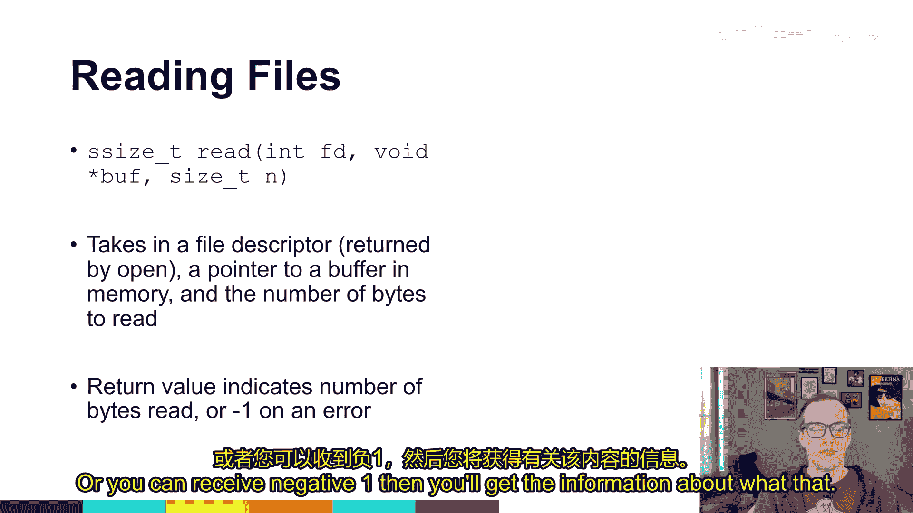

What that error was。The and there's， you know， several long on。Yeah， so E again will be。

Will will typically be what you would get if you ask for bytes and you say， listen。

 I want you to give me bytes。And if there are no bytes within 10 seconds。

When I'm listening on the keyboard， I want you to return and let me continue running my coat because you don't。

 because by default， read is gonna block forever。 By default。

 Re will stay blocked in the kernel until bytes show up on that file descriptor。

 And when they show up， they'll be given to your your program。 But you don't always want to do that。

 right， If I want to do other things instead of just wait forever until the heat depth of the universe for the user to type something in。

 I can say， oh， I want to set my file descriptor to be non blocklocking when I open it。

And I want to have the operating system telling me， hey。

 you asked me to read something from the command line and nothing was there。

So nothing was there returns negative one。 and it gives you again。 the other situation。

 which would also give you no bytes， but is fundamentally different。

 is you receive the end of file character。 If you receive the terminal set end of file。

 which means that when you read from this file in the user level process， you're going to receive a0。

 So when I hit when I do this， So then I hit controltr D here。

 that sends the end of file character to the terminal program the terminal programs closes standard input when it's talking to that shell。

 that shell receives a0 back because it was sitting there doing a blocking read waiting for me to type in my command。

 and when it receive that0， that means there's never going to be any bytes ever coming out of this file ever again。

 if it is something like standard in。😊，That's not always going to be the case in a regular file。

 right， Like I can read from a file and I can get to the very end of that file。 and I don't have。

 there's nothing that says I have to close it that I can just as easily say， hey。

 I got to the end of the file。 And maybe somebody else is going to put more bytes at the end。

 Like they're gonna to append another log line。 I'm just gonna read again。 I'm just gonna hit read。

 I'm going to wait for that next chunk of bytes to come in and I'll just chill here until those those bytes come in and then nothing will happen until someone else writes to that file。

 So you can receive E OF saying， hey， you got to the end of the file。 and you don't。

 you don't get that when the return value is short。

 you get that when you do a read and you get back as0， saying， yes。

 you did read successfully to the end of the file。 Every file that every byte that is just in that file at that moment in time。

 has been given to you。😊，That is a special。 like I guess I can't stress this enough。

 That is what receiving zero means and receiving0 is different from blocking。 now， right。

 also a little bit tricky。 And we can also have short counts here， which is even confusing。

 So it looks very， very similar。 We have a file descriptor。

 We have a buffer to read from and then send out to the file that we're sending to。

 And we have the number of bytes we want to write into that font。

 And we are also here going to have a perfectly parallel set of return values where we either get the number of bytes that we're written successfully。

 or。😊。

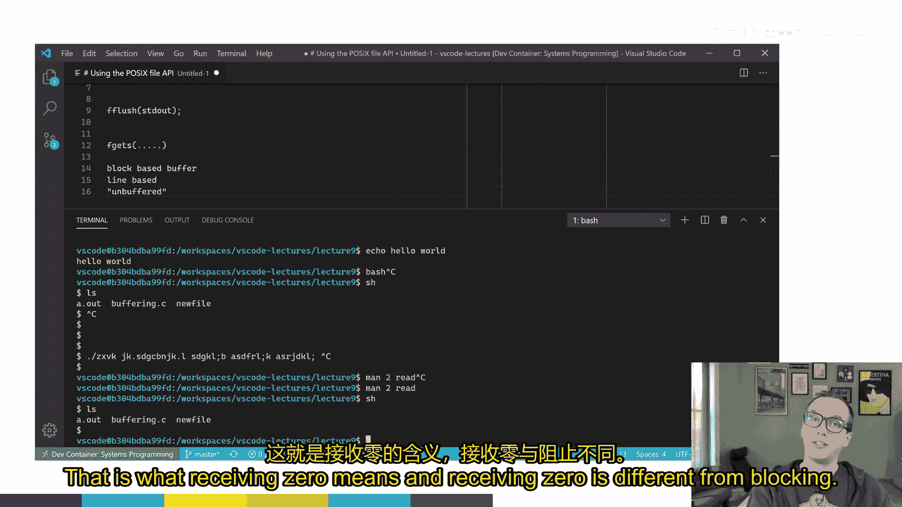

Excuse me， negative one。 So here again。The number that I received back as the return value is not necessarily going to be the number of bytes that。

I asked to send to the file。In the incredibly unlikely event that you have completely filled a disk and you're trying to write more bytes to the end of the disk。

 you can potentially receive a short count S size T return value that is smaller than the size T and that you gave in。

 but that's going to be in terms of regular files。 that's almost never， ever， ever going to happen。

 The vast majority of the times that you receive fewer bytes than you expected。

 It's going to be when you're connected to something that's not a regular file on the hard drive or。

You're going to receive a return value that indicates that you wrote fewer bytes than you asked to write will almost always be because you're not connected to a。

A file on a hard drive。 You're connected to a a terminal or a。

Network connection and the network connection will only take so many buffer so many bytes to eventually send through to the other side。

 That is。One of the common things here， But this is incredibly。

 incredibly important where you as the programmer， need to remember that just that the guarantee that the agreement between you。

 the user level programmer and Linus Torvals， the author of Linux。

 is that you can ask to send a certain number by So file descriptor， but you need to。

Check how many you actually set。 So if I'm trying to send a 4096 by buffer through a file descriptor。

And it's connected to a network connection。 And that other。

 the network connection on the other side only reads things in ever so slightly。

 or we can think about as a pipe， maybe that pipe only reads one by in at a time。

I might fill in this buffer and not be able to put any more pieces of information there because maybe the kernelel said。

 hey， I dont want to buffer a megabyte of standard in for this program。

 I don't want to keep on buffering this stuff。 So if you get to the end of what the operating system is willing to accept。

 It's just gonna give you a short count， it's going give you return value。

 that's smaller than the number bytes you wanted to send。

99 times out of 99 when you're connected to a regular file， this will never happen， but when it does。

 your program is responsible for recovering from that situation。

 The next system call we have here is Lse。 So this is just going to move our file offset for where we are in that file at that moment in time。

We can。Talk about a whence， which is a super archaic word。

 But the basic idea is where are we coming from when we perform the seek。

 we can seek from wherever we started from， We can seek from from to and。Arbitrary location。

 like an absolute location， we can seek from the end of the file。

 like if I want to look at the last five bytes of the file。

 I can set whence to seek end in the offset to， I believe negative file and then the operating system will say。

 oh， they want to move the cursor the offset of where the next read will come from or where the next write will go to to five bytes before the end of the file and you can write the last five bytes。

 you can read the last five bytes， whatever is you want to do based on remember the flag that you use when you open that file if you set it to read only。

 you can only read from the file， you set it to readwr。

 you can both read and write I don't remember whether read write is the or of read only and write only or not I think it is but I have to check。

😊，You can look in the dot H file if you are curious。So where were we， Yes。

 we can seek through the file。 This will change the offset。

 The other thing that changes the offset is the act of reading and writing。 right。

 So this isnt the other way that we can change the offset is to read through the file。

 If I do a read and I and the return value is 100。 The offset has increased by 100。

 If I perform a write and and the return value is 10。

 I have moved forward 10 bytes in this file overwritten。 The next 10 byte。

 or I added 1 byte on to the end of the file or some combination of the two。

 And now the offset is 10 further forward。 These are important differences between reading from memory and reading from a file。

 But you can imagine that they give you the same capability， but it just looks very different。😊。

And finally， we can close our file descriptors this will just tell the operating system， hey。

 you gave me this ticket when you opened this file for me， I'm telling you I don't need it anymore。

 I don't want to receive any more bytes from it， I't want to write any more bytes from it whatever it is I'm doing。

 I don't need to do it anymore So if the operating system realize oh hey I didn't have any other references to this file descriptor。

 no other process as a reference to this open file at this specific offset it can just get rid of it。

 it can say， okay I don't need to keep track of this anymore I don't need to keep track of this offset because I don't care about it anymore and no one。

 no other code within your program can use that file descriptor to refer to that file anymore。

This is rounding out the end of this video。 The other important part of this process is when you use file descriptors。

 these tickets are like the tickets at the meat counter at the grocery store。

 The numbers are just numbers。 and they get reused at the at the grocery store。

 they kind of just they cycle through the hundred or whatever。

 they start over again at zero and they work it way back up。

 the operating system just as soon as it has one usually it will just give you the lowest numbered free file descriptor。

 So if I， if I open a file， the obviously here， here's a ticket。 That ticket is 3。

 It literally is the integer 3 and then you're like， okay， I'm going to read from the file。

 I'm going write to this file。'm do whatever I want to do。 You close it。😊。

And then you open a new file。 You're going to be given three because three is no longer used because you closed it。

 And then you're given this new file description。 It's like， oh， okay，3。 It's like， well， you know。

 I've got this perfectly good ticket。 Why don't I just give it back to you， and you open another one。

 you get 4。 You open another one， you get 5， et cetera。

 It just follows along and just finds Usually it finds the lowest number file descriptor and just gives that to you to refer to that open file。

 This is。Logical from like an engineering standpoint like。

 why wouldn't you just keep using them over again， But from a gotcha as while coding standpoint。

 it is very easy to screw yourself up in this way right because you could imagine youve got a whole bunch of code that is using a file descriptor and function A doesn't realize that function B。

 close that file descriptor and maybe open another file。

And it's using its own local version of that file descriptor number。

 And it thinks it's writing the file A。 Yeah， it's actually writing the file B。 That's really nasty。

 right， So this is one of the many different challenging things we had to keep track of when it comes to using these tickets to。

Talk to the operating system and ask it to read bytes from files or write bytes to files for you。

That's what we have here today。 Next up is how do we talk about the internals of using files。

 How does the operating system refer to these as doing the opening and closing and seeking for you。

 Thanks a lot for watching。 and I will see you next time。

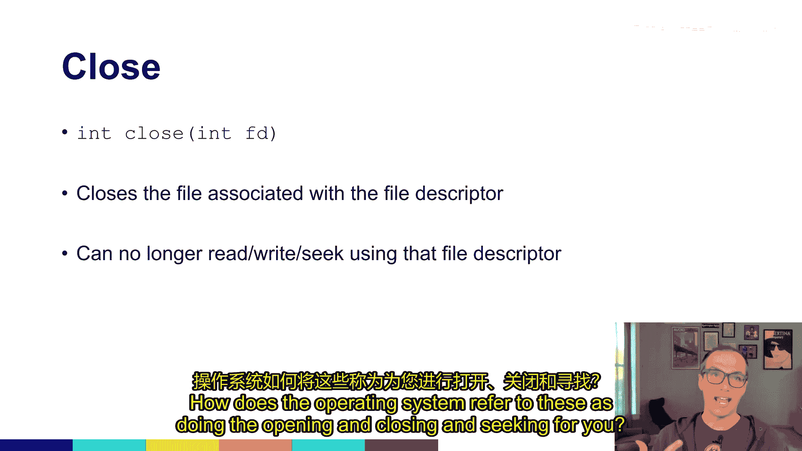