# 操作系统：第8讲：在C语言中与文件交互 📁


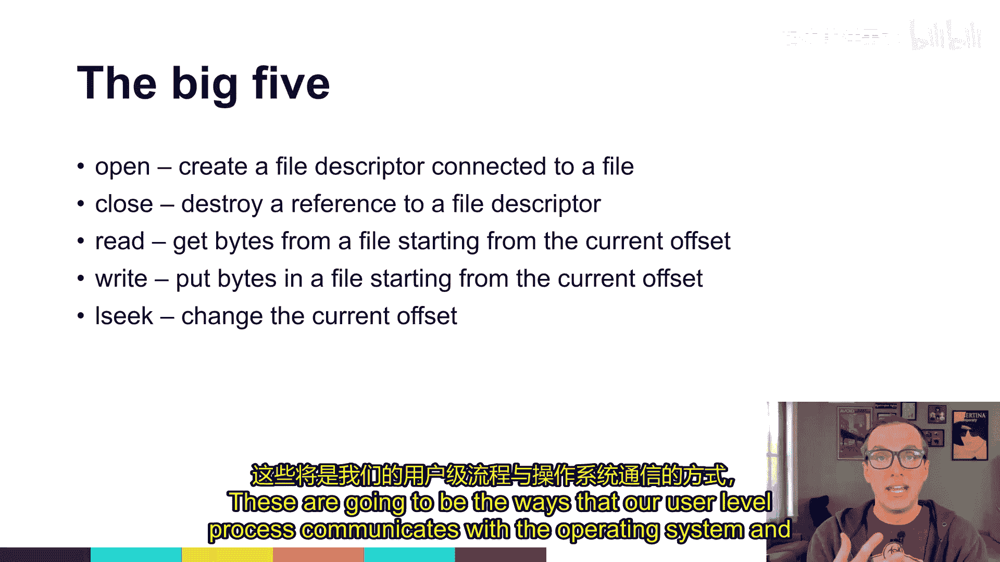

在本节课中，我们将学习如何在C语言程序中使用系统调用与文件进行交互。我们将重点介绍五个核心的API：`open`、`close`、`read`、`write`和`lseek`。理解这些基础操作是进行系统编程的关键。

## 概述：文件描述符与核心API

在Unix/Linux系统中，用户进程通过系统调用与操作系统通信，以操作文件。所有文件交互，无论是硬盘上的文件还是其他设备（如终端），都建立在我们即将介绍的几个核心API之上。这些API为我们提供了与文件系统交互的基础。

## 文件描述符：操作系统的“票据” 🎫

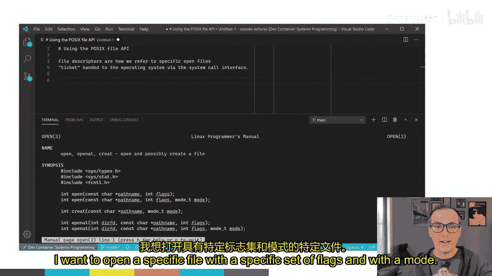

上一节我们介绍了文件交互的基础概念，本节中我们来看看其核心机制：文件描述符。

文件描述符是一个整数，它是操作系统分配给一个已打开文件的“票据”。当进程请求打开一个文件时，操作系统会返回一个文件描述符。此后，每当进程想对该文件进行读、写或定位操作时，只需将这个“票据”（即文件描述符）传递给相应的系统调用即可。

例如，标准输入（`stdin`）、标准输出（`stdout`）和标准错误（`stderr`）在程序启动时默认打开，其文件描述符分别是0、1和2。

## 打开文件：`open` 系统调用


了解了文件描述符的概念后，我们来看看如何获取它，即如何打开一个文件。

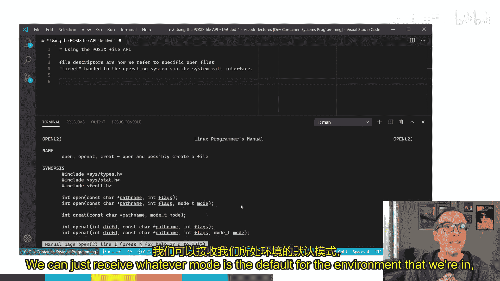

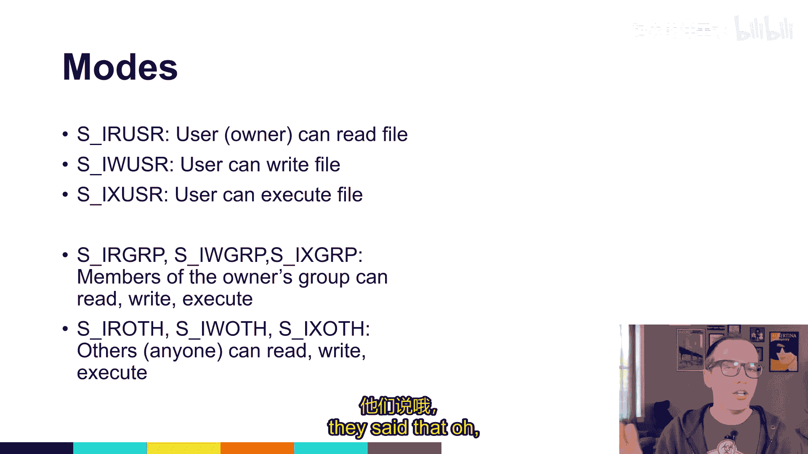

`open` 系统调用用于打开或创建一个文件，并返回一个文件描述符。其函数原型如下：

```c
#include <fcntl.h>
int open(const char *pathname, int flags, mode_t mode);
```

*   **`pathname`**: 要打开的文件路径。
*   **`flags`**: 指定打开文件的方式（例如，只读、只写、创建等）。这是一个位掩码，可以使用 `|` 操作符组合多个标志。
*   **`mode`**: 可选参数。仅在创建新文件（使用了 `O_CREAT` 标志）时指定文件的初始权限。

`open` 调用成功时返回一个非负整数（即文件描述符），失败时返回 -1 并设置全局变量 `errno` 以指示错误类型。

### 文件打开标志 (`flags`)

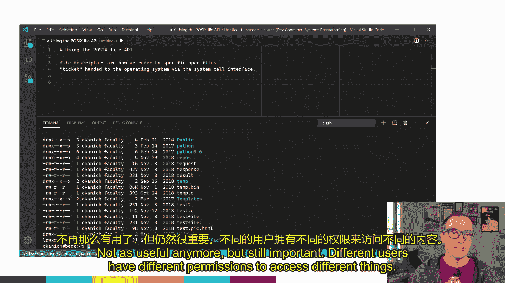

以下是 `open` 系统调用中一些常用的标志：

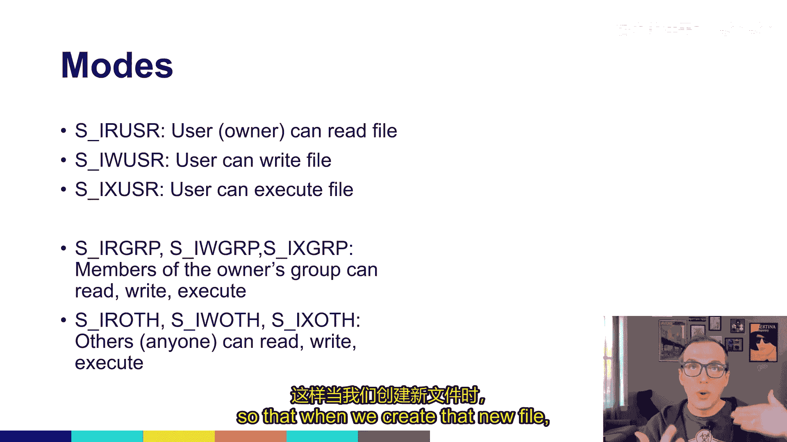

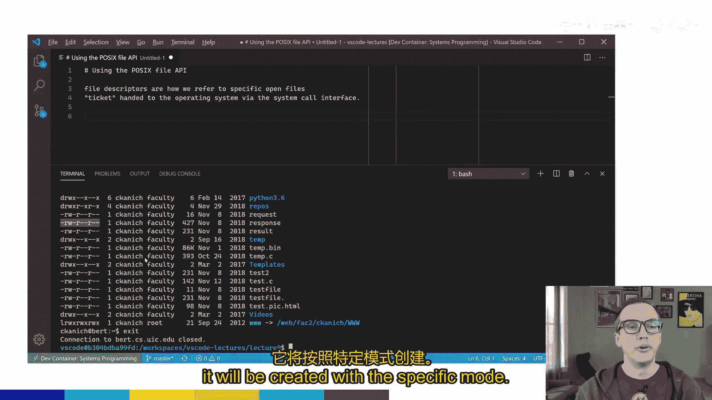

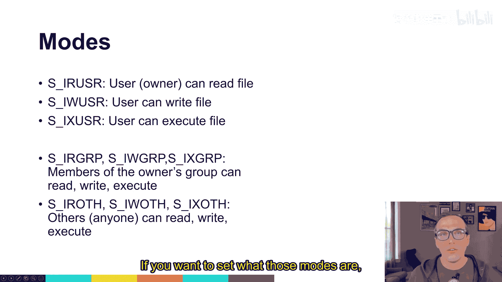

*   `O_RDONLY`: 以只读方式打开。
*   `O_WRONLY`: 以只写方式打开。
*   `O_RDWR`: 以读写方式打开。
*   `O_CREAT`: 如果文件不存在，则创建它。需要配合 `mode` 参数。
*   `O_TRUNC`: 如果文件已存在且以可写方式打开，则将其长度截断为0。
*   `O_APPEND`: 以追加模式打开。每次写操作前，文件偏移量都会被移动到文件末尾。

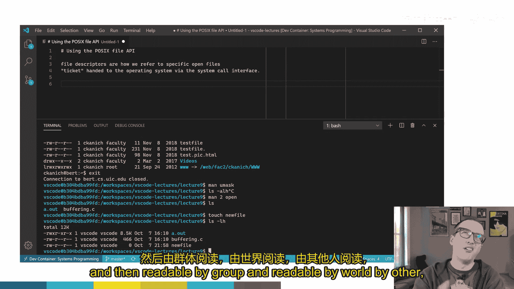

**重要提示**：默认情况下，打开文件进行读写时，操作都从文件开头（偏移量0）开始。`O_APPEND` 标志可以改变写操作的行为，确保总是在末尾添加数据。

### 文件权限模式 (`mode`)

当使用 `O_CREAT` 标志创建新文件时，`mode` 参数决定了文件的访问权限。Unix文件权限由三组“读(r)、写(w)、执行(x)”权限位控制，分别对应文件所有者、所属组和其他用户。

权限通常用八进制数表示，例如：
*   `0644`: 所有者可读写，组和其他用户只读。
*   `0755`: 所有者可读写执行，组和其他用户可读执行。

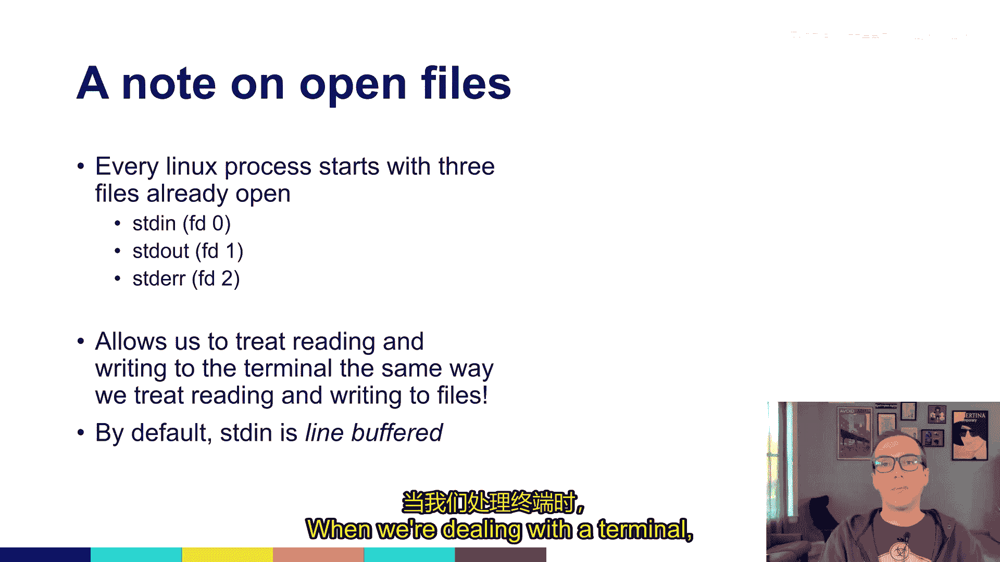

可以使用 `chmod` 命令或在程序中调用 `chmod` 函数来修改现有文件的权限。

## 读取文件：`read` 系统调用

成功打开文件并获得文件描述符后，我们就可以从中读取数据了。

`read` 系统调用用于从打开的文件描述符中读取数据。其函数原型如下：

```c
#include <unistd.h>
ssize_t read(int fd, void *buf, size_t count);
```

*   **`fd`**: 文件描述符，指定从哪个文件读。
*   **`buf`**: 指向内存缓冲区的指针，读取的数据将存放于此。
*   **`count`**: 请求读取的字节数。

`read` 调用成功时返回实际读取的字节数，这个数字可能小于请求的 `count`。返回 0 表示已到达文件末尾（EOF）。返回 -1 表示发生错误。

**关键点**：`read` 的返回值是“短计数”是正常现象，可能发生在多种情况：例如从终端读取（用户未输入足够内容）、从网络套接字读取（数据尚未全部到达）或读取到文件末尾。因此，编程时必须循环读取，直到获取所需数量的数据或遇到EOF。

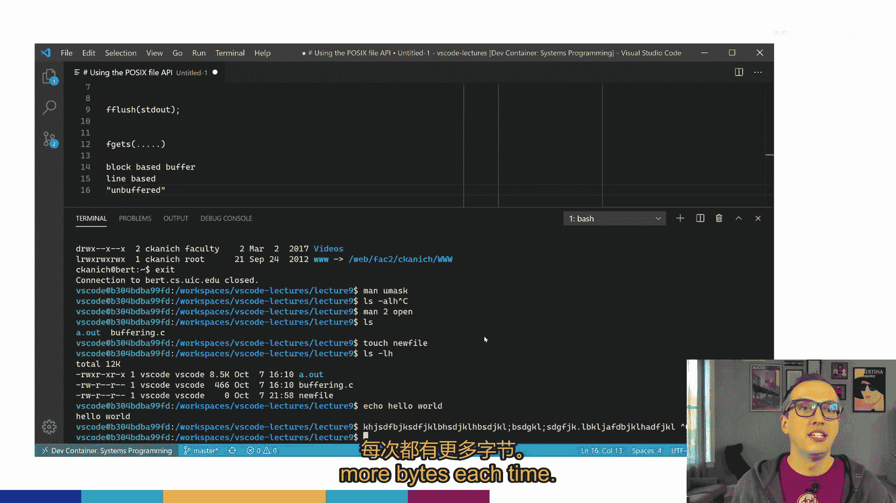

## 写入文件：`write` 系统调用

学会了读取，自然也要掌握如何写入。

`write` 系统调用用于向打开的文件描述符写入数据。其函数原型如下：

```c
#include <unistd.h>
ssize_t write(int fd, const void *buf, size_t count);
```

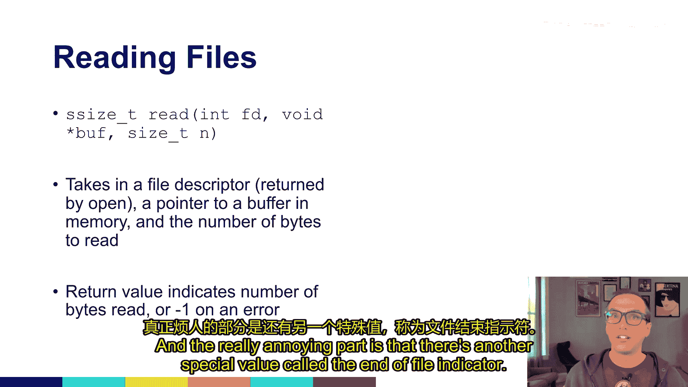

*   **`fd`**: 文件描述符，指定向哪个文件写。
*   **`buf`**: 指向包含待写入数据的内存缓冲区的指针。
*   **`count`**: 请求写入的字节数。

`write` 调用成功时返回实际写入的字节数，这个数字可能小于请求的 `count`（例如，磁盘空间不足或管道缓冲区满）。返回 -1 表示发生错误。

与 `read` 类似，程序需要检查返回值以确保所有数据都已成功写入，必要时需重试未写完的部分。

## 文件偏移与定位：`lseek` 系统调用

有时我们不需要按顺序读写文件，而是希望跳转到特定位置。`lseek` 系统调用就是用来做这个的。

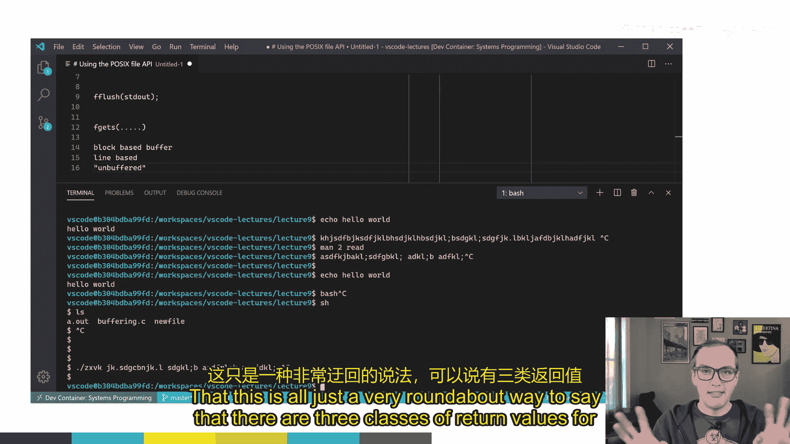

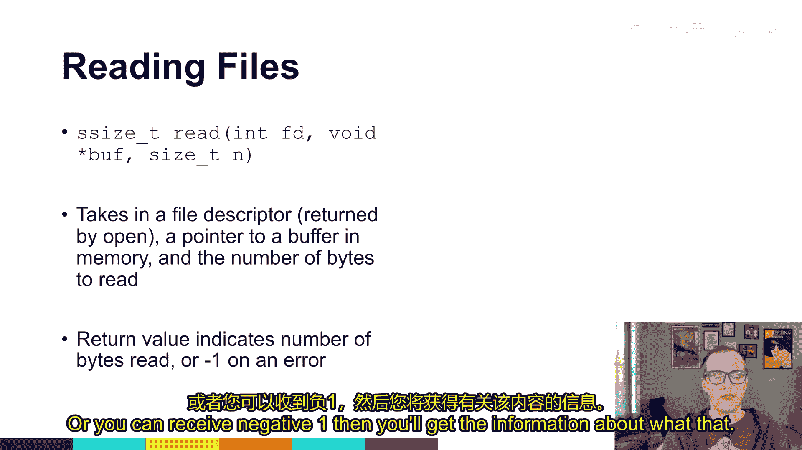

`lseek` 系统调用用于重新定位打开文件的读写偏移量。其函数原型如下：

```c
#include <unistd.h>
off_t lseek(int fd, off_t offset, int whence);
```

*   **`fd`**: 文件描述符。
*   **`offset`**: 偏移量。
*   **`whence`**: 解释偏移量的基准位置，可以是：
    *   `SEEK_SET`: 偏移量设置为从文件开头算起的 `offset` 字节。
    *   `SEEK_CUR`: 偏移量设置为当前位置加上 `offset`。
    *   `SEEK_END`: 偏移量设置为文件长度加上 `offset`（常用于获取文件大小或定位到末尾）。

调用成功时返回新的文件偏移量，失败时返回 `(off_t)-1`。

**注意**：每次 `read` 或 `write` 操作都会自动更新文件的当前偏移量。`lseek` 允许我们显式地、随机地移动这个偏移量。

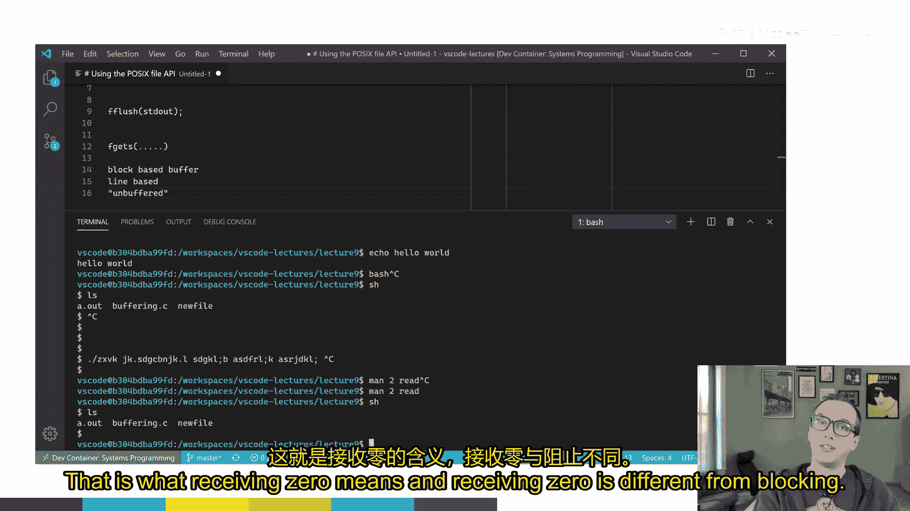

## 关闭文件：`close` 系统调用

最后，当我们完成文件操作后，必须关闭它以释放系统资源。

`close` 系统调用用于关闭一个文件描述符，释放其占用的资源。其函数原型如下：

```c
#include <unistd.h>
int close(int fd);
```

*   **`fd`**: 要关闭的文件描述符。

调用成功时返回 0，失败时返回 -1。

**重要提示**：文件描述符是有限的系统资源。关闭不再需要的文件描述符是一种良好的编程习惯。此外，操作系统会复用已关闭的文件描述符数值，这要求程序员必须谨慎管理文件描述符的生命周期，避免出现使用已关闭描述符的错误。

## 缓冲的注意事项

文件操作通常涉及缓冲，这是为了提升I/O效率。缓冲行为因文件类型而异：
*   **终端**：通常采用行缓冲。输入时，直到用户按下回车键，数据才会被送达读取程序。输出时，遇到换行符或显式调用 `fflush` 时，数据才会显示。
*   **普通文件**：通常采用块缓冲。数据会在内存中积累，直到达到一个块的大小（如4096字节）才进行实际的磁盘写入。
*   **无缓冲**：可以设置某些文件描述符为无缓冲模式，每个读写操作都立即生效，但这会降低效率。

理解缓冲行为对于调试和实现特定交互逻辑（如实时显示输入）非常重要。

## 总结

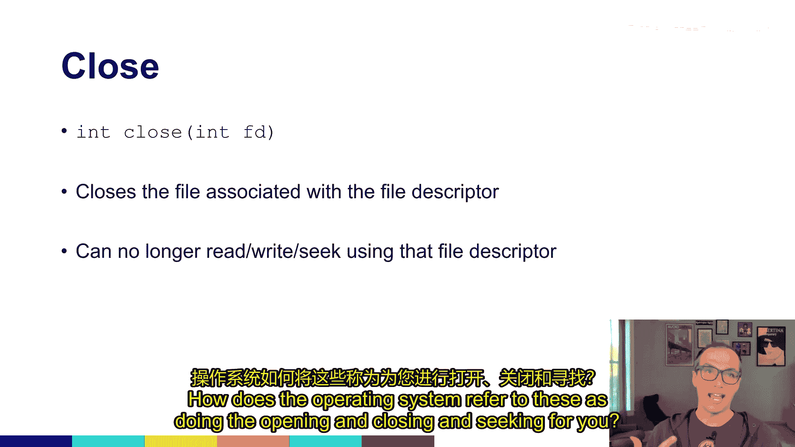

本节课中我们一起学习了在C语言中进行系统级文件操作的核心知识。我们掌握了五个关键的系统调用：`open`（打开/创建文件）、`read`（读取数据）、`write`（写入数据）、`lseek`（移动文件指针）和 `close`（关闭文件）。我们深入理解了**文件描述符**作为操作系统“票据”的核心概念，并探讨了文件权限、缓冲机制以及处理“短计数”返回值的重要性。这些内容是构建更复杂系统程序（如shell、网络服务器等）的基石。