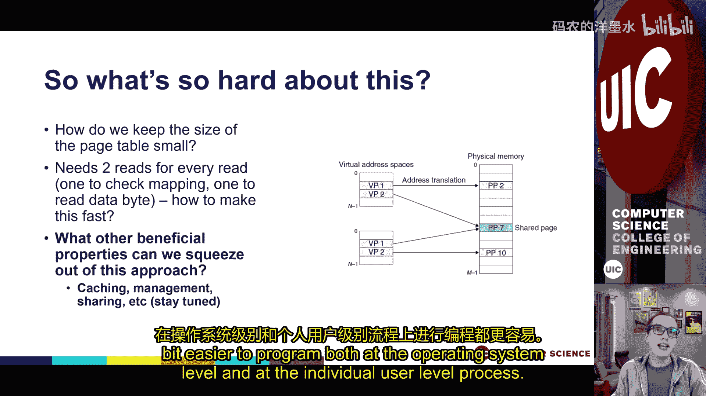
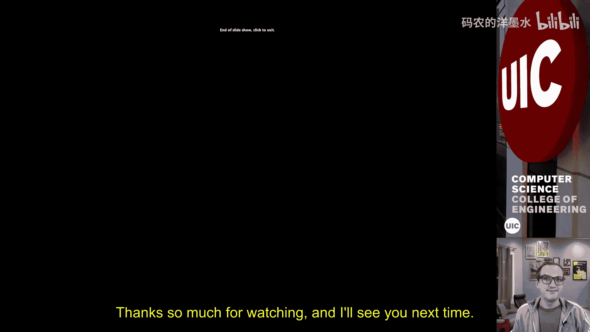

# 【全集】伊利诺伊大学 操作系统 中英字幕 1080P p09 Lecture 9 - 虚拟内存 -BV1AEASzNE3z_p9-

Hi everybody， I'm Chris Camdge， and this is CS361 System programming Today。

 we're going be talking about the what's and the whys of virtual memory。

 The next video in this series is going to talk about the how。

 but right now we're kind of going to motivate what's challenging about it。

 why it was design in the first place and what we can learn about the process of creating virtual memory that we can apply in our own everyday lives when we're looking at different challenges when we are doing software engineering So to talk about this story of why virtual memory exists we ought to talk about old computers。

 Now I'm talking about old computers。 No， I'm talking about like。😊，O the computers。Perfect。

 so with these old computers， they were operating on a level of like1hertz。

 they were doing thousands of instructions per second， which is pretty pretty fast。

And you would think it's slow by today's standards。

 But when it had to deal with loading things off of disks。

 you can see here that disks were even slower。 remember from the last chapter where we talked about seeking you can actually see this physically seek when it's moving that head from one disk to another disk to read things in and the bean counters are definitely going say。

 hey， listen， this computer that we're looking at here costs hundreds of thousands of dollars in like the 1960s。

 So these are incredibly expensive pieces of hardware。

 why would we take that piece of hardware and have it sit there and just do absolutely nothing while it waits for that disk to go to someplace else。

 you're only running one program and your program decided it needed to get something off of the disk。

 If your processor just sits there for a substantial amount of time。

 you're wasting a lot of this really， really big investment that you made in this amazing。

 fantastic fancy computer。😊，ice the engineers that were taking care of this were saying， okay。

 this is a problem。 We want to be able to get as much use out of our CPU as we possibly can。

 even though we have these very， very high latency peripherals like hard disk drives。

So this is our overall goal that we're trying to support here。

 And we talked about a little bit earlier on， where if what we're trying to do is this deal with the fact that we're switching a bunch of registers from one place to another。

 We can make it really， really simple right， We've got a handful of registers。

 The registers are incredibly fast memory right there on the CPU。 and there's not that many of them。

 So we can just pull a Patrick and say we're gonna to take all these registers from over here。

 and we're gonna put them over there。 We're just save them into memory and that's not that bad of a problem。

 That's not actually a problem at all。 It just works。

 So we can multiplex access to the CPU when it comes to what's the state of the CPU itself。 very。

 very quickly， We don't have to worry about anything besides just take everything out and put everything back in。

 But when it comes to memory， we're not talking about dozens or hundreds of bytes anymore。

 We're talking about thousands， hundreds of thousands。

illions of bytes that are in possibly pretty slow memory。

 Remember that if you're at the bottom of that cache hierarchy and you're just doing a regular load or store for memory。

 It takes a long time。 And there's a whole lot of it。😊。

So we still have this challenge of what are we going do to handle a multiplex system where two different programs both want to use the memory at the same time There's a couple bad solutions So we already talked about the slow super naive solution we're not going to be able to swap this memory in and out because we already saw that the whole reason we're doing this is that we're trying to get around the slowness of our peripherals so we certainly couldn't move the memory from memory down onto the disk because the disc is super super slow and in addition to this。

 we're probably going to be using the disc pretty often。

 we're probably not going to just use the disk at the very beginning of the program。

 do everything we need to do and then write everything back out。

 memorym is relatively expensive Certainly back in way。

 way back when when virtual memory was invented So you're not going to be able to just read everything in from disk。

Do all of your computation and write everything back out。

 You're probably going have to read it piece by piece。

 So you're going to do a little bit of reading from a hard drive。 Do a little bit of computation。

 do a little bit of reading from a hard drive。 do a little bit of computation。

 This means that the task that we're trying to do is going to happen relatively often。

 So we're just not going to be able to do this。 There's too much of it。

 We're going to do it too often。 And it's too slow for moving it around either in main memory or onto the peripherals themselves。

😊，The other kind of solution we could have to this would be to just allow the different programs to operate in different areas of memory。

 you just say， oh well， know if I have 16 gigabytes of memory and this program needs a few hundred megs and this program needs a few hundred megs not that big a deal willll just tell this one to live here。

 this one to live here， this one to live here， but one of the benefits of using a operating system is that it provides us with isolation。

Right， we want to be able to write our program and not worry about every single other program that's potentially running on that machine。

 I don't want to have to coordinate with every other person that's ever written the program for Linux just so that my program works。

 I would much rather just only live within my bubble。

 write my code so that it works for my use case and rely on the operating system to isolate me from everybody else。

 So we're not going to want to do that either。 And so if we're not going to have everybody play nice together。

 If we're not going to rip everything out and put it back in。 what are we going do。Well。

 we're going to apply the fundamental theorem of software engineering， which spoil alert。

 It just totally isn't a theorem at all。 It's more or less a rule of thumb about designing systems。

 And we have a lot of those that aren' rigorously proven。

 But they are really good ways to attack a problem in a given situation。 In this given situation。

 We're going to say， let's add a layer of indirection between what an individual user program thinks the address is of a piece of memory of an individual byte that's stored and where it's actually stored in that machine。

😊，So that is the whole idea behind virtual memory in the pre virtualr memory world。

 you had a CPU and it had registers and it had memory addresses。

 and it operated on those memory addresses。 You just said， okay， well。

 I need to load from this address。 The CPU would go out to the main memory。

 Pu in that specific byte or those four B。 And it would pull them in and it would do whatever it needs to do in that register。

 but a big but a boom， Nothing else specially going on there。

 That's what we wanted plus us to think is happening。 And if we can keep that structure。

 while actually having an underlying different address that we're actually using。

 we might be able to get a lot of these beneficial。😊。

Property that we're talking about in spoiler alert。 That's how virtual memory works。

 And so we are going to get those， those special properties。 So in a modern machine。😊。

All but the most low level embedded systems are going to have what's called a memory management unit that is doing translations from what the user level process thinks the address is of a given chunk of memory to what it actually is in the bits stored in the silicon chips that are attached to your motherboard。

 the crazy part about this is that for every load and for every store。

 you need to read this table and figure out what this one address maps to in the entirety of main memory So instead of doing those what we're going to do instead is we're going to say every single process as its own mapping between virtual memory and physical memory and instead of swapping the entirety of my program from one ship to another or from one ship down to a hard drive we're simply going to say。

 listen， every process has what it thinks is its set。😊。

Add my bash process thinks it starts at Hex 400000。 your Chrome process thinks it starts at Hex 400。

000。 My SS program thinks it starts at Hex 400000 That's fine。

 there's nothing wrong with all of these processes thinking that their memory starts at a specific offset and just goes on from there。

 But in reality what we have is every single one of these different processes is going to go through a different page table which will then allow it to map to a different area of memory。

 So instead of having them take that whole entire chunk of memory and swap it in and swap it out or find the right place to put it in memory we're simply going translate this through a page table through this virtual memory mechanism and how our processes you get to keep this idea where your memory is。

 and the CPU and the operating system are going to cooperate to say。

 okay well here's where it's actually stored in memory and here's where your 40000 is actually stored in memory and here's。

😊，Or 40，000 is actually sort in memory， and this gives us a lot of really good properties。

 but it also comes with a few challenges。So we got a whole bunch of these challenges here。

 We need to keep these tables small right， because so what we wanted to do was instead of swapping this whole entire thing out。

 we simply want to swap little chunks of memory in and out that has to do with that mapping We probably wouldn't want to say this one specific by of memory here maps to this one specific by of memory here this one specific by of memory here has to map to this one specific memory by here and spoiler alert we don't do it that way。

 we have entire pages that we're mapping back and forth and what we'll see in the next set of lectures for next week is the way that we actually do that on a page by page basis。

😊，In an address by address basis。Beyond this， we also need to make these things fast。

 we need to be able to make sure that even though we're doing something way more expensive for every single load。

 every single store， we've got to do two memory operations instead of one memory operation we need to make sure that this is fast because it's going to be a very high overhead thing if we don't make it as optimize as we possibly can。

 so we're going to see how that works and finally， because we've added this extra complexity of a layer of indirect。

 there's a lot of other really， really cool tricks that we can play with our system to make it work efficiently and make it a little bit easier to program both at the operating system level and at the individual user level process thanks so much for watching and I'll see you next time。

😊。

