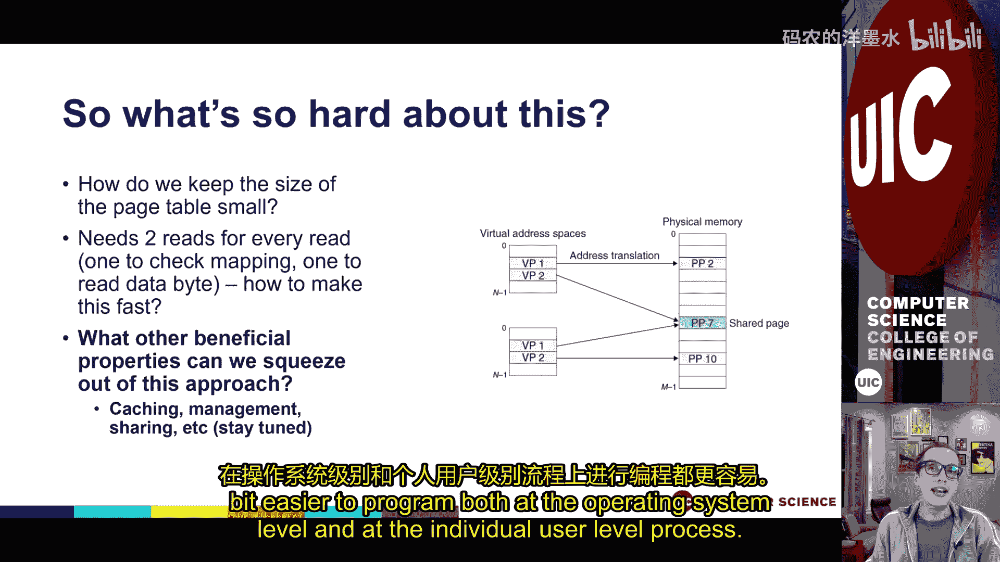

# 操作系统：第9讲：虚拟内存：是什么与为什么 🧠💾

在本节课中，我们将学习虚拟内存（Virtual Memory）的基本概念及其设计动机。我们将探讨为什么需要虚拟内存，它解决了哪些核心问题，以及其设计思想如何启发我们解决其他软件工程挑战。下一讲我们将深入探讨虚拟内存的实现机制（“如何做”）。

## 概述：虚拟内存的起源与目标

上一讲我们讨论了存储系统的层次结构。本节中，我们来看看操作系统如何管理内存，以支持多个程序高效、安全地运行。

早期的计算机运行速度相对较慢（例如1赫兹，每秒执行数千条指令），但与从磁盘加载数据的速度相比，CPU仍然快得多。磁盘寻道等操作（如移动磁头）会导致长时间的等待。考虑到这些计算机在当时价值数十万美元，让昂贵的CPU在等待慢速磁盘时闲置，是巨大的资源浪费。

因此，工程师们的核心目标是：**最大化CPU利用率**，即使存在像硬盘这样高延迟的外围设备。

## 内存管理的挑战与“坏”方案

我们已经知道，通过保存和恢复少量CPU寄存器的状态，可以快速地在不同程序间切换CPU使用权（多路复用）。然而，内存管理则复杂得多。

内存容量巨大（可达数百万字节），且访问速度（尤其在缓存层次结构的底层）相对较慢。核心挑战在于：如何让多个程序同时使用内存？

以下是两种不可行的“坏”方案：

1.  **完整交换方案**：将整个程序的内存内容在物理内存和磁盘之间来回交换。
    *   **问题**：磁盘速度极慢，且程序运行期间可能需要频繁访问磁盘。频繁进行大量数据交换会带来无法接受的性能开销。

2.  **静态分区方案**：为每个程序静态分配一块固定的物理内存区域。
    *   **问题**：这破坏了操作系统提供的**隔离性**。程序员需要协调所有其他程序的内存使用，以确保自己的程序有空间运行，这既不现实也不安全。我们希望程序能在一个“沙箱”中独立运行。

既然不能让程序“友好共处”，也不能整体搬移内存，我们该怎么办？

## 核心解决方案：引入间接层

我们应用软件工程中的一个基本原则（虽非严格定理，却是有效的经验法则）：**通过引入一个间接层来解决所有问题**。

具体到内存管理，我们将在**用户程序认为的内存地址**（虚拟地址）和**数据实际存储的物理内存地址**之间，添加一个翻译层。

*   **虚拟内存出现前**：CPU直接使用物理地址访问内存。指令 `LOAD [地址]` 会直接从该物理地址读取数据。
*   **虚拟内存出现后**：CPU发出的地址是**虚拟地址**。硬件（内存管理单元，MMU）和操作系统会通过一个**页表**，将此虚拟地址**翻译**成实际的**物理地址**，然后再进行访问。

现代计算机中，除了某些底层嵌入式系统，都具备这种内存管理单元（MMU）。

## 虚拟内存的工作原理与优势

其神奇之处在于：**每个进程都拥有自己独立的虚拟地址空间和页表**。

例如，我的Bash进程、你的Chrome进程、我的C程序，都可以认为自己的代码从地址 `0x400000` 开始。但实际上，通过各自独立的页表，它们被映射到了物理内存中完全不同的区域。

**核心公式/概念**：
```
物理地址 = 页表翻译(虚拟地址)
```

以下是虚拟内存带来的关键优势：

*   **隔离与安全**：一个进程无法直接访问或破坏其他进程的内存，因为它只能“看到”自己的虚拟地址空间。
*   **简化编程**：程序员和编译器可以假设程序拥有连续、独立的巨大内存空间，无需关心物理内存的实际布局。
*   **高效的多路复用**：无需在程序切换时搬运整个内存映像，只需切换页表（改变映射关系），或按需交换部分内存页。

## 实现虚拟内存面临的挑战

当然，引入间接层也带来了新的挑战，这将是下一讲的重点：

1.  **页表需要小巧高效**：我们不会为每个字节建立映射（那会导致页表巨大），而是以**页**（例如4KB）为单位进行映射。我们需要设计高效的数据结构来管理这些映射。
2.  **翻译速度必须极快**：每次内存访问（加载/存储）现在都需要先进行地址翻译。这相当于将一次内存操作变成了至少两次（查页表 + 访问数据）。我们必须通过硬件加速（如TLB，翻译后备缓冲器）等手段，将这种开销降至最低。
3.  **解锁新功能**：这种间接性也带来了许多强大功能的可能性，例如：
    *   **按需分页**：仅在实际需要时才将数据加载到物理内存。
    *   **内存共享**：让不同进程的虚拟页面映射到相同的物理页面，以共享代码或数据。
    *   **写时复制**：高效实现进程创建。

## 总结

本节课中，我们一起学习了虚拟内存的“是什么”与“为什么”。

*   我们回顾了早期计算机的瓶颈，理解了**最大化CPU利用率**的核心目标。
*   我们分析了简单内存交换和静态分区方案的缺陷。
*   我们掌握了虚拟内存的**核心思想**：通过**页表**在**虚拟地址**和**物理地址**之间引入一个**间接层**。
*   我们认识了虚拟内存带来的主要好处：**进程隔离**、**编程简化**和**高效内存多路复用**。
*   我们也预览了实现虚拟内存必须解决的挑战：**页表大小**、**翻译速度**以及如何利用间接性实现更高级的功能。




下一讲，我们将深入探讨虚拟内存的“如何做”，即页表的具体结构、翻译过程以及性能优化技术。