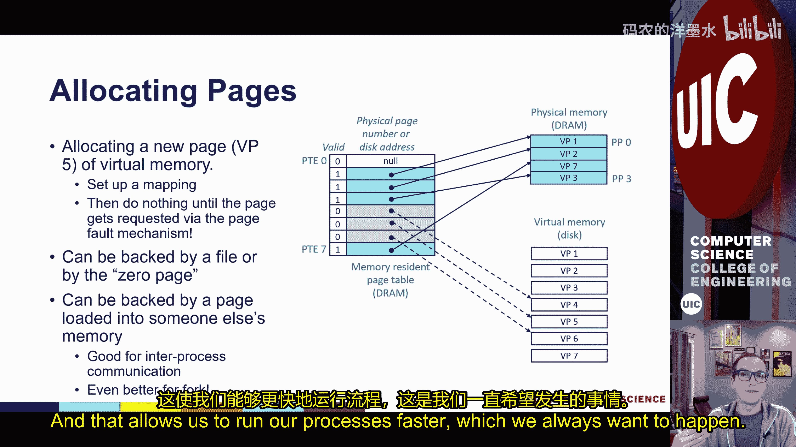

# 【全集】伊利诺伊大学 操作系统 中英字幕 1080P p10 Lecture 10 - 页面故障详解 -BV1AEASzNE3z_p10-

Hi， I'm Chris Kentndge and this is CS361 System programming Today。

 we're going to be talking about the nitty gritty of how virtual memory gives you the capabilities it does when it comes to mapping physical addresses onto virtual addresses and how we handle page hits and page misses。

Let's get started。So last time we're talking about why talking about why do we need virtual memory。

 Why is it a hard problem， what's the design space that we can be choosing from different strategies to accomplish our goal from。

 But today we're gonna to be talking about how are we actually going to solve that problem and what are they nitty gritty specific problems that we're going to need to solve to actually create a good working virtual memory。

 The first of these problems is the addressing problem where because we're going to be using physical address is in virtual address is。

 we don't really know where our address 400，000 or any given address is actually going to be stored at runtime。

 our user level process has no idea what that address is。

 the compiler has no idea what that address is。 That's a challenge that we're going to need to solve。

 but virtual memory more or less very straightforwardly solves that problem by saying listen you。

 the user level process。 you， the compiler are never ever going to need to know where your stuff is。

In the actual chips of memory stored in in the motherboard， you only need to know this fake address。

 And we， the CPU and the operating system are going do the translation for you。

 So this relocation process of talking about keeping things in different places。

 but then actually mapping them to the same place。 more or less solves that problem。

 The next one is the protection problem。 Remember that the operating system is in charge of isolating the different process that are running on the computer from each other。

 So I， if I haven't been given explicit access to your memory， I should not be able to access it。

 And again， this is something where the idea of virtual memory kind of gets the job done。

 If we're translating every single memory address such that I can never talk about raw physical memory。

 I as an individual user level process can only talk about the memory that I was given access to by the CPU in the operating system。

 I didn't even have the words。😊，Describe somebody else's memory if I have a view of the world that's just my own that's good for me is that it makes my life simpler。

 but it's also good for everybody else because then I can't mess around with their memory So by having the virtual memory system as the way that we're gonna handle multiplexing access to the memory that requires you to translate every single memory access you solve this isolation problem And finally we have this space problem where sometimes there' are going to be more processes that are using memory than we want to sometimes we're going to have to just keep things organized in a given way and sometimes we're gonna have less memory available to us than we actually have four individual process and this is where we're going to have page eviction which in modern systems isn't that important。

 but it's still a fundamental component of the design of virtual memory and so it's really useful to talk about。

😊，And think about here， but remember that this running out of space limited space problem is almost always not a real pressing concern in modern systems we'll be seeing the page fault and the page miss process happen a lot if you remember from the book reading it's said a whole bunch about how we're using virtual memory as a cache for the disk and while that's true。

 we're not so much using a disk as a place to store things that we had already previously saved into memory we're much more often going to use the disk as the initial place to receive something from and we're going to use demand paging we're going to see a little bit to make that process work a little bit faster and a little bit simpler and a little bit better。

So just a few definitions here， when we have an address space， this is every single process。

 is going to have its own address space because can have virtual addresses and these virtual addresses are just numbers。

 They start at some number， say0， makes a whole lot of sense。 they go up to some really。

 really big number， say n minus1。😊，Typically， if we're going to be addressing needed byte addressable。

 if we go up to the number two to the n-1， we need n bits to talk about that address。 Now。

 when we have our physical addresses and our virtual addresses every single process has their own effectively identical。

Opppy of the virtual memory address space。 There is no such thing as virtual memory。

 Virt memory is an idea that we're going to use to organize our physical memory。

 So if I have a program that starts at Hex 400000 and you have a program that starts at Hex 400000。

 So I have one。 and you have one。 and somebody else has one。

 all of those addresses are going to map to completely different places in memory in the physical chips that we're actually using。

😊，The hardware is going to be doing the job of translating this stuff for us。

 But even though the hardware that memory management unit is going to be doing the translation for us。

 how the translation happens。 what you go from and what you go to is going to be the job of the page tables and that's managed by the operating system。

 So as I mentioned on the previous slide this solves our relocation problem。

 the CPU will always do it。 and this solves our isolation problem。

 you can't access anything that you don't have a mapping for and you don't control your mappings。

 the operating system controls your mapping。 So you're not going to be able to read other people's memory。

 the main focus of this week's content is the page table。

 This is going to be the data structure that keep track of a whole bunch of information and we're going to see what a lot of those specifics are next week。

 First thing that we're going to talk about are these three different pieces of information that are associated with each。

😊，Viual page table entry。 and one of them is kind of implicit。

 remember that when we're talking about L values and R values。

 this is getting a lot more complicated than it has been in the past。 there's implicitly。

 whenever you have an array， just stack them， here's one here's another one， here's another one。

 here's another one。 and where you are in that address space of that array has to do with what your index is right So if I create just this thing right here and it's got a valid bit and it has a page mapping number。

 This one has a valid bit and a page mapping number， a valid bit and a page mapping number。 Yeah。

 if we look at it， there's two pieces of explicit data being saved there。

 But the really important other piece of information is where you are in the offsets of this page table itself。

😊，We know that page table entry 0 maps to this one。 We know that page table entry 1 maps to this one。

 We know that page entry 2，3，4，5， et ceter。 right So this is something that we need to keep in mind。

 it's not always going to be in the drawing， whether we're talking about virtual address faces or physical address spaces or anything。

 but whenever we talk about an array of contiguous chunks of information。

 we're almost always going have an index into that array。

 even though we don't have to store the index itself。 We just know that if we know where it starts。

 and we know how far away something is， we know what the addresses of that new thing as well。

So our page table entries for the purposes of today's lecture have a valid bit as to whether or not it is a currently valid mapping and then the mapping itself。

 so we can see that page table entry0 is not valid， there is no page table entry mapping there。

 so it's unallocd conversely you can have a valid page table entry that has a mapping that goes into physical memory and it is a valid page of memory that is something which has been allocated to the process and is actually resident in memory。

So if we're going to be accessing something that is a valid page table entry。

 it's going to be relatively straightforward。 So we're going to have a virtual address。

 We're going to find which page of memory that virtual address is in。

 let's say it's in this page page table entry2， we see that it is valid and we see that it maps to virtual page2 stored in physical page one In this case。

 The memory management unit will translate this virtual address to a physical address within that physical page on the main memory of the machine。

 The page table is managed by the operating system。 The actual mapping itself。

 the process of mapping over the course of an instruction is done by the memory management unit that has to be done by hardware that's on or connected to the CPU rather than being done by the operating system。

 because remember， the operating system is not running at all times。

 when I'm running user leveled instructions， the operating system is not running its own instructions。

😊，So this mapping itself has to be visible to and understandable by the CPU itself。Now。

 that's a page hit， that's kind of all she wrote when we get to the end of that process。

 that is relatively straightforward。The other flavor that we have here is something which is allocated。

 So this one right here is allocated， but it isn't actually valid right now。

 It's an invalid mapping because it goes to the virtual memory that is stored on the disk rather than stored in main memory。

 So when we want to access something that is a virtual address that points into this。😊。

Invalid page table entry， but it is something that is allocated。

 Then we have what's called a page fault。 Now interrupts traps faults and aborts。

 This is a recoverable error that was caused by an instruction just trying to do its job。

 And then it sees， oh， hey， I was trying to load from this specific address。

 But the page table entry is invalid。 The CPU detects so that page table entry is invalid。

 It causes an error。 And to say operating system， fix this problem for me。

 put that page of virtual memory into physical memory。

 so that I can actually do my job and run this instruction to completion and run it successfully。

 Now here， if we're thinking about Ram as a cache， know，261 style。 This is a cache miss。

 we were using the memory as a cache for the disk， the disc has the real true copy of that information。

 and we couldn't find it。 So like any other cache miss。 We're gonna have to go out there and find it。

 then find a place to put it。 So that's。😊，Exact what we're going to do here so we have this page fault。

 This is an exception it traps into the kernel。 The kernel says， hey。

 I'm going to find some way to take this information and stored on the disk and store it into physical memory so that this load instruction or store instruction or whatever have you can actually run to completion successfully。

😊，In some situations， when you have filled up your ram。

 you are going to have to evict a page of memory in most modern systems。

 we don't do too much of this page eviction， because remember。

 disks even now are so much slower than our main memory that our programs are going to just grind to an effective halt。

 if they're trying to move information in and out of the hard drive or wherever it's being stored to get jobs done。

 Usually you don't have to do that process， but it is something that we want to keep track of。

 this is going to be relatively uncommon in modern systems that you have to do eviction。😊。

The page fault process will still happen quite a bit， even if we aren't doing eviction。

 This is one of the most important concepts that I want you to take away from today is that even though we're using the page fault mechanism and the way it's described in the book has to do with evicting a valid page table mapping from physical memory and then taking our virtual memory that's on the disk and putting in it in instead that eviction process isn't always going to be necessary。

 it's going to be very， very common for there to be free space and memory。

 but because we're doing demand paging and we're going to see in just a moment。

 we don't pull things into memory until we actually need them because we don't pull them in until we actually need them。

 we're going to rely on this page fault mechanism to do the regular expected loading that we want to do when we start running a program or when we start reading information from the disk So to get back to that page fault mechanism when we find an invalid page table entry that is allocated。

 we know that we have to do， say， some eviction。😊，So maybe we're going to take virtual page four and we're going to move it out to the physical disc we're going to write whatever changes have been done to that physical page four out to disc and we're going to move virtual page three from the disc into that physical page three and here's the other important part we're going to restart that instruction so we basically。

Assume that everything is going to be fine。 We're going to assume that a page hit is going to be the correct thing to happen If we don't get a page hit。

 if the instruction starts and it grinds to help saying， who， I can't actually do this load。

 because it's loading from an invalid page table entry。

 the operating system is going to be alerted via an exception。 The operating system is going to say。

 okay， put that instruction aside。 let's run the operating system procedure。

 that's going to pull this virtual page in from disk， put it into Ram in someplace。

 fix up the mappings and then rerun that instruction。 And then it works。

 we're just going to restart that instruction and not do anything special because we restarted it。

 We're just going to run the instruction again。 And when we run that instruction again。

 we're going to get a page hit。😊，And again， I can't stress this enough。

 This is one of those really tricky things that honestly。

 it took me a couple slow curves to wrap my head around the fact that this is how it works that I think the biggest thing that I personally had a problem with because I remember。

 know from the way， way back when you'd be running4 mebyte of Ram and you run out of Ram and all of a sudden things are really。

 really slow， but you kind of could keep doing like playing your game or whatever it is we're doing。

 That's not nearly as common a use of the page fault mechanism as this just garden variety。

 I want to load something。 There is no load this piece of memory in for me that you use on an everyday basis。

 You probably could find some way to explicitly force the operating system to pull a page of memory in。

 But far more often。 what we're going be doing is just saying。

 you know what I'm gonna find that mapping。 I'm gonna set that mapping up like these gray elements here。

 And I'm just gonna wait for the page fault mechanism to pull it in for me。 I'm going to。😊。

Do this demand paging this lazy loading or say I'm not gonna to touch it I' not going deal with it until it's actually needed。

 just like the last time we talked about lazy loading。

 This is the same exact system building trip if we do something before the last possible moment that is needed。

 we don't know whether it was actually going be needed at all because we can't see into the future。

 we can't know what is going to be needed by this individual program。

 So if we don't know what's going to be needed。 maybe this thing that we spend all this time pulling in isn't actually needed。

 The other nice thing about this page fault mechanism as the main way for us to bring things into memory is that we can do this super lazy loading。

 we can say， all right， well， if I want to run bash or I want to run Chrome or I want to run word or whatever it is I'm trying to run。

 I don't have to actually load the entire process into memory。

 I don't have to load everything from that ELF executable into specific places。😊。

Memory all I need to do is set up the mappings， I set up a bunch of mappings。

 and then I let the page fault mechanism do all the work for me。

We don't have to do anything besides set the mappings up and let the page fault take care of it。

 This is what I was talking about earlier on， where the virtual memory mechanism allows us to simplify the design of our entire loading process and just have it all work on the page fault mechanism。

 Another aspect of the page fault mechanism is that well a lot of memory is loaded in from disk。

 for instance， we're pulling in the text section of a bash program or we're gonna pull in a bunch of textures for a game or a map or something like that。

 we're pulling off of individual chunks of binary data that start on the disk。

 Sometimes like for the stack and for the heap。 we don't need stuff that comes off of disk。

 But what we actually do is we still use the page fault mechanism。 When a process says， hey。

 I need 500 mebytes of space。 The operating system is like。

 okay why would you ask for that much at once， that's usually not very common。

 but sure you 500 mebytes of space it create。😊，'s500 mappings to a special thing called the zero page。

 and it just says， okay， you know I gave you 500 megabytes of memory。

It didn't actually give them to you， but it is actually going to just create those mappings to a special thing called the anonymous page or the0 page。

 which says， okay， this page doesn't actually exist。 They don't actually have 500 M of memory。

 I'm just going to tell them they do。 And when they actually write to it。 And I say， oh， well， okay。

 well， if you wanted to write to this memory。 That was all zeros。

 Then I'm going actually give you your own unique page until then。😊，That memory is brand new。

 brand new memory is all zeros。 All zeros is all zeros。

 whether it's in my program or your program or somebody else's program。

 And so every page that's all zeros points to the same physical page in memory that is the0 page。

 So that zero page is super， super useful。 The last thing I want to talk about here is the memory management benefits that we get from using virtual memory in this way。

 So not only can we map things all onto the same thing for the zero page。

 we can map different things that are going to be functionally identical across two different processes。

 if I want to share memory between two different processes。

 I can do that by having one physical page and then two different virtual pages that point at that same memory。

 They don't even have to be using the same virtual addresses。 I can be using virtual address 12。

3 and one process， I can be using 4，5，6 in another process。 And if they both map onto 1011 12。

 I don't care。 Like as long as they're the same bytes。 And they're in。😊，Same Port。

 I don't care what their address is as long as I know that I'm using it starting from here and you know that you're using it starting from there。

The other even better reason for us to be able to share memory is when we're sharing read only memory like the text of a program。

 when we're sharing a text of a program or we're sharing the text of a library。

 we don't need to change any of that。 remember， we load those things in， read only。

 if we load them in read only， we can load them wherever the heck we want within the virtual address space of that individual program of that running process and then we simply map them onto the physical memory that comes from some other。

😊，File like the GlibpsC shared library， this allows us to save a very substantial amount of RA when we're running lots of different copies of programs that are all using。

 say the same version of the C standard library that's dynamically linkednkedIn and remember when we use less memory。

 we can use the faster memory for more different important things in our working set。

And that allows us to run our processes faster， which we always want to happen。

So that's the end of what we've got for you today， thanks so much for watching and I'll see you next time。

