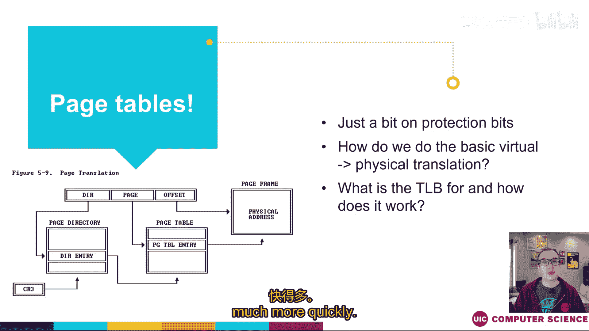
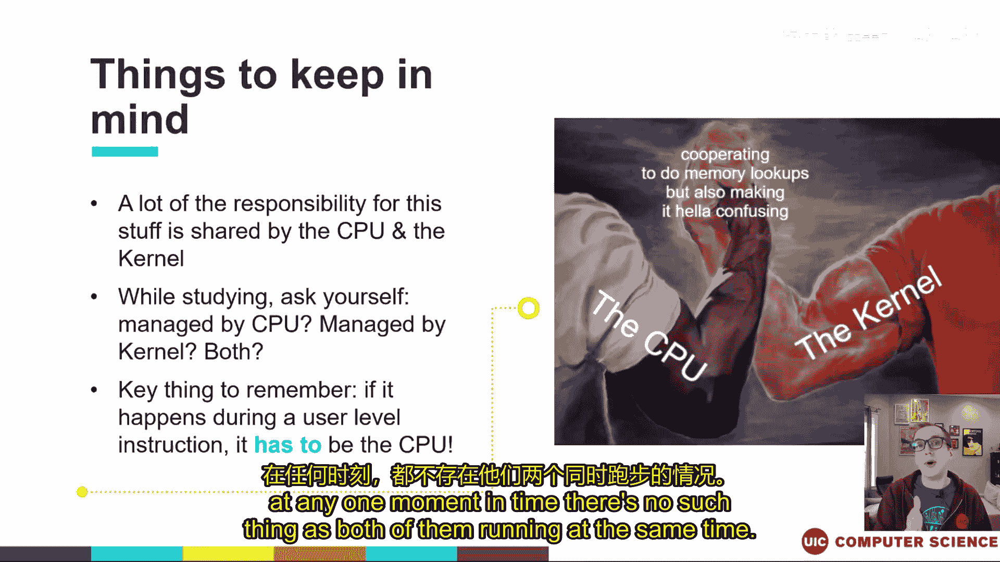
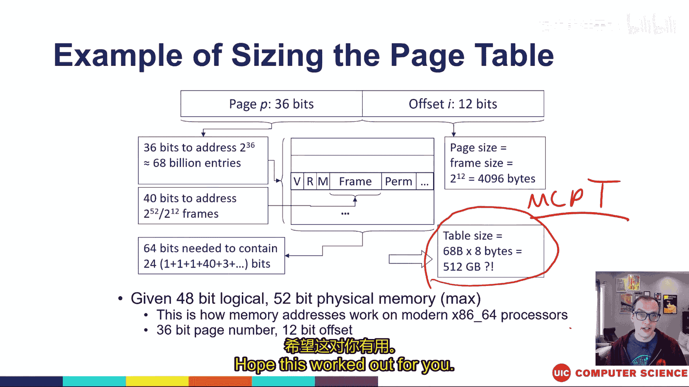

# 【全集】伊利诺伊大学 操作系统 中英字幕 1080P p11 Lecture 11 - 页面表 -BV1AEASzNE3z_p11-

Hi， I'm Chris Kench， and this is CS S 361 System programming Today。

 we're gonna to be talking about how to use page tables to translate virtual memory addresses to physical memory addresses。

 Let's get started。 So the high levelvel bit about what we're going to be covering today is talking a little bit about how we use protection bits。

 So this is part of the entire page table entry that we're going to use its metadata about when you're allowed to access one of these mappings。

 we're going talk about how to do this virtual to physical translation and we're going to see what would make it really ridiculously slow。

 Then we're going to talk about the translation look aside buffer with the TLB that is a way that we're going to make this work much。

 much more quickly。 So first， a few things to keep in mind。😊。

Basically about this entire chapter is that memory translation is something that is done in cooperation between the CPU and the operating system。

 The CPU with the help of the memory management unit is going to be translating these virtual memory addresses into physical memory addresses for every single load every single store but it can't do that alone the operating system is going to be in charge of setting up the page table entries that the MMU uses to do this translation。

 So sometimes this is going to be done by the CPU， sometimes it's going to be done by the OS。

 but one really important thing here is that this is an architecturespec thing。

 your operating system needs to know what your CPU is expecting in terms of the format of say a page table entry。

 This is going to be pretty important and one rule of thumb that I would use here。

 but then also in lots of other places in this entire course is that if you're running user level code。

 the operating system is not doing anything at all。At that moment。

 it might have configured some things beforehand but it's not actually doing anything because you only have one entity that has control over the instruction pointer in the stack plan or yada yada yada at any one moment in time There's no such thing as both of them running at the same time So address translation within a page table looks a little bit like this when we're running a set of instructions that are part of user level code。

 they are going to be accessing things via these virtual page numbers and the memory management unit needs to be able to say。

 okay given this virtual address， how do I find what its physical address and the first thing needs to do is find where is that table in physical memory So the page tablebased register is going to be in charge of that The operating system sets that saying oh hey。

 this is where the page table for this specific process lives one really important thing here that I'll probably touch on a couple more times over the course。

lecture is that every individual process has its own page table so I have a page table that says here's what my view of the universe looks like。

 you have your own page table that tells you what your view of the universe looks like when you swap those page table mappings out simply by changing what this base register is the entire mapping changes so that's one of the ways that we make this nice and efficient right literally the only thing that you need to change is that pointer to the beginning of the page table and you go from living in one universe of virtual addresses to living in some other universe of virtual addresses you're kind of changing which page of the map like which page of the Atlas you're looking at and all of a sudden you're looking at a completely different page you're in a completely different universe。

😊，So when we're doing this translation first thing there。

 we're going to talk about that page table base register。

That's going to index us down into the page table。 And another very important component of modern page tables is that they're just arranged as arrays。

 They are flat arrays that have specific offsets that talk about specific locations。

 Every single entry in this array is a fixed size。 And so the very first entry in the page table is going to go to the very first virtual page。

 The very second address in this page table is going to be the second virtual page of the memory layout of that process。

 And every single virtual page is going to get an individual。😊。

Page table entry at this point in time， we're going see that that's not 100% true later on。

 but for conceptual purposes， that's the way that we're gonna to look at it right now。

 And the most important bit， arguably in this page table entry is the valid bit saying whether or not this mapping is true or not that needs to be set to figure out whether you have a page table hit or a page table miss if it's valid that basically means whatever index is here in this green line right there is going to be correct and we're just going to be able to map straight through the CPU can just index through this page table kind of like an indirect load like you would through a pointer like you're dereencing a pointer the CPU is going to be dereferencing the virtual page number into the physical page number and another thing that I'll hit over and over and over again the offset within that page and say you had would be a 12 bit page number so you。

4096 different bytes， the index within that entire page is just going be the same thing。

 If we have the same size physical pages as we have virtual pages。

 which definitely is the way that makes the most sense then we're just going to pull that straight down。

 there's nothing special that has to happen to figure out where within that page you are。

 So now if we look at this entire process boom boom boom going through the entire thing。 the CPU。

 the MMu and the cache of the memory， different things are going be located in different places。

 the memory management unit on most modern processors is going to be part of the CPU itself。

 but theyre different pieces like a CPU is just a general purpose processor or the MM is this very specialized piece of hardware that does one job and it does it really。

 really well and really， really fast It translates virtual addresses to physical addresses the very first step here is that when the CPU wants to load or store from specific virtual address。

 it sends that to the MMu saying I want to load from。This address I want to store from this address。

The memory management unit will then check to see whether it has that page table entry somewhere in memory right that needs to do two loads here say this is a load instruction right the NmU needs to not only know what the core physical data is that the CPU wants to load into a register it needs to know where to find it right so the first thing it needs to do is look。

 hey， where is the page table entry that will tell me based on the virtual page number what physical page actually holds this memory when the memory management unit gets that page table entry。

 this what we're going to see a little bit later on is a 64 B chunk of data including the physical page number it is going to then send that to the memory as a load。

And it's going to hold that in from an actual address of a specific chip of Ram that's in a stick that's on the motherboard。

 This is a physical load of an actual thing。 the user level processes keep track of these virtual page numbers but they don't actually hold anything themselves。

 they're just mappings that go through to the actual physical page that actually holds those bytes and then once that physical address request goes through to the memory hierarchy。

 the data will come back in from the memory itself。

 and then the CPU has loaded a specific amount of data from memory into a register or whatever it was planning and doing this would be the exact same thing if you were doing a load or a store or a increment in place anything that has to do with manipulating memory is going to go through this memory management unit Now。

 if we should look at this on the opposite direction。

 remember from the last video that page faults are this allencomping trick。

We use to bring information in it， we're gonna to be bringing it in from the disk we're going to be creating new page mappings。

 we're gonna to be doing all sorts of different things and when we do page faults。

 page faults are very， very common and this is one way that this is actually going to happen whereas in the page hit what's really important here is that at no point did the operating system get involved there's nothing happening on this slide that was done during this slide you know1。

2，3，45 here all of that was purely user level code running on the CPU using the MMmU using the page table and memory the kernel did not execute a single instruction in this situation now here it going to be a little bit different we're going to do the same exact first couple steps where the CPU wants to do a load it asks the MMU to translate its virtual address for it the MMU knows that it has to first get the page table entry out of memory and figure out where in physical memory that is and。

This is where things change whereasas last time we said okay we saw that the valid bit was one。

 so we're just going to go in and load that information here instead we're gonna to have an exception。

 This is a page fault that says immediately we need to change this from running the user level instruction to running the kernel level instruction that's in charge of fixing this page table entry because right now we know that it's not valid the kernel then takes over and says okay well it wants this page of memory and it's currently marked is invalid that could mean a lot of different things that could mean that it's a completely illegal mapping it could mean that it is stored on the disk as an anonymous page or it could be swapped out or it could be mapped to say a specific chunk of a file like if you were loading a new executable when you ask for a specific chunk of that memory that the loader set up as a mapping but didn't actually pull in for you the page fault mechanism is going to happen this is how we're going to load in chunk。

So executables， pieces of data brand new pieces of memory that haven't been allocated yet。

 these are all the ways that we're going to be doing this process So the next thing that the kernel is going to do is if it needs to evict a page it will push that victim page to disk this is optional if memory isn't full yet which in most cases when you have a page fault is going to be the case you're not going to say page fault happen when the main memory is fault page fault happen in order to bring things into Ram period this is optional if RA is full then you're going to do number number five here so then your next step if this is a page which you are allowed to access if this is a page fault that can be recovered from then you're going to bring that new page in from disk maybe you're going create a new page that needs to be created because it didn't exist yet and you're going to push that into main memory and say okay now I have chosen a physical address for this virtual page。

Me now it does have a valid mapping between the virtual address that the user level instruction saw and the physical address that the NU needs to find in order to actually access the real bits that are actually stored there。

So finally， the page fault handler is going to finish doing this fix in。

 it's going to restart that instruction that had faulted in the first place。

 then we're going to go back through the page hit process that we saw in the previous slide we're going to restart that instruction the MM is going to find a valid page table entry and it's going to。

Do whatever instruction was， do the low， do the store， whatever it needed to do there。

 So a little bit more of the metadata that's stored in these page table entries。

 We have our present bit right This is a valid bit present bit， whatever you want to call it。

 And then we've got this right bit this user bit in this executable bit。 These are all very。

 very important for figuring out whether a specific memory access is supposed to be a allowed And then beyond that。

 you have that physical page number that is in this entry。 So these are our entries in an array。

 right So we don't have the virtual page number stored in the actual data that's stored in Ram。

 The virtual page number is implicitly stored as its index within that array。

 Remember like the offset of an array isn't actually stored。

 It's just you know how far away it is in the address space。

 So we know where each individual virtual page table entries location is based on how far it is offset from。

That page table base register。And every process has their own。 see other important things here。

 And there will be different mappings for different pieces of code here。

 whether something has to be accessed only in kernel mode， whether something is an executable page。

 whether something is writeable， all that gets not So earlier on in class。

 when we're talking about loading executable， we were talking about loading specific chunks of that executable as read only or read write loading certain chunks of that executable as exe as executable code as in text of a program or in not and we have extra bit fear now to this user accessible bit。

 So if the user accessible bit is set， that means that you are allowed to access something when you are in user mode。

 when you're running unprivileged user mode code as in not operating system， not kernel mode code。

 So if we go through this set of different types of memory， these different flavors。

 And let's just figure out which bits we should be setting for these first off。

 the present bit that's going to be set。😊，Based on the situation that's happening so we don't really care about that one we're gonna care about whether something should be loaded writeable user accessible and executable so writeriable here。

 something that we should say this page should be writeriable to or not some things are going to be writeable something things shouldn't be user accessible is a bit where we said yes if we are allowed to see it in user mode and zero if we are not allowed to see it in user mode so kernel mode only and then we have the executable bit where we want to say whether or not if we find code there or if the instruction pointer points into that page should the CPU say yes。

 it will totally run those instructions or should the CPU say wait a minute there should never be executable code in that page of memory this is a security defense that we have so the user level text should not be writeable because remember we don't want our programs to change in the middle that's almost always going to be either a vulnerability。

Somebody's trying to take over our program or it's just way too complicatedate like self modifying code has never been a thing that does anything effectively like it's it's a cool it's like a weird flex type of situation so user accessible so user level text。

Is definitely supposed to be user accessible and user level text is definitely supposed to be executable。

 So that's what we have for userle text。 So for the user level stack writeriable， yes。

 we want the user level stack to be writeable we want the user level stack to be user accessible。

 And even though it's storing pieces of information that have to do with executing code。

 we do not want the stack itself to be executable。 So we're going to set the executable bit on the pages of memory which hold the stack as not executable。

😊，The user level heap， we are going to have the same set of stuff where we say writeriable yes。

 user accessible， yes and executable， no， we don't load。Code into the heap， there's a different。

 even though they're gonna to be in the same basic area of memory when we load in the heap。

 like we're doing something on Ma we're doing data there definitely。

 whereas when we are loading in say shared libraries。

 those are going be loaded in a slightly different way。 and we're gonna to explicitly say， hey。

 I want to map this file that has Glib C in it into my memory space。

 and I'm going to mark that as executable because it is code。

 but we don't change it once we've loaded in in from disk。

 whatever bits we're on disk are going to be the bits in memory and we don't have any way to change it because we don't want to change it。

 we don't want to change Glib C right in the middle of our program。 that would be a horrible idea。

 map， let's go over kernel text。 kernel text is not writeable。

 we only want to change the kernel once when we load the machine。

 There's some special ways to change the kernel while your computer is running。

 but theyre relatively esoteric in most situations when you want to change what。😊。

Colonnel is running， you need to reboot your machine so the kernel text is not writeriable the kernel text is not user accessible because if a userleve piece of code wanted to read from those addresses or certainly write to those addresses that should not happen that page fault when the user level code tries to do that load or tries to do that store should be an unrecoverable fault the CPU is gonna see that it shouldn't be allowed to do a specific thing at a specific time then it says mom fixes for me and it does the exception trap out to the operating systems exception handler and that kernel code takes over and the kernel code says ohy the user level code tried to read from the kernel and it was not privileged and so I definitely need to kill this process because it was not allowed it did something illegal。

Then finally， kernel text is executable and we need it to to be able to run the kernel stack is going to be writeriable。

 Yes， user accessible， no executable no， we don't want any code outside of the text to be runable the only places that we ever going to have executable pages of memory are going to be the actual text of our actual program and then libraries that we map in using our dynamic link for for the purposes of C361 and then finally for the kernel heap is writeable right we want to be able to mail things and read them and write to them and。

😊，Colonnel importantly， is going to have a lot of the same mechanisms that you have at user level。

 It's going to have a he where it dynamically allocates things。

 It's going to have one stack per user level process。

 It's going to have its text it's going to have all that good stuff user accessible。

 No anything in the kernel side should be not user accessible the user level code never ever touches the kernel code。

 It's the kernel wants to send something to the user level code。

 the kernel will put it in user level accessible memory and the he is also not executable。 remember。

 as I said earlier in in the presentation， one thing you want to think about is who's enforcing this when the decision to say whether this is a valid load or a valid store is going to be done purely by the CPU because the CPU is going to look at the page the CPU and MMU sometimes I'll say CPU sometimes I mean all of the hardware and not the kernel So sometimes the CPU in the Mu are going to decide。

y， this is a valid access。 It's a page hit。😊，Allow the load， allowed the store， nothing happens。

 We don't transfer control to anybody。 we're just running user level instruction。

 user level instruction， user level instruction Sometimes the CPU in the NM will decide， okay。

 this is not a valid。Operation to be done based on the elements in this page table entry。

 but it doesn't know what to do。 That's why it's a fault。

 It's a fault that causes the operating system to take over and figure out what needs to be done。

 Sometimes it can be recovered by doing a load from the disk。

 Sometimes it can't be recovered because it's a plain and simple illegal operation。 Now。

 this is a relatively minor part。 we're talking about integrating the MM and the virtual memory with the cache。

 But the basic idea here， is that the memory that the Mu is accessing is the same memory hierarchy that we saw in 261。

 when the MM tries to get a physical address it's going to be using the L1 cache and the L2 cache and the L3 cache etc。

 to find where that information is when it accesses things via physical page numbers。

 it is going to be accessing them through that cache hierarchy。

 So we don't have to do much here for instance。When the CPU asks for a specific virtual address。

 the MMU is going to ask for that page table entry， then if that page table entry is in the L1 cache。

 it'll come right back in， but if it's not in the L1 cache。

 it's going to go out to main memory and it's going to pull that page table entry back in。

Like any other store in a。Cash based hierarchy like this。

 that's also going to pull it back into L1 cache。 That page table entry is also going to get loaded into the MMu and we're gonna to be able to then go through check the physical address。

 Maybe it's in the ash。 maybe it's not if it's not pull it in from memory if it is we can just shortcut and bring that back into the CPU same So we saw in 261。

 this is that the memory hierarchy at work。 The only core thing that you really need to know here is that the。

Cash is between the entire CPU and the memory and not like here in between the CPU and MMu， right。

 the CPU is going to be doing these translation to the Mu and the Mu is going to be doing them through the memory hierarchy and not anything else more fancy than that。

 So even with the cache And even with the fast memory， This is actually a little bit slow。

 Like if we look at the CPU and we have the MMu and we have the memory。

 we still have this double lookup for every single time。

 we do a loader a store even if we're going right into L1 cache， like the super， super。

 super fast cache that's right there right next to the CPU incredibly fast。

 it's too memory loads and stores for every single load or story that actually needs to happen。

 And that's going to be very， very slow。 And we do a lot loading for memory and storing out to memory。

 that's a very common thing to do。 That's just the way。

Moern computing works so the big problem we end up with here is we don't want to do these two for one memory accesses。

 what instead we want to do is say okay， we're going to make a very special cache called the translation look aside buffer that is going to live in the MMU itself。

And rather than using the memory hierarchy to say， oh。

 a page table entry is the same thing as any other chunk of memory。

 I'm going to say that page table entries are these special things that I want to pull into the NU and have a page table entry cache I think it's a very good way to think about what the TLB is the TLB is a page table entry hash。

😊，On the M M U I think that's the best way to think about it。

 And rather than being a fully associated cache， this is going to be a set associated cache。

 and we're going to say a little bit right now about what this does。

 The idea here is that this is going to keep a very small number of pages。

 but usually when the CPU is actively doing some sort of job。

 it's probably only going to be looking at a small number of pages and they're going to be close to each other and this is going to speed things up very。

 very marked。And we're going to see a little bit later on。

 especially when we use our multilevel page tables that this provides a huge win that really。

 really makes memory loads and stores much more efficient than they would otherwise be so let'ss page back in our ideas about set associated caches from our 261 days right when we have a element that we want to pull into a cache with a set associatedsociative cache we're pulling in more than one at a time so that we have some level of locality so like if I have a tag here that I say okay we're going to take the virtual page number。

 we're going to split it up into a tag and highle bits and an index in the lowle bits。😊，First。

 when we want to access the TLB， we're gonna to say okay。

 let's take these lowleve bits of the virtual page number and we're going to use them to index into a collection of sets of multiple page table entry that we're all pulled in at the same time so we're going to index down into the set using the index。

 these low order bits。 that's going to tell us which of these rows we're trying to look for our thing in。

 So once we've indexed down into the correct row， we're going to go over to the column based on the TLB tag。

 which is the highest order bits。 Does this tag that is in the virtual page number match the tag that is stored in the set associated cache。

 If we check here， and we see that this tag is equal to this tag。

 then we know that we found the right page table entry and we can immediately use that page table entry the entire thing is valid and ready to be used to do some memory translation。

So now that we have this awesome thing called a TlB that's effectively part of the MMU。

 what will end up happening is that in common cases。

 because remember cache hit rates on welldesign caches are 95% or above they're relatively high and the TLB is no different than this。

 it's going to have very high hit rates， the CPU is going to ask for a specific virtual address just like before。

 and the MMu， rather than immediately going out to cache main memory whatever have you is going to go straight into its TLB。

 it's going to check that。Index it's gonna check the row for that tag。 And if it does find that tag。

 it's gonna say okay， I'm done。 I get the page table entry back。

 and the only time I touch main memory through the cache hierarchy is where I'm gonna do a load or a store from a specific chunk of bits and that data comes into the CPU or gets stored out to the CPU at the correct address stored out from the CPU to main memory at that correct address and for one memory access we end up with one memory access that's good In the case where there's a TlB miss it's gonna be relatively straightforward same basic thing here where we ask for a specific virtual address we check the index。

 we check the tag based on that virtual page number。

 the TlB comes back as a miss and then we go through and do the same exact thing we did before where we say hey。

 main memory I need this page table entry that lives at this specific physical address remember because I know the base。

gister and I know which virtual page number I need therefore I know where the physical address of that page table entry should be in main memory that is going to come back into the MMmU when it comes back into the MMmu I'm going to both store it into the TLB This is the cache and I'm going to use it in the MMU to actually translate that address and then I go get it and I give it back to the processor everybody's happy Okay now we're going switch gears a little bit。

 we have the idea of this TLB the TLB uses the the virtual page number as a index into associative cache to keep track of these page table entries。

Each individual entry is going to have that metadata in it。

 but now we want to talk about how big our is our entire page table going to be now at a very。

 very high level， depending on our architecture， it's going to look a little bit like this。

 we get our entire page table entry and it's going to need at least those bits like the valid bit。

 the user level bit， the writeriable bit， the executable bit。

 it's going to need the physical page number， the physical frame offset whatever nomenclature we want to use。

And we're going to split our entire logical address。

 Remember all modern computers are using byte accessible memory。

 and we're gonna take an address of an individual byte。

 and it's going to end up having a part that's an offset within a page。 and then a page number。

 These are just like offsets within a book。 You， we have pages of a book。

 Every page as hundred words out。 So you flip to that page。 Then if you want a specific word。

 you just out in that number of words。 The pages get stored in virtual memory address space or they get stored in actual physical memory。

 If I have a specific word on a specific page。 I tear that page out， I put it someplace else。

 somebody else reads it。 It' like， oh， yeah， that word the is seven words in。

 It doesn't matter whether it was in my book or your book。 If it's the same exact page。

 it's going to have the same exact offset。 So this is another part of why we pull that offset straight through without manipulating it at all。

 We're basically going not think about the offset。 But what the offset does。

 is it tells us how many bits of。😊，The entire address need to be used for the offset within the page。

 sometimes our pages can be  four kilobytes， sometimes pages can be much much larger than that the important part here that if we have a logical address that is a certain size。

 let's try some old tiny ones like 32 we get a 32 bit address and if we use 4096 byte pages that means we have 12 bits of。

Offset within the page， that means that we have 20 bits to specifically talk about the number of different pages。

 So if we have 20 bits to talk about the number of different pages。

 20 bits corresponds to two to the 20 pages， and that's a big number that I don't remember right off the top of my head。

So that basically means if we have two to the 20 different pages and we have a array of page table entries。

 that means that we would need to have two to the 20 different entries here。

So what we end up with is。The page table entry width。Is going to be the size of the metadata？Plus。

 the size of the physical page number and then the physical page number has to do with how big your physical addresses are As remember in this example。

 if you have a 32 bit architecture， it doesn't mean we need to have a 32 bit physical address size maybe the physical address size is 20 bits and there's only 8 bits of page number and there's 12 bits of offset that's a completely possible thing that you could do you probably wouldn't be able to have that much memory but there's a lot of machines that didn't have that much memory in the way way back I was talking about the width of the page table like every individual entry is going to have a certain size and then we need to have one entry for every single page that we could potentially talk about using the address space that this process is going to have So our length of that array is going to be the number of pages and the width is going to be proportional to the size of。

Physical page address and the size of a metada that needs to be kept track of so let's do this in a little bit of a more real world scenario in a real honest goodness machine the one that you're probably watching this lecture on right now if it's a desktop class machine has a 48 bit logical address space it's virtual address space is 48 bits and its physical address space is 52 bits that's what we've been using for several several years now on Intel AMD class desktop class machines in our 64 bit world we do have 64 bits hypothetically to use for that address but we only use 4 for the virtual address and 52 for the physical address and then another important you know thing to remember is that logical will very often be a synonym for virtual。

In lots of situations in computing and not just right here in 361， we're talking about memory。 Now。

 as an example of sthing this page table in the real world， we have 4 kB pages， which is very common。

 We're going to have 12 B for our offset。 we're going to have 36 B for our virtual page number。

 So we know that we're going to have 2 to the 36 entries in that entire page table。

 So it' going to be 2 to 36 of these。 And we also know that if we have a 52 B physical。😊。

Address space。 that means that we need to take 52-12 is equal to 40 is going to be the size of the。

Physical frame number。 So this one right here is going to be 40 bits。

Because we know how big the physical memory is。 And we need to talk about every single physical page number that could ever possibly exist。

 if it's a 52 bit address space and 12 bits are taken up by the offset。

 that means we've got the 40 bit left over for the physical page number。

 Now remember that the operating system， whether it's Windows or Linux needs to know what does a Intel I5 i7。

 whatever CPU expect for its page table entries。 So these page table entries are the collection of these 40 bits plus another 24 that bring it up to 64 Bs total。

 you don't need to memorize these types of things。 but it's important to remember that that's just the default。

 So these are going to be it's not just the default， it's required。

 if you're going to be using a 64 bit machine in its standard addressing mode and not use some like old compatibility mode it's going to have a 64 bit page table entry the width of the table。

64 B，8 by height of the table。😊，Is going to be two to the 36 entries。

 So this kind of leads to inconvenient truth that the entire table would end up being。

About 512 gig just to hold the page table for one process。 Remember。

 every single process has to have its own page table。 So 512 gigs。

Her process for every single process running on your machine。

 Usually there's going to be hundreds of them。 And most of us don't have 512 gigs of Ram。

 So that poses a problem。 That's slightly impossible。

 And that is why we have multi levelve page tables。 They come to the rescue。

 And that's what we're gonna talk about in the next video。 Hopepe this worked out for you。

 Have a good day。 and I'll talk to you soon。

