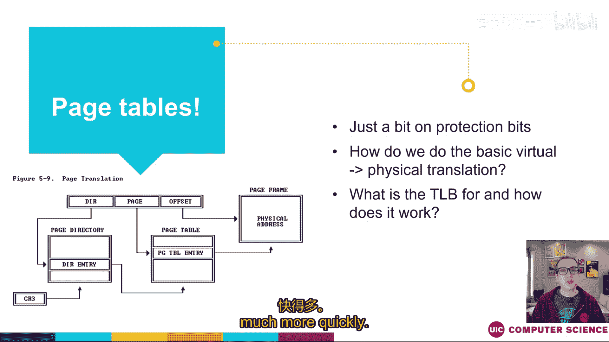
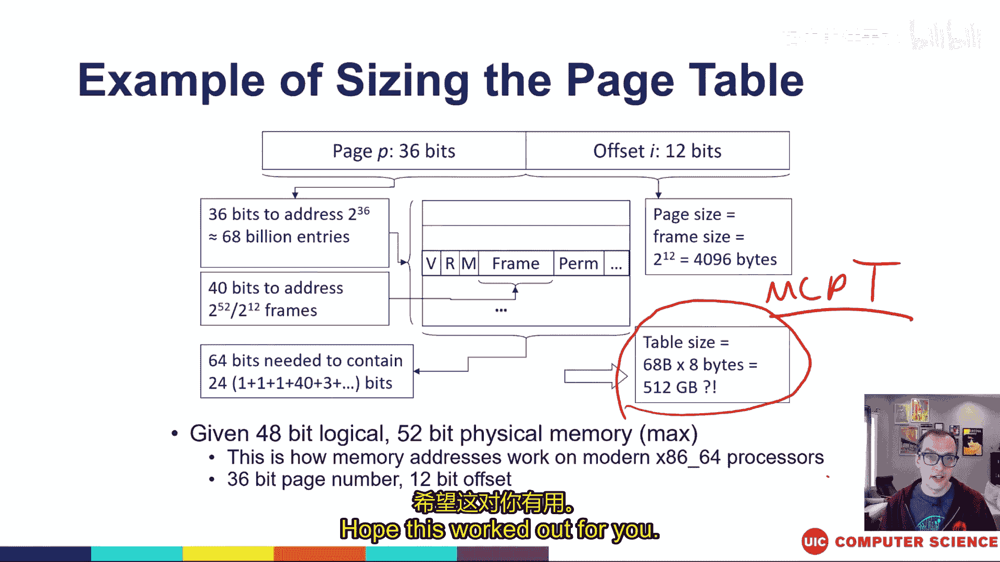

# 操作系统：第11讲：页面表 📄

在本节课中，我们将学习操作系统如何利用页面表，将虚拟内存地址转换为物理内存地址。我们将探讨页面表的结构、地址翻译过程、相关的保护机制，以及如何通过翻译后备缓冲器（TLB）来加速这一过程。

## 概述

内存地址翻译是CPU与操作系统协同工作的结果。CPU借助内存管理单元（MMU）为每一次加载和存储操作执行翻译，而操作系统则负责设置MMU用于翻译的页面表项。这是一个与具体架构相关的操作。

## 地址翻译的基本流程

上一节我们概述了CPU与操作系统的分工，本节中我们来看看地址翻译的具体步骤。

当运行用户级代码时，指令通过虚拟页号访问内存。MMU需要找到对应的物理地址。首先，它需要知道页面表在物理内存中的位置，这由操作系统设置的**页面表基址寄存器**负责。

每个进程都有自己独立的页面表。通过更改基址寄存器的值，就可以切换整个地址空间的映射，这非常高效。

翻译过程如下：MMU使用虚拟页号作为索引，在页面表这个**数组**中找到对应的**页面表项**。每个表项大小固定，最重要的信息之一是**有效位**，用于判断此次映射是否有效。如果有效，MMU就能获得对应的物理页号。

**公式**：`物理地址 = 物理页号 * 页大小 + 页内偏移`

需要注意的是，页内偏移在虚拟地址和物理地址中是**完全相同**的，无需转换。

## 页面命中与页面故障

现在，让我们深入了解翻译过程中可能发生的两种情况：页面命中和页面故障。

当CPU执行加载或存储指令时，它会将虚拟地址发送给MMU。MMU首先需要从内存中获取对应的页面表项，检查其有效性。如果有效（页面命中），MMU则根据表项中的物理页号，向内存层次结构发起真正的数据访问请求。在整个页面命中过程中，**操作系统内核没有执行任何指令**，完全由硬件完成。

如果MMU发现页面表项标记为无效，则会触发一个**页面故障**。此时，CPU会暂停当前用户级指令的执行，将控制权转交给操作系统的异常处理程序（内核代码）。

内核的页面故障处理程序会分析故障原因。原因可能多种多样：可能是非法的访问（如用户程序试图访问内核内存），也可能是合法的但数据尚未载入内存（例如，访问一个被换出到磁盘的页面，或一个文件映射的某部分尚未加载）。

以下是内核处理可恢复页面故障的典型步骤：

1.  **检查访问权限**：确认此次访问是否合法。
2.  **选择牺牲页（可选）**：如果物理内存已满，需要选择一个页面换出到磁盘。
3.  **载入新页面**：从磁盘（或创建新的空白页）将所需数据载入物理内存。
4.  **更新页面表**：建立虚拟页到新物理页的映射，并标记为有效。
5.  **重启指令**：故障处理完毕后，重新执行最初触发故障的那条用户级指令。之后，该指令通常会经历一次页面命中流程，成功完成。

## 页面表项中的元数据

页面表项不仅包含物理页号，还包含重要的元数据，用于实施内存保护和访问控制。

核心的元数据位包括：
*   **有效位**：指示该映射是否有效。
*   **可写位**：指示该页内容是否允许写入。
*   **用户可访问位**：指示用户模式（非内核）代码是否可以访问此页。
*   **可执行位**：指示CPU是否可以将此页中的内容作为指令来执行。

虚拟页号并不直接存储在表项中，而是通过其在页面表数组中的**索引**来隐含表示。

## 不同内存区域的保护位设置

了解了保护位的含义后，我们来看看如何为不同类型的内存区域设置这些位。

以下是典型设置：

*   **用户级代码（文本段）**：
    *   可写位：**0**（不应在运行时修改代码）
    *   用户可访问位：**1**
    *   可执行位：**1**
*   **用户级栈**：
    *   可写位：**1**
    *   用户可访问位：**1**
    *   可执行位：**0**（栈不应存储可执行代码）
*   **用户级堆**：
    *   可写位：**1**
    *   用户可访问位：**1**
    *   可执行位：**0**
*   **内核代码**：
    *   可写位：**0**
    *   用户可访问位：**0**
    *   可执行位：**1**
*   **内核栈/堆**：
    *   可写位：**1**
    *   用户可访问位：**0**
    *   可执行位：**0**

这些保护规则由**CPU和MMU硬件**在每次内存访问时进行验证。如果违反规则，硬件会触发异常，由操作系统内核决定如何处理（例如，终止违规进程）。

## 缓存与内存管理单元的交互

地址翻译过程需要访问内存中的页面表，这自然会涉及到缓存系统。

MMU在获取页面表项或访问用户数据时，都会经过标准的CPU缓存层次结构（L1、L2、L3等）。页面表项本身也会被缓存。这意味着，如果所需的页面表项或用户数据已经在高速缓存中，访问速度会大大加快。

需要记住的关键点是：**缓存位于整个CPU（包括MMU）和主内存之间**，MMU的访问同样受益于缓存。

## 翻译后备缓冲器：加速地址翻译 🚀

即使有缓存，每次内存访问仍需两次内存查找（先找页面表项，再找数据），这仍然很慢。为了解决这个问题，现代CPU在MMU内部集成了一个专用于缓存页面表项的特殊高速缓存，称为**翻译后备缓冲器**。

你可以将TLB理解为MMU专用的**页面表项缓存**。它容量很小，但利用程序访问的**局部性原理**，能极大地加速翻译过程。TLB通常采用组相联缓存结构。

**工作原理**：
1.  将虚拟页号划分为**标签**和**索引**两部分。
2.  使用**索引**位在TLB中找到对应的组。
3.  在该组中，比较所有表项的**标签**是否与虚拟页号的标签匹配。
4.  如果找到匹配项（TLB命中），则直接使用缓存的页面表项完成地址翻译，**无需访问主内存中的页面表**。
5.  如果未找到（TLB未命中），则MMU需要像之前描述的那样，通过缓存/内存获取页面表项，在用于翻译的同时，将其**载入TLB**以备后续使用。

TLB命中率通常很高（>95%），因此在大多数情况下，地址翻译的开销几乎可以忽略不计。

## 页面表的大小问题

TLB解决了翻译速度问题，但页面表本身的大小也可能成为问题。让我们计算一下。

假设一个现代64位系统使用48位虚拟地址空间和4KB页大小：
*   页内偏移占12位。
*   虚拟页号占 `48 - 12 = 36`位。
*   这意味着最多有 `2^36` 个虚拟页。
*   每个页面表项大小通常是64位（8字节）。
*   因此，一个进程的页面表最大可能占用 `2^36 * 8 字节 ≈ 512 GB`。

这显然是不现实的，每个进程都需要自己的页面表，而物理内存通常远小于这个数字。这个“不方便的真相”引出了**多级页表**的解决方案，我们将在下一讲中详细讨论。

## 总结

本节课中我们一起学习了：
1.  虚拟地址到物理地址的翻译是CPU（MMU）与操作系统协同工作的过程。
2.  **页面表**是存储映射关系的核心数据结构，每个进程独有。
3.  翻译过程可能产生**页面命中**（硬件直接处理）或**页面故障**（操作系统介入处理）。
4.  页面表项中的**保护位**（可写、用户可访问、可执行）用于实现内存安全和访问控制。
5.  **翻译后备缓冲器**是MMU内部专用的缓存，能极大加速地址翻译过程。
6.  简单的单级页表在大的地址空间下会占用巨大内存，因此需要更复杂的结构（如多级页表）来解决。