# 【全集】伊利诺伊大学 操作系统 中英字幕 1080P p12 Lecture 12 - 多级页表 -BV1AEASzNE3z_p12-

Hi， I'm Chris Kash， and this is CS S 361 System programming。 Today。

 we're gonna to be talking about multilevel page tables。

 which are going to save our but when it comes to doing memory address translation in real processors。

 So as we saw in the last video。 when we have a 48 virtual address space and an8d page table entry and 4 kilob pages。

 we end up with the need for a 512 GB page table where every single running process。

 This is absolutely not going to work。 So our solution to this problem is the multilevel page table。

 So the multilevel page table is nothing but taking that entire address space where we had an offset and a page table。

😊。

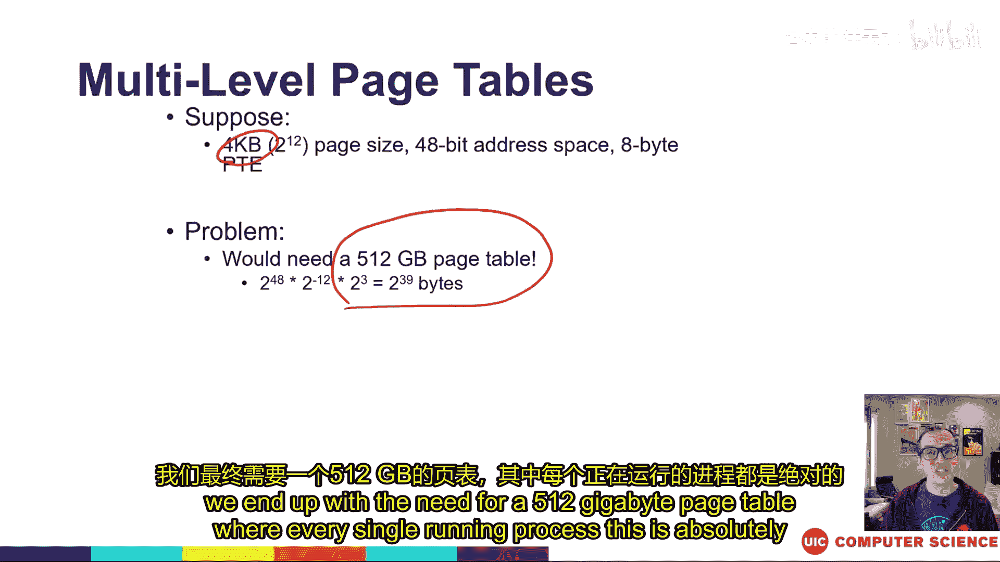

Index and saying， okay， we're going to chop this up into two different pieces。

 We're going to say this is the page table index。 And what this does is rather than mapping down into a thing that tells us our physical page number。

 All that this mapping does is it takes us to a new level that is itself， a page table。 So this。

 this page table entry。

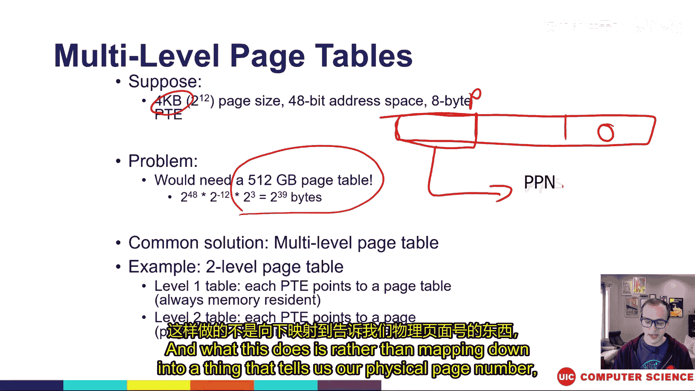

Takes us down into a new page table。Whi we will then index into this page table using this address。

 and that's going to tell us where the piece is and in this example of a two level page table。

 this would have a physical page number in it， and we would use that to actually go out to main memory and find where that piece of information was。

This allows us to not create that 512 gigabyte collection of page table entries。

 We only really need the regions that we are actively using at any given point in time。

 So the big advantages we get out of a multilevel page table is that these level2 page tables can be on the disk if they're not in use or they can just not even exist yet so they don't have to be allocated we only really need to allocate the top level before we do something。

 So if we have our offset and we have the first level and we have the second level and this is say 10 bits of address space really need two to the 10 addresses in that page table that are pointed to by that page table base register we're going to need two to the 10 entries of 64 bits each and each of those is going to send us to a new page table that then gets allocated so some of these are going to be allocated some of these are not And because the lower levels aren't allocated then we save a whole bunch of。

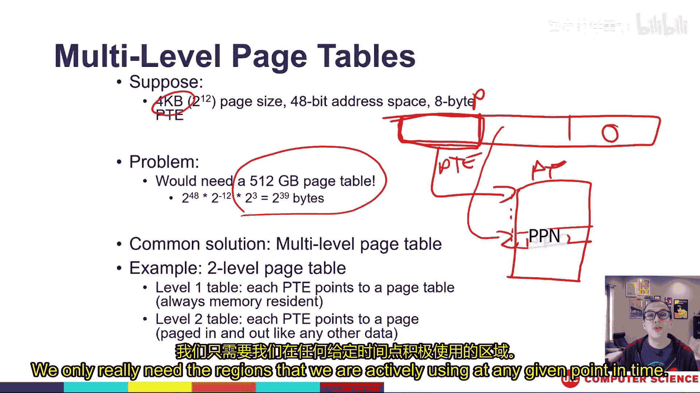

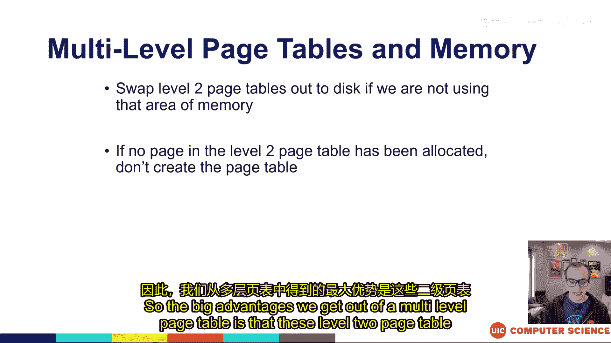

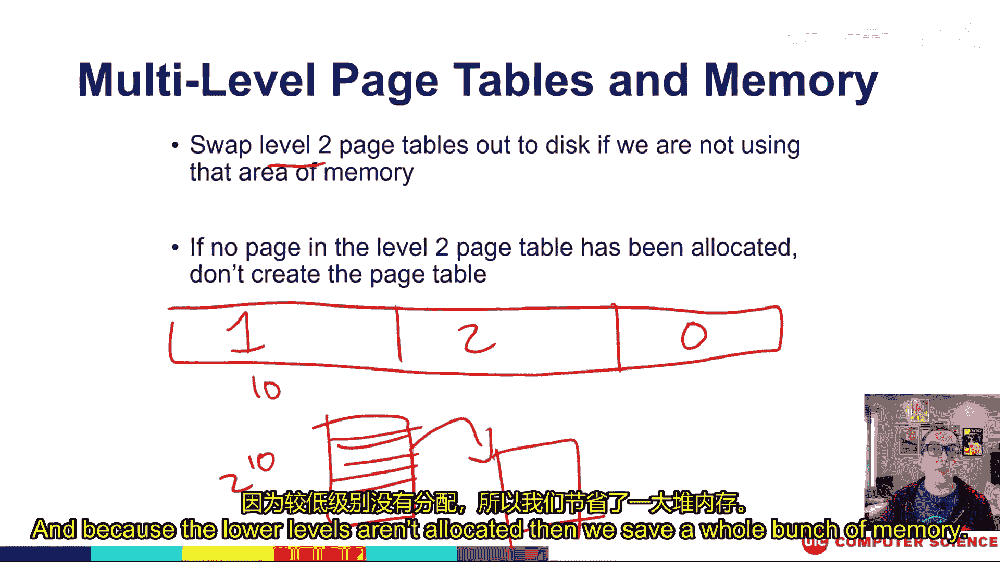

And so this is just a diagram that's roughly what I've been drawing so far。

 but much much neater and easier to see。 We're always going to have this page table base register going at a fully allocated first level page table but that first level page table might have some null pointers in it it might say oh nothing within that entire region of memory has been allocated yet So I don't need to create a page table entry for that location。

 So two doesn't point at anything， three doesn't point anything。

 And when they don't point at anything we don't need to allocate these page table entries for the other levels So say page table entry0 and one are allocated they're going to point at other page tables which themselves also have。

The the full you know in this example for byte page table entries and a 64 bit machine。

 they're going to be 64 bit page table entries， so we're going to have a arrays of page table entries。

Excuse me and when we are at the last level rather than pointing to another set of pagetable entries。

 we point out the actual page of memory that is defined by that entire virtual page number。

 So in the real world。 remember that when we're using virtual addresses。

 they don't correspond to capacity of the actual memory they just correspond to a way for us to organize our memory。

 So when there are gaps of billions or trillions of bytes within the address range。

 it's not like we're using all of that memory， it's just that there's easy ways for us to keep things separated and allow them to grow towards each other。

 but then they very， very rarely will end up touching because they're so far away from each other in the address space。

So we can allocate a little bit of memory， you know， way， way down here。

 we can allocate a moderate amount of chunk way， way up here。

 and we don't need to waste all of the memory for all of these or all these page table entries right here。

 we just see。😊。

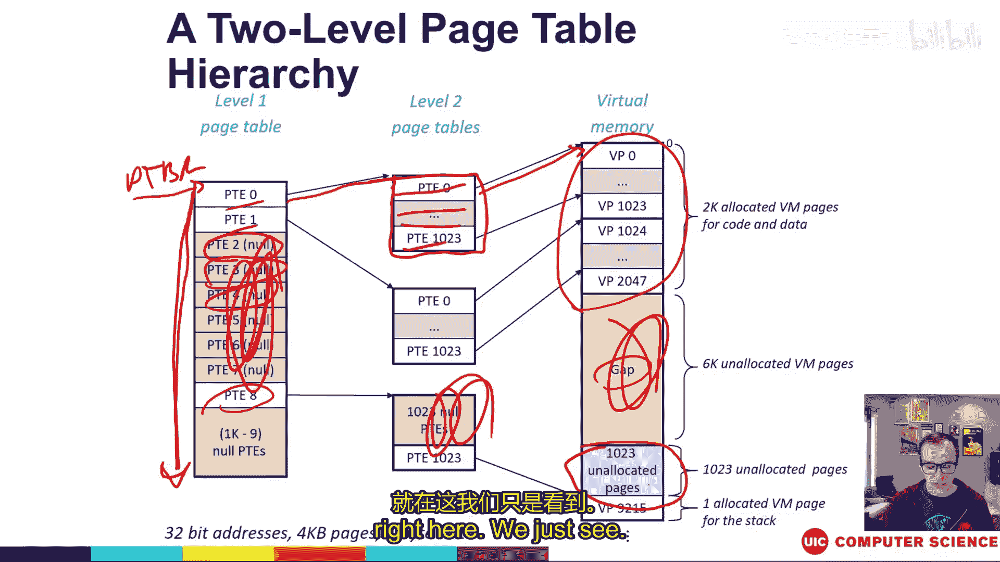

Where we're trying to find that one specific thing。

 So I've been talking already about how you do the translations in these multilevel page tables。

 but let's go over in a little bit more detail right here。

 Remember that our page table base register points at the very， very beginning of the very。

 very highest level of the page table hierarchy。 So this always has to be entirely allocated in physical memory。

 very very important component， but nothing else has to be allocated besides that one specific piece。

😊，So if we have， say， a 9 bit virtual page number， we're going have two to the9 different entries here。

 That's what 2 kilobytes，2000，2048 entries。 So of these 2048 entries， they all exist。

 But a lot of them are probably going to be not。 If I find one of them that I am trying to look up based on a specific。

Virtual page number。 That's this entire thing。 That entire thing is the virtual page number。

 But I'm only going to look up the highest order 9 B to find where within this page table。

 I need to look to find the next level。 When I find that level。

 it's gonna point me at a physical address and that physical address is going to be the base of a new page table。

 When I get to the base of that new page table， I add in the offset within that page table。

 which is this second chunk of virtual page numbers， right。

 So if there's 2000 different entries here， This is going to tell me which of those 2000 based off of the base I found in the higher level。

 where do I find it。 So I find it right。😊，7。When I find that level there。

 I'm going to keep doing that same thing over and over and over again Moern Intel CPUs have four or five levels of page tables。

 each one holding9 bits and we eventually end up at that fourth level say on a modern 64 bit machine we end up finding a physical page number that doesn't refer to another page table。

 it's not the base of a page table， it is the actual physical page number physical page number of a。

Page in physical memory that will have whatever it is the user wants。

 then we drag our virtual page offset straight down here。

 it becomes the physical page offset remember those are the same thing because pages are the same size and we actually load that in。

So if I gives you some hints about what I think is important to remember here is now where do you find the base of each of these chunks of memory。

 Where do you find the offset within each of these chunks of memory。

 what's different about the first level like the thing that's important here is the difference between the first level and every other level is that the first table has to find its location from the page table base register。

 Where every other level is going to find its location from these page table entries those page table entries might be null in which case there is no 2000 entry array allocated for that region of memory So here's what it looks like in a modern Intel machine running on a Linux。

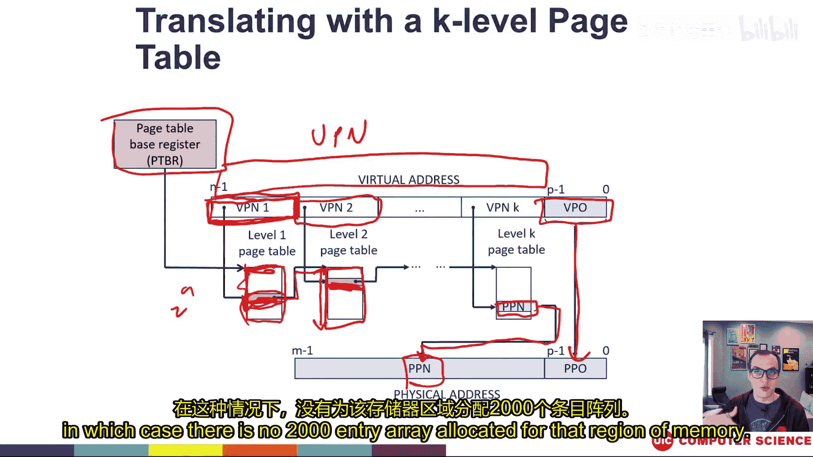

Operating system， but it'll be roughly the same for Linux or Windows or whatever else you're using because it is architecture dependent。

You have a specific register that points at the base of the highest level page table。

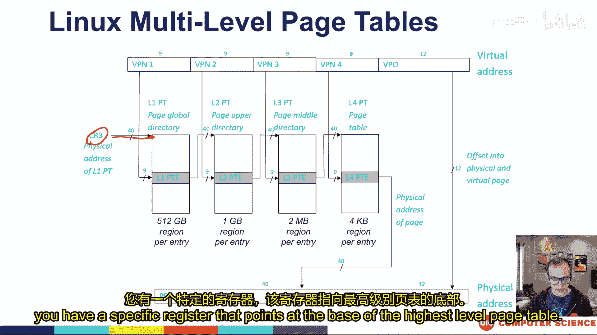

The 48 bit。Virtual memory address gets chunked up into a 12 bit offset and then 4。

9 bit page table levels and our physical page numbers for the entire system are 40 bits each with a 12 bit physical page offset because here we have a 52 bit。

Physical address。And what we end up with， the one interesting thing I want to show you on this slide is that each of these levels corresponds to increasingly smaller chunks of memory。

 so there's going to be 512 entries in this element， 512 entries in this element。

 512 entries in this one， 512 entries in this one。What we end up with is just four levels of translate。

 translate， translate， translate。So the big thing that we have here that I probably want you to think about is this sounds。

Frazy slow。 remember the the worst case scenario is that you have to do a lookup for this page of memory。

 then you have to do a lookup for this page of memory。

 then you have to do a lookup for this page of memory。

 and you have to do a lookup for this page of memory。

 and then you can actually pull in the piece of information that the CPU needed to do one friin。

Instruction for the user level program that is absolutely bonkers。

 But as we saw in the previous lecture， we have that T LB through the rescue。 What the T LB does is。

 yes， it's going to store the mapping for where this page table entry is and where this one is and where this one is。

 et cetera。 But probably most importantly when you're using a specific page of memory the physical page number that maps this entire virtual page number to this entire physical page number is also going to be stored in the T LB。

 So the very first time you do an access into this page。😊，If it's the very。

 very first time you're ever doing anything in this process， it might take a little while。

 but every single one of these layers is going to pull those page table entries into the TLB and the very next time you do this it's going to be a page table hit that go straight through the TLB and it' very。

 very fast。 So remember when we're using caching， we can usually have pretty good algorithms that will prefetch the correct things and we know that we have sized the set correctly based on how people typically do memory accesses and this will be very。

 very fast after we have pulled it in the first time。😊。

Even though we have these several different layers of the page table because we can leverage the TLB and we can size the TLB properly and it's nice and fast right next to the MMU。

 we aren't really going to suffer much at all of a performance hit when we're using multi-level page tables that's pretty awesome part of the modern engineering that goes into modern operating systems。

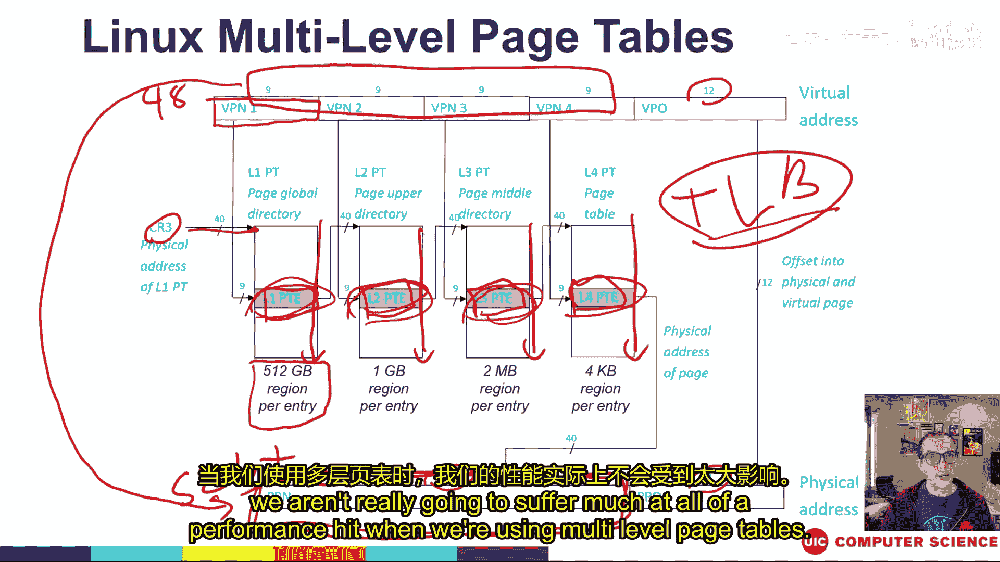

Now we're going cover just a few other things outside of multilevel page tables that are still really important for using memory。

'll just go through these really， really quickly One really great useful thing that we can do when we have this layer of indirect between virtual page numbers and physical page numbers is sharing our pages everybody that uses GlibB C the same exact version doesn't need to load their own copy。

 there will be one copy of GlibB C loaded in the physical chips of RA and then every single process that uses it。

 another nice part is that they don't even need to keep that in the same place。

 like I can have my Glib C loaded here， you have yours loaded here。

 and they both map into a specific physical address and everything works out hunky do Another kind of historic but also important but also detail oriented component to this is that there's this idea of a segment or area of memory in addition to the flat page table type So when we're talking about page tables。

😊。

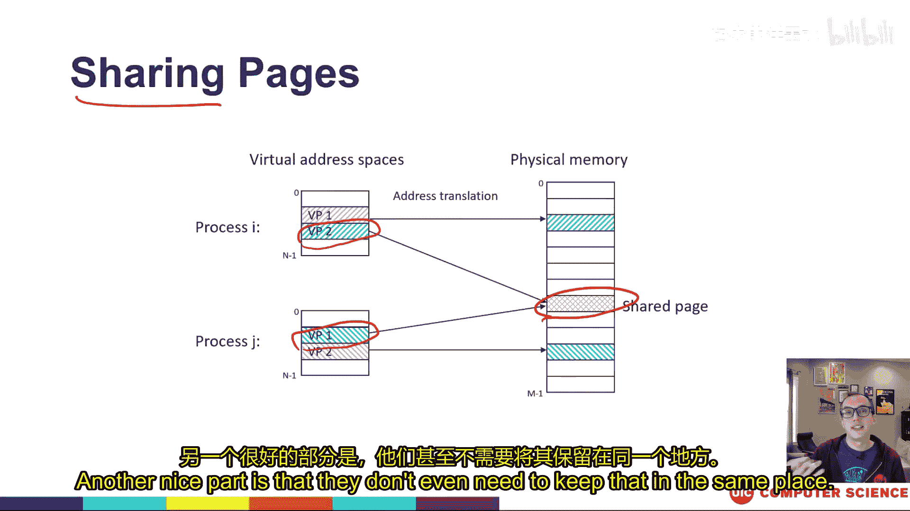

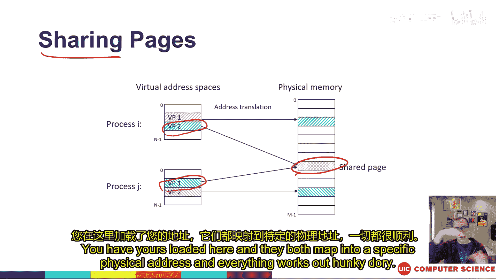

Page tables are flat， which means that they aren't like linkedless。

 they're just straight arrays if I have a page table and it starts at a specific address。

 every single entry is at a specific place that means something that's all that we end up with。

In the way way back。We didn't always do things this way。

 The other way to talk about a large collection of memory is more like a linked list than like a straight up array where we can say。

 you know area。1 goes from address X to address Y。 Then we have very。2， which goes from Z to W。

 et cetera， et cetera。 And every single region of memory that you're using is going to be of a certain size and it can usually grow and shrink。

 So for instance， you wouldn't be able to make y greater than Z if these were contiguous in that way。

 but you still can grow and shrink them that way。 So within Linux's organization of how it keeps track of memory that's going to look a little bit more like this。

 where every single running process has a VM area struck that is more or less a linked list that talks about the different main areas of memory that Linux is using so。

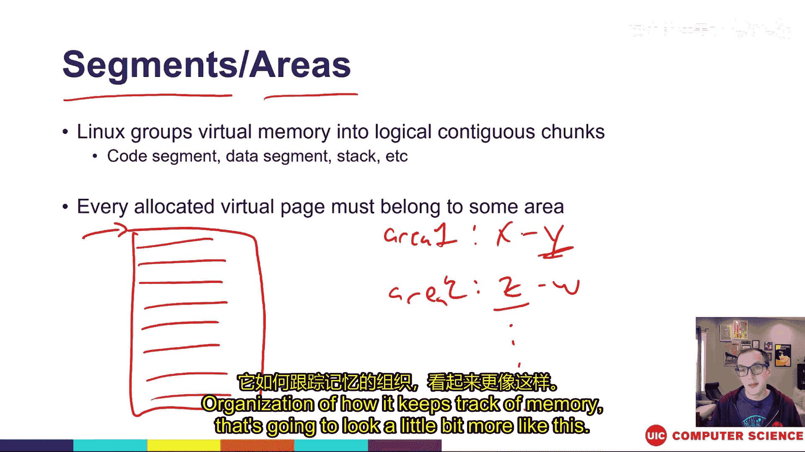

Remember that the page table and the operating system operate on these flat things like there's a 4 kiloby chunk of memory。

 it has a user bit。 it has a valid bit， it has a executable bit etca。

 etc ce and it has a physical page number importantly but when we look at it at the operating system level well the operating system like yeah it knows that it has to keep track of that stuff for the CPU to do all of its translations but' if I'm writing an operating system。

 I don't want to keep track of all that stuff that's a waste of memory it's a waste of instructions to do all of that bookkeeping what would be much more useful is to say listen I know how my programs get reload。

 I don't gonna have a region for shared libraries， I don'm gonna have a region for data I'm gonna to have a region for text it'd be much easier for me to just create these based on a linked list of all of these areas and then I'm going to set the page table based on this like canonal version of what do I want new pages within this area to have for their protection。

What do I want new pages in this area to have for whether they're readable or readable stuff along those lines？

So Linux keeps track of all of these virtual memory areas using segments rather than using the flat approach of the process table。

 this is information that's purely internal to Linux so when Linux needs to generate a new page when there's a page fault。

 it knows what to do based off of its segment mapping rather than off of the process page table。

 the page table is primarily something that the operating system manages so that the CPU and the MMU can do their job when user level code is running。

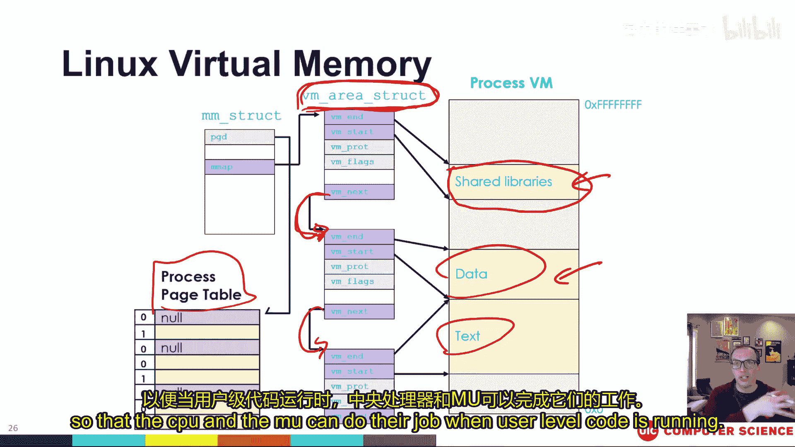

So that's about all I have for you on multi level page tables and a few of our extra fancy things we can do with。

Virtual memory， the very important thing here with the programme's view of virtual memory is that it's like that joke about the two fish who talk to each other and the one fish says great water today。

 the other fish says what the hell is water。User level processes the only thing they have ever known their entire lives is virtual memory addresses。

 you don't even have to know that virtual memory exists to do programming using virtual memory because it's the only thing you've ever know that allows you to have protection where you don't corrupt other processes。

 other processes don't corrupt you and you can just think you have full lay of the land it's all to you at the system level both the OS and the CPU which you includes the MMU。

It's a little bit different。 We have this idea of the virtual memory address。

 There's one address mapping per process， and there's one。Physical memory for the entire machine。

 we want to use memory efficiently by using virtual memory pages This is efficient because there's a lot of locality in most code if I'm going to look at page X it's much more likely that I'm going to look at page X plus1 rather than look at page X plus 1 million it's very very unlikely that I'm going to be hopping around in memory truly randomly。

Memory management is very simplified by using this layer of interactiondirect between virtual memory and physical memory so we can use this translation to check for permissions for whether a specific instruction is allowed to happen。

 we can share these things because we have this layer of indirect so the operating system can be very efficient about how it uses these things and even though it introduces this really high。

😊，Overhead theoretically in a modern multilevel page table。

 a load could end up being expanded out to five different loads to figure out where that one thing comes from in actuality。

 we use things like the T LB to make that much much faster so that that caching allows us to have all those advantages of using a minimal amount of memory to keep our multilevel page tables。

 but then still getting a very fast translation that most of the time is going to be a hit in the TlB and us you'll be able to pull that information out right away。

 The other tricky things that you'll need to keep Fco are when you're switching from one process to another。

 what actually has to happen what happens with the face register。

 what happens with the page table entries， what happens with the T LB。

 Those are things that will discuss during class or on piazza。

 And I definitely encourage you to think a little bit deeply about these things。

 Vi memory is probably one of the。😊，Most powerful concepts that we're going to cover over the course of class this semester and while it's not incredibly complicated or counterintuitive。

 it is something that has a lot of different bells and whistles moving pieces and so I encourage you to review that and me up with questions。

 I hope you've enjoyed this lecture and I'll talk to you later。

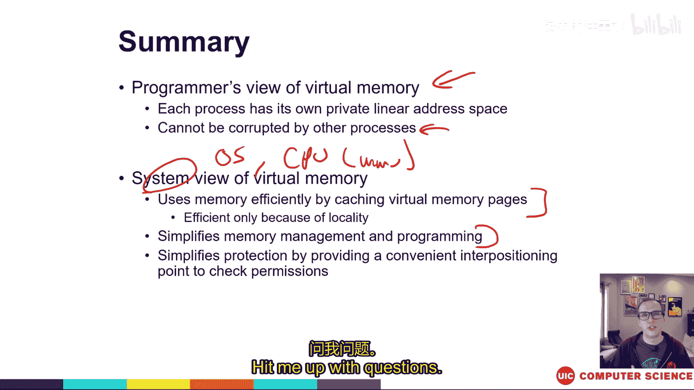