# 操作系统：12：多级页表 📚

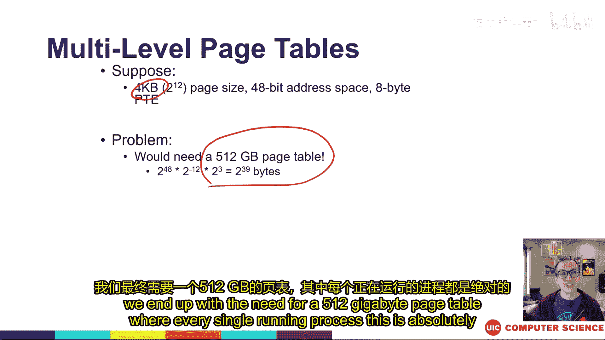

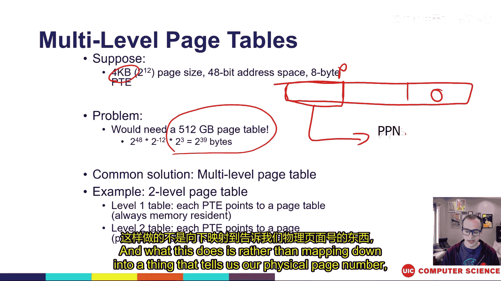

在本节课中，我们将学习多级页表。这是一种解决单级页表在大型地址空间中占用内存过多问题的关键技术。我们将了解其工作原理、优势以及在现代处理器中的实际应用。

## 概述

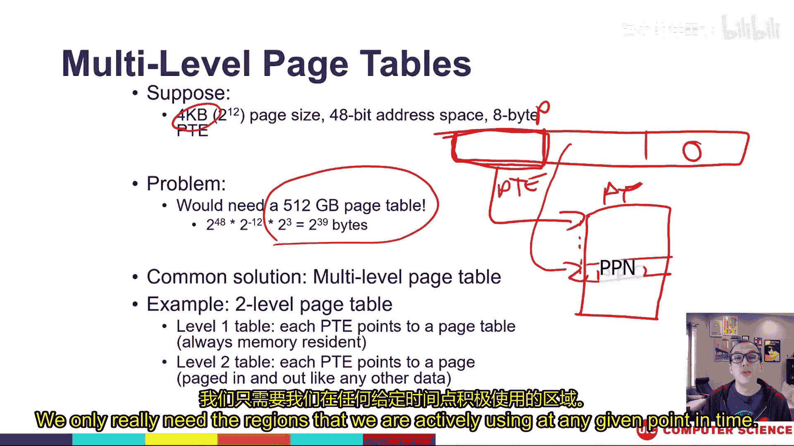

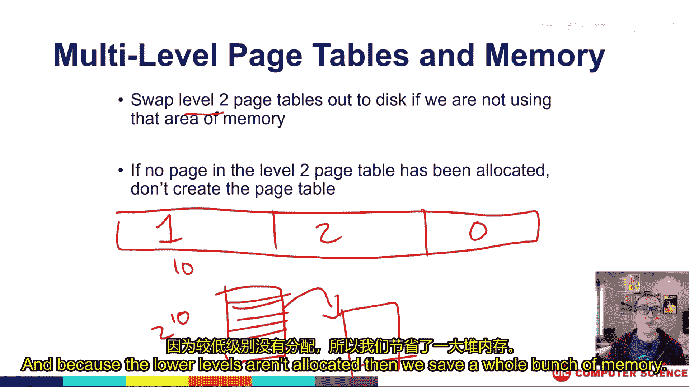

上一节我们介绍了单级页表在大型地址空间（如48位虚拟地址）下会变得极其庞大（例如512GB）的问题。本节中，我们来看看多级页表如何通过分层结构，只分配实际使用的内存区域对应的页表项，从而高效地解决这个问题。

## 多级页表的工作原理

多级页表的核心思想是将虚拟地址中的页号（VPN）部分进行分层解析，而不是用一个巨大的线性表来映射。

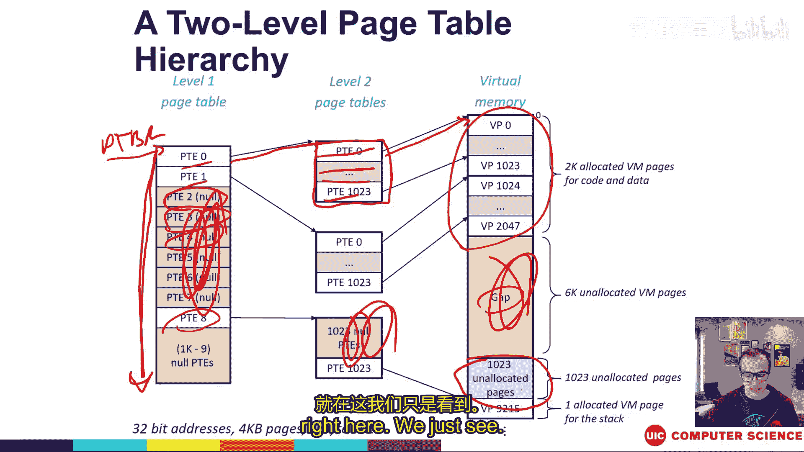

*   **单级页表映射**：`虚拟页号 (VPN) -> 物理页号 (PPN)`
*   **多级页表映射**：`VPN 第一部分 -> 二级页表基址` -> `VPN 第二部分 -> 物理页号 (PPN)`

在两级页表示例中，第一级页表项（PTE）不再直接指向物理页，而是指向一个第二级页表。然后，我们使用虚拟地址的另一部分作为索引，在第二级页表中查找，最终找到物理页号。

这种设计的最大优势在于，我们只需要为进程实际使用的内存区域分配第二级（及更下级）页表。如果某个大的地址范围（例如数十亿字节）完全没有被使用，那么对应的第一级页表项可以设置为空（NULL），从而完全不需要分配下级页表，节省了大量内存。

以下是多级页表查找过程的简化步骤：

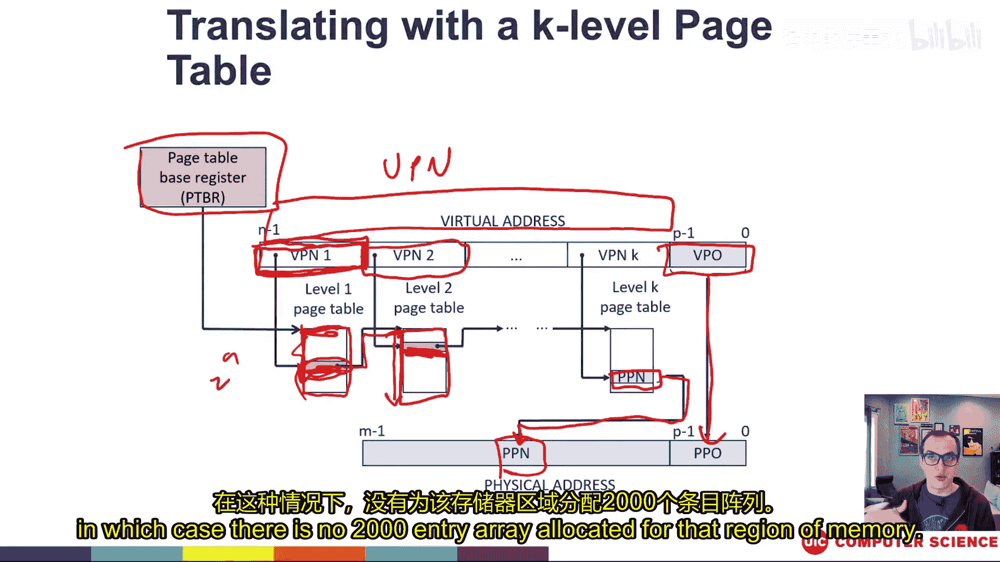

1.  **获取顶级页表基址**：从页表基址寄存器（PTBR）中获取第一级（顶级）页表的物理地址。**这个顶级页表必须常驻在物理内存中**。
2.  **索引第一级页表**：使用虚拟地址的最高几位作为索引，在第一级页表中找到一个页表项（PTE）。
3.  **检查并进入下一级**：
    *   如果该PTE有效，它包含的是**下一级页表的物理基址**。
    *   如果该PTE为空（NULL），则表示这个虚拟地址区域尚未分配，触发页错误（Page Fault）。
4.  **重复索引过程**：使用虚拟地址的下一组位作为索引，在刚找到的下一级页表中进行查找。此过程可能重复多次（现代系统通常有4-5级）。
5.  **获取物理页号**：在最后一级页表中，找到的PTE包含的不再是页表地址，而是最终的**物理页号（PPN）**。
6.  **组合物理地址**：将物理页号（PPN）与虚拟地址中的**页内偏移量（Offset）** 组合，得到完整的物理地址。偏移量在翻译过程中保持不变。

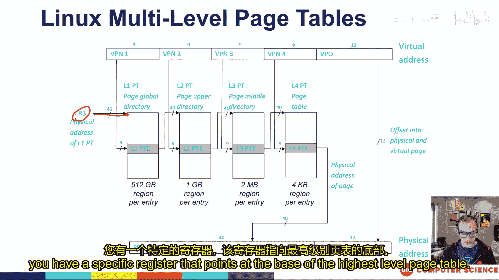

## 现代系统中的实例

以现代64位Linux系统（使用48位虚拟地址）为例，其多级页表结构通常如下：

*   **虚拟地址划分**：48位地址被划分为 `4个9位的页表索引` 和 1个 `12位的页内偏移`。
    *   公式表示：`虚拟地址 = [L4索引 (9位)][L3索引 (9位)][L2索引 (9位)][L1索引 (9位)][偏移量 (12位)]`
*   **页表层级**：对应4级页表（PMD4, PUD, PMD, PTE）。每一级页表都是一个包含 `2^9 = 512` 个条目的数组。
*   **物理地址**：最终得到的物理页号（PPN）通常是40位，与12位的偏移量组合成52位的物理地址。

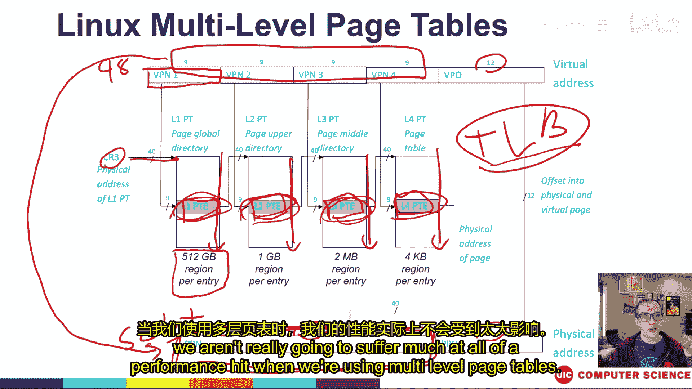

## 性能与TLB

多级页表听起来会导致多次内存访问（4-5次），从而拖慢速度。但实际上，我们依靠**转址旁路缓冲器（TLB）** 来解决这个问题。

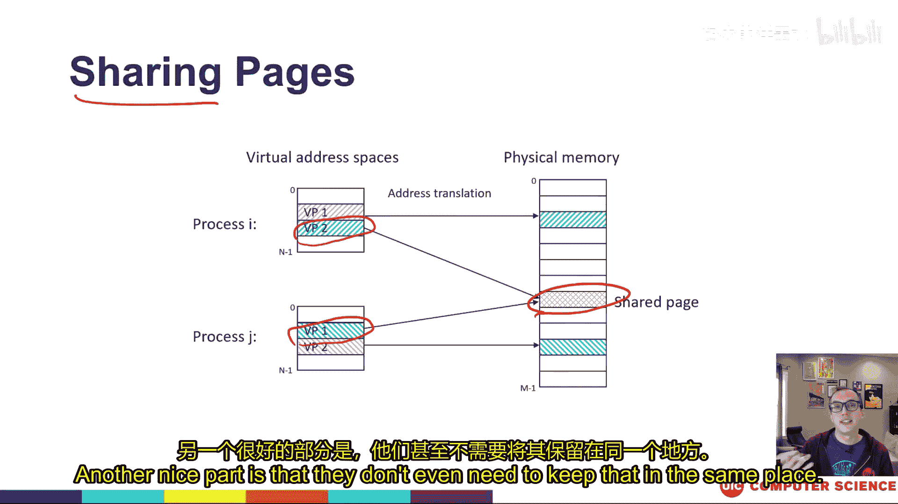

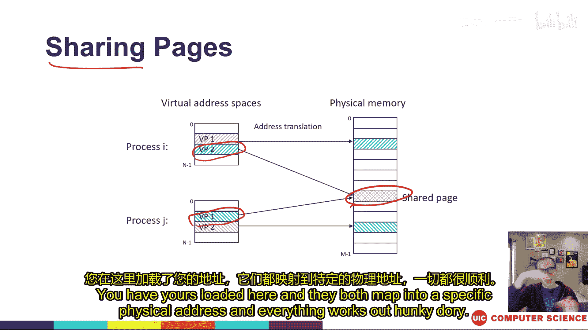

TLB是MMU中的一个高速缓存，存储最近使用过的虚拟页到物理页的映射。当CPU需要翻译一个虚拟地址时：
1.  首先查询TLB。
2.  如果命中（TLB Hit），则直接获得物理页号，过程仅需一个时钟周期，极其快速。
3.  如果未命中（TLB Miss），才需要执行完整的多级页表遍历。这次遍历的结果会被存入TLB，以备下次使用。

由于程序访问具有**局部性**（倾向于访问附近的内存），TLB的命中率通常很高，这使得多级页表在提供巨大地址空间和节省内存的同时，保持了高效的地址翻译速度。

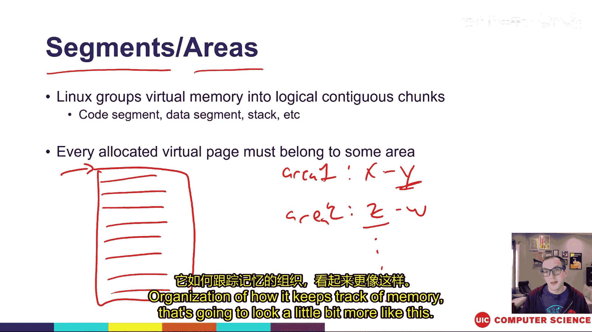

## 虚拟内存的其他优势

多级页表所依赖的虚拟内存机制，还带来了其他重要好处：

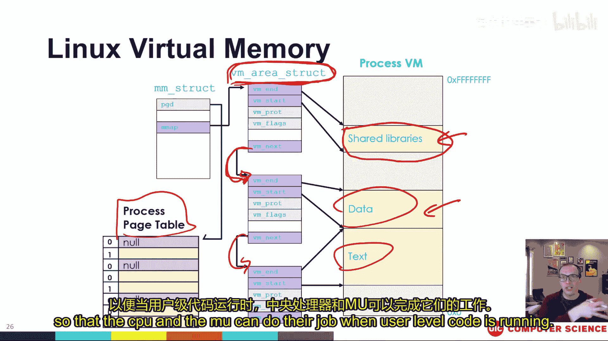

*   **内存共享**：不同的进程可以将各自的虚拟页映射到同一个物理页（例如，共享的C库`glibc`）。这样，物理内存中只需保存一份代码副本，所有进程共享，节省了大量内存。
*   **内存保护**：页表项中的权限位（读、写、执行）使得操作系统可以精细控制每个内存页的访问权限，防止进程越界访问或执行恶意代码。
*   **简化内存管理（操作系统视角）**：对于操作系统内核而言，管理一大块连续的“段”（Segment）或“区域”（Area，如代码段、数据段、堆栈、共享库区）比管理无数个独立的4KB页更为方便。Linux使用`vm_area_struct`结构体的链表来跟踪每个进程的虚拟内存区域。当发生页错误时，内核根据这个区域信息来决定如何分配和设置新的页表项，而不是直接操作庞大的页表数组。

## 总结

本节课中我们一起学习了多级页表。我们了解到，通过将单一大页表拆分为多层结构，系统可以只为实际使用的虚拟地址区域分配页表，从而极大地减少了内存开销。虽然理论上多层查找会增加延迟，但借助TLB缓存，地址翻译在绝大多数情况下都能快速完成。

我们还回顾了虚拟内存带来的关键优势：**内存共享**提高了物理内存利用率；**内存保护**增强了系统安全性；从操作系统内核角度看，基于**内存区域（段）** 的管理模型比纯页式管理更为简洁高效。

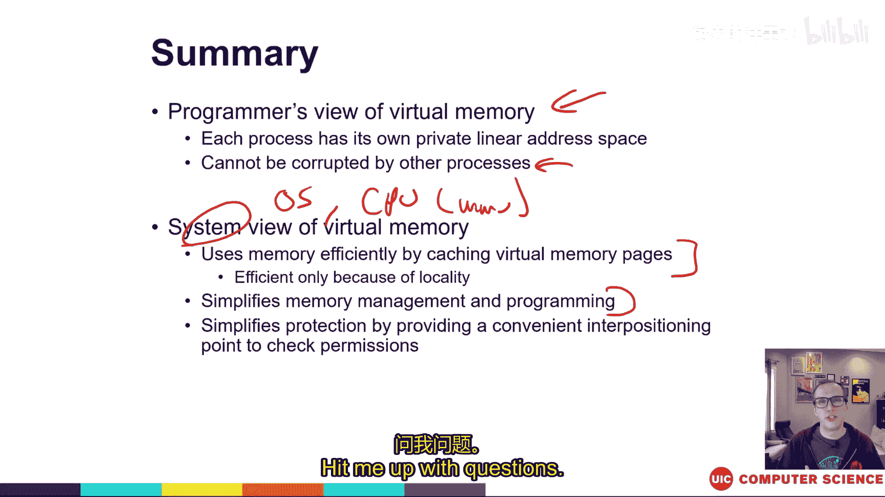

虚拟内存是现代操作系统的核心概念之一，它让每个进程都仿佛独占了整个地址空间，同时由硬件和操作系统在幕后高效、安全地管理着有限的物理资源。理解多级页表是掌握虚拟内存工作原理的重要一步。