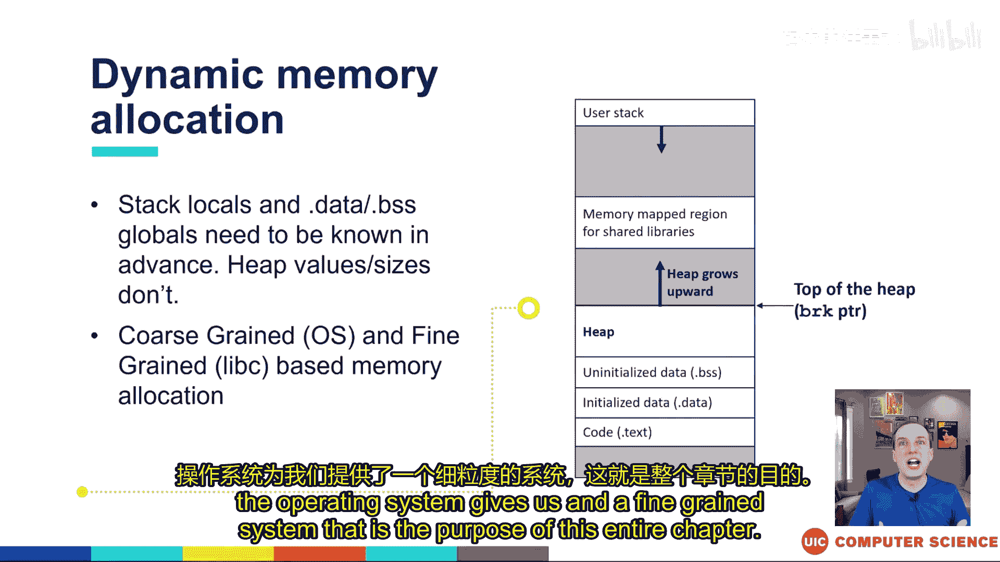
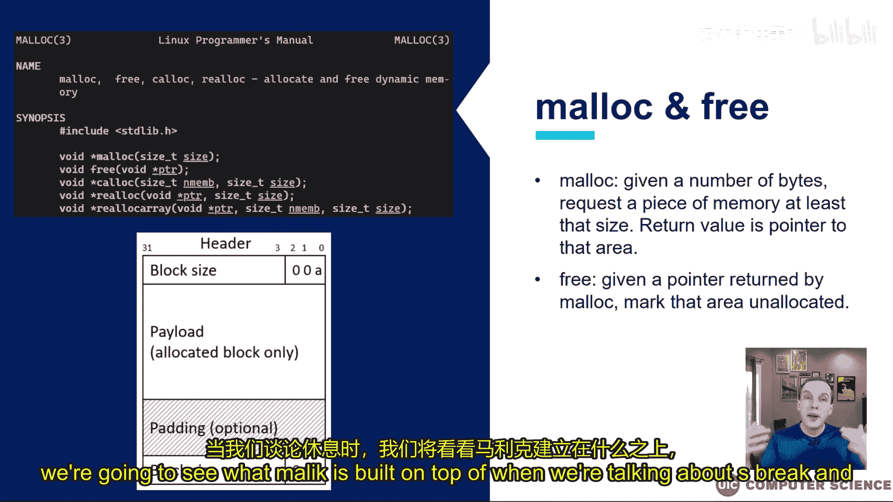
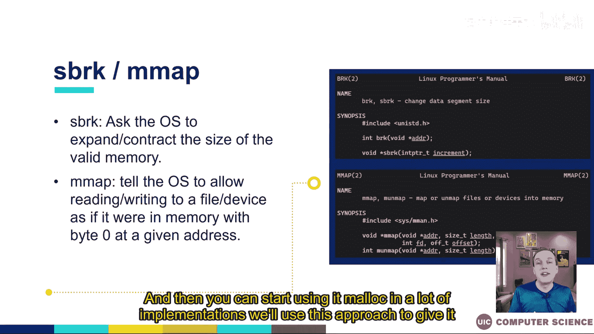
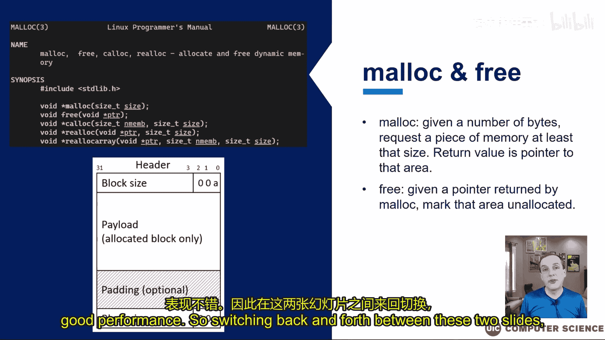

# 【全集】伊利诺伊大学 操作系统 中英字幕 1080P p13 Lecture 13 - 动态分配器 -BV1AEASzNE3z_p13-

Hi everybody I'm Chris Camdge， and this is CS361 Systems programming Let's get started today we're gonna to be talking about the motivations and concepts behind building a dynamic memory allocation system。

 There are a lot of knobs and levers that you can turn when you're designing a dynamic memory allocator and it really comes down to what are your engineering tradeoffs。

 what cases are you trying to make fast and it's a fantastic example of the design thinking that we've been trying to build over the course of this class so let's get started with talking about what our problem is and how we're going to approach it。

So dynamic memory allocation as we know， is necessary because the stack and the globals are defined at compile time。

 what stack variables you're using， what global data structures you're using are set in stone you can't dynamically change or grow what's in there based on the workload of your program so dynamic memory allocation is a way for us to say at runtime we need a certain amount of memory。

 and we didn't know what would be necessary beforehand and at a high level the two things that we have in terms of memory allocation is a very coar grain system that the operating system gives us and a fine grain system that is the purpose of this entire chapter So our fine grain system uses this API this is a very common API whenever we're using an explicit memory allocator where we're going to malic to ask for new things and we're going to free when we are done using that this is different from other languages like Java or ja or Python where the language runtime keeps track of which object。

You have access to， but C is different C allows you to operate on raw pointers。

 If you can point at a specific area of memory and it's a valid region of memory。

 then you can access it。 There's no ifs stands or buts about it。

 Therefore we need to be explicit about what we malic and when we free and it's really easy for us to shoot ourselves in the foot when we are using an explicit allocator。

 but it does give us full control over what's happening a little bit of nomenclature right here。

 when we talk about a block。 we're gonna to talk about both the payload kind of the thing that you get back from malek as well as any padding and metadata that surrounds that。

 So if we have a certain block and has a certain size。

 that's the entirety of this thing rather than simply the interior。

 the part that was asked for by the user So this is the fine grain application that we want to create and this API is one thing we can say Malic to get back the pointer。

 we free to get it back to the allocator to market as unallocated and it will just churn through all of the memory that has available。

To it to give us what we want， which is relatively straightforward。

 But how it accomplishes it is a little bit more complicated Before we go into that。

 we're gonna see what Malik is built on top of when we're talking about S break and Mm and malic and free S break is a system call that does incur a certain amount of expense in terms of time when we're switching over to the kernel mode and then switching back from kernel mode So in general。

 we don't want to do that every single time we're doing a memory allocation。

 we don't want to invoke the operating system when a library that locally handles things at the few bytes 00 bytes200 bytes level could be much much more efficient by just giving out a little bit of memoryclaiming a little bit of memory without even having to switch between user mode and kernel mode So this horse grain fine grain component is not just something that makes our design more complicated it's pretty necessary both from a space standpoint because we only get the granularity of pages the operating system only think in terms of pages as well as that time standpoint because it's going be much。

😊。

Much faster to say， oh， you just gave me back 32 bys from this free block。

 you asked for 32 new bytes。 I'm gonna give you that same one back。

 no new memory gets allocated If that address range is still in the cache。

 it's still going be nice and fast everybody's happy traditionally Malck was built completely on top of the brake functionality。

 which would increase or decrease the size of the he。

 but modern allocators use both S break and mmap to get the best performance that possibly can So S brake allows us to say at a page level granularity。

 what should the boundary be between legal heap addresses and illegal heap addresses if the heap addresses are illegal the page table doesn't need to have entries for it。

 it just doesn't exist， it would cause a seg fault if you were to try to access it all that good stuff or is everything that's inbound if you access it it won't cause a seg fault in and of itself if you're accessing the wrong thing or if you try to free something that wasn't allocated yet or try to access something that has been freed and has been corrupted by the memory allocation。

You can very easily cause your program to work incorrectly。

 but there won't be any fundamental problem with accessing anything that's below that S break boundary endmap as we hinted at a little bit before when you're in the file portion of class is a way for us to map a file into the memory address at an arbitrary address or a specific address that we choose This allows us to have our own user levell control over what gets put where in memory。

 we can map an entire file into memory starting at a specific address but we can also say operating system。

 give me a whole bunch of memory I don't care where it is。

 I just want you to give me something that's mapped in as a bunch of zeros and then you can start using it Mal in a lot of implementations will use this approach to give it good performance。

 So switching back and forth between these two slides。

 we see that Malik and free or what we want to implement and S break and endmap or what we're going to implement it on top of we're gonna ask our operating system。

 Hey， give us chunks of memory maybe。😊。

Kbytes at a time， a megabyte at a time， several megabytes at a time。

 and then we're gonna dole it out to the user level program that is doing this。

 Malck is implemented as a library。 it uses the system calls underneath S break and Mm to get its job done and there's a huge amount that has to go on here in order to make it work well when first we have to define what is well mean first off。

 the most important part is that you need your allocator to be correct。

 if you allocate something it is given to that user they have a specific region of memory and until they say。

 oh hey， I'm definitely not using this anymore。 it should be valid and it shouldn't be touched by anybody else。

 remember my rule of thumb is that making something faster， get to array。

 but making something correct keeps you employed。 Second of all。

 we don't want this to take too much time。 we want it to be efficient in time and get these allocations done as fast as possible。

 get the freeze done as fast as possible so that we're not interrupting the user level program our definition of fast。

Can not only be know what's the minimum time or the average time but also trying to make sure that there aren't in really big plaits there's a lot of situations where're using an implicitly dynamically allocated language like Python or Java and there are these things called garbage collector pauses where those implicit allocators decide oh hey I really need to fix all of my memory because I left it really really messy I need to stop your running program from doing its instructions and come over here into this library and fix a whole bunch of stuff So where one free might usually take a few microseconds if one all of a sudden takes 20 milliseconds that's a huge difference and if you're in a specific situation where you need to have low latency responses maybe you're building a stock trading platform that level of jitter is the difference in the response times it possibly be dangerous So when we talk about something being correct that's super important but taking too much time it's a little bit more subtle do we want it's a little bit more subtle sometimes we'll talk about the average。

Amount of time， the expected amount of time。 Sometimes we'll talk about the jitter between the different response times and what you'll see a lot of the time in professional settings is a 95th percentile or 99th percentile or 99。

9th percentile slowest possible response So what that would be is if we said I'm going to take every single time I ever called malck or every single time I ever called free and I want to stack them from the fastest one to the slowest one and that's going to be a whole big long line Now if I go 90% through that line So the one that's 90th slowest out of 100 is going to be the 90th percentile response rate the 99th out of 100th is going to be the second most bad response time and that gives us this idea of the tail response time So in really bad case scenarios that might not happen often but are still going to be important we want to say even in the worst case scenario under this workload。

 we're only going take 2 microseconds to do a free or。

mal that's what's embodied when we talk about taking too much time， it very tricky， but it's super。

 super important when we diagnose and profile and optimize real world systems。Beyond that。

 we also don't want to take too much memory， right。

 We talked a little bit about this in the previous week' lectures。

 We're talking about internal fragmentation and external fragmentation。

 So if I have my memory address space， and I'm given a nice big chunk by the S break functionality It says。

 okay your old start of the heap is here， your new start of the he is here。

 and I give all this space to work with。 that's pretty awesome。 And what could happen is I say， okay。

 well， I'm gonna to take this first one， I'm going to give it to the user level program。

 then I've got a bunch of free space here， then I'm going to give this part to a user level program then I've got a whole bunch of free space here。

 et cetera， et cea， et cetera。 you can see that if you chop this up in weird ways。

 if the next request is asking for you know this much space this one isn't gonna to fit because it's too small。

 this one's not going fit because it's too small。 But if we could somehow combine these we would be able to。

😊，Serve this request， but we can't because we fragmented our memory。

 And once we've given those addresses to the user level program。

 we can't take them back once they have them， they're gonna to have them until they decide to give them back and then we can do a lot of fancy things but the main idea here is that if we're good about where we place things then we'll be able to use our memory more efficiently before we go back to the operating system and say。

 hey， I actually need more Ram， I need more pages for my user level process to actually run。

 So just to reiterate with a few of our funny g on the screen while we're doing it when we don't want to take too much time。

 what our job is going to be is when we free， we want to keep those organized it in a way that we get efficient pieces back。

 when we ask for something the amount， we want to get it back nice and quick。

 and we need to trade off this time with the space， as we'll see in just a moment。

 because something could be very， very time efficient。 like we just get things back really。

 really fast but we waste a whole bunch of space。😊，By just doing the dumbest possible。

 fast possible thing。 Likewise， when we're trying not to take too much memory。

 we also want to make sure we minimize that fragmentation because fragmentation is almost certainly going to happen。

 We don't know what the requests are that are going to come in。

 So we can't really predict what there we can say， okay in general。

 when people use memory allocators。 or when they use them for a specific situation。

 They usually use them in this way。 So I'm going optimize my design for that。

 We're not going to worry about that in class here。 but in real world memory allocators。

 There's a lot of， oh， the workloads that people almost always do look like this。

 So let's use this special case。 there's things like memory allocation。

 things like sorting algorithms in real systems are very often not just quick sort or just merge sort or whatever it is it's going to happen。

 They're going to say in the real world， things aren't just asymptotic time。

 They're going to have a lot of special cases。😊，Again， we're not going see too much of that in here。

 But if you do want to digging to say how good New Malik works。

 that's a fantastic idea for seeing how these real systems are built。

 So the next few videos that we're going to be going over are first going to see how to make an allocator。

 Now that we've said， here's what the challenge is。 We're going have the space time trade off。

 We're going to design a system on top of。😊，S break and Mmap。

 really just Sbreak for our purposes in class。 and it's going to look like malikinfr。

 That's all we have to do。 It's relatively straightforward。

 but there's a lot of different choices that we're going to make there。

 So the first thing that we're going to look at is in the abstract。

 how are we going to design one of these explicit memory allocators when we're given the memory by the operating system。

 How are we going to arrange it so that we' both space and time efficient Now that we know we need to use S break to grow and shrink our heap we're going to use that functionality and our ability to set our own bytes and bits。

 however we want to create the malikinfr functionality that user level code in C uses。😊。

There's a lot of moving pieces there and we're going to see what those moving pieces are and how we can optimize space。

 how we can optimize time， where we can make those decisions to make things work both correctly。

 super， super important， but also efficient in time and space。

Then we're also going to look a little bit more closely at how the homework4 allocator works。

 We'll go over a few demos of just messing around in the code and finally from last week's 12，30 PMm。

😊，Discussion section， I actually did a really extensive。

Explanation of how the garbage collector works， so between that and the Monday lab from this week。

 you'll probably be able to get a really good idea of what's necessary for that assignment so I would definitely say besides these two if you're starting the homework definitely go back and watch that I cut it down to I think about 40 minutes of talking about these things and you can skip around but the important parts are definitely in there of what it is you're trying to accomplish。

Thanks so much for watching and I'll see you next time。

