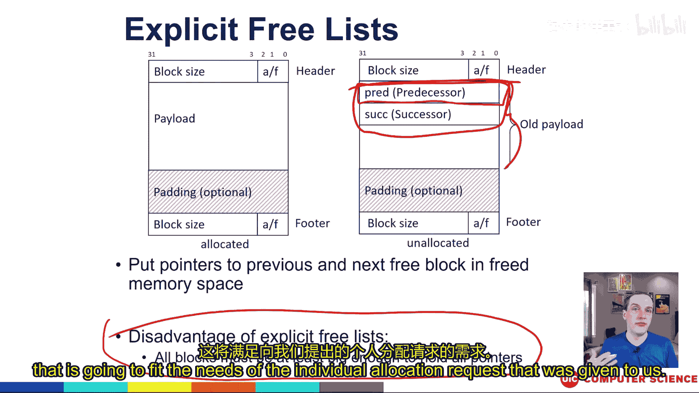

# 【全集】伊利诺伊大学 操作系统 中英字幕 1080P p14 Lecture 14 - 分配器设计 -BV1AEASzNE3z_p14-

Hi， I'm Chris Camdge， and this is CS 361 System programming。 Today。

 we're going to be talking about the design and implementation of dynamic memory allocators。😊。

So in the last video we talked about the tradeoffs between time efficiency and space efficiency and what it is we're trying to build on top of the operating system functionality to give dynamic memory allocation to the user level of code what we're going to go over in this lecture is all of these different moving pieces that we're actually going need to implement to give a design of a memory allocator so say we get a whole big chunk of memory。

 say4 kiloby a kilobytes1 mebyte2 mebytes from the operating system。

 we're going to hand it out in anything from one byte which is actually one byte all the way up to that whole entire one2 megabytes of space we want to do that efficiently we don't need to bug the operating system about it every single time and we want to make it correct above all So the things we're going to think about here are how are we going to keep track of these free blocks。

 how are we going to keep track of the available blocks and the allocated blocks where we're going to store that information how are we going to access that information efficiently how are we going to make freeze fast。

 how are we going make。😊，Allocs fast， how are we going to use the space as efficiently as we can。

 even though we don't know what the request stream is going to look like。

 whether somebody's going to ask for one and then one and one and then one。

 then 100 then one and then one and then a 200 162， whatever it is， no matter what they ask for。

 we want our application to be relatively efficient and how it uses memory and how it uses time。

So how we're gonna do this。 The first step is creating a header on the block。 when we call Malic。

 we return a pointer to the beginning of the payload right here， but in actuality。

 there are four bys above that。 So the four previous bytes are going to have special information in them in a header。

 And as we're going to see a little bit later on for efficiency's sake。

 that same information is duplicated in the four bytes at the very bottom of that block that is allocated and again。

 the really， really important thing here is that the block that has a specific size that is going to be delineated as everything including the payload。

 the padding in order to get up to an even multiple of8。

 So we're going to see a little bit later on and the block header in the block footer。

 every time we allocate something， we're going to store this extra information in the header in the footer。

 and that's going to give us an idea of what we need to do to keep track of what's going on here。

 So you could imagine that if you were doing your pointer arithmetic wrong after you've mal something。

😊，And you overshot or you undershot where you were supposed to be writing something。

 you can very easily clash your program by accidentally overr the block size。

 accidentally overr the allocated bit all that type of thing。

 The next design primitive that we have access to here is the idea of an implicit free list this is going to be super important because this allows us to take the entire chunk that we get from the operating system that's an even multiple of four kilobytes and we're going to split it up into these individual pieces。

 This is one of the first places where we're going to see our efficiency argument come into play what we want to do here is efficiently store information about what blocks are stored without having have an extra data structure rather than keeping an additional hash table or something else along those lines we're just going keep the information about which chunks are in use in the chunks themselves and because we're going to be storing the size of the chunk。

And we're keeping everything contiguous， we can actually hop through this list to find each individual chunk within the entire heap。

So in this example， as we saw in the previous one， we have a block size in each of these headers that we know exactly how long how far it is from here to here is this big if we put these things end to end all in a nice list as if they're all contiguous within that chunk of pages at the operatinging system gave us what we end up with is saying。

 okay， well this one is8 bys long， if we go8 bytes forward from the beginning of this。

 we're going to start at the next chunk and that's going to be another chunk header so we know if we started a chunk header we interpret it size。

 we hop forward by that many bytes we're going to be at another chunk header and we can keep doing this and doing this and doing this until we get to a special block that says hey。

 my size is zero and we allocate that at the very beginning saying this is the header of the end so this is the epilogue block that says we are done。

 this is the end of the heap。 one other important property of the blocks that we are received。😊。

From Malic is that they're always going to have an even multiple eight bytes within the entire block。

 So if the block size is always evenly divisible by 8。

 So if something is evenly divisible by 8 that means that the lowest three bits are going to be set to0。

 no matter what this comes in really important because if the block size is going to be divisible by 8。

 then we know that we can always mask those off if we're going to know how big a block is。

 we just mask these three bits as0 and then compute the block size as this number and boom we're done no big deal。

 the next thing that we can do with this interpretation is that we've got three bits to use for whatever we want to。

 So in this basic allocator case， we're going to use the lowest order bit of that block header to indicate whether something is allocated or free。

 And so you can see in this implicit free list that we're going to keep track of each of these blocks contiguously from one block to one block to one block to one block each of these blocks as。

😊，Blockheader。 that block header is going to have a zero in the least significant bit if it's free。

 It's gonna have a one in the least significant bit。 if it's allocated。

 and after we mask off each of those three least significant bits。

 we can take the size and then we're going to add the size to the block pointer and that brings us to another block header pointer that points at another header。

 we can interpret that number right there， mask off of three lower bits interpret it as an integer at it to the pointer that brings us to the next header As you can see if you keep your size in your header you have implicitly created a linked list of the pieces of memory in your heap if you always keep track of these chunks with their size in them。

 that is what you get。 And if we want to keep track of the free blocks。

 which is going to be useful for lots of different situations we will be able to just iterate from the very beginning all the way through to the very end。

 we could say oh， this one is free and this one is free and that's what we。😊。

Have to work with if somebody asks for 32， we can just give them 32 if somebody asks for 24。

 we can split this up and give them the 24 and then keep the other eight for our own purposes。

This gets a little bit more complicated when we see the way that our allocateocator works in class where we're actually going to use an implicit free list that goes backwards and forward。

 So what we end up with is a header and as I saw in the previous slide of footer that duplicates that header value and this allows us to say if I've popped through this list to here Well。

 if it was a singlely linked list， remember we can only go forward。

 we can't go backwards but if we know that if right here is a header that means that four bys earlier is a footer and we can iterate backwards through the list that way。

 this is going to come in handy when we're trying to efficiently keep track of the blocks that we have unallocated in our system now you could imagine if you have a system like this you're going to ask for a certain amount of memory from the operating system。

 you're going to give some chunk to the user and then you're going to have the remainder that is unout that presumably if they didn't ask for an even multiple of 4 kilobytes。

Going to have a little bit of extra information that you can use for other calls to mall when we get this brand clean memory。

 Yeah， it sounds pretty obvious that we would say， okay。

 the very first thing we're just gonna take it。 we're gonna make it a certain size。

 We're gonna split it up and have the other thing be free。

 And we've implicitly already said we're going to have a decision about how we're going to create new chunks of memory。

 We're just going find the very first place that actually has a enough space of unallocated memory and give it to the user。

 chop it up into two pieces give the one part to the user， keeps the rest as free。 That makes sense。

 but that's not the only way that we can do it。😊，If we look at how we're going to decide。

Wch block goes where we're very quickly going to end up with our space constraint where we're trying to optimize on which space we're using and say。

 well， finding the very first location isn't necessarily always going to be the best thing because we're going to very quickly end up with kind of like a plot marked memory allocator where if users are allocating things and then freeing things and allocating things and then freeing things。

 we just put it in the very first spot that we find we're going to end up with increasingly smaller and smaller free allocations to the point where things are going to look like oh here's a small thing here's a small thing here's a small thing here's a small thing and if we just always find the first one that fits wes like oh there's gonna to be 8 bytes left over who cares whatever but if nobody ever needs an eight byte allocation then we've wasted those 8 bytes and if you waste enough of those little 8 byte chunks you might end up with a 24 byte allocation and say。

 oh I've got thousands of bytes but none of。They are 24 by themselves。 We got 8 here，16 here，8 here。

8 here，8 here。 If somebody asks you for 24 bys。 You need to give them 24 bys in a row。

 you can't give them a little bit from over here a little bit from over there。

 That's just not the way that it works at this user level memory allocation。

 You're guaranteed to get contiguous memory。 And if we use first fit。

 We're very quickly going to run out of contiguous memory。

 The opposite to first fit is best fit where we say， listen。

 rather than being very time efficient and just finding the first thing。

 chopping it up and giving it back to the user boom boom ready go done。

 We're gonna be space efficient and say listen， The worst thing that we can possibly do is take really。

 really big pieces of memory。 put it into small， tiny little chunks。

 It'd be much better if we say somebody asks for 24。

 I'm going find the smallest possible region that still has at least 24 allocable bytes。

 And I'm gonna use that one。 that's going to preserve our big chunks for when we actually need to use those big chunks。

 So best fit。😊，of gives us a very low run time， so it's going to be very inefficient in time。

 especially if we're going through a linked list， right？

But it is going to be very efficient in space because you're going to say， you know what。

 I don't know when allocations are going to come in， how big they're going to be any of that stuff。

 but I do know on a case by case basis。 I am always wasting the smallest amount of memory at any given point in time。

 And so without any sort of crazy predictive analytics。

 I'm probably using the most efficient allocator I possibly can't。

 The next optimization that's covered in the book is this thing called next fit。

 And while it's not super important because it actually ends up not being super efficient。

 It is interesting to think about its design and the intention behind that design。

 So we start thinking about the first fit allocator。 And we say this is supposed to be fast。

 But what happens in actuality。 In actuality first fit always starts looking for a free space from the very beginning of the memory。

 And it finds the very first one it finds。 And it says， yes。

 this is what I'm going to put this thing。 So you can imagine that if you had a really big array of memory and。

😊，This memory is totally yours for your process it can do whatever it wants with it and it keeps saying okay well I'm gonna to start at the very。

 very beginning and say， oh are there 24 bytes here or are there 24 bytes here or are there 24 bytes here。

 it's gonna to find them， it's gonna to use them And you could imagine that over time if there's allocations of deallocs there's all this free memory down here。

 but the allocator keeps saying oh， I'm going check the first one， the second one， the third one。

 the fourth one， the fifth one， the sixth one etc ce。 And even if you did something very very simple。

 maybe not the most optimized thing in the world， but you just mal 5000 different things and you did first fit。

 you're going to be iterating over a bunch of allocated blocks over and over and over again。

 before you find the free one and then you're good to go。

So next fit is an optimization of this process that's designed to say I looked at how first fit works and it sounds in theory like it's a good idea。

 but in actuality it is very time inefficient because of this the optimization we're going to use here is between different allocations we're going to keep track of where we did our last allocation。

 and the next time we get another request for an allocation。

 we're going to start our iteration from that chunk header rather than the very first chunk header in the entire system。

This will give us a faster allocator， but in actuality。

 it's going to end up creating an even more Swiss cheese looking memory layout。

 And so it's not actually in use in in the real world。

 What I want you to take away from this is that sometimes when we design something based on first principles。

 it's not always going to be as simple as it seems。

 We're going to have to go back through and look at how things actually work in reality。

 and design optimizations or fixes on top of that。 Remember， all of these allocators are correct。

 Remember， our first most important job is to make the allocator work the way it's supposed to。😊。

All three of these algorithms will give you memory， Will they give you memory fast。

 Will they give you memory efficiently， I don't know。

 but the important part to realize here is that there are these different tradeoffs in time and in space and in out of the program actually works。

 they're going to go into designing the right way to do this allocation the next thing that I want to go over is coalescing。

 So when we were talking about our whole entire heat before。

 we were talking about this problem where we take our chunks。

 we split them into and we end up with a lot of smaller pieces。

 So the bad situation that we saw earlier was that oh。

 if this one and this one and this one and this one and this one and this one and this one are allocated and somebody comes in and ask for this much memory we've got we have this much free but we wouldn't be able to make a single allocation of that size that's bad right but what's even worse if we took a completely naive implementation where we split things。

😊，Apart when we need a new allocation and we free them and when we free them。

 we just mark them as free， what we would end up with is a whole bunch of three pieces。

So if all of these were individual free pieces。But they're individually small sized chunks。

 and somebody comes in and asks for this much。 They're not going to be able to get it。

 even though we have more than not much time， space。 How did this after into a G。

Even though we have more than enough space to allocate that piece of memory that's really。

 really bad。 So what we want to do is say okay， when there are two freed pieces next to each other。

 we want to turn them into one freed piece。And that makes it bigger。

 and a bigger piece is always better for keeping track of our memory。

 We can always split things in half easily， but it's much。

 much harder to put them back together because you can only put them back together when they are both free at the same time。

 So again， this is one of those places where kind of the naive way to approach it might not be the most efficient one。

 but I'll tell you the way that I just see when when I'm not thinking super。

 super deeply about these things。 I just like， you know what， first possible solution here。

 It looks like every once in a while， I should go through my entire heap。 And I should just say。

 are these two free together okay coalescent are these two free together， Okay， coalescent。

 are these two free together， okay coalescent and that's gonna take order in for and is the number of chunks that we have。

 and we do that every once in a while。 And so sounds like okay。

 that's a good idea that'll certainly get the job done but it sounds like it's gonna take a very variable amount of time。

 I would rather do a small， constant amount of work。 every single time there's a free rather than do。

😊，A lot of work every once in a long while， because then I'll have a much more predictable delay and predictable delays。

 especially when overall the average is low are kind of the best way that we can design these systems。

So we're getting it。So what we're going to see is that coalescing in the abstract is just taking to free blocks and turning them into one thing。

 so if I were to free this piece。And then I said， okay。This piece。Is free。

 and the peace after it is also free。 Then I now have one big free piece。Likewise。

 if I free something。And there's nothing。Free above it and nothing free below it。

 I it just becomes free。And。If I free something and there's something free above it and there's something free below it。

 then I have the entire chunk altogether。 I add the one above it。 I add the one below it。 I'm done。

 Now， the really important thing about this， that I would just like when it first realized it is that those are the only three situations you can have。

 Yeah， this first one， maybe it's the maybe the one below it is free， maybe the one above it is free。

 But these three situations are the only ones that could possibly ever happen。

 If I do my coalescing after every single free。 And this is a small， constant amount of time。

 Every single time we're gonna check a few bits above。

 check a few bits below and do a few different manipulations of a few different headers very。

 very fast。😊，But the most amazing part is that there's never going to be some weird situation where this one was free and this one was free。

 and we got to kind of coalesce all of these things。 And there's some sort of cascading situation。

 because if we do it every single time we're guaranteed that every single thing that gets freed is going to have a free chunk above it。

 and then an allocated above that。 a free chunk below it。

 then an allocated one below that or allocated below or and free above or allocated above and allocated below。

 in which case we just free it。 So we only have these three situations。

 we only are going to coalesce to one above one below and the same idea。😊。

Not do any coalescing or coalesce with the one above and the one below。

 We never have to do any more than that。 If we do it every single time。

 If we didn't do it every single time。 if we only did it once every 10 time， then yeah。

 we might end up in a bad situation where we've got a coalesce above and then above that one and then above that one。

 But if we amortize that time by doing it every single time。

 we're going to end up with less overall effort and much。

 much lower overall variance in our response time。 So the last optimization that I'm going to talk about here in how we're going to design a memory allocator is the use of an explicit free list。

 So as we saw earlier on， if we had our whole big long list of allocations and we。😊，Said， okay。

 this whole entire allocation。 You know， this one is allocated。 This one's allocated。

 This one's allocated。 This one's allocated。 This one's allocated。 This one's allocated then。

We would have to iterate through this one to this one to this one to this one to this one to find。

 say that block。 And so iterating over allocated blocks isn't super， super useful。

 if we're trying to find something that's free going over this and this and this and this isn't useful right like yes。

 we're using that implicit free list to hop from header to header to header and when we have allocated the space in that individual block to the user。

 we can't touch it right but if it gets freed to us then we're free to optimize this a little bit more rather than hop hop hop。

 hop hop， let's say this this one here is free and we want to find this one This is the best fit and we're trying to do best fit。

😊，In a implicit free list， we'd have to go 1，2，3，4 or 5，6，7，8 hops。

 But because we have these free chunks here， we can say， okay。

 I'm going to put a PTR to the next free chunk。 and I'm going to put a PTR to the previous free chunk area where there used to be user level data because it's been freed。

 we， as the library can do whatever the heck we want with it。 So that's pretty useful。😊。

So we can take this PTR next and that goes all the way here to the next free block and in that free block。

 we can keep another PTR next and then PTR preve and that will take us all the way to the next free block and in that way。

 the amount of time it takes for us to iterate through the free list is going to be proportional to the number of free blocks rather than the number of allocated blocks and free block。

 which would be much， much lower， especially after a program has been in use for a while and has lots and lots of information stored in it especially in lots of different little Ity Bity Mal chunks。

So this is a little visualization of what we had。 this is an old payload。

 so we know that we have at least enough space for one of those predecessor pointers。

 one of those successor pointers to go back and forth within this thing and another fantastic part about this is that if we have enough space here for these pointers。

 nothing says we have to make just a garden variety linked list we could turn this into a heap or a binary tree or anything like that to make this allocation much。

 much more efficient。So there's a little bit of disadvantage here that you have to have those blocks beside size large enough to keep those pointers again。

 that's going to be a space efficiency issue， but we're going to get this huge time efficiency benefit by being able to very quickly find a free block that is going to fit the needs of the individual allocation request that was given to us That's all I've got for you in this video Thanks so much for watching and I'll see you next time。

