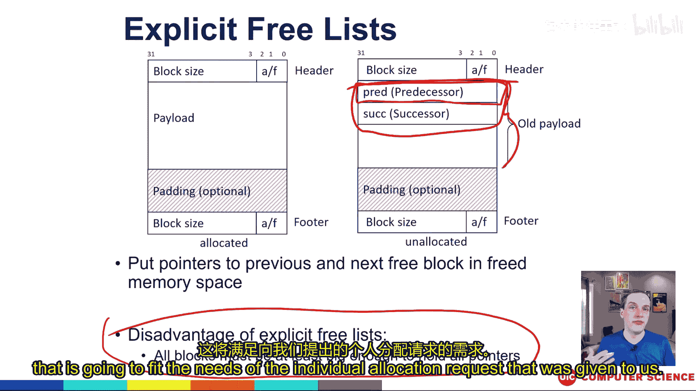

# 操作系统：14：分配器设计 🧠

在本节课中，我们将学习动态内存分配器的设计与实现。我们将探讨如何高效地管理从操作系统获取的大块内存，将其分割并分配给用户程序，同时确保正确性、时间效率和空间效率。

上一节我们介绍了分配器在时间和空间效率上的权衡。本节中，我们来看看实现一个内存分配器所需的各种核心组件。

## 块头与块尾 📦

当调用 `malloc` 时，我们返回一个指向有效载荷（payload）起始位置的指针。实际上，在这个指针之前的四个字节存储着特殊信息，称为**块头**。为了效率，在块的末尾也会复制这四个字节的信息，称为**块尾**。

一个块的总大小包括有效载荷、为对齐到8字节所需的填充（padding）、块头和块尾。每次分配时，我们都会在块头和块尾存储这些额外信息，以便追踪内存状态。

**核心概念**：块大小总是8字节的整数倍。这意味着块大小的最低三位总是0。我们可以利用这三位来存储其他信息，例如用最低有效位表示块是否已分配。

```c
// 假设 header 是一个指向块头（整数）的指针
size_t block_size = *header & ~0x7; // 屏蔽低三位得到块大小
int is_allocated = *header & 0x1;   // 检查最低位判断是否已分配
```

## 隐式空闲列表 🔗

为了高效地追踪内存块而不使用额外的数据结构，我们使用**隐式空闲列表**。我们将从操作系统获得的大块内存（例如4KB的倍数）分割成连续的块。每个块的头部都存储了其大小。

通过将块大小加到当前块头的指针上，我们可以找到下一个块的头部。这样，我们就在堆中隐式地创建了一个链表。

*   **块头**：存储块大小和分配状态。
*   **遍历**：从堆起始位置开始，读取块头大小，指针向前移动该大小，到达下一个块头。
*   **结束标记**：在堆的末尾设置一个特殊的**尾声块**，其大小标记为0，表示堆的结束。

这种设计允许我们在不维护独立列表的情况下遍历堆中的所有块。

## 分配策略：首次适应、最佳适应与下次适应 🎯

当收到分配请求时，我们需要决定使用哪个空闲块。以下是几种常见策略：

以下是主要的分配策略比较：

*   **首次适应**：从堆起始处开始扫描，选择**第一个**足够大的空闲块。优点是速度快，但可能导致堆前部产生大量小碎片（外部碎片）。
*   **最佳适应**：扫描整个空闲列表，选择**大小最接近**请求的空闲块。这能最大程度减少浪费的空间，但扫描整个列表的时间开销较大。
*   **下次适应**：从上一次分配结束的位置开始扫描。旨在避免首次适应总是从堆头开始扫描的开销。虽然可能更快，但往往会导致更严重的碎片化，因此实际应用不广。

这些策略体现了在分配速度（时间效率）和内存利用率（空间效率）之间的经典权衡。

## 合并：对抗碎片化 🧩

频繁的分配和释放会导致堆中出现许多小的空闲块，即使总空闲空间足够，也可能无法满足较大的分配请求（外部碎片）。**合并**是解决此问题的关键技术。

当我们释放一个块时，我们检查其物理上相邻的前后块是否也是空闲的。如果是，则将它们合并成一个更大的空闲块。

合并操作仅在释放时进行，并且只需检查紧邻的块。这保证了每次合并只需常数时间，避免了复杂的级联合并。

合并只有三种可能情况：
1.  仅释放当前块（前后块都已分配）。
2.  与前面的空闲块合并。
3.  与后面的空闲块合并。
4.  同时与前后空闲块合并。

通过在每次释放时立即合并，我们可以保持堆中空闲块的大尺寸，为后续的大分配请求做好准备。

## 显式空闲列表 ⚡

隐式空闲列表的缺点是，为了寻找空闲块，我们必须遍历所有块（包括已分配的）。为了优化，我们可以维护一个**显式空闲列表**，其中只链接空闲块。

在空闲块的有效载荷区域（因为已释放，可供分配器使用），我们存储指向前一个和后一个空闲块的指针。这样，寻找空闲块的时间就只与空闲块的数量成正比，而不是堆中块的总数，从而大大提升了分配速度。

**核心概念**：显式空闲列表将搜索操作从 O(所有块) 优化到 O(空闲块)。

```c
// 显式空闲列表中的节点结构（存储在空闲块内）
struct free_block_node {
    size_t size; // 块大小与状态
    struct free_block_node* next; // 下一个空闲块
    struct free_block_node* prev; // 上一个空闲块
};
```

此外，由于我们完全控制空闲块的组织方式，我们还可以将其实现为更高效的数据结构，如平衡树或分离空闲列表，以进一步优化特定场景下的性能。

---




本节课中我们一起学习了动态内存分配器的核心设计思想。我们了解了如何通过**块头/块尾**来组织内存，利用**隐式空闲列表**来遍历堆。我们探讨了**首次适应、最佳适应**等分配策略在时间与空间上的权衡，学习了通过**合并**来减少内存碎片，以及通过**显式空闲列表**来加速空闲块的查找。这些组件共同构成了一个正确、高效内存分配器的基础。