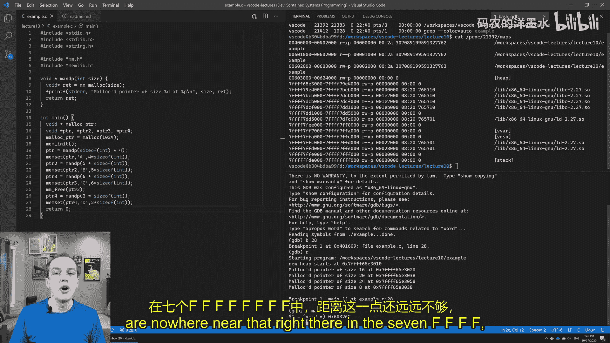
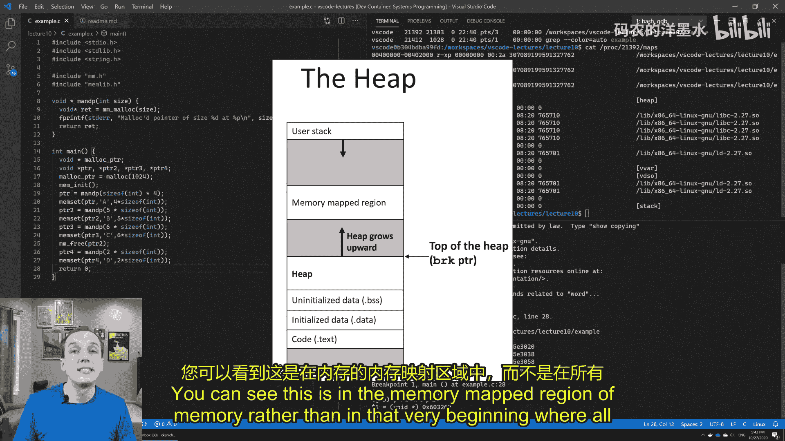
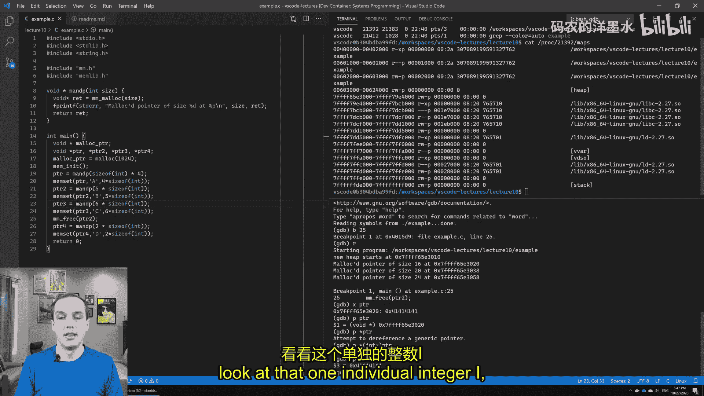
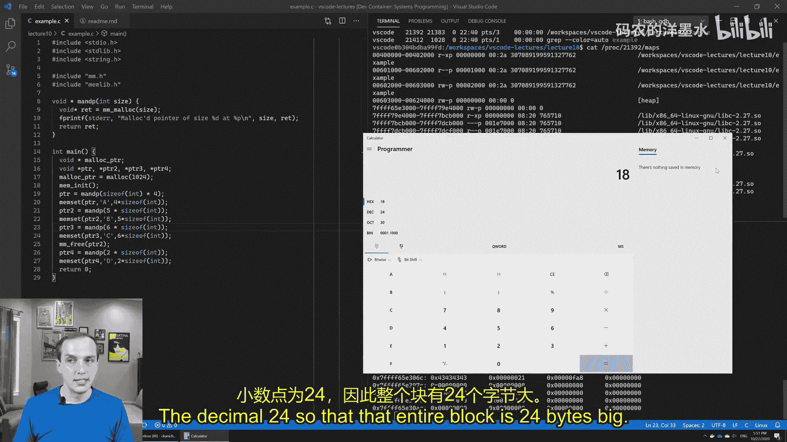
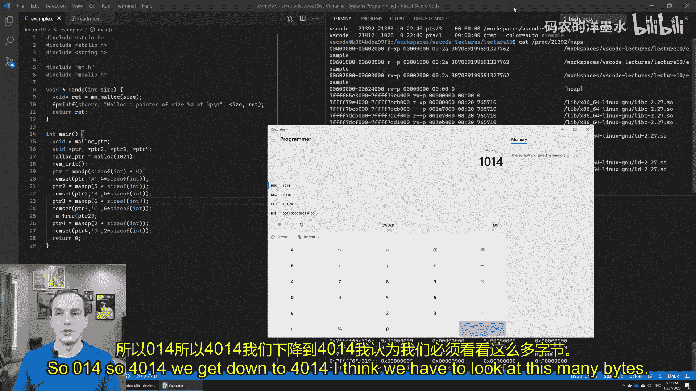
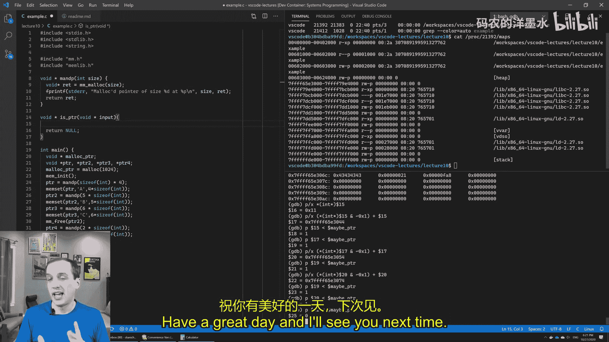

# 【全集】伊利诺伊大学 操作系统 中英字幕 1080P p15 Lecture 15 - malloc实现 -BV1AEASzNE3z_p15-

Hi， I'm Chris Kendge and this is the CS 361 systems programming Today we're going to do a little bit of a live demo of how dynamic memory allocation works and how we can get started on homework there。

So what I have here is a very basic program that uses the same memory allocator that we're gonna to be using in homework4。

 but rather than doing it within the testing harness of main dot C here it's simply a piece of code that is going to use it so what we see here on line 18 we're initializing that Malic allocator and then we're going to be using it I wrote some helper functions here where I'm going to Malic and print something and this is one of the first kind of tips that I would give you when you're writing a program where the output like what gets printed into the screen isn't the primary task that that you have to deal with what you're dealing with here is a bunch of bits that are stored in locations in memory and in order for you to know whether it's correct or not you have to come up with some tests of your own you have to print things to the screen that show you that your understanding of what's going on matches with what the bytes are in the memory。

This is where things get a lot harder than they are in earlier CS classes。

 but a lot of the times when you're dealing with pieces of information like this。

 it's not going to be straightforward how you can figure out whether something is correct or not。

 you're going have to start testing it on your own rather than just running it and seeing it compile piles or doesnt crash or any of those good things。

So first thing here， we got that M and P function and what I'm going to。

So another thing that I want to talk about the differences here and this has a lot to do with what we've been going over in chapter 9 as well as how this specific allocator works MalC。

 the version that comes from GlibB C is a lot more complicated than the version that we learn about in chapter 9 it mals things into different places and uses Mmap that uses separate heaps。

 all of this stuff so that it can support higher performance programming so that it can support multiple threads things can see in the next chapter。

 all sorts of stuff that we wouldn't normally be seeing in our。😊。

Normal just basics of understanding how a dynamic memory allocator works。

 So the first thing that I'm going to do is compile this code。

And GDPB it so that I can see what's going on while that process was running because we're gonna to have to look at the internals of the memory to get a better idea of what's going on。

 So let's GDPR example and I'm going to place a break point right on the last line of the entire file right there in line 28 and I'm going to run the nice thing about this is that everything that has happened here that's happened the memory has been manipulated the way that this program works。

😊，But the process hasn't exited yet。 so we can come up here。

 We can look at all of our processes and find the ones called example。 and that is。和笋。

So I'm going to copy this and I'm going to that route。This。Maps。

And what this shows us is the memory layout of this process。 remember when the loader works。

 it brings things in from this according to the way that the loader and the EOF file format tells it to and here is not only what the loader tells it to do statically from the file that is saved there it's also showing you everything that got loaded dynamically as part of running the text of that program So you can see things like the text the read only data section in the read write data section here but then the really interesting things come after this So we see that right after the very next byte is the beginning of the heap and if we are to na something that's relatively small inside of regular system Mal we'll see that pointer exists on the and what's really really useful when using GDP and this assignment is that once you load your program and you stop at a certain point you can run whatever expression you want you can。

ipulate things。 you can print things out in lots of different ways。

 that's going to be super useful to kind of figure out how things are working and the way that the memory looks while you're manipulating it。

 So first one we want to do here is P now P KR。 So this 603260。 that's right there is on the heap。

 That's part of what is in that heap area。 but。😊，What you can see here is that this other stuff。

 the things that were malled using the synthetic allocator are nowhere near that right there're in the7 FF FF 6。

5 blah， blah， blah， you can see this is in the memory mapped region of memory rather than in that very beginning where all of the things loaded out the executable and the heap end up。

😊。

So what we see here is that Malc is much much more advanced than the allocator that we're writing If its see the really small allocation。

 it'll just put it right there on the heap because that's going to be the most efficient thing for it to do。

 but if it's see the very large allocation that's going to take up maybe several different pages it's just going to say。

 you know what rather than trying to deal with fragmentation and coalescing and all that stuff。

 this is a really big allocation， I'm just going to ask the operating system to give me a bunch of。😊。

Pages that will allow me to give the user exactly the amount of memory they want。

 and it's going to be nice and efficient。In fact， we can even come out of GDP and we can S trace example and we will see the Mmap that happens here。

 so the earlier ones are starting the entire system and then we're gonna to see break here is actually enlarging the heap as that process starts running。

 but this Mm here is Malic asking the operating system， hey。

 I need a certain amount of space for this allocation， please give it to me。

 this is actually the 20 megs that the internal allocator asks for the internal allocator asks Malic。

 you can see in the me in it function。It says I want the system now to give me 20 megabytes of space。

 I'm going to use that as my pretend heap that I'm going to grow and shrink using my pretend spir。

 but in this memory model we're asking for this full 20 megs so we get the full 20 megs and we use it。

 however it is we want to use it。The important thing that I want to go over here is that we're not going to worry about end mappingping things in or having all of these fancy free lists or multiple lists for multithing。

 none of that is necessary for our allocator， our allocator is purely singlethed nice big free list。

 we're going to do first fit， nothing special besides coalescing and in our case for homework 4 garbage collection。

嗯。So the next thing that I want to look at here is what does all of real memory look like when we start using one of these dynamic alligator so if I come back into my GDP and I break on 28 again I'm going to run。

And I'm going to get there to 20。 So what has happened here is I allocated for in source of space and I set every single by there to the ASI value upper K A。

 I malled five times four so 20 bytes。 I put a bunch of Bs。 I malled。😊，24 bytes。

 I made a bunch of Cs， I freed the second one， created the second。

 created a new chunk of memory and put a whole bunch of D's in there。 So actually。

 let's do something a little bit more fun。 let's start this over and break on 25。

 So that means before we run line 25 we are going to pause。😊。

So we are about to free that pointer and the first thing that I can do that is going to be really。

 really useful for this assignment and also for understanding just the way that all this memory works is to examine all of that code。

 So let's see if I can remember this I want to I want to examine memory and I want to start at PTR So if I just say examine PTR it's going say oh PTR is a pointer to an integer and I am going to show you what is locate at that this effectively dereferences PTR and shows you the data that's stored there。

 if I instead wanted to just print the value stored in PTR I would just type P PR for print and that will say okay this is what's stored there and again。

 any expression that I want to use in C will work right here if I say P of thereence PR first off that's a void star so that means it's a pointer to a generic piece of memory that doesn't have a type associated with it So I want to print something。

There I would have to explicitly say this is an ink star。And it will print it out for me。

 that is not the same thing as x41414141 on on ouring。

 but if we say instead that we want this to be printed in hexodadecimal。

 it'll show us exactly what we expect。So we are able to to look at memory。

 So not only can we look at that memory， look at that one individual integer， I and examine the 100。

😊。

Different elements starting from PTR。And so this gives us 100。

 and let's make them a little bit shorter。😊，Yeah， so if we look at 40 different elements that are in this case starting from PTR。

 so what this is we going to do is we're going to print out all of the bytes that are stored in memory starting from that location or 40 void stars worth so that's 44 byte chunks worth so we've got the floor there should be 10 lines01。

2，3，4，56，7，8，9 okay that makes sense。And this shows us the thing that was returned by math and we can see that we men set four times 4。

16 by。 So we set 16 by to 4，1，4，1，4， and41， a little aside here。

 you think uppercase A to figure out what's going on in memory is like a security type thing when people are trying to manipulate code and find exploits and vulnerabilities in it a lot of time what they'll try and do as a very。

 very first step is to just try to write straight uppercase A's into memory because if you're flipping through a whole bunch of just a hexadeadeimal gobbledygook。

 it's very very unlikely that are real program would store4，1，4，14，14，141。

 but it's relatively easy for you to spot that if you're flipping through lots and lots of me you say。

 oh okay， if I was trying to manipulate memory arbitrarily or outside of where I'm supposed to go。

 this is how I can notice that my manipulation was actually successful because I see this very unlikely string of characters here。

😊，We're not trying to exploit anything， we're just using that same approach of， oh， hey。

 look for something that is not going to show up NASco。

So we see that these 16 bytes are set to 4141 and then we start seeing the way that the memory allocator works。

 how it stores all this information Now first off， we're seeing the very beginning of the allocated set。

 so that's the men pointer that you give back as the return value of mal。

 but it'll be more interesting if we。😊，Look at。The byte starting before that so if I look at four bytes earlier than that I can actually say oh here is the header remember the headers are four bytes so void stars you when you do math on void stars I'm just going to add willing minus one。

So QPR minus4 is4 bytes earlier and now we see here's the header that is set to 19。

 which is X18 plus one because that block is allocated so if we do our math X 18 here's。😊。

The decimal 24， so that that entire block is 24 bytes big。

 That means that we get 16 for the allocation and then  four before it and for after it to get a total of 24 Bs in the entire block So not only do we get 18 hex 18 decimal 24 by。

 we also know that that lowest order bit is set。 therefore this block is allocated。

 So if we go forward 8 x 18 bys from this beginning byte。

 we end up at this beginning byte And all of a sudden we are at the beginning of another block at that other beginning of a block。

 we're going to see roughly the same thing。 we're seeing X 20， which is decimal 32。

 So 32 bys plus 1 B to show that it's allocated and this also makes sense because if we're saying 5 times size of4 is 20 we round 20 up to 24 because we're going to be allocateating and even。

😊。

Multiples of eight， so we're get 24 bytes for the allocation， and then four bytes before。

 four bytes after it comes up to 32。This level of verifying that what I understand is what I'm seeing on the screen is excessive。

 like super excessive for the purposes of getting started on this assignment or just coding through something and working through something on your own。

 but keeping track of what your understanding is and what you're seeing in memory is super。

 super important when you're not going to get really trivial results out of this worker did this next。

Now we see we' got our bes all set into here。and then another interesting thing we see here is that there's nothing at this point。

 remember that we went up to an even multiple eight and therefore there's a little padding。

 So in the earlier lectures when they was at padding at the bottom。

 this is an example of that padding then we get our end point our beginning point of the next one our end point of the next one and then this says okay go forward the F8 to get to the next end of that zone so that's very。

 very far away rather than just you know 20 bytes， 30 bytes whatever whatever have you that I believe if I say one page is worth we're going get through all the way through so F8。

What F A was 0，6 C， FA8 plus 0，6 C。So0，1，4， so 4，01，4 we get down to 4，014 I think we have to。

Look at this many bytes so we probably got 4096 bytes back from the allocator when we first did an aspirite So if we go forward 4096 bytes and change。

 we should see that header and the footer that corresponds to this FA8 and remember this does not have a one in the。

One's place。 This is an even number。 therefore， the lowest order bit is 0。

 And that is what because this block is free。 Let's go all the way down to。

But know what we're looking for， 4014。So 401 C。 So there there is our footer of that F8 size free chunk。

 And here is the header of the next chunk。 You can see here that it is marked as a chunk of zero size。

 and it's marked as allocated。 This is the special header that means that this is not a real header。

 This is a pseudo header that is the epilogue block that says this is the end of what we have allocated if you want any more memory。

 you have to ask the operating system for it rather than asking the memory allocator itself to just give you memory directly。

 Co， So the next thing that we want to see is let's work through to line 28。

 And then we're going to free something。 So let's do a print again。

 just to remind ourselves what we saw here was。😊，Allocated。16 by footer， allocated 24 bys footer。

 allocated 24 by footer， and then unallocated。 We're going to free something。

 and then we're going to allocate another tune。Intoor block， another eight byte block。

And then we're going to mes that， but let's see what that looks like after we run。

Now we're going to inspect that same amount of memory。

So here we reallect this one it has D so that' 4，14243。

44 So where are the four4 the four4 like at right here So here we're seeing that we have taken this block that was already used and then give it back to us via free and then we just give it back again and not only do we give it back again but we get to split it into two different chunks So this pull them apart and turns them into two smaller chunks。

 What is interesting here is that we do overwrite this set of bytes so this set of bytes used to be the 42。

424242 but super importantly all of the bytes that were set otherwise besides the header in the footer in this chunk are going to just have whatever values they add at the start this is really really tricky because just like with the stack if you get memory from malc or if you get memory in a local variable and see it is not guaranteed。

😊，Have all zero values and I see a lot of people when they end up with kind of tricky bug that they're having trouble figuring out what's going on they didn't reinitialize a variable after they started a new stack frame and so it just has the variable from the old time and usually that kind of works and that just makes things much more tricky because if your program doesn't crash or it does something weird expected or it crashes 30 lines later like what the heck happened but when you actually traced down that issue very often it's because you didn't initialize your barrier but that's just a very common mistake for rookie and veteran programmers alike。

So we got our old garbage data in here， we have our new data that we had set based on what we asked for。

 and so if we ask for another say， eight bytes， we will probably get a pointer to this byte right here。

So。This bite right here is probably so it's 304 c minus4。 that would be 304，8， I believe，8，9， ABC。

 Yeah， so 304，8 is probably what we would get back if I say M and。So I'm going to print Mm now。

Of eight and see what it's said。Yeah， so 304， it we did。We got back 3048。

 which is a pointer to right here so that's that's what we expected so again。

 what we think is going to happen and what actually happens is exactly the same so I highly encourage go back through and rerun these commands with the VS code lectures C code and convince yourself that things are working the way that you expect them to。

I will have this code pushed before this video of this slide and just as a quick reminder。

 if we were to dereference what we got back from that return value of Nic it's not going to have a bunch of zeros in it like other newly allocated memory does it's going to have all those 42。

4，2，42，42 z so let's say。The in star， we're going to print in He an instar version of the return value from four these dollar sign are I' shorthand for what was returned in that previous expression。

 but we don't have to set it to our variable。And we end up with all the fortune fortune， For fortune。

 so I have allocated that one if I x my memory rather than seeing a end here。

Ask yourself you might want to pause this video and say what are you going to expect to see here if I run this again what will have changed what else might have changed things along doors like did did this change did this change。

 did this change， did this change， did this change。

 did this change all of that stuff like try and figure out what it's going to say。

And it says line here because much like the previous chunk。

 this is an 8 byte chunk that is allocated， therefore it is 16 byte total because 8 plus4 plus4 on either side plus the one bit to show that it's allocated shows up as hexlam So the next thing that I'm going to motivate how it is we're going to start working on it is the is PTR function。

 So if I recall correctly， it's Ld star is PTR Llod star。😊，Input I'll just call whenever I want。No。

 so it's going to look a little bit like this， so we take as input any pointer。

A really good thing to do， especially in this situation is to say， okay。

 I have all these addresses and I have all these values that are stored in these addresses。

Can I as a and this is the he， remember this is the heap and besides the footer for this one。

 this is effectively all the information we need to talk about the heat itself。

So if I want to say rather than talking it through in code。

 I just want to say in English in a few different examples。

 and I run the isptR function just out loud myself to know conceptually what it's doing rather than how to do it and hopefully I would say yes or no。

 so if I had a memory address， it has to be between the beginning of the heap and the end of the he。

So he man be。Row。Is this value？So 301 seat that makes sense and the then need high。That is 401 f。

 so that is x10008 a 409652。 we have only asked for1 page worth of memory。

 So if we were to get a value like 7 FF FF65 E501 f that would be outside of man who apply and therefore it wouldn't be a valid pointer at all no matter what but if it's in between those two values。

 what I want to return， remember from the definition in lab 8。

 I want to return a pointer to the block header itself。

 that I can manipulate it the way that I want to to do my mark and suite functionality because if any pointer within that entire array of bytes that was returned is still reachable from someplace else then that entire array has to be assumed it is reachable when you see in memory that something is stored。

 say this long value7 F F FF 65302 if you see that value stored in memory someplace。

You know that somebody and it sort didn say the globals。

 then you know that somebody could still potentially find this bite of memory and they can find this bite of memory anything within that allocation is fair game。

 that's kind of a simplifying something。 So like I was saying， how do I do the is PR function。

 So if I was giving the address of this bitete right here。

 I know that I would want a pointer to this I would want a pointer to 301 if I was given this bitete。

 I know I would want a pointer to that beginning of that chunk if I got a pointer to say this bitete I would want a pointer to that chunk if I got a pointer to this byte I want a pointer to that chunk。

 So fundamentally what I'm doing here in my head is I'm finding that。Address。

 and then I am going backwards or forwards until I find the header。

 but that's a problem because I know how big these are right now。

 But if I had a whole bunch of random integer values here that I didn't expect because I'm only a library I'm not actually knowing what that individual program is doing。

 I would have to do a lot more than that， I would have to say， okay。

 I know that I'm working with this byte， but at the end of the day。

 the only way that I can find out what chunk this is in is to say。

 let's walk through the entire he chunk by chunk and find when we go from the address of the chunk header。

Or the chunk header the address of the chunk header is smaller than the address of the memory pointer in question to the address of the chunk header that be this one is greater than that So that means that if the first time we see that the chunk header pointer is greater the pointer value is greater than the pointer in question。

 then we know that the previous chunk is the one that has that thing in it。

 so data is are going to be the return value that we want from is PT up。

So if I know that I was looking at say 308 C here when GDP， I can set a variable by saying that。Um。

 maybe PTR to be， I mean， I want it to be the address of say this by。

 so that's going to be this whole big thing。I think I can paste it like that。So P maybe be BPR。

And we want to print it as x。Okay， so yeah， that is our hypothetical pointer now the first step we want to do is say is it between men Poland men he low and men he high well。

 that's pretty pretty simple if we just want to work through these expressions we can check let's say maybe PTR is greater than men heat low。

True， fantastic。And we want to know that it is。Less than Menhe pi also fantastic it is inside of the region that defines our active it is potentially a pointer So if I dereferenced some long value and that value was this integer I don't know that it's some gigantic integer it's much more likely that it's a pointer to this region of memory because like what are the chances that some random counter was exactly the thing that is the address that we were using at that moment in time So if either of those weren't true I would probably bomb that but instead I can keep going so we know that maybe PTR is greater than Menhe blow and Menhe blow is the beginning of the heap'm not sure if that's how you're supposed to call it in the assignment but we're just going use behelo because we know that that's where everything starts。

So if I want to find the next chunk header。From that chunk。What are we going to do。

 We are going to print。Man sheep。Hello。And we're going to dereence that。呃嗯 star。Yeah。

 so Instagram he。19， okay， so hex 19， that's what we want， right。

 That's interpreting that piece of information as a。Integer。

 and that's exactly what we want to happen。 So this is what we would be doing if we were writing ourRC code if we wanted to just talk about that。

 But we need to mask off that lower order bit， because regardless of whether it's allocated or unallocated。

 we only need to jump forward that many bytes in memory from where we started。

 So we want to mask that with what we want。 and。😊，And。Not of0 x1。So I want to。Frennt。This。

 that's should be 18。 Okay， fantastic。 What we did here was made a nice， big。

 long bit string of all zeros。 and then a one at the end。 And then we inverted that。

 So it's all once and0 at the end。 We and that through and that gets rid of whatever is in the lower order bit。

 If the lower order bit was0， it' stay 0。 If the lower order bit was one， it turns into0。

 And now we can say， okay， this is how this is the size of this。😊。

Chunk now this isn't going to be exactly how you want to do when you're marking and sweeping。

 because here I know the only thing that's going to be used in those three low order bits is the allocated bit。

 not necessarily the mark bit that you're going to deal with when you're doing this assignment。

So if I know， that's how big it is。And I know where it starts。Then if I add that to then the below。

 I should find the pointer to the next chunk headed。

So let's see whether that is the pointer to the next chunk header。Pr this again。So。

30343034 so if we're starting at this 301c we dereence it we get that number 19。

 we mask it off and get the X 18， we add that hex 18 to where we started and that will bring us to the next pointer to the next chunk header and so we see that our next chunk header is 3034 if we start at this is 2 c2 c DF0 so this starts at 3030 and then 0123 then this one starts at。

3，03，4， which is exactly the number that we are looking for here。

 So we've iterated one step through this entire linked list by finding that size。

 jumping forward by that size。 And now we can do the same exact thing。

 We're going to interpret that piece of information as a。New teacher。

So we want to say three or three courses so that's  one， five。And we want to add it to。

The value itself that we started with， so the same thing we did before， rather than then heat blow。

 which is kind of our beginningner， the beginning of the heap。

 we're instead going to start with men start with wherever we had left off previously。So of the team。

And this should give us 304，4，304，4 is this one， same thing as the previous one。

That brings us here and what memory location were we looking for， We wanted to say 305， see me。

So what we were supposed to be doing here that I forgot to start doing was checking to see whether that value is greater than。

The value in question。WeWe want to see whether the may pointer。

Is less than the new chunk header because if it's if it becomes less than the new chunk header that like we always we start with the chunk header is always going to be less than the maybe pointer。

 so it's less than less than less than less than less than then it becomes greater than you we say。

 aha。This chunk header for this part， is not the right one， it's thrown previous to it。

So if we do P apps of。Yeah。So we want to test weather 15。Is。Less than。Nly你啊。We're going to get true。

 So we still haven't found it yet。 So the sun cutter is still less than the maybe pointer。

 So let's see about 17。 What's the next one。 Also not through。 So let's do a。P X5。17。

And it off plus 17。 so we de referenceence the value start at 17。

Whatever centmo so this 3044- 3044 is here， we dereence this rather than talking about it as an address。

 we talking about it as the value sort of that address going from the L value to the R value。

And then we find a new pointer I want to test against。

20 because 20 will be the next pointer that I care about。So。2。So 20， which is 3054。

 is still less than。Maybe pointer is 305c。3，0，5， C is less than。305，4。305 C is still greater than。3。

05，4。 that makes sense。 What about 307，4， this one is probably where we're going to see 0。

So now we see that 22， which was。3074。3，07，4 is going to be this header。 This header is。

Too far away we have jumped past the by in question。

 So if we jump past the by in question and we keep track of our previous pattern or we just go in and use the footer and do some subtraction。

 Although keeping track of your previous iteration is easier in your code。

 This is the chunk in question that has the。Bite in it that we cared about。

 And I believe you're using 305 C as our example。Yeah 305 c。

 So this if we did this algorithm out by hand， just like this， we have decided， oh。

 it is in this chunk someplace， So 305 as we see， is in that chunk。

 So that is the way that you can work through this using GDP。

 you can also work through this using print statements。

 but I find that especially when we're manipulating memory like this， it works out so。

 so usefully that now that I know how to manipulate the bits of how to add and how to subtract and what I'm trying to do。

 I go from。😊，English description of what I need to do and just doing it out loud myself without any precise definition of how to find it。

 And then I just run a bunch of expressions to figure out how would to get from point to point B。

 And then if I have that one example of how to go through the entire thing。

 I can take that and turn it into the code。 So I'm not gonna get it started here on the left side of screen right now。

 but you should be able to take these pieces that we used right here and write your own is PTR function that returns the previous pointer after we find the one where the potential pointer has become greater than the chunk header and address in question we still have to do those bit masking And the way that I did it here is not the way that you're going want to do it。

 but there's a relatively small change from what we did here to what you're gonna want to do in the assignment。

 So that should get you started， I would highly recommend working on this because as it's the last assignment the concepts from this assignment will be tested on the exam。

😊，Great day and I'll see you next time。

