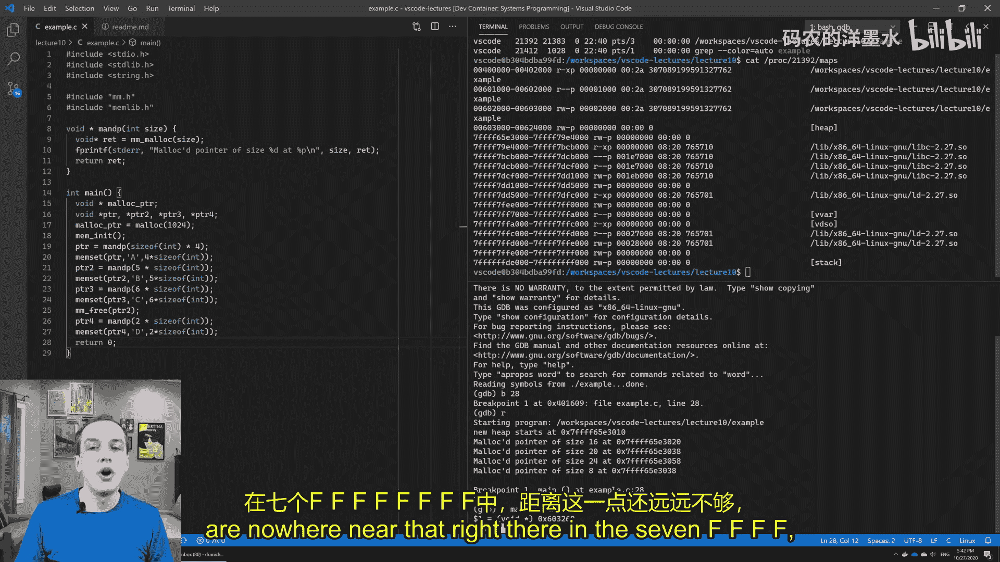
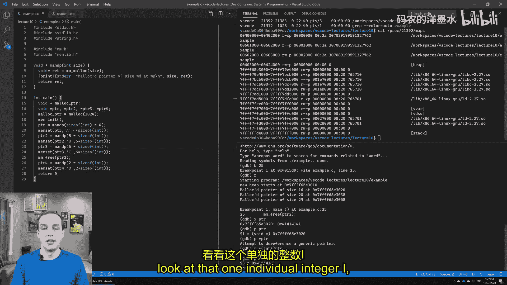
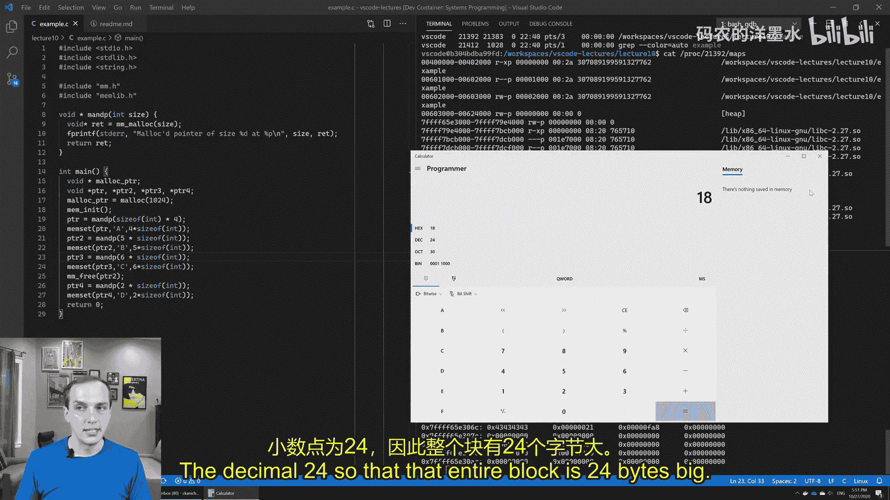
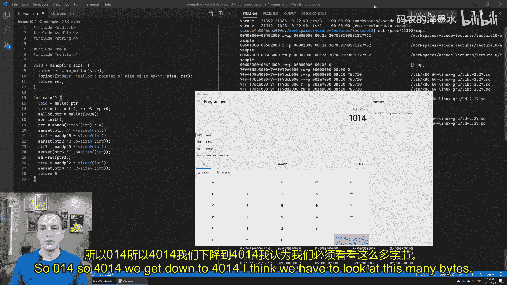
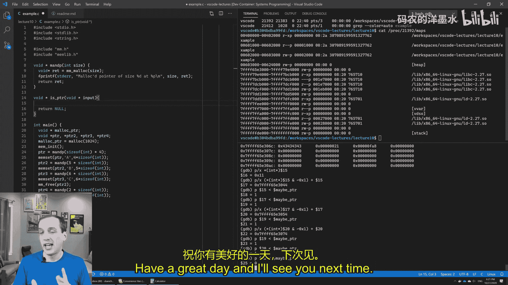

# 操作系统课程：第15讲：malloc实现 🧠

在本节课中，我们将通过一个动态内存分配器的实际演示，来学习其工作原理，并了解如何开始完成相关的编程作业。我们将使用GDB调试器来观察内存的内部状态，理解分配、释放、合并以及垃圾回收等核心概念。

## 概述

我们将分析一个使用自定义内存分配器的简单程序。这个分配器比标准库的`malloc`简单，但包含了理解动态内存管理所需的核心思想：堆的布局、块头/脚信息、分配与释放策略（如首次适应）以及内存合并。

---

## 内存布局与系统malloc的差异




上一节我们介绍了动态内存分配的基本目标。本节中，我们来看看我们实现的简单分配器与系统`malloc`（如glibc中的实现）在内存布局上的关键区别。

系统`malloc`为了支持高性能和多线程，实现非常复杂。它会根据分配大小，将内存块放在不同的区域（例如，小对象在堆上，大对象使用`mmap`映射独立的内存页）。

在我们的简单分配器中，我们一次性向操作系统申请一大块内存（例如20MB）作为“模拟堆”，并在这块连续的内存中管理所有分配。我们使用一个单向空闲链表，采用首次适应算法，并支持内存合并。

以下是查看进程内存映射的命令，它显示了堆和内存映射区域的起始地址：
```bash
cat /proc/<PID>/maps
```

---



## 观察内存分配状态

现在，让我们进入GDB调试器，在程序执行到特定位置时暂停，并检查内存的实际内容。这是验证你对内存布局理解是否正确的关键步骤。

我们将使用`x`命令来检查内存。例如，`x/40x ptr`会从`ptr`地址开始，以十六进制格式显示40个单元（每个单元的大小取决于后缀，这里`x`代表字）的内存内容。

以下是检查内存的示例命令：
```bash
(gdb) x/40x ptr
```



通过观察，我们可以看到：
*   分配给用户的数据区（充满了我们设置的测试模式，如`0x41414141`，即字符‘AAAA’）。
*   每个内存块头部和脚部的信息，其中编码了块的大小和分配状态。

---



## 分析内存块头信息

每个内存块都有一个头部（header）和可能有的脚部（footer）。头部存储了**块的总大小**以及**分配状态位**。

在我们的实现中：
*   **块大小**：存储在头部的值中，但最低有效位用于表示分配状态。
*   **分配状态**：如果最低位为1，表示块已分配；为0表示块空闲。

因此，要获取实际的块大小，需要屏蔽掉状态位。公式如下：
```
实际块大小 = 头部值 & ~0x1
```

例如，如果头部值是`0x19`（二进制`00011001`），则：
*   分配状态：`0x19 & 0x1 = 1`（已分配）
*   实际大小：`0x19 & ~0x1 = 0x18`（十进制24字节）

---

## 遍历堆内存块

我们的堆本质上是一个由内存块组成的隐式链表。每个块的头部指明了下一个块的起始位置。

遍历堆的算法伪代码如下：
```
current_block = heap_start
while current_block 的 size != 0: // 遇到大小为0的块表示链表结束
    处理 current_block
    current_block = current_block + current_block.size // 移动到下一个块
```

在GDB中，我们可以手动模拟这个过程：
1.  从堆起始地址（`heap_start`）读取头部值。
2.  屏蔽状态位得到大小`size`。
3.  当前块地址加上`size`，得到下一个块的头部地址。
4.  重复此过程。

---

## 实现 `is_ptr` 函数

`is_ptr`函数是垃圾回收器（mark-and-sweep）的关键部分。它的作用是：给定一个可能是指针的值，判断它是否指向堆中某个已分配块的内部。如果是，则返回该块的头部指针。

其逻辑步骤如下：
1.  **边界检查**：判断给定地址是否位于堆的全局边界（`mem_heap_lo` 和 `mem_heap_hi`）之内。
2.  **块查找**：从堆起始地址开始遍历每个内存块。
3.  **范围判断**：对于每个块，检查给定地址是否落在 `[块起始地址, 块起始地址 + 块大小)` 这个区间内。
4.  **返回结果**：如果找到包含该地址的块，则返回该块的头部地址；否则返回`NULL`。

查找过程的代码逻辑核心如下：
```c
void *current = mem_heap_lo();
while (获取当前块大小(size) > 0) {
    if (ptr > current && ptr < (current + size)) {
        // ptr 指向当前块内部
        return current;
    }
    current = current + size; // 移动到下一个块
}
return NULL; // 未找到
```

---

## 调试技巧与常见陷阱

在编写内存分配器时，手动验证和理解内存状态至关重要。以下是一些实用的建议：

*   **使用清晰的测试模式**：像`0x41`（‘A‘）或`0x42`（’B‘）这样的值在内存中很容易被识别，有助于快速定位你的数据。
*   **内存不会自动初始化**：从`malloc`或栈上获取的内存包含**旧的、未定义的数据**，而不是零。忘记初始化变量是导致难以调试的错误的常见原因。
*   **逐步验证**：像我们演示的那样，在GDB中逐步执行代码，并在每个关键步骤后检查内存，确保其状态符合你的预期。
*   **从概念到代码**：先用自己的话描述清楚算法（例如“如何找到包含这个地址的块”），然后在GDB中手动执行每一步来验证逻辑，最后再将这个逻辑翻译成C代码。

---

## 总结

本节课中我们一起学习了动态内存分配器的内部工作原理。我们通过GDB调试工具，直观地观察了：
1.  简单分配器与系统`malloc`在内存布局上的差异。
2.  内存块头/脚部信息的编码方式，以及如何解析块大小和分配状态。
3.  如何遍历由内存块组成的隐式链表。
4.  `is_ptr`函数的核心算法，它是实现标记-清除式垃圾回收的基础。
5.  在系统编程中调试和验证内存状态的重要方法与常见陷阱。



理解这些概念对于完成内存分配器作业至关重要，也是应对相关考试内容的基础。