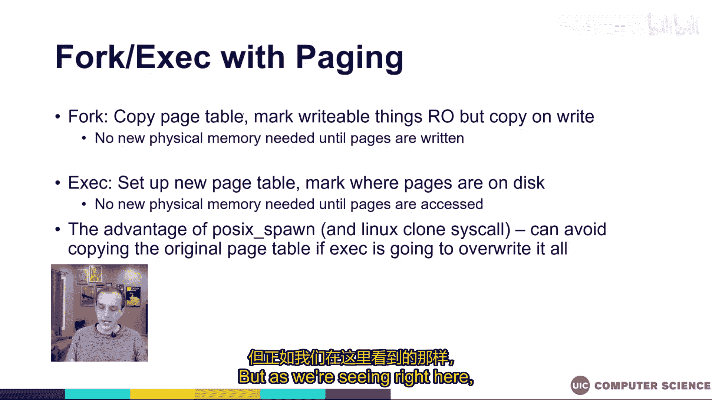

# 【全集】伊利诺伊大学 操作系统 中英字幕 1080P p16 Lecture 16 - mmap机制 -BV1AEASzNE3z_p16-

Hi， I'm Chris Kench and this is C361 System programming Today。

 we're gonna to be talking about memory mapping。 going to be a relatively short lecture because we've already covered a lot of these concepts。

 but there's still a few really important parts about how and memory mapping works that we have to see to really drive home exactly how this mechanism provides the cool features that it does provide。

 So this lecture and me in a nutshell is looking at page tables as a way to provide a layer of indirection And we've added that layer of indirection。

 it allows a lot of other neat features to enable various things that we're gonna to see during the lecture today。

 remember that this is the culmination of a lot of other concepts and a lot of other moving pieces within this whole concept of virtual memory and so the best way to really drive home the important differences and how these things work and what capabilities they provide is to remember to focus on the relationship between the CPU the page tables themselves the operating。

😊，t and the user level code all of these have different levels of access at different times and cause different things to happen。

 So if you can work your way through how some of these examples work。

 that'll probably help out by a bit。 So at a basic level we have this idea of sharing pages we've got virtual pages that are mapped into an individual process and they can have their own individual virtual address spaces that map those wherever the heck they want and then that address translation。

 the page table translates whatever virtual page one is in process I into some page of memory and if we have a virtual page two that's mapped someplace else it can be mapped someplace else and now the same virtual page in terms of address or a different virtual page can be mapped into a shared physical page like we have right here in this example So whatever address is right here with the virtual page one in process J also maps onto the same place that virtual page two does in process I the important thing for us to remember here。

The slide is that because we have that magic of the page table。

 we can map any one thing to any one other place The page table maps in this direction only it maps given a virtual address find the physical address if you're trying to take a physical address and reverse that search and say which virtual pages it's the map to you're not going to be able to use the page table to figure that out you're probably going to have to iterate through a whole bunch of information to really see what's going out probably the most clever trick that we've seen in virtual memory is this concept of demand paging where all pages start out as backed by the disk and are marked as invalid when they are mapped into memory such that the mapping exists between a specific address of virtual memory to a specific offset within a file but the actual bytes have not been pulled into memory yet and so they simply get marked as invalid this gives us that lazy loading property that we've talked about a lot of other times previously that actually created。

via demand paging when it comes to individual parts of executables being stored on disk and the benefit of this is that we don't expend resources loading anything into memory that we aren't going to eventually use。

 This is a really really powerful trick and it also makes a lot of sense if you got a whole bunch of classes where there is no syllabus and there was no list of homeworks and there was no list of exams and the only time you ever knew that you had to study for an exam was when all of a sudden said okay I need you to do this exam and it's going to be this specific instruction and then you said okay I'm gonna to do all the work I need to for this exam that I know I'm actually going to have to write the same thing happens with memory it makes a lot of sense to not study 17000 other different topics if you're not going to be tested on them it's very not important to what you actually have to do and you can save a lot of time by not studying for granted in this class you do know what you're going to be tested on and I do want you to study for all of it not so much about making。

that you know A B C， D and E but knowing that you know how to take these problems decompose them communicate about them all that good stuff And so as I've been mentioning for several of the previous lectures right now every one of these virtual memory addresses is going to map through eventually to either a location on the disk here or into this anonymous file that I've mentioned a few times where it's a special file of all zeros this is something that is。

Just there by default， if you need brand clean memory。

 it's going to come from the spec anonymousous file。

And we'll see in just a moment why we only need one of those。 Well。

 it kind of makes sense that we only need one of them if it's always going to be identical to zeros。

 So if we were given this whole entire region of memory and every single one of those pages was mapped to pure zeros because it was a brain clean heap。

 Then all of those would map to that zero page。 and that zero page would just stay zero。

 if everybody has all zeros， they're all mapping to the same thing And that's no big deal。

 What becomes a big deal is what we do when somebody actually starts trying to change those pieces of information because they're not always going to stay as all zero。

 A page full of zeros is not really useful for anybody。 eventually it's going to get written to。

 So just a break what our virtual memory looks like in terms of these filebacked versus private areas of memory。

 One vocab word we've got here is demand0。 That's another word for the anonymous page or a zero page or things along those lines。

 A demand zero page is a page that is full of zero。😊。

That gets loaded in on demand That's an easy way to remember it The stack gets pulled in from these demand zero pages。

 the Malic and the BSS sections get pulled in as demand zero pages because remember the stuff that's in BSS starts with all zero values and we didn't keep those in the file as BSS takes up no space but it does need space in the virtual memory address layout So when we load that in every single one of those pages of your BSS section is going to map to that same specific private demand zero page until it gets written to。

Likewise， we have these shared file back pieces of information and some of these are always going to be shared and file backed like the text because the text is fundamentally read only we are not going to change the text for the entirety of running bash there's could be1 thousand people on the systems machine running bash at the same time they are all only going to have one physical copy of the text of that bash executionecutable in physical memory at any moment in time however。

 while the data section does start as a shared filebacked page or set of pages。

 it's not always going to be that way data is for a global variables global variables are going to be written to eventually those global variables will need to be changed by your program and when I change my global variables and my execution of bash you probably don't want your execution of bash to also reflect those same pieces of information so that's where we're gonna to start。

Seeing this idea of copy andwrite I up so before we talk about that concept of copy andrite。

 we're going to hit that in just a few slides， let's talk about the just basics of how we are going to be reading and writing bytes from files using the MAT mechanism rather than the previous read write mechanism so to recall remember if we want to read a file in the traditional mode we've got to open that file and then we're going to say read from that file and we're going to write to that file etc。

In Mmap world， we have this alternate way to read and write file Now。

 some things like loading the executable is done by the loader。

 you're not going to have to do that yourself， but if you want to unmap in a big file and do certain types of calculations and certain types of data processing and storage。

 you're going to probably want to at least think about using Mmap。

 what's nice about Mmap is that while it still uses the open system call because we do need to pass in a file descriptor。

 we need to have open file and told the operating system， hey。

 this is the file that I want to start operating on。Traditionally。

 if we wanted to read and write from that file with read and write system calls or whatever version of those we wanted to use。

 like getline or。Print F printf things along those lines。 each of those calls。

 each read call you right call。 each f printnf call is a system call That requires us to change from being in user mode to being in kernel mode and then we do some operations then we come back from kernel mode back into user mode and these things are very optimized。

 But there's still a little bit slow。 if every time all we want to do is write a few bytes to memory。

 we don't want to have to update these kernel data structures and switch from user mode to kernel mode and back again。

 this occurscurs a not an negligible cost when we're trying to especially do lots of small operations。

 And this is where the magic of endmap really comes in where with read and write。

 we have to do system call here， system call here， system call here after that initial system call open And after our system call to Mmap saying I want this file that starts this byte0 to line up with this address out of my virtual memory or we say you know what。

😊，Colonel just picks an address for us， and that'll be the beginning of our file。 All of a sudden。

 we take that entire file that we would have had to read through or seek through with system calls。

 And we say byte 0 starts at address 0 x 0 and byte X 1000 is address 0 x， x 1000， et cetera。

 like that So we just say this whole file maps substitute these addresses of memory。

 if I want to read through it as if it were a。😊，Read system call。

 I will need to keep track of my file offset。 I will need to keep track of all that information for myself internally。

 but it'll be much， much more efficient because if I don't need to keep track of that， I won't。

 if I know that I'm always trying to seek to a specific place， read a specific value。

 write a specific value out， which would be very common in situations like reading and writing from a database。

 that is going to be far more efficient than reading those read and write and seek system calls constantly to try to figure out where I should be at any given point in time。

 when I need to read or write some bytes。 So when it comes to actually sharing this memory。

 one of the options that we can pass to end map I this map shared option。

 So if we are running a individual program and we open up a file or we just ask for an anonymous mapping from M map and we get a big chunk of memory that we can do with as we please we can market as shared between ourselves and whatever descendant processes we create。

 So if we were to fork a additional process using。😊。

The fork system call after we had loaded something in as map shared。

 rather than having those pieces of memory diverge when they're running and doing different things。

 that region of memory that M map has pulled in， will stay mapped between the parent process and the child process。

 So any right that happens in the parent will be visible in the child and vice versa。

 which is one way for us to communicate across that boundary between two processes。

And it's very efficient， but it also doesn't have a lot of the bells and whistles that you would use if you wanted to pass messages back and forth。

 It's kind of a raw shared。Bullet board。 And I'm not going to get any notification when somebody else puts something there。

 But if I look at it， I will see what anyone one else has written。So to visualize this。

 it'll look a little bit like here where we have forked these two processes and we have declared these as a map shared region of memory that we asked for from Mmap and to begin with they're both mapped into the virtual memory address space in both of these processes and it only has one copy if one of them writes to this memory or reads from this memory it'll cause a page fault and it'll bring this memory actually in and it'll say okay now there's actual physical bits that represent what this page is trying to store。

And whatever any one process writes。 So if process A writes 50 to that shared object。

 it will immediately be reflected in the physical memory。

 and it will immediately be visible by process B。 So that way， anybody that has that page mapped in。

 if there's nothing stopping us from forking multiple times to have multiple children that all have access to that same page。

 they're all going to see the same thing at the same moment in time。

 Now the next thing that we're kind of getting at at this point is that we don't always want to do this。

 if we take a quick look back at this slide， there's some things like text that we want to be shared。

 we want it to get page faulted in by a read and it'll state the same exact thing in every single process that is ever run that comes from the bash executable。

 However， there are certain things like data where as soon as we start editing it。

 we don't want anybody else to see a copy， we want to pretend that we have our own copy and what copy and write allows us to do is kind of have our cake and eat it too where we can say if。

Pivific page of memory hasn't been changed yet because maybe this data section is nice and big and there's a few variables that get changed here there's a few variables that get changed here。

 but 90% of the time all of this stays exactly the same and all of this stays exactly the same。

Optimally， we would like these to only have one copy in memory at any given point in time if they're all still the same。

 the same thing that came off off of the disk。 whereas these other things should have any different copies where enter the different number of processes that have actually changed that memory。

 that would kind of be like the minimal amount of memory we would need to keep if we're gonna leverage our page table mechanism to save as much memory as we possibly can。

 because the more memory we save， the faster our programs run。

 because we get to keep more things in cache and we don't have to go up to the disk is off。

 So fundamentally the goal we have is to start memory as shared。

 just always have anything that's been loaded in like that be shared。

 But then at the less possible moment， we can make a copy and say， okay， well。

 now we have two different copies because somebody tried to change this。 But before that。

 we only had one。 So as soon as somebody wants to change one little bit in here， we say， okay。

 now we need to have a copy of each。😊，And everybody looked digital like a copy of each one as if it were always there。

 And then one of them stays the same。 And one of them changes。 So let's look at this example。

 that will map onto what would happen if the dot data section was pulled in at the very beginning。

 the dot data section is going to come out of that executable， according to the EF rules。

 and it's going to be mapped into the virtual address space of process and the virtual address space of process B。

 And when when a of them reads it we're going to bring that memory into main memory。

 and there's only going to be one copy of it because if nobody has changed it yet。

 mine and yours and the other one and the other and the other one。

 we're all going have the same exact bits。 and we only need one copy in physical memory however。

 as soon as any one of these individual processes writes to that area of memory to like some small area of that memory。

 we're going need to create a brand new chunk as we did here in this example。

 So if we wrote to this chunk of the data section， we change one of the global variables，😊。

That that global variable was in is going to need to be copied from where it was before and so we take every single bit that was in the first copy。

 we bring it out down to the cycle one and then we perform this right and we change the one specific variable that got changed。

That way， there are two private objects that both map to that page of memory。

 but until we actually needed it， we didn't actually create that second copy。

 so this comes back to that concept behind fork and how it creates child processes and how it doesn't just totally explode our use of memory over the course of that time。

When we create a new process via fork， we copy the page table。

 but we don't copy the actual physical memory that's there。

 We just get this mirror of the virtual memory。 So eventually these are going to change eventually especially if you do something drastic like executive。

 which completely replaces your memory。 it's going change。 but in general。

 we can't just straight copy the page table and just call it a day because then some edits in one place will show up in the other place and we don't want that to happen by default。

 usually we want any edits in a forked process to not be reflected in the parent process。

 I don't want my child process to corrupt or manipulate what's happening in the parent process and also vice versa。

😊，So just straight copying those page tables is not enough for a correct fork。

 as we're going to see here in a moment。 So what we end up doing when we use fork to create a brand new independent process is we do copy that entire page table。

 but we list every single one of those pages as read only， we set the read only bit there。

 even if it is a writeriable area。 And so that way， if something is a read only section like text。

 it's just going to always stay read only， there's always going to be one physical copy of it and everybody's happy if one of those pieces of memory is writeable。

 say it's the data section， we're still going to set it to read only。

 And if you haven't done the discussion question yet。

 I want you to stop and think what is that going do。😊。

With respect to what I said on that second slide， what is the importance of。

Setting a specific page that's supposed to be writeriable the read only。

 how will that impact the way that the CPU， the operating system and the user level code interact with each other。

 especially Via V， the page tables。And I'll tell you that right now by setting those。

Wriable areas to be read only。 it causes a page fault to happen whenever any one of those processor tries to write to the copy on right region of memory。

 It will cause a page fault。 This allows the operating system to say， hey。

 I'm implementing copy on write。 That means I lied to them。 about whether something was readable。

 I told the。Process， hey， this page of memory is totally writeriable。

 You can write to it whenever you want。 And I told the。CPU。

 this page that I just told them is wriable， totally isn'triable。

 You really need to come see me before you let them write to it。

And then the user code just runs and does whatever the heck it wants。

 It's going to merr try to write to that page。 It's supposed to be able to write to it。

 but it causes a page fault， but the code doesn't know anything about the page fault。

 It's not gonna worry about that。 it's just running its instructions。

 but the page fault causes the operating system to take over the operating system see oh。

 a write was attempted on a read only page that is marked copy andw writeite Oh。

 that's actually legal。 what that means is I need to create another page of memory map it in instead of this one。

 copy all of the content and then allow them to retry that operation。

 This allows us to just in the very nick of time， manipulate what memory is being used so that we don't waste any memory on something that isn't actually going to get edited。

 because if we had some global variables that we're never ever going get edited unless they're in some really special situation like if the program crashed then we don't have to waste time or memory trying to map them to independent pages。

😊，physical memory so our TlDR here is that when we fork we copy the entire page table。

 we mark the writeable things as read only， but also copy andrite and so no new physical memory is needed until those pages are actually written to and all of the pages that started out as read only those pages are shared on every single process that's using that program or that's using that library。

 also something that's very very efficient because lots。

 thousands of these processes are probably using the C standard library Now when we exact something we set up a brand new page table and we mark where those pages are on disk and no new memory is needed until we pull those things and remember this is the lazy loading of executable loaders where things are set to be mapped to a specific area of the specific file on disk but we don't bring them in until we actually need that not until we say start running the assembly instructions from the specific page of the text do we actually pull that data in and see the magic of caching。

Good prediction we're going to have a really really high hit rate on that and things will get pulled in probably long before they actually get needed and this also brings us all the way back around to some of the advantages we get out of plastics spawn versus out of using fork。

This。😊，Mechanism of having to copy that entire page table， mark everything writeable。

 mark everything read only that's copy onrite is still kind of expensive。

 especially if you have a very large process that has a lot of memory available to it。

 What Posic Spwn does， is it gets implemented via this clones ci call， which is kind of like fork。

 but instead of having no arguments， it's got like 17 different arguments。

 It gives you all these different options for when you create a new process。

 We only want to do the specific things that we need to do to support whatever mechanism we're trying to use here。

 So in Pos Spwn， if we're going from a very large memory image program to just running echochohelello world。

 We don't copy all of those page tables， we just say listen for the time being the parent process in the child process。

 both read and write from the same pages of memory。

 I didn't have to copy anything about the page table， they're both using the same page table。

 but they're only doing that until the child。😊，Process does a very specific number of things。

 Those were those file actions that we are talking about。 It does those specific file actions。

 and then it runs exactly。 It does nothing else。 And the way that clone is implemented。 It says。

 okay， I know that if I do this specific set of things。

 I won't impact the rest of the memory of the parent process。

 And I'll be able to get away with just doing a few things in the shared memory region。

 And then immediately saying， oh， I'm gonna wipe this entire thing up and slap in a brand new executable。

 that makes things much much faster in a lot of reasonable real world situations。

 And it's also a lot easier for us to understand from the outside。 But as we're seeing right here。

 it gets a little bit trickier on the inside。 Anyhow， that's all I have for you today。

 I have a good rest of your week。 and I'll see you soon。😊。

