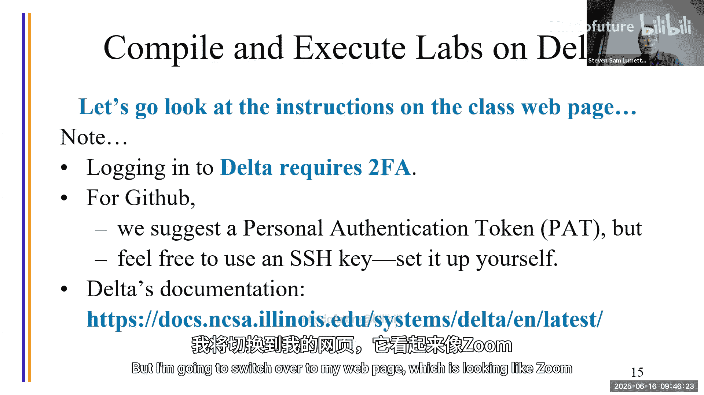
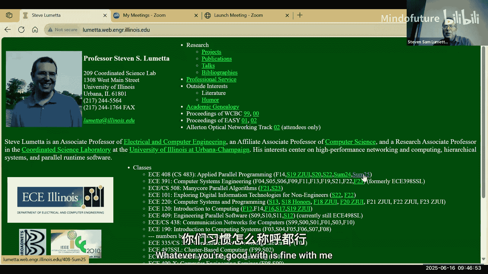
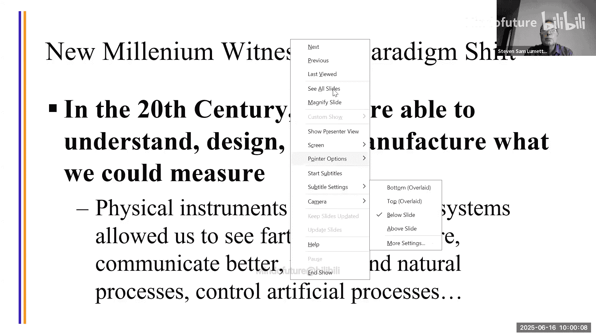
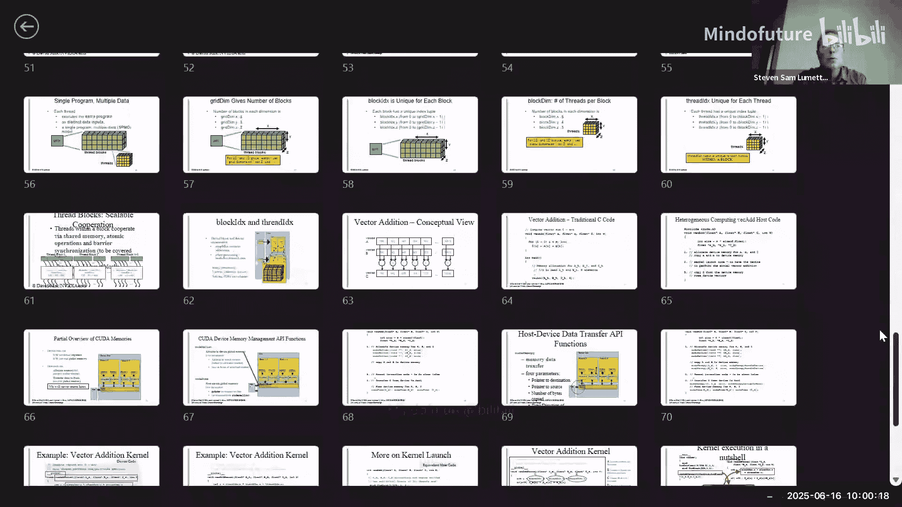
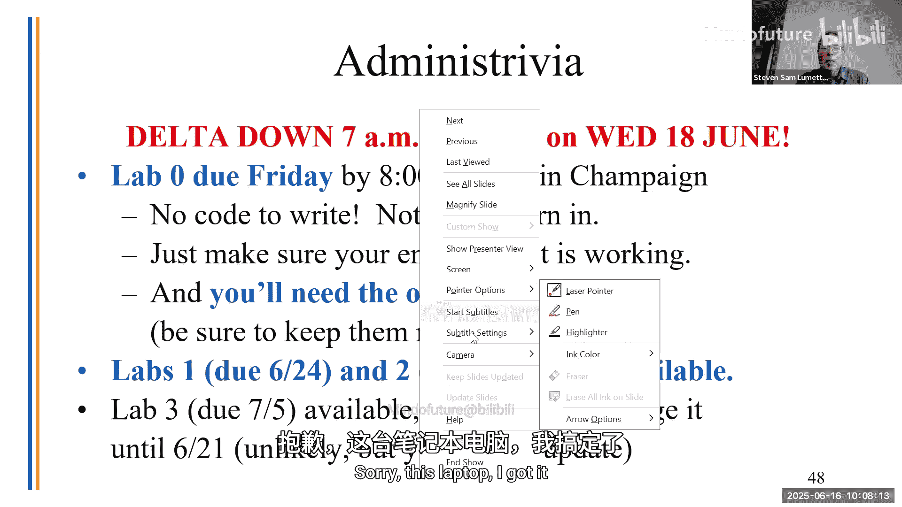
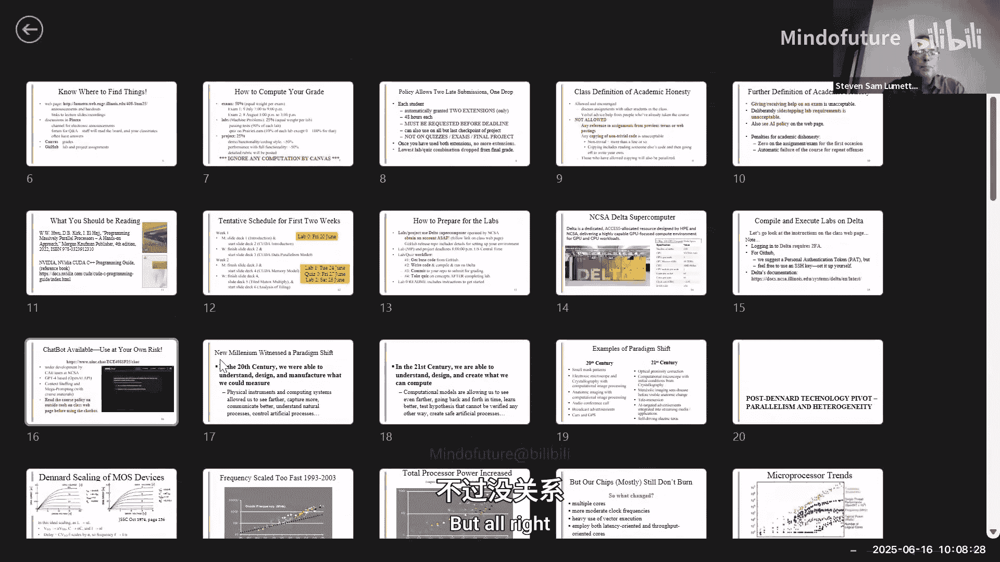
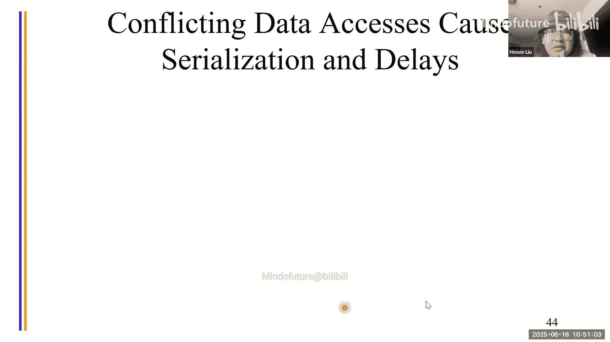

# 001：课程介绍与GPU计算基础

## 概述

在本节课中，我们将学习应用并行编程课程的基本信息、课程结构、学习目标，并初步了解GPU（图形处理器）计算的基础知识，包括其历史背景、设计哲学以及与CPU（中央处理器）的关键区别。

---

## 课程介绍

欢迎来到应用并行编程课程。本课程旨在教授如何为大规模并行处理器（主要是GPU）进行编程，以充分发挥其高性能计算潜力，同时保证代码的功能性和可维护性。

本课程由伊利诺伊大学于2007年首创，由Wen-mei Hwu教授和NVIDIA首席架构师David Kirk共同讲授，是首批教授GPU编程的课程之一。

### 课程技术主题

我们将涵盖以下技术主题：
*   并行编程基础
*   并行算法的原理与模式
*   编程API、工具和技术
*   处理器架构及其约束
*   关键应用案例（尤其是AI领域）

### 教学团队与资源

*   **讲师**：Steve Lumetta教授。办公室时间为周二和周四上午9点至11点（讲座之间的同一时间段）。
*   **助教**：Hanwen。办公室时间为周六。
*   **课程页面**：所有公告、讲义和代码链接都将发布在课程网页上。
*   **Piazza**：用于课程讨论和问答。
*   **Canvas**：仅用于成绩发布。
*   **GitHub**：用于实验和项目作业的提交。
*   **教材**：《Programming Massively Parallel Processors: A Hands-on Approach》（第四版）。

### 课程评分构成

课程总成绩由以下部分构成：
*   **考试（50%）**：两次考试，各占25%。考试将在Zoom上进行，需要开启摄像头。
*   **实验（25%）**：共9个实验（含第0个环境设置实验），每个实验权重相等。
*   **项目（25%）**：一个大型个人项目，评估功能、性能、演示和代码风格。

### 迟交政策与学术诚信

*   每个学生有**两次**延期提交实验或项目前两个检查点的机会，每次最多延期48小时，但必须在原截止日期前通过Google表单申请。
*   我们将**去掉**最低分的实验+测验组合。
*   我们鼓励讨论课程概念，但**严禁**复制代码、在考试中作弊、规避实验要求或使用AI生成代码。违反学术诚信政策将导致严重后果（首次违规该次考试记零分，再次违规课程不及格）。

---

## 实验环境设置：Delta超级计算机

我们将使用位于NCSA的Delta超级计算机进行实验和项目。

### Delta配置简介

Delta节点的主要配置如下：
*   **GPU**：每个节点有4个NVIDIA A40 GPU，通过NVLink高速互连。每个GPU拥有48GB DDR6显存。
*   **CPU**：每个节点有1个AMD Milan CPU，包含64个核心，主频约2.5 GHz。
*   **内存**：每个节点有256 GB CPU内存。

### 环境设置步骤

1.  **申请Delta账户**：通过课程页面链接申请ACCESS ID，建议使用伊利诺伊大学NetID。
2.  **设置GitHub仓库**：通过课程页面链接创建个人课程代码仓库。
3.  **配置身份验证**：建议使用个人访问令牌（PAT）而非SSH密钥在Delta上访问GitHub。
4.  **完成实验0**：在截止日期前（6月20日周五晚8点，美国中部夏令时），登录Delta，编译并运行示例代码，保存输出结果用于后续测验。

**注意**：Delta计划于6月19日周三进行维护，届时将无法访问。

---

## GPU计算基础

上一节我们介绍了课程的基本设置，本节中我们来看看GPU为何成为现代计算的核心，以及它与CPU的根本区别。

### 计算范式的转变

在20世纪，计算主要用于辅助测量、控制和理解物理过程。进入21世纪，计算本身成为了发现和创新的主要驱动力，例如计算成像、药物设计和AI模型。

这一转变部分源于“后登纳德缩放”时代的技术转折。登纳德缩放定律指出，随着晶体管尺寸缩小，芯片功耗可以保持稳定。然而，约在2004年，业界为追求更高性能而大幅提升时钟频率，导致了“功耗墙”问题。此后，行业转向通过增加核心数量（而非提升单核频率）来提升性能。

### CPU与GPU的设计哲学

CPU和GPU针对不同的计算模式进行了优化：

*   **CPU：面向延迟优化**
    *   **目标**：尽可能快地执行**单个**任务（线程）。
    *   **手段**：高时钟频率、大容量缓存、复杂的控制逻辑（如分支预测）、数据前推。
    *   **公式**：追求最小化 `任务完成时间`。
*   **GPU：面向吞吐量优化**
    *   **目标**：在单位时间内完成**尽可能多**的任务（线程）。
    *   **手段**：适中时钟频率、大量计算核心、简单控制逻辑、高能效ALU、深度流水线。
    *   **公式**：追求最大化 `单位时间内完成的任务数量`。

### 为何需要两者协同？

一个成功的应用策略是混合使用CPU和GPU：
*   将**顺序执行**、对延迟敏感的部分放在CPU上运行。
*   将**数据并行**、计算密集的部分放在GPU上运行。
程序员需要判断代码的哪部分适合GPU，并管理CPU与GPU之间的数据移动，因为两者拥有独立的内存空间。

### 并行编程的挑战

编写高效的GPU程序并非简单地将代码移植过来，我们需要考虑：
1.  **负载均衡**：所有并行线程应尽可能同时完成，避免某些线程长时间运行而拖慢整体进度。
2.  **内存带宽**：计算能力（FLOPS）的增长速度远快于内存带宽（Byte/s）的增长。这形成了“内存墙”，程序员必须精心设计数据访问模式以隐藏内存延迟。
3.  **可扩展性与可维护性**：算法应能有效利用不断增加的计算核心，并且代码应易于长期维护。

---

## 总结

本节课我们一起学习了应用并行编程课程的框架、评分政策和使用Delta超级计算机的流程。我们探讨了GPU兴起的历史背景，并深入理解了CPU（延迟优化）与GPU（吞吐量优化）两种根本不同的处理器设计哲学。认识到需要根据任务特性（顺序执行 vs. 数据并行）合理分配计算资源，并初步了解了编写高效并行程序所面临的主要挑战（如负载均衡和内存带宽限制）。在接下来的课程中，我们将开始学习CUDA编程模型，亲手将理论应用于实践。