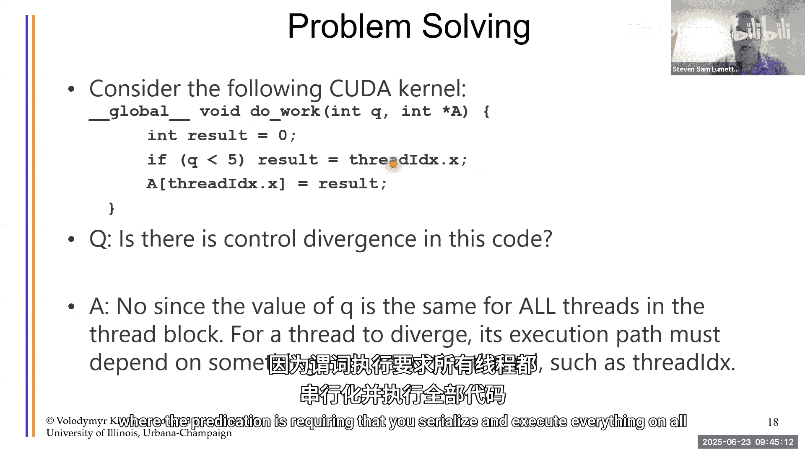
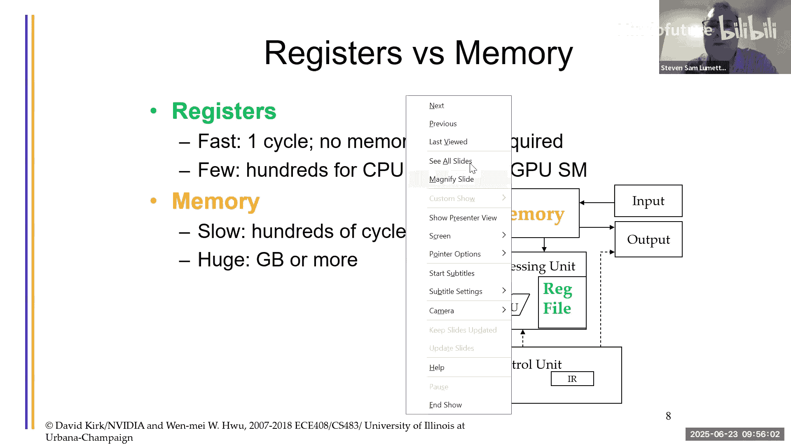
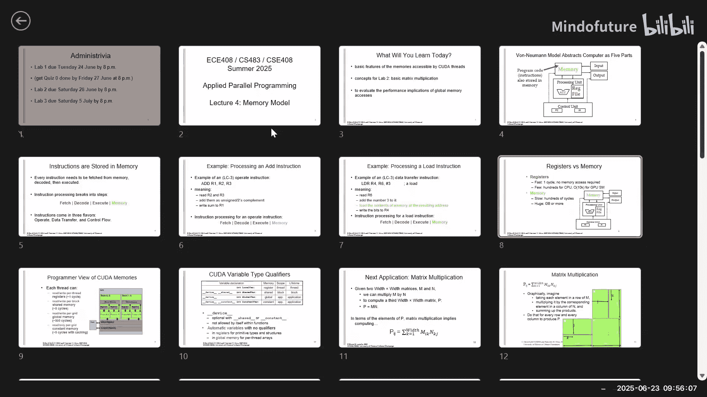
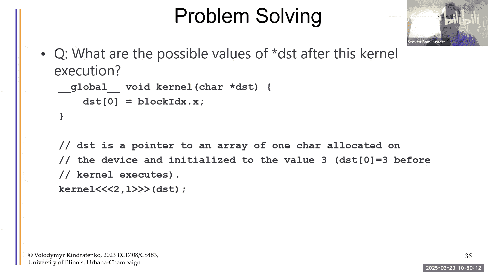

# 003：CUDA线程组织与内存模型 🚀


## 概述
在本节课中，我们将学习CUDA编程中线程的多维逻辑组织方式，以及CUDA的内存层次结构模型。我们将深入探讨如何通过合理的线程块配置来优化性能，并理解不同内存类型（寄存器、共享内存、全局内存）的特性、访问速度和使用方法。这些知识是编写高效GPU程序的基础。

---

## 多维线程组织回顾
上一节我们介绍了CUDA的网格-线程块-线程三级层次结构。本节中，我们来看看如何利用这种结构进行更复杂的计算。

一个CUDA内核启动时，会创建一个由线程块组成的网格。每个线程块本身又是一个由线程组成的多维数组。虽然逻辑上是三维的，但任何维度的尺寸都可以是1，因此我们常用1D或2D结构。

每个线程通过其**块索引** (`blockIdx`) 和**线程索引** (`threadIdx`) 的组合来获得一个唯一的标识符。内核代码可以利用这些标识符来计算数据数组中的唯一索引。

**核心概念公式**：
对于一个2D网格和2D线程块，计算全局线程索引的常用方法是：
```cpp
int col = blockIdx.x * blockDim.x + threadIdx.x; // 列索引
int row = blockIdx.y * blockDim.y + threadIdx.y; // 行索引
int global_index = row * total_width + col; // 线性化索引
```

---

## 线程块执行与调度
线程块被分配给流多处理器执行。一旦分配，整个线程块将在同一个SM上运行，不会被拆分。

### 线程束与SIMD执行
在SM内部，线程块中的线程被分组为大小为32的**线程束**。线程束是SM的基本调度单元。
*   **线程束形成**：将线程块中所有线程的`(threadIdx.z, threadIdx.y, threadIdx.x)`按`x`变化最快、`z`变化最慢的规则线性化，然后每32个线程分为一个线程束。
*   **SIMD执行**：当SM选择一个线程束执行时，该线程束中的所有32个线程**执行相同的指令**。这被称为**单指令多数据**执行模型。

### 零开销线程束调度
SM采用**零开销线程束调度**。这意味着SM可以在每个时钟周期无延迟地在所有就绪的线程束之间切换。这种机制对于隐藏内存访问等长延迟操作至关重要。

---

## 控制流与分支发散
由于线程束以SIMD方式执行，当线程束内的线程遇到条件分支（如`if-else`）并走向不同路径时，就会发生**分支发散**。




### 如何处理分支发散
GPU使用**谓词执行**来处理分支发散：
1.  首先，所有线程执行`if`的`then`代码块，但只有条件为真的线程会保留执行结果。
2.  然后，所有线程执行`else`代码块，只有条件为假的线程会保留执行结果。

**性能影响**：分支发散会导致SM串行执行所有分支路径，显著降低性能。最坏情况是线程束中只有一个线程活跃，而其他31个线程空闲。

### 如何避免分支发散
*   **确保线程束内控制流一致**：尽量让同一个线程束内的所有线程执行相同的控制路径。
*   **调整数据访问模式**：例如，通过将线程索引除以线程束大小（如 `threadIdx.x / warpSize`），可以使同一个线程束内的线程获得相同的商值，从而走向相同的分支。





---

## 线程块大小的选择策略
选择线程块大小时，需要考虑多种硬件约束，目标是最大化SM上可同时调度的线程束数量，以隐藏延迟。

以下是选择线程块大小需要考虑的几个关键因素：
1.  **每个SM的最大线程数**：限制了可以同时驻留的线程总数。
2.  **每个SM的最大线程块数**：限制了可以同时调度的线程块数量。
3.  **每个线程块的最大线程数**：当前GPU通常为1024。
4.  **共享内存大小**：每个线程块可用的共享内存是有限的。
5.  **寄存器文件大小**：每个线程可用的寄存器数量受限于SM的总寄存器数和活跃线程数。

**选择策略**：通常需要在上述约束间进行权衡。一个常见的经验法则是，线程块中的线程数最好是线程束大小（32）的倍数，并且足够大以充分利用SM资源，但又不能太大以至于限制了活跃线程块的数量。

---

## CUDA内存模型
现在，我们转向CUDA的内存层次结构。理解不同内存的带宽、延迟和用途对于优化程序性能至关重要。

### 内存层次概述
CUDA提供了多种内存空间，供程序员显式或隐式地使用：

1.  **寄存器**：速度最快，延迟约1周期。每个线程私有，用于存储自动变量（非数组的局部变量）。生命周期与线程相同。
2.  **共享内存**：速度很快，延迟约5-10周期。每个线程块共享，用于线程块内线程间的通信。生命周期与线程块相同。
3.  **全局内存**：速度慢，延迟约500-1000周期。所有线程可读写，容量大（GB级别）。数据在主机与设备间传输。生命周期与应用程序相同。
4.  **常量内存**：只读，速度较快（有缓存）。所有线程可读，由主机初始化。生命周期与应用程序相同。

### 在代码中使用不同内存
*   **寄存器**：在内核函数中声明非数组的局部变量（如 `int temp; float sum = 0.0f;`）。
*   **共享内存**：使用 `__shared__` 限定符声明变量（如 `__shared__ float tile[TILE_WIDTH][TILE_WIDTH];`）。
*   **全局/常量内存**：在全局作用域使用 `__device__` 或 `__constant__` 限定符声明变量。

---

## 案例研究：矩阵乘法
我们将以矩阵乘法为例，展示如何将并行化思想应用于实际问题，并分析其性能瓶颈。

### 算法描述
给定两个宽度为 `Width` 的方阵 `M` 和 `N`，计算输出矩阵 `P = M * N`。矩阵乘法的定义是：
`P[row][col] = sum over k ( M[row][k] * N[k][col] )`
其中 `row` 和 `col` 的范围是 `0` 到 `Width-1`。

### 并行化策略
一个直观的并行化策略是**每个线程计算输出矩阵P的一个元素**。
*   **线程组织**：使用2D网格和2D线程块。网格大小覆盖整个输出矩阵P，线程块大小（如16x16）是一个可调参数。
*   **内核伪代码**：
    ```cpp
    __global__ void matrixMulKernel(float* M, float* N, float* P, int Width) {
        // 计算该线程负责的P矩阵的行和列
        int row = blockIdx.y * blockDim.y + threadIdx.y;
        int col = blockIdx.x * blockDim.x + threadIdx.x;

        if (row < Width && col < Width) { // 边界检查
            float pValue = 0;
            for (int k = 0; k < Width; ++k) {
                pValue += M[row * Width + k] * N[k * Width + col];
            }
            P[row * Width + col] = pValue;
        }
    }
    ```

### 性能瓶颈分析
上述简单内核的性能受限于**全局内存带宽**。
*   **计算与内存访问比**：每个线程计算一个`P`元素需要进行`Width`次内积迭代。每次迭代需要从全局内存读取`M`和`N`各一个元素（共8字节），并执行一次乘法和一次加法（2次浮点运算）。
*   **算术强度**：计算访存比 = 2次浮点运算 / 8字节 = 0.25 FLOP/Byte。
*   **瓶颈**：现代GPU的峰值计算能力远高于其内存带宽。例如，一个具有1000 GFLOP/s计算能力和150 GB/s内存带宽的GPU，其理论最大性能受限于内存带宽：150 GB/s * 0.25 FLOP/Byte = 37.5 GFLOP/s，仅为峰值性能的3.75%。

**结论**：简单的全局内存访问模式无法充分利用GPU的强大计算能力。我们需要通过**数据重用**和**使用更快的内存**（如共享内存）来减少对全局内存的访问。

---



## 总结
本节课我们一起学习了CUDA线程组织的核心概念，包括线程束、分支发散和线程块大小选择策略。我们还深入探讨了CUDA的内存层次模型，了解了寄存器、共享内存和全局内存的特性与用法。最后，我们以矩阵乘法为例，分析了其并行化实现和由全局内存带宽导致的性能瓶颈。在接下来的课程中，我们将学习如何利用共享内存来优化类似矩阵乘法的计算密集型内核，从而显著提升程序性能。