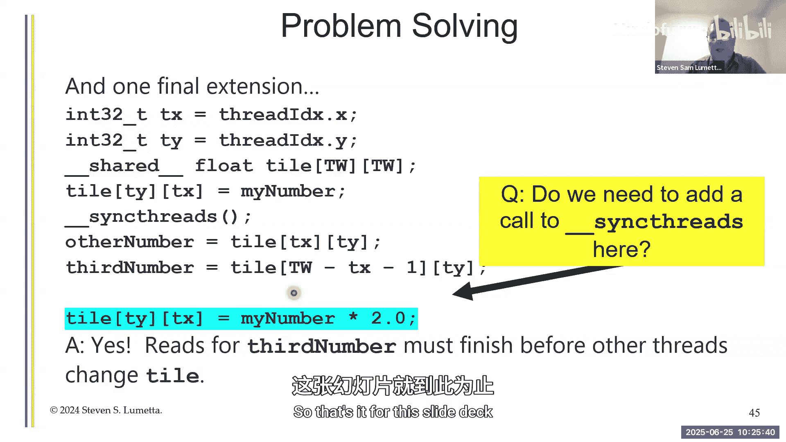

# 004：共享内存与分块矩阵乘法


在本节课中，我们将学习如何利用GPU的共享内存来优化矩阵乘法运算。我们将分析全局内存访问的瓶颈，并引入“分块”算法，通过将数据块加载到更快的共享内存中来减少全局内存访问次数，从而显著提升计算性能。

---

## 概述：全局内存瓶颈与共享内存的引入

上一节我们分析了简单矩阵乘法内核的性能，发现其受限于全局内存带宽。本节中，我们将探讨如何利用共享内存来缓解这一瓶颈。

简单矩阵乘法内核的每个线程需要从全局内存中读取 `2 * width` 个浮点数（来自矩阵 `M` 和 `N`），并写入1个浮点数（到矩阵 `P`）。这导致计算访存比很低，约为 **2 次浮点运算 / 8 字节数据 = 0.25 FLOPS/字节**。在带宽为150 GB/s的GPU上，理论性能上限仅为37.5 GFLOPS。

共享内存的访问延迟远低于全局内存（约5个周期 vs 500个周期），但容量较小（例如48KB）。为了利用它，我们需要将大矩阵 `M` 和 `N` 分解成更小的块（称为“分块”或“瓦片”），分阶段加载到共享内存中进行计算。

---

## 分块矩阵乘法的核心思想

分块算法的核心是数据复用。在标准矩阵乘法 `P = M * N` 中：
*   矩阵 `M` 的每一行被用于计算 `P` 的对应整行。
*   矩阵 `N` 的每一列被用于计算 `P` 的对应整列。

简单内核中，同一个 `M` 或 `N` 元素会被不同线程重复从全局内存中读取 `width` 次。分块算法旨在将一个数据块一次性读入共享内存，让线程块内的所有线程共享该数据块，从而将全局内存访问次数减少约 `tile_width` 倍。

以下是实现此想法的步骤概述：

1.  **分配共享内存**：为 `M` 和 `N` 的数据块分配共享内存空间。
2.  **协作加载**：线程块内的所有线程协作，将全局内存中的一个 `M` 块和一个 `N` 块加载到共享内存中。
3.  **屏障同步**：确保所有线程完成数据加载后，再开始计算。
4.  **计算部分结果**：线程从共享内存（而非全局内存）读取数据，计算部分内积。
5.  **屏障同步**：确保所有线程完成当前块的计算后，再覆盖共享内存以加载下一个数据块。
6.  **循环**：重复步骤2-5，直到处理完所有需要的 `M` 和 `N` 的数据块。
7.  **写入结果**：将最终结果写回全局内存中的 `P`。

---

## 内核代码解析：从简单版本到分块版本

首先，回顾一下简单的矩阵乘法内核：

```cpp
__global__ void MatrixMulKernel(float* d_M, float* d_N, float* d_P, int width) {
    int col = blockIdx.x * blockDim.x + threadIdx.x;
    int row = blockIdx.y * blockDim.y + threadIdx.y;
    if (row < width && col < width) {
        float p_value = 0;
        for (int k = 0; k < width; ++k) {
            p_value += d_M[row * width + k] * d_N[k * width + col]; // 全局内存访问
        }
        d_P[row * width + col] = p_value; // 全局内存访问
    }
}
```

现在，我们来看分块版本的内核。以下代码假设矩阵宽度 `width` 是块大小 `TILE_WIDTH` 的整数倍（边界处理稍后讨论）。

```cpp
__global__ void MatrixMulTiledKernel(float* d_M, float* d_N, float* d_P, int width) {
    // 1. 分配共享内存
    __shared__ float Mds[TILE_WIDTH][TILE_WIDTH];
    __shared__ float Nds[TILE_WIDTH][TILE_WIDTH];

    // 计算线程对应的输出位置
    int bx = blockIdx.x; int by = blockIdx.y;
    int tx = threadIdx.x; int ty = threadIdx.y;
    int col = bx * TILE_WIDTH + tx;
    int row = by * TILE_WIDTH + ty;

    float p_value = 0;

    // 循环遍历所有需要的分块
    for (int m = 0; m < (width / TILE_WIDTH); ++m) {
        // 2. 协作加载分块到共享内存
        // 加载 M 的分块
        Mds[ty][tx] = d_M[row * width + (m * TILE_WIDTH + tx)];
        // 加载 N 的分块
        Nds[ty][tx] = d_N[(m * TILE_WIDTH + ty) * width + col];

        // 3. 屏障同步：等待块内所有线程完成加载
        __syncthreads();

        // 4. 计算部分内积（从共享内存读取）
        for (int k = 0; k < TILE_WIDTH; ++k) {
            p_value += Mds[ty][k] * Nds[k][tx];
        }

        // 5. 屏障同步：确保所有线程用完当前共享内存数据后再加载下一块
        __syncthreads();
    }

    // 7. 将最终结果写回全局内存
    if (row < width && col < width) {
        d_P[row * width + col] = p_value;
    }
}
```

**关键点解析：**
*   `__shared__`：声明变量位于共享内存中，该内存区域在线程块内共享。
*   索引计算：加载 `M` 和 `N` 时，需要根据当前分块索引 `m` 进行偏移。`M` 的列偏移和 `N` 的行偏移都与 `m * TILE_WIDTH` 相关。
*   `__syncthreads()`：CUDA内置的屏障同步函数。调用该函数的线程将等待，直到**同一线程块内所有活跃线程**都调用此函数后，才会继续执行。这对于保证共享内存读写顺序的正确性至关重要。
*   共享内存使用：计算时，线程从 `Mds` 中读取一行，从 `Nds` 中读取一列，在共享内存中进行乘加运算。

---

## 性能提升分析

假设我们使用 `TILE_WIDTH = 16`。
*   **数据复用**：每个从全局内存加载到共享内存的 `M` 或 `N` 元素，会被线程块内的16个线程各使用一次。全局内存访问次数减少了约16倍。
*   **计算访存比**：现在，对于每个加载的 `M` 和 `N` 元素（共8字节），我们执行了 `TILE_WIDTH` (16) 次乘加运算（32次浮点运算）。计算访存比提升为 **32 FLOPS / 8 字节 = 4 FLOPS/字节**。
*   **理论性能上限**：在之前150 GB/s带宽的GPU上，理论性能上限变为 `150 * 4 = 600 GFLOPS`，更接近GPU的峰值算力（例如1000 GFLOPS）。

使用更大的分块（如32x32）可以进一步提高复用因子，但会受到共享内存容量和SM内最大线程数的限制。

---

## 线程同步与屏障 (`__syncthreads`)

正确使用 `__syncthreads()` 是编写分块算法的关键。以下是关于CUDA屏障的重要规则：

1.  **作用范围**：仅在**同一线程块内**同步线程。不同块间的线程无法直接通过此函数同步。
2.  **必须全部执行**：线程块内所有**仍有代码要执行的活跃线程**都必须到达同一个 `__syncthreads()` 调用点。
3.  **静态调用点**：所有线程必须从代码的**同一个静态位置**调用 `__syncthreads()`。不能根据条件分支让部分线程从一个点调用，另一部分从另一个点调用。
4.  **内存操作保证**：在调用 `__syncthreads()` 之前发起的对**全局内存和共享内存**的读写操作，保证在该屏障对所有线程完成之后是可见的（即已完成）。

**何时需要屏障？**
*   **写-读 hazard**：当一个线程写入共享内存后，另一个线程要读取该位置时，需要在写之后、读之前同步。
*   **读-写 hazard**：当所有线程用完共享内存中的一块数据后，要加载新数据覆盖它之前，需要同步，确保没有线程还在读旧数据。

**思考题：以下情况是否需要 `__syncthreads()`？**
1.  线程将数据写入 `shared[ty][tx]`，随后又从 `shared[ty][tx]` 读取。
    *   **答案**：不需要。线程读取的是自己刚写入的值。
2.  线程将数据写入 `shared[ty][tx]`，随后从 `shared[tx][ty]` 读取（交换了索引）。
    *   **答案**：需要。因为读取的位置可能是由其他线程写入的。
3.  在情况2之后（已有一个屏障），线程再从 `shared[TILE_WIDTH-1-tx][ty]` 读取。
    *   **答案**：不需要。因为屏障后没有线程再修改 `shared`，所有读取操作都是安全的，顺序无关紧要。
4.  在情况3之后，线程再执行 `shared[ty][tx] = new_value`。
    *   **答案**：需要。因为这次写入可能会覆盖其他线程在情况3中尚未读取的数据，构成读-写 hazard。

---

## 处理边界条件

上述分块内核假设矩阵宽度是分块宽度的整数倍。在实际应用中，我们需要处理任意大小的矩阵，包括非整数倍的情况和矩形矩阵。




**核心策略：条件加载与归零**
在将数据从全局内存加载到共享内存时，检查要加载的索引是否在矩阵有效范围内。
*   如果在范围内，正常加载。
*   如果超出范围（例如，在矩阵右边缘或下边缘的分块中），则向共享内存的对应位置写入 `0.0f`。

这样处理的好处是：
1.  在计算阶段，即使线程访问了共享内存中这些“填充”的零值，乘加运算的结果也不受影响（任何数乘以零还是零）。
2.  无需在计算循环内部添加复杂的边界判断，保持了内循环的高效性。

**修改后的加载逻辑示例：**

```cpp
// 加载 M 的分块，带边界检查
int load_row_M = row;
int load_col_M = m * TILE_WIDTH + tx;
if (load_row_M < width && load_col_M < width) {
    Mds[ty][tx] = d_M[load_row_M * width + load_col_M];
} else {
    Mds[ty][tx] = 0.0f;
}

// 加载 N 的分块，带边界检查
int load_row_N = m * TILE_WIDTH + ty;
int load_col_N = col;
if (load_row_N < width && load_col_N < width) {
    Nds[ty][tx] = d_N[load_row_N * width + load_col_N];
} else {
    Nds[ty][tx] = 0.0f;
}
```

**其他必要的修改：**
*   **分块数量计算**：循环次数应为 `(width + TILE_WIDTH - 1) / TILE_WIDTH`，向上取整以确保覆盖整个矩阵。
*   **输出保护**：在将结果 `p_value` 写回全局内存 `d_P` 时，必须检查 `row` 和 `col` 是否在 `P` 的有效范围内，防止越界写入。

---

## 总结

本节课中我们一起学习了如何利用共享内存优化矩阵乘法：
1.  **识别瓶颈**：简单矩阵乘法的性能受限于全局内存带宽。
2.  **引入分块**：通过将数据分块加载到共享内存，利用数据在线程块内的复用性，大幅减少全局内存访问。
3.  **编写内核**：我们逐步构建了分块矩阵乘法内核，包括共享内存分配、协作加载、屏障同步和计算循环。
4.  **理解同步**：深入探讨了 `__syncthreads()` 屏障的作用、规则和使用场景，这是保证并行程序正确性的关键。
5.  **处理边界**：学习了通过条件加载和归零技术来处理非整数倍分块和矩阵边界，使算法更具通用性。


通过应用分块技术，我们成功将矩阵乘法的计算重点从昂贵的全局内存转移到了快速的共享内存，从而显著提升了程序的潜在性能，使其更充分地利用GPU的强大计算能力。在接下来的实验中，你将有机会亲手实现这一优化。