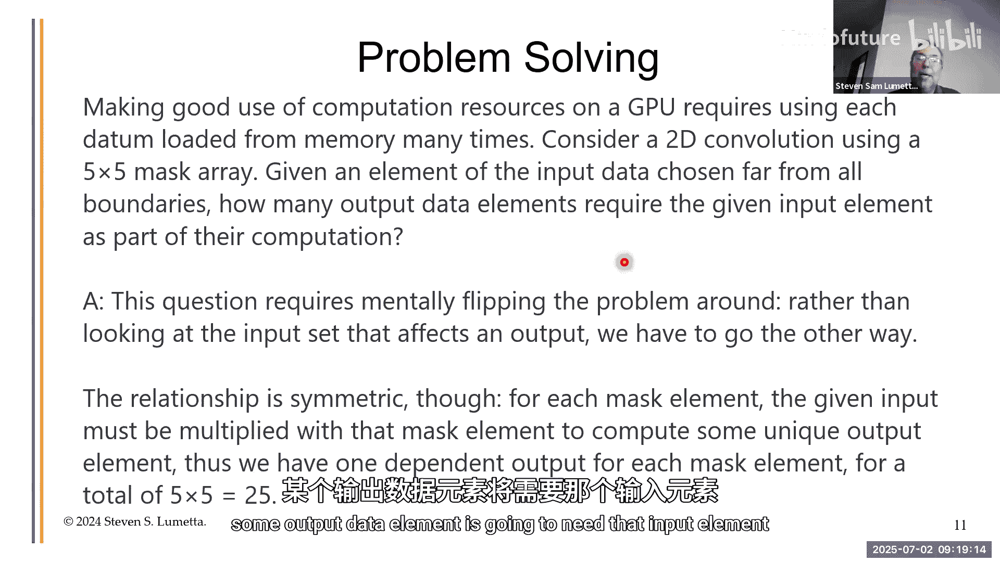
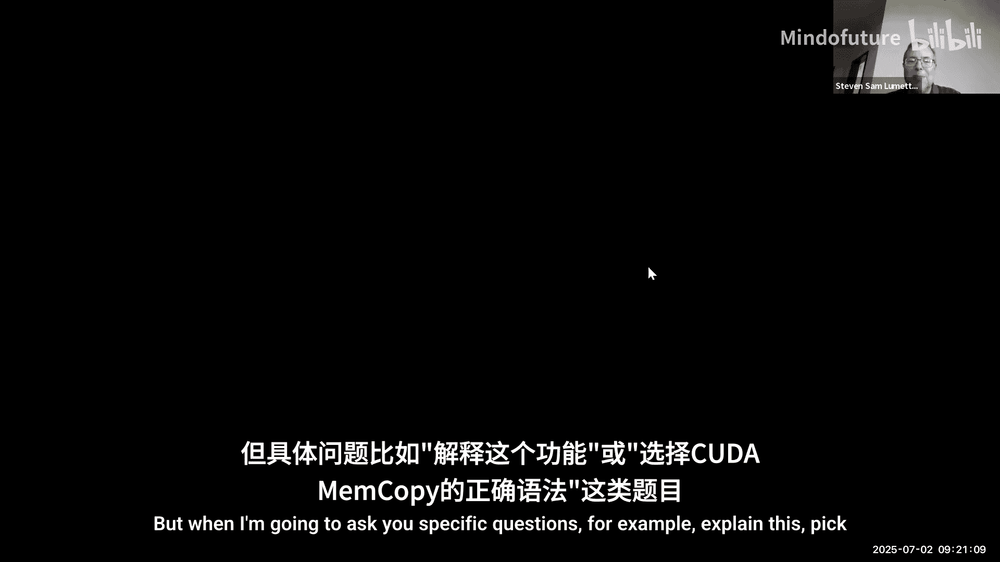
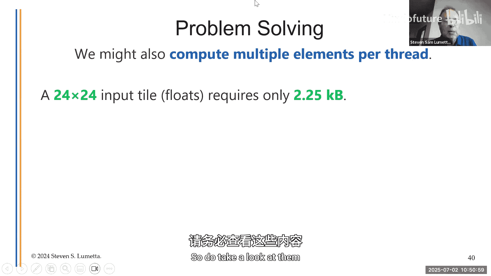

# 006：卷积与常量内存


在本节课中，我们将学习卷积计算模式，并探讨如何利用CUDA的常量内存来优化卷积操作。卷积是高性能计算、信号处理以及深度学习中的核心操作。我们将从基础概念开始，逐步深入到使用共享内存进行优化的分块卷积算法。

## 卷积基础回顾

上一节我们介绍了卷积的基本概念。卷积涉及两个数据集：输入数据集 `N` 和一个通常较小的掩码（或滤波器）`M`。输出数据集 `P` 的每个元素都是通过将掩码与输入数据的对应区域进行点积运算得到的。

对于一个一维卷积，计算输出元素 `P[i]` 的公式如下：
```
P[i] = Σ (M[j] * N[i + j - radius])， 其中 j = 0 到 mask_width-1
```
这里，`radius = mask_width / 2`（向下取整）。当掩码超出输入边界时，我们将其视为与零相乘。

## 常量内存的使用





在卷积计算中，掩码 `M` 对于所有输出线程都是只读且恒定的。这使得它成为使用常量内存的理想候选。常量内存通过缓存机制提供快速访问，特别适合被所有线程频繁读取的少量数据。

以下是使用常量内存的关键步骤：

1.  **声明常量内存**：在全局作用域使用 `__constant__` 限定符声明掩码。
    ```c
    __constant__ float M_c[MASK_WIDTH][MASK_WIDTH];
    ```

2.  **从主机复制数据**：使用 `cudaMemcpyToSymbol` 函数将主机上的掩码数据复制到设备的常量内存中。
    ```c
    cudaMemcpyToSymbol(M_c, host_mask, MASK_WIDTH * MASK_WIDTH * sizeof(float));
    ```

3.  **在核函数中访问**：由于常量内存变量具有文件作用域，核函数可以直接通过变量名 `M_c` 访问它，而无需作为参数传入。

使用常量内存可以减少对全局内存的访问压力，并利用缓存提升性能。

## 优化策略：数据复用与分块

基础的卷积核函数是内存受限的，因为每个输出元素都需要从全局内存加载整个掩码和对应的输入数据。为了提升性能，我们需要复用从全局内存加载的数据。

### 数据复用分析

考虑一个使用 5x5 掩码的二维卷积。对于输入数据中间的一个元素，它会被多少个不同的输出元素需要？答案是 **25** 个。因为掩码覆盖的 25 个位置在计算不同的输出时，都会用到这个中心输入元素。这种输入数据被多个输出复用的特性，是我们进行性能优化的基础。

### 分块卷积策略

为了利用数据复用，我们引入共享内存，采用分块计算策略。核心思想是将输入数据块加载到共享内存中，让块内的多个线程共享这些数据，从而减少对全局内存的访问。

在实现分块卷积时，一个关键决策是如何分配线程的工作。主要有两种并行化策略：

1.  **输出并行化**：每个线程负责计算一个输出元素。这是最直观的方式。
2.  **输入并行化**：每个线程负责将一个输入元素加载到共享内存中。然后，由块内的一部分线程（通常是前 `tile_width` 个线程）负责计算输出。

#### 策略比较与选择

以下是两种策略的简要比较：

*   **输出并行化**：
    *   **优点**：逻辑直观，所有计算线程都保持活跃。
    *   **挑战**：加载输入数据到共享内存时，由于需要加载额外的“光晕”区域，可能导致部分线程需要加载多个元素，引起分支分歧和潜在的合并访问问题。
*   **输入并行化**：
    *   **优点**：加载阶段所有线程工作量均衡，易于实现高效的合并内存访问。
    *   **挑战**：只有一部分线程参与计算，会造成一定的计算资源浪费（部分线程闲置）。但随着掩码增大，闲置比例会降低。

对于初学者，**输入并行化策略通常更易于实现和理解**，也是后续实验推荐的方法。它通过清晰的职责分离（所有线程加载，部分线程计算）简化了边界处理和共享内存的索引计算。

### 输入并行化分块卷积示例

以下以二维卷积为例，概述输入并行化策略的关键步骤：

1.  **定义变量**：
    *   `tile_width`：输出块的大小（例如 16x16）。
    *   `block_size`：线程块的大小。因为需要加载光晕区域，所以 `block_size = tile_width + mask_width - 1`（例如 5x5 掩码对应 20x20）。
    *   确保 `block_size * block_size` 不超过 GPU 的每块线程数限制（通常是 1024）。

2.  **计算网格和块尺寸**：
    *   网格尺寸基于覆盖整个输出所需的 `tile_width` 大小块的数量。
    *   块尺寸设置为 `block_size`。

3.  **加载数据到共享内存**：
    *   每个线程根据其线程ID (`tx`, `ty`) 计算对应的输入坐标。
    *   进行边界检查，如果坐标有效，则从全局内存加载输入值到共享内存数组 `tile` 中；否则，将 `tile` 中对应位置置为 0。
    *   使用 `__syncthreads()` 确保所有加载完成。

4.  **计算输出**：
    *   只有满足 `(tx < tile_width) && (ty < tile_width)` 的线程参与计算。
    *   这些线程使用共享内存中的 `tile` 数据和常量内存中的掩码 `M_c` 进行卷积计算。
    *   计算完成后，再次检查输出坐标是否有效，然后将结果写回全局内存。

这种策略将复杂的边界处理和加载逻辑与计算逻辑分离，使得核函数结构更清晰。

## 总结

本节课我们一起学习了卷积计算及其在CUDA上的优化。
*   我们回顾了卷积的基本原理和公式。
*   介绍了**常量内存**的特性与使用方法，它适合存储像卷积掩码这样只读且恒定的数据。
*   深入分析了卷积中的**数据复用**特性，这是性能优化的关键。
*   探讨了基于共享内存的**分块卷积**策略，比较了输出并行化和输入并行化两种方法。
*   详细阐述了**输入并行化策略**的实现步骤，这是推荐初学者使用的方案，它通过让所有线程加载数据、部分线程计算的方式，平衡了实现复杂度和性能。



理解这些概念和策略，将为你在后续实验中实现高效的三维分块卷积打下坚实的基础。