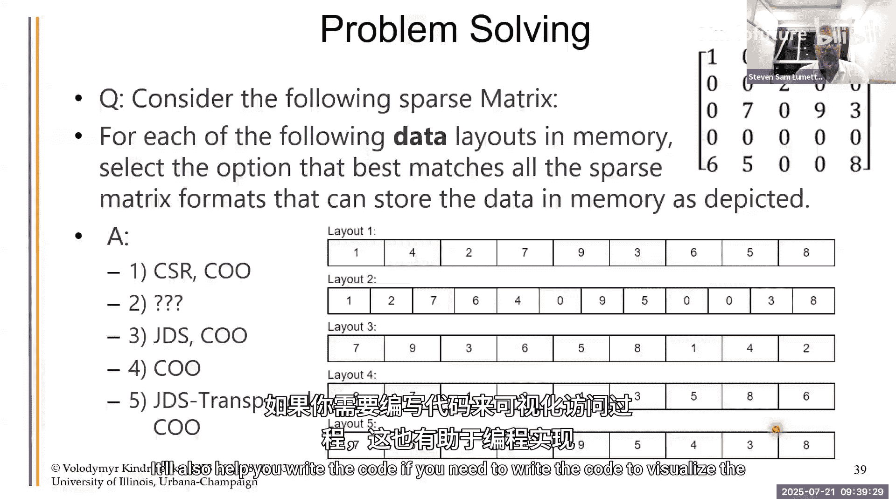
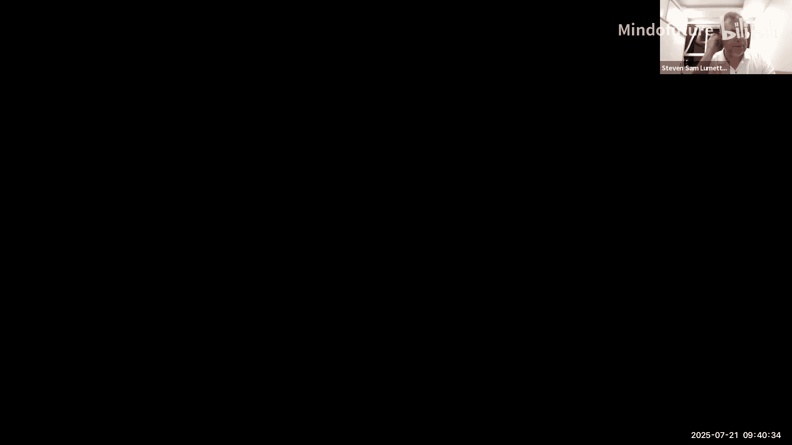
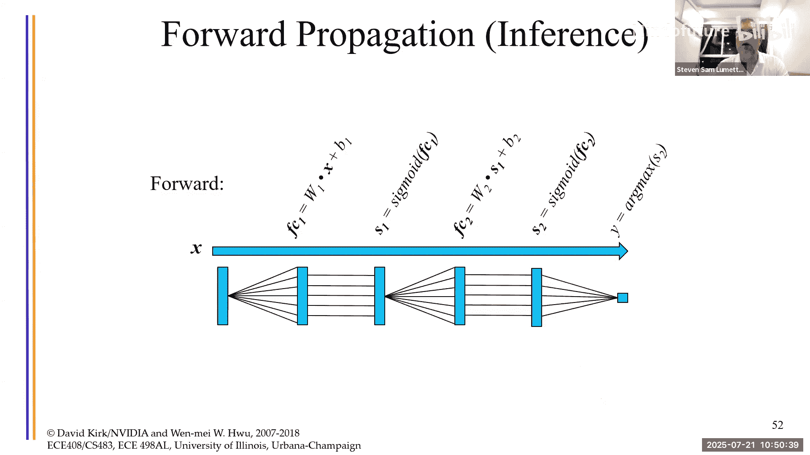

# 011：稀疏矩阵格式与机器学习入门


## 概述

在本节课中，我们将继续学习稀疏矩阵的存储格式，特别是JDS格式及其转置版本，并探讨这些格式在GPU上的性能影响。随后，我们将转向机器学习和深度学习的基础概念，了解其核心思想、应用领域以及多层感知机的基本结构。

---

## 稀疏矩阵向量乘法回顾

上一节我们介绍了压缩稀疏行格式、坐标格式和ELLPACK格式。本节中，我们来看看如何通过引入间接层和排序来进一步优化不规则数据的处理。

稀疏矩阵向量乘法的目标是计算 **Y = A * X**，其中矩阵A包含大量零元素。我们讨论过的格式旨在高效存储和访问这些非零元素。

### 压缩稀疏行格式

CSR格式包含三个数组：
*   `data`: 存储所有非零元素的值。
*   `col_index`: 存储每个非零元素对应的列索引。
*   `row_ptr`: 存储每行非零元素在`data`和`col_index`数组中的起始和结束位置（行数+1个元素）。

### ELLPACK格式

ELLPACK格式通过填充零元素使所有行具有相同的长度（最大非零元数），然后进行转置，以实现线程间更好的内存合并访问。

### 坐标格式与混合格式

COO格式简单地存储每个非零元的行索引、列索引和值。我们可以将其与ELLPACK结合，选择一个小于实际最大行长度的阈值，将超出阈值的元素用COO格式存储，从而减少填充开销。

---

## JDS格式及其转置

尽管使用了混合格式，我们仍然面临负载不均衡的问题，因为长行和短行可能被分到同一个线程块或线程束中。

### JDS格式的核心思想

JDS格式通过引入一个间接层来解决负载不均衡问题。具体步骤如下：
1.  对矩阵的行按照非零元素数量进行降序排序。
2.  使用一个`row_perm`数组记录排序后行号与原行号的对应关系。
3.  将排序后的行数据按CSR类似的方式存储。

这样，相邻线程处理的行具有相似的长度，提高了线程利用率，减少了线程束内部分线程空闲等待的时间。





### JDS格式的内存访问问题

然而，简单的JDS格式重新引入了内存访问不连续的问题，因为每行的第一个元素在内存中并不相邻。

### JDS转置格式

为了解决内存合并访问问题，我们可以对JDS格式的数据进行转置。与ELLPACK不同，JDS转置不需要填充零元素，因为我们已经通过排序解决了负载均衡问题。

以下是JDS转置格式的关键组件：
*   `data_t`: 转置后的非零值数组。
*   `col_index_t`: 转置后的列索引数组。
*   `col_ptr`: 列指针数组，指示转置后每一“列”（即原JDS排序后行数据的每一列）的起始位置。`col_ptr[i+1] - col_ptr[i]` 给出了在第 `i` 次循环迭代中活跃的线程数量。

### JDS转置的代码逻辑


在核函数中，每个线程负责计算一个行（排序后的虚拟行）的点积。线程通过比较自己的虚拟行号与`col_ptr`数组的差值来决定在每次循环迭代中是否活跃。活跃的线程从`data_t`和`col_index_t`数组中连续地读取数据，实现了高效的内存合并访问。计算完成后，通过`row_perm`数组将结果写回输出向量`Y`的正确位置。

核心计算循环的伪代码逻辑如下：
```cpp
float sum = 0.0f;
int sec = 0;
while (col_ptr[sec+1] - col_ptr[sec] > row) { // 如果该列活跃线程数大于当前行号，则该线程需参与计算
    int index = col_ptr[sec] + row;
    sum += data_t[index] * x[col_index_t[index]];
    sec++;
}
y[row_perm[row]] = sum; // 通过排列数组写回原行
```

---

## 不同稀疏矩阵格式的应用场景

以下是针对不同矩阵结构推荐使用的格式：

*   **随机矩阵/图**：通常使用**ELLPACK**格式。由于度的分布相对均匀，填充带来的开销可以接受。
*   **行长度方差大的矩阵（如三角矩阵）**：推荐使用**JDS**格式。通过排序有效平衡负载。
*   **带状矩阵**：通常使用**ELLPACK**格式。各行非零元数量相近，转置后能获得良好的内存聚合访问。
*   **极度稀疏的矩阵**：直接使用**COO**格式即可，数据量小，处理简单。
*   **具有规则非零结构的矩阵（如三对角矩阵）**：可以使用更专用的格式（如对角线存储），将结构信息编码到数据结构中，无需存储索引。

此外，还有许多其他格式和混合格式，如压缩稀疏列、分块CSR等，可根据具体应用选择。

---

## 机器学习与深度学习引言

从稀疏矩阵计算过渡到新的领域，我们现在开始探讨机器学习和深度学习。这些技术利用计算能力从数据中学习模式和关系，解决了许多难以用传统算法形式化描述的问题。

### 机器学习定义

机器学习是一种构建应用程序的方法，其内部逻辑并非完全由人类预先定义。它通过从大量标注数据（输入-输出对）中学习，自动调整模型参数，从而对新的输入产生合理的输出。这个过程称为**训练**。

### 学习任务的类型

机器学习可以应用于多种任务：

*   **分类**：将输入映射到预定义的类别（如图像识别、缺陷检测）。
*   **回归**：预测连续值（如温度预测、曲线拟合）。
*   **转录**：将非结构化数据转换为文本（如语音识别、OCR）。
*   **翻译**：将一种语言的符号序列转换为另一种语言。
*   **异常检测**：识别数据中的异常模式（如入侵检测）。

### 从特征工程到表示学习

传统机器学习依赖于**特征工程**，即由人类专家设计并提取对任务有用的数据特征（如图像的边缘、音频的频谱）。然而，对于许多复杂问题（如识别一辆汽车），定义合适的特征非常困难。

**深度学习**属于**表示学习**，它通过多层非线性处理单元（神经网络）自动学习数据的层次化特征表示。较低层学习简单特征（如边缘），较高层将这些特征组合成更复杂的抽象概念（如物体部件），最终用于决策。

### 多层感知机

一个基础的深度学习模型是**多层感知机**，它是神经网络的基本形式。

*   **感知机**：一个简单的线性分类器，计算输入向量 **x** 和权重向量 **w** 的点积，加上偏置 **b**，然后通过一个激活函数（如符号函数）产生输出。公式为：`output = sign(w·x + b)`。它在多维空间中定义一个超平面。
*   **线性不可分问题**：单个感知机无法解决非线性可分问题，如异或逻辑。
*   **多层感知机**：通过堆叠多个感知机层可以解决非线性问题。一个典型的三层MLP包括：
    1.  **输入层**：接收原始数据。
    2.  **隐藏层**：包含多个感知机，学习数据的中间表示。其计算为：`h = g(W1 * x + b1)`，其中 `g` 是非线性激活函数（如ReLU）。
    3.  **输出层**：生成最终结果。对于分类任务，通常使用 **softmax** 函数将输出转换为概率分布。公式为：`y = softmax(W2 * h + b2)`。

理论上，一个足够大的单隐藏层MLP可以近似任何函数。但在实践中，更深的网络通常能更快、更有效地学习复杂的特征层次。

### 模型训练

模型参数（权重和偏置，统称为 **θ**）需要通过训练来学习。给定一个训练样本 **(x, y)**，过程如下：
1.  **前向传播**：用当前参数 **θ** 和输入 **x** 计算网络输出 **ŷ**。
2.  **损失计算**：使用损失函数 **L(ŷ, y)**（如均方误差、交叉熵）衡量预测输出 **ŷ** 与真实标签 **y** 之间的差异。
3.  **反向传播**：计算损失函数相对于每个参数的梯度 **∂L/∂θ**。
4.  **参数更新**：使用优化算法（如梯度下降）沿梯度反方向更新参数：`θ_new = θ_old - α * ∂L/∂θ`，其中 **α** 是学习率。

通过在整个训练集上迭代这个过程，模型逐渐调整其参数以最小化总体损失。

---

## 总结

本节课中我们一起学习了：
1.  **JDS格式及其转置**：通过按行非零元数排序解决负载不均衡，并通过转置数据解决内存访问不连续的问题，从而在GPU上实现高效的稀疏矩阵向量乘法。
2.  **机器学习基础**：了解了机器学习通过数据驱动的方式解决难以形式化描述的问题，其核心是从示例中学习映射关系。
3.  **深度学习与表示学习**：认识了深度学习作为表示学习的一种，能够自动学习数据的层次化特征，免除了复杂的手工特征工程。
4.  **多层感知机**：学习了MLP的基本结构，包括输入层、隐藏层和输出层，以及它如何通过非线性组合解决复杂分类问题。我们还简要了解了模型训练的前向传播和反向传播过程。



下一讲，我们将更深入地探讨神经网络训练的具体细节，包括损失函数、梯度下降以及更复杂的网络结构。