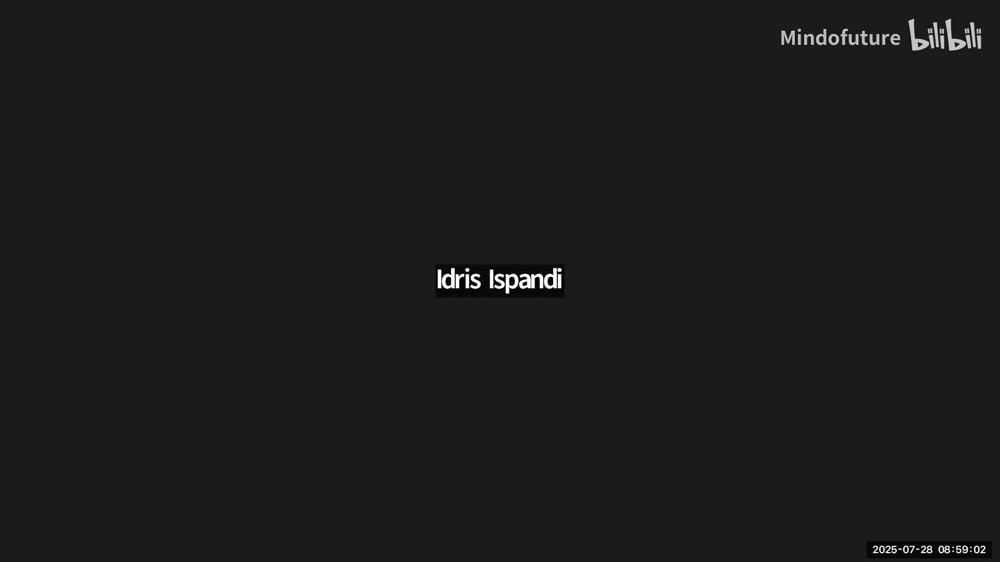
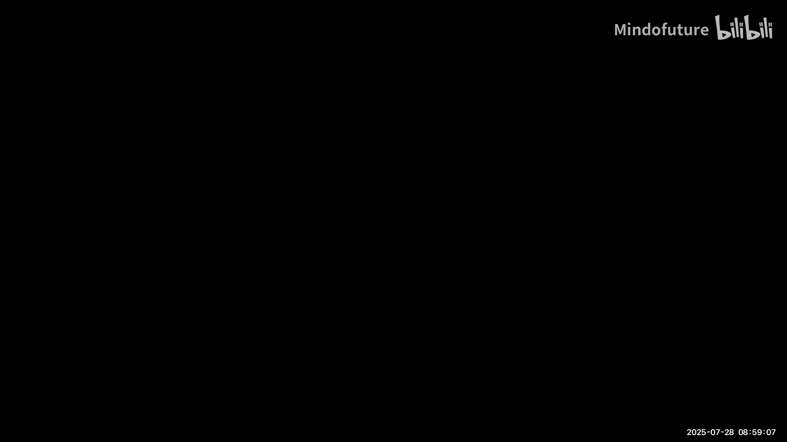
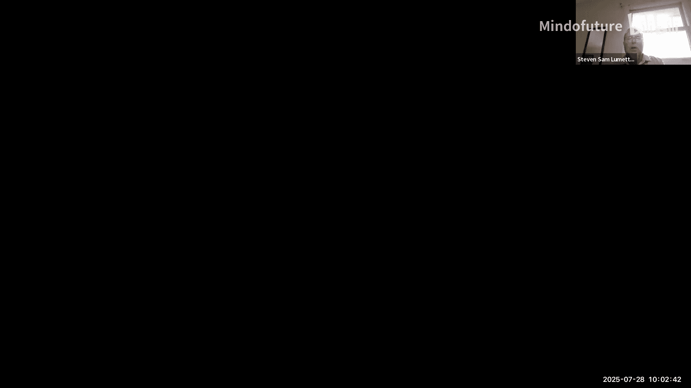
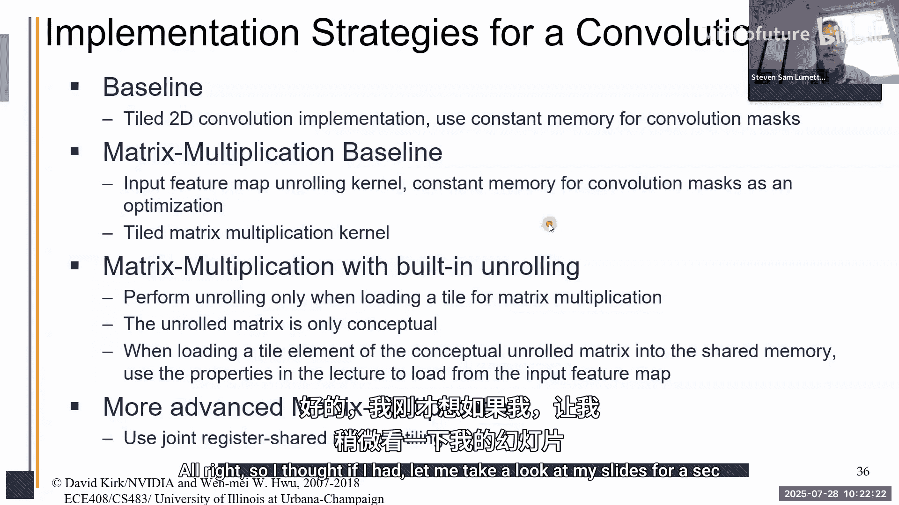
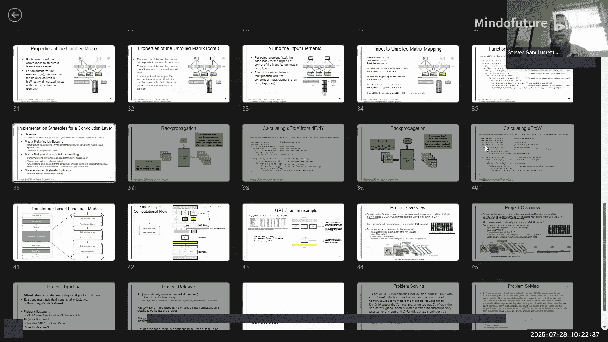
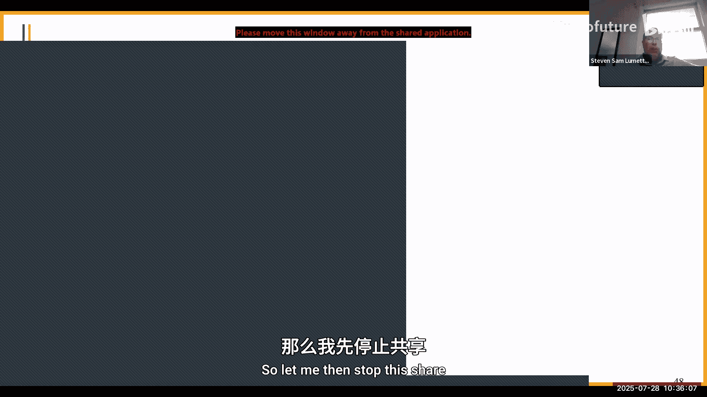
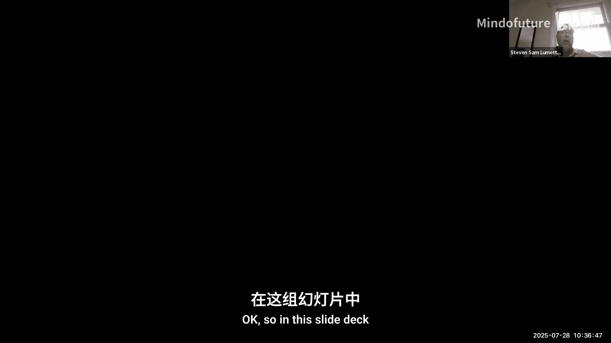
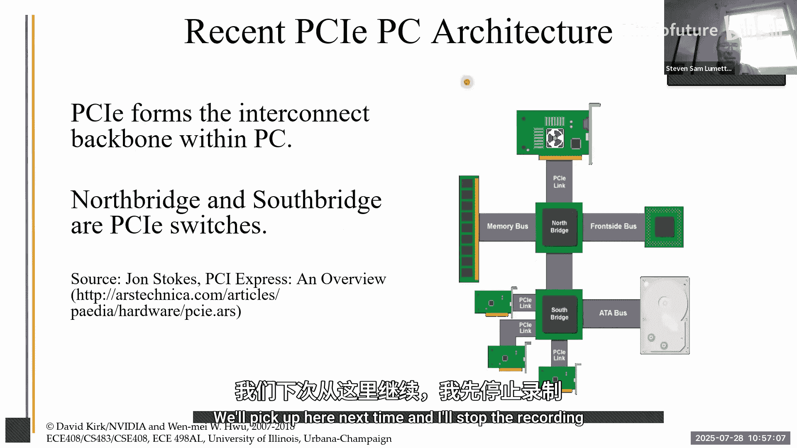

# 013：卷积神经网络层实现 🧠






在本节课中，我们将要学习卷积神经网络中卷积层和池化层的实现细节，包括其计算原理、顺序代码结构、并行化策略，以及如何通过矩阵乘法来优化卷积运算。

## 概述

上一节我们介绍了CNN的基本概念和结构。本节中，我们来看看如何具体实现CNN中的核心计算层——卷积层和池化层。我们将从顺序代码开始，逐步分析其并行化潜力，并探讨如何利用GPU架构进行高效计算。

## 卷积层计算原理

卷积层的输入称为X，包含B个不同的图像。每个图像有C个通道（例如，RGB图像C=3）。每个通道有H x W个像素。因此，输入数据集是一个四维张量：`[B, C, H, W]`。

卷积层的权重集（滤波器）用于提取特征。假设我们有M个特征图（滤波器），所有滤波器大小相同，为K x K。每个特征图对应C个通道，每个通道有一个独立的K x K滤波器。因此，权重张量的维度是 `[M, C, K, K]`。

卷积操作包括逐点乘法和求和。首先，在每个通道上进行卷积运算，然后将所有通道的结果求和，从而“折叠”通道维度。在边界处，我们忽略滤波器会超出输入范围的输出像素，因此输出尺寸会变小。

输出Y的尺寸计算如下：
*   `H_out = H - K + 1`
*   `W_out = W - K + 1`

输出Y也是一个四维张量：`[B, M, H_out, W_out]`。

## 顺序代码实现

理解并行化的第一步是分析顺序（CPU）版本的代码。以下是卷积层前向传播的顺序伪代码：

```c
// 假设数组已适当线性化，此处使用多维索引便于理解
for (int b = 0; b < B; ++b) { // 遍历批次中的图像
    for (int m = 0; m < M; ++m) { // 遍历输出特征图
        for (int h = 0; h < H_out; ++h) { // 遍历输出高度
            for (int w = 0; w < W_out; ++w) { // 遍历输出宽度
                float sum = 0.0f;
                for (int c = 0; c < C; ++c) { // 遍历输入通道
                    for (int p = 0; p < K; ++p) { // 遍历滤波器高度
                        for (int q = 0; q < K; ++q) { // 遍历滤波器宽度
                            // 计算输入像素和滤波器权重的乘积并累加
                            sum += X[b][c][h + p][w + q] * W[m][c][p][q];
                        }
                    }
                }
                Y[b][m][h][w] = sum; // 存储结果
            }
        }
    }
}
```

这段代码清晰地展示了七层嵌套循环。我们的并行化目标就是将最外层的几个循环（图像、特征图、输出像素）映射到GPU的线程和线程块上。

## 并行化策略分析

在GPU上实现卷积时，我们需要考虑如何将计算任务分配给大量线程。以下是主要的并行化维度：

1.  **跨图像并行**：批次B中的不同图像可以完全独立处理。
2.  **跨特征图并行**：不同的输出特征图M可以并行计算。
3.  **跨输出像素并行**：每个输出特征图内的像素`(H_out, W_out)`可以并行计算。
4.  **跨输入通道并行**：对输入通道C的求和操作理论上也可以并行，但这需要线程间同步（例如原子操作）来合并结果。

选择哪种并行化策略取决于具体问题的参数（如图像大小、滤波器大小、特征图数量）和目标GPU的架构。通常，输出像素数量巨大，因此跨输出像素并行是主要手段。当特征图数量较少时，仅靠像素并行可能不足以充分利用GPU，此时可能需要结合其他维度。

## 基础GPU内核设计

一个基础的GPU卷积内核可能将线程块分配给输出特征图中的一个图块（Tile）。假设每个线程块计算一个 `TILE_WIDTH x TILE_WIDTH` 大小的输出像素块。




以下是线程块和网格的映射方式示例：
*   **网格X维度**：映射到输出特征图索引 `M`。
*   **网格Y维度**：线性化映射到单个特征图内所有图块的位置（需要将二维的图块索引转换为一维）。
*   **网格Z维度**：映射到批次中的图像索引 `B`。

主机端代码可能如下所示：

```c
#define TILE_WIDTH 16
dim3 blockDim(TILE_WIDTH, TILE_WIDTH, 1);
int W_grid = ceil((float)W_out / TILE_WIDTH);
int H_grid = ceil((float)H_out / TILE_WIDTH);
int Y_grid = W_grid * H_grid; // 单个特征图所需的线程块数量
dim3 gridDim(M, Y_grid, B); // 网格维度
convolutionForwardKernel<<<gridDim, blockDim>>>(...);
```

在内核中，每个线程需要根据其线程ID和块ID计算出它负责的精确输出位置 `(b, m, h, w)`，然后执行内层循环（遍历通道和滤波器）来计算该像素的值。

这种基础实现的缺点是输入数据重用性差。同一个输入像素会被多个计算不同输出特征图或相邻输出像素的线程多次读取，导致全局内存带宽成为瓶颈。

## 通过矩阵乘法优化卷积

为了更高效地利用GPU的矩阵计算单元（如Tensor Cores）和优化数据复用，可以将卷积运算转换为矩阵乘法。





核心思想是“展开”输入数据和滤波器：
1.  **滤波器矩阵**：将每个 `M x C x K x K` 的滤波器展开成矩阵 `W‘` 的一行，该矩阵大小为 `[M, C*K*K]`。
2.  **输入数据矩阵**：对于每个输出位置，将对应的输入感受野（`C x K x K`）展开成矩阵 `X‘` 的一列。如果有 `H_out * W_out` 个输出位置，则 `X‘` 的大小为 `[C*K*K, H_out*W_out]`。

那么，卷积运算 `Y = conv(X, W)` 就等价于矩阵乘法 `Y‘ = W‘ * X‘`，其中结果矩阵 `Y‘` 的大小为 `[M, H_out*W_out]`，可以重新变形为 `[M, H_out, W_out]`。

**优势**：
*   可以利用高度优化的矩阵乘法库（如cuBLAS）或手写的高效矩阵乘法内核。
*   在矩阵乘法中，通过分块计算可以显著提高输入数据和滤波器权重的数据复用率，减少对全局内存的访问。

**注意**：在实际实现中，我们通常不会在物理内存中真正创建展开后的矩阵 `X‘` 和 `W‘`，因为这会增加内存开销和数据搬运成本。相反，我们使用“隐式展开”，即在矩阵乘法内核中，通过索引计算直接访问原始张量 `X` 和 `W` 中的元素，模拟展开后的访问模式。

## 池化（子采样）层实现





池化层通常跟在卷积层之后，用于降低特征图的空间维度，减少参数和计算量，同时提供一定的平移不变性。

最常见的池化操作是最大池化或平均池化。它在一个 `N x N` 的窗口内进行操作，并用该窗口的统计量（最大值或平均值）代替该区域。输出尺寸为：
*   `H_pool = floor(H_in / N)`
*   `W_pool = floor(W_in / N)`

顺序伪代码如下（以平均池化为例）：

```c
for (int b = 0; b < B; ++b) {
    for (int m = 0; m < M; ++m) {
        for (int x = 0; x < H_pool; ++x) {
            for (int y = 0; y < W_pool; ++y) {
                float sum = 0.0f;
                for (int p = 0; p < N; ++p) {
                    for (int q = 0; q < N; ++q) {
                        sum += inputY[b][m][N*x + p][N*y + q]; // inputY 是卷积层的输出
                    }
                }
                float average = sum / (N * N);
                outputS[b][m][x][y] = sigmoid(average + bias); // 可能通过一个激活函数
            }
        }
    }
}
```

**内核融合优化**：池化层计算简单，数据复用率低。一个重要的优化是“内核融合”，即将池化层的计算直接合并到前一个卷积层的内核中。这样，卷积层的输出不必写回全局内存，再由另一个内核读回，而是直接在芯片上（寄存器或共享内存）进行池化操作，最后只将池化后的较小结果写回全局内存。这大大减少了数据移动的开销。

## 总结

本节课中我们一起学习了卷积神经网络核心层的实现。
1.  我们首先分析了卷积层的计算原理和顺序代码结构。
2.  接着，我们探讨了在GPU上并行化卷积运算的各种策略，包括跨图像、特征图和输出像素进行并行。
3.  然后，我们介绍了一种强大的优化手段：将卷积运算转换为矩阵乘法，从而利用GPU高效的数据复用模式和专用硬件。
4.  最后，我们简要介绍了池化层的实现，并提到了通过内核融合来减少数据移动的重要优化技术。



理解这些底层实现细节对于在GPU上高效运行深度学习模型至关重要。在实际项目中，需要根据具体的层参数和硬件特性，灵活选择和组合这些策略以达到最佳性能。