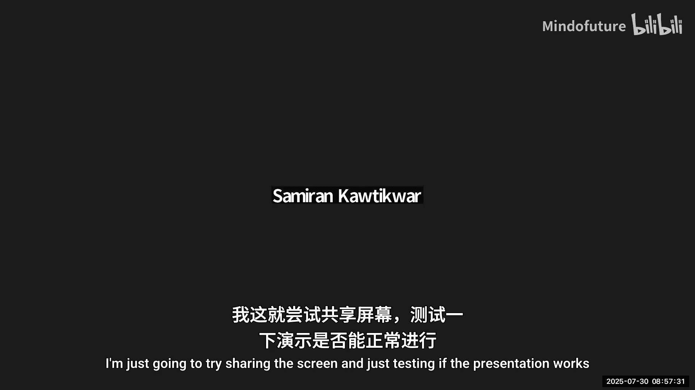
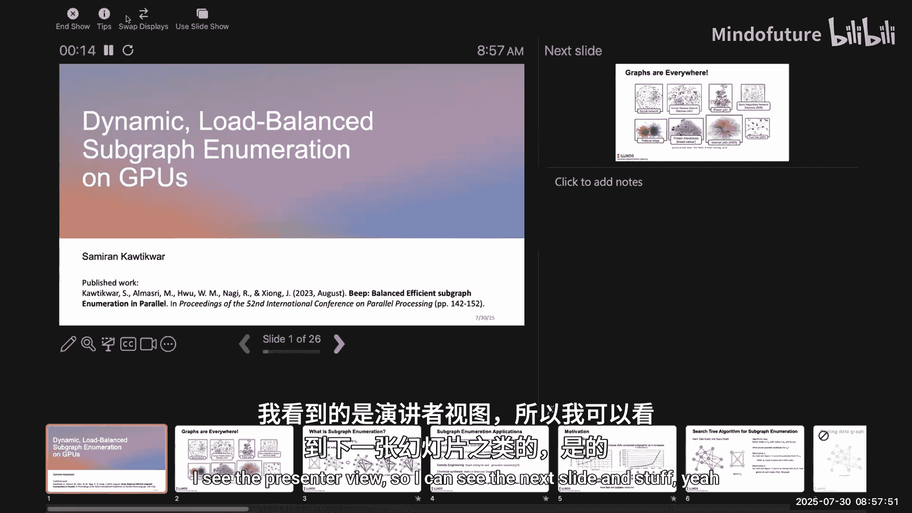
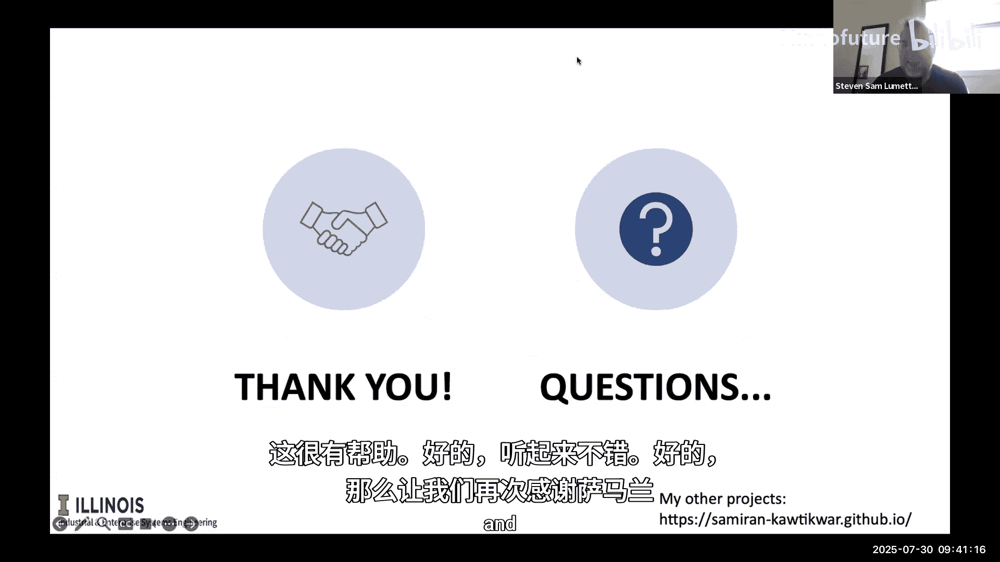
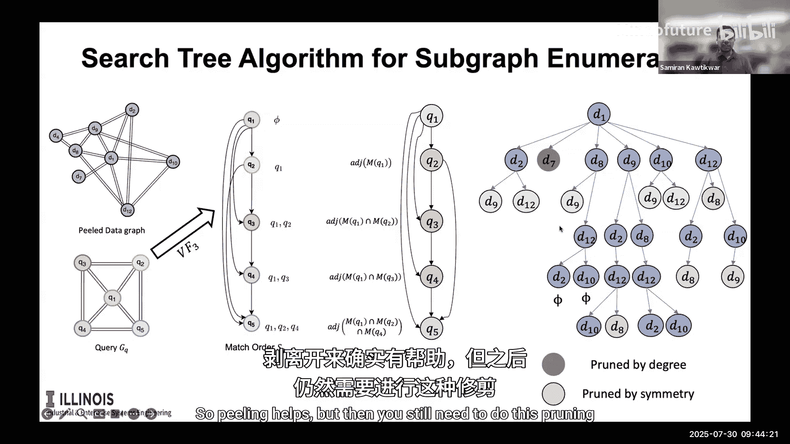
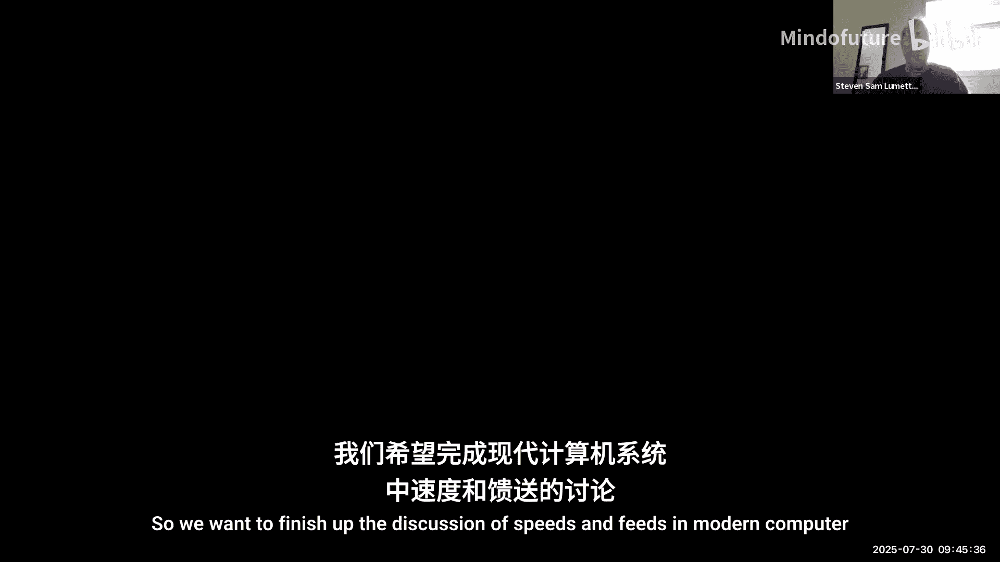
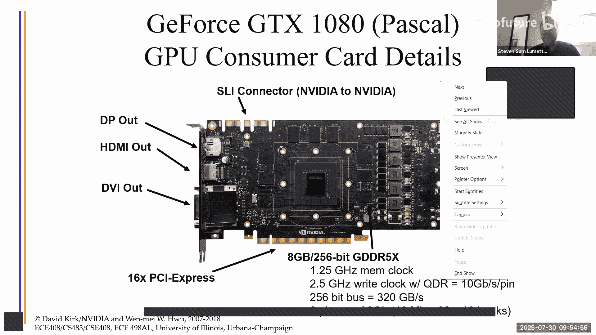
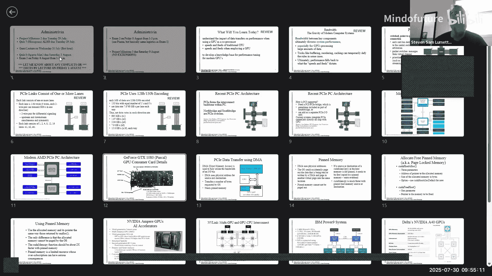
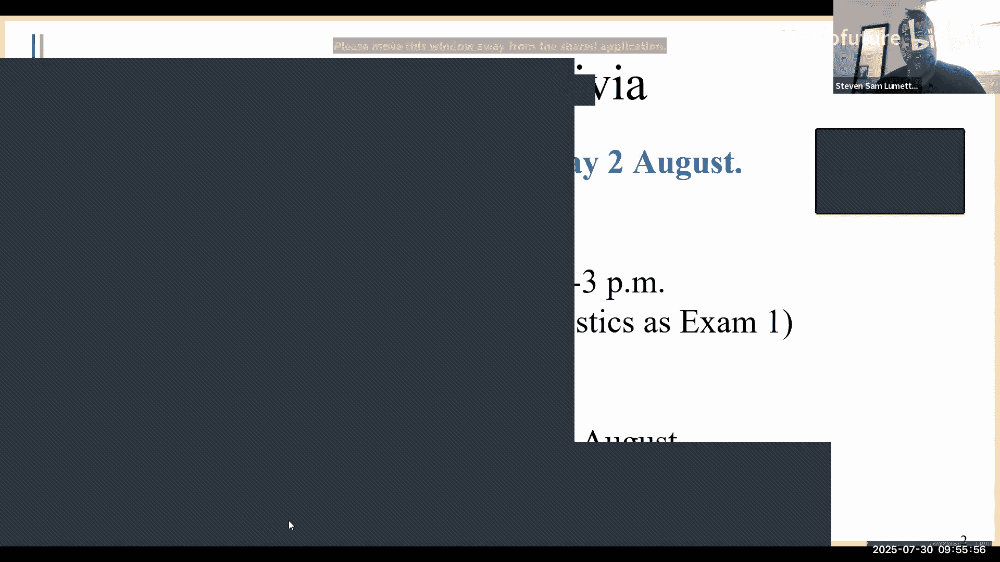
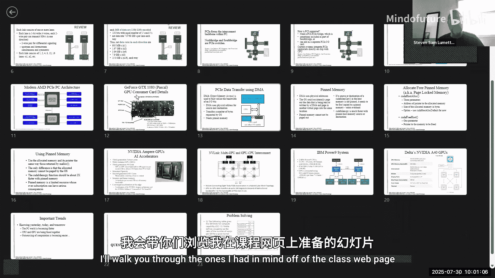
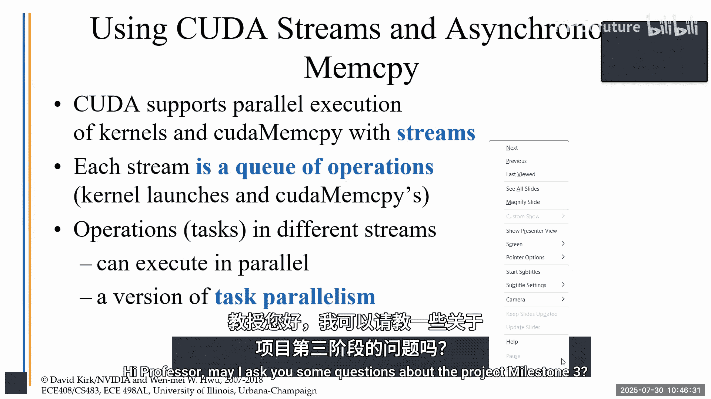

# 014：子图同构与动态负载均衡 🚀

在本节课中，我们将学习一个重要的图挖掘问题——子图同构，并探讨如何利用CUDA的动态负载均衡技术来高效解决该问题。我们将从问题定义出发，逐步深入到算法实现、性能挑战以及优化策略。

## 概述 📋

子图同构是图论中的一个基本问题，旨在从大型数据图中找出所有与给定查询图结构相同的子图。这个问题在生物信息学、社交网络分析、自然语言处理等领域有广泛应用。然而，由于其计算复杂度呈指数级增长，且需要处理海量数据，因此对算法的性能和可扩展性提出了极高要求。

## 问题定义与挑战 ⚙️

子图同构问题涉及两个图：数据图 \( G_d \) 和查询图 \( G_q \)。目标是找出数据图中所有与查询图同构的子图。同构意味着两个图在结构上完全相同，即节点和边一一对应。

### 计算复杂度
子图同构是一个NP完全问题，计算复杂度极高。例如，在一个包含6500万节点和18亿边的图中，仅查找大小为6的团（完全子图）就可能产生数千亿个实例。随着查询图规模的增大，实例数量呈指数级增长，这对内存和计算资源提出了巨大挑战。

### 现有方法的局限性
传统的解决方法主要分为深度优先搜索（DFS）和广度优先搜索（BFS）。CPU上通常采用DFS，因为它易于实现且内存占用较低，但并行度有限。GPU上更适合BFS，因为它可以充分利用大量线程并行处理，但内存需求巨大，难以扩展。

## 算法基础 🧠

### 搜索算法
子图同构的搜索算法基于逐步匹配节点。首先，根据查询图的最小度数过滤数据图中的节点，排除不可能匹配的节点。这一过程称为“剥离”。然后，将查询图转换为有向无环图（DAG），并按照拓扑顺序遍历数据图，逐步匹配节点。

### 关键操作
搜索过程中的关键操作包括：
1. **掩码操作**：根据度数或对称性剪枝，排除不可能匹配的节点。
2. **交集操作**：生成新候选节点时，需要计算邻居节点的交集。这是算法中最耗时的操作，占总计算时间的99%以上。

## GPU上的优化策略 ⚡

### 现有工作：Parsic
Parsic是首个在GPU上实现DFS的子图同构解决方案。它通过二进制编码和快速交集操作提升了性能，并采用了两种并行策略：
- **节点每块**：每个线程块处理一个父节点，块内的线程负责遍历其子图。
- **边每块**：进一步细分工作，每个线程块处理一条边，以增加并行度。

### 负载均衡问题
Parsic采用静态分配策略，将线程块固定分配给数据图中的节点。然而，数据图中节点的度数分布不均，导致某些线程块工作负载过重，而其他线程块空闲，从而引起负载失衡。

## 动态负载均衡 🔄

### 线程块调度
在CUDA中，线程块是独立调度的。每个线程块可以独立执行，且顺序不受其他块影响。这种设计提供了透明的可扩展性，但同时也带来了负载均衡的挑战。如果线程块的工作负载差异较大，会导致某些流多处理器（SM）空闲，而其他SM过载，从而降低整体性能。

### 动态负载均衡的实现
为了解决负载失衡问题，我们引入了动态负载均衡机制。具体步骤如下：
1. **启动最大并发线程块**：通过`cudaOccupancyMaxActiveBlocksPerMultiprocessor` API确定可同时运行的最大线程块数，并以此启动内核。
2. **工作队列管理**：使用全局原子操作分配节点ID给空闲线程块。当线程块完成当前任务后，将其加入工作队列。
3. **工作卸载**：繁忙的线程块可以将其DFS栈中的部分工作卸载给空闲线程块，通过全局内存和原子操作实现通信和同步。

### 性能提升
通过动态负载均衡，我们显著减少了负载失衡。例如，在某些测试案例中，最忙SM与平均SM的工作负载差异从6倍降低到1.06倍。这使得整体性能提升了7倍以上，并且在多GPU环境下也表现出良好的可扩展性。

## 总结 🎯

本节课我们一起学习了子图同构问题的定义、挑战及其在GPU上的优化策略。通过引入动态负载均衡，我们有效解决了静态分配导致的负载失衡问题，显著提升了算法性能。关键要点包括：
- 子图同构是NP完全问题，计算复杂度高，需要高效且可扩展的解决方案。
- GPU上的DFS实现面临负载均衡挑战，动态负载均衡通过工作卸载和全局通信机制有效解决了这一问题。
- 线程块独立调度的特性使得动态负载均衡成为可能，但需要仔细设计通信和同步机制。

希望本节课的内容能帮助你更好地理解如何利用CUDA的高级特性优化复杂计算问题。