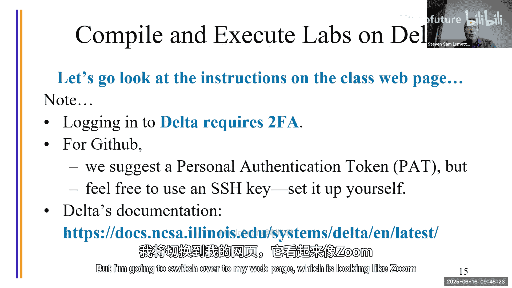
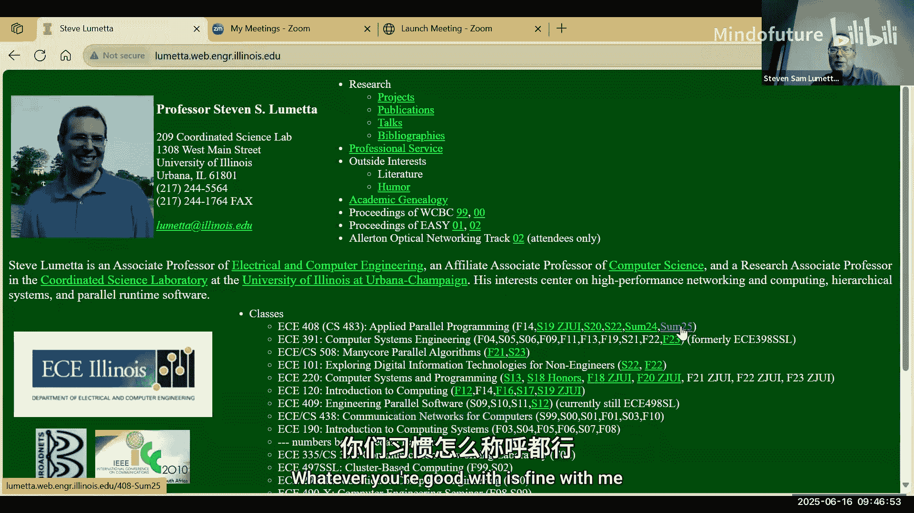
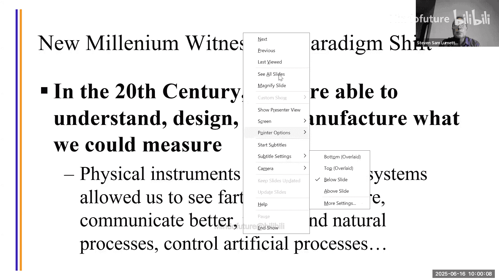
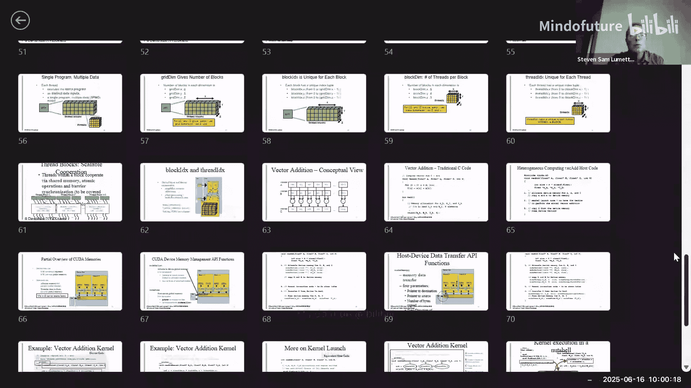
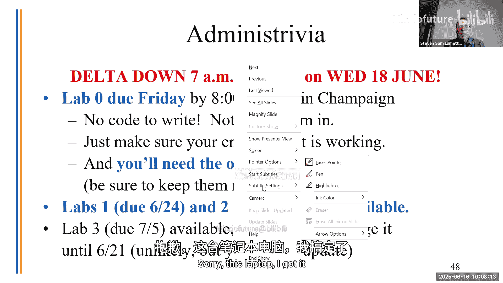
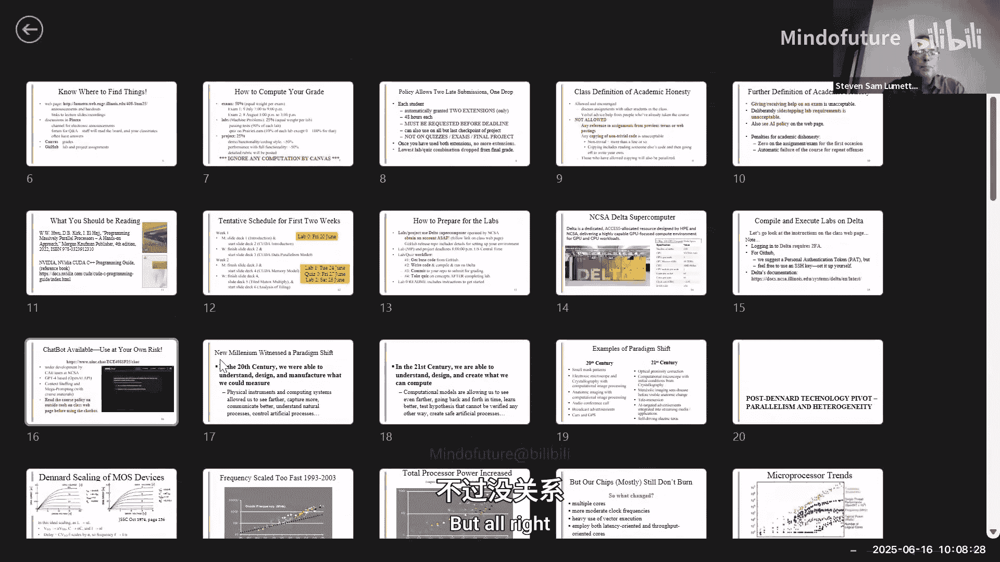
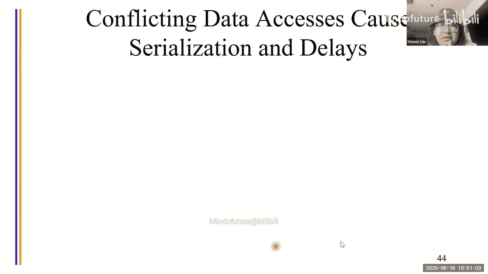

# 【伊利诺伊大学】应用并行编程2025-｜-ECE408-CS483-CSE408-Applied-Parallel-Programming-2025-p01-P01_lec01--BV1uNSyBaEcu_p1-

3lash。Okay， and then let me share。 Sorry， this was all set up on the other one， but。For some reason。

😔，Didn't。And show up。Yeah。Brein can hear me， right？You may， yeah， should be able to。谢。The sure。

Thanks。Okay， there we go。 So now we can actually start。

So welcome hope you've been enjoying your summer so far you think people were just responding to my questions Okay yeah thanks generally speaking I I guess the pop up may come in chat but it's kind of unlikely that I'll notice it so if you do have questions or you're confused by something please don't hesitate I mean normally I guess keep it muted especially if you've got cats like I do or little siblings or something making noise in the background。

But but generally just you know raise your voice， I do like to have I do like to have your cameras on if you don't mind。

 you know it's always good to see people's faces so I can see if they're looking confused or looking confident and happy or looking bored or things like that。

Alright， so welcome to the second offering of 40843408 in the summer。

 I did this last year and kind of put the material in a different order。

 and we had it five days a week。 So this summer I thought that's little that's a little tiresome to have a lecture every day for everyone。

 So what I did is I squeezed it into two days a week。

 which is what we do during the normal semester and I picked days that avoided the holidays。

 So unfortunately then they cut me from what I thought I was gonna get。

 which is an hour and 50 minutes down to an hour and 40 minutes。

 So I'm going to do the hour and 50 minutes。 We'll have a break in the middle for a few minutes anyway。

 so people can get up， go to the bathroom， have some water etc ce。

 But I will I will keep talking until about 1050 each each lecture。

 So hopefully that's okay with everyone。 or you can catch the rest online if you'd rather。😊。

All right， so welcome， oops， I think I see it was going to work。 Yeah， There we go。

 Turn this one on too。So as you're aware， the course is online， everything we do is online。

 you don't have to be in town， I'm not in town， I'm actually still finishing up because I was on sabbatical last year。

 so this week I'm in Madison next week I'll be in Massachusetts the week after that I'll be back in Madison and then I'll be in Vietnam and then I'll be back to Madison and then I'll wrap up in champpane so so I be I'll be moving around in the world and I know some of you are as well the lectures are going to be live on Zoom there's I think just one day that I can't make the normal time so what I'll do is I'll have a live lecture beforehand so that if you want to show up at the regular time and just keep your normal schedule you can but you're certainly welcome to attend the live lecture ahead of time of course as well。

嗯。It'll be available in media space as soon as it can be generally speaking。

 I'll be recording them and so anytime we use Illinois Zoom it goes up automatically on the media space。

 but it does take some time to process So if you're thinking of watching the lectures just online I guess maybe don't plan on being available at 11。

 maybe more like early afternoon hopefully the labs and projects are on your own outofclass activities。

 I know you had to sign up for lab section but there is no actual section or meeting time or anything like that all of those are done。

 we'll talk more about it but it's basically a Github repo and so you get the materials you'll get access to the Delta machine over an NCSA and you can use the GPUs on that machine you're also welcome to use your own GPU on your own machine if you'd like to but we don't sort of actively support that So I think we can try to help you but we can't guarantee。

TThat everything will work correctly on your home machine， I know a lot of people have done that but。

But we are going to grade everything on the lab machines on the Delta cluster。

The exams are also going to be on Zoom， you do need a working camera。

 so our TA will proctor those for you but you need to have a working camera so he can see you while you're taking your exam so please make sure you have that before you show up for the exams。

And the lecture slides I put up I think it's all of the material for the first exam already so you can go ahead and peruse those there aren't too many changes from the last semester so if you want to look ahead you know feel free to go through my homepage and go to I guess I mean last year so last summer's class you can look at those slides as well it's basically the same so。

嗯。So what should you expect to learn in this class so the idea of this class is to teach you how to program massively parallel processors and I'll tell you what we mean by that。

 basically GPUs for those that know what a GPU is， but program them in a way that you can get the high performance that you expect out of a graphics processing unit。

But at the same time， have some functionality and maintainability in your code。

 so be able to write code that you can expect to use for many years and have some scalability across the future generations of these path。

Now this is a class that was actually started by Wen Mehu in 2007 Okay， so in 2007。

NviDdia released the first GP GPU， general purpose GPU and。

Illinois was the first school to have a class teaching students to program those GPUs and the class was taught by Wema and by the chief architect of that chip at Nvidia David Kirk and since then Iaddo Hodge。

 who's one of Weme students has also written some additional chapters of the textbook。

 so the textbook these days says the three of them on it。

 but Illinois has really been a leader in this area and so I was actually the second person to teach this class we had as you might be experiencing now there was a little bit of a downturn in the industry。

 we had students having their internships actually canceled back then。

 and so we brought some students in because we had formed an Nvidia Center of excellence and we taught this class in the summer while I taught the class in the summer to some of those students。

So the technical subjects we're going to cover， we're going to take a look at just basics of parallel programming that's in the next even today and then on Wednesday。

 we'll look at some principles and patterns of parallel algorithms so you'll go through just a total of nine labs if you count the first one that that's really just getting your environment set up。

 making sure you know how to run code， compile and execute we'll look at the programming API。

 the tools， techniques people use for these platforms。We'll talk about the processor architecture。

 including the features as well as the constraints that are imposed by the processors in terms of what you can do and as well as the APIs and we'll look at a few of the killer applications of course the biggest killer application is of course is of course AI right as you probably know GPUs have kind of fueled the AI revolution。

Okay， so when May is awesome。 I agree。😊，All right， so。Yeah。

 We may has since retired from Illinois and is now actively working at NviDdia on next generation of technology there this should work it's not so good。

Well， this one doesn't want to work either there we go， all right。

So let me introduce you to our staff。 you've seen me on the camera that's my email there if you want to send me an email。

 my office hours will be between the two lectures in the week so same time different channel but but 9 to 11 a on Tuesdays and then Hanwen is our TA he's worked with me for gosh seven or eight years now he's I mean I knew him in as an undergraduate and then we worked together while he was still doing his undergraduate degree in China and now he has finished and become a grad student in Illinois and he's actually wrapping up this summer and going off to industry so for those of you who are interested in in getting into industry soon you can also chat with him about that as well as the class my office hours you can ask anything if someone's waiting to ask a question about class I will prioritize those so don't feel shy feel free to just drop into the conversation listen。

UIf someone needs private time， you know， we can do a breakout room okay， but generally speaking。

 just it's meant to be open， you can ask anything you want， you know， ask about industry， ask about。

 you know what you should do， what classes you can take after this， what classes。

 whatever you'd like。嗯。😊，And Hanman's office hours will be on Saturdays partly why we're choosing Tuesdays and Saturdays。

 by the way， if you take a look at our timeline on the webage。

 a lot of our labs are going to be Tuesdays and Saturdays so we'll have office hours earlier in the day for you just in case you're running a little late and feeling frustrated and you need some help it is good to get things done early and if you do show up to office hours and we can just you chat。

But。Or whatever you'd like。So let me give you a little background on myself。

 I finished my PhD in computer science at Berkeley in 1998 working on clusters of symmetric multiprocessors that means back then we didn't put multiple processors on a chip。

 but we were building boards that had multiple chips each with a processor on it and so I looked at connecting those into a bigger supercomputing system basically since then I've done research in a wide array of actually I didn't even add some of the things here。

 but I started working on optical network architecture reliability。

 processor architecture testing of chips as they came out of the fabs to make sure they worked。

 understanding information theoretically how we do test compressions so that we can do a more effective job。

 faster job of testing them looked a lot at accelerator architectures worked in GPUs。

 FPGAs over the years about a decade ago started working in computational genomics and then shortly after that。

In programming education， so I have a bunch of work that tries to create automatic TAs and then finally most recently I've been doing some solar taxonomy sorry。

Not taxonomy。Tography， basically reconstructing the solar corona with GPUs so that's the last thing I've been playing with recently as well as as starting to dabble in understanding AI models and what we can learn from them so。

Teaching I been kind of a major contributor to the undergrad core。

 122-2391 were creations of mine originally， of course with a lot of input from other faculty。

 Doug Jones helped with the creation of 120 and then many people had contributions in 220 and of course Sanja Patel wrote the textbook 391 I created and then of course other people contributed so the director of computer engineering for ZGI campus。

 this is our joint campus in Heing China with the Jjiang University there。

And then other stuff at one point way back when I cofounded a company based on packetized optics in the data centers。

 and Ive also been involved with things like Blue waters。

 which was the scientific supercomputer for about a decade and it was housed in NCSA in Illinois。

All right， so that's me。So where can you find things I did put the link to this page my apologies I know I cannot go through the college or the department at this point。

 I did put it up supposedly through them。About a month ago， I think。

And I checked it yesterday and it was there but nevertheless I couldn't go through the course pages and get to it you can always find it through my homepage or now I sent you an email with it if you're registered。

 if you're not registered。はい。Here it is。All of the announcements and handouts we will put on this page or it'll be in all of the code。

 et cetera in GitHub， which is linked through the page。

We do have piazza okay links to lecture slides， recordings I will add to the page as they're available。

Discussions， if you have questions， just generic questions and it's not office hours。

 please do make use of piazza。 Okay， so you've probably used it before。

 but it's basically just a channel for electronic announcements or questions and answers。

 We'll try to look at the board often your classmates will hopefully also look at the board and if they know the answers they can post you can post things privately。

 So if you have some concerns about people seeing your question for any reason。

It's piazza is anonymous to other students by default。

 so realize that but but if you still don't want them to see it you can feel free to post privately and only staff will see it if you're if you're asking a general question and not putting any kind of answers or anything in your question。

 we might actually make it public just because。When we answer we don't want have to answer the same question for other people and we know it often will come up so we occasionally do that Yeah usually you don't have to worry about I mean it is anonymous already to other people so don't feel too shy about asking questions there please don't put answers to labs etc cea in a public post that would sort of infringe on academic integrity of posting your answers publicly please don't do that can you can put them in a private post realize that we can also look at your githubs right so if you're working on something I can grab your code and I can take a look with you without exposing it to other people so。

嗯。Let'sy Canva we're to use for grades Canvas we only going to use for grades Okay so Canvas is a little bit in my view obnoxious Canvas will take grade information that we put into it it's one of the one of the only secure ways I can provide you with grade information that you have to authenticate that it's actually you looking when I was a student that just posted our grades on the wall。

 but these days you know people are a lot more sensitive about about having that happen and so。

We use canvas， Canvas will look at what I've typed into it and decide that it knows a lot of things about how the class works。

 which it doesn't and will tell you things like， oh， hey。

 here's what I think you're going to get at the end of the class。Don't look at canvas that way。

 it knows nothing， it really knows nothing， so please don't make use of those things and then get confused and get upset。

Yeah， it says that on our canvas page too， but sometimes people look at it and they see things like projected grade and then they get anxious so don't don't look at canvas for that purpose just look at raw grades we'll go over how we're gonna put those raw grades together generally speaking I do a curve and an absolute scale so that you can feel like you can work with your friends talk with your friends learn the most you can but at the same time you know if I make the exam too hard we're not going give only bees or something right because I made the exam too hard so so we try to do it both ways。

 I always try to do it both ways in the class to give you those those two guarantees we'll talk more about that later。

All right， so GitHub we're going to use for lab and project assignments。

 everything you'll turn in through GitHub and then we will grade it after you turn in okay。

So here is how you can see in red at the bottom just a reminder ignore any computation by canvas that are totally irrelevant here's how you will compute your grade。

 how we'll compute your grade the exams will be 50% of your grade we're going to have two exams it's not a midterm and a final it's basically two chunks of material and largely speaking the second one you kind of have to know the basics right in order to think through the questions but we're not going to focus on the first first half of the material in the second exam we're going to focus on the second half of the material so it's not a final it's not cumulative in that sense where we're going to give you questions from the first half of the class。

The weights are thus equal right it's about equal chunks of the class， we did say。

 well look everyone's supposed to be available in the final slot so we took the final slot for the second exam that's on8th of August 1 to 3 pm。

For the first exam it'll be in the evening  ninthth July I think that's a Wednesday from7 to 9 pm okay so those are two exams if you have conflicts a few people have told me already if you have a conflict please let us know soon Hanwen will be proctoring and actually Hanwn do you want to show your face because I wanted it'll give you a minute or two to chat if you want to just to so everyone knows you sorry I should have done that when I introduced you。

Well。😮，Okay， he said he was going to join us today。是。Oh， maybe he's not here， okay。All right， okay。

 something may have come up。All right， so Hanan will be proctoring。

 so please see see him and and he can arrange if you if you have a conflict。

 we like to minimize the number that he needs to proctor。 So， so， please be flexible with your time。

嗯。The labs will be a quarter of the grade。 Okay， we'll do it as equal weight per lab。

 including the really trivial lab。 So just， you know， make sure you do that get it done。

 The one where you just need to compile and run the code and then you have the output。

 You can use that on the quiz。 Very easy passing the tasks for each lab is 90% of the lab grade。

 and then we'll have quizzes on prairie learn。 Now， the quizzes will start out pretty easy and basic。

 and we get a little more challenging。 So they will take some time for you to think through things。

 So for all of the quizzes， you should get the lab done。 In fact。

 the quiz won't even be available until after the lab deadline。

 but get the lab done and be ready to think about what you've learned from the lab。

 You'll have an hour for the quiz and。😊，And it'll be 10% except for quiz0 because there's no actual work on the lab part of it。

 So quiz0 will be 100%， but it's essentially just， you know。

 did you really do it and do you have the output and there's some answers in the output There are a couple other questions for materials online but but most of it is just looking at the output of what you ran。

All right， and then the last quarter of the class is a big project， right。

 It's individual project at this point， but there'll be some demo functionality coding style。

 about half of the half of the grade and then performance full functionality about half of the grade We'll give you a detailed rubric later in in the class。

 that might start as early as maybe about three weeks out in terms of just giving you the information。

 Usually it's kind of the latter half of the semester where you'll be spending time on the project The summer is is pretty condensed right。

 we only have about eight weeks together。😊，And even the final period is really quite short and so。

You know we have only until I think the Thursday of the week after after classes and to finish all the final grading so you'll notice the labs are only about half a week right normally they're about a week。

 some of them I gave a full week because they're a little more involved but and then they'll also the last labs will overlap a little bit with starting up your project and that's just because we're so compressed in time in the summer I did also for those of you who have seen or take a look at the material for the regular semesters I did also move the material you need for the labs forward in time so that you're ready for the labs in the summer and the compressed schedule and then we'll do the material for the project after that the project is involve some AI basically and so that kind of stuff we'll talk about after all of the material you need for the labs that way you see the material in lecture before you need to go。

😊，and coat it in the lab。Allright， so policy for late submissions。

 you can submit things late two times for for the exact I'm sorry for the for the labs and then we have three checkpoints in the project again。

 we're on a hard deadline for turning in the final grade so we cant allow you to extend the last project checkpoint。

 but your labs and your first two project checkpoints can be extended if you want you can have two extensions per person。

 up to 48 hours each but you have to ask for them before the deadline of what you're turning in and you ask for them by filling out a Google form and that's linked on on our web page so you can go。

 you can fill it out。 tell us which one you want to turn in late。 the quizzes。

 you have you have an entire week after the lab deadline。

 So please don't wait for the last minute you do it well， it's fresh in your head。

 we're not going extend anything on the quizzes。 So if you do wait for。Last minute and then you know。

 you get sick。I mean， you had a whole week， so please don't ask。

The intention is not to let you you know wait for the last minute。

 the intention is to let you have some flexibility and when you get it done。

So once you use those two extensions， that's it no more extensions。

 but we will drop your lowest lab quiz combination。

 remember those are graded together usually 90% lab 10% quiz and we'll drop that from your final grade as well so don't get too stressed if you do miss something but。

But do try to do all of those things， they do contribute a quarter of the grade。All right。

 so just want to go over how we define academic honesty。

 so we do allow and encourage you to talk about the assignments with other people in the class It's okay to go to your friends who's taken 408 before and say。

 hey， you know I don't really understand this idea of of memory accesses and how they have to be structured so that the GPU can work well and perform well for me I don't get it it's okay to go talk with people about that kind of thing It's not okay to take their code or look at their code or go over their code with them or say。

 oh my code doesn't work， can you help me fix it so you shouldn't be working with their code or their assignments or showing them your assignments and having them help you any copying of non-trivial code is unacceptable if they want to write a line of code and say。

 look， this is how you write something that CoLS' is memory well， that's fine。

But having you get that in a form that you can just drop into your lab。

 you're crossing the line at that point right so more than a line or so is non trivialvial and looking at their code and then going to write your own don't do that right。

Just talk about things that's fine。嗯。😊，If you've allowed your code to be copied and you're currently taking the class。

 we will also penalize you， right， So don't think that that you're helping a friend， actually。

 you're hurting them， right， you're keeping them from doing the learning part。 So。

 so hopefully I won't have to have that conversation。 I have had it a lot of times。

 And to the point that I've actually， I've got a canned。Text explaining why， you know。

 helping your friends by giving them answers is not helping anyone including your friends in the long term。

 So， so please don't do any of those things。 So of course， giving receiving help on an exam。

 these are online。 we do have cameras， but you know if you really try hard。

 you could probably manage to find a way， please don't do that。 And I mean。

 I don't think I've ever done it， but but people do get thrown out of the university for cheating on exam。

 So please don't do that kind of thing。 sidestepping lab requirements is also unacceptable。

 So we will have， for example， two versions of matrix multiplication。

 one of them requires that you do some extra use of GPU capabilities。

 if you don't do the lab that's fine。 But if you deliberately try to trick us by turning in code that passes tests but doesn't actually do what we've required that will count as as you know failure to。

Try to solve the lab correctly， and try to just get the points for it。

 So that'll be an academic integrity violation。 So please don't do that。

 There's also an AI policy on the webp page。 So the policy is basically， if you don't realize it yet。

 a lot of what the AI does， especially in the coding side is regurgitate code that's been taken online。

 So surprise surprise， former students in the class have made their Github reoss available。

 They've posted things。 there's there's plenty of GPU code online。

 And so if you go to any copit like site。 and so， please help me write my code， essentially。

 that's someone else's code， right， And in that sense。

 you are violating the academic integrity policy。 So AI AI both same acronym， but。😊。

You's there is a chat bot if you have general questions， that's fine。

 please don't ask it to write your code。Please don't ask any AI to write your code and you're responsible for it so if we find that your code matches someone else's code and you say oh。

 I used an AI， well that's too bad right we have warned you and you are responsible for what the AI generates whether or not it takes someone else's code or it looks like freshly generated code okay。

All right， so the penalties for academic dishonesty zero the first exam for the first occasion。

 automatic failure for the course if you happen to do it again， Okay so again， you know。

 hopefully no one in the class does any of these things and we don't have to worry about it。

 but we have to have a policy to try to make it clear how we're going to interpret things so。

So I do feel obliged to go over those at the start of the class。All right。

 so where are you going to read this is our textbook in the upper right。

 this is the fourth edition of who Kirk and Elhaj programming massively parallel processors a handson approach we're going to focus mainly on coUA which is the NviDdia programming language for GPUs so the NviDdia coUDA C++ programming guide we do not require you to use any C++ constructs I know a lot of you have sort of if you're from ECE。

 you've done some C coding， you've probably all of you have probably also done some C++ coding we don't require it for this class if you're out of CS you've probably done C++ coding The thing I hesitate with is you know C++ does a lot of things for you and if you don't know what those things are it can be very easy to introduce bugs into your code so I hesitate to encourage you to use things where you don't。

allyUnder what the code generation by the compiler is doing。 Okay。

 so I think just a little bit of caution there。 So， of course， in industry these days。

 most people are going to use C plus plus。Features that it's useful to understand how those things are working before you start using。

 So just a little bit of caution and the things I show you in in in class will be in the C subset of C plus plus。

All right， so here's the plan for the first couple of weeks in the revised view。

 it'll be a little bit faster than this， but not much。

So today we're gonna go through the first slide deck， just the introduction to the class。

 introduction to kind of how GPUs came into existence and why and the differences between CPUs and GPUus and some of the issues that you'll have to think about as you write programs for GPUs and then I'll introduce you also to the couda language it's simply an extension of CC++ so your couda programs or your C and C+ post programs are valid coupa programs that run simply on the host side on the CPU and then if you add some additional code you can have a program part that runs on the GPU so we'll talk about that today we'll finish up that slide deck on Wednesday and then start the data parallelism model slide deck which is slide deck3 next week will finish that slide deck on Monday and start into the memory model and then on Wednesday we'll finish slide deck4 go over。

Tile matrix multiplication and then analysis of TyL。Slide deck 5， by the way， that's that's lab 3。

 So by the end of the first couple of weeks， you'll be ready to do lab 3， which I think is。

 is another week out after that。 Okay， before it's due。 So。

 so I think you should be in good or maybe even two weeks。

 So you should be in good shape for the labs。😊，You do need I think we've got a section where I'm going to go over to the web page so make sure that I talk with you about getting set up on Delta because that needs to happen soon the lab zero we want you to try to get done by Friday there is basically maybe 10 minutes work for you so it's really fast but you do need to get the access to Delta before you can do that so。

Allright， so also in these first two weeks， La0 again will be due Friday， the 20th of June。

 Everything's gonna be due at 8 o'clock PM。 so this Friday，8 o'clock。 and then during next week。

 we've got lab1 that's through Tuesday。 that's basically vector edition， which we'll talk about。

 I think today。 quiz 0， you'll have a week after lab0。 remember that's 100% of your lab。

 So there's no actual grading for running the code。

 but you do have to get the code runs so that you can you can answer the questions on quiz0。

 and that'll be due by next Friday at 8 PMm。 And then that's automatically coming up on prairie alert。

 Okay so make sure you've logged into Prairie learn associated yourself with our class。

 and' never been a student prairie learn。 so I don't really know how that happens。

 Hopefully it's automated or easy for you if not definitely let us know tomorrow in my office hours。

 We'll try to figure it out。 or sometime soon。😊，Okay， lab2。We'll be due Saturday， the 28th of June。

 the next day， 8 pm， another good reason to knock quiz zero out earlier。

And that's what we have for the next couple of weeks。All right。

 so how to prepare for for the labs again， all of the labs。

 as well as the project are going to use the supercomputer sitting over in NCSA。

 you need account Okay， so you need to account as soon as possible。

 we have a link on the class web page。😊，You can follow that link thatll explain to you how to go to access。

 please when you create your access ID， NCSA likes you to use your Illinois NeI。

 so please choose the same identifier for access unless someone's somehow taken it which is possible but kind of unlikely use the same identifier for access as you do for your UIU account that'll make life easy for everyone the Github release repo that we've made available。

 which is also linked from those pages also includes some details for setting up your environment So you've got to create your own repo there's a link for that it'll happen automatically you do have to log in using your netI but do those two things as soon as possible ideally today it does take a couple of days for the access people sorry access is also the name of the supercomputing management group So those people take a couple of days typically to create your account。

You set up， so please just ask for it immediately and then once it's set up， you can make use of it。

All of the lab and project deadlines will be 8 o'clock， PMm， US Central Time， daylight。

Central daylight time， summertime。And then the workflow generally speaking will be get the base code from GitHub okay there's some instructions for that in the early labs if you don't know how to do that。

 but hopefully most of you are familiar enough with GitHub at this point write the code compile it running on Delta。

 the supercomputer you'll be using one GPU but you'll be running on this collection of machines with GPs I'll show you pictures and talk about how those systems work I think later in this lecture or maybe the next lecture or the next slide deck。

When you're done and there's an output， you'll see the output。

 you'll see it says you've passed all the tests。 at least that's when you want to submit it for grading。

 you just commit to your repo so once you commit your code back or if you want us to look at it。

 commit it to your repo before it's due for example， it's fine generally speaking。

 hopefully you know already commit to your repo frequently right if you delete stuff。

 your life will be， well， I mean， these labs aren't that big but if you make things work and then you delete it。

 you're going be unhappy and we don't keep backups for you but your repo does right So commit changes to your repo。

 make sure you're not losing a lot if you manage to remove your files I don't know if you've done that but I've done that more than enough in my lifetime that source control is a good thing make you。

😊，嗯。So finally， after you finish your code and you've turned it in。

 you want to take the quiz okay so take the quiz on the concepts after you finish the lab。

 it won't become available until the lab deadline， but I think sometime in the week after the lab deadline。

 make sure you get that quiz done on Prairie learn。

 you have an hour for it and it will test you and ask you to think a little more deeply sometimes about some of the ideas you've learned and by doing the lab。

Again， the first couple are pretty easy does get a little more challenging after that。All right。

 so the lab Ze readme also has some instructions to get you started。

 so do take a look at that once you've got your GiHub repo set up and can you can look at the release readme too and you can see the lab zero read me and all the other lab read me is in there。

Allright。All right， so let's take a look at Delta So Delta is a dedicated access allocated resource so again。

 access is is the national US national group that coordinates resource allocation on our supercomputers our scientific supercomputers spread across the United States NCSA is the National Center for supercomputing applications for about four decades now it has housed many of the largest and most capable supercomputing resources for science so Bluewaters was in fact the biggest scientific supercomputing resource for many years there are many other bigger supercomputers that are privately owned owned by the Department of Energy for example。

 even the Department of Justice has some now but for scientific use those are controlled by part of the NSF basically the National Science Foundation and so we have people actually housed over at NCSA that work for。

organizationganization and help us coordinate resource allocation。

 but we have an allocation for this class from access and so you will get access to Delta supercomputer through that organization okay。

So this machine was designed by NCSA， Well， I'm seeing another chat again。DDR 6。 Yeah， yeah。

 The memory interface。 I mean， this machine has been up and running for a few years now， so。

GPU memory is DDR 6 interface。 Yes， so。Delta has a combination of CPU and GPU Okay。

 so most of the supercomputers these days will have that we will talk actually not too much in this class。

 we more talk about it than the graduate class。People have tried to build supercomputers out of low end processors。

 so。So just embedded processors， basically， So since most of the computation was being done on the GPus。

 they tried to build really low end CPUus， So embedded cores basically。

 and they found that that actually didn't work well。

At the time because a lot of work is being done on the CPU in the device driver for the GPU and so Kuda was revised to move a lot of that work onto the GP。

 So the modern libraries， you can actually do quite a bit in the GPU but we don't really get into a lot of that in this class。

 that's really the graduate class， which I'll be teaching in the fall。

 all of those videos are online。 So if you're just interested， you can watch those。

 you might want to wait till you're finished with the introductory material。

 but Delta has some pretty capable CPUs。As well as GPs。

 so I'll show you I'll show you that connectivity shortly， but the GPUs are a40s。

 So these are a few years old now。 they're four way a40s connected by Nvlink which is a high speed interconnect。

 We're only going to be using one GPU at a time in our class。

 feel free to play with them and look into how you can use more than more than one GPU。

 but it's beyond the scope of our class。 so 100 nodes in Delta， each GPU is an a40 invi a 40。

 there are four of them in each node， so 400 total the GPU memory is 48 gigs of DDR 6。

 there's an AMD Millan CPU， there's one of those。 you've got one CPU and four GPus for each of the nodes and then you have 100 nodes in Dlta。

Then one CPU then has 64 processors in it， so we call them cores typically to allow ourselves to call the chip a processor still but so you've got 64 processors if you prefer cores right and that means since you only have one of those CPU chips you've got 64 CPU cores per node as well those are clocked at about two and a half gigahertz the GPs are typically clocked more like one okay。

And then you've got RAM as well on the CPU side， that's 256 gigabytes。

So that's the basic parameters of your Delta nodes。And my。Clicking is not working， get there we go。

So you're going to compile and execute on Delta so I want to switch over for a minute。

 So sometimes when I do this I forget to switch the share， so please do remind me if I ever do that。

 but I'm going to switch over to my web page okay， which is looking like zoom， but I have okay。

 it's not。

There we go。 All right， so this is the link if you ever need to rapidly remember where to go and you don't have the class page bookmark。

 type my name into your search engine， it should come up with my page。

Someone took my last name for a company。 I don't know。 what's up with that。 So type Steve Lemeta。

 That'll work。 Yeah， you can call me， Steve， and call me Professor， You can call me Professor Steve。

 Professor Lemeta。 Whatever you're good with is fine with me。 If you say， hey， you， I probably won't。

Listen， but。Alright， so here is， here is our class page， which you probably have seen already。

 And this is the link that you will follow。 So let's just go ahead and click on that to get started with Delta。

 Okay， so when you're ready after class， maybe or later today， go ahead and click this link。

 I guess I can probably do it， I already have an account， but。😊。

So this will take you over to access and then you know they tell you please don't create another account and then shows you how to do New Year's of registration so this is what you'll need to do if you don't already have an access account if you have one you're gonna have to do password recovery which I know can be a little painful so please get that started soon if you if you started 408 and then drop the class。

 you probably already have an account So you will have to go through that to get your account recovered。

If you did keep access to it。So once your accounts created。

 then you go over to this form and this will tell us what your access ID is and we need to know this so we can get you started as well okay。

So do this immediately once you have your access ID and then we can we can get you started this bit down at the bottom is just so Hanwen can sort of separate what he's done into groups。

 I think not too many of you have asked yet， but those of you who have already gone through this process。

 I see one of them on the participants list， have you already gotten access to Delta。

If you already went through this process。Destiny， I see your name there。

 So if you don't mind my asking you， are do you have access to Delta already。

I took 408 last semester so I had no idea Okay okay so you had it already did anyone who's already given us your access ID and didn't try to take 408 before get access yet。

To Delta。Now one okay all right， well hopefully those things will be quick I know unfortunately they scheduled a downtime so I should warn you they have downtime on Wednesday from seven to7 so7 a to 7 PM so your students you'll probably be asleep most of that you'll be in lecture for two hours。

😊，But but you can't really work on Delta during the daytime until until evening on Wednesday okay so if that's a problem or if it causes people to be delayed。

 let us know hopefully it won't be an issue， but but they did schedule some maintenance this Wednesday so。

All right this tells you how how to set up your repo with us down here so you just click this link I don't want to do this because I think it might try to create another one for me it might cause problems it shouldn't but mine's already set up and this is the release repo which you should have access to it's just public but you have to sign in I don't want to sign in right now so you have to sign into Illinois CS coursework and then you can see our release repo。

All right， so hopefully that process。 And again， you know， that's our class web page。

 followow that link right there。And then Canvas link， Piazza link， course policies we talked about。

 Zoom link for the lectures。Zoom links for office hours are down here。

 so another I had another lecture link oh it's down here。Maybe it's not down here， or I headed。

Textbook timeline。Okay， well， I thought I had a second link。 But this one。

 this one is live right here for the for the zoom。 So I just want to make sure that if you if you wake up late or something and you're scramblembling。

 you know how to find the class quickly。 Al right， this is our timeline。 I mean。

 we kind of talked about it already， but。Basically lab zero due date for the labs is over here on the left due date for the quizzes is over here on the right okay so make sure you're looking at both of those columns exams are in bold as a reminder project deadlines are not out yet but we'll do that separately again probably early July so two or three weeks from now we'll get you those those deadlines okay。

All right。这。Yes。Yeah， DDR6 is available on GPU for a while， I think。So we need to go back。

 can reshare PowerPoint。Here we go。All right， so。Yeah， we have some advice in those pages as well。

I think we don't recommend until lab3， I think it'll be stored encrypted so it's a little safer。

 but you can tell Github to keep track of your personal authentication token so create one you'll have to do2 FAA to get into Delta you can use if you're logging into access with your U of I credentials which you can do then you can use your preexisting。

Let me retract that I think you need to use NCSA duo as well for that at least I do。

When you log into access， you can use the U of I credentials。

 but when you log into Delta you might need to use your NCSA duo so you'll need to set that up as well。

 once you get into Delta to access Github I suggest using a personal authentication token we have some instructions if you never use one it's really easy。

 but you just need to keep track of it and then in lab3 there's a hint on how to tell GiHub to keep track of it for you make it a little easier so you just use that in place of your password I would discourage you I mean I know it's easy but security wise you know please don't put your private key copy onto Dta right I mean you don't want to have your private key distributed more widely than it's necessary so keep your private key private on your own machine don't copy it to Delta so that you can use it easily use a patent instead it's a little safer for you。

Okay。And if what I said made no sense， just follow the directions for the Pat， sorry。

I know not everyone has done a lot of security stuff。

 but if you have an SSH key you can set it up and then you you know if you're using it directly from your machine that's a lot easier right so do that on the repo that's fine but for the Delta access I would suggest using the I do。

I'd recommend it if you're wondering how to use Delta and you want more more familiarity with it。

 there is a documentation guideline for all deelta users here。

 I think that's also I think it's also linked in the materials I just shown you on on the web page okay。

So it should be easy to get started and thank yous。All right， there's also an AI resource。

 this is put together by the CAII team at NCSA Vlod Kidertenko whos been teaching the class。

 he and I are actually the only people teaching the class anymore here at Illinois we're hoping one of our newly faculty will pick it up as well。

 but for now he and I are the only one teaching the GPU classes and he has been teaching them for the last year。

 well I'm on sabbatical and he also created this chatbot so the spring one is still open。

 it's based on GPT4 with context of all of the materials from the spring offering of the class。

So if you have questions about the class and it's not office hours。

 do feel free to go use it Okay so if you're familiar with G4 it's using the context stuffing and megaproing fine tuning extensions there basically making the context with the course materials right So when you ask a question all of the course materials。

 all the lecture slides and handouts and everything are part of that part of that material obviously don't ask it oh。

 what's the deadline for lab too because you're gonna get the spring spring 25 it should say I don't know oh I just didn't update the picture you follow this link you'll get the spring 25 offering but if you ask it about deadlines you'll get the spring 25 answers right which are maybe make you nervous when you know that you're so late turning into your lab but。

But do make sure if you're going to use this that you're not asking it for answers right so this is an AI just like all the other AIs out there that you can play with and if you ask it to generate code for you and you use that code in your labs and then we say。

 hey， this is someone else's code， that's your responsibility so it's not it's at your own risk。

I mean， unfortunately too， and you may or may not realize this about AIs these large language models have no ability to understand what they know and what they don't know okay and so my favorite example is there are many examples maybe I'll give you two one example is just to show you that they don't have any clue what they don't know so one of our faculty he showed us as example I don't know if he made it up or if you got it from someone else。

 but you can ask so what color are my pants？Okay， and for all of you， you'd say， well。

 how the heck would I know your pants aren't in the camera， right？

 If you ask some of these large language models， they'll say， well， you know， most likely。

 the most common thing I've seen is khaki。 So they'll just say， oh， your pants are khaki。Like。

 so it has no clue that it doesn't have a camera， right， that it can't see you。

 that it doesn't know or have any way to know what your pants look like or whether you're even wearing pants。

 maybe wearing something else， right？ maybe youre wearing pajamas， right， Who knows。

 But but it doesn't know。 And nevertheless， it will state unequivocally oh， your pants are khaki。

Great， so when you get an answer out of a large language model， it may or may not be correct。 Okay。

 so even though Professor Kenertenko has done his best to try to give you insightful answers by stuffing all of the all of the context from the class into the chat bot。

 it may give you incorrect answers。 So if you come to me and tell me， oh， you know。

 I was doing the exam and I had asked this question of the chat bot and I gave it the same answer I gave that answer on my on my exam and I got I got marked off。

😊，The chatbot is not a member of our course staff okay if I mislead you or if Hanwinn mislead you and you subsequently give the wrong answer。

 I'm happy to give you a point that if the chat bot mislead you， I'm sorry。

 I can't help you with that。So just be careful with it Okay one good thing the chat bot does do is it will point you to the class resources Okay。

 so it will tell you where to find the answers so if all you read as the AI summary that's your risk okay if you go back to the lecture slides and you look at them and you say now I understand it then you should be okay Okay so be careful with using the the AI any AI。

哎。Oh， I told you I'd give you the other example， so the other example was really quite funny。

 so someone asked a large language model， how many rocks should you eat each day？ Well。

 according to UC Berkeley geologists。😊，One was the answer。I don't think you'll find any， I mean。

 I'm a Berkeley grad， so maybe I'm biased， but I don't think you're going to find a UC Berkeley geologist who recommends that you eat one rock per day。

Allright， so my timer went off we in the middle of class， I do want to take a five minute break。

 so let's take five minutes before we get started talking about the origin of why GPUs have come to be one of our main computing platforms just you know have a drink of water I will come back and start again in five minutes you can feel free to ask questions if you like。

 I may get up to grab myself more water， but but I'll be around。😊。

And I will start again in five minutes。Next。

All right。All right。 So let's go ahead and get started。 I think that's5 minutes。

So also what I like to do with a break， I usually like to do all the Ada。

 I mean we've kind of gone over most of this stuff but in a normal lecture know I don't want to put the administrative at the start in case someone comes in late。

 you just get started and then they can still see the administrativeial stuff。

So I mentioned already Delta is going to be down this Wednesday。

 so please don't get confused if you're trying to get in， you won't be able to。

 even if your accountsor all set up because they're doing some maintenance La zeros do Friday。

 there's nothing no code to write， nothing to turn in。

 we just want to make sure that you can get into Delta and that your environment is working you do need the output so once you run the code。

 make sure you keep copy of the output I mean honestly for convenience。

 you might want to bring it back to your own machine or something so you don't have to log into Dlta while you're taking the quiz up to you but you do need the output because there's some numbers in there that are not going to be easy for you to generate that we ask you to type in prair line okay。

All right。Yeah， so yeah Delta is in NCSA is in on campus。

 so it's in champaign so these are all champaign central daylight times。

Let's see the labs due Tuesday，6，24， Saturdays，6，28。 I think I'm getting the days right。 Lab 3。

 I mean， those are the those are the right dates， but。I'm pretty sure those are also， let's say。

 So Friday is the 20th and yeah。 All right。 And then lab3 is not due until July 5。

 Okay so it's available generally， my policy is we're going to try to not make changes more than two weeks in advance we'll get the labs out so that you can work on them for a couple weeks if you want to whenever you want in that two week period。

 I mean we're probably not going to get to the material two weeks in advance。

 So you might be working ahead if you start immediately on the release， but at least in summer。

 but we won't make changes right So if somehow we found a bug， it's unlikely at this point。

 but if we found a bug in our lab， then you know you could turn it in with or without fixing that problem in our in our description。

 that way you don't have to worry that we're gonna to come the day before the due date and say oh。

 we've changed the rules for the lab and turned it in already I didn't really want to go work on it。

 I've got some。Other class or real life and get done all right so。So that's administrative for today。

 So let me go back to our slides。 sorry， this laptop， I got it。 it has a GPU。

 I thought it would be fast， but it's actually ridiculously slow。

 You'll notice as I get into slides with animations that it can't actually even animate quite properly。

 sometimes。

But。

All right。So。Let's talk about GPUs in the 20th century we were able to understand design and manufacture what we could measure Okay。

 so physical instruments， computing systems， what they did back then was they allowed us to sort of see further capture more communicate better understand some natural processes。

 you know control machines in an assembly line right there were robots back in the 20th century surprise。

 surprise。But in the 21st century。Things are actually more much more based on computing。

 so I'm in Cambridge teaching some high school students next week。

 and so I looked up the chemistry 2024 Nobel laureate。

 and you know it's based on folding using AI right understanding how molecules act based on computers right so everything we do now usually is preceded if not completely replaced by computational models even when we started when blue waters were wrapped up in 2012。

 the first application was was imaging from first principles physics imaging the AIDS molecule so we actually Klaus Schulteds group using NandD not another molecular dynamics code that was developed in Illinois working with Sanjay Collay's。

😊，Turm plus plus。Programming language， they were actually the first ones to ever be able to sort of see what that molecule looked like。

 right， to make a picture of it。 And that got a nature publication for them within three months of that machine coming online。

😊，So that kind of thing computational models allow us to see even further than we have physically right to go back and forth in time。

 look at the origins of the universe， find better ways to learn with with machine learning test hypotheses they can be verified any other way。

 create safe artificial processes， etctera， etc right this is really a change these kind of things were not used widely if at all prior to the 21st century I mean when I was an undergrad。

 I was a physicist and。😊，I was actually literally surprised when I started applying for grad schools。

 and they expected me to know computational physics。

Who cares right Why would I care Because what I was taught is there's experimental physics and there's theoretical physics。

 And no one said， oh， and we also do some physics on computers right And these days。

 there's a lot of great physics being done on our supercomputers but that's a change so it give you some more examples in the 20th century。

 we got smaller and smaller masks when we're making semiconductors in the 21st century。

 we started inverting inverting the process of the optics computationally So well what are we trying to do and how is diffraction through the mask going to affect what we actually build and so let's invert the diffraction computationally so that we can come up with a mask that when the diffraction happens actually produces the correct chip design。

 in a way that is reliable and produces chips that work。

 even though the frequency of the light is much longer the wavelength of the light is much。😊。

Bigger than the actual things we're drawing on the chip， okay？

So we're not using a lot of x rays as we thought we might to build chips。

 because we figured out ways to computationally correct the optics， for example。Electro microscopes。

20th century technology， crystalography of computational image processing， right。

 now we have computational microscopes where we're doing the crystallography and actually computationally recovering what the crystal structure looks like。

 I actually met someone who does this in their daily work a week or so ago but now we're doing computational to get that information out anatomic imaging with computational image processing。

 my colleague Jepaleone， he can actually see atomic deposits in your brain right when when he does an MRI right so the computational aspect。

 he can see at the atomic level， So you think， oh， my mom has Alzheimer's right。

 maybe your grandparents may have hopefully not， but maybe they have or will get it。

 It's associated with calcium buildup right So you know now we can maybe predict it much more reliably because we can see oh。

 you've got calcium buildup in in your brain。😊，By doing computational imaging from an MRI right so the machine hasn't really changed much。

 I mean we are building bigger and bigger magnets， more powerful magnets， but we're doing much。

 much more processing on the computing side which is why these things have become much more powerful 20th century you can do audio conference call now we have Zoom。

 we have teleimmersion okay。😊，Broadcast advertisements。 Now you have AI targeted advertisements。

 I mean， you grew up with these probably right， but now you expect things to be of interest to you or hopefully。

 I mean， honestly， they're not still not that good in my opinion。

 but maybe I'm just not that interested in ads， but they do try to target you right They do try to figure out what you're interested in and figure that out and try to give you something you're more likely to click on right Cars and GPS soon。

 if not today will have self-driving electric taxis。

 right You can just get in and it will drive you somewhere。系。All right。

So how did this happen It was really happened after what we call the post denard technology pivot So I need to explain denard scaling to you so this is really kind of the heart of what most people would call more law so denard scaling of metall oxide semiconductor devices and what you see here a couple old plots from this JSSC paper in 1974 but the idea was。

 well in the next generation of chips， maybe I want to take my feature size L so it might have been some number some number of microns and I want to scale it down right so alpha maybe is half so I want to make those features。

 the wires， the sizes of the transistors， I want to make those half half is big so alpha say half。

So when I do that， I'm going to lower the voltage， okay？Because when I。

 when I make my my devices smaller， I can drive them with lower voltages。

 And so I can use half of the voltage。 I can see VDD， the voltage I'm using to drive my electronics。

 my transistors goes down by a factor of alpha or multiplies by a factor of alpha and the capacitance also my capacitors get smaller。

 And so I can I can make them smaller by a factor of alpha and my current flow to charge those capacitors in the same。

😊，Yeah， my current flow， I can also reduce right by factor of alpha multiply by alpha。 So they say。

 well， what happens to the delay。 So delay is， how long does it take to get enough charge on my transistor to turn it on or off。

So multiple delay scales as the capacitance times the voltage divided by the current。

 the the higher the current， the faster I get electrons， say into the capacitor and the capacitance。

 I have to fill it up and the voltage， I have to generate that voltage。 So C V DD over I。 So I say。

 well， each of those scaled by alpha。 So my delay scales by alpha。 But remember alpha was say a half。

 So my delay goes down by factor52， and I can now drive this chip twice as fast，1 over alpha。😊。

The power at the same time for each of my transistors， when I turn it on and off。

 I need to move those electrons around。 So power scales by c times v squared times F。

 And if you do the math， all of those alpha factors in there。 you say well。

 C and V are both alpha and frequency is one over alpha。 So I get a factor of alpha squared。

 so you say， well， in a fixed area of my chip， now I've got one over alpha in each dimension right so if alpha was half now I've got twice as many in each dimension。

 so in a fixed area of my chip， I have four times as many transistors。

 but my power is going down by alpha squared so my power per transistors going down by a factor of four my number of transistors in that area is going up by a factor of  four and I have an equal amount of power So given a chip size。

 I've got the same power going into that chip that was den scaling。

 So as we make everything smaller that the power just。We drive the chip with the same power。Now。

 that didn't work， right， Or rather， people didn't follow the rules。 What they did is they realized。

 oh， well， I don't really have to go that slow。 In fact， I can drive my transistors faster。

 So what you see here is years on the bottom。 So the 80s，85 on the far left going up through about 0。

5 on the far right。And you see real ship designs， processors Denard scaling would have carried us along the dotted black line right so you see those purple and orange points over on the left and Denard scaling would have kept us on this black line and around 2005 we'd be closing in on gigahertz speeds but supercomputers had already done gigahertz speeds in late 80s。

 early 90s and so processors started saying gee， maybe I should try desktop processor manufacturers like alphas in the early 2000s were out gigahertz processors so you can see they were violating the rules they broke the rules on denarard scaling and started driving the processor clocks much higher speeds than we expected based on the scaling down of the transistors。

So what that meant is that around 2004， we had power problems。 Okay。

 so total processor power started increasing。 So in the same period， actually ending an 03 here。

You can see that the processor power was ramping up。 I think these are watts on the left。

 And so we hit the point where we were using about 100 watts per chip， but it kept going up。

 And if we followed what people had been doing we would have had chips literally bursting into flame。

 because we had no way to pull that power back out of the chip。

 the methods we used were inadequate to that task。 supercomputers at the time。

 some of the craze used liquid water cooling or there was even a cray designed and built that used liquid nitrogen so people。

 sorry， people kind of knew how to do that technology。

 but no one wants to have liquid nitrogen in their house So there not many people want to have liquid nitrogen in their home cooling off their computer And so it was a problem。

 And so Intel， for example， around 2004 actually had to cancel the product when they realized that if they put it out the processors in people's houses would just start on。

And that's not that's not a feature， right， so we hit a power wall。

And so what changed as a result of that power law powerwall in the industry was the industry started building multiple cores and that happened really quickly。

 so even around 2007， it was kind of funny because no the software industry had not embraced parallelism at all okay but around earlier than that。

 maybe 2005 2006。When we go in and neat with the semiconductor industry。

 we had some big centers back then。 and Intel would tell us， you know， you software guys。

 you need to be ready to program 128 processors next year。 And most of the software industry like。

 we don't do parallelism。 parallelism is hard。 We don't put up with that。

 right that's for supercomputing。 We're not doing parallelism。

 But the chip started having multiple cores very， very rapidly。 as I mentioned， the ones in Delta。

 right，64 cores on one chip。 and the GPus， those have thousands of cores on one chip。😊。

So clock frequencies stopped going on right， In fact， they started going down in 2004。

 the clock frequencies were around 4 gigHz。 Most modern processors are more like two to3。

 you can still get a few from some companies that will go up to four。

 but it's not the common the common thing for clock frequency these days。

 We also saw a lot more what's called vector execution。

 So you're going to be using this as well in the GPU right So vector is as you probably know。

 a set of numbers。 So instead of having instruction that says， well。

 add this register in this register and put the answer into that register。

 now I'd have an array of registers。 and I'd say， well take this array of registers and that array of registers。

 treat them as vectors， add one for one for each of those and put that into a third array of registers。

So heavy use of vector execution， but we'll also and we'll talk about this in more detail。

 started using both latency oriented and throughput oriented course。

 so latency oriented or the CPUUs throughput oriented are the GPUs。And then finally。

 and this people talked about， we had proposals， I don't know， 15 years ago。

About doing 3D di stacking。 Okay， that's actually become a reality with memory In very few chips。

 cameras also people， people built some devices that used that use 3D di stacking for cameras。

 but not many chips still today because of expense are using 3D di stacking。

 but where it's really become a reality is memory。 and on the newer GPs in the last say  five day。

 maybe 6，7 years， we have what's called high bandwidth memory。 Okay， so the memory is dis stacked。

 And then that's connected through a very high bandwidth interface using 3D packaging to the through the GPUus。

 so。😊，So that's given us a real upward bump in our ability to access memory on GPUs。

So we can look at what happened in the years before and since with microprocessors。

 right so the number of logical cores until about 2000 So again， you know。

 I mentioned I did my PhD late 90s using multiple cores on a board。

 But number of cores on a chip stayed flat， really。

 until the middle of the 2000s after people after the industry hit the powerwall watts per chip。

 you can see what I showed you already drifting up to about 100 watts。And。

Drifting up to about 100 ws。And then flattening out， right。

 that's that's really what we can pull off the chip without going to something like water cooling right or liquid nitrogen in an extreme case。

 okay。Frequency again， went up too quickly up to the gigahertz range。

 That's this line right underneath。 and then kind of flatten out or even started to fall off。

 single thread performance has slowly drifted up。 People are still researching single cores and trying to make it possible for sequential programs to run more quickly。

 but that's really been moving slowly much more slowly than it used to。

 right you can see the slope here into about 2010。 and then it kind of flattened out it's going up slowly。

 but not not much faster。 Transistors。 meanwhile， which is what most people think of as as more slow。

 that has not slowed down into the 2020s。 So we're building bigger and bigger chips。 In fact。

 the GPs are some of the biggest chips ever built。 and you could ask Hanwe about it。

 but he's going off to work on what's called a wafer scale computing company So they're building entire silicon wafers filled with。

😊，With computing， which is now working together at the wafer level， so a full wafer。

 people played with that in the 80s right but now it's becoming an interesting technical reality for real products。

All right， so this was blue waters。 This was operational。 It's actually been shut down。

 but it came online， I guess 2013。 got delayed a year。 So we were at the proposal in 22007。

 got the machine and then basically trained up all all of the software。

 So you don't want to have a supercomputer come online and then no one can use it So I've already kind of told you the success story there with the AidDs virus and imaging a molecule of the AIDS virus。

 as soon as the machine came online basically， but that period between 2007 and 2013 was spent kind of understanding how we would create software that scaled So at the start of writing the proposal went me who put the GPus into the proposal as an option all of the softwareer people at NCSA everyone no no no way we're going to ever use heterogeneous computing that's。

😊，Sa no one wants to write two programs。 No one wants to write a program that's， you know。

 you gotta have one part that runs on this processor。 no one wants to do that。 That's ridiculous。

 We soon found out within even before the machine came up that almost all。

 So 90% of the computing capability of the machine was going to be the GPUus okay。

So we had designed the machine with the CPUs， we had 10 times as many CPUs。

 you can see the numbers up here， like almost 50，000 CPUs and only about 4000 GPUs。

 and nevertheless the GPUs were the dominant performance for computing and that was true throughout the lifetime of the machine I think it got shut down a couple of years ago now but it was the biggest scientific supercomputer in the US for many years。

And it was targeting terafloop computing， and it ended up offering more like about 10 teraflops with the GPs and peak performance stations。

At the heart of it was this C X K7 computing node。 So Cray did a custom interconnection inside this machine。

 And so you can see where the processor well， there's the GPU and then the AMD processors。

 which are opt on， I think there's interlongos over here。

 those chips were then connected to these these custom interconnect designed and built by C。

 so that was the Gemini highspe interconnect。 I mean。

 if you really want there's still some papers out there， you can go see how it works。

 It's pretty interesting。 I mean， Cray was in the business of building these high speed interconects for their own supercomputers for many years。

 so they're very good at at building interconnection networks between four supercomputers， basically。

😊，Yeah， there's some more specs。 I mean， this is， this is now an old datad machine。 right。

 But the point here is that as early as about 2008，2009。

 supercomputing came to be dominated pretty quickly by GPus。 And at the time。

 this was not the main market for Nvidia。 Nvidia was still mostly a home entertainment company。

 right， I mean， they made all their money based on on selling people GPus。

 so they could go home and play games， right， and scientific computing though was dominated by use of GPus。

 even even from that time。 So it's been more than a decade。

 Sc computing became more and more of a market for Nvidia until until AI started to really make heavy use of。

Of the GPU。 And I think。I think I looked this up last summer。

 I think NviDdia's revenues tripled in one year and they had all of that was AI growth。

 right all of that was people using GPUus for AI so that's obviously their dominant market at this point。

But what you'll see in this class is largely how people write those codes and make them work on GPUs。

All right， so that's one end of the scale right Those are the supercomputers。

 What's maybe a little surprising to people is that GPUus are actually everywhere right so you have a GPU almost undoubtedly on your phone this is a Qlcomm SOC system on a chip for mobile for mobile platform a phone and what you can see is that in addition to the CPUus right here and this multico subsystem。

 This SOC also has a GPU built into it I think oh， maybe this was a highend Qualcomm phone now it's actually not I had a project I think it was maybe around 2012 my student was working on it So what we did is we did。

 this was with Brian Cunningham and ECE And so he had done a 3D printing of a phone cradle and we did thin layer chromatography as it's called So we sat the phone in the system and we looked at some chemicals that would they said。

😊，Creep up on on a thin plate， but they would allow us to look at the quality of drugs。

 So what is this useful for？ Well， in a lot of third world countries， you know。

 you you get shipments of drugs that are supposed to help people A drugs， for example。

 And then some warlord comes in and takes them and sells them and replaces them with sugar pits。

 So you want to know when you get the pills， Are they actually real pills， Have they been cut， right。

 What's the concentration of the drugs， So you know what you're dealing with？

 So we created this technology， And we had some collaborators in Africa。And we， you know。

 they didn't want to have expensive cell phones。 So we had a $100 cell phone。 Okay， this was in 2012。

$100 cell phone， five years after GP GPUs first came online。 And my student said， oh， you know。

 it has a GPU on it。 And he rewrote the code so that our our processing went from one minute down to one second。

This is on a $100 cell phone in 2012 so GPUs are literally everywhere right you almost have to go out of your way to find a platform these days that doesn't have a GPU attached even if you didn't buy a standalone with your laptop or your computer there are GPU resources these days on your CPU as well just in case you didn't want to buy an extra GPU so they're really everywhere this is the Oak Ridge National La frontronier supercomputer and this is the Apple a a14 bionic chip just to show you again。

 a smallest to largest so where is the GPU so this is the GPU。

 this is a chip a die photo with the GPU region highlighted up here for the a14 network processing unit down there。

 CPU here and then over here is the O Riage infrastructure of the node。

So you can see the AMD GPUs and then connections。Sure the raon processors and the epic chip there。

 the CPU， okay？So again， largest the smallest， there are now GPs everywhere。 So why is that。

 what are they good for？So if we step back for a minute。

 what the CPU does for you is really what we think of as a latency oriented design。

Now most of what you've done so far in your in your experience with programming。

 presumably has been sequential programs right so you think oh， my program。

 you know the processor goes through my code and executes my statements or my instructions one by one and I'd like that to happen as fast as possible and that's the latency part run the code。

 get it done as fast as you can， So to make that happen。

 we use high clock frequencies multiple gigahertz23。

4 we have very large caches right So if you haven't seen a cache before it's essentially with memory on the chip with the CPU when we bring data from from the Dr which is far away。

 hundreds of cycles or thousands of cycles sometimes slow to access we bring it into the chip it's pretty likely we're going to use it again or it's pretty likely we're going to look at something next to it。

 you have a data structure and memory you look at one piece of it。

 you look at the next piece of it so。Keep those on the chip and what's called a cache。

 And a lot of a CPU chip is dedicated to large caches。 So a CPU has large caches。

 it has high clock frequency， really sophisticated control。 So hopefully by this point。

 you've seen at the instruction level， you've got what are called branches you say， oh， well。

 if if this condition is true。 I go to this piece of code。

 Otherwise I go to this other piece of code。You need to know which piece of code you're going to before you can start executing the next instruction。

 So CPUs will make a guess。 right It's a really informed guess， usually 95，97，98% correct。

 because there is a cost to making the wrong guess。

 And I don't want to get into too many architectural details of CPUus。

 but CPUs put a lot of resources into getting those guesses correct。

 because of the way they're designed and built。And we also use things like data forwarding so when your ALU is computing an answer adding two numbers。

 that answer goes directly into another instruction instead of having to go back into the register file okay so it goes also back into the register file but often that's at the same time okay so there's a lot of parallelism on the chip。

Things happening at the same time。And there's a very powerful ALU so we do what's called full pipelining right so if one instruction uses the same operation you're doing multiply next instruction does multiply well the ALUs maybe you've got two of them。

 maybe you've got four of them， but they can also take back to back instructions or back to back operations and allow those to flow through that pipeline cycle by cycle even if that operation might take 10 cycles overall so they're fully pipelined and we can get 10 of those going at the same time so that's a CPU。

So what's different about a GPU in a GPU。This programmer instead， I said， oh。

 I've got lots and lots of parallelism。 I have many， many pieces of data。

 thousandshouands or millions of pieces of data。 And I need the same thing done to each one of them。

 and this is what we're gonna be doing throughout our summer。 moderate clock frequency。

 I don't really need to worry about how fast one piece of data gets done。

 What I need to worry about is how quickly can you do my million pieces of data。

 so the clock frequency， gigaherz， that's good enough。 Even half a gigahertz。 that'd be okay。

 not very big caches。 This is actually changed over the years。 So 2007， the GPs had no cache。

 Invidia found over the years， that actually wasn't the right design point。

 So the GPs you use in Delta。 They've got some cash。 It's not like a CPU。

 the GP chip is dominated by computing， Okay， most of the very big chip is computing resources。

 floating point units。😊，Do computing of floating point on a CPU。

 it's mostly cash you can look at a die photo and you see it's mostly cash。Very simple control。

No branch prediction。 If you get to a branch on a GPU that that execution goes to sleep。

 You just wait， Figure it out， Get the answer。 then you can go to the next instruction。

 You don't have to rush。 You've got more work to do with another thread。 There's no data forwarding。

 Way till the answers there put it in the register go get it out of the register don't don't try to make things go faster for one thread。

 What we worry about throughput， many， many， many， many threads at the same time。

 how many can we get done and the Alus are quite energy efficient so the lead researcher。

 the head of research in NviDdia came out and gave a nice talk。 His names Bill Dley。

 He's got long academic history。 He was a standard professor for many years。 He's an MIt before that。

 But a lot of what he talked about was ways that you know his researchers had made A operations on the Nvidia processors on the。

😊，Chps even more efficient so many long latency but heavily pipelined floating point units。

 AUs on those chips on the GPUs。Now in order to make use of them， you， the programmer。

 have to give thousands of threads or tens or millions， even okay so the programmer now has to say。

 I've got a lot of data and here's what I want done with my data Okay so when we have problems like that we use a GP when we have problems that require some sequential execution。

 we use a CPU okay。So。If you want to have a winning strategy for your overall application。

 you use both when your latency is going to hurt when it's going to be a human sitting there saying。

 what's going on， I need this answer and it's just sequential code。

 then you use a CPU right If you've got something that requires sequential code。

 A CPU can be 10 times faster or more than a GP。On the other hand。

 if you have a lot of data parallelism， if you have a lot of pieces of data that you can execute at the same time。

 your GPU can be 10 or more times faster than their CPU， okay？So。

Usually you're going to want to use both okay， and probably you haven't used a GPU very often。

 so that's what our class is going to teach you。All of the programs you've written as a student typically you're running them on CPUs So what we're going to do now is we're going to start to say。

 well， how do I read programs for GPU and how do I figure out which piece of my code should I should I actually push over onto the GPU And then we're also going to have to worry about well how do I move my data back and forth。

 It turns out that the memories are separate， we're going to have to say when we want the data moved and then deal with that data motion that can actually be the dominant aspect。

 So when we're getting working on blue waters， this was one of the things and I may bring this up again later as as we understand more about how the GPUs work。

 But some of our chemists were working on some computational chemistry code And so they were looking at their code and say oh you know this piece has a lot of Carlm So they took it and they put it on the GPU And it was much。

 much faster But the problem was theres a lot of data that needed to move from the CPU memory to the GP memory。

 And so overall once you waited for that to happen。

was slower so what they realized was theres some other piece of code that it didn't really it didn't really need to go to the GPU。

 but what it did is it generated a lot of data。 And so they moved that other little piece of code over to the GPU so that they could move less data from the CPU memory to the GPU memory after they did that。

 they got a much faster overall application execution type so these are the kinds of things that we'll be thinking about in the in the next eight weeks together。

 what you see here is just a fairly modern processor and a lot of this structure is cache there's actually several levels of cache and I think the right side in this design is entirely cache and then there's additional cache close to each of these processors which are the 10 things in in the middle there with the little gray squares okay。

And then on NviIDdia， what you see is mostly compute resources。

 so there's a little bit of cache at the edge of the chip。 this is their GK110。

 it's got almost 3000 kuda cores， 28 nanometer process so these are a little dated now。

 but just to show you kind of the difference in the chips。

 so this is almost all dominated by the 2800 cores and then a little bit of cache at the edge。

All right。So again， in order to do well， we're going to have a mixed strategy right。

 CPU use for the part where latency hurts and GPUs for the part where throughput wins。

There's a lot of applications。 So these， many of these applications are actually taken from blue waters。

 we've talked we've talked about some of them already。

 but but almost every area these days has started to think about how to use GPUs to make things go faster right I had a class that I put together about gosh。

16 years ago now， and I ran it for a few years because my students in 391 kept asking me to do it。

 it kind of became became less timely。 So I just let it die after a few years， but。

But one of the things we we were doing in that class is trying to understand， you know。

 how to how to use perism。 And what I found was when I started at the application level。

 it was almost impossible not to find parallelism。 I had to struggle to find something that I could only express sequentially。

 And when I found one， it turned out that you could solve it mathematically and simply write down the answer。

😊，It's not easy when you start in that way。 but when you start with a big program。

100000 million lines of code and you say now let me use parallelism。

 it's much harder to do the software engineering to fit that parallelism into your existing code so working with existing codes is a lot harder and of course that's what most people are doing day to day。

 you're not starting from scratch， I know you we have you do a lot of that in school。

 but that's not how the real world works most of the time right if you've done an internship you probably realize this already。

 you know you go in and they say， oh， familiarize yourself with our existing system and then you're going to start maybe making some changes right so so trying to make changes in existing system can be challenging so all of these all of these application areas or of course large existing bodies of work that over the years the throughput intensive parts of the code have migrated onto your GPUs。

So the way we typically do this starting with a big code is we look for the parts that are doing a lot of computation and try to develop create or create scalable algorithms for those pieces of the computation。

 and then figure out how to optimize our data to maximize locality then go back and do some performance tuning so the issues that come up are things like portability are we're going to be able to use these effectively on the next generation of CPU。

 next generation of GPU scalability of the code maintainability of the code。

So the bad case of scalability is that as I scale my computing， my time goes down。

 but it doesn't go down very fast。 So the blue in the green code。

 I'm getting some pretty good results， right， the more computing I use does the faster my code gets vertically as our time。

 So down is good。 and then horizontally is computing resources。 The gray line here。

 sorry as easy to see。 but that's less scalable you can see between 60 and 70， I'm adding， you know。

16% more computing resources， but I'm getting almost nothing terms of execution time right So what we want is algorithms that give us the blue or green。

らハのこ。Now algorithmic complexity is part of this right and people have backed off for example。

 what are called Nbody codes right where you're trying to understand the physics of n particles in a large space know galaxy formation for example。

 or many other types of systems these days if you do or electromagnetics if you do the full particle to particle interaction that's quadratic and that does not scale well because the number of operations scales quadraically with the number of particles or the number of entities involved so what they do is they try to approximate things that are far away and when you do that you can actually bring your algorithms down to n log N and is again say number of particles and get much better scalability on the high throughput systems so we'll talk about that in more detail later but the idea is that when we are developing algorithms for our GPUs。

We reallyally want to be thinking about the algorithms where we can provide more resources and still have a scalable solution right when you start to scale your computing in you know in the square of the number of entities that you're looking at that actually is very difficult to deal with right in these large distributed systems like the supercomputers。

So you know most of the successes have been algorithmically linear or maybe NL in and these are just a few examples of particle dynamics。

 the direct sum code is and is quadratic and you can see that as it as the potential map that we're trying to understand gets bigger it starts to get much much slower going off the top of the graph here again time is vertical in this graph and then the size of the simulated volume is horizontal here both logarithmic so just some taken from some some results we go into more detail in the grad class。

 but this is just an。Sort of get you motivated for what we're going to be doing in our class。

So in order to use the GPU， what we need is massive regularity。

 This is actually nothing new to humans， right， So here are some pictures。

 even a really old painting， right， of some armies， right， where there's massive parallelism， right。

 or freeways， massive parallelism， Everyone doing the same thing at the same time。 convoys of ships。

 right， Everyone driving their own ship。No factories， right。

 I think maybe there's a magic the gathering。 I don't think so， I think the photo is too old， but。

 you know， people doing the same thing， right。😊，At the same time。

 so if we want that to work that well， we need to have load balance。

 So just highlight a couple of problems before we end for today。 Go a couple minutes left。

 So load balance is the amount of time， it takes to finish a parallel job。 Now。

 if you have a parallel job， you've got thousands or millions of pieces of work， you're done。

 when the last piece is done。 So if everything takes the same time。 Well， that's great。 that's good。

 If some things take 3，4 or five times longer， that's not so good。 right。

 because we're not done till this this one that takes a long time is done。 So in the worst case。

 a lot of our system is sitting there doing nothing。

 While one little GPU thread works on this last piece。😊。

So one of the problems we'll have to worry about is load balancing。

 Another problem is global memory bandwidth。 I mentioned the high bandwidth memory。 That's a step。

 right， That was one time people realized they could use technology to get 10 X improvement in global memory bandwidth。

 okay。😊，That's not gonna to happen again。 Now we're back on the slow。

 slow rise that process has been on for decades。 What we'd like， Oh bring my data in。

 What we get is more like a straw。 so you have to deal with this fact when you're writing G codes and we'll talk about this in our analyses and things like that。

 This is a graph of scaling of the various resources right， So normalized on the vertical access。

 also logarithmic。 And you can see interconnect and Dmer in bandwidth， largely flat。

 This doesn't really reflect the oh， no HBM is there。 Okay。

 so the step that I talked about is between this G R5 line over here and the HBM data points up here。

 So you can almost see it as slow growth at this point。 It's actually quite large。

 It's about an order of magnitude， right， So you getting you're getting some nice。

 some nice boost out of that。 And the flip side is the flops。 The flops are going up rapidly as。😊。

Chhiip size scales， the transistor density continues to scale， so over 20 years we've got 90。

000 factor growth。In in these GPs， in terms of their floating point operations per second。

 we've only got 30 x for your DM and your interconnect between the chips。

 so that's that's the challenge these days。Okay， and we'll continue to be into the future。 All right。

 I'm going to stop there。 We've got another issue to look at， but I don't want to go over time。

 I know I know already on this on the schedule it says I'm going to stop at 1040。 but as I said。

 we're going we're going to go to 1050 each lecture。

 So thanks I'll stick around if you have questions。

 but I'm going to stop the recording and officially and the lecture。 Thank you。😊，Hello， sorry。

 I was a little bit late to the class。

