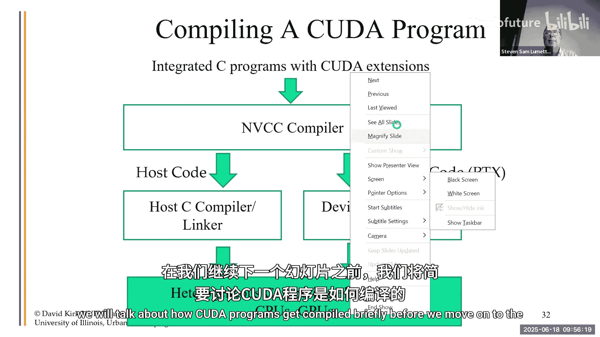
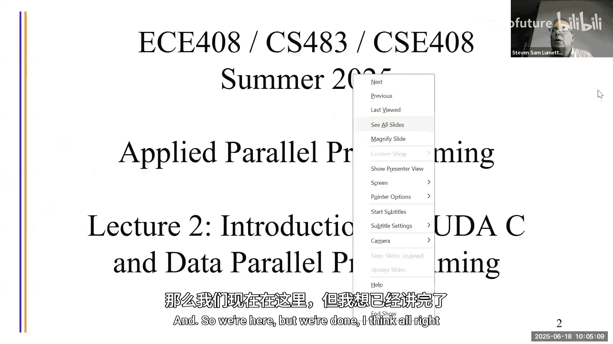
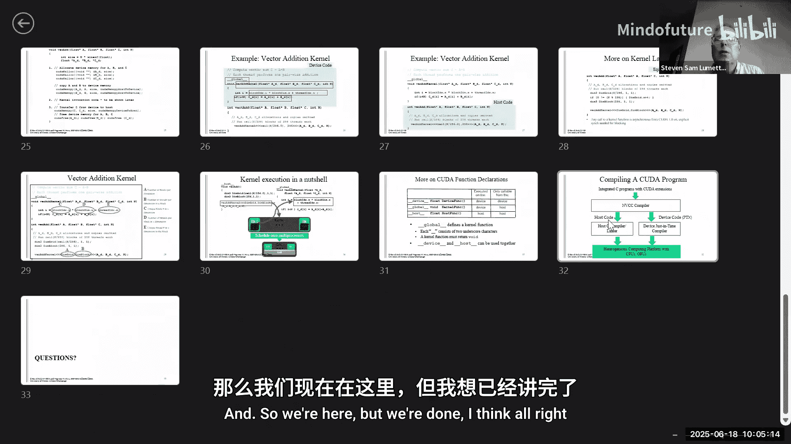
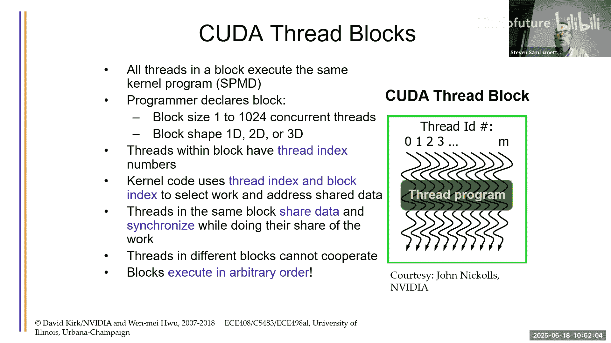

# 【伊利诺伊大学】应用并行编程2025-｜-ECE408-CS483-CSE408-Applied-Parallel-Programming-2025-p02-P02_lec02--BV1uNSyBaEcu_p2-

All， I don't think it should pick this up， good， all right。Perfect。嗯。对。Okay， can people hear me？

It should be working， but it doesn't seem to be。Right， go check my audio。How was that， but better。

Move this a little closer。All right， well hopefully everyone can hear me now。

 someone responded in chat， Okay， good thank you。All right so let's let's pick up where we left off I usually will try to do a few review slides just to get us back into the swing of things we were in the middle of discussing some of the issues that we're going to have to face while programming these high throughput massively parallel systems the GPUs。

So。We mentioned scalability right that we need to be able to get more parallelism out as we get more data and so if we're looking at algorithms that are say quadratic in the size of the data or worse typically those don't end up executing very well on GPUs I mean its not that there are any really worse than other systems but often such algorithms require exchanges of data and so when you scale up to supercomputer scale for example than you have to think very carefully about how the data move around and those problems people have solved in that space。

 but our class is more about really the single GPU platform or maybe a handful of GPUs。

The other problem we talked about was the need for regularity right every thread。

 every instance of data being treated the same way。

 so this is really something we're going to need and when we don't have this。

 we're going to have more difficulty finding ways to get things to go fast on a GPU。

We talked about load balance right the idea that each of the pieces of data should take about the same amount of time to process there are ways that we can deal with this one is to have more parallelism for example。

 but typically creating more parallelism actually creates more variety amongst your parallel pieces rather than less。

 but when you have more parallelism then each processing element ends up processing multiple things and so as long as one element doesn't end up getting all of the slow things then you can improve load balance a little that way。

 for example， we'll go through all of these one by one through the course of the summer together。

And then the last thing I mentioned before we stopped on Monday was global memory bandwidth and so he said well ideally we just get as much memory as we want as fast as we want to we pull it in out of the memory and we make use of it and in fact GPUs relative to CPUs have always been better in terms of memory bandwidth the reason mostly being their larger chips and so you have you have multiple memory interfaces because you have more chip area but even still you'll see as we go through an analyze some of the algorithms will develop together the reality is often that we are going to be held back by the amount of memory bandwidth we have so just to give you an illustration I showed you this plot and what you see here is roughly 30 years of CPUs and GPus and what you see is。

Basically flat lines almost， I mean a slight bump up for the green and the blue as well with NV link。

 but those are the bandwidths to DRAM and the interconnect between the GPUs and the other parts of the system。

And meanwhile， the floating point operations per second is the black line。

 so you can see that's continuing to go up very rapidly and if you look from end to end you get about 90。

000 increase over about 20 years I think that's the 20 years from about 2005 right for the release of the first GP GPU and for DM and interconnect you get about 30X improvement so much slower improvement for the bandwidth than for the compute capabilities。

All right， so that's what we looked at on Monday。The other problem we're going to run into is that when we've got thousands literally thousands of threads trying to access data we can end up creating serialization okay and serialization in turn can turn into delay right so if we're trying to do things in parallel we really can't afford to have people getting in line or threads getting in line to access a single resource this is what happens during the holiday season。

 any holiday season doesn't matter， pick your favorite when you go to a large store and people are lining up to buy gifts and they get to the checkout counter it's also what happens when you try to go through security in an airport terminal that everyone can get on their flights there are many。

 many gates it's relatively easy to board an aircraft compared to getting through security because with security there are typically a much smaller number of security entry points and everyone who wants to get on a flight has to go through the same。

Small set of security entry points。So when we have this kind of contention in accessing critical data。

 we get what's called serialization， right， meaning that the threads have to line up and access things one at a time。

That's the serial part。 All right， so why do we want to learn this stuff。

 Why is it important for you to have a handle on know how you make these high throughput。

Entities work well and how you write good code for them so I think even at the beginning when we may started teaching this class he had this in mind and this was the reason that you put a lot of time and energy and I think he really feels that this is the largest impact I mean I could list off many of the projects he'd done previously for which he got international awards before he started working on GPUs but I think he really feels that this is the biggest contribution that he made to society is to start teaching probably on the order of a million people at this point how to write code。

 I mean personally I think he's done 100000 but there's been probably a million people who have learned from his book from his courses his videos how to teach people how to write good code for GPUs code that could be scalable code that could be portable and last across 20 now going on almost 20 years of GPUs and there have been many hardware changes over those years。

So scalable algorithms and libraries are really the best legacy that we can leave behind from what we do right and you know it's kind of it's probably going to be a surprise to you how long software actually lives right so you know you're not old enough and probably didn't write software when you were you know 20 years ago。

When you are a handful of years old for most of you。

 but I have right and I've seen my software be used for literally 20 years in many cases and so you know it's very important that you think carefully about what you're doing with your software so people can continue to make use of it for those time scales。

😊，All right and so that's what we're hoping to help you with this class so at the end of each slide deck i'll have a slide like this you don't have to wait for it you can ask questions anytime。

 but let me just pause and see if anyone wants to ask a question before we move on。

Okay。So if not。I am going to shift over。Because I found that cutting and pasting into PowerPoint mangled my slides。

And so。We're going to just use。The original slide decks when we need to move。

So let me share the new one。Okay。

So if everyone's ready， it's time to start talking about kUuta okay so in addition to every slide deck other than the first one。

 we have kind of a set of objectives listed out at the beginning of the slide deck so this slide deck is meant to teach you the basic concepts of data parallel computing。

As well as the basic features of the KUa C programming interface， CDc+ plus something。嗯。

Now in QutDa we have a thread as a basic unit of computing so you might say well what is a thread many of you have probably heard the term before maybe maybe dont had a definition there are lots of different meanings floating around in the industry in the world so let me just tell you you can think of a thread as a program counter right where am I in the execution of my code as well as some context so some memory。

 some registers a program may actually have many threads running within it in fact your programs will。

So when we have multiple threads， those threads may be communicating with one another through memory。

 for example。But each of them has its own。Program counter PC。

 sometimes we call it the instruction register。Or the instruction pointer。

 if you're familiar with x86。And in Kuda， we're going to have many， many threads。

 so thousands of threads or millions of threads。So what are we going to do with those threads。

 so let me give you an example， here's a picture of Professor Kidertenko nice color image and let's say that I wanted to convert that image to black and white I want a monochromatic image of Professor Kidertenko。

So I have in the left at the left side the color for each pixel in the image and there are thousands of them for each pixel。

 I have a red level， a green level and a blue level， their RGB data。😊，So for example。

 I could write a little loop， and I could say in a sequential program。

 I could say for every pixel call a function called grayscale convert， yes convert。

 give the pixel data， the red， the green in the blue and convert that to a monochromatic single level pixel and I could do that and realize。

 well wait a minute Every pixel， every iteration of that loop is completely independent of every other pixel I don't make any decisions for the lower right side of the image based on what I found from the answers in the upper left side of the image。

 for example， right every pixel's independent。😊，So in particular you could think of that as an array。

 an input array of red green and blue pixels and I've just called them I1 through sorry I0 through n minus1。

 and what I want to do is do the same operation， take the red the green， the blue。

 do some operation on that GS convert represented by the circles in the picture and do that same operation and produce the output array00 through ON minus1。

And that can happen entirely in parallel， there's no dependence from one of those to another。嗯。

So the Kuta or also openCL， which is an alternative language we'll talk about a little bit towards the end of the summer。

 but not much， but the Kuta execution model。Is we've got an integrated program。

 we've got some code that runs on a CPU and we've got code that runs on a device or a GPU。

 and we'll go back and forth call things a device， a GPU same thing in our class。

So your program will have code for both parts。And the KUa compiler， based on annotations。

 you'll write the KUa annotations into your code will know which parts do you want to execute on the CPU and which parts do you want to execute in the GPU or the device。

啊。So the serial or modestly parallel parts of your host code will or your code。

 you will want to execute on the host， the CPU， the highly parallel parts you're going to want to execute on the device。

In SPMD so that stands for a single program multiple data okay so you're going to have executing on the GPU one program。

 one piece of code， in fact it'll be a function Okay so one subroutine from your code at a time。

Called a kernel。 Okay， all of the threads executing in the device will execute that same chunk of code。

 Now， they might be in different places in the code。 but the code itself will be the same。

 That's why we say single program。 So single program， multiple data。

are other terms we'll see a couple of them， these are from the high performance community。

 they're decades old at this point， but that's one which is commonly used for GPUs that you've got one program that's executing across all your threads。

And the way that execution will occur is typically you'll be running some code on your host and you'll reach a point in your host code where you say I need to go run some code on the GPU so you do what we call a kernel launch and that kernel launch will look syntactically something like this second green line。

We'll go through the details later， and that will cause thousands upon thousands of threads to start executing on the GPU。

In the kernel a subroutine， which you'll see over here on the left。

 And when all of those threads are done， when the very last thread is done。

 then you'll come back and start executing more code on the host， more serial code。

 and then maybe you'll launch another kernel。 So you go kind of back and forth。

 This is a simple model。 Once you start understanding how things work。

 we can become more sophisticated。 Again， we'll do that later in the summer。 okay。

But at a high level， you go back and forth。Now these kernels will execute as a grid of uniquely identified threads。

 so every thread will have its own identifier and that's how you'll decide which piece of data or which set of data a thread should operate on and which set of data it should produce using the unique identifiers。

So we call the whole group of threads in the coudta kernel， we call it a grid okay。

 so you start with a grid of threads executing your kernel all of the threads in your grid run the same kernel code again。

 this is called single program multiple data model SPMD okay。And to tell the threads apart。

 each thread has a unique index and you can use that index then to compute memory addresses。

 make control decisions and so forth。 Okay so loops， branches。嗯。So let me draw you a picture。

 so every kupa kernel we said is executed by a grid， so it's a grid， well。

 it's in 3D array of thread blocks， which are then 3D arrays of threads。 so here's your grid。

And the grid is actually a three dimensional array of thread blocks that's these little green cubes that I've drawn here。

 and then each thread block is actually a three dimensional array of threads so there's a three- dimensional organization largely this has to do with the arraybased nature of most data parallel computation right so GPGpUus were originally targeting things where you've had a lot of regularity and often in your code。

 your data structures would be expressed as arrays。

 oddly enough because you have the regularity even thinking back to what we just looked at with the grayscale conversion we expressed our input as an array of pixels and our output as an array of pixels now there there was a natural 2D structure sometimes there's a natural 2D structure。

 sometimes there's a natural 3D structure in some AI apps which we'll see towards the end of the summer there's actually four dimensions that we care about so we'll have to。

😊，Think about how to。F two dimensions into one of the thread block dimensions in those applications。

All right， so each of those threads has a unique identifier。诶。

So let's talk about that each thread again， we said this couple times。

 but I want to make sure you understand each thread executes the same program on distinct data inputs。

Okay so how it finds the inputs， well that's going to be up to you right you're writing the code。

 you'll use the identifier to decide which data that particular thread will access access using its identifiers it block identifier and instead identifier which together are unique。

So that makes us a single program multiple data SPMD model。So the first set of identifiers。

Are the identifier for the thread block。 Okay， so the number of blocks in each dimension is called the grid dim。

So here you can see I've annotated the X， Y and Z dimension of my grid of my thread blocks。

So if I say， well， griddm。X is the number of blocks in the grid in the X dimension。

 and now I'm going to start my terrifying habit because I know how excited everyone is to jump and answer questions so I will give someone a chance to step forward and answer。

 feel free， or I'll go through and I'll just call on people I'm happy either way。Yeah， seriously。

 I like people it to participate， so does someone want to say how many。

 what is grid dim dot X in the kernel that's illustrated here。18， eight， good， good answer， Joshua。

So griddm。x， and I'll just let you maybe you could do this。W slide if my animations will pop up。

There we go，8， but about grid dim dot y。3。Three， good。Sorry。

 my animations are a little slower than I'm hoping。And what about grid Dem do Z？2， two， good， okay。

All right， so。That's the grid dim variables。 So what if you want just the 2D grid。

 right for our pixel example， we wanted a 2D grid。 Well， that's easy。 You use grid dimension 1 for Z。

 so you， the programmer， when you do a kernel launch。

 are going to specify the number of blocks in each of the grid dimensions。 So if you want 2D grid。

 set the grid dimension for Z to1。 If you want a 1 D grid， set the grid dimension for y to1 as well。

 All right， so I think you understand this and trying to go forward。 Sorry， there we go。😊。

What about within a block， so within each block each。Block has a unique index tuupple， Okay。

 so the block index runs from 0 to grid dim dot x minus1。 so0 to 7 here。

 the block index dot y runs from 0 to grid dim y minus1，0 to2 here。

 and the block index dot Z runs from 0 to grid dim z minus10 to 1 So you want to look at the index for your block for your thread you look at those variables。

Now， similarly within the blocks， each block has a 3D array structure。

 so the number of threads per block is given by block dim x Y and z。

 so this is no different right so I won't ask someone to tell me this is this thread block illustrated here is blockd x5 in the x dimension4 in the Y dimension and three in the Z dimension。

 right？😡，What if I want a two dimensional or one dimensional thread block structure， Well， again。

 I can simply set the block dimension to one for the Z dimension and or the Y dimension。

Typically we do it in that order when you run lab zero。

 which I think probably probably none of you have had the chance to do yet。

 but you'll see that actually the limits on these sizes。

 the number of threads and the number of blocks in each dimension are actually larger in the X dimension then they are in the Y and Z dimension okay so if you're using1D typically you're going to do that in the x dimension only and if you're using 2D you'll use x and y so they're actually architectural reasons for choosing those it's not just happenstance。

All right， so within each thread block then each thread has a unique index tuupple these are called the thread index index x Y and z and of course those run from zero up to block dim in the corresponding dimension so here x would go from zero to4 the Y index would go from zero to3 and the z index would go from zero to2。

嗯。😊，The thread index tuple is unique to a thread within a given block。😡。

Okay so no two threads will have the same thread indices within the same block， however， there will。

 if you have more than one block， there will be two threads with the same thread indices so the combination of block index and thread index is the unique identifier for your thread。

哎。Now， how do we actually write code， how do we get these things to cooperate？Threads within a block。

 within a thread block， sometimes they'll just say block。In Kuta， cooperate through shared memory。

Through atomic operations on memory。And through barrier synchronization now some of those we're going to cover later so don't worry if those don't make sense yet threads in different blocks can cooperate less and so none of the things that I just mentioned do threads in other blocks have。

As ability to communicate okay， so the ones in the block it's a lot easier at says its not quite true you can do global atomics on global memory。

 which is accessible to all threads within all blocks。

But the shared memory part and the shared atomics and the barrier synchronization only occur within thread blocks and code。

喂。😊，So you can see down below how we might， for example。

Compute a global index on an one dimensional array。

 So if we think of our thread blocks as being lined up end to end。

 as we do in the grid right so we got thread block 0 from your left， thread block 0， thread block 1。

 thread block2 up to thread block n minus1。 and we have a compute a one dimensional index。

The way we would do that is take our block index in the x dimension， multiply it by the block size。

 and then add our thread index。 So， for example， thread block 0 would then run。 it has block index 0。

 itss I value down here in the code would run from 0 to 255 Here you can see the block dimension is 256 right so this is block index 0。

 These would get 0 to 255。Oop， sorry， block in that's one。

Or thread block one would compute i values block index is one。

 so one times 256 plus a number thread index from0 to 255。

 so that would go from 256 up to 511 and so forth， so every thread would have a unique eye value at that point。

哎。This vector addition that you're seeing， this is what you're going to do in the first line。

 we'll go through it more carefully later。So why did they decide to have coUa use these array values for the unique identifiers Well partly because in this manner you can use this thread and block organization to simplify your memory addressing when you're actually processing multidimensional data right so when you have multidimensional arrays it's a little easier when you've got a multi-dimensional thread structure to map those threads onto your multidimensional data so that was really why they thought this would be a good way to get started with people writing high throughput highly parallel programs right。

Image processing is one example right， typically two dimensions。

 so although if you go to video you've got a time dimension as well。

 so video processing three dimensions vectors， matrices。

 tensors right solving partial differential equations on volumes as what a lot of the a lot of the computational science is doing。

 for example。Okay so let's take a closer look at a simple thing right， so vector addition。

 let's say that we have two vectors of numbers。And what we want to do is add those vectors together so I have a vector a that has indices from 0 to n minus1。

 so elements of n elements in each vector and n elements also in the output vector。

 that's the only way vector addition makes sense right if all the vectors have the same number of elements。

So vector B of course runs from zero to and minus1 and what I want to do is add those two element Y so I want to add a0 to b0 to produce c0 the zeroth element of the output vector C so this is vector addition illustrated and you can see everything happens in parallel right。

Here's how we write that in C so the vectors I would then represent as arrays and pass them in as pointers to floats so now I've got floating point numbers。

 32 bit Iee standard floats。And I want to add vector A to vector B and produce vector C and I need to tell the subrtine because of course those pointers don't contain any information about the length of the vector I need to tell the subrtine well。

 these vectors have n elements and it's up to me when I call the function to make sure I get that right。

And here's the code I would write， so I go over all the elements one by one using a for loop and I simply add them up。

 I read a subi and B sub I， add them right then into C subi。

And when I wanted to call that from Maine， I would do some memory allocation。

 maybe read those vectors off the disk drive or out of a file somewhere and call my vector ad using my the H stands for host side。

 so we're going to start having memory on the host， the CPU and memory on the device。

Underscore D the GPU but here this is all CPUU code， so I would say， okay。

 I want to add a hoide to B hoide to produce C hoide and those are all length n。So that's my C code。

How do I turn that into KUDa code？So we need to do three things， so first of all。In the vector Act。

 So we're going to change our sub routineout。 So we need to have memory available on the GPU in order to have that memory。

 we need to allocate it。 So the first step will be to allocate device memory for the a vector。

 the B vector and the C vector。 Okay， so that's part of step 1。And then we need the data。

 the A and B vectors， the inputs inside the GPU memory。

 so we'll also have to copy them from the host memory over to the GPU so host is going to be over here GPU is going to be over here。

 so we allocate the memory on the GPU and then copy the data A and B vectors into the GPU memory。

Step two， execute the code right on the GPU， do a kernel launch。

That'll do our actual work over on the GPU one thread， say for every element of the vector。

 so n threads， so think n is 20，000 a million even a billion okay。

Then we'll take all of those results from the device memory right we're producing the memory I'm sorry we're producing the C vector in the GPU we're writing it into GPU memory we need to get that back over into the CPU memory so that we can make use of it on the CPU maybe store it to disk again so we're going copy that back right from device memory into host memory and then we're done with the GPU memory so we can free up that memory that we used for the kernel。

All right， so what does that look like in terms of the memories？So device code， right。

 the code that we run on the GPU。Can do a couple of different things。

 It can read and write per thread registers。 So what you see here。

 sort of an illustration of the thread blocks。And then so the grid is the outer blue box running on the GPU。

 the thread blocks are are the lighter orange and then the threads themselves are the green blocks。

 so each grid has a number of blocks each block has a number of threads here I just done two each。

Okay， so Ishaan is asking， why do we need to copy the data over to device memory？

So historically the memory interfaces on the host and the memory interfaces on the GPU were separate hardware and they go to separate DRAM okay and so there was no hardware support for directly accessing memory from the host to the GPU memory。

 the DRAM living on the GPU or connected to the GPU I should say physically or vice versa from the device processing elements over to the host side DRAM。

 there was no support for that in the hardware。In in more later releases of KUDa you can do that。

 but you have to be really careful as you'll see when we talk later。

 all of those accesses have to go over the PCIEIO interface and so that's relatively slow。Okay。

 so whereas you're getting typically on the order of a terabyte。

 a second of memory bandwidth on a modern GPU to this orange block at the bottom here。

 this global memory PCIe is typically going to be。Typically on the two orders of magnitude smaller。

 let's say about 10 right it might be 30， but it's not going to be 100。

 it's certainly not going to be a terabyte a second so you must you need to use that kind of capability really carefully and that's going to be something we talk about later in the class not now so for now we're going to move all of the data across in a block efficiently make as much use of it as we need to and then move all the answers back so that'll be how we start things but it's a good question know why not just make things easier for the programmer and the answer is because easier typically means lower performance right so when you're concerned about performance you have to pay attention to how the hardware works so we'll go through all of that in our class in much more detail but I just wanted to make sure people understand now why are we going about things in this way。

All right， so in addition to registers， which are a perth thread thing。

So each register will I'm sorry each thread will have private registers that it can read and write and each thread will also have global memory now later will add things like the shared memory I mentioned I don't know but for now these are the two resources that are available okay and this global memory is on the GPU okay so the threads can only read from the GPU memory。

In your host code， you can allocate memory in this per grid global memory so you can do dynamic allocation。

Of resources， memory resources within this orange block down here。

 and you can transfer data to and from that global memory。 So we will cover more later。 But for now。

 we need to be able to do those two things。So how does that work， so there's an API call Kuta Malik。

W says I need to allocate some memory in the device global memory。

 so it takes two parameters One is the address in which to store the pointer to the allocated memory so this is probably different than many Mals you've worked with Many dynamic allocation routines It does not return the pointer it returns an error indicator so k Malik does not return the pointer to the memory you have to pass a pointer to the place where you want to store the newly allocated memory pointer the second parameter is similar to most Malex right a size of allocated memory invites。

When you're done with a chunk of memory in the GPU， make sure that you call coudafree。

Okay so you pass just the pointer you got back from Kuta Malk and that frees up those resources within the GPU memory。

So one parameter， pointer to the memory to the three。

 that's just the address you got back from Kuta Malek。

So let's go ahead and fill in our code for the first step。系。So Kutamalek。

We've got up here pointers to floats， so you'll notice that the pointers don't look any different。

But the address spaces are different okay， rather the meaning， unfortunately。

 the address spaces are not different。So you might in fact have a pointer that you can use to point to something that you've also allocated on the host side so don't get yourself confused you the programmer are responsible for remembering which pointer means what so the pointers in terms of type information are identical this is a pointer to a float but we've called it a sub D to remind ourselves that this is a pointer to device memory so we're going to allocate that device memory size here is N the number of elements in the vector times the size of a floating point that'll be four bytes。

We get the address of that floating point pointer。 So this is a pointer to a pointer to a float that is not automatically cast to avoid star star。

 which is what a pointer to a pointer to avoid， which is what Kutamalik requires。

 So you'll see it's explicitly cast to avoid star star。And then we pass the size。

 the number of bytes that we want in that array now we should be doing air checking。

 but there's only so much space on the slide so typically we're not going to do air checking in the code you may well want to do the air checking because if you try to allocate。

 for example， too much memory for your GPU kmalic will fail right you'll get an error message in return and you should realize that before you start trying to use the pointer。

We also allocate。The B vector in the GPU， same call。

 just pointing to B sub D with the first argument。 We also need to allocate space for the answer。

 right， We need to allocate that array before we start writing the answer into it。

 So we'll call kutamalica third time。Then we need to copy oh sorry。

 I'm going to fill in the coupa freeze， we simply pass a sub D B sub D and C sub D back to couta free down at the end here okay so when we're all done。

 we'll call couta free three times free up those three arrays。All right。

 so now it's time to go look at how we do the memory copies。

So when we want to do a memory data transfer in either direction。

 we call one API call it's called KUa Memcopy so you probably used meMcopy in the C library before。

 well maybe this is coa meco so it's preceded like most of the COUa API calls by lowercase KUa and then the rest of the words are first cap so coaMcopy memory data transfer。

4 parameters， like almost every member copy I've ever seen first destination。

 And if you don't remember it， look it up， be on the safe side。 it will fail silently。 In many cases。

 if you can put things in the wrong order， pointer to destination， pointer to source。

 don't mix them up。Number of bytes copied， and the direction of transfer is the fourth argument。

And make sure that you're getting the direction right。So what does that actually look like？

When we're copying the a vector again destination first。

 so the destination in this case is the device side copy of the a of the a vector right so a sub D。

 and remember host over here for us device over here， the source is the host side copy a。

 the size is the number of bytes， which we created up at the top。

And then the direction in this case is coaM copypy hosted device。

 so this call sets up a direct memory access transfer moving data from the host memory to the device member。

When we're done with that， we want to copy also the B vector。

 so we'll do another coaM copy call from I'm sorry from B。

 the second argument to B subD destination first， size bytes， cotaM copy hosted device。We don't do C。

There's nothing in C on the host except bits。 There's nothing there we need to copy When we're done with the kernel。

 though， we need to get the answer back from device memory into host memory。 So in this case。

 the source is C sub B That's the second argument。 The destination now is the C array on the host。

 which is currently full of bits。 So we're going to copy from the GPU back to the host memory size bytes again。

 but in this case， we say coimm copy device to host。All right。

 last piece is the kernel invocation so here before we do kernel in I need to tell you well how do you actually write a kernel so a kernel will be simply a subroutine that we're going to precede with this qualifier。

 which is a coupa extension to CC plus plus called global now you can't see it well in the slides you won't be able to see it well often in in a fixed point font to underscores underscore underscore。

Global underscore underscore the KUDa compiler will give you an error if you get it wrong。

 but you don't want to get it wrong you don't want to have to waste time fixing syntax errors。

Undersco， underscore global。 underscore， underscore。 When you put this in front in front of a。

C function that tells the kernel that you want to run this code as a subroutine。

 as a kernel on the GPU， okay。So we need a couple of things for that。

 We can have any parameters we want。 That's fine。 However， we need to return void。 Okay。

 so kernels always return nothing。 Nothing comes back from the GP to the CPU when you do a kernel launch。

 except an error value right， So that error value is produced asynchronously sometimes。

 but it's produced。In response to the kernel， it does not come back from the kernel function itself。

 okay。All right， so they return void and you can see the name here along with whatever arguments we want to pass into the kernel。

These arguments are the same for every thread。哎。What's different for every thread。

 as you hopefully remember， we talked about a few minutes ago， are the block and thread indices。

 so we're going to launch this as a one dimensional grid of one dimensional thread blocks。

 so we only use the X indices of the block and the X indices of the thread。In order to compute。

Recompute an index into our vector。 We're going to do the same arithmetic you saw earlier。

 So take the block index in the x dimension， multiply by the block dimension in the x dimension and add the thread index。

 That will give us a unique index。However。If we have， for example， blocks of 256 threads and we say。

 well， we want our code to work for any N and may or may not be a multiple of 256。

So if we're going to launch a number of thread blocks。

 we're going to get some extra threads at the end。 right， let's just say for simplicity。

 we've got 300。 That's not going be enough to be interesting。 but say we've got 300。

 Then we need two thread blocks， and we're going to get thread indices out to 5，11。

 If we have thread blocks of 256 each。 right， We need to make sure。😊。

It's our job the programmer to make sure that we don't go accessing array elements that don't exist。

Okay， so we check to see， is I what my thread computed actually less than n， If not。

 we do nothing in this code。If it is， we do one edition of one element from a。

 one addition to one element from B， write that into an element from C， that's our kernel， okay。Art。

So Colonel launchch is down here。Let's take a look at it。 This is this is now host code。

 So when I don't add the global annotations， that's going to be hostcode。

 I'll give you more detail a little bit， but this is an unannotated function So this is host code this runs on my CPU we write the two chunks of code into the same C file and by using the qualifierr like global we tell the coo compiler that we want that V a kernel only compiled for the GPU and we want Vec addd only compiled for the CPU so inside V add you can see the blue part。

 which is the vector kernel vector add kernel launch whoops sorry。And what I want to call out to you。

 first of all， vector kernel launches have this triple bracket notation。

 so use the name of the function followed by three less than signs， no spaces。

 It's like any other operator in C or C plus plus you can't put spaces into it So three less than signs and then on the right three greater than signs。

 Now the form you see here is just two numbers。When you use this form。

 what happens is the first number gives you the number of thread blocks and the second in one dimension。

 the other two the Y and Z grid dimensions are set to one implicitly and the second number tells you the one dimensional size of each thread block and the Y and Z block dimensions are also set to one implicitly so this says I want n over 256 floating point round it up。

Thread blocks and 256 blocks per thread I'm sorry， threads per block。哎。Why do we need to round up？

So let's go back to the example I gave a minute ago。

 I said 300 is n is 300 so I get n I divide by 256 floating point。

 I get one point something right and I said， well， I went around that up so I have two thread blocks because if I only have one thread block I only have 256 threads so only part of my vector is added。

So I need to round up so that I've got enough threads to cover my whole vector。

 even though that gives me too many threads。 now， unfortunately。

 people often make the mistake of saying， oh， I just do n divided by 256。 I don't put dot 0。

What happens when you write n， which you can see is an integer divided by 256 in C or C plus plus anyone remember。

Okay。I won't call it rounds down with zero It rounds it rounds towards zero right it's actually hardware dependent which makes it even more painful but all modern hardware I shouldn't say all modern hardware because one of you may go up and build a processor and say aha see but typically the hardware you're going to use it these days is going to round towards zero and I don't think I've ever heard of any hardware that rounded up for positive numbers so it's going to round down right it's going to give us one thread block。

And so then you're gonna to get errors in your checking code and you're going wonder why why is it not launching enough thread blockslocks and unless you go back and think carefully about what you did for your kernel launch。

 you're going to struggle with that so be very careful think carefully about how you write your kernel launches I'll share a couple other ways you can do it so in this here is another way to do it。

 this is using a coupa type called dim3 So dim3 is a variable that has X Y and Z components。

 it's just a structure or a class if you want to C plus plus Okay but with just three components and no methods except this constructor。

So dim grid right we're going to call it dim grid and it'll take three integers in this case now here I've done what I said you shouldn't do and round it down so you can correct that yourself by checking to see if n was a multiple of 256 and if it was not adding one to the grid dimension of x as shown here。

And then setting the block size to 256 threads in the x dimension 25 and1 in the Y and z dimensions right so these have created a dim3 variable called dim grid and dim block filled them in correctly and then we can do a kernel launch using those two three dimensional variables so you can do it this way any time you want more than one dimensional grid or one dimensional blocks thread blocks。

 you need to use this dim3 approach so so later in the classes will typically be the way we're doing things。

 but you can vary how you how you set things So here I've gone back to using seal this is to show you show you the bug so。

Or maybe it's to show you that I didn't notice that bug when I yeah oh yeah。

 so this is a bug right so this code will not work because we left out the dot zero all right。😊。

So I want to talk a little bit about how these things tie together so A down at the bottom so you're looking at the kernel launch right when you specify your kernel launch。

 you're giving the number of blocks and each dimension of the grid as well as part B the number of threads per dimension in a block so those are specified by you the programmer as variables when you launch a kernel mean you can hard code them as integers and get one dimensional parts or you can even create a dim3 out of just numbers as we've done for the dim block so they can be hardcoded or they can be variables it's up to you when you launch the kernel when the execution of the host code hits that point that tells the GPU the number of blocks per dimension and the number of threads per dimension in each block。

Blocks in the grid and threads in the block in each block。 All right。

 those identifiers then are unique， right， so we use inside the kernel code。

 we use those unique identifiers to reconstruct a unique index into our data。 In this case。

 it's just one dimensional data So you can see again， this form that you're going to use a lot。

 So make sure you get it right。 block index times block dimension plus thread index。

 And that'll give us an element I， And then again， that that value has to be checked before we use it to make sure that we're actually inside the real vector。

😊，And that's the eye listen end part there。2。So I want to illustrate the kernel execution for you。

So on the left is the kernel launch on the right is the kernel code so when the kernel launch happens what that does is it creates on the GPU on the device a number of thread blocks and each of those thread blocks has all of these threads 256 threads in our case in this particular launch executing within it。

 the GPU then starts to schedule those thread blocks for execution。

And as they start each of those thread blocks， each of the threads in the thread blocks start executing at the start of this subroutine here of this kernel so they're given the four values that we've passed in。

 the pointer to A sub D， pointer to B sub D， pointer to C sub D and N and they start executing at the beginning。

 and when they're done when all threads in a thread block are done， that block is done。

 it's taken off the GPU and maybe another thread block if you haven't filled up or if you've overfilled the GPU with more blocks and can execute simultaneously。

 we start executing when all of your blocks are done then then we come back to the host code after the kernel launch。

So once you've created these blocks of threads again they get scheduled onto these physical multiprocessors on the GPU。

 so a GPU will have some number of what we call streaming multiprocessors okay or sometimes we call them PEs there's actually multiple PEs inside of。

S&P or S will usually abbreviate them S usually means symmetric multiprocessor it's what I mentioned on Monday so most people will call them multiprocessors down here SMs and we'll do that in our class as well so you've got some number of SMs physical SMs on your GPU and the blocks are scheduled for execution onto those resources onto those physical resources。

All right， so let me I promised I'd give you a little more information about the KUa function declarations so these are three qualifiers that you can add in front of your functions in your coUuda code that mean different things to the couda compiler so let me go through them one at a time and then I think maybe after the slide will take a little break it's about time for that。

So device means that this is a function it's a subroutine that you want to call from your kernels so this code the couda compiler will only call will only compile rather the subroutine put the pointer in the right place will only compile the subroutine for the GPU so you execute it on the GPU you call it from kernels and that's the only place you can call it so well if you put device that will happen you can actually put more than one qualifiers I'll talk about in a second。

 but if youve put device it will the function will be compiled for the GPU。All right。

 if you put global， that's a kernelnal marker， as we saw， so it must return void。

 so that's your kernel function。That function executes on the device， and。in modern kuda。

 you can actually launch kernels from kutuda code from kernels。 Okay。

 but we're not going to get into that in our class。 so think of it as you can only call this device。

 you can only launch it as a kernel from the host okay。😊。

And then finally host so the host qualifier means I'm going to run this function on my CPU and so I want it compiled for my CPU so it's going to execute on the CPU and it will be called from the CPU by some other code so normal C subroutine so by default any subroutine in front of which you put no qualifiers is a host subroutine right its just a normal C subrtoutine C++ subrtine。

In all of these just to reiterate， I said this earlier。

 but doesn't hurt to remind you everywhere you see the underscores those are double underscore so underscore underscore global underscore underscore underscore underscore device。

 underscore underscore， etca，Alright， so kernel functions after a turn void and you can put both device and host in front of a routine So if you only put device。

 the coa compiler will not compile that code for your host if you want a subroutine and often this is good software practice right if you've got data structures that you're copying between host and GP memory。

 you want your code that accesses those data structures to be the same。

 you don't need to make two copies of the same code。

 So your subroutines can actually be compiled for both a CPU and for the GP So if you're writing such a subroutine。

 you can put device and host in front of those subroutines and they'll be compiled for both and when they're called on the host。

 the host version will be called and when they're called on the device from a kernel。

 the device version will be called。You need to be a little careful with that because。Yeah。

 certain things can't be done still on the device and so you' you'll get compiler errors if you try to do something impossible。

All right， so I promised your break before we talk about compiling a coupa program。

 So let's take five minutes。 I'll come back at 1001， do some administrativea and then。

And then we will talk about how KUD programs get compiled briefly before we move on to the next slide deck？

And feel free to ask questions now if you have。Questions about things。Professor。Yeah， hi， hi Eris。Hi。

 address。Is there a reason why we do。Dy static allocation because I was under the question that static is slightly better because you have question。

Yeah， so。There are some things。 Okay， so keep in mind that the GPU is a separate piece of hardware。

 It has its own clocks。 It has its own memory interfaces， its own memory， and so。

You don't want to pin down resources on the GPU just because you've got some program running on your CPU。

Okay so for example， let's say you write a server and that server is able to launch code on the GPU and make use of it and you want to run that you know you do that on your machine and maybe you hook it to your your own web page which you run locally from your machine and you want to use your GPU to do cool things with some AI that you've you've created but at the same time you know you want to be able to do things with your own GPU yourself so if you pin down those resources。

 well those resources you can never use because your web server is up and running right。So that's。

 I mean， that's one reason is that they didn't want NviIdia didn't want to tie down those resources all the time just because there's some code running of the GPU。

So even in the case where things are what you think of as statically allocated。

 So later in the class we'll talk about constant memory and those are declared in ways that look more like static variables in C code。

 but really。😊，Gosh， when is I think the allocation， it's done dynamically。

 but I think it's done when you start your program。Right， so。Or do you have to do an aEC， No。

 I take it。Sorry， I haven't used the interface for a while。Yeah。

 I think the static part is just so that is just so that the device code sees the name when you do the compile。

 the device code has to know where to go yeah， are those are static allocation So it's done dynamically when you start your code on the host side and then those variables are handed off to the to the GPU side through the driver So they persist I think for the lifetime of your code but you know that memory is special memory and pretty limited in size So when you run lab zero I think it tells you the size of constant memory as one of the outputs and it's pretty small so and it's a special purpose thing we'll talk about it maybe two three weeks I think。

yeah， so most of the memory is dynamically allocated for the reasons they mentioned right and you're not really going to do it right as you start getting more sophisticated。

 you know， if you write something that does a lot of vector editions you don't want to allocate memory every time you do a vector edition right you're gonna allocate some memory and then you know use it as many times as you need to and then delocd so you know people are not allocating every time they launch a kernel typically in real systems but at the same time GPU memory is a limited resource and so you have to think about how your kernels interact what you're pinning down memory for and how you've allocated etc right so it is something that you have to be aware of as you as you use things。

I don'm going to grab a glass of water。Okay， so I think it's time to get started again。So。Let's see。

Yeah， Delta is down today till7 so hopefully people have already filled out the form。

 give us your access ID。 It does take a couple days for them to add you to our list and things like that we don't have direct control over that unfortunately so the Sssidmins on the Delta system will add you in there is nothing I mean you should finish lab lab zero as soon as you can but you're not turning anything in so it's not like if you miss the deadline you miss it it is important to get it done。

 you will need the output for quiz0 and more importantly this is our way of making sure that you know how to get into Delta that you can get into Delta so if things are getting delayed and you are you are not able to access or if someone just joined the class recently or something。

Do let us know if you're getting slowed down and when you're able to do things。

And we will sort of keep tabs on that。Lab one is due pretty quickly thereafter right is just vector edition so it's basically the thing that we were looking at today so you'll write the memory allocation。

 the memory copies， the vector edition kernel the kernel launch， the cleanup and so forth right。😊。

Yeah。I mean the。Don't just copy the code， right？😊，All the code you need is especially for this lab all the code you need is in the slides right but do try to think about it do try to learn it because later that's not going to be true there's going to be parts that are more difficult。

 more challenging and you know it's a good habit to start to make use of these things you're learning and understand how they're working and things like that on the flip side you know the most painful aspect of this class is the lack of debug support。

😊，And， you know， if you， if you do something like I mentioned and you leave off the floating point part of the of the。

Of the kernel launch， you know， your code will not work right because you' we'll test some example that doesn't have a multiple of your thread block size and it just won't work right so。

If you're having bugs， you know make sure you're looking carefully at the code you've written。

 especially the host code， making sure your kernel launches are correct。

 but also don't hesitate to kind of compare with what we've given you sometimes that's easier than seeing the bugs in your own code it's very difficult I know from decades of experience。

😊，To read bugs in your own code because you don't really read your code right you look at what you meant to write and of course that's always perfect so so don't hesitate to say wait wait a minute and I thought I understood this and let me go back to the slide but but I discourage you from you know typing in from the I mean technically you're not supposed to do that anyway right but but I know it's going to be tempting and it's just a few lines of code。

😊，So when you're doing lab one， try try to remember how everything works and type it all in and then if you need to go back and look at the slides and make sure you got it all right。

 if it's not working or something okay。All right， so La two， do next Saturday。Lab 375， I mean。

 we might change it until it's out， but I think it's out。Make it out think so Yeah， yeah。

 I released it， but。😊，But if we do make any changes。

 we'll tell you on Piazza and you'd have to update it。

 but I don't think there's going to be any changes to that。All right， so let me go back。

To where we were。

And。

So we're here， but we're done， I think， all right。So when you compile your coudDa program。

 you're going to run something called NVCC Okay so this will actually be done for you when you run your job okay。

 but if you do something at home or something on your machine， you'll run NVCC probably directly so。

When you run NVCC， that takes your integrated C programs with a KUD extensions。

 the qualifiers like Global hostst device that you've typed in。

And what it does is it actually separates those out into a piece of host code which it then hands off to a C compiler for your machine in this case if you're running on the Delta machine it will be for the CPUUs for Delta and also down to something called PTX。

 which is an intermediate version of code for GPUs and you can look at that PTX output if you want to if you're familiar with assembly code。

 it might be helpful， you'll have to learn it kind of on the fly。

 but that that's the limit of public versions of NviDdia ISAs and instruction set architectures that you'll be able to see is that PTX code the actual execution of the kernels partly for historic reasons partly so they can make it completely proprietary partly so they can optimize for your specific GPU and any changes。

made to its ISA all of that is done just in time So when you start running your program your codes what used to be like shaders would be compiled for your particular GPU so that's done just in time it's done just before you try to do your kernel launch and it can make things a little slow the first time as well So you'll see if you look at some of our code to do timing as we point you to those kind of resources。

 sometimes you want to launch your kernels multiple times just to make sure that nothing like that just in time compilation is being counted against you in terms of your execution time but that code is done from PTx down onto the GPU in a Jit sort of way just in time Meanwhile。

 the host code is then compiled using the host site C compiler and linker and that produces C code with the kernel code。

Whi calls the device driver， the couda device driver。

 which knows how to get to the the GPU PTx versions and do that compilation to run a new GPU Okay so those two outputs are then launched onto your heterogeneous computing platform and executed as I showed you earlier with a host code first going through main and when you do a kernel launch going over to the kernels。

Each thread in your grid executing those kernels on the device。All right。

 so that's the end of slide deck 2。I want to get a start on slide deck three today I don't think we'll finish it。

 but we'll get part way through it so if you have any questions on slide deck two now's good time to ask them。

Otherwise I'm going to be switching over。Oh。Okay， Chad said there was a new message but I don't see it。

 so if someone had a question to just please ask it。Okay， so otherwise。Let's。

Get started with the kernelnal based data parallelel execution model。Orkua。

So what are we going to talk about in this slide deck？So first of all。

 we're going to spend a little more time on the multidimensional logical organization of Kupa threads。

嗯。We're going to talk about how we use control structures like loops inside of a kernel。

And talk a little bit about things like thread scheduling， latency tolerance and hardware occupancy。

 okay？So those are things we'll define and talk about them and help you understand why they're important when you're programming a GPU。

So this was our vector edition kernel from the last slide deck and I haven't changed anything here other than to fix the bug that was in a similar version so you can see that it now has a dot zero correctly down there at the bottom。

and so。We're launching again。Telling the device driver。

 which then communicates to the GPU and we do a kernel launch the number of dimensions in each or sorry。

 the number of blocks in each dimension of the grid that's part A。

 the number of threads in each thread block dimension， that's part B。

And then when we execute our kernel， remember that we're using the unique identifiers。

 the block indices C and the thread indices E， those are the unique parts along with the size of the blocks that's D here all of these just in the X dimension to reconstruct a unique identifier in the space of our bigger much bigger vectors so these could have million elements or billion elements all of the tests will run by the way in lab1 are going to be smaller mostly just not to use huge amounts of memory for no reason and take time we're also doing hostide verification。

 so for something like vector addition， it's no big deal but when you start doing you know huge multi- gigabyte matrix multiplications and you try to do those matrix multiplications on the host it takes a while right so a lot of the data checking will do for you will be smaller just for those reasons you're getting pretty good speed up on the。

The GPU and if you verify with the host takes a while。So if I were to ask you。

 so how many threads in total are going to get executed in this example kernel launch？哎。

The answer is not going to be N。Right。😊，It's going to be n rounded up to the nearest multiple of 256。

Because remember we're rounding up the number of blocks and in every thread block。

 we have 256 threads exactly so generally speaking， whatever n is。

 we're going to have slightly more threads。Then threadb or then in our original data set。

 So just to give you another illustration of that in here with a concrete example and is 1 thousand00。

 So N of 1 thousand00 will give us， let's see， and block size 256。 So 1000 divided by 256 is 3。

 something right Rounded up we get4。So we're going to have four thread blocks。

 zero through three will be our dimensions？Thread block three， when we do this index calculation。

 for example， will'll start。3 times 2，56 is 7，68 plus 0 for the first thread in the thread block。

 So it'll start at 7，68， which is what I've illustrated down here on the right。

 But those threads will go up to eye values of 1023。So we need to make sure that threads1000。

 actually 1000 right Cdices run from 0 to 999， so threads 1000 through 1023 do not try to access nonexistent array elements in A or B or try to write back to a nonexistent array element at the end of C。

诶。Now， for what it's worth， if you forget to write this code。

 you may or may not get an error out of your GPU。😡， so this may or may not cause problems。

Unfortunately， it's just like a memory problem in a CPU。 you know。

 that you're unlucky if it doesn't cause problems。 What you'd like is it crashes immediately in a deterministic way and you go back and you figure out why and you fix it if you're unlucky it doesn't cause problems for you and you go and you release your product and no customer can ever use your product because it has memory books。

That's the unlucky version， right？So be very careful right we'll try to encourage you in class we're often going to leave these checks out。

 but we'll show you how to do them and you'll want to do them and sometimes you may get error messages from the GPU or your code may crash on the GPU depending on where that inappropriate memory access happens to occur whether it's a read or a write and so forth okay。

All right， so。Instead of saying。One thread per rail elementment。

How to decide the block size so that's a good question and that's one we'll go over as we go through more applications Okay briefly the block size on Nvidia GPUs and most GPUs has been limited to 1024 threads since the first GP GPU until today。

So typically speaking， since you can share resources within your thread blocks。

 usually you're going to want to use larger thread blocks。

 but not always Okay so the the decision is kind of application or even kernel specific and so that's that's not an easy question to answer generally but if there's a general answer it'll be kind of bigger is better Okay often 512 instead of 11024 because there are other resource limits that you'll see in a couple lectures that will allow you to make better use of your GPU if you pick that number instead but。

But bigger is usually a little better。All right， and the code we're looking at it makes no difference at all。

Well， I should， I should be careful， 32 up to 1 thousand makes no difference。In this code。

 up to 2024。All right， so。We could do things differently right we could instead of having every thread access one element。

 we could say， well every thread I don't need that much parallelism。

 let me have every thread access two elements。And one way we could do that， for example。

 is we could say， well， thread block 0 will be responsible for index values in the array 0 to 511。

So twice the block dimension。And thread block 1 will take 512 through 023 and so forth So in that case。

 our thread indexing indexing would look like this we would start and say， well。

 we're initial I value will be two times the block dimension instead of just the block dimension because every thread is going to handle twice as many elements from the arrays so we want thread block 1 to start at 512 and thread block2 to start at 024 and so forth。

So that part would be the same。This checking and the execution of the thread edition。

 that doesn't look any different。 but now we have to go do the other half of the work， right。

So the second piece of work， then we would update I I is just a local variable in our kernel。 Okay。

 that ends up going in a register。 We'll go over that later。

 but we could update I by adding the block dimension。So that means in block zero。

Thread0 would initially handle element 0， and now will handle 0 plus 256。

 So block thread block 0s thread 0 will handle element 0 and 256。

Thread one will handle zero and 257 and so forth。Thread 255 will handle array elements 256。

 I'm sorry， 255 and 511。啊。Notice。Two things， one that we need to。Check I is less than n。诶。Now。

We do have to be a little careful so you might think， oh gosh。

Maybe I could just check once and I could put all the rest of this code inside that IS than n。

 and then I'd be okay， right？It wouldn't actually， you would save yourself on a few threads。

 this update of I。 That's true。 If I is already outside the array。

 adding a number to it is not going to make it go back inside the array， right， I mean。

 short of wrap around in the integers or something which hopefully is not going to occur。 however。

 I might be inside for the first access and outside。

For the second access right So you have to do this check again right at the end of our array。

 right there's still some region that we don't have to access。

 and we're always going to have some thread block right So unless now and is a multiple of 512。

 we're gonna to have some region that is not part of our array and it might be the case that some threads。

 their first access is inside the array， but the second access is outside right so we still have to do this check the second check for I less than n after we update I so you might think。

 oh， I can make this code a little faster。 it's not really going to help。Okay。

And you do have to do that second sha for safety for correctness or reasons。

So let's think now about go back to our gray scale conversion。Okay， so our pixels remember。

 could be calculated independently。Starting with the red green blue from one pixel in the input and computing the single monochromatic value in the output。

 those are all independent。So those pixels can be handled， for example。

 one by one using one thread per element。But it might be more natural in that case， if we had。

2D grids and 2D thread blocks。Okay。So here what I'm showing you is a two dimensional array of data and 16 by 16 blocks of threads。

So when I arrange my thread blocks。Over my picture。Just like in the one dimensional vector case。

 I had some extra elements。Extra threads at the end。

 Now I'm going to have extra threads falling off the edge of my picture on the right side。And。

Extra threads falling off the bottom of my picture at the bottom at the bottom of the image。

Not necessarily， it might be the case if I choose 16 by 16 thread blocks that my image is exactly a multiple of 16 wide and exactly a multiple of 16 high。

You don't want to write code that makes that assumption。

 you want to write code that handles the general case of an arbitrary image size。

so you have to assume that there's some pixels are going to fall off the right or some threads will not have data to access and some threads on the bottom will not have data to access so for example。

In a 76 by 62 picture covered with 16 by 16 blocks， My thread blocks。

 you can think of it as falling into two regions。 in region 1， every thread has a pixel。In region2。

 some threads don't have pixels， some threads on the right side of the thread block with X indices that are too large。

Don't have pixels to access。 And And the way we're going to do that is compute a column number。

 and that'll be exactly what you saw for vector edition。

 literally exactly the same expression using the block and thread indices and block dimension。

 We'll compute a column number for that thread。 and we'll check it against the width of the picture。

😊，哎。However， that test is not enough because we also have thread blocks down here in region three and in region three。

What are we going to do to test？How would we set that up？So we have a column。

 what else could we want to know what is our pixel for this thread？row is less than the Yeah。

 so we're going to compute row， right， good。So the row turns out will have the same structure exactly the same structure。

 You'll see it in a minute。 as our computation of column， except that we'll use the y indices Okay。

 so the y block index， the Y block dimension and the y thread index Okay so we'll compute our row。

 and then we need to ask ourselves， well， is the row less than the height， just like you said。😊，诶。😊。

Sorry， that was meant to be an animation。 There it is。 Okay， so is the row less than the height。

And then we've also got region four， this thread block down here， right。

 where we need to do both tests。So we're running the same code in every thread。

 So both all of our threads are going to have to do both tests。

 Okay so we'll have to check that a row and column numbers are all valid within the space of the image before we go trying to access the image or writing output to the output monochrome image。

 All right， so here's an example of how we might write a monochrome conversion kernel。

 Okay so you notice I've got the global qualifier at the top there。

 not in the box outside before the name I returning void because it's a kernel call it color to grayscale conversion I pass in。

😊，Two arrays one is a pointer。 This is now a pointer to a twodisional array of width by height Okay those are laid out in the standard way and see we'll kind go over that for those who don't remember it or not familiar with it in general but we'll pass in the pointer to the data for the output。

 the gray image a pointer to the data for the input。

 these will be organized as pixels of red green and blue。

 so three sequential bytes This is one byte for each grayscale output0 to 255 and each of those images is width pixels wide and height pixels high。

Allright， so here's what I promised you in terms of row and column。

 Not that these are identical expressions， except column is computed with X row is computed with Y。

 so except for the differences in ining indexing that we talked about， well gee。

 what if I want to have two pixels for each of my thread， Okay， fine。

 if you want to do anything fancy， you might change these expressions。

 but for the first starting point， when you're laying out your array data。

 every dimension will follow just this simple expression Okay so you're gonna to see this over and over again。

 just make sure you get it right， get it wrong， if you type a y here for block index。

 when your blocks are square， it's all good。😊，Oh sorry block dimension when your blocks are square it's all good。

 but if you get them wrong you're in trouble and if if you switch X to y or y to x on the indices。

 well then your blocks or your threads are going to do the wrong thing okay so make sure when you do what you shouldn't do and you've written out column and you cut and paste it and go try to change all the x's to y's don't screw it up。

Because it'll take a long time for you to think you made a mistake there right all right。

 so they look exactly the same one is x one is1 all right。And then here are tests， right。

 so every every thread then simply says。Do I have a valid pixel in the image to deal with and if not。

 that thread has no work to do， We've just created a bunch of threads with no work to do， right。

That's okay。Hopefully the image is big enough， we have a lot of parallelism。

 we've just got a handful of threads that are not doing anything all right。

Oh and then the rest of this， this is just the what you would do on a on a sequential code to change a RGB value into a into a monochrome value。

 So I will go over the the indexing into the arrays， but。

Unsigned character because these are0 to 255 values， you don't want to deal with signs。

 the compiler will extend them to s integers instead of unsigned in your array indices， for example。

So you don't want that to happen。So later when you're doing the histogram lab。

 you're going to want to make sure that when you're dealing with image data。

 you're dealing with unsigned characters。Yeah。Yeah， C is ever sinces gosh， I don't know。

 late 90s when they decided that care defaultsed sign care to be a lot more careful mixing and matching characters with array indices because they will break very easily。

So make sure when you've got just data bits that you do unsigned characters， yeah。

 un data will be fine， yeah。Yeah， there's no underscore for the U， but UNT would be fine。

So row major layout UN aid is on side character it's the symptom row major layout of 2D array so how does it work so when you think about the two dimensional arrays。

 of course in memory everything has just linear addresses right so down below I've shown you how two dimensional array in C or C plus plus is laid out when you literally allocated two dimensional array in one of those languages。

 how it's then laid out one dimensionally in in memory so。

The linear address and then typically in C we're passing around pointers to one dimensional arrays anyway because otherwise the compiler。

 the language is not does not really support dynamic type casting in that way right of multidimensional arrays。

 so you're passing around just pointers to the start of the array。U。

So here what you see is a square array of 16 elements labeled with the row number and column number。

 so this is typical mathematical notation。But the column it's row major in C so each row is laid out followed by subsequent rows so you can see the first row in yellow row0 it comes first in the linearization followed by the red row which is row1 followed by the blue row which is row2 followed by the green row。

 which is row 3 and so if you have the row and column indice， for example。

 shown at the bottom row2 column1 if you want to compute the linear address in the m array。

 what you need to do is take the row number and multiply it by the width so in front of the blue row which is row two are the yellow and red rows so there's two rows in front。

 that's what row number two means everythings zero index in c and c plus plus so you multiply two by the width you get8 and then you add the column number one that's also zero ated and then you get nine。

So offsetff nine。Whi is element nine or the 10th element and everything zero indexed in the linear array as well is right here so that's how we go from the two or three or four or 10 dimensional arrays into linearized memory addresses in CNC plus+ okay。

So if you do three dimensions， you have to multiply the first dimension by the size of the other two dimensions by both of them。

 second dimension by the size of the last dimension and so forth。But for images。

 this suffices all right。So hopefully you've seen that or or it makes sense。 All right。

 so now I can go back and look at this middle code。

 So when I want to compute my index into the output array。

 I take my row number and I multiply it by the width of the output image because this is index just in bytes and I add my column number Okay so now I have an offset into my output I'll call that gray offset。

😊，However， the RGB image is organized as tus of three pixel value of three red green blue values。

 right each of them occupies a byte， so each pixel occupies three bytes。

 and so the bitetewise offset since they have an unsigned character array a UN8 if you'd prefer pointer is three times the gray offset。

Because each pixel in the RGB array occupies three bytes instead of one so three times the gray offset is the offset into my input image。

 and then I can get red out of the offset plus zero green out of the offset plus one and blue out of the offset plus two and down here is just some formula one of several formula you can choose for for computing an output monochromatic output from a red green and blue value doesn't really matter which one you pick。

All right。So that is our kernel then for creating a monochromatic image from。诶哦。

From a color image in red green blue for men。So the next thing I want to talk about is a little more interesting okay。

In red green blue to monorome conversion， there is no sharing of data， there is no sharing of work。

 everything is what the high performance computing community calls embarrassingly parallel right everything can happen at the same time or at different times and it really doesn't matter because there's no sharing there's no utility to sharing。

 everyone's working on different inputs， everyone's producing different outputs so it's very easy to parallellyze。

With image blurring it's a little more complicated so with image blurring what you do is you take a little box and you take the pixel values within that box and you average them typically to produce your output so if I take this nice crisp photo in monochrome of the pyramids a Giza up here on the left and I do a blur on it then I get something that maybe you'd like from a sequence to a game or slowly the pyramids come into focus and so I need a blurry image right and so here I've blurred I've blurred the pyramids which with a five by five filter so I've took every every five by five square within that image and I've averaged them and I've replaced the pixels with those five by five averages。

😊，And produce the output。So in other words， every output pixel is the average of pixels around it okay so here for example。

 the blur size is one that produces a three by three mask right where I go one in each of the two dimensions minus one to plus one that gives me a little three by three mask in the picture I showed you before I'd used a blur size of two okay。

😊，I'm going to launch my k kernel using twodiional grid of twodisal thread blocks in exactly the same way。

 and so I'm going to get again as I did before these threads that are doing nothing but I'm going to have some more problems right so specifically I have to make decisions for example about well what happens for these pixels at the edge where there is no image pixel above it right how am I supposed to take the average of a non-existent pixel。

I clearly don't want to just go reading the outside of the image and whatever bits I find there making use of。

Okay so here is my attempt at an image blur kernel for example。

 so this part at the top just briefly looks exactly the same as our monochrome kernel you'll notice i'm getting an input and output image as before a width and a height which I've just called W and H now for simplicity I compute my column in a row just like I did before so exactly the same kernel launches with 2D grids of 2D thread walks check that my pixels are valid。

And then I'm going to go through nearby pixels right so you saw my little picture。

 let me go back to it。My pixel that I'm going to output is my rowing column number， but as input。

 I have to go one row up and one row down one column left and one column right for blue size of one。

 right？So I'm going to run from negative blur size up to blur size， notice I'm less or equal here。

 kind of atypical in a for loop， and then column difference will be negative blur size up to blur size as well。

 and I'll compute my input indices， my cur row and my cur column as my output row and column plus the blur row variables for my loops。

 blur row and blur column。If I don't have something in some cases。

 some threads will then have an input pixel that doesn't exist right everything on the border of my image。

 even if blur size is one， everything on the border of my image is going to have now cur row cur column that fall outside the image for some combination of those of those variables so I have to verify that I have now a valid input image pixel so I need to check that cur row is greater or equal to zero and less than H。

You might wonder， well wait a minute， why didn't I check that my column was greater or equal to zero what if it was less than zero？

So sometimes you do need to check that。In this case。In this case。Up here。

 you'll notice that the block indices， threat indices and block dimensions are all non negative。

so modulular arithmetic overflow， column and row were never negative。哎。

So that's why we don't bother to check them here。When we get into some of the later examples we will need to check and down here。

 since we're adding negative numbers to cur row and Care column。

 we can get negative answers and we need to check that we have a valid in range image pixel okay？

So sorry， Yshaan， I didn't see your question in time to understand the context if we don't use the block or the code still work。

 you mean if we if we don't do this check where my cursor is， is that what you meant or was。No。

 I was just asking if we just totally did did not use the block feature。

Then we all opposed to overt stories is kind of required for us to have a block here Oh you mean if you made your thread blocks one by one by one or yeah or we just totally do not declare that and tried to just directly go into the threads。

 is that just not going to work or。So when you launch a kernel you have to say how many blocks in your grid and you have to say how many threads in your block。

 so there's no way to launch a kernel without saying that。

So I'm trying to interpret what you're asking in that in that constraint that's what I mean yet Okay。

 so you meant one by one by one so we haven't talked about it yet。

 but all of the GPUs since the beginning have had what NviDdia insists is a tunable parameter called the warp size and in fact your your threads execute in groups on the on the streaming multiprocessors。

 your threads execute in groups of 32 threads okay and it could change right Nvidia insists that it might change one day but currently it's 32 okay and if you say oh only only one thread per thread block well that means you're going to have 31 sets of physical resources doing nothing all the time so already off the bat you're running your GPU 32 times more less efficiently。

So I mean， the short answer is， well， no one does that。

 but I haven't really told you why except that brief answer。Yeah。

So we'll leave it at that for now and we will talk about those things。

 but let me leave it at that for now。Okay， thank thank you。All right。

Yeah that's a good question though right I mean why why bother with these annoying boundary checks well because you know you don't really want to have size one by one by one free your thread books。

Yeah。Allright， so we do these checks down here that I mentioned。 I think I can animate。

 maybe sorry didn't Okay， well， we're gonna look at them。 So let's look at them。

 right these these boundary conditions are for the pixels near the edge of the image right So the upper left pixel。

 for example， this thread is producing thread number one is producing the upper left pixel over output。

 And so you can see that actually five out of its nine inputs or outside of the image threadread two is one of the left pixels in the image is producing one of the left pixels of the output And so it has actually three pixels outside of the image and so forth and so on right so many pixels。

 even with the blur size of one are going to need to read if we allow them to from outside the image。

 So instead we do those checks that I mentioned right we check that the current row is within the boundary on both sides。

 we check that the current column was within the boundary and both sides。 But as a result。😊。

We don't know， well， how many pixels did our thread add。

 so we're going to keep track of that in this pixels variable。

Now I should be a little careful here because later we're going to divide by pixels。

 so keep in mind that the output pixel we've already checked。

 so the output pixel which is corresponds to input pixel right blur row equals zero blur column equals zero that's always inside the image because we already checked it up here just before line one in the numbering system right。

So we're always going to have a pixel values of at least one。So don't worry about it。

 getting zero and doing divide by zero。All right， so current row times width plus current column。

 we know those are valid within the input image， we can use them to compute a one dimensional array index。

 cur row times w plus cur column， go get that pixel。

 add it into our pixel all total down here we can divide through and cast it back I mean this is going to be an integer anyway。

 but and then write that into the row and column for our thread。

Notice that line 10 is inside this protective if statement up here， okay。

 so we're not producing output pixels that don't exist within the image。All right。

So just to remind you， all of the threads in a thread block execute exactly the same kernel program。

 right things run in SPMD。You the programmer， declare the block。

 right a block size is between one and 1024 concurrent threats okay？You can make it a 1 D array。

 you can make it a 2 D array， you can make it a 3D array。It's up to you。 if you make it a 3D array。

 make sure you are limited to 1024 threads， the kernel launch will simply fail。 And So if you say。

 I want 32 by 32 by 32。You may want that， but Nvidia cannot launch such a kernel because 32 squared is already 1024。

 so you've asked for 32，000 threads can't happen。But you pick the block sizes。

 you pick the number of blocks， threads within the block have thread index numbers， right。

 You look at the thread index variable， x， Y and z dimensions。

Colonnal code that you write uses the thread and the block index to decide what work to do so it's up to you how that partition work gets partition。

 it's up to you to make sure that you have enough threads in your kernel launch you create enough threads to do all of the work。

And it's up to you to write the code in the kernel that translates these unique identifiers into the address of that data。

That's in the global GPU memory， okay？Threads in the same block can also share data and synchronize。

 We haven't talked about how to do that yet， but when you have data that's shared。

 such as you saw in the blurring example， right where two adjacent threads actually need some of the same inputs。

It's useful to have those threads also be in the same block we're going to be able to get performance gains by doing so。

And we can synchronize within those third blocks，Threads in the different blocks cannot cooperate。

And then finally， and this is something that can be really hard to internalize because it's a little bit。

Counterintuitive blocks execute an arbitrary order Okay。

 so do not make assumptions about how your thread blocks execute on the GPU Do not assume that， oh。

 I've got a one D， and I'm running thread block 8。 my block index is 8。

 So thread block 0 must be done。 right It must have don't make assumptions about how they're scheduled。

 how they execute which ones are done and so forth and so on。

In modern kuta there are things you can do， but they're not really simple Okay。

 the execution the scheduling the scheduler for threadblocks onto the SMm is proprietary。

 so even though you can kind of get some information about it you can try to tune for it you should not make correctness assumptions that depend on that scheduler okay。

So blocks execute in an arbitrary order generally speaking。

 they're not concurrently executing right your GPU has a finite number of SMs。

 HSM will be able to run a finite number of blocks and so if you've got lots of third blocks。

 some third blocks are running some others are not some have finished don't make any assumptions in your ka code you one。

Yes， I might be misinterpreting there with。そ。The thread in the same block will share the memory address and the different block doesn't share the same memory address right that's what you said。

Oh， it was。So the global memory， which is the only memory other than registers right。

 so registers are all private to a thread， the global memory is accessible by all threads in all blocks。

but there's an additional there's additional shared memory which we haven't talked about how to allocate and use yet we'll talk about next week okay that can only be used within a thread block it's private to the block so every thread in the block can access it can read it can write it。

 but threads and other blocks cannot。So we haven't gone into the detail on that yet the reason this is here is mostly to get you in the spirit that the threads in a block actually cooperate and share information more more closely than threads between blocks and that's something you want to keep in mind as we move forward。

系。But I haven't basically really where thread in the first block is not really a problem for that to access to。

For example， a different blocks data that kind of， that's okay， right？U。Yeah。

 I hesitate to say it's okay so it is accessible by name in the global memory so what we'll learn in next week is global memory is slow number one。

 so you don't want to use global memory when you don't have to the kind of sharing I was talking about with the blurring inputs that happens actually in the resources haven't talked about the the private block memory。

 which we call shared memory so you want that you want the threads that are accessing the same data from global memory to be able to leverage the fact so that leverage the fact that they need the same inputs right so that we can bring those data from global memory into the chip once。

😊，so we'll talk about all of those things and see how they work next week。😊。

And the reason I hesitate to say， oh， it's okay if you access things reads are fine。

 reads to global memory are fine， they're not going to hurt anything writes not good remember blocks are executing an arbitrary order so if you have two threads in different blocks writing the same thing if it's one word right then you'll get one of the two versions at the end of your kernel okay if it's multiple words you get some arbitrary interl of results that who knows what it is so you need to be really really careful if you're trying to produce the same outputs。

Because you can very easily get just random garbage in your outputs。That doesn't obey you know。

 data structure and varianceance， et cetera， because you're allowed these these things to。Inner leaf。

 the other thing is that。Having a threadb write a value to global memory and have another threadb somehow read it。

Without atomics， which I haven't explained to you yet。

 you can get the old value right there's no coherence guarantees on a GPU right so that you can see what someone else wrote。

 you get something else。You might see what a third block wrote。

 you might see what the first block wrote， you might see what was there before the kernel started。

And any of them is correct as far as inbidious concerned。

 so you have to deal with that fact that's why yeah， be very careful about having， you know。

 especially outputs overlap between across threads or threadblock， the order is often not guaranteed。

Yeah good question so so let's stop there for today and I'll stick around I want to stop the recording but if people want to keep talking or have other questions feel free。

