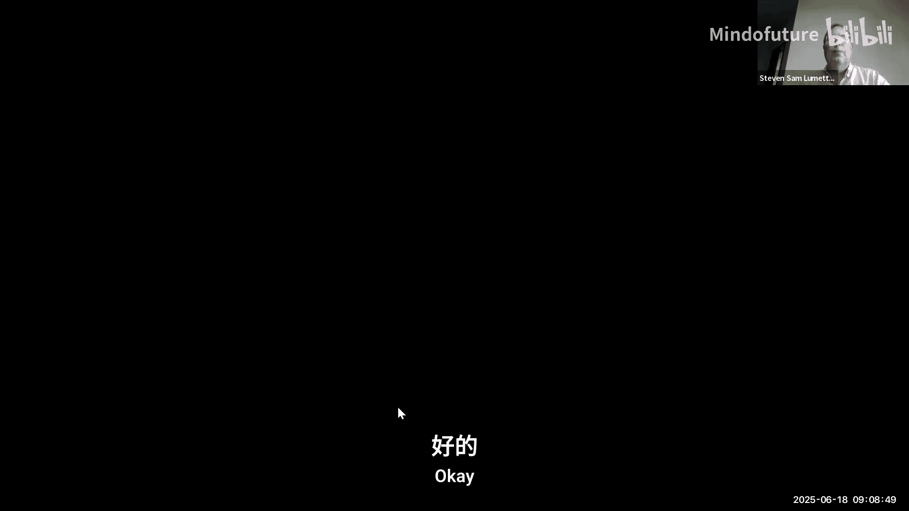
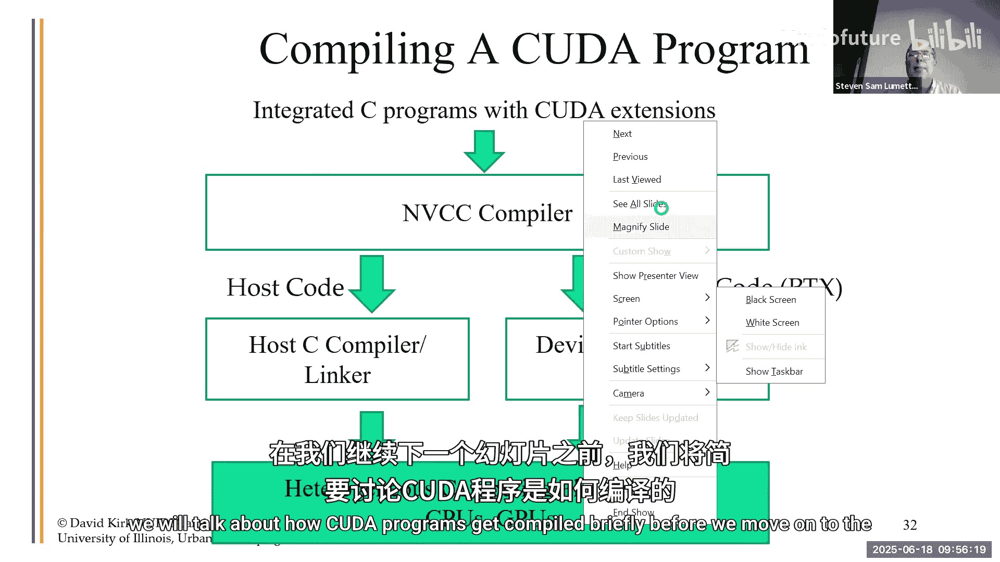
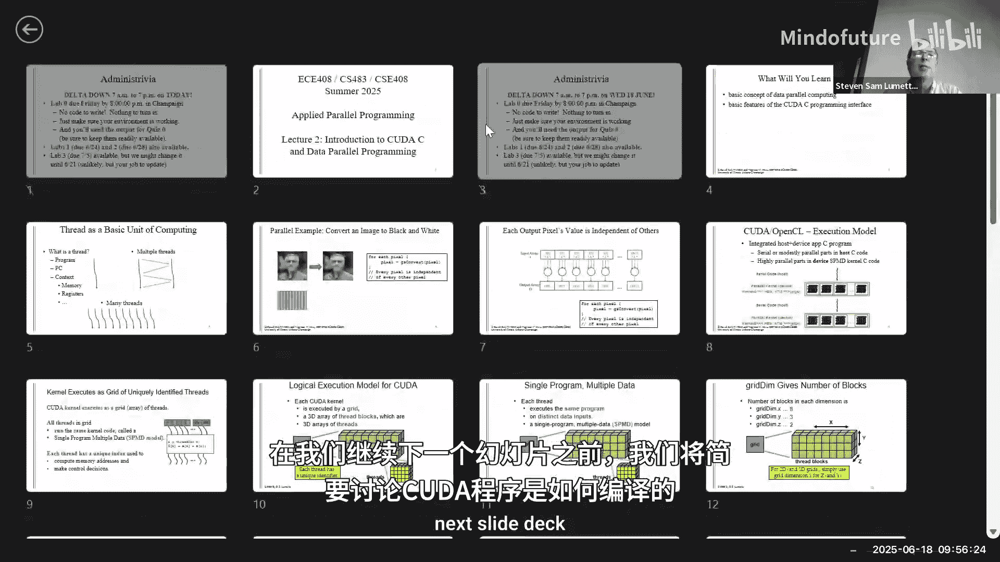
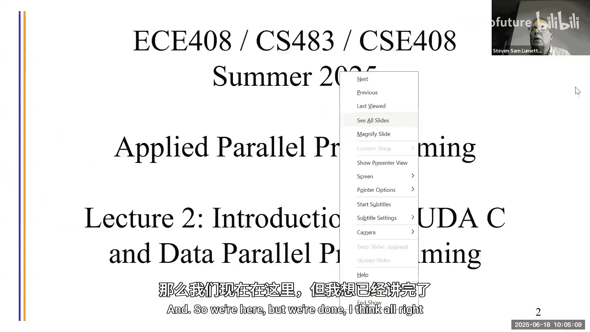
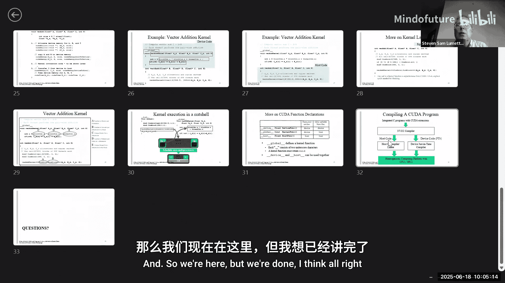
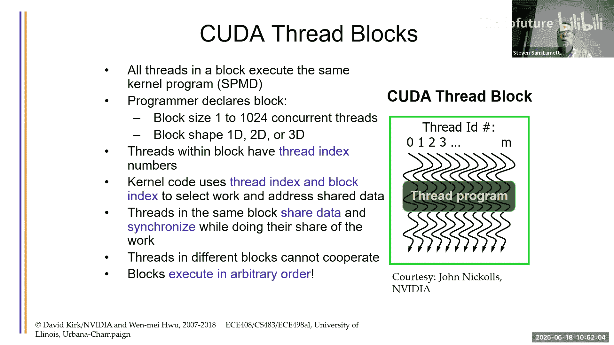

# 应用并行编程：02：CUDA 编程模型入门 🚀


在本节课中，我们将学习数据并行计算的基本概念，以及 CUDA C 编程接口的核心特性。我们将从 GPU 编程面临的挑战开始，逐步深入到 CUDA 的执行模型、线程组织、内存管理以及如何编写和编译一个简单的 CUDA 程序。

---

## 回顾：GPU 编程的挑战

上一节我们介绍了在高吞吐量、大规模并行系统（如 GPU）上进行编程时需要面对的几个核心问题。本节中，我们来看看这些挑战的具体表现。




以下是 GPU 编程中需要解决的关键问题：

*   **可扩展性**：算法需要能够随着数据量的增加而提供更多的并行性。二次方或更复杂度的算法通常不适合 GPU。
*   **规律性**：每个线程或数据实例的处理方式应尽可能相同，以利于并行化。
*   **负载均衡**：每个数据块的处理时间应大致相同，以避免部分线程空闲等待。
*   **全局内存带宽**：GPU 的计算能力增长速度远超内存带宽，因此程序性能常受限于内存访问速度。
*   **串行化**：当大量线程试图同时访问同一资源（如内存地址）时，会产生排队等待，导致并行效率下降。

---

## 为什么学习 CUDA 编程？

掌握如何为这些高吞吐量实体编写高效代码至关重要。CUDA 的创始人认为，教授人们编写可扩展、可移植且能跨越近 20 年 GPU 硬件演进的代码，是其对社会最大的贡献之一。可扩展的算法和库是我们能留下的最佳遗产，因为软件的生命周期往往远超预期。

---

## CUDA 执行模型简介

CUDA 采用一种集成的编程模型，程序包含在 CPU（主机）上运行的代码和在 GPU（设备）上运行的代码。编译器通过代码中的注解来区分这两部分。

*   **主机代码**：处理串行或适度并行的部分，在 CPU 上执行。
*   **设备代码**：处理高度并行的部分，在 GPU 上执行，采用 **SPMD** 模型。

### 什么是 SPMD？

SPMD 代表 **单程序多数据**。在 GPU 上，一个被称为 **内核** 的函数会被成千上万个线程同时执行。所有线程执行相同的代码（单程序），但处理不同的数据（多数据）。

执行流程如下：
1.  主机代码运行。
2.  遇到 **内核启动** 时，成千上万的线程在 GPU 上开始执行该内核函数。
3.  所有线程执行完毕后，控制权返回主机，继续执行后续代码。
4.  此过程可以反复进行。

---

## CUDA 线程组织：网格与线程块

一个 CUDA 内核由一组线程执行，这组线程被称为 **网格**。网格是一个三维的 **线程块** 数组，而每个线程块本身又是一个三维的 **线程** 数组。这种多维结构便于处理图像、矩阵等多维数据。

每个线程都有唯一的标识符，用于决定它处理哪部分数据。

### 网格维度

网格的维度由 `gridDim` 这个结构体的 `x`、`y`、`z` 成员表示，它们分别代表网格在三个方向上的线程块数量。

### 线程块维度与索引

每个线程块的维度由 `blockDim` 的 `x`、`y`、`z` 成员表示，即每个线程块在各个方向上的线程数量。
线程块在网格中有唯一的 `blockIdx`。
线程在线程块内有唯一的 `threadIdx`。

**一个线程的唯一全局标识** 由 `blockIdx` 和 `threadIdx` 共同决定。

### 线程协作

*   **线程块内协作**：线程可以通过共享内存、原子操作和屏障同步进行紧密协作。
*   **线程块间协作**：不同线程块间的协作能力较弱，主要通过全局内存进行通信，且需要特别注意同步和一致性问题。

---

## 实战：向量加法

让我们通过一个经典的例子——向量加法，来具体了解 CUDA 编程步骤。

**目标**：计算 `C[i] = A[i] + B[i]`，其中 `i` 从 `0` 到 `n-1`。

### 主机端（CPU）C 代码

```c
void vecAddHost(float* A_h, float* B_h, float* C_h, int n) {
    for (int i = 0; i < n; i++) {
        C_h[i] = A_h[i] + B_h[i];
    }
}
```

### CUDA 实现步骤

将一个顺序的 C 函数转化为 CUDA 程序需要三个主要步骤：

1.  **在设备上分配内存并传输数据**
2.  **在 GPU 上执行内核（进行计算）**
3.  **将结果拷贝回主机并释放设备内存**





#### 步骤 1：设备内存分配与数据传输

由于 GPU 拥有独立的内存空间，必须显式地进行内存管理和数据搬运。

*   **分配设备内存**：使用 `cudaMalloc`。
    ```c
    float *A_d, *B_d, *C_d;
    cudaMalloc((void**)&A_d, n * sizeof(float));
    cudaMalloc((void**)&B_d, n * sizeof(float));
    cudaMalloc((void**)&C_d, n * sizeof(float));
    ```
*   **拷贝数据到设备**：使用 `cudaMemcpy`，方向为 `cudaMemcpyHostToDevice`。
    ```c
    cudaMemcpy(A_d, A_h, n * sizeof(float), cudaMemcpyHostToDevice);
    cudaMemcpy(B_d, B_h, n * sizeof(float), cudaMemcpyHostToDevice);
    ```
*   **释放设备内存**：计算完成后，使用 `cudaFree`。
    ```c
    cudaFree(A_d); cudaFree(B_d); cudaFree(C_d);
    ```

#### 步骤 2：编写与启动内核

**内核函数** 是一个带有 `__global__` 限定符的特殊函数，它将在 GPU 上执行。





```c
__global__ void vecAddKernel(float* A_d, float* B_d, float* C_d, int n) {
    // 计算当前线程的全局索引
    int i = blockIdx.x * blockDim.x + threadIdx.x;
    // 确保索引在数组范围内
    if (i < n) {
        C_d[i] = A_d[i] + B_d[i];
    }
}
```

**内核启动** 使用特殊的 `<<<...>>>` 语法配置执行参数。

```c
// 假设每个线程块有 256 个线程
int threadsPerBlock = 256;
// 计算需要的线程块数量，并向上取整以确保覆盖所有数据
int blocksPerGrid = (n + threadsPerBlock - 1) / threadsPerBlock;
// 启动内核
vecAddKernel<<<blocksPerGrid, threadsPerBlock>>>(A_d, B_d, C_d, n);
```

#### 步骤 3：取回结果

使用 `cudaMemcpy` 将结果从设备内存拷贝回主机内存，方向为 `cudaMemcpyDeviceToHost`。

```c
cudaMemcpy(C_h, C_d, n * sizeof(float), cudaMemcpyDeviceToHost);
```

---

## 扩展到多维：图像处理示例

向量加法是一维的。对于像图像处理这样的二维问题，CUDA 的多维线程组织显得更加自然。

### 灰度转换

将彩色（RGB）图像转换为灰度图像。每个输出像素独立计算，公式通常为：`灰度值 = 0.299*R + 0.587*G + 0.114*B`。

**内核函数示例**：
```c
__global__ void colorToGrayscale(unsigned char* rgbImage,
                                 unsigned char* grayImage,
                                 int width, int height) {
    int col = blockIdx.x * blockDim.x + threadIdx.x;
    int row = blockIdx.y * blockDim.y + threadIdx.y;

    if (col < width && row < height) {
        int grayOffset = row * width + col;
        int rgbOffset = grayOffset * 3; // 每个 RGB 像素占 3 个字节
        unsigned char r = rgbImage[rgbOffset];
        unsigned char g = rgbImage[rgbOffset + 1];
        unsigned char b = rgbImage[rgbOffset + 2];
        grayImage[grayOffset] = 0.299f*r + 0.587f*g + 0.114f*b;
    }
}
```
**内核启动**（使用二维网格和线程块）：
```c
dim3 blockDim(16, 16); // 16x16 的线程块
dim3 gridDim((width + blockDim.x - 1) / blockDim.x,
             (height + blockDim.y - 1) / blockDim.y);
colorToGrayscale<<<gridDim, blockDim>>>(d_rgbImage, d_grayImage, width, height);
```

### 图像模糊（卷积）

图像模糊需要每个输出像素是其周围一个区域（如 3x3、5x5）内像素的平均值。这引入了**数据共享**和**边界处理**的问题。

*   **数据共享**：相邻的线程需要读取重叠的输入像素区域。
*   **边界处理**：对于图像边缘的像素，其卷积核会超出图像边界，需要特殊处理（如忽略界外像素或进行填充）。

内核中需要额外的条件判断来处理边界，确保不访问非法内存地址。

---

## CUDA 函数限定符

CUDA 扩展了 C/C++，引入了特殊的函数限定符来指示函数的执行位置和调用方式：

*   `__global__`：声明一个**内核函数**。从主机调用，在设备上执行。必须返回 `void`。
*   `__device__`：声明一个**设备函数**。从内核或其他设备函数调用，在设备上执行。
*   `__host__`：声明一个**主机函数**（默认）。在主机上执行。可与 `__device__` 联用，使同一个函数同时为主机和设备编译。

---

## 编译 CUDA 程序

CUDA 程序使用 `nvcc` 编译器进行编译。`nvcc` 的工作流程如下：
1.  将代码分离为主机代码和设备代码。
2.  主机代码交给系统的 C/C++ 编译器（如 gcc）编译。
3.  设备代码被编译为一种称为 **PTX** 的中间汇编语言。
4.  在程序运行时，GPU 驱动程序会根据具体的 GPU 架构，将 PTX 代码即时编译为优化的机器码。

---

## 重要概念与注意事项

1.  **线程块大小选择**：通常选择较大的线程块（如 256、512）以更好地利用 GPU 资源。最大值是 1024。
2.  **线程块执行顺序**：**线程块以任意顺序执行**，且彼此独立。不要在内核代码中假设线程块之间的执行顺序或完成状态。
3.  **内存一致性**：不同线程块之间通过全局内存进行通信时，没有严格的读写一致性保证，需要程序员使用原子操作或同步原语来管理。
4.  **资源限制**：每个线程块可用的共享内存、寄存器等资源是有限的，这会影响活跃线程块的数量和性能。

---

## 总结



本节课中，我们一起学习了 CUDA 并行编程的基础。我们从 GPU 编程的挑战出发，深入探讨了 CUDA 的 SPMD 执行模型，理解了**网格**、**线程块**和**线程**的多维层次组织。我们通过**向量加法**的实例，掌握了 CUDA 编程的核心流程：设备内存管理、内核编写与启动、数据传输。接着，我们将知识扩展到**图像灰度转换**和**模糊**等多维应用，并学习了如何处理边界条件。最后，我们介绍了 CUDA 的函数限定符、编译过程以及编写高效 CUDA 程序需要注意的关键点，如线程块执行顺序和内存一致性。这些概念是构建更复杂、高性能 GPU 应用程序的基石。