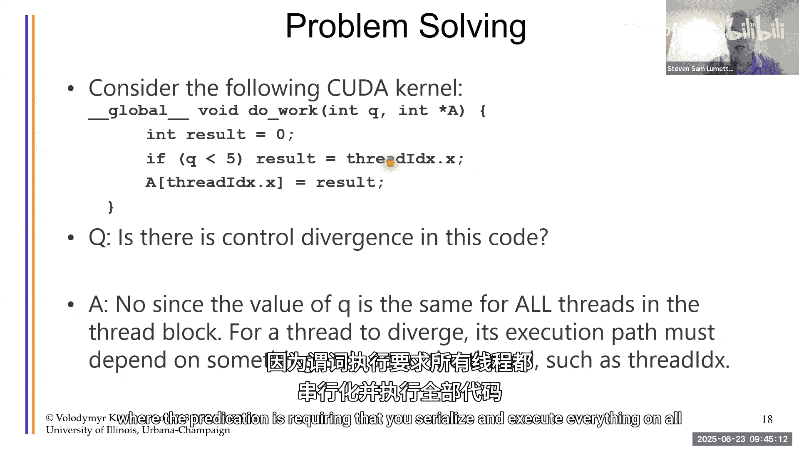
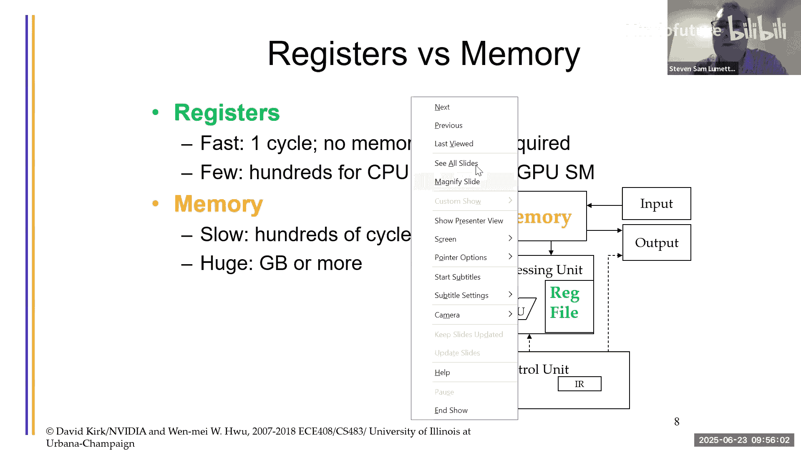
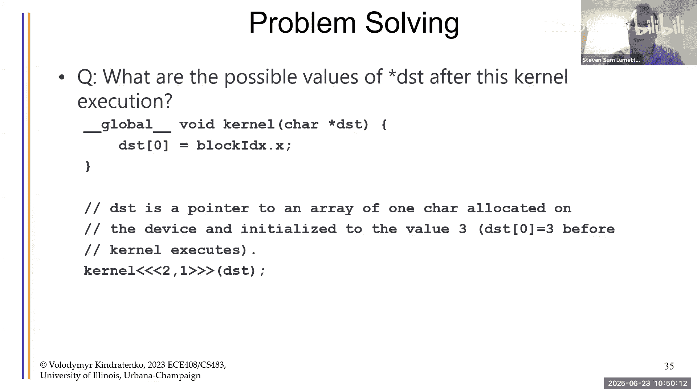

# 【伊利诺伊大学】应用并行编程2025-｜-ECE408-CS483-CSE408-Applied-Parallel-Programming-2025-p03-P03_lec03--BV1uNSyBaEcu_p3-

Okay， so。I think if I you that' picking。All right， welcome back， everybody。

I'm now enjoying my little MIT dormer， which is not air conditioned。The hallways air conditioned。

 but I can't have my door open because there'll be no probably as students come back。

So hope you enjoyed your week， hope you were able to get。Lab zero done on time。

 and I know a few of you at least have finishedquiz zero。 so that's that codes well。

 and we didn't see too many people asking about about extensions or anything yet for for。

For the lab zero so hopefully things are going well for most of you I know a couple of you are still trying to get things set up so you can access Delta make sure we know about that because I know sometimes it takes a couple days between when you submit a few of you send email saying what's going on unfortunately there is a little bit of a delay and it's the black box between the between Hanan sending them your name and your access ID and then they're adding you to our allocation so that you can actually log in and use Delta。

So that's kind of outside our control and get the email then it's set up sometimes that email may could get lost could go into your spam for whatever reason so so do try to log in if you haven't managed it yet。

 but I think most of you probably have at this point if not maybe stick around if you want to and just let me know after the lecture if you haven't already told us but we do want to be in the loop because there is the next lab tomorrow night so。

So we need to think about that if things are slow for some reason。All right。

 so what were we talking about when we finished up last Wednesday。

 So we're still working on slide deck 3， which was talking about the multi-dimensional logical organization of coupa threads right the idea of a grid that you break into a three dimensional array of thread blocks。

 and then each of those thread blocks。 you break into a  three dimensionional array of threads and I say 3 dimensionmensional。

 but of course， the size of any of those dimensions might just be one in some cases right so you can think of it as 1D or 2D。

 and that's typically what we're going to use in the first few examples。

 We will do a 3D example later this summer。We're also going to talk a little bit about control structures like loops inside of kernels and then talk about thread scheduling。

 latency tolerance hardware occupancy and stuff like that Okay so that's。The slide deck。

We will always start with a little bit of review so I showed you this image blur where there was an opportunity for some sharing of data right because remember that each pixel is actually an average of weighted average sometimes a Gaussian sometimes just just a linear arithmetic mean right doesn't really matter there's a blur filter and you collect say 25 pixels or more if you want and then you take some linear combination of those and that produces your output pixel so for example we might blur this beautiful picture of the pyramids into the one down on the lower right okay。

And then we thought about how we would execute those in parallel and this was a picture showing you how one output pixel the one in black here in the little highlight would need nine input pixels that's for blur size of one going one each direction from the central pixel which is our output pixel And so you see we talked about。

We went over the couta thread blocks， I guess I took the slide out for review。

 but we talked about not only how some of these thread blocks。

 some of the threads in some of these thread blocks would not have output pixels and so they need do nothing in this kernel just as we saw with a vector a kernel but also some of them might have outputs but not some of the corresponding inputs that they would need right so we talked about writing control in the kernel。

Just if statements in that case to avoid trying to read things that didn't exist so thats important thing to keep in mind as you go through writing your kernels is that each thread will be accessing a different location or set of locations in your array so you want to make sure that none of the threads are accessing outside the array bounds okay particularly for writes but also for reads reads are maybe a little more subtle because they're less likely to cause crashes so whereas they are getting just random bits back if they don't cause a crash。

In many cases， all right， so。We went over， this was the last I think review slide。

 we went over what we had seen previously that lecture so maybe I won't go through in much detail again but。

You declare as the programmer， you declare the block size between one and 1024 concurrent threads。

 the block shape in one， two or three dimensions， and then each of your threads says a unique combination of block index and thread index identifiers in each of three dimensions and you can use write kernel code to use those unique identifier values to then reconstruct a unique array index。

 for example， into your data set Okay so we talked about that and looked at it。

I did want to reiterate that the blocks execute an arbitrary order。

 we will talk a little today about how the sharing between threads in a block can work。

 but when you think about well which thread block executes first。

 I may at some point kind of tell you okay it's the same as the Cor of linearization。

 but that is specific to an instance of KUDa and is not something that you can count on so you should not try to reason about that or make use of that order for performance reasons sometimes you might want to。

 but never do it for correctness reasons because if NviIDdia decides in a future generation or even just a new version of coUDa that downloads onto an old GPU that that order needs to change they will do so without notifying you and if your code doesn't work as a result。

That's your problem， not not anyone else's right， so be careful about trying to reason too much about thread scheduling。

Allright， so now we can kind of move forward so compute capabilities of each GPU are GPU dependent I know there's a little small font。

 this is not meant for you to read the slide just to highlight some of the differences So here what I have is a number of aspects of two GPUs one from the Keeppler generation on the left and a second from the maxwell generation of GPUs on the right。

 So let me zoom in on a few of the on a few of the parameters So the size of shared memory which is the memory that one can share between the threads in a block that we'll talk about how you do that a little later。

 that size， for example， in the Keeppler generation was 48 kilobytes per streaming multiprocessor but then your thread blocks could only make use of about 16 of it so you were not allowed to allocate more shared memory for a given thread block even if you only had one thread block running on that SM in the maxwell generation that went up。

To 64 kilobytes I think it's actually in the ones you're using on Dlta I think it's actually still 48 kilobytes so it doesn't always just get bigger。

 it kind of goes up and down there's some architectural constraints on on how much memory you can put close to a processor on a chip and so typically that'll be 64 max for a long time to come but just because that's the physical constraints on processor design。

But it might be smaller， it might be a little bigger sort of order of magnitude it'll be about the same most likely the register file size similar set of constraints。

That has been 256 kilobytes for a while and wow that's a lot of registers keep in mind that is in bytes so first of all。

 most of your registers are going to be four maybe 8 byte registers So if you're using  four byte floating point values putting those into registers then already you've got divide your 256 by4 before you have register counts the register file on the Sm is also shared between threads so it's a very big register file even for four byte registers you've got 6400065。

 536 registers but then if you say well have1000 threads then you're down to down to 64 threads per I'm sorry 64 registers per thread and if you then actually go and have more thread blocks and you've got even fewer registers that you can allocate per thread so typically you should think of a given thread is having maybe 203040 registers available to it which is about the same order of magnitude。

You're a typical modern 64 bit processor okay so even though here you say。

 oh that's a lot of registers in practice each of your threads will have about the same as a CPU。

And the number of active blocks for SMM， this is the number of thread blocks that can be scheduled onto a streaming multiprocessor simultaneously now in many cases you won't hit this limit in fact you very rarely want to hit this limit but this is another constraint so as you'll see as we start looking at these things all of these aspects or constraints and any one of them could be the one that limits your parallelism so with GPUs you often have to be aware of several aspects of the hardware and make your choices about your parallelism about your block sizes and things like that based on the GPU and based on the constraints that are placed on you based on the particular GPU you're using。

2。So I promised we'd say a little more about executing thread blocks， the thread blocks。

As theSo you create the kernel that creates all of the thread blocks logically and those thread blocks are then assigned to streaming multiprocessors on a block by block basis so once a thread block has been assigned to a streaming multiprocessor。

 it will not execute anywhere else， no other streaming multiprocessor So thread blocks are never split right even if you've got eight streaming multiprocessors doing nothing and only one thread blocks left execute those threads will not go across those SMs it will go on that whole block will go on one SMM。

So the assignment of execution of blocks is on a block granularity is how we say that up to 32 blocks in HSM and now again that's the resource limit for MaxWell that changes from generation generation。

 the lab zero device query you can actually use that to query how many blocks are allowed per SMM if you want to on the GPUs we're using the A40s。

Maxwella。A single MaxL SM just to have an example can take up to 2048 threads again still limited to 1024 per block。

 but the total number of threads executing on one SMM in the maxal generation of NviDdia GPUs。

 2048 and now we'll see later the reason for that that's basically a processor level SM level scheduling of what are called warps within within the blocks。

 but so those are schedule or slots for the processor which instructions can execute next in the processor can't look at more than in this case about 64 different possible sets of instructions it could choose next which is why we end up having 2048 threads in groups of 32。

The threads in your blocks， once they've been scheduled once that block starts running on an SMM they run concurrently okay so it's up to the SMM to maintain those thread and block ID numbers and to decide well which threads are going to execute in the next cycle or which set of threads are going to execute the next cycle so the SMs manage and schedule the thread execution within those blocks that have been allocated onto the SM。

Okay， so each of the blocks is then executed as a set of 32 thread warps。

And so if you take your thread block。Indices and you linearize them as you would to put something into memory right。

 so taking the x dimension as the smallest and then the y dimension is the x smallest and then the Z dimension as the largest。

Think of those as being linearized and then take chunks of 32 okay and each of those we call a warp。

The warp is an implementation decision for a particular GPU and NVdia insists， despite the fact。

That every GPU they've produced has had warp size of 32。

 they insist that that is not necessarily going to be the case on future GPUs so it may be that in the future GPUs don't have warp size 32 could go down to 16 could go up to 64。

 a lot of code that kind of implicitly assumes especially performance reasons that it'll be 32 but you should be a little careful in making that assumption and putting too much weight on it。

 particularly correctness issues。Wps are then divided so as I said based on their linear study index。

 but warps are the scheduling units in the SM okay so when the processor in the SM needs to execute some new instruction every cycle。

 what it does is it looks at available warps right warps that have their data ready and connection be executed and it picks one of those so how does it decide well that's proprietary scheduler information from NviDdia we're not going to find that out。

 but amongst the available blocks or I'm sorry amongst the available warps inside the blocks that have been scheduled onto that SM the processor will choose one or sometimes two depending on the hardware processing resources warps that are executed in that cycle。

So for example， if we had three blocks assigned to an SM and then each block had 256 threads。

 could say， well， how many warps are available to the processor for scheduling onto the processing resources that AL use。

 arithmeticalologic humanss？So each block， as I said。

 256 threads divide them up into warps so you've got 256 over 32 if you didn't have a multiple you'd round up in this case it's a multiple so you have eight warps in each thread block and then you have three thread block so that's 24 different warps that can execute on that SM in any given cycle。

嗯。The streaming multiprocess in the GPU implement what's called zero overhead warp scheduling。

 so what does that mean？So what that means is that from cycle to cycle。

 I should go this way for you from cycle to cycle， a streaming multiprocessor can switch between any of the warps that are available to it from any of the blocks that are scheduled onto it so if I run warp3 from thread block2 in cycle0 then in cycle1。

 I could choose any other warp including the same one but any other warp and execute it in the next cycle I now and Sm with no overhead so it costs me nothing I don't have to delay for three cycles to move from one to the other this is not true in many threaded environments right so if you look for example at operating system level scheduling of threads in software or many processors etc。

 you can't easily go from one context one thread， one process to another with。

out paying some penalty right taking time to take all of the information about that particular context and kind of put it away somewhere and then get the new one out。

However， zero overhead is really important for something like a high throughput engine like a GPU because you really do need to be able to execute amongst the available perism as quickly as possible so the design of the GPU has always been to maximize your ability to get things done in time and if you're spending time on switching right between your thread contexts that's just wasted time。

Now there are plenty of ways to waste time right if you don't have enough warps available to hide the latency as we're going to talk about memories very slow。

 even slower than it is on CPUUs and so if you have to go to memory those warps have to wait they don't have any work to do there is no out of order execution there is no branch prediction very simple processors and so they simply wait now if you don't have any other warps that are not waiting because you've only scheduled say five warps onto a system that could take 64 then that streaming multiprocessor simply does nothing so there are many ways to kind of waste time on a GPU's Ss but the price of switching between warps is zero okay。

All right， so eligible wars are then selected for execution using a prioritized scheduling policy。

 again， proprietary to NVID or MDD or whatever company made the GPU。

All of the threads in the warp then execute the same instruction when they're selected。

 so if the SM decides to execute a particular warp all of those threads the 32 threads in that warp execute exactly the same instruction。

So that's a model called single instruction multiple data。

 and it's much more restrictive than the SPMD model we talked about last week。

Exactly the same instruction okay so you might wonder well what what about branches right what if will come to that but the threads in a cycle in the warp execute the same instruction so it's called SD and I'll put that on a slide shortly I think。

All right， so over time what does this look like so time is now going to the right we've got thread block numbers and warp numbers within thread block so TV is the thread block number and warp W is the warp number so for example at time1 you might the SMM might decide to start executing Warp1 from threadb1 and then say at cycle6 on that particular warp all the threads decide they need to go to memory for example。

 so they go to memory but memory is not instantaneous that answer does not come back within the cycle so that it can continue executing the SMM cannot continue executing that warp so we have a stall which is shown up here。

 this delay here much shorter than a memory access but but let's pretend that that's what happened this is more like a floating point computation maybe that would take eight cycles for example。

 so maybe they did a multiply。The threads did a floating point multiply。

 So then the thread immediately in the next cycle chooses another warp to execute。 So for example。

 it might choose to execute thread block2s Warp1。 So that executes for a couple cycles。

 then it too has a stall At which point the SM in the subsequent cycle with no delay So immediately next cycle。

 These are cycle by cycle， little blocks in this picture here。

 chooses to execute Warp 1 from thread block3。 So it does that for a couple of cycles and then maybe that warp figures out that it doesn't have any useful warp to do。

 and it goes away。 and then the SMm immediately chooses another warp in this case。

 thread block3 is Warp2 and so forth and so on。 So once the stalls are done。

 you can see some of the earlier warps might be scheduled again how the SMM chooses which warped to execute is a proprietary schedule。

So don't try to reason about it at the main point of saying that。

So one of the issues that you might immediately， if you've been exposed to how processors work。

 one of the issues here is branch divergs。So you think about your code and you say， well。

 I've got an if statement， I've got a loop。 What happens if the threads in my warp。

Don't need to do the same thing， right， What if I do an if statement。And threads in my warp。

 some of them take the if case and some of them take the else case。What happens？

This is going to be your main performance concern with control flow in your kernels for GPUs okay？

TPUs use something called predicated execution。You may or may not have heard of this。

 the idea in a predicated execution， a predicate in English is。Is a condition okay。

 so if I say something like， you know， if you give me an apple， I will give you a peach。For example。

 that seems to be my favorite example taking from some other class。😊。

If I give you an apple or I'm sorry， if you give me an apple is the predicate Okay。

 the I will give you a peach is conditioned on your having giving me an apple。

 If you don't give me the apple， I don't give you the peach。 so in the context of a processor。

 of course， we have computed prediicates， I say， well， if x is less than 0。

Then on some threads the answer may be yes and on other threads the answer may be no so now I have a predicate was x less than zero or not they can have a one bit register that records for each thread yes or no。

That's the predicate that is then used to condition the execution of that next instruction。

On the streaming multi processing elements， okay？So when your threads diverge in terms of a control decision。

 predicated execution is used and all paths are executed by all threads serially and so you have't if else。

First， the threads for which the answer is yes in the test for the if。

You're going to execute the then block， actually all threads in your warp will execute all instructions in the then block but will be predicated so that the execution for the threads for which the if test was false will simply not do anything with the results of that instruction。

😊，Then after you after the Sm has executed all of the instructions for the then block of code。

The SM will execute all of the instructions for the else block of code and the predicate sense will be reversed。

 only the threads for which the if test was false will then do something with the results of those instructions。

 all of the ones for which the if test was true will simply discard the results of those instructions。

 But the point is that all of the threads will execute all of the instructions in both the then clause and the else clause so you can imagine if those are kind of equal sizes this will take twice as long right and half I guess half on average regardless of what the distribution is of your threads will be doing nothing useful throughout that predicated execution。

The worst case is that you then nest these if statements and then you subdivide your groups of threads and you get down to the case where you have one thread doing one thing and 31 threads doing nothing。

Right so so this is this is one of the major pitfalls with control in GPUs that you want to try hard to try to get all of the threads in your warp to avoid this control divergence problems So if all of the threads do an if test and all 32 take the else branch or take the sorry the else branch or the then branch right if they all do the same thing processor doesn't need to execute the other path so when you're coding need to keep in mind how the warps are organized and think about how the control flow works in your code and we'll see examples of this in the lab just wanted to start making you aware of the problems okay。

All right， so here is an example of branch divergence， so I could， for example， say if my X index。

 my X part of my thread index is less than two， then I have a big chunk of code I want to execute on a couple of my threads。

And otherwise， I've got some other code that I want to execute on all the other 30 threads or more threads if I've got more in my block right because I'm looking at my block in thread index here。

So for my first warp， the one with thread indices x indices 0 through 31。

There are two control paths okay， so again， just to emphasize all of the lines of code here in the then path as well as all of the lines of code here in the else path will be executed。

By all of the threads in my warp， so the SM will execute both blocks of code。

So how can I try to avoid that so first of all。I can try to make the branch granularity a multiple of my warp size。

 remember unfortunately it may not always be 32 okay so for example。

 if I do something as shown here and I say， well let me divide my thread index by my warp size as to the different distribution of threads clearly so I have to think about what that means and actually get my code correct。

Performance is second order to correctness as always。Or maybe 100th order to correctness。😊。

If if I were to write this kind of code all of the threads within a given warp have the same left side value here right all of the threads would have exactly the same number here if they're in the same warp so thread 0 through 31 would get a0 after dividing by warp size again energy division rounding towards zero threads 32 through through 63 would get a1 and so forth right so they't get the same answer if they were threads within the warp so all of my warps will either execute then or execute L I won't have any warp split across the two so I still have the two control paths。

 but all of the threads in any warp go only through one of these paths。All right。

 so another thing that you have to worry about as you start to write your couta kernels is block granularity。

 so someone asked。know thinkinging ahead， someone asked last week， well， how do I decide， right。

 should I have 16 threads， Should I have 32 threads， Should I have 64 threads。

 How do I pick the size of my block and and then I think we saw and asked why not one by one by one So branch divergence is one reason then even if you don't have that。

 if you've got one thread then you're gonna have 31 threads idle in that warp right and the other constraints like number of thread blocks per S if you can only have 16 for example and you've only got one thread in one warp。

 you've only got616 threads and I'm sorry 16 warps in that case to schedule。

 which is not going to fill up your your scheduling resources So that'll be limited and then you've also only got efficiency of 130 second in that case So then ends up being really bad as I suggested last week now you've seen kind of why as well。

So back to the question right how do we make the decision so unfortunately it's often a case that you have to think through some of the trade offs and think about what it's going to mean so let's do that for our gray scale conversion example。

😊，So let's say our choices that we want to consider would be eight by8。

 16 by 16 or 32 by 32 blocks of threads。And let's assume that in the GPU that we're using that each of our SMs can take up to 1536 threads。

 this is power of 2512 times 3。That's why it's that number。嗯。

And then up to eight thread blocks per SM so let's think about the implications of those constraints when we pick the size of the different sizes of blocks。

Keeping in mind that what we'd like to do is make as many warps as possible available to our SM and what that means in this case。

Since we're limited by the number of threads we want to maximize our number of threads and the reason this is the limit again is that 32 threads per warp。

 this ends up being 48 warps and that is the hardware limit on how many different warps of processor you can look at in one cycle for this GPU and decide which warp to schedule without waiting a cycle which would incur a lot of overhead for switching。

So 48 warps went to make sure that we're trying to fill those scheduling slots。So if we do eight by8。

 we have 64 threads per block， each streaming multiprocessor can take up to 61536 threads which would take 24 blocks。

 1536 over 64 but we can't allocate 24 blocks simultaneously we had a limit of eight blocks so what that means is that with an 8 by8 block size we only have 512 threads which is 16 wars at a time on each of our SMs。

That's going to limit our performance Okay， the SM won't be able to hide the latency。

 keep things going through executing while some warps are unavailable they're waiting for a memory。

 waiting for a floating point， etc。What about 16 by 16 if we do 16 by 16 we've got 256 threads per block each of our SMs can take up to 1536 threads that's 48 warps right which is six blocks now that's within our8 block limit so the scheduler would actually allocate us assuming we have enough blocks six blocks to each of the SMs and we have as much parallelism available as possible so this is a good answer so 16 by 16 would be a good choice on this particular GPU。

What if we made them bigger right he said， well I've got more parallelism within my block。

 I want to have 32 by 32 block size right that's the upper limit on threads per block that's great。😊。

So we can't get bigger， at least not as a square， we could try some rectangles or something。

 but we can't do a bigger square。Unfortunately， with this large block on this GPU 024 threads。

 we can only fit one block。So if we've only got one block we have 1024 threads instead of 1536。

 so we have 32 warps instead of 48 and again we have not made enough parallelism available for that SN so as you can see sometimes even though the application may encourage you to have a bigger thread block size we'll see that often the ability to reduce memory bandwidth depends on having larger thread blocks so make them as big as possible sometimes other constraints on your GPU may require you to not maximize that size so unfortunately with GPs there is a lot of this fine tuning if you want to call it that where you have to think about the different constraints and pick your thread block sizes to match the GPU。

Alright。So that was it。Or this slide deck。 But starting with this slide deck。

We're going to try to do a little problem solving just to make sure people feel comfortable with the kind of things we're talking about these are similar to the kind of things that will show up on the quizzes so you definitely want to feel that these are questions you can answer obviously you have the slides please don't look at the answer and then read it out to me I will I will give you an answer to or the second for someone to volunteer but I will also kind of go through people in order of the participants list and call on people so we can do it either way either way is okay with me last summer we kind of went through the participants list and everyone was happy to answer when called on but if you'd rather just speak up that's fine if I find the same persons answering all the questions i'll probably ask them to bow out so other people can have a chance。

All right， so here's the question for you。So a particular coUDa device streaming multiprocessor。

 the SM can take up to 1536 threads and up to four thread blocks。

 so which of the following block configurations allows us to fully utilize and get fill up the threads for that SM so one option is 256 threads per block。

 one is 84 threads per block and the third is 576 threads per block。

So what do you think the best choice would be here？Anyone want to volunteer？Would it be 334 Yeah。

 I think that's right answer let's go ahead and do the math there Okay so Max says 384。

And let's take a look。If we were to choose the 256 threads per block， then you say， well。

 how many blocks would I need to have 1536 threads in division and find you need six？

But unfortunately， this GPU， this device only allows four simultaneous thread blocks to be allocated on21 Sm。

 So we're not going to be able to to fill those those threads。

 right We're only going to get 1024 threads with that thread block size。 So that's suboptimal。

If we choose 384 then do the math there， we get exactly four so we're going to fill that that resource constraint doesn't matter if we have as many thread blockslocks as we can or if we have fewer。

 that's not what matters right what matters is whether we have enough warps right corresponding to number of threads because warps are fixed right a fixed number of threads each。

Whether we have enough warps allocated that the SMm can try to hide the latencies okay by switching to another warp when some warp is waiting for results so again 1536 divided by 3044 so that's exactly right and we can fill the number of the number of threads we want 1536 divided by 53576 is only three okay and so we're not filling that resource。

do you think for sex or I have to do the reverse math so it's also it it's only slightly suboptimal right so the way to think about this it doesn't really matter that we didn't have four thread blocks so what matters is the number of warps Okay so three times 576 is going to be。

is that even。No， this doesn't make sense。Moved around down。哦。Yeah， sorry， I think it should be two。啊。

Sorry I've vetted these but I think I screwed up yeah this should be too you have to round down you can't put more warps onto your system than are available as scheduling slots so 1536 divided by576 is not rounded down is not three so。

So when we do the math and we have two thread blocks then we're only going to have something like 1 1152 threads so we're not going to fill the schedulings。

So good answer， Max。So the right answer is let's choose 34。All right。And again， you know。

 you will get some， I'll need to fix that one。没事。😔，All right so。

Second question for you for the slide deck before we move on to the next one。

 let's say we have a1D array of n floating point elements and we want to process with one element per thread the way we did with vector edition。

 for example。Using our GPU and the target GPU has8 Ss each with each with 16 processing elements sps we call it so what's the best execution configuration for this kernel。

And I don't think another information on here。I don't want to reveal the answer。So okay。

 I'm going to just reveal the answer。あ。So that's not enough information right so it's important for you to be able to realize when you don't know enough information about the GPU and I know that's going to be a little hard at first so that's one reason to just reveal this answer。

So we don't know the maximum number of threads because we did I didn't tell you right now you can look it up with the vice query and that's what you'll you'll want to do when you're really trying to do a you know cutting edge performance tuning for your codes which we're not going to require in this class most of the time but。

You'll want to know how to do it right so you can look up the number of threads but without that information there's really no way for you to decide based on what I've given you in the question。

 know what is the right answer right where what's what's the number of threads I should put in my thread blocks etc so just because I tell you the number of Ss and the number of processing elements with NHSM the S。

 that's actually the width of the of the real processing resources， So it's going to typically be。嗯。

A divisor of the warp size 32 so sometimes it's 8， sometimes it's 16， sometimes it might be 32。

 but basically your 32 threads map onto the array of SP so in the picture I showed you it looked like there were two blocks that's because with 16 sps your 32 threads will actually take two cycles so the first 16 we're executing the first cycle sorry first 16 and then the second 16。

But we didn't really even talk about that， so you might have thought， what is this？

All right so so the point here though is that in some cases you may not have enough information。

 so there are a lot of things that one needs to know and I've introduced you to some of them。

 but we'll go through and look at more of them and the quizzes we'll ask you to think about these kind of things because as you're thinking about how to tune your codes。

 these are some of the things that you want to know and as you go dive in with with the performance tools for NVIDdia these are some of the things that can constrain you and you'll want to be able to recognize them quickly and realize what's going on when you've made a poor decision about block size。

 for example and as a result not had enough warps to execute on your S。All right。

 so unless people have questions， I think this is the last one for this slide， Oh。

 wait nope sorry you have one more。Okay。So here's a kuda kernelnal， so I just called it do work。Okay？

And you can see some code in here， so I have a couple of things passed in to do work and I set a local variable that would go into register。

 set it to zero， and then if Q is less than5， then I set the result variable to threadX。

Thread index on x， and then I go and I write into the array A at thread index on x with this result。

Okay。Is there controlled divergence in this code？So remember。

 controlled divergence means some threads in some warp。Are going to take the statement。

And execute this piece of code here。Whereas other threads are not。No。Okay。

 I'm sorry I missed was this Noah， Yeah， okay， why not？I don't think it's。Oh。

 every single thread needs surrenders。Right， well， yeah， the answer will be yes or no， I would argue。

 but why is that， why do you say that？你真没事。Inally on Q and right， and what do we know about Q？啊啊。

Its a constant it's a constant， right， that all threads get the same values of Q and A， right。

So I want to be a little careful I mean it's a technicality it is C code you could change Q in your thread I don't suggest that you ever do anything like that。

 but you can clearly it's not being done here so what i'm saying is not relevant except that when you say it's constant if you're looking at someone else's code don't assume that they've。

That they're good at writing gold， right？But for the purposes of the question it's absolutely it's it's the same on every thread right the parameter values passed into Q are the same on every thread and so that's the point that noah and interests were saying is that well Q is the same for every thread and so for the threads within every warp the answer is yes or the answer is no right so either we set the results to the thread index or we don't depending on the value of Q but the answer is yes or no for all threads and so the answer to the question down below is there controlled versions is no there isn't penny there's another thing I want to mention briefly about this examples。

So that's just it down below is just explaining the same thing I just explained if you want to read it。

 please do if you don't， that's okay the other thing I want to mention though is。

We don't have an else。We only have an if statement with a then。

So this is still an issue right we have threads if if Q were thread dependent right if this did have controlled divergence。

 we still would have some inefficiency， it's less of an issue than if we have a big else or big then statement in a big else statement right because those have to be serialized and all threads have to execute both。

Okay， so if we've all cut。Excuse me， some threads executing code right the other threads are doing nothing。

 it's not as efficient as it might be， but it's less of an issue than controlled divergence where the predication is requiring that you serialize and execute everything on all threads。

All right。So that's the end of this slide deck。We're going to move does anyone have any questions on what we've covered in this set of slides？

All right， so I'm going to switch over to the next slide deck。

不。有么 time。All right， so。So our next topic then is the memory model in Kuta。

 So we're going to start talking about the different memories and。

Thputs and speeds and stuff like that okay？So in this slide deck。

We'll talk about the basic features so how big are the memories。

 I mean those are things obviously you're going to want to do device query to get real details。

 but kind of relative throughputs relative access times to the different types of memories。

 how you use them， how they get allocated implic or explicitly when NVCC looks at your code。

 the compiler looks at your code and the options for you as a programmer for accessing those memories。

 will also go over some concepts that you'll need for lab2。

 which is due Saturday which is basic multiple matrix multiplication using global memory。

And then we'll think about some of the performance implications of using global memory for something like matrix multiplication。

 which will lead us into the La3 material， which is using the shared memory feature of KUudDa to improve our performance for something like matrix multiplication。

😊，嗯。So let's step back a little bit， I know a lot of you have seen this kind of thing in introEC classes or maybe you've taken CS233 or something。

 so you may have seen this other people won't so be patient as we go through these kind of background material for some people。

The von Neumman model of computers computer architecture abstracts a computer is five parts okay so one part is the processing unit which has the arithmetic logic unit。

 the piece of hardware that does multiplication， addition division logic operations and the register file which is where we keep data that we need frequently and quickly okay so we have registers we have AU。

 those together make up the processing unit。We also have memory。

Now in the von Neumman model the program sits in memory。

 so this is a difference from other approaches to designing computers from 70 years ago。

 but this is typically how we're doing everything today on most systems。

So we have a memory and that's a second piece， it's made of DRAM or SRAM or whatever based on whether your device is a desktop or a phone or something like that。

We have input， so keyboard mouse wave output， so display printer。

 something like a network card would be both input and output so those are four pieces and then the last pieces of control unit which is keeping track of where we are in the program。

 the program counter keeps track of the current instruction in the instruction register of the IR and controls the rest of the pieces of the von Norman model。

 the memory the processing unit， the input， the output by sending them signals saying okay it's time for you to do this and basically those signals correspond to what the programmer has given for the next instruction which is sitting in the IR。

So those are the five parts As I said the program code the instructions are also stored in memory in the von Neuman model so part of what the control unit does is bring those instructions from memory into the IR and then execute those instructions and then go get another instruction and execute it and then essentially just loop through that through that process forever。

 that's a computer。嗯。So every instruction then has to be fetched from memory and then decoded and so the instructions use an encoding it's just a bunch of bits so instructions are a bunch of bits so the controlling unit has to look at those bits and say。

 well what was the programmer asking me to do so that's decode and then it has to execute those the instruction that the programmer has given it and we break instruction processing down into several steps so the first as I said is well go get the instruction to get the instruction I don't know what it is look at the bits and say。

 well what am I supposed to do and then execute it and then maybe go access memory？

And you can you can think of instructions as three three flavors， so there's operations。

 things like okay， I want to multiply， take some data from this register。

 some data from this register， multiply them together， put the answer into that register。

Or data transfer， get some data out of memory， put it in my register or get some data from my some bits from my register and put them over into memory over here and then control flow right the things that implement our ifs and our force right is some condition true。

 if so go to one place in the code otherwise go to some other place in the code and those are control flow instructions。

My alarm just rang for our breaks， so I think。Let me finish talking about processing instructions。

 give you a couple of examples and then probably break around there okay。

So let's say I have an ad instruction， so I'll just use LC3 ISA， it's a convenient。

 simple ISA an ad honestly looks pretty much the same and almost any modern ISA。

 typically three registers right so you'd say in LC3 notation this destination is first and a lot of other notations destination is last so you kind of have to know their notation for your instruction set but here what this instruction means is take the contents in bits of R2 and R3 treat them as unsigned or two complements number。

 the arithmetic operation is the same add them together and put the sum into RRA。

So in this case we don't need memory， we fetch this instruction from memory。

 we decode the bits corresponding to the encoded version of the add operation I didn't want to bother you with bits in the slide。

 but the processor of course has to look at those bits takes a cycle or two and then execute execute those。

Instructions or execute that instruction， don't need access memory。

If we instead look at an example of a data transfer instruction， so here is a load in LC3 ISA。

 so here what this means is go get the bits out of R6。Add the number three to it， okay？

Use that as an address for memory， go to that memory address。

 get the contents out of that memory address and put those bits into R4。

And the corresponding instruction execution breaks down as color coded here right so of course we have to fetch the instruction。

 get the bits， corresponding to the LDR， decode them， right。

 understand what they are and then the execution is usually the adding the three here。

 getting the bits out of the register， adding the three to it and then we'll go to memory。

so that's how we break down our instruction execution in a processor。

So then what we typically are looking at in these processors is registers， right。

 the reason that we do our operations on registers is registers are fast。

Okay so for a register typically you've got one cycle access or even in some sense less right an instruction like an ad it reads two registers and it writes one that actually can all happen in the same cycle okay so。

Well， yeah， logically it can happen in one cycle right you can get the two registries out it'd be a different cycle that you're writing back。

 but in fact in many processors that you then split the cycle in half so you're doing the right back of the previous instruction in the first half of the cycle and the read and the second half。

So you don't need memory memory is slow okay so but you don't have many registers。

 so for a CPU you might have a few hundred or tens might be that small。

Order of tens of k right so again， 256 kilobytes maybe about 64。

000 registers on a GPUSM okay so order 10 K for GPUSMs within threads order tens of registers so you don't have a lot of registers。

Meory is slow， hundreds of cycles are actually on GPUs， even1 thousand cycles， so you say， hey。

 I want something out of memory。Well go take a nap， get a coffee， right， a thousand cycles later。

 your data will come back to you。The good thing about memories it's huge。 multiple gigabytes， right。

 Sometimes these days， I have I've had machines with a terabyte of D Ram。 I actually。

 I've had machines like that for a decade now。 Okay， I know most of us don't have it on our desktop。

 but you know， you can have huge memories， but they're very far away from the processor。

 they take a long time to access。 So let me stop there， just take a few minutes。

 get a drink of water， go to the bathroom。 I'll mostly be around。

 I might want to open my door and get some air because these rooms are not air conditioned。😊，Um。

 but I will answer any questions you have if you want during the break and we will come back at 11 o'clock sorry。

 10 o'clock I'm in Boston。

Professor， is a quick question。

Sorry， I was muted， go ahead。嗯。This is just about my function， but is a thread the same as an S B。

Oh notation is an S is it I'm sorry P and SP are kind of the same I mean。

 the sp and a thread I did the same thing Oh no， no no。

 okay so thread is a logical concept you the programmer you break your kernel into which is you launch your kernel get a grid of threads but that grid subdivides into thread blocks and then those thread block subdivide into threads Okay and those have identifiers but it's the logical concept right those thread blocks are then mapped onto Ss so that the logical threads in the thread block mapped onto an SM can only execute on the physical processing resources of that SM。

The SPs are the physical processing resources of T SM。Okay， does that make sense？一呀呃是DSB。

How many threads does it execute concurrently is it just one I don't think anyone's ever built one but it does depend on the particular GPU sometimes it might be I think as low as eight I don't think I've seen four as low as8 as many。

Trying to remember if I've seen a 32 usually 8 or 16 would typically be the answer which means that within a cycle okay let me let me well let me add some detail in a second within a cycle let's say the answer is eight so you'll have eight threads all within the same warp so you take your warp it's 32 threads and then you take the first eight threads and you'd execute it in the first cycle next eight threads same instruction but second cycle next eight threads。

 third cycle next eight threads fourth cycle so because your warp is 32 but you' you've only got eight sps you divide those up into eight groups and then you execute。

Four cycles。And that's because each S is able to execute8。E of them at the same time。Yeah。

 you have8SPs and so each of them would execute any single thread in a given cycle。Okay。

 so an S can only execute a single thread。 then Yeah， yeah， yeah， it's a simple。

 It's a very simple little processor and you have eight of them Okay， or we're good at 16， but。

 you know， you've got some number of physical hardware resources， which are the little processors。

 not very powerful right so each of them in a given cycle executes one instruction for one thread。

Okay， yeah okay， so the extra complexity some of the newest GPUs actually have multiple banks of SP so one SMm might actually have two groups of eight or two groups of 16 even。

 but that doesn't matter that just means you can schedule two different wars at the same time。

But the concept of an S only executing one thread stays the same yeah。Yeah， sometimes。You think。Yeah。

 which SP run on sometimes we end up calling them like lanes in 508 because there's also。

There's also issues of。When you get into more sophisticated algorithms。

 you have to worry about conflicts between the different SPs in the same cycle right because if they all go to the same place and they're asking for different things from one hardware resource。

 then they have to be serialized， which takes time。So you might also hear lanes。

 but not in this class。If you're going out reading stuff， people may say lanes。

 which would be the threads that get mapped onto a particular SP when the S is mapping your warp onto the SPs。

O。😔，Go出， thank you。Well it's actually 11 already， so maybe go ahead and get started。All right。

 so do a little administrative before I start， I mean I think maybe chat would be good enough。

 I just want to know if there's anyone listening who has not successfully gotten access and has not told us。

whichch hopefully the answer is zero， but just shoot me a chat I mean to the group or to me personally or whatever I just want to make sure that we're not having people you know sitting around frustrated but not vocalizing well emailizing or whatever the verb is for making us aware electronically that you're not able to get in and do your work because we do need to try to make sure that everyone's on board and can you get your labs done okay。

All right， so lab one， as you know， hopefully do tomorrow night。

 8 pm I do have my office hours in the morning as usual， so same time as lecture。

 but different Zoom you can find it on the class web page and just click on it if you want to join in。

Quz0 as always you get exactly one week from the lab due date I do encourage you to just get it done once you've got that output I mentioned a couple places and a couple people that I would find it easier just to check the output into the reos so that you can just look at it in your browser for example while you're doing the quiz but if you'd rather keep a window open on Delta that's your prerogative I think I forgot to mention in the first couple of lectures I did put a piazza post but the quizzes are timed so you have exactly one hour so once you start the quiz you'll have an hour to finish it you can do that hour any time in the week again I'd encourage you to do it a little earlier but not before doing the lab you will have to think the quizzes will require some thought kind of along the lines of what we've been doing sometimes later a little more challenging don't get too stressed about it you get three guesses you get three informed answers per quiz question it's done like。

An exam on Prairie Learn。So we want to just make sure that you you're understanding the material and thinking about it。

 they're only worth about 10% of eachmp， so don't get too stressed if you miss a couple points here and there it's not a big deal。

Lab two then is due you know on Saturday so that's one reason to just get the quiz out of the way get it over with La two is Saturday and that'll be matrix multiplication which I think we're going to start talking about shortly and then lab three will be due this the following week right so that one will take a little more time so well give you a full week for that and then in the week after that we have our first exams。

So that's the plan coming up。嗯。Thanks， Andrea， I saw the message。I will look into that after lecture。

And then bug me by email if I haven't done it in the next couple hours， please。搞回那个。😔，嗯。Okay。

 so I think I'd actually finish the slide。So let me give an overview of how the couda memories look from the programmer point of view。

So when you're writing your code， you can write code and this slide doesn't tell you how I'll tell you that shortly。

Each of your threads can read and write per thread register so when I say per thread that means they're private to your thread。

 so you can't have one some other thread read your threads register somehow it doesn't work。

So Perth thread registers in one cycle， so that's this little chunk here in orange。

So you can actually read multiple registers in a cycle， so just like the LC3 ad。Read to。

 write one all in one cycle， very， very high throughput and very fast。

 those are the registers you don't have many tens per thread okay。

Read and writeite per block so all of your threads within the same block can read and write to the same shared memory。

 this is new on this graphic we showed you the same graphic with this removed before。

But you can see that it's per block。 Okay， so in other words， as within the lighter orange。

 that means implicitly， the threads in other blocks cannot see this chunk of memory used by block 0。

0。 Okay， both block 0，1 10 threads cannot touch this chunk where my cursor is of shared memory。

 They do have their own chunk。 the names actually， of those memory locations are the same。

 So there is no way for your thread to express an address in a different block shared memory。😊。

That shared memory is actually also pretty fast， right， five cycles roughly to read and write it。

Okay， pretty good throughput， you can read or write one value in a given cycle for each of your threads。

But it's a little further away than your registers， registers are faster， if you can use registers。

 then registers are going to be better。You've got read and writeite to per grid global memory so this is what we've used so far in our in our examples has been the global memory right that's what we copy over from the host and we pass in pointers to it in our kernels and then we simply make use of it as big arrays。

That's typically actually about 500 cycles away。 Okay。

 so we're going to talk about ways we can make that faster。

 Modern GPs backed off of the original design point， which was not to have any cash at all。

 And now they have。Cashs at the edge of the chip to cache some of your global memory。

 but they're not big。 Okay， so if you're going through a lot of global memory。

 you can expect to wait on average about 500 cycles when you do a global memory access。

And that's slow。So you've got to have a lot of parallelism available for those SMs。

And then there's some read only per grid memory called constant memory。

 which we're going to look at in a few weeks。And that's about five cycles actually that's implemented as part of the same chunk of physical memory these days in the I think as of the voltage generation of GPUs so。

So it's kind of the same blog but logically it's a separate piece of memory。

So what's done is you actually end up cashching global memory locations in this chunk of physical memory。

So your access times are about five cycles， assuming that it's available and when things are not available。

 it's 500 cycles to go get it out of the global memory。

So how do you actually use these things well first of all？😊。

Whenever you simply allocate something like an integer variable， not an array。

 but an integer variable or single variable or floating point or whatever。

 shouldn't say whatever if you allocate a structure it's not necessarily going to go in registers。

 but primitive type，In your kernel， you get a register Okay。

 so typically the N compiler will store these kinds of variables in registers。Again。

 only the thread is able to access that， so scope remember means what pieces of code or what pieces of execution can access your data。

 only the thread executing can access that register。And the lifetime of that register is the thread。

 so as soon as the thread finishes its function that those data are gone。

 whether or not you've copied anything important somewhere else。If you want shared memory again。

 as with global and host and device， yeah global host and device。

 this is in fact the same qualifier two underscores for all of these qualifiers so devices underscore underscore device underscore underscore shared。

 same thing。So if you want shared memory， you can put the shared。

OkayYou don't actually need the device， but you could put it if you want the device qualifier as well。

 So this says you want to allocate some data in shared memory for your thread block okay each thread block will get a separate copy I should have set up here each thread will have a separate copy of this local variable so all threads can access local variable though'll all have different data okay。

With your shared memory， all of your threads in a block will share the same data so that's shared memory amongst your threads in the blog。

 all of them can access it， all of them can read it and write it the lifetime is the full blocks execution So from the point at which the scheduler puts a block onto an SM until the last thread in that block finishes its execution and leaves the kernel that shared memory will persist after that it's reclaimed the hardware resources are reclaimed and your bits are gone So as with the registers。

 if you haven't copied any important data， say into global memory then it's gone。Also。

 as you should know， from writing C code or C++ code。

 although with C++ you tend to be forced to write initialization code。

 what comes in when you allocate local variables， they're not initialized for you。

 so if you don't explicitly initialize them， they will be set to bits。Similarly， shared memory。

It will be set to bits so you need to fill it with the bits you want in there if you expect the first reads。

 for example， to have particular values if the first thing you do is write into it you don't have to worry。

All right， global variables。You can allocate device side variables in global memory。

 those live for the lifetime of the application， they're accessible by any thread in any kernel in your application okay so they have the full program lifetime and scope and anyone can access it。

If it's on the device side， you would have to do a co ofM copy to get at it on the host side。But。

 but it does exist。Similarly for constant memory， if you want to allocate constant memory。

 you put this qualifier constant in front of it， same same as global the scope and lifetime or the application so any thread in any kernel at any time can access these variables。

The device qualifier is optional with shared or constant， you don't have to have it。

 most people don't bother with it and just put shared or constant in front of the variable to declare it a shared memory or constant memory constant remembers read only。

You have to fill it in from the host code， so it'sriable from the host side， but not by the GPU side。

By the device side。Device is also not allowed by itself within functions。

 so you can't allocate inside your kernel and say， oh， I want this thing on the device。

Can't make global variables that way they have to be outside because remember their scope is the application。

 so putting them inside a kernelnal wouldn't make sense。

Inside the function for acardnal would that make sense。Automatic variables with no qualifiers。

 things like you see at the top， the local there， those are registers for primitive types and structures and global memory small structures。

Global memory for per thread arrays。 So if you allocate an array for this class anyway。

 just assume that it will be in global memory， then it'll be slow。2。

So I want to show you matrix multiplication and I need to make sure that you know what it is So again。

 sorry for those who think gosh I have no matrix multiplication for 10 years。

 why do I need to see this because some people haven't right so I need to go。

And it is the subject of La2， so maybe it'll be helpful to have common set of notation and everything like that amongst ourselves。

So given to with by with matrices， I'll show you pictures in a minute， M and N。

 we can multiply M by N to compute a third with by with matrix P and we write that。

In mathematical notation very easily， right， P equals m times n。 we're happy。

 We can expand that in terms of the elements of the matrix to give you the the definition。

 So in terms of the elements， matrix multiplication implies this computation where we go from one to the width of the matrix and we take the I throw and。

😊，Kith column of M and multiply that by the element in the k row and Jith column of n。

 and we do that summation over one row of M and one column of n。

 and that produces one output element of P。So let me just show you the picture。

So here are two end by end， I sorry， width by width matrices。M over here on the left。

And n up here on the upper right and what we're trying to do is multiply those two matrices to produce P down here So what that involves is again for each output element each little tiny box here in P we're going to take an entire row of M and so that's width elements of M can say this is the I throw to produce the IJth element of p we're going to go from one decay that goes through all the columns of M。

And simply， we're going to take a column of n， so the J column of n。

 and we're going to go through the rows from 1 through k of n。

And we're going to do what's called an inner product there and the inner product is just this expression up here。

So each element of P is formed by computing the inner product of one row of M and one column of n。

All right。So that's many tweak multiply。So in a sequential code in a CPU。

 we would write something like this so we get， as we always do and see a pointer to our unknown size matrix M pointer to our data for end。

 these are linearized in the same way as we looked at last week。

A pointer to P the output and then the size of all these matrices now in your lab you're going to have to deal with rectangular matrices Okay but in the in the code I'll show you we'll just deal with。

Square matrices where all of the different sizes are the same。哎。

So CPU matrix multiplies this function， you can see three loops each with a trip count of width。

 meaning that they execute width time， that's what trip count means compiler term。

So the eye loop is going to go over the rows。Of P， the J loop is going to go over the columns of P。

And then。We're going to compute one element of P inside this second loop， right the J loop。

 that's all this code。You can see at the end we write the answer out so sum is going to be our running sum for the inner product。

 we're going to write to the I times width plus J。 that's again how we linearize for these multidimensional arrays that element of P。

So we'll start summit zero and then we have a loop over the elements again for M it's the columns of M and for n it's the rows of n and you can see that difference here in the indexing into M and N right so it's the I row in the Caith column and then for n this is the k row and the Jith column。

I that right。嗯。Yeah， the JF tall。So I take those two elements out。

 I copy them into floats A and B and multiply them together and then into my sum when this loop is done。

 I have one value of P， I write it into P and that's all of my code。对。All right。😊，So they say。

 what are we going to paralyze here？Well， we didnt do the same thing we did before right we'd say okay。

 we'll take the middle loop there and we'll do one element of P per thread。Okay。

 so we'll just take those two outer loops off， those will be。

 we'll decide which element of P based on our thread IDs， okay？

And then we will compute one element per thread。 so that seems like a reasonable start。

So what about the inner loop， where are were going to do with that， So technically。

 we could paralyze that as well。So let go back and look at it。They well。

 why don't we do some more parallelism， right， what if we got really small matrices and we need more parallelism。

 couldn't we do something here？We could the operation that's going on here is called a reduction right so all of these。

A times B， these are all independent right， We don't need to do anything here。

 but the summation we need to we need to cooperate right so if we had lots of threads computing one element A times B。

We need to somehow put them together that operation will go over a lot more later you'll implement a lab on it's called a reduction floating points is also not associative。

 which I'll remind you about and make sure you understand that but technically if you do that summation in a different order than the sequential code you could get a different answer now hopefully not by much but it actually is data dependent。

In some applications， you need to be careful，So for now we're just going to do simple we're going to say okay one thread for each of our PIJ outputs Let me remind you about floating point in case I think some of you might not realize this floating point is not associative that's the lead in So here's my trick question for you What's to the negative 30 plus1 minus1。

This is not the tricky part， by the way。Z， whatever。Well， so this one。

 so you have to follow the parentheses。哦。So。This one is meant to be easy。

 so what's a mathematical answer to this？It hit the negative of 30 Yeah。

 it't just two to the minus 30， right yeah？Because you take the y you sub to one you get zero。

 you add zero to anything you get itself so there you go right so mathematically this is to the my30 Okay。

 so here's the tricky part。What if I do it this way， What's the answer here， And Joshua。

 your answer is correct here。So what did you say is zero good answer？Okay。

 so some people may be confused， so with floating point。You'll give a zero。

 and you can try it if you want， Use a single precision for this。So why what's going on here。

 So our first song was to the minus30 plus one。To hold that integer one， your bit pattern。

 floating point has an exponent amanisa in its representation and so to hold the value one youve got to have an exponent of two to the zero because you've got the one Okay so your exponent will be two to the zero so that you can say well I've got a one。

The menisa for IT single precision flowing point is only 23 bits so that means you've only got 23 bits of stuff besides the one right it's 23 significant figures in binary right if you will and two to the minus 30 requires more bits to represent it right so you've got two to the you've got 23 bits of binary precision after the one but you've tried to add to the minus 30 that doesn't go anywhere in those 23 bits that's off off the 23 bits。

So when you do that addition， the adder simply throws that bit away。

 there's no place to put it in the answer and so when you add to the minus 30 to1。

 you get one and then when you subtract one from one， of course you get zero right？

And so you think well， wait a minute， all I did here is reassoociate right all I did is do the same operations in a different order。

 shouldn't I get the same answer， Well， yes， if your arithmetic is associative。

 flow point is not associative。😊，哎。It's not real math， right it's floating points。😊。

So you have to be very careful。😊，If you want to know more honestly you would be well served to take a class right I've sometimes been quite frightened they're famous people and I really don't want to mention names I mean this is a common issue right I was confused by it when I was an undergrad so if you get confused by it don't feel bad。

But I have seen you people who work in high reliability computing systems not understand this， right。

 which is a little bit disturbing because I don't want code that's running my aircraft to be written by people who don't understand when floating points is going to give right the wrong answer。

All right， so if you want to know more， CS357 is a good place to start and there's actually another follow up class if you really want to know a lot more okay。

But if you just want to be aware， at least you're aware。

 right that sometimes the living point might give you the wrong answers if you're not careful。

And GPUs are a place， the reason I bring it up is more because GPUs are a place where as you're thinking about parallelism and you're thinking about well I could just reorder my operations。

 you do want to be aware that sometimes you reorder your operations you get different answers and if you look carefully at the code we give you to check we actually do comparisons between your outputs and the outputs computed by a CPU by looking at at the relative error so we subtract one from the other and divide by one of those two correct answers so that we can figure out whether you're close and if you're not close then we say well you got the wrong answers but close has to be good enough because you won't get the same bits out if you do things in a different order with the load point。

All right， so that's enough talking about floating point unless someone wants to ask a question or something。

😊，All right， so let's talk then about。How we use 2D blocks in a 2D grid to solve this kind of problem。

 Okay， so our P matrix is two dimensional right， so it makes sense to say。

 let's organize our threads in two dimensions 2， we'll split our output into some square tiles。

 We'll call that tile with by tile with that might be a preprocessor constant， for example。

And then each of our threat blocks， we can produce one tile of tile width squared elements。

And then how many thread blocks will we need well we'll have to round up right I showed you a couple pictures by now where well we've got to cover all of the outputs right in each dimension it's got to round up in both dimensions so you take the width of the matrix that you need to produce divided by the tile width round it up that's the ceiling right and then square that so you need that many thread blocks to cover our output matrix。

嗯。Each of our thread blocks then has tile with squared threads and computes a tile with squared sub matrix of that result matrix。

 So we generate this grid here， I'm just starting。Being simple and assuming that the width is a multiple of tile width right。

 of course you need to not do that in your code， you need to do the rounding the ceilings and do that the control checking in your code as well to make sure that your threads fall within the actual output of the P matrix。

So this idea of breaking up our multiplication into these chunks is actually not just new to GPUs。

 this is something people have been doing for decades on CPUUs because the tile actually will then fit into a processor's cache so for performance reasons any kind of high performance matrix to multiplication is a tile or a blocked matrix multiplication so there's a lot of wisdom in the literature on how to do this kind of stuff this is just a really tiny example just to show you how things work。

Here I have a width of four， so I'm producing a four by four output matrix I've chosen a title width of two again。

Small inappropriately sized numbers right you wouldn't really want a two by two thread block。

But just so we can show you things on a slide so the width is for title width is two so that means each of my thread blocks has two by two or four threads and I need width over thread blocks which is two blocks in each dimension right so I end up having four blocks of threads each with four blocks to cover my 16 output elements okay。

If I give you a bigger example， let's say I have a width of eight and I keep my tile width size of two right now I need four blocks in each dimension so I end up having 16 blocks each of which has four threads and they cover my eight by8 output matrix P in this manner。

So two by two is four threads per block。That's from a tile width and then the number of blocks in each dimension is width over tile width is4。

 so4 by4 is 16 blocks total so my grid would be4 by4 and then my block size would be two by two。

If instead I've made slightly larger tiles， I could have a tile with a four so now I have four by four thread blocks now keep my width as eight then I only need two blocks again in each dimension using these parameter values right so each block now has 16 threads。

And my number of blocks is with a retwial width is two， right so8 over4 is two in each dimension。

 so two by two grid four blocks total okay。2。So how are we're going to launch our kernels so how are we're going to use these variables the width and tile width to create those structures so tile width is some pound definedfin constant preprocessor constant and width is the width of our matrices that we're passing into our kernel or we're going to pass into our kernel from outside so we know the width before we launch the kernel so we first dimension our grid so remember we need to turn our integers into floating point so that ceiling can actually do its job so we do 1。

0 times width in this case divided by the tile width round it up using the seal。

So that is one dimension that's the x dimension， we use the same expression for the Y dimension and then the Z dimension is just one。

 so that's our grid dimension number blocks。And then our blocks are all tile with by tile width by one Z dimension again as well。

All right， so once we get the block or saw grid and block dimensions。

 we can launch our matrix multip kernel you'll see we're passing in the device copy of M。

 the device side copy of N， device side copy of P and the width parameter again in your lab you're going to have rectangular matrices you're going to have multiple size parameters。

Be a little bit more complicated， but hopefully not too bad。啊。All right， so for the kernel function。

 what's that going to look like， So this is matrix multiplication creating one。

Output of P for each of our for each of our threads right so we create a kernel so remember we preface every kernel with underscore underscore global underscore underscore。

Returns void， the name of the kernel we decided it was matrix small kernel and that's going to take a pointer to the M matrix which on the device side。

 so that'll be a pointer to a float， pointer to the n matrix， also a pointer to a float。

 pointer to the output matrix P that we're supposed to create， pointer to a float。

 and then the size of all of these square matrices in this code， which is width。

We'll use a register right so when I declare just a automatic variable in C style or C+ plus style。

 which would normally go on my stack instead that's going to go into a register in the NviIA compiler so P value is going to go and be our running sum for our inner product of remember we're computing one output element of P so that means take one row of M one column of n do the inner product so our running sum for that loop will be P P value rather。

When we're done， we'll write our output。So this thread will write its output into the P matrix on the device side。

And that indexing I've just left out here， right it's essentially the same we'll have to do indexing to compute row and column for this thread and then use rowing column to linearize our position within the P matrix same way we've done before。

So let's actually write that code though， so row and column for each of our threads looks exactly the same as before。

 remember row is done using the Y indices and column is done using the X indices of our our threads。

😊，Sometimes you'll want to switch these around but think very carefully when you do that kind of thing okay make sure that you're consistent're using the X dimensions or the Y dimensions that you're using different dimensions for row and column these kind of errors are easy to make and very painful to track down because usually you just sort of assume blindly that you would make that kind of mistake right whereas when you know。

I know many of us get excited about editing text。Boring tasks make for bugs。

All right so let me just give you an example of how this column and row indexing computation works right so for example。

 in block 00 that'll be the one up here our block indices in both x and y dimensions are zero it will in both dimensions so when we compute column in row that multiplication of block number block index will be0 in both x and y and so a row and column computations the first term will be zero and so those will simply be based on the thread indices。

And the thread indices， of course in both dimensions run from zero to1。

 so when we read from the M matrix over here， the first two threads we'll be reading from the first row and the second two threads will be reading from the second row and because those are their y indices of their threads。

And similarly， using the X indices of the threads reading from the n matrix。

 the first little mini column here will read the first column of n based on their thread index x being zero and thread index x1 will read the second column column equals1 of n。

So that's how the logic is going to work if we look at a different block， for example。

01 we want to read actually the same two rows of M which is good because our block index y is still zero right so for the row computation we still have a block index y of0 which is great but for the columns now we want to get columns two and three for these threads those are the ones we should be computing on for producing these elements of p but the block index here is one in the x dimension so we have one times the block dimension which is two So we're going to add that two into a thread indices to produce two and three for the column numbers so just showing you just illustrating how that row and column indexing works to get us the right data for our input side。

All right， so we've got those expressions up here， we do a check to make sure this thread is in fact supposed to produce an element of P right if not。

 we have nothing to do so you can see the end of that end of that if statement down here at the bottom there's nothing for that thread to do if it doesn't need to produce an element of P and then we have essentially the same as the sequential code so we've got P value which is going to go into register in the SM for that thread within that thread each one will have its own private value of P value。

And then we walk over K again in a register。Because it's just an automatic variable。

Just an automatic integer variable so I'll go in and register do our inner product walk from0 to width minus1 of k these are just the linearized index schemes right so row row given by row for M column given by column for n。

 but then the column of M given by K and the row of n given by K。Just like in the picture。

 a few slides back。So we do that in our product， not my favorite notation。

 sorry the brackets are left off but the loop ends here。And then once we're done with the loop。

 we have the correct value of P， so we simply write that out to the P matrix at rowow and column。

So that's our simple matrix multiplication kernel。The GPU kernel is basically just the CPU code right so it's essentially the same code All we did is we took the outer loops off and we wrote some index calculations based on the thread and then we did a little protective if clause to make sure that that was actually some thread producing a real output so those are the only additions So again take your sequential code strip some loops off。

 use the parallelism model of couda to produce all of the elements in that inner loop as loop iterations。

 use the thread indexing to do that， put a protective if clause because maybe you've got too many threads。

And then you're done。Unfortunately and you'll see this because this is the code you're going to write essentially slightly more complicated version for La2。

 but the performance is not going be very good so you're going to say oh I' finally written my first exciting GPU code。

 it's dense matrix multiplication it's an ideal application unfortunately with all of the threads hitting global memory all the time global memory bandwidth can't keep up。

😊，So you can't get enough data out of your DRAM onto the chip for you to execute all of these pieces so what actually ends up happening within the SMM remember when you go get something out of global memory your warp goes to sleep waiting for that answer to come back 500 cycles later it doesn't take that much for all all of your warps to try to go to global memory and that memory bandwidth with is all in use and so all of your threads kind of line up and now your SMs have nothing to do all of your warps are waiting for answers from the memory okay。

So if we want to keep the S busyzzy， we'd better figure out something to help， okay？

So where do we actually access global memory here？Help me out。Where are we going to global memory？

The P value is a register， right？Row is a register， columns a register。

So where is the global memory access again？Anyone？Is it when we're indexing the M and N Yeah。

 exactly right these these copies of M and N， they're in the device D Ram right。

 So when you go and you access an element of M and an element of N that's gone to global memory right and I mean to point for our way for me。

 It's go get it out of global memory Also So that's the main ones we're doing it with times two width times because we have one to M and one to N So the main things we're going to have to worry about are these in the in the loop for every thread。

 we're also doing one right to global memory when we write to P that's back to global memory send it off。

😊，But the main thing here is the eminent。That we're going to have to worry about。 so M， I mean。

 I should highlight n as well， but。Hopefully you know that， so we've got the M axis。

 the N axis and the P axis。ね。So every thread accesses global memory for one element of M。

One element of n so the four bytes each right one one floating point value is four bytes single precision floating point。

 so for one pair we've got eight bytes from global memory and once for the whole thread to P right four bytes let's just ignore that right。

Because we have width elements and we're assuming width is 1000 or you know 10。

000 or something so these8 bytes for M& N get multiplied by big number and this one is once per thread to pe so that that's not going to matter until we fix this other big problem。

 right。So with every pair of elements， what do we do with them when they come back well every thread you go get M。

 go get N， you multiply them， you add it to your sum and so you've got two floating point operations。

Two flops for every time you go to memory。For those M and N So one way to think about that is every time I do a floating point operation。

 I need four bys for memory two floating point operation， eight bys， a one floating operation。

 four bys so every time I want to do a floating point operation I need four bys In other words。

 four bys per floating point operation is the memory bandwidth I need。😊，哎。So here's。

It's a relatively old one I'll show you a new one in the next slide。

150 gigabtes per second was the memory bandwidth for this generation of GPus。

 the same generation of GPUs would give you aterlo per second of compute power。

Thou0 gigablots per second。Wow， it's great。I only have 150 gigabytes per second of memory bandwidth。

I said well that's okay I only need four bytes for each floating point operation so said。

 well let's say I'm able to get data just pumping across that interface from DRAM over to my chip。

 get it into my Ss as quick as I can so 150 gigabytes per second divided by four Btes per flop well that means you can't do more than 37 and a half gigablops per second。

😊，So in other words， you may have the ability to do lots of floating point。

 but you can't get the data into the NviDdia chip out of the DRM into the chip fast enough to do more than。

What is that3%， almost four， let's call it 4% to be generous， right。

4% of what you could be doing with your with your chip。え。

That's not so exciting right that's a limit too right that's if you get it perfect right。

 you get as much data across the interface as you can as quickly as you can doesn't happen in actual execution memory is not busy all the time the code ends up running at about 25 giglobs so 140th right2 and a half% on that chip on that device。

😊，If you want somehow to get closer to your thousand gigaplops per second。

 we're going to have to do something about those global memory axises we're going to have to cut down on them。

 There's no way we're going to be able to do all of those global memory accesses and be able to use that thousand gigaplops per second that's available to us with that GPU okay so I didn't have my reanalysis I'll show you a more modern GPU and in a later slide deck it's not getting better。

 the problem is getting worse and we'll continue to get worse so it's important that you understand how do you get around it and that's actually what we're going to do in lab3 so in lab3 we're going to look at using shared memory to reduce our memory axises our global memory axis。

So we've got a few minutes left。So maybe it's worth kind of wrapping up slide deck four and walking through these problems together if we don't finish it today that's okay we can we can finish them up on Wednesday but let's see what we can do so so here's a problem。

So let's say。That we have a 2D input matrix and we have 250 rows。And 60 columns。

And I want to use 16 by 16 thread blocks to perform operations right similar to what we just did。

 so I just these are my sizes now and each thread will process one input element so how many blocks do I need in that case so I want to make sure you understand how these things work。

Anyone want to take a crack at it， or should I call on someone？Okay， Andrew。

 you're at the top of my participants list so you get to go first today。So。The呃给来。59。 oh。

 that sounds that sounds more complicated than I would understand。

 You might be able to get it down to that。 I'm not sure， honestly。

So so let me let me see if you're doing the same thing I would do and then you might be optimizing in ways that I probably wouldn't so if I have 256 I'm sorry 250 rows so remember that's 250 rows of output and my thread blocks are 16 high so how many blocks do I need to cover all of the rows of my output in the vertical direction。

So's a 250th divided by 16 yeah and then round it up right so I would get 16 yeah exactly Okay good so 16 in the vertical dimension of my grid right 16 blocks and how about horizontal so that would be the 60 columns。

Oh。那个。Or。4 right so good so 16 vertical and four horizontal so 16 by4 64 right and I think what you did is you tried to basically compute the actual number of outputs and how you could squeeze them into 16 by 16 thread blocks and that answer might well be 59 however。

 that answer would require you to write substantially more complicated code first of all。

 so I would discourage you for making that your first draft on your lab。😊。

Because get the easy one done before you try the hard one but also in honestly in GPUs often that kind of optimization ends up not being worthwhile for a couple of reasons one is because of the control issues right so if you think about well okay so six what is it。

15000 elements right so I got 15000 elements and i'll just somehow map them into these chunks of 256 you're going have some control flow there and that control flow might break up a lot of warps and that will result in inefficient execution right so you might end up introducing a lot more control divergence than you gain by not having warps that are doing nothing by having the threads that do nothing。

The other thing is that when you're dealing with small data and honestly 250 by 60 is pretty small right when you're dealing with small data。

 you're probably not going to fill your GPU， but often you you're looking at bigger data and when you have bigger data these little edge effects they don't matter as much so you're not really losing as much as you do here where you say look I saved five thread blocks right that's pretty nice but in a bigger as you think about scaling those data out。

 it becomes less of an issue so as as you go through this class and then you get more sophisticated and you're thinking well gee in my AI code I have only four columns this is a real problem that people run into sometimes with projects then you might want to write a special version that deals with the fact that you got very narrow matrices for example。

 but for now we're going to keep simple So your answer is a good one but。

What I was looking for here was the simpler answer。

 which we walked through and he gave correctly also， which was 64。

And so here's the rationale for people make sure everyone's following it okay。

 so you got 60 columns horizontally and so that means 60 divided by616 rounded up is four blocks and vertically you've got 250 divided by 16 rounded up is 16 blocks and then four by 16 blocks is going to be 60。

Okay。 so a couple minutes left， I don't know if we'll get through this one or not。Okay。

 so suppose your so thanks Andrew， suppose your kernel code requires certain threads to read data items written by other threads in the same thread block。

Which type of memory would be most suitable？Fastest accesses for this purpose。

 should you use registers， should you use shared memory or should you use global memory。

Would this just be shared memory？Yeah了。So Carol says shared memory， so why， why not register。

 something they faster？Did be faster， but since you need。

Like all threads to read the same memory from the same block you need like one I memory you need the memory that all them can exit the same time exactly right so registers are the fastest。

 but registers are private to each thread So those are not useful to us for this for this particular problem right next fastest is shared memory since we only have threads in the same block accessing particular chunks of these data that's adequate right we don't need other threads and other thread blocks to be able to access them so we choose the fastest among the remaining after we've rolled out registers。

 which is the shared memory。If we did need accesses across blocks。

 then we'd have to use global memory in some way。But the right answer here was shared me。

 so good Carol。気持ち。All right， this one I think i'm to put off because we're really pushing it we got about one minute left I don't want to rush it you can take a look at it if you want to you can wait till we come back but we'll start and wrap up the slide deck just this one problem。

On Wednesday and thanks for coming and see you Wednesday。Thank you。定意。Thank you。

