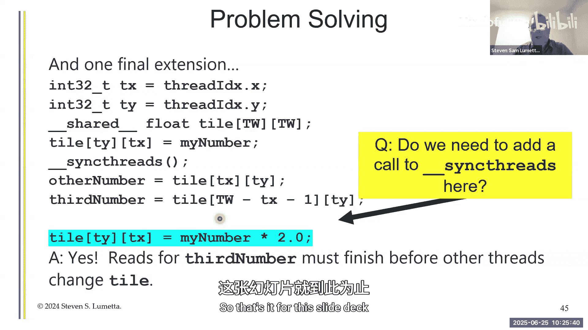

# 【伊利诺伊大学】应用并行编程2025-｜-ECE408-CS483-CSE408-Applied-Parallel-Programming-2025-p04-P04_lec04--BV1uNSyBaEcu_p4-

This Oliveriv should pick them good。

Okay， good morning everyone， hope it is less hot where you are than where I am。

supposedposed to cool off here today， right？All right， so today I just wanted to wrap up slide deck4。

 we had one more problem we're going to look at and then we will start in on the next slide deck。

So the last thing I wanted to make sure that you understand some of the thread block scheduling issues that we talked about。

Well hopefully tell me if the noise is bothering you I can close my door。

 but I'm trying to trying to use it for airflow all right。

 so here what you see is a little piece of code。So down at the bottom， So there's kernel on top。

 down at the bottom， we launch the kernel Okay， so a destination is a pointer to an array of one character that we allocate on the device and initialize to value 3。

 Okay， so we set it to the value 3。 then we launch this kernel。

And the kernel you can see as the simple notation， there's no dim3 arguments。

 we just have two blocks each with one thread。In this kernel up here。

 we take our block index and every thread writes its block index into the one location in the destination on the GPUs DRA。

 okay？So the question for you is what are the possible values of the thing in that memory location。

 the bits in that memory location after we execute our kernel after that kernel finishes。

 what do you think？It should be either 01 because we only allocate two blocks right？Yeah， okay。

 so it just says either zero or one。Because we have two blocks so I think the rationale there is that we have those two blocks。

 their indices are block indices are zero and one and so one of the threads in block zero will try to write a zero。

 the other thread in block one will try to write a one。And。

We don't know which of those will happen first and which of those will happen second。

 we don't even know which block will be scheduled first， but if they're simultaneous。

 then one of them will win rather not win， but will happen second for its right back to global memory and so we don't know which of those values will occur。

 but we do know that one of them will end up being the last one written and that both of them should try to be written。

So we don't expect to see the value 3 anymore， nor are there any other values being written。

Interests answer is what I also found， which is that after this kernel executes。

 you get either zero one Okay so good answer。All right。So。Let's look a little bit about on Monday。

 we brought up the issue of global memory bandwidth。

And we did some simple analysis of our matrix multily kernel。

 which is what you'll be writing in a little more general way with rectangular matrices for your lab too。

 let's just due Saturday。U。Let's think about what we can do to make it more efficient in other words。

 is there a way that we can reduce the number of global memory accesses。

For each floating point operation and to do that， we're actually going to take advantage of the of the shared memory that I mentioned。

I think also Monday or perhaps last week。The ability to share memory on the chip between threads in a block。

So what are we going to learn from this slide deck well first of all。

 I want to go and make sure you understand how you can evaluate the performance implications of these global memory accesses so we kind of did that a little bit with our code last time。

 but we'll spend a little more time on it。I also want to get you ready for La three。

 which is not due until the day after4th of July of July 5th。

And then also understand the benefits of using a tiled approach with some of these algorithms。

So our invocation。From current for the kernel from the host side。

 remember looks like this right so you can see that we had two constant values right or constant for a given kernel launch one is the width so we have a square matrix or three square matrices of width by width so the first cap width is the size of our matrices and then the block width is the size of our two dimensional thread blocks so they're block width by block width。

So we take the size of our matrix in each dimension and we divide it by block width and round that up we need to make sure we do it in floating point that gives us the number of blocks we need to cover to cover the entire matrix or remember we're doing one output element of P we call the output matrix P so one element a P per thread so we need to generate enough blocks to cover it that's stem grid and then within the blocks again those are block width by block width number of threads okay。

The kernel launch then looks like this， we pass in dim grid， pass in dim block。

 passing in the device side copy of M， device side copy of N。

 the place where we want to put the device side copy of P， and then the size of the matrices。

 the width。All right， and then we went through and we analyzed this last time but I wanted to make sure that you understood it。

 so the places where we do global memory accesses， I want to just walk through again and make sure you understand how sorry the NviDdia compiler makes decisions about this kind of stuff rowing column our automatic variables in CC++ they would go on the stack inside of a kernel those become registers at least the primitive types if you do an array or something like that is actually going to go into global memory most of the time but for something like an interview those will simply go into a register。

P value， similarly primitive floating point type into a register， loop index K into a register。

So down to here we have no global memory accesses oh let me let me qualify that usually the parameters go into global memory but those can be shared the one read is actually often shared by the all of the threads in your war in your block so those can be hidden a little bit and the few enough of them that they might also be cached right these days。

All right， so the accesses to D and DN， however are going to global memory these are big matrices they live in the GPUs DRA so when we go off to get one value from Dm and one value from DN we're doing global memory accesses similarly when that loop is done that inner product loop over K when we write back to global memory one element of P that's a global memory access to so we've got two times width plus one global memory accesses so we said well let's just ignore the one right to P we have four bytes for each of the values red from M and N because those are single precision floating point numbers so that gives us eight bytes total and we're doing a multiply and an addd with each pair so that gives us two flops so for every flop we need four bytes four bytes per flop we did that math last time and I said well here's one。

eration of GPUs we had a tariffloop per second of floating point performance。

 compute power1000 gigablops per second。 We had only 150 gigabytes per second of memory bandwidth So what that implies you can simply divide the memory bandwidth by the applications needs which are 4 bys per flop so you do the math there。

 the bytes cancel and you get a gigab floating point operations per second and the number you did is 37 and a half and so that would be an upper bound for this application because we also have to it's a little less for various reasons in actual execution you write that code and go run it on that GPU you get about 25 gigablops per second。

So we need to find a way， as we said last time to cut down on global memory accesses。

Okay so that was our motivation。So I want to now start to share the answer right so how are we going to do that？

So the dilemma again， is these matrices， M and N， they're big right。

 we want to be able to multiply large matrices， they fit easily in global memory。

 but that memory is slow。We also have this shared memory okay so remember we have the shared memory I told you instead of 500 cycles it's more like five cycles。

 but it's also quite small right we remember we looked at some numbers it was maybe 48 kilobytes say well gee。

 that's not very big if I have a000 by thousand0 matrix that's a million elements。

 four bytes that's already four megabytes。For one matrix。

 have two matrices and an output matrix right so 12 megabytes doesn't fit in a little chunk of kilobytes。

So what I do is I break M and N into pieces， which we call tiles or blocks， okay？

And I'll read a we're going to call them tiles， I'll read a tile into the shared memory。

I'll use the tile from the shared memory， and then I'll get rid of it， just implicitly ignore it。

 and then I'll repeat that process until I'm done。系。So remember， GP in the GPU。

 only the threads in a block can use shared memory， okay？

So different blocks will operate on separate tiles。

So the idea is our block together will use multiple threads and exploit what's called memory level parallelism where each thread is going to memory。

 so they're all pulling a bunch of data into the shared memory simultaneously they're all going to ask for some memory。

 it's all going to come in in parallel。We're going to use that to read a tile for the block。

Then we're going to write some computation using that big chunk of memory that while not big in the sense of M&N but big in the sense of the shared memory。

 that tile， we're going to compute based on that tile setting a shared memory。

 and then we're going to repeat and once we've gone through all the tiles we need to look at。

 we're going to have our answer and we'll write that one value for thread back to global memory。

So that's the approach and that's that's actually a pretty common approach right so I don't want you to think this is only good for tiled matrix multiply there are a number of problems where that's the kind of approach you use you figure out what data are shared amongst the threads you bring in a chunk of shared data you process the chunk and then you repeat that process and you bring in as many pieces of data shared across the block as you need okay so it's not only good for matrix multiply but this is the easiest application for us to give you as a as a starting point to understand how things work。

It also is one of the easiest in terms of achieving really good performance so you can get pretty good performance compared to the peak a reasonable fraction of the peak of your GPU performance using this kind of approach if you take 508 or if you could just go off and explore your own a little bit you can you'll see that in order to really explore exploit as much of the performance as you can you need to use some additional tricks which we can talk about whether you want to use those in the final project or not and I can point you to some resources to learn them if you want。

Allright， so for now， though let's focus on this idea of shared memory。

 So here's our matrix multiply kernel we need to allocate some space in the shared memory for the tiles of M and N that we'll use for a matrix multiply So what I want the tile size is actually going to match our thread block size So when I go out to global memory each thread is going to read one element and they're going to put them into the tile of M then each thread will read a second element from global memory and put those into into the tile of N sitting in the shared memory So you can see my allocations。

 first of all， the shared qualifier underscore underscore like all the qualifiers we've seen both before and after shared and then it just looks like an array allocation now this tells the N video compiler this variable number one。

 I want to copy of it per thread block。So remember that the integer variables that I showed you earlier a few minutes ago。

 those were per thread okay so those go into registers， registers or a per thread resource。

 this shared memory block chunk of shared memory of the tile。

 those are shared across threads in a block， so we get one copy per thread block。

Each thread blocklock has its own copy。One we call subtile n， it's tile with by tile width array。

 one we call subtitle n， it's a tile width by tile width array Okay All right， that's the allocation。

So common across threads in a block。I want to comment also and remind you that like any variable allocation and C these are not initialized to zero okay so do not ever assume that when you allocate a chunk of shared memory that somehow it's filled with zeros if you want zeros in it you need to write code to put zeros in it okay now we're going to use these tiles by filling them first so we don't need to initialize to zeros but in other applications you may want to assume that the shared memory has zeros in it。

You need to put those zeros there if you want that assumption， okay？All right。

 so here's the basic idea。 we've got a data in global memory。

 We're going to bring those into do some loads from global memory and we're going bring data into shared memory or on chip memory in this case which is the red contents there so we want two things one whatever we bring in of course has to fit in the red red memory and we have to have enough shared memory to fit what we're bringing in from global memory that's one constraint but we do want to leverage the memory level parallelism so we don't want one thread going through it and saying well let let's read all of these things because remember one one thread reads a word for memory it goes to sleep until that answer comes back we don't do fancy outof order execution that you may or may not have seen in CPUs where you say well I've asked for some memory but now I need to do an ad and my ad doesn't depend on getting that answer because it uses other data let me go ahead and do the ad and。

IfWhen I need that answer then I'll go back and execute finish executing the load that doesn't happen in GPU okay so instead we want all of our threads to go ahead and ask for memory I'm exaggerating a little bit we're going ask for two chunks of memory and in fact the GPU processors are sophisticated enough to allow those two loads to go out okay but if you have more complex instruction flow then they will stall and wait okay。

So。We're going to go ahead and go to the next slide。

 we need to identify that tile of global data right so we need to think about well how is this going to make sense from an application and in this case the application is dense matrix multiplication right so the one I showed you on Monday。

How do I get a meaningful tile that's going to allow me to have a performance benefit okay so I need to identify that tile so that I can have that tile accessed by multiple threads and used in the computation。

So I want to figure out what's going to be used multiple times by the threads in my block and then I need to change the access pattern in the kernel。

 So again， the way I'm going to do this is get the data from global memory into on chip memory。

Then write the code that has the threads instead of going to global memory。

 have them access so let's say they've copied from global to shared I want to then compute based on the shared copy and then I'll move on to the next tile。

So how is this going to help me Okay， let's let's take a look at reuse if I talk about my inputs each input element is actually used to calculate width elements of P。

Okay， so let's look， for example， at a row of M。Or actually， let's look at this column of n instead。

Okay so that let's take you can think about just the first element in this in this column up here。

 So there's just one element of n right， but that value is actually used in the computation。

For every single element in this entire column of P。

 every element of P takes a row of M and each of these elements。

Vertically in this columny is a different row of M。But they all use the same column of N。

 and particularly they all use the first element of n to multiply by something out of this first column over here of M。

 something taken from one of the many rows of M。So for any given element of n。

 we're going to use it with times and that's with different threads in our grid，Similarly。

 we can think the other way and say， well， what about the elements of M。

 every element of M is used to compute everything in the corresponding row of P。

Okay so everything in a row of P is pulling the same row of M into memory so that it can do its computation with a different row of n so now think about it we're computing a row of P。

 they all use the same values， all those threads use the same values from M right。

So that's where we're getting reuse。 You might think， well， wait a minute。

 Why do I have to bring the same number from memory。From global memory into the chip width times。

 remember width could be 1 thousand width could be 10，000。

So instead of bringing number in once I bring it in 10。

000 times that's incredibly sort of ridiculous use of of my memory bandwidth right I mean。

 I've got orders of magnitude less efficient use because I keep pulling the same bits over the memory over the memory thus repeatedly into the chip So I mean that again why don't I just keep it there so that's what we're going to do we're going to grab those values and put them。

 put a copy into shared memory and then have the threads look at that local version。

 that shared memory version to reduce our memory bandwidth to global memory our memory bandwidth needs not capacity memory bandwidth needs to global memory。

😊，All right， so here's what it will look likek。So we're going to break up the execution of the kernel into phases。

Again， please let me know if the background noise is too audible that don't want to。

Class disruptive all right， so break up the execution of the kernel into phases so that the data accesses in each phase are focused on one tile Okay。

 so we're going to go tile by tile through our through our content。

So the way that's going to look is a thread block is going to compute some little square of elements of P right so here is this yellow thread block。

And you say， well， what data do I need from M& N in order to compute sorry these elements of P that the yellow thread block is computed？

Well， I need all of the rows of M that correspond to the rows inside the thread blocks elements of P right so it would be all of the rows over here。

 including this blue square and the orange square and other squares coming after it and similar if I say。

 well what about the columns of n well I need everything in the columns of n in n with column equal to anything computed by the yellow block of P so I need all the columns just going straight up。

 need everything vertically above the yellow square right？Now。

 what I've done is I've actually broken up， broken up the rows of M and the columns of n then into similar squares right so here I've got a blue square and of M and a blue square of n。

 And if you think about it， the elements in the blue squares are the things that the threads need to multiply an add in order to do part of the inner product。

 So the elements of M that are colored blue on the left and are the same or paired up rather with the elements of n in the blue square up top。

 and similarly， the orange square in the orange square match right。And so forth。

 so you can imagine I've got a bunch of other colors lined up there if it's really 10。

000 wide and my thread block is 16 then you know on the order of on the order of like 1600。

Sorry 1600， is that right yeah？No。About 600， right？625 or so all right so。

I'm going to have a lot of tiles potentially is the point right so what we'll do now is we'll bring in a tile from M one of these blue tiles and a tile from N and we'll do part of our inner product computation with the threads of P and then we'll move on to the orange tile。

And so forth。So how do we get these tiles into shared memory？Each thread， again。

 is going to load one element of M。And one element of n。Okay， that just sounds really loud。

 give me a second when we close my door。Sorry for that。So we're going to read one element of n。

 one element of n and put those into the tiles that we already allocated in shared memory， okay？

And I want to do that in a way that those loads are coalesced and I'll give you more information about how I do that later so we'll come back to that it's important that we access memory global memory in the right way from thread to thread so that we get the best memory bandwidth performance。

Okay， so here what you see， we've got M in global memory。 we've got N in global memory。

 we've got P in global memory。And threads in block zero want to compute these four outputs of P block 0 zero right so I've got thread blocks now of two by two threads and I have four blocks to compute these four by four matrices Of course we're not really going to run this small of an example on a GPU but this fits well on the slide and kind of illustrates the ideas right。

And here are tiles in shared memory。So the first step then。Is to bring in a tile。

Into M so each thread will load one value of M Okay and the way we're going to do that is simply to match up the elements of p that we're going to compute with the elements of m over on the left and I did that with the colors right so let's say that the blue element the thread that's computing the blue element of p brings in m00 and the one computing the red element which is p01 brings in m01 and so forth and so on Okay。

系。We're also going to load one value of n。 and we could do that in the same way， right？Okay。

 so each of the elements computing PAB， let's say， brings in NAB in this case。

And then we have the entire tile that we need for the first step。Of tiled matrix multiplication。

 we have the M tile， we have the N tile， and we're ready to do some computing。

So once we have those two tiles， we can now do the computation and this will be loop iteration zero across our tiles。

So we've got the tiles in and we can do the compute for that part each thread is going to read one value of M。

 so the first step will be， as you can see here to read the zero column out of the tile into the four threads。

Okay so this is where we're going to get our reuse， by the way。So。

 how many threads are reading each of these M values that are being read？

How many threads read M00 here？This is an easy answer， okay。

 I'm going to assume you know it it's just the two right red and blue readM00 orange and purple readM 10 in this case。

So in fact， we're only going to get a reuse of two here。

 each value that we read into shared memory we're only using twice think。

Who cares right so instead of 25 gigaplabs that get 50 that's not a great help。

 we're limited by the thread block size。Okay？So the potential reuse for dense matrix multiplication is the width。

 we could have a width of 10，000， could get 10，000 times efficiency。Great。In practice。

 we don't have a huge chunk of shared memory and we can only share amongst the threads in the block。

 so we have a more practical limitation that we're only going to get the width the tile width rather reuse here okay now here in this little tiny example the tile width is only two okay in real applications we would use maybe a tile width of 16 or 32 so we'll get 16 32 times reduction。

It will rather reuse， which means also reduction of needed global memory bandwidth right all right。

 so we'll read those two elements。And then also read two elements of n。

 so we have an inner loop where we're doing our inner product and we're processing the tile right so we do one element per loop iteration。

In the second loop iteration of that inner loop we'll read the second element out of M。

 the second column or column1 and then the row one of n and do that next step multiply an addd or inner product and now we've used up all of the tiles right the tiles have no useful information for this thread block anymore so we need another another tile so we'll go back and read a second tile right so we'll read in now the second tile from these two rows corresponding to the output block here so remember that this thread block is going to read rows0 and one of M and columns0 and one of n。

Because it's thread block zero， zero。So similarly， we'll read。

Four values from n another tile into shared memory。One value per thread。

And then we can go through and do the inner computationut loop again right so again we'll read one value of n from the tile in loop iteration zero and then we'll read in the next iteration。

 loop iteration1。We'll read a second value from N and a second value from n now remember these are coming from shared memory。

So let's think about how we actually write those indices right outside of a toy example。

So first of all。When we're getting the input tiles， in the first iteration。

 the first tile we want to bring is the blue tile， the second tile we want to bring is the orange tile and so forth and so on。

So from M， we're going to be reading from whatever the row is in P and remember a thread is producing a row in column output of P。

So the M value we're reading is always going to correspond in row to the value that we're going to write eventually in P。

 so the row is what we'll use for the row of M Similarlyly。

 the column is what we're going to use for the column of n but we don't know that I mean they're written here。

 but I want to make sure you understand them and we don't know what to use for the column of M and we don't know what to use for the row of n So what I want you to remember。

Is that essentially you can think of this as a one to one transposition where each。

Thread over in this yellow box here。 right， These correspond to threads will read one element of this blue tile over here first。

 and then the orange tile and so forth right， So the part we don't know there in M is the is the column。

Okay。So。In the first iteration。The columns of n run from zero up to tile with minus1 and so do Tx so we can simply index the column using Tx that's meant to be an abbreviation for thread index do x sorry so thread index do x and thread index do y similarly with the blue tile。

 the row inds of n run from zero up to tile with minus1 which corresponds to the y thread index。

So we can use the。The Tx thread index do x for the column of n and T Y。

 the thread index dot Y for the row of n。 So that's shown here， that's for the blue tile。

What about the orange tile， so for the orange tile。We have exactly the same row numbers for n。

 exactly the same column numbers for n， right， row and column。

 same same as we're using for the output of P for our thread。

But now we need to move to the right for M by tile with columns right so you can think of this as tile with times 1 plus thread index on x。

And then for the orange tile of n， the row number is going to be again tile with further down。

 so I'll do tile with times 1 plus Ty。And you can imagine if I were to show you a third。

A third tile or a fourth tile or a fifth tile， each time we get a new tile we want to move to the right in M and down in N。

 so to the right by tile with columns of M down by tile with rows of n。

So what we do is we have that index， we'll call it M in this code so you can if we're looking at tile number M。

 then we multiply M by tile width and add thread indexd do x to get the column number。of M。

And to get the row number of n， we take M times tile width and add the thread index dot y。

And you might wonder what the next line is below those。

 those are the linearizations of these two indices into the one dimensionional indexing that we have to use for M&N because remember those are big matrices in global memory with size that's unknown until we enter our kernel and it's not statically known write when we compile the code。

So remember the way we do that is we take the row number for M that's simple。

 let's just row multipplied by width and add the column number， which is m times tile with plus Tx。

For n， the row number is M times tile with plus ty。

 so we have to multiply that row number so put it in parentheses， multiply by width。

 and the column number which is simple for n， it's just column。

So this is what the two expressions need to look like in the code。

 assuming that the loop variable over tiles is called M。All right。

Please feel free to stop me if you have questions or not following the development here。

So let's then think about how I will write my aes。 Okay， so my subtile of M。I'm going to write into。

 Remember going to， we're going to。Read over。Sorry， this is the inner product。

 so we're going to use the make use of the tiles that we've read into memory。

me go back here for a second you might wonder well what how do I index into the subtileles Well when we index into the subtles。

 remember we have that small two dimensionmenional array right for each of the subtitles and those are tile width by tile width so we're simply going to use the thread indices for the first index we'll use thread index Y second index thread index on X for both cases for both tiles。

You'll see that in the code but wanted to make sure you understood it So now we can move on and start thinking about how we make use of the subtles in the computation。

 So let's take a look， for example， at the orange tiles。

 So let's say we have the orange tiles and we have them in shared memory and now we want to use them to start to compute a part of the inner product and add that in we've already done with the blue tiles。

 So now let's think about the orange tiles let's say。So to use subtile M to compute an element of P。

 well I want to have remember the same row， okay， so the row number will correspond to my thread Y index。

OkayBecause remember， I read the correct rows into the subtitile， but I need my row number。

 which inside that more limited space is given by my thread index dot x， so that's my row number T Y。

And then I'm going to walk over all of the elements in that little partial row of M from left to right。

Using index K， so I'm going to have a k loop in that's my inner loop that runs from zero to tile width minus1。

And that will be my column number for the tile of M， similarly for my element of P for a thread。

 I want this little piece of a column out of the tile of n。

So I want to have the loop now the K loop run from the top to the bottom so the row number will be using K and we'll run from top of the top of that little tile down to the bottom and then what about the column number well the column number corresponds to my thread index。

Which is my position， my threads position within the thread block， so thread index not x。

 So I've got K and then Tx for the subtle of n row and column。And then rule column of M。

 I have thread index dot Y and K。Now here we don't have to linearize because we simply declared two dimensional arrays of tile width by tile width so we can use the two dimensional notation in the code。

But we're not there yet， right so。How can a thread no。That another thread finished。

Anyway that another thread is finished using the previous tile so we finish the blue tile we do all the compute。

 our thread wants to move on， get a new tile， maybe there's another thread still using the tile in shared memory how do we know it's done？

So we need to do something to synchronize right we need to have the threads kind of wait for each other and make sure that they finish their work before we move on to the next step Okay remember。

 read memory， global memory to shared memory use that memory but the parts that we're reading and the parts that we're using those could be different I have to make sure that everyone's done their reading before we start using。

Okay。So that's the synchronization。So KDA uses a very common idea in parallel coding from decades called bulkynchronous execution。

So the idea。Is that the threads execute roughly in unison within a thread block？

Now I already told you that within a warp， the threads are literally executing the same instruction at the same time。

 right， but across the warps， that's not true。😊，系。So bulk synchronous execution is a little more constraining on the bigger set of threats。

 they're a little less constraining maybe than executing the same instruction。

 but more constraining than the scheduling cross blocks， which has no。

 you can't reason about it at all。So we want to organize our threads within a block so that they kind of follow the same path through the code at the same time。

 so we're going to do some work while we're doing the work that might get out of step right maybe one is rushing ahead and that's fine。

Then we're going to wait at some point in the code。

 we want to wait for all the threads in our block to catch up， finish all that work。

And then go do some more work Okay， so periodically we going we're going to stop and let everyone catch up all the other threads in our block。

Turns out by doing so， you get a much easier programming model okay and the reason is mostly debugging。

So your thread here in Kuta， it's going to be synchronization right that you need to wait for them to get correctness。

 but， but in the high performance world， it was largely debugging。 Okay。

 so your threads within a section on。Are like a lot of little programs right So they go and they do something and you got 10。

1520 lines of code and when you're debugging you know all of your threads are executing in that little chunk of code。

 So you need to make sure you can think through do they all do the right thing Can they interact in ways that are strange or is that code okay It's like a little tiny program and it's easy to debug we've all done little tiny programs in our heads no big deal when you have a million lines of code and your answer is well've got 10000 threads and you know somewhere in that in that million lines of code。

 every thread is somewhere and then you know make sure they're all not interacting in strange ways right that's a very challenging problem So instead of having one huge program when you use bulk synchronous execution。

 it makes it a lot easier to think about where are my other threads And so that's why this was largely the most popular programming model for high performance computing for decades。

Isn't it just made things easier to think about easier to get right Okay so in Kudo we we also need it we also need the concept of the synchronization and so we're going to leverage that idea and as a result we'll get this kind of bulk synchronous code in our kernels。

So the bulk synchronous means you've got a chunk of threads and they're sort of tied together right in this case it's the thread block they're tied together in their execution through the code。

So the way it works is we're going to use something called a barrier， Okay。

 so the barrier is the thing that we're going to do for waiting for the other threads and our thread blockss to catch up。

So barrier is a synchronization point。Each of the threads calls a function to enter the barrier。

 So when you're done with your work for that little piece， you say， okay。

 I need to wait for all my other threads in the block。 Let me call the barrier function。

OnceOnce your thread calls that function， your thread is logically sleeping until all of the threads in your thread block in this case have called that function。

As soon as the last thread calls the function， everyone can keep going， okay？

So you're just waiting for everyone to catch up at that barrier so you can think of it as this so time here is going to the right everyone's got a different amount of work to do in this case。

 you can see thread zero， thread one， everyone is a little bit different in time。At some point。

 they all call a barrier。 and that's a different points in time。

 But the time at which they can move forward past that barrier in the code is the same， right。

 So thread n -2 here happens to be the last。 So when it calls the barrier。

 then everyone else is released。 So you can see this。 I mean。

 one reason to think about it as a barrier is it's kind of like a fence right in time。

 So once once this last thread calls the barrier everyone can continue and move forward in the code。

Everyone in this thread block。So in coUDa barriers only work within thread blocks you cannot have a barrier across threadb that's there are ways to do it in the last five years or so in coUDa but it's a little more sophisticated and you have other constraints that you have to obey so we're not going to talk about the more recent coUDa features at this point but。

I mean if you're interested， you could take five8 you could look through the coUDA programming manual but we're not going to do it in our class。

 so just want to make sure you understand i'm sort of trying to simplify the model a little bit for you。

So only call within a thread blocklock and furthermore， all threads in your thread block must enter。

You cannot have a subset enter。Unless the。Yeah， you're allowed to have remember we weve written several codes now where some threads are done with all of their work right。

 there's no work for them because they're outside of our data set you're allowed to have threads that are done with their work not called the barrier that's okay Okay so want to make sure you understand that all the threads that are still have code to execute must call the barrier you're not allowed to have some threads call the barrier other threads don't call the barrier that does not work if those other threads have still code to execute。

啊。Also， and this is unusual， this is true in Kuta， not true in almost any other parallel programming model。

 all of the threads have to enter the same static call。Okay。

 so it's not that your threads have to call the function。

 They must enter the same function or the same call in your code。 So you cannot， for example， say。

 well， if x is greater than0， blah， blah， blah， do a barrier。 else， blah， blah， blah， do a barrier。

 do a sync threads that doesn't work， you must do the same sync threads call。

 you have to say if x less than 0， do the work else， do the work。

Finish the FN else barrier okay and if that means that you have to have two copies because there's actually work that requires a barrier inside the then and else blocks。

 then you have to have two copies of the ifN else still put the barrier in the middle right where every thread's hitting in the same call in the static code。

Okay。So you might wonder as you should。So I call this sync threads， what does that mean。

 they all get to keep going， what does it mean？So what it means。In Kuta。

 well you can ask questions like so I did some shared the memory operations before I entered my barrier before I call sync threads are those done after I leave the sync threads？

What about global memory operations are they done， we haven't talked about atomics。

 but what if I do an atomic Gr doesn't have a return value， is it done， what about IO is it done？

The couta manual gives an answer， which is that all global and shared memory operations。

 which presumably includes atomic variants， have completed by the time or before I should say your thread leaves sync threads okay。

 so if your thread or some other thread has done a global or shared memory operation a reader or write。

 before calling sync threads within your thread block， those are done。

 you don't have to worry about them okay。Not so clear in the coa manual but IO So printf。

 for example， what happens with a printf well that has to happen on your terminal right so that goes and contacts the host and delivers the data to the host and sends it up to the device driver。

 which sends it out to your program which sends it out to well might go through the OS directly。

 but eventually goes out to your terminal right or out to your output file。Okay。

 so that's not something that's sitting inside the chip。 Okay。

 is it done before you come back from the barrier， probably not。嗯。

So don't make assumptions about that。嗯。😊，You should ask this about every parallel programming model you use right because the answers are often different so for example。

 when I was a grad student we had a connection machine5 big powerful supercomputer at the time and it had a hardware barrier network。

And I didn't really ask these questions the first time I wrote some parallel code and I had some code that would put。

An address in another processor's memory， so that code would move that address and put it in another processor's memory and then I had a barrier and then I would use that address on the other processor。

And that crashed。What's going on here well it turned out that there's a communication hardware for or sorry communication network in hardware and there's a separate barrier network in hardware so sending the message to put the address in the other processor's memory。

was cruising no long happily， I did the barrier， the barrier finished that data is still flowing through the network。

 it hasn't gotten there yet， my other processor finishes the barrier with that separate network and then starts using the data that aren't there there's just some zero bits there fortunately so it crashes。

So not every parallel model will have the same you know hopefully they'll have clear definitions but maybe not as easy to use cout is actually pretty easy to use right you can assume that all of these memory operations have finished but again don't make assumptions about things that require external communication from the chip those may not be done just because you did a barrier okay。

All right， so here's what we'll do for our titled matrix multiplication kernel。

And we're going to take a break soon， but I think we can take a look at this code so。Let'ss。So let's。

 let's。Just take a look at it briefly。 and then we can， we can compare it with。而。

No tiled version also。I just put them side by side， I mean， you've seen the non tiled already。

 so this was our allocation up here。 You saw this already， right。So that you understand。

 here are just some abbreviations。And so we use BX and B Y for our block indices。

 Tx and T Y for our thread indices just to make our code look a little simpler。

We do our row in column computations， these are nothing special you've seen these many times except i've been writing them out before tile with is the block dimension so。

I'll just use the preprecessor constant here。Be careful with this kind of stuff if you know if you change the way you're doing things。

 then this kind of this kind of replacement of use of the block block dimension， for example。

 can bite you if these assumptions become false right if you change your tile with。Or you use。

 let's say you try to compute two elements per thread or something like that。So now down here。

 this is our loop over tiles。 remember we chose to use the variable M for that。

 this code assumes that width is a multiple of tile width。In other words。

 our matrix size is a multiple of our thread block size。 Your code cannot do that。 Okay。

 you should know how to， how to deal with that。 We'll actually talk about that a little bit。

 but you'll be responsible in lab 3 for writing code that deals with arbitrary matrix sizes， Okay。

 so。But for simplicity we're going to write it this way so we can divide width by tile with that's how many tiles we need to operate on for our thread block we'll do a collaborative loading of M and N tiles So this indexing we walked through already I'm simply pulling it out of those previous lines and dumping it into the code。

 nothing special。Then。We do sync threads。 So what is this sync threads for。

When I read from global memory， I'm going to get a chunk of data flowing into the chip and going into the shared memory right I need to make sure that all of that data is there before I start using it from with other threads Okay it turns out that if my thread wrote a particular shared memory location。

 I don't need to synchronize to read that location but if you think about the access patterns here right。

Yeah， that's。Hopefully you can。I can kind of go back and visualize let me go back here just to make sure you're following。

O。So you can see this thread over here， right？Just in the middle of my thread block。

 the first thing it's going to read when computing is going to be the left most element of its row in M。

 for example， you say， well， which， which thread read that element from global memory into subtitile M。

 And well， it's not， it's not the thread over here， right。

 it's the thread corresponding to the same position in the thread block， which is the thread。

Right there so it's a different thread that read it right so I need to synchronize to make sure that all of the threads have finished getting the data into shared memory before I start using it。

我。Do I need that sync threads。If you're in doubt about whether you need a sync thread it's probably safer to put it in it will cost you it is a little slow if you have too many barriers but you' better getting correct code than you know。

The non correct code that is a little faster。If you want fast non correct code。

 you can just not write the code， right？😊，All right， so。Here's our loop to use use the subtitles。

 I think we walk through this as well， the elements that we're working on right we looked at that indexing K as our index through that inner loop。

 so this is simply a chunk of the inner product right that we're computing and adding into P value just like we did before。

You might wonder about this sync threads， I sort of alluded to the need for this sync threads。

 but remember that after we finish， say with the first tile。

 we're going to go back up to the start of the M loop and read in the second tile。

So as soon as we go back up there， some threads are going to start overriding the data from the first tile in the M&m tiles in shared memory right so we need to make sure that before that happens everyone has finished using those data from the first tile so we need to wait for them。

So that's why we have two sync threads per loop， so we read some data， we wait， we use the data。

 we wait， we read some data， we wait， we use the data， we wait okay。Once we've done all of that。

 we can everyone has their final value， we can simply write those back to P， right？

This was our comparison， I put this here not really so I'd go through it。

 but when you look at the slides you have them side by side and so we're not going to spend time on it。

So let me stop there and not do the analysis， we'll take a break for five minutes。

 come back at 10 o'clock and start talking about the analysis and actually we'll go do of course our。

Our administrative before that。And I'll be here if people want to ask questions now。Okay， so。

Hopefully now， I didn't chat， but hopefully most people have finished quiz zero already。😔，Lap。

one was due yesterday， and so you have a full week to finish that up。

 I would encourage you to do it soon， but。You could take a little longer if you wanted。

 remember you get an hour whenever you start it， so just whenever you feel comfortable sit down。

 have an hour available quiz one then do before Tuesday on July 1st8 o'clock。

8 o'clock at night lab two is due by this Saturday 28 June and then of course the quiz will be one week later for that。

And then La three is available and will be due July 5th， Okay。

 so nothing nothing changed really here。So let's go back。All right。😊，So let's think about。

 so what good does it do？To have written much more complicated code right we have to spend a fair bit of time on had to draw pictures or to think about it。

 but to get the indexing right really we probably would write some bugs and then we'd spend some time debugging。

So why bother， what are we going to get out of this， let's do the analysis。So 16 by 16 tiles。

 okay we're going to use each opera end for 16 operations。

So every time we read something in from shared memory。

 whether it's an M value or an n value because we've got square tiles。

 we're going to use each of those values 16 times somewhere in our compute loop on some thread in our block。

え。What that means is that we're reducing our global memory access count by a factor of roughly 16。

 We still have the right by pe， but remember we're going to ignore that one。

so we're doing 16 times fewer global memory aes and what that means is if we simply plug that factor into our previous computation。

 we end up instead of getting only 37 and a half gigaplops。

 potentially we could get up to 600 gigaplops。On that same chip that was limited to 1000 gigablos per second and 156 gigabytes per second of memory bandwidth。

If instead we said， well， let's use bigger tiles right， we could have 1024 threads per tile。

 so we'll do 32 by 32 tiles。Now in that case， each of our elements of M and each of our elements of n going to be used 32 times during the compute loops by different threads will be used 32 times。

So that means our global memory accesses will actually be reduced by a factor of 32。

 Now remember our width is maybe 1 thousand0，10000。We could be getting that huge reuse。

 but in practice it's very difficult to get all of the reuse you could get out of an application because we can't have thread blocks of 1000 by 1000 or 10。

000 by 10，000 and also we would have as much perilism right because even if we could if we generate one big thread block well that can't run on8 Ss right so now we're only using one SM out of maybe 8 or 16 we're only using part of our chip。

So。However with the bigger tiles we reduce our global memory access by about a factor of 32 so if we plug that in。

 we say oh well maybe we can get up to 1200 gigaplops per second at that point the memory bandwidth is no longer the bottomneck right we're limiting ourselves based on how many floating point operations that chip that GPU can do per second and we're not waiting all the time now of course this is a peak right in reality even about 32 by 32 blocks there's overheads there's slowdowns and you're not really ever probably going to get the thousand gigaplops per second but you might actually get kind of close in a good case。

We also need those parallel accesses to memory， so I want to talk a little more about this Okay。

 so our shared memory size is implementation dependent What do I mean by that so that means different GPUs have different amounts of shared memory per SM。

In max all generation， for example， you've got 64 kilobytes per SM。

 but a thread block can only access 48 kilobytes so the max per block is really what you might care more about or depending on how you're structuring your block。

 you might care more about the overall max。But you have to obey both constraints。

Given a tile with of 16。That's 256 thirds per block。

 each thread block has two shared memory chunks right tile subtile M and subtile N。

 the size of those is tile with by tile width， we have two of them so two by 16 squared is 256 four bytes each because they're floating points so that gives me two kilobytes of shared memory per thread block。

So if I have 64 kilobytes per SM， I can't have more than 32 blocks executing on an SM with T width of 16。

On the other hand， I have 2048 threads for SM in the same generation of GPUs。

 so that means I can't have more than eight blocks because I have 256 threads per block。

So with that tile width what will happen， so remember that when I load the subtitles。

Each thread goes out to memory so if I have eight blocks and each thread out of my 256 is reading one element of M one element out of N well that's 512 total load operations that can happen out of my one thread block of eight thread blocks that gives me 4。

096 pending loads that can occur in parallel per tile okay。So we talked about memory level perism。

 so when I go to memory， I don't want to ask for four bytes and then wait and then ask for four bytes and then wait。

I'm doing this deliberately， right， to give you the sense that it's really slow。

What I want to do is have threads ask for4 bytes each and then have a huge wave of data come back from memory and then use that okay so that wave of data remember is still going to take these 500 cycles but now a lot of data is going to come in and I can use it so I still have to wait the 500 cycles but now I get a lot of data when that answer comes back。

So I need that memory level parallelism let me let's think for a minute well what happens what kind of memory level parallelism do we get with 32 by 32 tiles is it's still a good choice we saw that we'd get more reuse but if we're going to limit memory level parallelism somehow that might not be a good choice Okay so let's do the math。

Given a T width of 32， I have 1024 threads per block。Each thread block， then uses。

1 thousand24 threads right so tile width by tile width for each of our subtitles I've got two of them so two by 10244 bytes each so now  eight kilobytes of shared memory。

Remember in the maxal generation we talked about we had 64 kilobytes total， so dividing that up。

 I have at most eight active thread blocks right if I have that much shared memory per block so I can only have eight。

Which means or sorry， we also have a limit of 2048 threads for SM。

So you can't have more than two blocks。So I won't actually use more than 16 kilobytes of that shared memory because I can only have two thread blocks。

 otherwise I'd have too many threads executing on that SM。

So you have to consider all of the constraints right to know what's going to happen with your kernel execution with a given thread block size so you've got up to2 by 2048 right remember again 2048 threads two loads each so again we end up with the same number just happens to be the same number 4096 pending loads coming for each tile so it go out we get a wave of data back and what make you so so we've got good memory level parallelism right。

So that's a good thing。So you might wonder and I've kind of talked about this a couple times you actually made use of it in La zero although we wrote the code for you so you might not have paid too much attention。

 but you can go back and look at it look up the look up the function in the in the API description and kind of see what information right so remember。

If you want to know how many GPUus are there you can ask so you can say well call coa Git device count turns out I got one GPU I got two。

3，4 if you want to know about the capabilities of the device things like how much shared memory is there。

 how how much shared memory per block can my threads use how many threads can run on an SM how many Ss are that these kind of things right E call coudagit device properties So of course the devices as with everything and see are named zero through n minus1 where n is the device count return from Git device count？

If you simply assume you have A GPpU and you want to use A GPpU and you don't want to deal with multiple GPUs well then past zero。

 it's fine。But。You'll get back a lot of a lot of information okay so it is a couda device prop it's a built in C structure type when you includeud kuda libraries and you can ask things like max threads per block or shared memory per block etc okay so you can figure these things out in your code and make the right choices in the code if you want to。

Okay， so that was it for this slide deck。Then I wanted to just stop for a second。

 give you a chance to ask any questions， otherwise I will ask you a couple of questions。

I just a one quick question earlier you mentioned how we can't assume that they're going to be initialized with zeros would that mean that they are technically having the previous values use that whatever that threat had？

So that thread has just started its existence， that thread block， so yes。

 the previous bits from whatever thread block executed previously and was assigned that that shared memory which on modern GPUs could actually be cache values for constant stuff could be shared memory could be L1 cache values meaning just cache data values from global memory could be many things from your point of view it's random bits I think in VDdia if you've taken OS classes you probably know that operating systems for security reasons have to zero out memory between physical memory between one program using it and another so I think across across applications。

 you could get zero bits， but you should not assume that you'll get zero bits。Yeah。

Yeah it's kind of unfortunate really and I've done some debugging examples where I give my students you know CC++ code that doesn't work because when you do a Malic for example。

 the first time you'll get zeros because of the operating system security issues but then if you free that up and you call another Malic or equivalently new to leave in C++ you just get back the old memory right it's filled with what are the bits you left there because they're your bits who cares if you see them。

Yeah is that a thing with just like kuda or like is it the way kudD is implemented or is that like something that just can't be helped with zeroing out that's that's sort of standard C+ plus the initialization takes time right so in languages where the programmer wants a little more control over performance I mean in what we did with the shared memory titles code the matrix the title matrix multiply we simply wrote over whatever bits were there right we didn't want to spend time putting zeros there。

And it takes time。Okayfect， thank you sure。Yeah。Anything else？Okay。

 so let's go ahead and we have some problem solving I want you to do。So this is about sync threads。

 so I'm going to ask you now where we need to add sync threads in our codes。

So remember that we need to put barriers， sync threadreads call on couda， oh。

 I think I I didn't emphasize and I want to make sure because I don't want you to get syntax errors。

 sync threads like everything else where I say underscore underscore， this is underscore。

 underscore syncth threads。So barriers are needed to ensure that one's rights are visible to the other threads in your thread blocks right so if you want to communicate through shared memory for between threads in a block。

 if one does a write and then you expect another thread to be able to read it then you need to have a sync threads in between the right and the read okay。

So。Think about this code。 So what you see here is we write weve got a couple of registers just to make it simpler。

 We have a shared。Let's say tile with TW is our。Thread block size。

 we allocate a shared matrix of TW times TW Taluth by Taluth。

 and then we write into it a number which we've computed， say on a third per thread basis。

And then we want to read that back out using the same indices。

 so you noticew TY Tx and the indices I use to write。

 and then I use the same indticices to read so thread indexd do y。

 thread indexd do x in the two dimensions。Do I need to put a S threads call there？Yes， I think so。

Okay， so you would certainly be safer doing so right。

 but in this case because the indices that are being used are identical， so you say。

 well which thread wrote this particular element of tile？And the answer。

 because everyone has a unique thread index X and thread index Y within the block， is， well。

 the same threat。Right。So if this is the access pattern as shown here。

 where I'm reading from something that I just wrote。

 I don't actually need the sync threads in that case。

And my own rights are visible to me without the barrier。 Other threads， rights are not。 Okay。

 so in this case， I don't actually need it。 Now， if for some reason， it's it's hard to understand。

 right， I mean， this is this is。You know， pretty straightforward it's just TY TX。

 but if for some reason there's some complex expressions there and you're not really sure do they match or not I don't know you're certainly much safer right just saying I don't want to care I'm going to put the sink threads in。

And if later you find out oh what's making my code slow and maybe I can get rid of it。

 then you can spend the time to think through it okay。But in this case， technically no。

 you don't need the sync thread because each of the threads is only reading the value that it wrote okay。

Or a location that it wrote， maybe it' a better way to say it。All right。

 so a slightly different example， everything is largely the same up to the right of tile TyTx with my number。

 but now what you see down here is I've swapped the indiceice。Okay so instead of row TY column Tx。

 I say， well， row will be Tx， column will be TY。So now what do I need the sink threads or not？

Yeah definitely in this case right yeah exactly good yeah。

 so as Joshua says need the sync threads okay yes， Carlos also said yes on chat。Yeah。

 please feel free to speak up， you know， I mean chat's a little I have to pull it up。

 it I think it does beat mean that I have to pull it up to see your answers。

 so feel free to just unmute and speak up。嗯。So I definitely need it here right because unless I happen to have a one by one thread or one by one block right and there's only one value certain combinations of threads will have different TY and TX so when those happen to match I didn't need it technically but that's only a subset of my threads in most cases so if I want this code to work。

 I need to put that I need to put that sync threads there otherwise the threads the values copied into the other number variable maybe nondeterministic。

Meaning sometimes I might get the one that was written by the thread that I was expecting and sometimes I might get whatever bits were there previously。

嗯。Allright so lets let's extend that last code all I've done here is add the sync threads and then you can see the read right of other number that's exactly the same as it was before is's nothing new in the non highlightedighlighted code all I've done is add that blue line down at the bottom so in the blue line I'm going to read another value out of tile but I'm going to flip flip the row number sorry flip the row number right so I'm going to take tile with minus tx minus1 and compute my row number or maybe tile with minus1 minus tx is a better way to think about it whatever you prefer logically just mirroring the vertical direction。

😊，But keep the TY the same， okay， so a different access pattern。Do I need to sync threads？

Wouldn't it also， I known enough for this one since it's just mirrored。Okay。

Is it because we already run St France earlier， so the data in tile is already sync up？To accession。

Okay， so I think you're making a point that we've already sync threads after this right。

But I did this operation here， right？Do I need another synchcls for that？So yeah。

 safe I'm safe definitely from， you know， worrying about， did all the rights finish？

Do they have the sink threads。Here。Separating me。But do I need to separate this operation。

 what is this， this is the reader right？Shed memory。That is a Lee good and this is。Oh I mean yeah。

 so do I need to separate my reads？I think it should be fine because after the synths we no longer modify tile so the data should be synced yeah so we can all read from things without modifying them right it doesn't change anything so it doesn't matter who looks at different things first okay they're all not changing they're all fixed。

So when I'm looking at them， it's okay if I'm looking at them in different orders。

 it's not going to change what answers I get。The problem is when I do rights， okay。

 so write before I do a read。I have to make sure the rights have finished because if the rights have finished versus didn't finish。

 get different answers。 Okay， so that's a read before write hazard。

 And if I don't have the sync threads， then I might get the wrong answer。

There's another issue which is right before read I mean right right before write is also an issue but we try not to try not to do that in cota right so usually you don't have to worry about it too much where two threads are writing to the same thing and you have to think well which one do I get right we talked about that at the start of today's lecture but usually the answer is well I want to know which one I get and so I don't want to do two rightss from two threads and then get one of them。

But you do have to worry about right after read， which is what we did in the tiled matrix multiply example at the end of the code where we said well。

 in the next tiled read we're going to do reads and we're going to write those into the tiles。

 but now in the compute for the previous iteration。

 some threads may be still reading from those tiles so we need to wait for those。So thats a that's a。

Of right after read。Hazard and you have to prevent those as well， but we don't have that here。

 we simply have two reads okay。So we don't need a second sync threads here okay so no threads is making a modification to tile after our first barrier so we can go ahead and do that read and not worry about it we don't care whether some threads manage to read a value for third number before others have read their other number value out that doesn't matter the reads will still get the same answers。

Good。All right， so one final extension so again I just added the code that we talked about being correct so I didn't put the sync threads in because we said we didn't need one。

So now what I dont want to add to that is another right。

 I want to take my number and I want to write it over the number I put there previously。

 so it's the same index as I used for my first write。

 but now I want to double all the values in tile basically do I need to put a sync threads before that。

I'm so sure， but it would be yes， because you're overriding some of them。嗯。

Rights or the memory that the previous like where we set the other number and third number。

 those might not happen。Before we set the title， theY notes。Yes， that's exactly right。

 So other threads may still be reading the values that they want out of tile for other number and third number Okay。

 the indexing scheme is not the same we talked about that before because the indexing matches between our our threads first right up here and the second right down there those are the same index indexing schemes right so some other thread is going to be using。

The value that my thread with T Y Tx indexing overrites in tile and that other thread may not have gone and gotten these reads finished yet unless I wait for them Okay so this is the right after read hazard that we talked about and that showed up also in the tiled matrix multiplication so when that kind of thing happens。

 you do have to make sure that those reads have finished right reads for third number as well as other number right Other number may also not have been have been read yet we don't have a sync threads there unless we add one between the other number read and the blue addition to the code down below。

Oops， so we do need that sorry I thought it would animate add the sync threads for us。

 but I didn't put that in。Okay， so that's it for for this slide deck。

 I do want to move on and spend a little time on slide deck6 today， feel free to ask questions。

 but I'm going to shift over to the new file。

Okay。There we go。

So let's spend a little more time thinking about tiling。

 So what are we going to get in this slide deck。Coect。

So now I want to spend a little time thinking about how we handle the boundary conditions in the tiled algorithms。

 So you will have to do this for your for your lab。 I want to make sure you understand。

The different choices you have and what we suggest in terms of trying to deal with those boundaries okay so you'll have to deal with the a slight additional complexity of dealing with rectangular matrices and things like that I mentioned you know number of tiles you'll need to round up so that you're getting all of the data right when you're in your loop for M in that code。

The tiled kernel there assumed an integral number of tiles。

 thread blocks and all the matrix dimensions and the question is how do you avoid that assumption okay？

You might think well。Maybe I should just pad my matrices and I want to make my life easy。

 I want my kernel to be nice and lean couldn't I just change my data structure。

 couldn't I just say oh well I'm going to use tile sizes you know thread blocks of 16 by 16 so if you give me a matrix。

 give me something that's a multiple of 16 by 16 okay。

And you could say that you could do that that kind of thing is probably not a great approach first of all。

 if your matrix is already in memory it does take a fair bit of time to do that reformatting so a CPU moving those chunks of memory around is not going to be instantaneous so it's going to take you some time if the mates at large it will take a lot of time potentially as well as you know you have to have a full extra copy of the memory and you're going to end up with more data depending on your padding that may be just tiny and your matrix size right you've got to have the padding in the in the new format and so that's part of the transfer because you transfer continuousuous chunk of memory so part of that is padding well you're transferring the bits in the padding even though they don't mean anything so you add time to your data transfer from the CPU memory to the GP memory and back。

Okay。So what else can we do， let's say I want to do padding。

else could we do so let's take a look at our kernel。

So this was our tiled matrix multiplied kernel right so just remember where we're walking through here。

 remember we assumed that width was a multiple of tile width， so we'll have to fix that。

Because we need to have enough computation right we have all of the tiles。

 even if they're only partial tiles， we'll take a look at what that means in a second。

So even if they're only partial， we'll have to pull them in and then we've got the compute loop where we're going to use the values from shared memory so we can think a little bit about how that works too。

So let's think about the second tile so here what I'm showing you is a smaller matrix。

 a three by three matrix， but I'm doing it now I'm computing this matrix with again two by two thread blocks you say well how many blocks do I need well of course I need four still right because I need to compute these elements P2021220212 right so I need thread blocks to do that so just like I did with all the images I'll allocate the extra thread blocks but I need to make sure that they actually work right that the threads in those blocks don't go access memory they shouldn't be accessing and so forth。

So let's go ahead then and think about the second tile iteration so you look at the thread block00 and you say well what are the tiles first tiles easy it's just like it was before with the four by four that's fine second tile though these two elements here they don't exist right。

So I better make sure I don't try to read them because that would not be good， but they don't exist。

 M doesn't have those elements， so you need to think about what I'm going to do。嗯。😊。

So thread block 00 still produces four values， but when it goes to get these four values。

 I need to do some special treatment for the purple and the red thread。

Those two threads don't have anything to get from global memory， those values of them don't exist。

And similarly， when I go and get my tile of n， well the two values at the bottom also don't exist right。

 but those are not the red and the purple threads， so those are the orange of the purple threads。

 so different threads need to be handled separately。Aay for the Anne and the ambb subtles。

So we do something， okay， so maybe we just leave bits in those tiles。

 maybe we do something else I don't know。Then we have to compute。 So all of our threads。

We're going to compute， so the first iteration of that tile for that tile。

We're going to load one value from the tile of M and do the computation that's all good， right？

In the second iteration， we're going to load one value and that's all good。

And then for compute loop iteration one， now we have a problem。

These were reading from those values that we didn't define。And up on N。

 we're also reading from the values that we didn't define。So that's probably not going to be good。

 I mean we could maybe put a conditional to make this not happen right or maybe we can even just change the loop structure or something I'm not sure。

Somehow we have to make sure nothing bad happens， so， right？So let's look。

Also just did another block。 So here's the first tile for block 1，1。

 That's this block down here in the lower right corner。 It's only producing one。

 one value of P right， There's only one thread that actually produces a real value of P here。

So for the first tile。We're going to read in four data values right the orange and the purple threads we're going to have to deal with especially because there are no elements of M down there。

 right those don't exist。And then for N， the red and the purple threads need some special treatment because those values of n don't exist。

哎。So I think that's a different set than before too。

 so we've got a bunch of different conditions to think about when the threads then compute the data from loop iteration zero。

 well what happens， let's see。So orange and purple use an undefined value of M and then red and purple use an undefined value of n for that loop iteration。

 right？And then for the next compute loop iteration， see what happens。So orange and purple again。

 use an undefined M value。And red and purple again， use an undefined end value。

 This is in the first tile。Tile zero， if you will， m equals zero。嗯，是吗。All right。

 and close my door again。So we have a lot of cases right a lot of different complexity here。

 the threads that calculate valid P elements but can step outside the valid input right so the second tile of block0 is all threads when K equals1 but we still kind of step outside that valid input we've got cases where threads don't calculate valid P inputs right those are the ones that I showed you in tile 11 right so block 1 thread 100 is a non-existent row block11 thread 01 is a non-existent column the lower right thread actually is non-existent row and column right。

So we've got a bunch of different cases。So here's one way to handle it。

 let's say that when we do a tile load。We ask ourselves。

 is what I'm trying to get from M actually part of M？Okay。

Or is what I'm trying to read from N is that actually in N so I could do those conditionals？

And if the answer is yes， go and get it just like I did before from Anne and put it in shared memory。

 but if the answer is no， instead of just leaving the shared memory bits there。

 I'll write a zero into that location instead， how about that？Sa。But does that too？Well。

 remember that when we're doing our computation， what happens if there's a zero in the tile。

 so we go ahead and reread the zero and then we multiply zero by some other number we'll get a zero。

If we add zero to our sum， we get whatever it was before。So in this case。

 if we put a zero we won't have to worry so much about the computation right so when we're actually using the tiles。

 if we've made these checks during the tile loads， we don't have to do anything at all in any of the cases when we're consuming the tiles and doing the computation。

Okay。So all of the unwanted terms that we might have gotten if we left bits there。

 it was just go away because we put some zeros there。In the tiles in shed memory。

So this is one strategy that's pretty easy to use I mean I think this is what you'll want to do in your lab。

 We don't really require you to take any particular strategy so long as you write the code that works。

 but this is certainly one way to make your life a lot easier is to leverage aspects of the arithmetic and say I'm going to put zeros there and then I won't have to worry too much about the other complicated conditions right so here for example is looking back at what happens when threadblock 00 computes on the shared tiles in iteration1 so this is compute loop iteration number one for the second tile used by this thread block  zero0 so you remember hopefully so you can see that it has it's taken from this upper right square which has two real elements and then for the elements that didn't exist now I've put zeros and then for the subtile of n again。

Real elements and then for the elements that didn't exist， I put zeros。

 so I do have to change that code。So when I go for the second loop iteration now。These values。嗯。

Are read before they were undefined because we didn't decide what we' were going to do。 Now。

 all of those tile values have value 0。 So they have no effect whatsoever。

 So the code remains the same。 Go get the bits out of shared memory。

Multiply them by the other bits out of shared memory。

And add them to our running sum bunch of zeros multiplied， get a bunch of zeros out。

 add zeros to the sum has no effect， and we have the sums for all of the threads are the same as they were before。

 and we have the right answers right。So what about the threads that are outside P right so the thread outside P what that mean remember P is the set that is the output and so we have thread blocks covering P and some of the threads in those certain blocks will they don't produce anything So that's what I mean they don't need to produce an element of P because they're indexing falls outside of P those are the threads that are not within P that's what I mean by that。

In that case， if you think about it， actually all of the terms in their sum are zero。

So he did a whole bunch of work and you know the answer is going to be zero okay。

 what's the big deal。You didn't do any harm in doing those floating point operations right you just multipied a bunch of zeros added a bunch of zeros。

 you get zero， I mean maybe you can even check your ALU when I was right。It didn't do any harm okay。

 you don't have to write， you know， you didn't do any harm writing to registers。

 but you do need to make sure that those threads don't take those zeros and go stick them somewhere in global memory。

 right？Because of the places that they would write using the indexing we have from before and。

 I mean， first of all， you're not supposed to be writing anything there but you certainly don't want to go write zero bits randomly into memory。

I don't want to write any bits randomly into memory。All right。

 so the threads outside of P calculate zero， but then you have to make sure they store nothing so that's that's the change we want to make right。

ok。So let's take a look now again at what happens with these threads in block 1，1。

So let's look at the second loop iteration I'm sorry loop tile zero right which again is this lower left box right so you've got two elements defined and then two zeros that we've inserted when we went went to get things that weren't in M and similarly for N we got two elements that existed of N and two elements that didn't we replaced with zeros so that's what our subtileles look like and this is the second iteration of the compute loop iteration number one which they start with zero as always okay。

So all but P2 P22 are computed as zero。Okay so the red and the blue are taken from M to2。

 I'm sorry M to1 okay。As shown， so you said， well， wait a minute， that's not zero。

 that's a matrix value。But red blue both pull from the right column。

 I'm sorry red pulses from the right column， so it has a zero in its computation。

 orange and purple have zero from M red and purple have0 from n so basically everything except the P22 thread 00 in block 11 compute zeros。

so the other three threads compute zero。P22 is computed correctly。

 everything else is computed as zero。All right， so what about the tile count so I said you're going to have to do this I'll actually know show you a way to do it。

 you can do it whatever way you want。嗯。😊，We need to make sure that we get all of the data out of the rows of M and all of the data out of the columns of n right so width is not most necessarily a multiple of tile width。

 so we need to round up。So one way to do that， for example。

 is to take with minus1 divide it by tile width if it was a multiple we'll get an answer that's one too small so we'll add one to that if it was not a multiple then。

See。Yeah if it was not a multiple， then we had extra left over so we need to allocate one more tile so that's what the plus one satisfies there so if with for example。

 we're 50 and tile width we' 16 then when we take 4 50 minus1 is 49 divide by 16 we get three。

 we actually need four tiles to cover 50 elements with with blocks of 16 right first 16， second 16。

 third 16 that covers 48 another 16 to cover the last two so for both multiples and nonmples this expression works。

And that's explained down here slightly differently than I just did。

So that's one way to do the rounding up。When we want to go and modify our tile loading code， right。

 we had a couple of conditions。You want to make sure you understand that the tests for loading the M and the N tiles are not the same right if you somehow get it into your head that they're the same conditions and you put the loads of M and N into the same if that else。

 your code will not work。Okay， so make sure you understand why and get the get the conditions correct and you're going to have to separate them and do two if then elses。

 okay。Al right， so line9 in our code before was our sumtile load。 so that has to change。

 So now we're going to check is the element。That we're trying to load actually within M right so M is a width by width matrix。

So we have a row number of row and a column number of m times tile with plus Tx。

 so we check that both of those which are non- negative values are less than width the reason for saying non negative is zero have to check that they're greater or equal to zero if they are。

 we do the same thing we did before so there's just a copy of line9 above。If they're not， again。

 we override the value from we could have， well we wouldn't be able to get doesn't exist。

 we simply write a zero into the subtile of L。Okay。The code for loading n looks similar。

 but again not identical right the tests we have to do here are based on the row and column we would use to index into n which are not the same right the row for n is M times tile with plus Ty and the column for n is just call right。

So the checks are whether both of those are less than width。

 are they within the zero to width minus1 range of。

Of the N matrix in two dimensions Okay when you have rectangular matrices， by the way。

 your checks will also be different right so it's up to you to do that generalization for your lab。

If we are within the end matrix， we're going to simply copy line 10 down here do just what we did before。

 and if we're outside the end matrix， we're going to put a zero into that shared memory location instead。

So how do we modify the tile use code？Again， you don't have to。We walked through it。

 we talked about it， you can do all the zero multiplications and ads you wanted to。

 it doesn't matter， it's not going to hurt anything。

If you wanted to save a little energy and you should all be globally conscious， you know。

 try to reduce energy。What you could do is as a starting point， say， well。

The threads that are not computing elements of P I don't really need to multiply a bunch of zeros right everything they do is multiply and add zero I don't really need to do that part right the other parts are a little harder to get rid of but that part is easy to get rid of right the other repercussions sometimes is you know you add these extra checks all of the threads do the extra checks right so it could be expensive doing it once outside the k loop shouldn't be too bad。

So you could check is the row lesson width and is the column lesson width remember those are our output row and column into P for the thread so if that's not true this thread is not producing a value for P you might think。

 well why don't I just make a big if then else， and the threads that are not producing values I just don't do anything。

 wouldt that be better？Unfortunately， if you think about the way that tiles are read into memory。

 we need those threads to help right so we can't do that in this code and if make sure you understand that comment but hopefully most of you do already but go back and look at the pictures all of the threads are participating in the tile loads and we need to make sure that they're helpful and around not unfortunately in the corner case but think about the side cases right we need all of those threads to help us with Amler and or both。

So the last thing is the right to P this we definitely need to protect right so in the simplified version of the code I assumed that we never had any threads that weren't doing creating an element of P now we do and so we simply add the if then else will just the if check around them right make sure row and column or within P and if so write the value back。

P read the inner product song after we've computed the whole thing back to P。O。So again。

 I want to reiterate before we stop for the day。For each of the threads。

 conditions are different for loading M。Get that from M into the tile for loading n's a different set of conditions for loading in from global memory into the tile and for calculating or storing outputs so calculating again you don't have to do storing you do need to do but it's a different set of conditions。

 a third set of conditions the branch divergence for those conditions is really only going to affect your blocks on the boundaries right so you might think。

 oh we talked about control divergence the only place you're going to see that if you look through the code is when you have blocks on the boundaries of the grid layout where you're looking at the boundaries of computing P basically。

It's not quite true， you're going to get a little bit of it when you're reading the tile at the end right because that's only partial so when you read it in。

 you have to decide to put zeros that if then else is going to be triggered by many blocks。

 almost all blocks。嗯。It should be small， though， for large matrices。

 there shouldn't be too much of an issue for that branch divergence。

If you're working with small matrices， it becomes a real issue right you also have much much less perilism right so。

Later in the class， again， when you start thinking about very narrow or very long matrices。

 really big access ratioarrows or smallx。Ratiioos between the two sizes of your rectangular matrices aspect ratios。

 I mean you might want to consider specializing your code for that it is helpful actually so for rectangular matrices in general though writing general code will ask you to do that for your lab。

All right。So that was it for this set of slides。But we're right on time so I think we have some problem solving to do no I didn't put it here Okay so we'll pick up next time with a new slide deck I will be around for questions if people have burning questions but I want to just end the lecture so'm going to stop the recording and try to be on time and then if you want to ask questions feel free thank you and I will otherwise see you on next Monday。

Thank you。😊。

