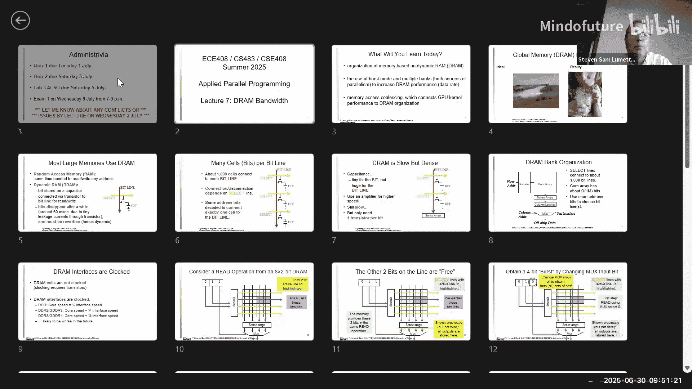
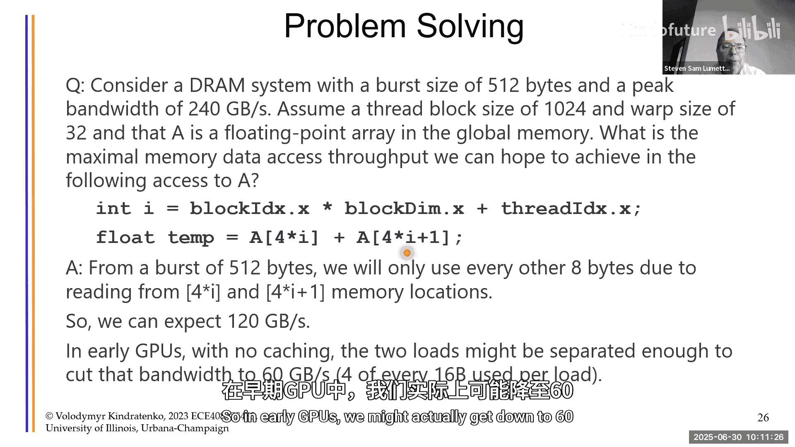
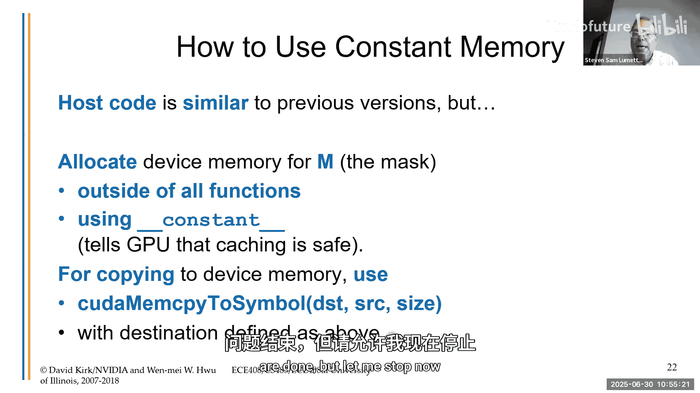

# 【伊利诺伊大学】应用并行编程2025-｜-ECE408-CS483-CSE408-Applied-Parallel-Programming-2025-p05-P05_lec05--BV1uNSyBaEcu_p5-

Testing， testing。Testing， testing。Testing。All right， so is my audio working。

 Zoom seems to think it is not。See， here now my audio is working。Then if I go back to my。

B microphone。Do I still have audio， I seem to have audio， I think。Now Zoom is just freezing。Yeah。

 can you still hear me， sorry it's。Being really slow and seeing okay， awesome， thank you all right。

 so welcome back to our third week， we are now ready to start talking about dynamic random access memory。

So close some of this stuff up。😔，I think we're ready to go。Al right， so。New week new slide deck。

Seeee， there we go。So in this slide deck， we're going to look at the organization of memory based on dynamic RAM RA means random access memory。

 so the accesses to any location in memory take an equal amount of time as opposed to something that has sequential storage like a tape or really just tape these days。

I see some of the modern systems are non uniform， but we still we still typically think of them as raM if the difference is small。

 you know， factor two， four and sometimes but。But generally speaking that access time is uniform to any location in the memory。

 that's what RA is， random access memory， and dynamicna RAM is the technology that we use for the large memories for most of our computers。

So we'll look at how it works， we'll look at burst mode。

 we'll at multiple banks for parallelism and talk about how we get the performance that we get today sustain the data rates that DRAs are able to provide we'll also talk about an aspect of GPUs that requires us to give some thought to how we write our code called coalescing okay so when your threads access memory they need to access memory in a certain way relative to one another so that the access is from the GPU to the DRAM chips which are not on the GPU right they're on the little board next to the GPU。

But those those access patterns need to be organized so that you can maximize the bandwidth that you actually achieve from the memory into the GPU chip okay so we'll talk about how we do that it's called memory access coalescing。

So hopefully you remember from last， I guess a couple of weeks ago， we said， well。

 wouldn't it be great if the world looks like the dam on the left where we say， hey。

 I'd like a little water and out comes a giant。Very broad wide fast downpour of my water。

 which the water here is data but in reality often what we instead have is a little tiny straw going into our cup or even worse。

 a little tiny straw going into our giant reservoir of memory and bits。So。

We saw that a little bit when we did our original implementation of matrix multiply and we did some analysis and then looked at the parameters available from an old GPU and we saw that we were being limited by the memory bandwidth。

And then what we did is we said， well， let's let's come up with a tiled approach and that actually enabled us to get better performance overall by reducing the pressure on the memory bandwidth and bringing those two resources。

 the computational resources and the memory bandwidth resources into a little bit of a little better balance and by by achieving that better balance we were able to take more advantage than of the computational resources and achieve higher performance overall for the same problem。

So that's how we should think about these kind of problems。

So most large memories these days as I hinted use dynamic random access memory so again。

 random access memory RAM， as we usually say， means that you have the same time needed to read or write any address your reads and writes might be different。

 but the same time to read any AndRS the same time to write any address in the memory。

Dynamic RA is a specific technology in which the bit the zero1 that we store is stored using a capacitor okay。

 so capacitor， you can think of it as just two parallel pieces of metal and we put electrons on one of them and then we have electrons pushed away from the other ones so we have an electric field between the two plates。

And because those have opposite charges， they attract each other and they largely will stay put。

 meaning that the electrons will stay put on one side and the electrons will stay away from the other side so we can use it to hold a charge。

And those are then connected by a transistor。 right， Remember。

 that's an electric for voltage controlled switch to a bit line for reading and writing。 So that's a。

 there's a diagram over here showing you what that looks like in terms of circuits right So you have the bit line in red going down that。

Is then connected over here to our bit This is a symbol for a capacitor I mentioned it's just two metal plates and not necessarily metal in inside of a chip。

 but something that can hold electrons so there's a capacitor here where we marked a bit so that's either has electrons or doesn't on it so it either has a charge on it or doesn't and when we turn on select then this transistor turns on in the bit is connected to the bit line。

So when we turn the transistor on or turn our switch on， the bits connected and we turn it off。

 it's not connected now unfortunately， although as I said。

 the charge on on that capacitor will hold for a little while。

 eventually just like water evaporates from a puddle。

 those bits will drift Im sorry those electrons will drift away from the capacitor and eventually eventually we' lose our bit and so when I say eventually I don't mean any time that's long for humans it takes typically about 50 milliseconds so you've got some tiny leakage currents that go that go well I't want to get too much into the technology but you have some tiny leakage currents meaning the electrons drift away and after about 50 milliseconds you will have lost your bit。

So what you need to do is every 30， 40 milliseconds at least or maybe faster if you want to。

 you need to rewrite every bit in your memory okay and that's where the dynamic term comes from because we have to constantly go back and rewrite the bits into the capacitors otherwise we lose though。

哎。So that's dynamic graraham。Now。Because we have the select lines。

 we can actually share a single bit line across many stored bits。

 So typically think of that as about 1000 A in practice。

 So we've got about 1000 cells each storing one bit connected by one single piece of wire。

 the red line going up and down。1 thousand0 cells with one bit line and you can see that each of them has a separate select line so what we're going to do。

 of course， is say well， I want this bit or that bit or a third bit and we' we'll turn on the corresponding transistor by setting it select bit high its select line high or low depends on the technology in this case high。

To higher voltage and then that will connect the bit to the single bit line。

Now the way we're going to do that is to use a decoder， so we'll have address bits， for example。

 if we have 1024 cells， we would have 10 address bits。

 those 10 address bits will be put through a decoder which then produces 1024 outputs one of which will be a one okay。

If the decoder is enabled， all of them will be zero if the decoder is disabled so some address bits will be decoded in this case10 for one bit line。

So。When you think of this electrically that little tiny capacitor right we want it to be as small as possible because we want to pack a lot of transistors。

 I'm sorry， a lot of bits onto a memory chin right so that transistor we want to make it as small as possible so the capacitance is small but the problem is that we then have this very long wire that connects a thousand0 cells。

 so relatively speaking the capacitance of the bit line。

 its ability to hold a bunch of electrons is actually higher than the individual bit cell。

So the problem there is that when we connect our bit to the bit line。

 it takes some time to change the voltage on the bit line because there's not many electrons going on to it relative to its capacitance。

So in order to make our detection of what's stored in the bit cell a little faster when we connect a particular bit to the bit line。

 we use an amplifier so in other words， amplifier hopefully you know just means what it does in English which you take something and make it louder it can also in English mean you use more words but make something louder or in this case increase the voltage difference that we see as soon as we see a tiny little voltage difference on that bit line we increase it to the voltage difference we use for0 and1 in our system so we use these sense amplifiers to see which way the voltage is drifting on the bit line and then as soon as it starts to change。

 we immediately ramp it up to read a zero or1 out of the bit cell。

But it's still slow relative to something like a processor clock。喂。😊。

But we only need one transistor per bit。 Okay， so this bit cell design， one capacitor。

 one transistor。 that's enough to store a bit。We can do that in a very。

 very small space right and so we can pack many， many billions of DRAM cells onto a chip。

So here's what a DRAM bank looks like then we've got our core array。

 which is actually about 1000 bit lines so 1000 bit lines each connecting to about  a00 bits bit sell right so 1000 by 100 you go about a million bits。

You've got a row decoder， which is driving your select lines。

 so you've got a row address which is about 10 bits that then sets one of the select lines high。

 and so that will turn on a row of 1024 bits， roughly about 1000 bits。

 let's just say those bits will come down the thousand red wires in this square。

 the core array into the sense amplifiers and the output of those sense amplifiers will be stored using active logic。

So we don't have to worry about it drifting away in something called a latch。

 so we'll store those thousand bits。and then to figure out which bit or small set of bits we wanted we'll use more address bits。

 maybe another 10 here to decide well which one bit do we actually want to look at Okay so we'll use a logic element called the multiplexer just a amongsts for that purpose we'll look at one of those thousand bits that come out of the chlor array and get latched。

So it's important to understand DRAM is not clocked okay， so clocking requires transistors。

 you don't just get somehow magically a clock on your system without building some electric circuits or that clock。

So。VM cells are not clocked right the core array is just what I showed you a bunch of capacitors。

 one per bit and a bunch of transistors to connect them to the to the output and input channels。

 the bit lines， both output and input I should I should say。They're not clocked internally。 However。

 at the chip level， the D Ram interfaces are clocked。

 right So it's very likely if you go trying to learn more on the Internet， youll like， oh。

 I read Professor Lometa that you know， this new D Ram technology is clocked。

The cells are not clocked what's clocked is the interface between the DRAM chip and whatever's using it。

 whether it's the CPU or GPU right？So。And the DDR technology， the。

Pore speed is about half of the inter speed， right？In DDR2 or graphics DDR3。

 the core speed is about a quarter of the interface speed。

 so there's usually an integral ratio and you can see these are actually powers of two ratios。

In later technologies it gets worse okay so the speed of these interfaces to the DRAM is actually getting slower than what we can use for it so even though we're also playing lots of tricks like trying to send multiple bits per clock signal and things like that。

Al right， so let me let me show you how a read operation works。

 So what you see here is an illustration of a very small， unrealistically small core array。

 So let's say that we have this organized as an8 by 2 bit Dra。 So you say well，8 times 2 is 16。

 So I have 16 cells。And what this is meant to represent here are 16 boxes， so four by four。

 each of those is one cell， the bit lines are drawn vertically just like we did before。

 there's a decoder and we're going to organize our bits as follows each row is going to have two pairs of two bits。

 we have four bits sorry four rows， so that gives us four times two is eight different memory locations。

 each of which is storing two bits。So in order to have eight memory locations I need three bits of address right with three bits I get eight different patterns so that I can use the eight patterns to name my addresses within this little tiny memory so here's how it would work。

So first of all， that three bit address where my red laser point or cursor is would be put into the decoder。

嗯。And we're going to have the select lines going across。So， the是。Sorry my information。 Oh， sorry。

 There we go。 So we're gonna feed the address into the decoder。

 And that's going make one of our select lines go high。 So that's highlighted for you in blue。 Okay。

 so line 0，1 will take the high bits0，1 of the address， and that will make line 0。

1 of select go high。😊，So when that happens， we're going to read out actually all four bits。

 but the bits that we care about are highlighted for you in purple。

 we will also read the bits in these two cells to the left of the purple cells and those will also go through sams and will' also be latched。

 but we're not going to use those right now because we're trying to read the highlighted purple cells right that's the memory location we want。

So how do we know which one we want， Well， there we can use the third bit from the address in this case。

 a one， you can see that going down in purple to the mus and the mus decides between these two sets of。

Bits， right， the ones that are not highlighted on the left and the ones I've highlighted on the right corresponding to the two cells that we wanted to read。

 so what comes out of the memory is the two bits that we wanted。And again， this is all not clocked。

 right We have to just wait long enough to make sure that these answers are there。

So the other two bits on the line then are stored in the latches。

 I didn't draw the latches in this picture， but remember we're storing them in the latches。

Those are free， right， we could just say， well， you know， I also want those other two bits。

At the same time so I wanted the purple bits， but if I also could make use of the other two bits。

 then I can get them without going back for a second read from the bit cells because when I read from the bit cells。

 I'm obliged to read the entire row Okay so remember after the sense amps are some latches and so even those bits to the left of my purple bits going into the sense amps and then coming out。

 those are also stored in the latches。嗯。So if I want them， I can get them kind of for free， right。

 I have to wait long enough to switch the mus over。 Okay。

 so now I've highlighted those two in sort of green， a little more like cyan。

 But if I want those other two bits， I can actually get them in the same read operation。

 right because from from the internal memory point of view， I have to read them out。

 once I connect those those capacitors to those bit lines， those bits will drain out。

 And so I have to read them latch them and then write them all back。

 So this is another aspect of DrRAm， whenever you read a row， you have to then write that row again。

 right because you've drain all of the all of the electrons。

 I'll follow of the bit cells in that row。 So you have to go put it back So we have to read the whole thing every time。

😊，So instead， what I could do is say， well， let me get a burst out of this out of this D Ram。

 Now burst is not a big deal for here， right， instead of two bits， I get 4。 Okay， big deal。

 a little bit， you know， twice as big， but it's still only  four bits。In practice。

 remember the cell size is  a000 I'm sorry the core array size is 1000 white。

 so instead of asking for two bits or four bits I asked for 1 thousand bits out of each of those core arrays okay so now those start to add up quickly。

So to do that， I would change the Muux input， at least with the hardware I've drawn here。

 I would change the Muux input bit to get both， which in this case would mean all sets of bits out of that row。

系。All， so first I would read using Mo selectlect zero。

 and then I would read a second time that I would get the green ones first。

 I just go in order of address in this case。And then in the second step。

 so I'd get the green bits out and then I would go back and read the purple bits using a second step。

 and that would give me the entire row in this case， four bits。嗯。All right。

 so hopefully that's pretty clear。So make that change and then I get the the purple bits out and then at that point I can go back and rewrite the row because I've gotten all the bits that I want for the external purpose okay。

So here my DRAM burst length is just going to be four bits。

Now what good is this idea of bursting Why would I want to bother with it So remember that every time I read from these little capacitors。

 I have to wait right I mean， I have put the sense amplifiers there to make it faster。

 but it's still kind of slow so every time I go back to them and I say， oh。

 hey I need another different set of bits if I look at random places in that core array and I only read a couple bits at a time。

 every time I go to look I have to wait a while before I get an answer。

So we can illustrate that right so here on the top you see a timeline so in all of these lines。

 everything left to right is time okay。So on the left side。

 you see we put the address bits into the decoder and I've drawn this this arrow measuring the amount of time it takes to do a core array access。

 Okay， so that's the time to tell the tell the decoder。 Here's what I want to look at。

The decoder drives the select lines， the select lines turn on the right transistors in that core array the bits come out onto the bit lines。

 the sense amps say aha I see some change the latch the bits get latched right the sense amps change the voltage to zero1 voltage corresponding to our signaling levels in the circuit and then the latches decide there's zero1 Okay so that time is this core array access delay okay。

And then I have to send the two bits out through some other circuits out to the pin。

 and so that takes this little tiny amount of time here。So。By the time I'm done。

 if I get a second set of bits， right， then I only incur that latter two bit time。

 where if I'm going to go back and ask for a different two bits out of the core array。

 then I incur this much， much longer time again between every two bits I get out。So in other words。

 with a slightly different time scale， but conceptually just to illustrate， if I don't use bursts。

 my data look like these little red pieces coming out of the bigger system。

 so my wires coming out of my chip then are basically idle most of the time。

So if I'm not using a burst mode， most of the time I'm just sitting there doing nothing on the interface between the chips。

 I'm simply waiting for the memory to provide data out of the memory out of the core arrays。

 out of those little capacitors。With a burst at instead of getting only two Bs。

 I can actually send4 bits。I mean， the real numbers are much bigger。

 but what I've shown you could send four bits across my interface。Now in modern systems。

 this idea of burst mode， it used to be that， you know。

 sometimes you might want to turn on your memory's burst mode right because you knew that you could make use of it and other times it it didn't help you very much because your access patterns were so random it just didn't matter in modern systems essentially all DRA is always accessed in burst mode okay so if you don't need those those extra bits。

 you can throw them away okay in terms of the transfers。Generally speaking。

 everyone is running burst mode all the time okay， so anytime you access your memory。

 you're going to get this burst of bits back because that makes efficient use of the interface okay so if you don't again。

 if you don't need those bits and your system knows you don't need those bits you can simply ignore them。

 you don't have to make use of them but they will come across the interface because generally speaking your DrRA you're going to want to run it in burst mode so you might be able to use that interface bandwidth。

Okay。That's not good enough to fill up the interface。

 So hopefully that was clear even burst timing right the dominant time here is waiting for an access right so it's not enough to say。

 oh， let's just use burst mode even with realistic numbers the interface can carry a lot more data than a single burst in the time it takes to go read a set of bits out of out of your core arrays。

So in addition to using burst mode， we also make use of multiple DM banks in a memory chip。

And that gives us perilism right so you you can imagine here I've just drawn two and now that adds one extra address bit right so up here I've got a fourth address bit now so these are imagine these are the same as my earlier eight by two memory now I have two copies and I can add an address bit that says well which of those two copies do I want to read from now。

So if I have my 8 by two bank and then I use two of those。

 then I can actually get better results right， So if I have， for example， here。

 the bits are drawn as individual bits because if I'm using 8 by two I do a burst。

 I get four bits right So this is my single bank burst time versus the dead time on the interface for certain assumptions about the about the core access delay。

 which actually don't match what's drawn up here， but。

Imagine that the access delay is the blue part right and then when I'm finished accessing。

 I actually get extra data back。So if all I'm doing is a single bank right。

 then I still have a lot of dead time on my interface。

 whereas if I have multiple banks right and what I want you to think of here is that these are the access times versus data provisioning times from each of the two banks individually right So on these bottom two lines。

 This is one of my bank so that one bank matches the single bank exactly。

 But then I can also make use of the other bank， so that I can inter leaveve data from the first bank with data from the second bank going out over the interface。

 And when I do that， I'm actually getting。Think of these these two now merged。

 So the red parts where I'm using the interface， red part on either from either bank or where I'm using my interface to say the GPU and the blue parts where blue is now on both lines are the parts where my interface is still idle So you can see that my useful time on the interface is actually doubled So even just having two banks allows me to get twice as much bandwidth out of this particular set of out of this particular design。

 you can see I've also drawn it so that I can in fact， have three different banks right In practice。

 you'll have many banks so in practice you might have 16 or 32 or even 100 banks。

So that you because that time to access the cells is actually quite long right。

 it's not just three or four times the transmission time on the interface， it's actually quite long。

All right， so that was all I wanted to say about the operation of Dra。 I think the important part is。

Primarily for you to understand that when we use DRAM。

 we need to make sure that we can make use of those bursts so the bursts are going to come back so that we can get get effective use of of that interface the bandwidth on that interface that's our global memory bandwidth that's how much data we can transfer out of the global memory。

 the DrRA into the GPU chip per second right so maybe 150 gigabytes per second on the old GPU or maybe on a modern GPU typically closing in on a terabyte per second because we're using high bandwidth memory but it's still going to be slow compared to our computation So we want to make sure that we get effective use of that so the question is。

 well， what does that mean from the point of view of programming the GPU so that's what we're going to talk about next。

So let's make sure we all remember I know some of you have done this a million times and others。

 maybe it was new last week， so let me make sure everyone remembers how we linearize our C arrays so if I have CC++ it's the same not the same as Fortran so if you're doing Fortran it goes the other direction but probably not many are doing Fortran these days。

So in C， when we have a multidimensional array conceptually。

 like the one that's shown up at the top there， that's square of  four by four matrix。

What we do is when we have to map that into linear memory addresses。

 we do it by taking a row at a time okay and putting them then consecutiveully back to back so in other words。

 if if my first row and my matrix is the yellow row then red then blue then green。

 then in order in memory in order of increasing memory address， in other words。

 I will first put the yellow row then the red row then the blue row then the green row okay。

And so each row then occupies the amount of space for four of those individual matrix elements。

 And so if I want to go down conceptually go down a row in my matrix， I need to go。

Passt the width of the matrix elements of the linearized order so for example。

 if I wanted to go from the address of M12 to the address of M22 in this case a width is four so I need to add four times the size of the individual elements here these are just drawn abstractly as boxes but down in this linear ordering I would count1 sorry I'm not sure this is a good idea of my mouse is kind of slow23 and then four would get me to the address of M22。

All。So you've， I think you've actually。Now， labb 2， yeah， lab 2 was due yesterday， right。

 So I think you've actually used this in your code also。 So hopefully。

 you understood it and you're getting used to it if you've never used it before。

This was our matrix multiply kernel right， so this was our simple one right without  tiling。

And you can see， sorry you can see the indexing into the multidimensional matrices right where I'm taking the row and column for my thread here I'm accessing row row and column K right and then I multiply that by row k column COL in n and you can see the linearization expressions for each of those two multidimensional matrices and then down here also I use row and column to index into P for my individual thread so examples of linearization。

Now let's think about what happens when we access memory locations。

Inside the inside the kernel right， so K is our loop counter right so。

That's just each thread is going through the loop so you can think about two individual threads that might be next to each other in a thread block so we'll call them just thread1 and thread2。

 what locations are they going to access in that code as they walk through the inner loop right so remember the expression was row times width plus K well。

 of course the two threads are looking at different rows of M so two threads here looking at different rows of M but they're looking at the same column at the same time。

As opposed to N， right where。Each of those two threads is looking at different columns。I'm sorry。

 different。Yeah， different columns for the two threads。

 right the COL is different for the two threads because their thread indexdex do X is different here。

But they're looking at the same row as they go through the two different columns of it。嗯。

So what how does that then work when we look across our threads。 So as our threads。

Read their first value， right， the threads that are next to each other in the X dimension， right。

 Those will have different columns in the in the n matrix because the column number that each of our thread axises is based on thread index dot x。

 or rather is it adds in grid index then x。So those will be adjacent columns in n。

 and so if you think about， for example， four threads with the the same thread indexex do y that those are right remember we're going to linearize those in the x dimension first into warpps。

 so those are conceptually kind of adjacent threads those threads will access adjacent elements of n so the access direction in the kernel code the first loop we're going to access the yellow right then we're going to access the red we're walking down through the columns of n inside each thread so if you think about well。

 by four wide thread block is going to access four adjacent columns of n。In the first iteration。

 we'll access the yellow， then the red and the second iteration。

 then the blue and the third iteration， and then the green and the fourth iteration。嗯。

So in terms of our memory accesses， that means。In one cycle。

 those four threads are going to go access four adjacent elements of N。

 Remember the linearization order， those are actually adjacent in memory。

Okay now the way we do our DrRAm bursting is to provide from the DRAm adjacent memory locations。

 Okay so this block of four chunks in yellow， just colored in yellow， right。

 there's no colors on the memory locations， but four adjacent pieces of memory for the four values in our end matrix。

 Those are actually part of the same burst， not usually big enough to fill up a burst。

 but we will actually make them big enough to fill up a burst in our code。

 usually or half a burst or something like that。😊，So this is what we want to do right we want to have this kind of access pattern where we're going to get a bigger chunk of memory and distribute it amongst our threads similarly load in that same load from n in iteration number one。

 we're going to load four adjacent elements of N again right when I say adjacent。

 remember this is in terms of the linear order and memory and n the red values of N are adjacent and memory。

 which means again they'll probably be in the same memory burst。

And then we'll go to blue and then we'll go to green right so this is a good access pattern。

 We say that these accesses to N can be coalesced because we have simultaneous accesses to adjacent memory locations across our threads。

With M。It doesn't look so good。 Okay， so let's try to think through this。 So remember。

I have copied the access pattern in the code over here right so we say well。

 we'll take our current row number which is the same right across these four horizontal horizontal threads。

 they're accessing the same row okay。And they're accessing then actually the same column too as they go through。

Yeah， I guess if we separate them out and why， then it'll be different。If yeah。

 if we look at so these labels， sorry， these correspond to Y index changes okay。

So now the threads are separated in Y but it doesn't matter right because in low iteration1 are four threads are actually going to be accessing four different elements right because they're going to be accessing different rows of M in fact。

 we' have so sorry there's a little bit of confusing difference here and the threads are actually four different threads now the four threads we talk about well actually access the same element of M so the four threads we had on the previous slide for example。

 would read from the same row and so you might think well well that's good right you can just read that one thing and then send it to all of the threads so you're doing well。

 you're not actually doing that well because you're not reading all of the elements at the same time right so only later do you go back and read the next element of M。

On a modern GPU， it's not as bad as it sounds because that that burst of the yellow might be still in the cache so you might get okay access on the early GPUus。

 your memory bandwidth would be very bad because you weren't making full use of the burst。

 even on a modern GPU you would actually have to walk through the entire burst。

 which is a little harder when each thread is only looking at one element per per loop iteration。

 when they're all sharing the same axis。 Okay， so in this slide， these threads。

 you should think about them as being a thread column in our block。

 And so they're going to look at different rows。 And so they're illustrated down here with their access pattern。

In step one right at time zero。Right。The load iteration0 down here。

 we're going to access four separated elements of M， right， They're separated by width elements。

 Now here， that's only four。 Okay， but you'll notice that the intermediate intervening yellow elements right and the intervening red elements are not being accessed in iteration0 of the loop。

 right， So we've got three quarters of memory not being accessed。

 And so that's not a good access pattern， right， Again， we want a contiguous chunk。From our threads。

 we don't want the axises spread out because the memory is going to deliver everything in between。

 and then potentially the GPU might throw that away。 So we're gonna to use it later。

 but we have to go back and get it again and then throw a bunch of stuff away and go back and get it again and throw a bunch of stuff away。

 So we end up using our memory highly inefficiently in the sequential kernel when we go to access。

 I'm sorry， not sequential kernel in this in the simpler kernel that we wrote earlier for matrix multiplier when we're always going to global memory So in addition。

😊，We talk in addition to pulling everything in too many times。

 which is what we talked about when we went to the tiled version of the code in addition we've got the incorrect access pattern for allowing the memory to make use of burst mode in that original kernel which is another reason that we get really bad performance with that kernel。

 we're not doing good memory coalescing。In iteration one。

 we do the same thing right and again on a modern GPU if we manage to cache this stuff。

 the performance hit will not be as bad as it was on older GPUs。

 but it's really something you want to be careful about counting on right instead try try to have access patterns that allow good coalescing。

All right， now it turns out if you've read ahead， you'll know that once we move to the tiled code。

 we're actually going to play a little trick that we're going to call corner turning。Right， and。

I wish I knew why they decided to call this Cor of turkey。嗯。😊。

I think they I think David and Wema somehow thought of this as you've sort of。

Tranposed your code so you're kind of turning a corner somehow let me actually go back to this slide in practice you run into this problem also with CPUs for exactly the same reason that in your sequential code if you're walking through the matrices。

 you want to walk through them in the direction of linearization so that you're maximizing your use of burst mode。

Okay so you want to walk through M and N in the linear order。

 but the problem is that if you're walking through one of them in linear order。

 you're walking the wrong way in the other matrix， even in the sequential code。

And so what's done in practice in the sequential code is to transpose one of the matrices。

 for example， M so that the layout in memory is the correct direction so imagine instead that I laid out memory according to column first order right So column major order is what it's called the way we do it with CC++ is called row major order。

 I don't care and you probably don't care if you remember those but I does help to remember that the row is the big thing So if you change the row you have to take step by width or as column major if you change the column you have to take a step by the height。

So it's real major orders what I've shown you， but you could do column major order。

 transpose the matrix you've stored it and column major order and then you get memory contiguous memory accesses in both Okay。

 so if you start by transposing your matrix you can actually get good memory performance for both so what we've done in the tiled code。

 if you think about it is。Get that benefit without actually doing the work of transposing the matrix。

 right， So I think that's why they call it corner turning because you're kind of。

Logically changing your matrix organization， but you do it by changing the access pattern the of the tile read relative to the computation part of the code so。

Remember that when we read the M and N matrices out of memory。

 the way we did that was to simply map the thread block structure directly onto the tile that we were reading So what's shown here is that the access pattern into the two tiles looks exactly the same across our threads right so whether it's M down here on the left or N up here on the right。

 I'm sorry up here on the left also the access pattern is the same。

And if you think about the threads now accessing those chunks。

 they're accessing a bunch here it's only too wide。

 but now if you had say 16 or 32 wide thread blocks。

 you'd be accessing a chunk of 16 elements which with each row of threads in your thread block And so that's enough coalesible aes that you can get pretty good memory performance and when we load the tiles。

 we're using the same pattern So we're getting good coalescing on both M and N even though we didn't even transpose our matrix right so again。

 the way we get that benefit is by changing the way we access the memory when we're reading from global memory into shared memory and then when we make use of the data from shared memory。

 it's less important to have the access patterns because we're not worried about bringing those data over the pins right shared memory is already within the GPU。

嗯。All right。So hopefully that made sense， please do ask questions if you feel this is going too fast。

All right， so yeah， the shared memory logically enables this idea of corner turning right。

 so if we look at the tiles right， then we might think， well。

 we're still going to have the same noncoesible access right So what I've drawn here is the for a single thread block remember。

 we access all of the the rows corresponding to the output corresponding to the chunk of P that we're producing So this would be an example of the tiles through access for one thread block Similarlyly。

 we access all of the columns corresponding to the threads in our thread block。 So we'd have a。😊。

A chunk of columns from N。 So we're going to access all of these data。

And in the original access pattern。Each of the threads is logically walking through continuous memory and M。

But then our threads are not using that at the same time that's across the loop iterations whereas in n each of these columns is being read。

 one of them is shown here， but because the threads in the thread block or acting together we're actually reading those out at the same time in our original non-tled code but when we go to the tiled code。

 we read read those tiles out one by one using a coalesible access pattern which we use both for N which we already had good behavior。

 but also for M， so now we get the coalescing behavior for M without changing anything about N so we can just keep that in the normal order in memory。

All right， so we still have the same access pattern for compute。

 but because compute is done from the scratch pad from the shared memory。

 we're able to get good performance there when we bring the tile in we're using a coalesceible access pattern。

Now， what I what you might wonder at this point is I haven't really given you the details of well how can I tell right if I look at my code。

 how do I know kind of what's coalesible and what's not Okay。

 so we're going to go through that more carefully。We did look at a couple examples。

 so I want to make sure you have some connection， so maybe I'll go back here。You go back here。

 yeah so here's the here's the coalesible access pattern。

So if you think about adjacent threads right， adjacent threads in the linearization order in Kuta。

 remember X gets linearized first， just as we wouldt see the horizontal dimension is the small dimension and so threads with thread indexdex do x have are close to each other right they go into the same wars。

 for example， and so we want our access pattern to be different by thread indexd do x。

 basically not by thread indexd do y not by thread indexd X times 2 or times 4 right because then adjacent threads in our in our thread block are not accessing adjacent memory so we want something that's dependent directly on thread indexd do X And if you think back you know where did we get column maybe I should show you。

So column， remember， we simply add in thread indexdex。 x。

Right so there's the dependence on thread indexdex do X and that's why adjacent threads in our thread block acts as adjacent elements of n I'll go back to the oh actually the n expression is just down here right so it's directly based on column So if I were to expand this out right then I would have a term which is simply addition of thread indexd do X So every time I hit this this statement and I go read an element out of N the threads adjacent to each other and the thread block go read adjacent elements of memory and I get good coalescing。

The Y elements are not adjacent to each other because the threads in my thread block are linearized in the same way。

 So if I have a 16 by 16 thread block off by one thread index y is 16 threads apart in the linearized order right So if it's 16 by 16。

 two of those will be in the same warp， but the rest of them will be a different warmths。

 So they happen at different times So even though I have a dependence， if I were to yeah， actually。

 I don't even have that right because then my thread index y is also multiplied by my width So there's no adjacency here to speak of my K term is across loop iterations。

 so I have very spread out aes with them， that's not a good pattern what I want is a term which is directly dependent on thread indexed x。

 and that will give me the best access pattern for coalescing all right。

Yeah I don't want to go get a copy， I don't have a copy handy。

 but if you look at the tiled code when we read a tile from M and when read a tile from n you'll see that there is such a term for the access to the M matrix and for the access to the end matrix when we're reading from global memory into the shared memory you'll see that term is there for both right so it's illustrated here but I didn't show you the the expressions of the code。

Allright， so reason I want to make sure you understand that is I think in some of these exercises we're going to ask you that particular this one all right。

 so it is though time for a break and I want to be able to spend some time on these so let's take five minutes and then we'll come back and do these exercises and then we will move on to the next set of slides so we're a little earlier than usual but again I don't want to rush the exercises so I'll come back at955 and start again I'll be here and you can ask questions if you want or just feel free to wander away but we'll start in five minutes。

So Max， I'm not sure if you're still here， but。Maybe i'll type it as well you should have access to canvasva now it's set up we don't have any I don't know if Hanwen has put let's see so lab lab one was just due yesterday。

 right？U。No， that was lab two， so that won't be graded La one was。

One was last Tuesday I asked him to grade the labs within a week。

 so I think were that'd be basically at the same time as the quizzes due so I'm not sure he's he's done the grading so you won't see anything in there but you should have access to canvas if you're in the class so if you don't let me know and I'll try to figure out what's going on but you should all have access to canvas the only thing in canvas mind you is one your grades as numbers will be there please do not look at canvass wild speculations on the import of those numbers but。

But。The numbers will be there once things are graded and I have not copied the quiz stuff I think。

Hann might have done that so you will see great information when it's available in canvas and that's the only thing you'll see there I did put up a front page that says please don't look at any of the other numbers here look at the you know the rules in the first slide deck on how we organize things Okay so i'm seeing other people saying they don't have access also that's a little odd I will go in I don't know if I can do it during the break kind of depends on many more questions。

😊，嗯。Yeah so there should be access yeah there's just one page that says you know go to the class webp page if you want information on how grades will be brought together but we use Can just to give you the numbers because you have to log in and you know it's a secure manner for you to authenticate yourself and not have to worry about other people seeing your grades so that's why we use it otherwise it wouldn't use it at all。

Okay。I think we're at about 955 now and we're ready to go。S letting be。好。I think it should be。

All right， so can you hear me because Zoom is being flaky and seems to be saying I don't have audio。

Can anyone hear me？All right， let me reset。Okay。I think people are saying yes。

 but I have to scroll down all right， thank you。All right。

 so let's go over what's coming up if you haven't already and you think you have a conflict or issues about the exam。

 which is next Wednesday7 to 9 pm online， remember you need a camera， be proctored by Hanwen。

Let me know it'll be on Prairie learn also so you'll just get logged into Prairie learn it'll show up at seven you can start you'll have two hours so yeah let me know and and then also you can please see Hanwen and he can coordinate with you but do that at least a week in advance because we need time to try to find a time that works so。

All right， so quiz  one， you just had， I'm sorry， you have。

You have you had lab one do last week hopefully already done with quiz one otherwise you have until tomorrow night at 8 pm remember it takes an hour so if you don't start it if you start at 730 Prairie learn will automatically limit you to half an hour so please don't do that quiz two then is due on Saturday so they're all a week after I would just try to get that done you know while lab two is still fresh in your head because lab3 is also do Saturday remember that's the tiled version of matrix multiply。

And that'll be the last lab before the midterm you can do it either way we're going to not have convolution material。

 which is lab four on the midterm I mean I think we're going to kind of get to some of it but I don't want you to have to have too much material that。

That you were worried about studying before。 So I think we might even finish today or if not。

 then pretty early on Wednesday with the material that we'll put on the midterm。

So convolution is the lab for it'll be due the week after I think it's due the 12th and so you'll have a few days or a couple yeah three days after after the midterm to do it if you want to get an early start you'll have seen all the material too and it wouldn't hurt but we're not going to ask you about it until the second exam okay。

All right， so I think that's it for Admina， I guess I have to look into our canvas issues and I can do that after class。

嗯。Let's go back and do a little problem solving。All right。

 so here is a question I'd like you to think about and whoever would like can answer it or I will call on someone if we want to do it that way is fine with me I actually kind of like it that way because then we get everyone involved and we just kind of go through people but but sometimes people want to answer it that's fine too if you feel like you're you're ready and you know so here's a question。

So obviously this is going to be about coalescing memory right so which of the two lines of a kernel code do you think has better performance so you can see I've done my thread index X or my Tx rather not thread index that's related to thread index。

 but I've computed Tx as a horizontal index in the usual way and then I've computed Ty as a vertical index in the usual way。

 and then I access arrays A and B in different ways。え。So the access patterns， by the way。

 to the A and B matrices are the same in the two lines。

 sorry I should have maybe named the matrices different than I did than the lines。

 but the A axises and the B axises in the first line are the same but they're different between the two lines of code so here in the first line I've taken Ty multiplied by with added Tx and I've done the same index on to the B matrix over here and then similarly the access pattern。

For the second line， a matrix matches the second lines B matrix access。 Okay。

 so which of those two lines do you think is going to give you better performance on the GPU。And why。

Okay， let's see so。Speak。You don know people answered it last time so how about Henry do you want to answer this one。

 what do you think？If you're answering， you muted。Yes， we chat， oh， you don't have a mic， okay？

Right who's next in our list Yeah， there are a couple people I think answered like last week。

 so I just kind of I skipped over you this time Iris。How about you， you answered in the first week。

 but not last week。诶。B for this one， it should be a。And why because what we discussed earlier the。

When we do column access instead， the memory we can coalesce the memory。

 but for viewer doing like the row access。Yeah right， yeah， good answer。 Yeah， that's exactly right。

 So just to make sure everyone's following。 So this access pattern here right。

 you got T Y times width So already， those are not adjacent because you can I mean。

 I guess you could say well what if width is one maybe but here we're assuming width is some matrix and width is not going be one right it's gonna be at least the size of of this this index range here hopefully Tx so that things are as in different elements certainly would want that because we're using the we're writing to matrix B right so we don't want threads over writing each other。

😊，Allright， so with this big。 So those are not adjacent。 And then we look at what T X is。 And again。

 we've got blocked in multiplier here。 So those are not adjacent。

 So the things that are adjacent is thread index not X。

 Remember that our thread blocks are linearized first by。In the same way that we do in C。

 so the x dimension is adjacent threads and then the Y dimension is separated by block dimension do x。

 right？So we want thread indexdex dot x to separate the access elements for our threads。

 because that means adjacent threads in our linearized order access adjacent elements of a。

 as well as adjacent elements of B。 so the burst goes actually in both directions。

 so when when one right， we also want to send a big chunk of memory out to the out to the memory。

 or a big chunk of data out to the memory， I should say， So so we're doing that with line A。

 in line B， again， we ignore the times width， right， Those are not adjacent。 The T Y part， of course。

 this is times block width。 Those are not adjacent。 but thread index Y is also not adjacent。

 Those those threads that have， you know01，2。 those are not adjacent threads。 once we linearize。

 those are separated by block dim dot x elements in between each of those。

 Okay so these elements here，Are not accessed by adjacent threads。

 and so that means that we're not making good use of memory。

 we're not allowing our aes to be coalesced？Allright。Yeah， if you look at well。

 where did the adjacency go， where is thread and X do X in here， adjacent threads。

Are then multiplied by width， which is quite a large number。 So the adjacent threads in our warp。

 for example， are going to different parts of memory。

 so that coalaleescing is not going to work in line B。

And there's an explanation down at the bottom if you're going back to the slides and trying to remember okay。

All right。Okay， so second problem。Let's say that we have a DRAM system with a burst size of 512 bytes。

 so when I go to memory I want to read 512 bytes ideally。

 and a peak bandwidth of 240 gigabytes per second。Assume we have a thread block size of 1024 and a warp size of 32。

 and that A is a floating point array in the global memory。

So what's the biggest memory data access throughput assuming that every time we read from memory。

 we read a burst and if we can't make use of it within our warf， we throw the rest away okay。

 not realistic anymore， but you know that's the worst case right so we read a burst burst is 512 bytes and then if we didn't use all 512 bytes throw whatever we didn't use away。

And we go to the next step。 Okay， so under those conditions， right， if we throw away some of it。

Then we're not going to achieve our peak bandwidth right only if we use all of the bits we read can we achieve our peak bandwidth？

So that's what the that's what you're supposed to be thinking about here。

 So what's the maximumimal memory data access throughput we can achieve in the following access to a。

 So what's going on here so。We linearize according to these are， by the way。

 thread block of one dimensions right so 1024 spread out over x。

 so we use that0 to 1023 to compute I so these are just linearized as they were in vector addition。

One dimension。And then we use I in this line right here to access memory。

What do people think anyone want to volunteer or see have a chat？Okay， so Edth is saying。1，20 GB。

 So half， okay， so。Let's see， I'm not sure I' going to get have here so。First of all。

 this is a C statement right remember that C gets compiled to assembly language and so even though in C you might say。

 well look， I'm reading from adjacent elements of my a matrix here。

Except that that's not what happens at the instruction level right we don't have we don't have a way to issue two loads in the same instruction at the instruction level these are actually separate load instructions and so if we're not making use we said of the data immediately right we might end up throwing those away now it's true that we might actually make use of it depending on the code how the code gets compiled so it's fair to say that we might be able to to get that and maybe we can hope。

But you shouldn't assume that you will unfortunately， okay。

 so you want to be a little careful when you when you analyze this and say， you know。

 it might be possible that I'm actually able to use those two adjacent loads right or I might not okay。

So let me。Slowse this answer down here。So。Yeah， so this one assumes that we're actually going to be able to do it。

 right？So four times I plus1 means the i values， which are thread x。

 those are going to be separated by four elements。So out of every location by every chunk every index into a。

 we're only going to use every fourth for each of these axises。

 that's the four times I part and then we're reading out two out of those four now those are actually four bytes each because we said they're floating point。

 single precision floating point So out of a chunk of 16 bytes we're using in these reads for each so you could then potentially if somehow you're allowed to make use of those data coming back。

 which could happen， then we can expect 120 gigabytes per second if somehow those instructions。

 the load instructions， the compiler separates those they are separate instructions but if the compiler somehow separates those then we might actually get down to 60 gigabytes per second because these two loads it's possible that we could。

Throw away three quarters right because we're only reading with each of these these axises。

 we're only reading one out of every four and then we throw those throw the other three away and then read it back in so we could actually get down to 60 so somewhere between 60 and 120 okay。

Generally speaking， if that， if that kind of thing is ambiguous or something， you know。

 hopefully I've set it up so that we accept both， but。

But I think we didn't leave any ambiguity in the quiz if you。

 if you feel it's ambiguous for this reason， then let me know， certainly across C statements。

 don't expect， don't expect it to work， within the C statement。

 then you might expect these two loads， we talked about it before where we said， well。

 what about memory level parallelism， we said maybe both of these loads can go out at the same time。

So in that case， we might be able to make use of half of the data coming back。All right。Good。Yeah。

 so in early GPUs who might actually get down to 60 that was what I was trying to explain。

All right， so that was it for this slide deck。If you have questions， please ask。

 otherwise I'm going to switch us over to the next slide deck。See。啊对。Goodす。Yes。Okay。No。

Okay。So I want to talk then a little bit。😔，嗯。About convolution so this is the last slide deck for the midterm。

 so I think I misspoke a little bit at the beginning。This is this slide deck will be covered。

 So I guess we are going to include some convolution on the exam。

We do have questions on exam2 thatll be specific to lab4 so the split will be conceptual convolution as we discuss and there's some code in the slides too versus the specific threedimensional convolution that you're going to do on the lab okay so that specific lab4 work is not going to be on the midterm is you don't turn in lab4 until after the midterm anyway but the content of this slide deck which will be done with by potentially today or definitely by Wednesday so you have a full week to study it that will be on the midterm and then slide deck 9 which I just posted this morning is not going to be on exam1 and also posted slide deck 10 on the web page so you can start looking at the those if you want we will start at least nine on Wednesday。

But we'll finish up eight by then， which is the end of the material for midterm one。All right。

So this slide deck， we're going to cover。Writing a convolution。

 which is an important parallel computation pattern。 It's also a mathematical operation。

 You may have seen it in math。 You may have seen it in signal processing。

 you may have seen it in a wide variety of context or you may never have seen it at all so we will walk through the basic arithmetic that we're using and talk about how it works and then map that into code map that into a kernel together so it's it is quite widely used。

 we'll talk about some of the applications as well it's used in scientific computing as well。

 it's used， for example， for a thermal。Computing thermal equilibrium which is usually just kind of a simple application。

 but those kind of applications can be subcomponents in much more complicated modern mechanical engineering applications as well it's also it turns out a critical component of neural networks and deep learning so the convolution is going to be important at the end of our summary you're going to be doing a project where you're building some elements of a neural network and you're going to want to understand how convolution works at that point as well but it is an important technique it's used in many。

 many ways and it also will help us to understand how we can make use and when we can make effective use of the cached memories okay so particularly the constant memory available to us in the GPU。

All right， so what is convolution so it's an array operation and it's commonly used， as I said。

 in a wide variety of applications， so we've got signal processing， we've got digital recording。

 image processing， processing videos， computer vision， machine learning。

 all of these areas make use of this one operation in various ways。😊。

So convolution conceptually takes an array， for example， we might have an image。

 and conceptually it converts an array into another array。😊，In fact。

 I already showed you an example of a convolution when I showed you the image blur so we're taking there in the image blur we had a small three by three or potentially larger submatrix and we just talked about using it we didn't say what we were particularly doing with it right in that case we were just kind of blurring the image but that's an example of a convolution。

Right。So in convolution， again， inputs an array， outputs another array。

 same dimensionality of those two， maybe not the same size， sometimes the same size。

 sometimes not typically machine learning， they're a little smaller。

 the ones we're going to look at today or maybe through Wednesday going to be the same size。

Every output data element is simply a weighted sum of nearby input elements。

So that's how we're going to define convolution。 You might say。

 well what what is nearby right so we have to define that what are the weights you got to define those together that definition and those weights form what we call a convolution mask。

 sometimes we call it a filter， sometimes we call it kernel I' going to typically call it a mask here。

Which is a constant array with the same dimensionality as the input data。 Now， again。

 I want to make sure you understand the difference when I say dimensionality versus size Okay so in the image blur example。

 I had an image two dimensions， So two dimensional data I also had the size of that image。

 which was say height by width could be 300 pixels by 300 pixels or whatever it's not the same as the dimensionality right whereas the the kernel that I used was a little three by3 in the code we wrote it has the same dimensionality。

 It's a two dimensional matrix， but the size its different right It's just 3 by3 versus 300 by 300 for example So the filter。

 the mask has the same dimensionality as the input data。Generally speaking， in a convolution。

 we use the same mask for all of the inputs。All input elements were use the same mass。

That's a convolution。Well， I haven't told you we how we do it and Ive just told you the inputs okay so we've got some dimensional input。

 we've got a mask， same dimensionality and then we're going to somehow do a linear sum between those two to produce the outputs。

In discrete signal processing any filter， so you say I want a low pass filter。

 meaning I pass only low frequencies I cut out a high frequency noise or the opposite high pass filter。

 band pass where I throw away bothalo and high， a notch filter where I throw away a certain region。

 any other filter you can imagine where I'm trying to process data in terms of frequency can actually be implemented as a convolution。

Image processing， applications of convolution are things like blurring or smoothing。

 sharpening the image， trying to find edges in the image。

 identifying features in the image when you're doing machine learning。😊，In scientific computing。

 we use convolutions for solving discretized partial differential equations the way we do that。

 so we take our partial differential equations from the theory of that particular computation that particular science。

 we discretize them over， for example， a two dimensional or three dimensional grid。

 and then we implement them using convolutions。Right。So let's start simple。

Let's start with a 1 D example。 This would be something you could use with audio processing。

So we'll have a mask width so we said we're going to have a mask that has to have some size。

 so let's call that mask width and for for to have a concrete example。

 let's say it's five so our mask will have five numbers okay call that that number five mask width to generalize a little bit in our heads。

We also wanted to define the radius of the mask， so the radius of the mask is the number of elements on each side of the element being calculated so for example。

 with a mask of five you're going to line up that central element over your input and output okay and then you've got two others on either side right so you've got five you' got the one in the middle you've got two more on each side so we say that the radius is two for that mask width of five。

The way then we're going to compute the output is as follows so let me tell you what the inputs are the data input is n and so you can see here I've just made it kind of small it's just seven elements。

 The mask input is M we said the mask width was5， so that means we've got zero through four in our mask。

Now the way I'm going to compute the output P here I'm going to match and say I've got the same size as the input data。

 which remember was n， not n and M， so we'll call it data and mass。Data is N。

I want to have the output P be the same size as n。Okay so here I had n with seven elements。

 so I have Pb7 elements also。Now， the way I'm going to compute one element of M is going， I'm sorry。

1 element of P rather， it's going to be take M and line it up conceptually over。N， okay。

 so for example， the third element， P sub2， I'm going to line M sub2。

 the central element of M over n sub2。 And then I'm going to multiply a dot product。 basically。

5 elements of n with the mask。 So I'll say n 0 is1 times M0。 N0 is 1 times M0 is 3。

 And that gives me3。一。Think I can't actually see this part of the slide because Zoom's hiding it。

 but I'm pretty sure I've got a three down there and then four times two or maybe two times4 I'll keep the same direction right so n of one is2。

 M of one is 4，2 times 4 is8。Three times5 is 15， four times 4 is 16， five times3 is 15。

Take those five elements， sum them up， you get 57， that's the value of P sub two。

I'm going to repeat that computation for every element of P。 That's how I compute my convolution。

 So I'm going to move my mask conceptually over my data。Sorry。

 conceptually from left to right over my data。So remember you see things the other way。

 and I'm going to do that computation repeatedly to produce the elements of P。

So I walked you through this already， but I'll do it again for the output P of three so here we'll line up now the middle element of the mask that's M of2 with the n of3 right to compute P of3 so that's just whatever P element you want you line up the central element of the mask over the over the element of the input corresponding to the element of the output you're trying to compute in this case I've highlighted in red in the n input the data right。

So we'll go through again， two times three is six。Three times the four right。

 so n of two times M of 1 now is 12， four times 5 is 20。5ive times 4 is 20 and six times 3 is 18。

 Add those five numbers up that produces P of3。 sorry the arrows going in the wrong place。

 but that produces P of3 in this case or 76。All right， so you might think， well， wait a minute。

 That's that's great。 What happens when I line up my mask and then the mask kind of falls off the input。

 right， so here down below， I show you P of one right And you say， oh。

 you just line up the middle element of the mask M of two with n of one。

 And then I do my computation。 So what is n of -1。😊，It's not there， and it doesn't exist。

There are many things you can do and different scientific applications will have different ways of dealing with these boundary values sometimes people will replicate n of 0。

 sometimes people will ignore and just not compute anything at the boundary meaning effectively you've put zeros in when you use these for machine learning。

 you simply don't compute those outputs so in this case that would mean we don't compute what we've shown here is p of 0 and1。

 we don't compute what we've shown is p of 5 and 6 we only compute three elements of p for the output。

 So now the size of the input and the size of the output are different by twice the radius or the mask size minus-1 that's okay and it doesn't matter as long as we know what we're trying to do and we define it clearly then we can we can write code for that so in our code。

 what we're going to choose to do is treat those non-existent elements。0ero。Okay。😊，So in other words。

 when you line the mask up conceptually， and that falls off the edge of the input。

 whether it's on the low side or the high side doesn't matter。

 any place the mask doesn't overlap the input will replace the input value with zero。

So what does that mean for computing P of1， well， this element here doesn't exist。

 so we multiply zero by three， we get of course， zero。Three came from M of0。

 the mask is now lined up。N of 0 is1， we multiply that by m of 1 to compute p of1 that gives us 4。

2 times 5 is 10， three times 4 is 12， four times 3 is 12。

 Now we add up these numbers down here and we get 38。嗯。All right。

 so here's a kernel where I've done what we said we're going to do。

 which is deal with the fact that the mask when it's lined up might fall outside of our input data set。

 So let me kind of walk you through this a little bit。So this is a convolution 1D basic kernel。

 I've set it up as a kernel， which you know means I put underscore underscore global in front of it and it returns void sove got everything done there。

 I'm going to pass in the data， a pointer to an array of data which is n pointer to the mask。

 which is M and those are different sized arrays by the way。

 so I need the width of both so maybe I'll skip over those I've got the mask width and the width of n past it in as variables and then finally I got to produce output P。

 which is going to be the same size as N， which is given by the width variable or the width parameter that's being passed in right。

All right， so thats my that's my signature for my kernelel。With all the input and output variables。

 this linearization to compute my threads element of P。

 we're going to paralyze across output elements as we've often done。

 so each each thread is going to compute one element of P， so we linearize。Here， by the way。

 I'm assuming we have exactly as many threads as we have output elements。 Okay。

 so I'm going to ignore checking that I is valid。 I'm not going to do that here。

 You know how to do that， Of course， in your kernel you're going to have to do that， right。😊。

But for the simple code in class we're going to leave it off。

 so we'll assume that I is valid and that it's every thread corresponding corresponds to an output element of p。

We'll have a running sum because of course， this is again。

 just an inner product and you can see down at the bottom。

 we're going to write our running total back to PE。At element I。

 I is the index for our thread that we computed at the start of the kernel。

Now where are we going to start reading from the input Okay。

 so let me go so you can see this expression we're going to subtract the end start points going to be equal to I minus the mask width over2 Okay。

 so in our examples mask width was5 divide it by two you get two right because remember we're going to round towards zero and c。

That's a mass radius right so you could equally if we had a variable called mass radius here。

 we could subtract the mass radius instead。 So let me make sure you understand how that works。

 So here， for example， I for the thread。 we're computing in red I is1 we're computing P of1 and the starting point then is going to be1 minus2 is negative1 so that's correct。

 it's outside of n。 we better check that go back another slide here we were computing。😊，Element 3。

 so I would be three for the thread that does this work。And 3-2。

 the mask radius or mask width divided by2 is going to be 3-2 is1。

 And you can see that the first element of n that this thread will look at is， in fact， n of1。嗯。

Go back another slide， here we're computing P of 22 minus20， and of course。

 the first element that this thread will look at is n of0。

So just showing you how the Maria Dixing works， given what we've seen so far。All right。

 so that's our starting point。😡，Call it end start point。 Then we're going to do the inner product。

 Now， how many times do we need to compute something。 Well， remember， we've got a mask with。

 we're going to look at for every element of the mask。

 we're going to multiply by one element of the input。Okay。So we're going to do that mask width times。

 that'll be J。 we're walking now through the mask。And we're going to check。Whether we have a valid。

Element of of the input N。So end start point plus J is the index that we're going to look at in the input so remember our loop variable runs from0 to mass with minus1 the first element corresponding to the first element of our mask we call end start point。

 so end start point J is the element for this particular loop iteration。

 so we compare end start point plus J with0 has to be greater or equal to zero and less than width。

If it is， that means we're going to access something within our input so we can simply go ahead and make that access with n and multiply that by the J element of M。

 add that sum into our running sum P value for that little inter perfectfect。Now wait a minute。

 I said I was going to replace nonexent elements with zero。Did I do that， didn't this code？

I didn't do it explicitly， right。 There's no more code left to explain。So if I said， well。

When N start point plus J is not。Greater equal to 0 and less than width。 Well。

 then it's outside my input， right， It's less than lesser less than 0 or greater equal to width。

In that case， I said I was going to put a zero there。

Well conceptually if I take a zero there and I multiply it by m of J I get zero and then if I add that into P value。

 I don't change P value right so I don't actually need code for that right implicitly by leaving out the else case I've replaced that value with zero。

Now。Probably you can guess where we're going to go with our convolution。 We're going say， oh。

 let's analyze it。 Oh， look at that。 We have terrible global memory bandwidth。

 Let's put it in a shared memory。 Once we're in shared memory。

 our computation is probably going go directly to shared memory。

 we might need to do things explicitly， right， But in the。

 in the code where we're just going to global memory。

 I can implicitly set the values outside of end to 0 by simply leaving the code out。 Okay。

 so that's what's done here。 All right。😊，So that was 1D。Hopefully you're comfortable with that。

 let's go to 2D。So in this case， let's say that we still have our mask with a 5。

 but now5 means 5 by5。 So our mask is now 25 values。 And to do the convolution。

 we're going to do exactly the same thing， So we're going to take our input array。

 and we're going to line our mask up over each element。

And do the inner product between the corresponding elements of n which I've highlighted here for the output element22 remember everything in C and C plus plus indexed starting with zero so this region of n we will multiply pointwise by M our mask shown down here。

 and I'll walk you through this I don't want to go through all 25。

 but I'll walk you through this a little bit in a second。

 then we'll sum up those numbers to produce P sub22。And row to column two starting with zero。

All right， so yeah it's exactly the same so the upper left element in this can box would be multiplied by the upper left element of our mask。

 so one times one， and then that would produce the one shown here and then just reading across quickly。

 two times two is four， three times three is9， four times two is8 and five times one is five so you do that with the other 20 as well。

 and then add those all together to produce 321。嗯。😊，What about boundaries？

Going to do boundaries in exactly the same way。 So anything。

 when I line my mask up and here I'm producing row 1 column 0 right of P。

 When I want to produce that element， I line my mask up just as I did before。

 I take the central element to2 of M and I line it up over the corresponding input element。

Row row 1 column 0 ahead of n。 I say， okay， well， now a whole bunch of my mask falls outside of N。

It's okay， those I will treat as zeros。诶。So you can see all those zeros down here。

 once I multiply point wise， I have a whole bunch of zeros and everything outside of n becomes zeros in my inner product。

So to handle those ghost cells or apron cells， sometimes you will call them halo cells。

 I mention these other terms， not because I want you to learn everything。

 but if you're reading outside or if you're reading scientific computing literature。

 know you don't want to be confused that different communities have different names for the same concept so ghost cell halo cell apron cell。

 they're all the same thing。All right。So let's call them ghost cells actually I think in some of our slides we're going to call them halo cells too I think I call them ghost cells because I come out of high performance computing world and the GPU world called them halo cells doesn't really matter same thing。

All right， so。These ghost cells， then we're going to treat all as zeros。These extra cells outside。

Now， let's think a little bit about how our kernel accesses the mask。

So we've got the elements of the M， we call those our mask coefficients。

When we're computing an element of P， every single thread needs every element of M that's not quite true right so if you've got if you've got an element of P you're computing where the mask falls off the edge。

 you're not going to use some parts of M， that's okay if you've got a big input。

 almost all of your threads are going to use every element of M。And M doesn't change， right。

 M is just a bunch of constants。 M is just a bunch of numbers that we choose before we execute our convolution。

 Maybe if we do another convolution， we use a different mask， whatever for the convolution。

 we're talking about M is the same for every threat。All， all just a bunch of numbers。Also。

 every thread accesses the order axises the elements of M in exactly the same order。

 right because they're all just going through the loop and accessing exactly the same order of M。

When we have this kind of an access pattern where every thread in our grid is accessing the same chunk of memory in the same way。

 same order， is and it's read only right we're not changing it anyway。

 this is a good candidate for using constant memory in the GPU So if you look at your code and you notice a you know that particular chunk of memory。

 it's read only， we're not changing it， we're accessing it the same way and every thread。

 you might want to think about replacing it with constant memory。

So I want to go back and show you this picture again。

 remember that constant memory we can actually get pretty good performance right we'll get better performance than global memory right。

Practically we can get very close， if not exactly the same as something like shared memory so about five cycles for each access as opposed to 500 for global memory。

All right， now the way that works is through something we call caching and I know when I say caching。

 you know a number of you are saying okay， caching great and some of you are saying what the heck is caching Okay。

 so I want to talk a little bit about that。😊，So we just talked earlier today。

About how and we started talking last week， about how kernel execution time can be limited by our global memory bandwidth right And then we also said when we looked at our tiled matrix multiply。

 will instead of bringing in the same bit So over and over again for different threads。

 Let's think about how threads within a block could bring that data in once put it in shared memory and then reuse it use it across all the threads or at least some of the threads usually one dimension So the width of our I guess we called it tile would the thread block reuse So we're able to do that with matrix multiplication we use what's called a scratch pad shared memory where you the programmer decide what goes into that memory sitting on the chip that's called a scratch pad because you can write some stuff there just like you would you you're sitting in class like I don't understand whatmin saying let me make some notes on this little piece paper here that's a scratch pad you got some free storage you can put stuff there when you're done with a lecture。

 you throw it away when you're done with a。😊，ut you throw those bits away and that's a scratch pad but you can make good use of them right because it's close to you as opposed to。

 oh gee， I've got to go go get my textbook out and try to read it and figure out's what's going on right？

So we took advantage of that scratch pad with matrix multiplication。

 but there's another way to do things， which is the approach called caches。

So remember anytime we read from memory we're going to get back a burst right memories are always these Ds are always operating in burst mode so those memory bursts are going to contain typically at least around 1000 bits。

 so 128 bytes。Of consecutive or linear addresses in memory。 So let's give that burst a name。

 Okay we've got a chunk of memory， about 128 consecutive locations。 call it a line。

 Okay so what's a cache。 Well a cache is an array of what we call cash line。

 So when you get a burst back from memory So well let me keep a copy of that。

 I'll take those 128 bytes， and I'll put them into this extra memory。

 now when I say we're gonna to do that， it's not actually any human， It's a piece of hardware saying。

 oh， you know， maybe you're going to use those bytes， those bits again。

 let me let me just hold on to them in case your program says， you know what。

 I want something I want that line again。 I want something in that line。 I want something nearby。😊。

So anytime you read you're going to produce a line and your cache。

 then the hardware is going to store a copy of that line as well as record that line's memory address right so you don't want to say。

 oh， well， I got some bits。 Maybe next time you ask go I'll just give you these bits。

 I don't need to go look at the bits you wanted。 I'll just give you the bits I have You don't want that to happen。

 So you got to keep track of where were these bits in memory so what memory have you now copied and what are the bits that you copied so the cache is going keep a copy of that of that line that burst back from memory。

😊，It turns out that when you look at programs， you get a lot of memory locality and it comes in。

 there are two kinds right So if if you take your program and you look at the memory accesses， right。

 the loads in stores and you write down a sequence So your program could be one thread。

 your program could be a CPU program doesn't matter。

 but you look at that sequence of addresses and you say。

 what can I say about that sequence of addresses Well， your sequence of addresses。

 we usually have two types of locality one is called spatial， So that says， well。

 if I have some memory， some region of memory and I touch x。

 it's pretty likely I'm going to touch x plus12 and also x plus2 and also x plus3。

 those are addresses。 X is now an address So if I touch something in memory。

 I go read it or write to it iss a pretty good chance higher than the chance I'm going to touch some unrelated memory location There's a pretty good chance soon。

 I'm going to look at the next thing and the next thing after that。😊，That's called spatial locality。

 that property of programs if you think about what you know or may know about data structures right when we say。

 oh， I've got some related data， let me put that into a data structure。

 those data structures are laid out sequentially in memory right So if you touch one field of your data structure。

 probably good chance you're going to touch another right that's spatial locality。

The other aspect that we see in these sequences of addresses often is called temporal locality。

 so if I look at something， I read it， I write it pretty soon I'm going to look at it again。

 I'm going to read it again， I'm going to write it again that's called temporal locality the same same sort of thing data structure。

 I read one field and then I write it back。Change it right， if I read it once， I might write it soon。

 for example， or am I read it against soon。Cashs actually give you better performance for both types right because the hardware you bring in some bits。

 but those bits are a sequential chunk of say 128 addresses so I touched X well now if I say well where's x plus one the bits at x plus one well I got those in my cache they say oh I got I got a write to X now well that's sitting in my cache so I can change it and then I can send the whole chunk back later is a burst。

So caches improve performance for spatial locality and for temporal locality and almost every program we write displays these two properties okay。

😊，Oops。喂喂。Now cash is， this is a chunk of memory sitting on the chip。 and you say。

 oh I got a terabyte of D Ram， How about I have a terabyte of cash。

A terabyte VRAM is spread over a big physical space compared to your GPU right your chip。

 and most of your GPU chip is for computation， so you're going to have a very tiny chunk of memory for this cache。

😊，哎。😊，So what do I do to manage that memory Well， when the cache gets full So when it's empty。

 it's easy and just the put the bursts， the bits from the bursts every time you get some memory and put it into the cache。

 put it into the cache but pretty soon that little chunk of memorys full So what do I do Well I said well what did you use last so I take the least recently used line out of my cache throw those away。

 maybe they won't use those again Okay so I'll discard the least recently used line whenever the cache is full and you say I've got some new bits coming from memory I'm going to throw away the old one put the new bits into the cache。

LRU at least recently used by the way， is implemented not exactly in most hardware caches it's approximated okay doing it exactly is expensive and not worthwhile so it's some approximation and try to take the oldest one and get rid of it。

Or rather， the hardware tries to get rid of the oldest one。

So how does this actually work in GPUs So the GPU has memory dedicated on the chip next to the streaming multiprocessor to support caching of constant data right so data that you're not changing and L1 caches So the L1 caches or the memory close to the close to the SMs that store。

 for example， instructions， so similarly to accessing data when you access an instruction you're probably going to access that instruction again。

So if you think， for example， you write a little loop and your thread goes through that loop 10 times Well the first time that's a new instruction Ben go get it out of memory。

 the second， third， fourth， fifth， sixth， seventh， eighth。

 ninth and10 time right's sitting in the cache there's an L1 instruction cache for that purpose Similarly similarly there's a constant cache So if you touch constant memory the GPU can take those bits that you read from the constant memory and put those in the cache next to your S so that if another thread or another thread block remember all of our threads are going to access the same chunks of constant memory in the same order for our mask now they're sitting in that cache next to the S that's why we can access them on average in five cycles。

😊，All right， so the L1 cache， the data cache， not the instruction cache supports rights so you can actually make modifications。

 but it's small and it's not really it's just so that if your thread is accessing something and then writes something back locally。

 you can make changes quickly sos it doesn't have as much effect as a CPU's cash hierarchy where there's a lot of cash on the chip relative to a GPU。

The caches that allow changes have to track the modification status of the lines。

 right because if you make a change， you expect that change to go back to memory eventually。However。

 the cache for constant or texture memory you're not allowed to change those bits on the GPU right so it's a special case the lines are actually read only and you don't have to worry about it and that means you actually get higher throughput access because your cache can be designed not to allow you to make changes to the bits you only take those bits and use them you never change them so that way you don't have to check for example。

 well did you change those before you throw them away you can simply discard any line and you don't affect correctness when you're trying to do your managing lines in the cache for example。

 the hardware to do that that is。All right， so you have a higher throughput cache than you do for the than you do for the。

Execer。嗯。哦。Yeah， so okay， so I mean this question I don't want to spend too much time on it now I'm happy to ask it or talking about a little more later。

 I also want to repeat it so Ed is asking in the chat whether there's a performance impact to having a cash。

Certainly there can be and that's one reason that the caches need to be very small right so anytime you access memory you have to go off and get that。

Out of from somewhere right and so often in many processor designs the L1 first level caches are designed to operate in one cycle so meaning that they're not slowing you down and to be able to do that you have to limit the size right so you have to produce hardware that can produce the answer in the time you want to cycle today so the bigger you make the cache the slower it it is to go access it right and so you have to limit the size of the cache to the point that you can access what you want in one cycle。

So for example， the instruction cache you would like the instruction to be available when you execute when you execute that instruction So typically that would be an example of something where you want to one cycle cash access other cache is historically there were generations of Intel processor X86 processor for example。

 where the closest cache was actually three cycles away so in the instruction pipeline it was organized so that if you hit in that cache that was actually good enough that your instruction had to go through the stages of that processing so that bringing the data in after three cycles was fast enough so they could have not one cycle access for their caches and that let them crank up the clock speed in those generations of processors as well right so you've got a lot of constraints in the hardware design but typically you're thinking about well' what's the right operating point and what does that mean for the size of my cache remember that these caches it's actually the same chunk of memory for the。

Constant cash and the L1 data cache and the。And the shared memory。

 the scratch pad memory in the modern GPU， the Volta generation and later and so those are five cycle access right so you it's that's the intended time to access and so if your warp needs data from those it says I need those data in one instruction and then five cycles later that warp can wake up again and use those data Okay so a very good question if you want to talk more about it we can't afterwards。

All right。So。Yeah， so so we're able to actually get better performance also when we're only doing read only access。

 right because the hardware can be simpler， right？And this is kind of part of why I gave a little more detail on what I was saying is that I did know I had this next slide coming up or at least it was coming up sometime soon that we have basically as a voltage generation they're all actually using the same physical resources that are being split up dynamically between our scratch pad and our constant memory cache for example。

 right that's all part of the same chunk of memory that's thendynamically allocated either to your scratch pad for your threads if your thread says I need a certain chunk of shared memory that comes out of that pool of memory and then whatever's left over you can use for caching your constant memory for example。

Okay so they're all in the chip， they all have similar performance for the GPUs right cash hierarchy for the CPU is per chip。

 you'll have to figure out how it works if you want to leverage it really effectively。

So you might wonder so if it's all the same physically and it's using the same resources。

 it's got the same performance， well what the hecks the difference right， the difference is you。

 the programmer control the contents of shared memory。😊。

We call it a scratch pad because it's up to you， the programmer to say， hey。

 I need some give me some that's when you allocate shared memory variables right like we did in the tiled matrix multiply。

 it's up to you to put the bits in there， It's up to you to take the bits out of there it's up to you implicitly when your kernel is done。

 that chunk of memory goes away Those are all up to you， When does it allocated。

 when does it get destroyed， what goes in there， what it's used from there。

 how do the threads cooperate in that accessing that shared memory。

 that's all on you the hardware doesn't do anything to help you other than say out of this physical resource。

 you said you want I'll set that aside， I won't use that for anything else That's all the hardware does the software and associated kind of firmware running on the GPU will do that allocation deallocation for you but it doesn't change anything in in in the bits that are given to you the storage bits it's all a scratch pad。

With cache， it's actually the microarchitect， the hardware that decides what goes into the cache。

 you， the programmer generally speaking， don't do a lot with that。

 Sometimes there are instructions that say， you know。

 I think I'm gonna to touch those bits over there。 Could you pull a copy into the cache for me just in case I'm right oh。

 you know， those bits there， I think I'm done with that。

 Can you get rid of that so that next time I need some space in the cache。

 I've told you I don't need those so you make a good decision instead of maybe Lr use a bad choice right now don't know So sometimes you'll have instructions that are things like a prefetch instruction that brings something in or a flush instruction kick something out some Ias have those。

 but instructions that architectures have those but generally speaking that's not what the programmer does the programmer does not decide what goes into the cache that's all done implicitly for you by the microarchitect So that's the big difference。

Between a cash and a scratch pad。And I see I'm actually overtime now I apologize for that I thought I set an alarm to tell myself to stop talking。

 but I guess I didn all right， so yeah， we're over time so let me talk on Wednesday about how we're gonna make use of constant memory in the code and okay I have my timer set five minutes late for some reason I'm supposed to end five minutes ago Al right。

 so I'm going stop the lecture and I will end the recording you can ask questions now if you'd like I'll stick around until people are are done。

😊，But let me stop now， thank you。

