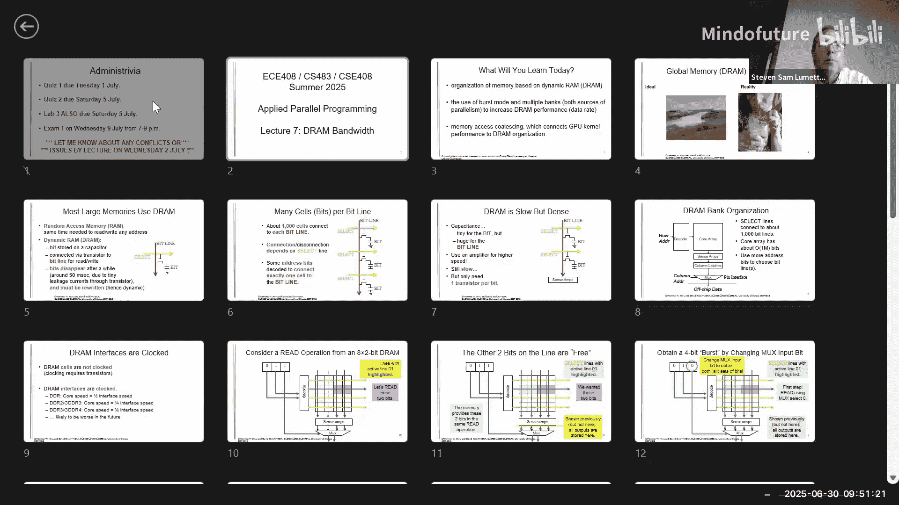
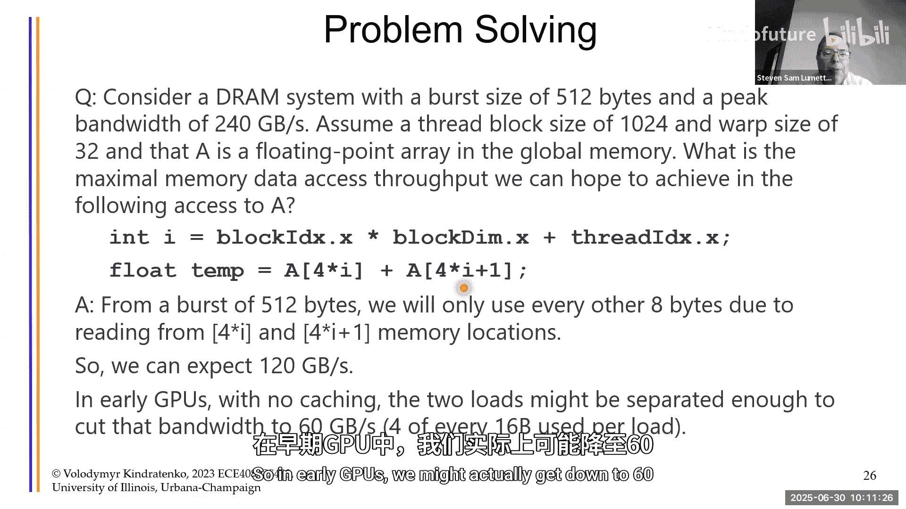
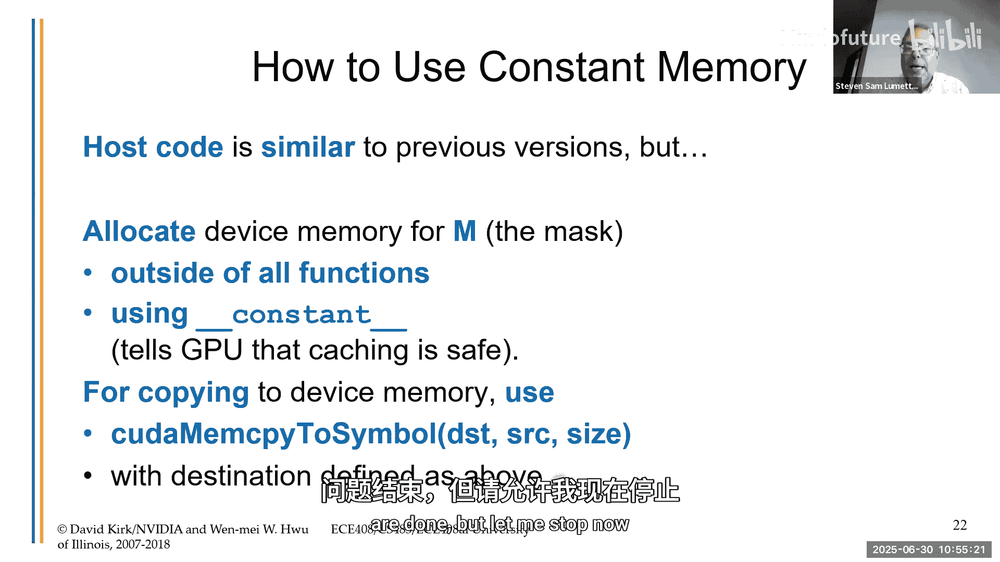

# 应用并行编程：第5讲：动态随机存取内存与内存访问合并


## 概述
在本节课中，我们将学习动态随机存取内存的组织结构和工作原理，包括其突发传输模式和多存储体并行机制。我们还将探讨GPU编程中的一个关键概念——内存访问合并，并学习如何编写代码以实现高效的内存带宽利用。

---

## DRAM基础：动态随机存取内存

上一节我们介绍了并行计算的基本概念，本节中我们来看看现代计算机中用于大容量存储的核心技术：动态随机存取内存。

动态随机存取内存是一种存储技术，其中每个比特（0或1）都存储在一个电容器中。电容器可以看作是两个平行的金属板，电子聚集在其中一块板上，从而在两板之间形成电场。这个电场可以保持电荷，从而存储信息。

每个存储单元由一个电容器和一个晶体管组成。晶体管作为一个电压控制的开关，连接电容器和用于读写的数据线。然而，电容器上的电荷会随着时间的推移而泄漏，通常在约50毫秒后就会丢失。因此，DRAM需要定期（例如每30-40毫秒）刷新所有比特，这就是“动态”一词的由来。

由于每个比特只需要一个晶体管和一个电容器，DRAM单元可以做得非常小，从而允许在单个芯片上集成数十亿个存储单元。

---

## DRAM的组织结构：核心阵列与突发模式

了解了DRAM的基本单元后，我们来看看这些单元是如何组织起来工作的。

一个典型的DRAM存储体包含一个核心阵列，大约有1000条数据线，每条数据线连接约1000个存储单元，总计约100万个比特。地址通过行解码器输入，解码后驱动相应的选择线，激活一整行（约1000个比特）的存储单元。这些比特通过数据线进入读出放大器，放大微小的电压变化，并将其锁存在锁存器中。随后，通过多路复用器，根据列地址选择出所需的特定比特或一小组比特。

DRAM的核心阵列内部没有时钟信号，访问任何地址所需的时间是相同的。然而，在芯片级别，DRAM与CPU或GPU之间的接口是时钟同步的。

**关键点**：每次从核心阵列读取时，必须读取整行数据。读取操作会耗尽该行所有存储单元的电容器电荷，因此之后必须将整行数据写回。这意味着，即使你只需要该行中的几个比特，DRAM也会提供整行数据。

这种特性引出了**突发传输模式**的概念。与其只读取请求的几个比特，不如利用已经读取的整行数据，连续传输多个相邻的比特。这样，在接口等待下一次核心阵列访问的较长延迟期间，可以持续传输数据，从而更有效地利用内存接口带宽。

在现代系统中，DRAM几乎总是以突发模式运行，以最大化接口效率。如果应用程序不需要突发传输中的所有数据，可以简单地忽略它们。

---

## 提升带宽：多存储体并行

仅靠突发模式还不足以充分利用内存接口的潜力。为了进一步提升带宽，现代DRAM芯片采用了**多存储体**结构。



多个存储体可以并行工作。当一个存储体正在进行核心阵列访问（耗时较长）时，另一个存储体可以利用接口传输数据。通过交错不同存储体的数据传输，可以显著减少接口的空闲时间，从而成倍增加有效带宽。

在实际设计中，一个DRAM芯片可能包含16、32甚至上百个存储体，以进一步隐藏核心访问延迟，实现接近接口峰值带宽的持续数据传输。

---

## GPU编程实践：内存访问合并

我们已经了解了DRAM如何高效地提供数据。现在，从GPU编程的角度来看，我们需要确保线程的内存访问模式能够充分利用这种突发传输特性，这就是**内存访问合并**。

在C/C++中，多维数组在内存中是按行线性存储的。例如，一个4x4的矩阵，在内存中的顺序是第一行的四个元素，接着是第二行的四个元素，依此类推。




考虑一个简单的矩阵乘法内核（非分块版本）：
```c
float Pvalue = 0;
for (int k = 0; k < Width; ++k) {
    Pvalue += M[row * Width + k] * N[k * Width + col];
}
P[row * Width + col] = Pvalue;
```
让我们分析线程的内存访问模式：
*   **对于矩阵N的访问**：同一线程块中，相邻的线程（`threadIdx.x`相邻）在循环的同一迭代中，会访问`N`矩阵中相邻的列元素。由于数组按行存储，这些列元素在内存地址上是连续的。因此，这些访问可以被**合并**——GPU可以一次性从DRAM获取一个包含这些连续地址数据的突发块，然后分发给各个线程，从而高效利用带宽。
*   **对于矩阵M的访问**：同一线程块中，相邻的线程（`threadIdx.x`相邻）在循环的同一迭代中，会访问`M`矩阵中相同的行元素（因为`row`相同）。这看起来似乎很好，可以共享数据。但在非分块内核中，每个线程独立进行全局内存访问，实际上每个线程都会发起一次对该相同地址的加载请求。更糟糕的是，如果线程在`threadIdx.y`维度上相邻，它们会访问不同行的元素，这些元素在内存中相隔`Width`个元素，访问模式是分散的，无法合并，导致内存带宽利用率极低。

因此，在简单的矩阵乘法内核中，对`M`的访问模式是非合并的，这是其性能低下的一个重要原因。

---

## 解决方案：通过共享内存实现“转角”

在上一讲的分块矩阵乘法中，我们引入共享内存不仅是为了数据复用，也巧妙地解决了内存访问合并的问题。

在从全局内存加载数据块到共享内存时，我们让线程块中的所有线程协作加载整个数据块。具体操作如下：
1.  **合并访问全局内存**：每个线程负责从全局内存中读取数据块的一个元素到共享内存。我们安排线程的读取索引，使得相邻线程读取的是全局内存中**地址连续**的元素。这样，对全局内存的访问是完美合并的，无论是加载`M`的数据块还是`N`的数据块。
2.  **在共享内存中重新组织数据**：数据被加载到共享内存后，线程可以根据计算的需要，以任何模式（包括之前非合并的模式）从共享内存中高效地读取数据，因为共享内存位于芯片内部，延迟极低。

这种技术有时被称为“转角”，因为它逻辑上改变了数据的访问方向。我们通过在共享内存中暂存数据，将对全局内存的非合并访问，转换成了合并访问，从而显著提升了内存带宽的利用率。

**判断合并访问的简单经验**：在访问全局内存时，确保线程的访问地址偏移量与`threadIdx.x`呈简单的线性关系（例如 `base_address + threadIdx.x`），这样相邻线程访问相邻地址，有利于合并。应避免访问地址与`threadIdx.y`相关或带有较大乘数的复杂偏移。

---

## 常量内存与缓存

在卷积等算法中，所有线程都会重复读取相同的、不变的数据（如卷积核或滤波器）。GPU为此提供了**常量内存**。常量内存位于芯片上，并通过一个**缓存**机制进行加速。

**缓存**是一小块高速内存，用于存储最近从较慢内存（如全局内存、常量内存）中读取的数据副本。它利用了程序的两种局部性：
1.  **时间局部性**：最近被访问的数据很可能在短期内再次被访问。
2.  **空间局部性**：当某个内存位置被访问时，其附近的内存位置很可能在短期内也被访问。

当线程请求的数据已经在缓存中（称为“命中”），则可以直接从快速缓存中提供，速度远快于访问全局内存。对于只读的常量数据，GPU的常量缓存设计可以更简单高效，提供接近共享内存的访问速度（约5个周期）。

**缓存与共享内存（暂存器）的区别**：
*   **缓存**：由硬件自动管理。硬件决定哪些数据保留在缓存中，程序员通常无法直接控制。
*   **共享内存**：由程序员显式管理。程序员决定何时、何地、如何将数据放入共享内存以及如何使用它，提供了更灵活和可预测的性能优化手段。

在卷积示例中，将卷积核（掩膜）数据放入常量内存，可以利用常量缓存让所有线程快速共享这些只读数据。

---

## 总结
本节课中我们一起学习了：
1.  **DRAM的工作原理**：基于电容存储，需要定期刷新，通过核心阵列、行/列解码器进行访问。
2.  **提升DRAM带宽的技术**：**突发传输模式**利用单次行访问获取连续数据；**多存储体并行**通过交错多个存储体的操作来隐藏延迟，两者结合以实现高持续带宽。
3.  **内存访问合并**：GPU编程的关键优化技术。线程对全局内存的访问应遵循“相邻线程访问相邻地址”的模式，以匹配DRAM的突发传输特性，从而最大化有效内存带宽。
4.  **利用共享内存实现合并**：通过先将数据以合并模式从全局内存加载到共享内存，再在共享内存中进行任意模式的计算，可以解决某些算法中固有的非合并访问问题。
5.  **常量内存与缓存**：对于所有线程只读的常量数据，使用常量内存可以利用GPU上的常量缓存，实现高速数据共享。



理解这些内存层次结构的特点和优化方法，对于编写高性能的GPU程序至关重要。