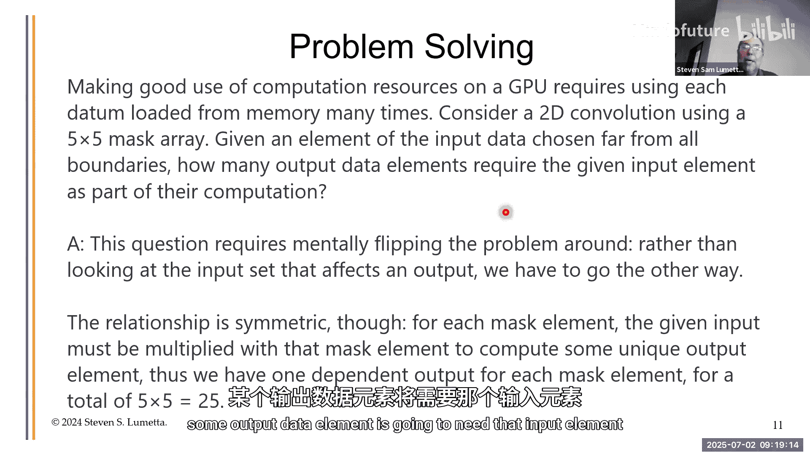
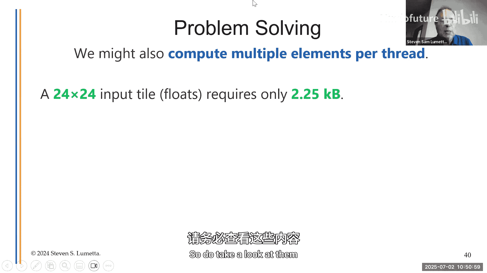

# 【伊利诺伊大学】应用并行编程2025-｜-ECE408-CS483-CSE408-Applied-Parallel-Programming-2025-p06-P06_lec06--BV1uNSyBaEcu_p6-

Yeah。Yeah。Yeah。Okay， well， I think yeah， Zoom's picking up， there we go and almost ready9 o'clock。

 good。Okay， so welcome back， so on Monday we started talking about convolution。

Which as I said then was is an important computation pattern it's used in a lot of high performance computing。

 scientific computing applications， it's also used in a lot of things like signal and image video processing。

And more more recently it's also a critical component in the pipelines for deep learning machine learning in general neural networks。

 particularly so you really want to be able to understand it and again we are going to use it towards the end of the semester when building the projects and you also of course do a lab on it after the midterm but。

What we want to also highlight in this set of slides is the idea of the constant memory right。

 so we start talking about that on Monday。So let's kind of dive back in， sorry。There we go。

So let me just go quickly over what the convolution is so remember that we've got some input data set that could be one dimensional two dimensional。

 three dimensional could be 10 dimensional for that matter it doesn't really matter here it's one that's we've called it n and the size of that data set can be variable。

And then we have。A mask filter etc cea of the same dimensionality。

 but a different size so we have a mask width usually the mask is fairly small if you think about the amount of computation being done it's actually roughly the product of the mask size or mask width was what we're calling it here with the input size okay。

Because every element of the mask at some point for some output is typically multiplied by each element of the input so once you get into higher dimensions that gets pretty big pretty fast right so so often the masks are fairly small so mask width again is is the size in each dimension typically typically we're using squares cubes hypercus you can have unevenly shaped masks but in a GPU particularly you'd probably fill in with zeros and pad more often but。

So the mask radius then is the number of elements on each side from the center of the mask so we want an odd number so we can align the mask over each of the input elements in order to compute each of the output elements so the computation is done as I just mentioned for each output element and the output is the same size as the input in this case。

 So P you can see a seven elements just like the input data set N for each element we want to produce we line the mask up centered over the element that we're trying to produce also centering it over these corresponding input element in this case N of2 and then we do an inner product between the overlapping elements of the mask with the data set so this was calculation of P of2。

And we walked through that last time right so this is a simple case showing that when the mask falls outside of the input data set。

 we simply fill that boundary region with zeros logically， there's nothing in the code to show that。

 but there's this if statement that implicitly leaves those elements out of the computation。

 which is equivalent to multiplying by zeros。All right。

 so still on review that's why i'm going a little faster the elements of the mask kernel filter and are the coefficients are the weights okay and basically those weights those are the same for every output element of P right the mask is essentially a constant。

Next time we do another convolution， do another kernel launch， we might have a new mask。

 but for our purposes for one entire grid execution。

 those numbers are read only okay also every thread。

That it computes one element of P the way we were wrote the code is accessing all of the elements of M in the same order。

 maybe not all of the elements right because we conditioned some out in the code I just showed you。

 but the bulk of the threads are accessing the same elements。

 all of the elements of M in the same order。 And even when a subset of M is accessed those that subset is in the same order is the rest of the threads so this makes M a a good candidate for constant memory。

 constant memory remember is similar to the scratchpa memory。

 the shared memory that we used for our tile matrix multiply but it's done through caching rather than through programmer control logically as of the  Volta generation of NviDdia GPUus。

 it's actually physically using the same memory resources on the chip so Sram on the chip。

To do the caching or to do the scratch pad and that chunk of memory is actually dynamically divided by the micro architectureitect controlled by the NVIDdia firmware。

 partly by the device driver running on the host so that you can have elements of constant memory like the mask alongside elements of shared memory。

And we actually do we will actually make use of shared memory a little later probably today。

 and that's what you'll use in your lab as well， okay， so that'll be lab for。All right。

So this is where we left off so the question is then well。

 how do we use this constant memory right what code do we write in order to tell the NVIDdia compiler well I want the mask to sit in constant memory how do I fill it in okay so it is read only from the GPU point of view so we're going to have to fill it in from the host side。

So the host code is pretty similar to the previous versions。

 but we have to allocate device memory for the mask and we do that outside of all functions using the qualifier constant so as with every other qualifier we've talked about I know it looks like in line what it is is underscore underscore constant underscore underscore one day I'm going to ask you that and I expect you to be able to tell me no seriously it'll give you a syntax there if you get it wrong right but hopefully no one is forgetting as you write your code so all of the Nvidia qualifiers are underscore underscore sync threads is underscore underscore but then without the suffix underscore underscore for that call。

So what that qualifier does is tells the GPU that for that chunk of memory allocated in GPU memory for the lifetime of the application。

Okay， we talked about that， I think in the first week， but I just wanted to remind you。

That chunk of memory can be cached safely and it will not be changed during the execution of a kernel。

 okay so it's read only。When you copy to device memory from the host。

 you want to use kutaM copy to symbol okay so when we're copying to dynamically allocated memory that can be changed by the GPU remember we're just using kaM copy when we're copying to constant memory we want to use kutaM copy to symbol that's only done from the host memory into the into the device memory so there's no direction on this one but otherwise the parameters and the meanings of the parameters are identical。

 so destination location is a pointer to GPU memory in this case some constant memory or the mask。

 the start of the mask M the source would be whatever bits you the start of the host side copy of that mask。

And then the size， of course， is just number of bytes。All right。

 so here's what that would look like remember that mask with all caps is pound defined to be the size of the mask so we would allocate outside of any kernel function this mask so we can make it static meaning that its's file scope so the mask is not usable outside of our file。

 but it's still resident for the lifetime of our application in the GPU memory。

The constant qualifier and then after that it just looks like any other CC+ plus variable declaration okay so this is a set of floats。

 it's a two dimensional mask of mask width by mask width。

So then we do what wed normally do allocating NP initializing N elements copy end to the device side copy of N however。

 we also have to fill in the mask before we launch the kernel Okay so to do that we'll need a host side memory copy which we can allocate dynamically would be the normal way to do it。

 we could do it statically too or even as an automatic variable in a function doesn't really matter okay。

啊。😊，Well you should be careful there。Yeah， so I'm sorry。

 you probably should avoid the automatic variable。 We haven't talked about it yet。

 but all of the all of the NviDdia calls are actually asynchronous to the host code。

 So if you're not careful， you could allocate a mask on your stack with an automatic variable。

 fill it in call the could amcoied a symbol finish that function and then that variables been delocd from your stack。

 but could amcoied a symbol might still be in the middle of trying to read it。

 So you need to be a little careful actually in your code。

 I would suggest just making this this point're either dynamically allocated or or statically allocated on the host side。

All right， so code of M copy dissem remember destination。

 so the destination here you'll notice we call it M sub C that's for constant all constant memory of course is on the device。

 so just some annotations in our variable names from the host side copy which we've called M and then the size is mask width times mask width array times the size of one element sorry this should be M00 not M0 this code is has a typo make a note of that。

All right， so then we launch a kernel。Okay， the convolution kernel will pass in whatever dim grid dim block we've set up and then pass in the device side copy of N and the device side copy of of P。

 Now， you'll notice that M sub see。 the device side copy of the mask is not being passed into our kernel。

And that's because。Any static variable living in the GPUs memory is scoped also for any kuda code in this file right so we did file scope so any ka code in this file can see and can use by name M sub C so in your kernel you can actually use the mask without having it passed in by simply using the variable name M sub C right。

So that's it for our first look at convolution I do have a couple problems that we're going to solve together any questions right now though that people want to ask。

About using constant memory before we dive in to problems。Okay。Okay。

 then time for me to ask you some questions。So first， I want you to think just about the caches。

 which I know we talked about them on Monday， I didn't really review them today。

 but hopefully you remember what we talked about where you've seen them before， one's fine。

So remember， caches can benefit from both spatial and temporal locality。

 So remember spatial means if I access some memory location X。

 then it's pretty likely I'll access x plus1， maybe even x -1， et cetera。 The stuff around X。

 right that spatial locality and my code will do that soon。

 temporalor locality is accessing the same place repeatedly。😊，In a small amount of time。

 so if I access X， it's likely I'll access X again in the near future。

So let's think about the order in which we make use of our 2D masquerade。So specifically。

 which order do you think is a better choice for performance？

For every row in the mask or every column in the mask。

 read the mask element at row column or for every column and then another loop for every row。

 read the mask at row and column， which do you think is the better way to access the mask？嗯。

Im to look at my participants list and try to go from memory on who's answered questions Helen I don't think we had you answer a question right Yeah I think。

I think for every role and then for every column because。I think。嗯。

The mask should be stored in cash in a row measure order so that。In every role， the elements are。

Are adjacent to each other so we can benefit from the spatial and temporal locality right right good good answer。

 that's exactly the way I would have said it。 So as Heing is saying。

 remember that we use row major order and C and so the address of this mask element inside the loop and the indices are the same and the two alternative strategies is basically the row number times the width plus the column number so everything as Helening said in a row is adjacent and then those rows are also adjacent So you're literally walking linearly through memory with this first with this first loop nest as we call nested loops and then with the second loop nest you're jumping around if you had a big mask you would be jumping by width spaces in memory sorry width memory locations or width times4 with times8 whatever the size of your mask element is with each read and then you jump back up to up to almost the top right the。

ingin plus one element。 and then you jump， jump， jump， jump so。

The caches are actually pretty small on the GPU and so you want to do your best to lay things out in the right way to make it much more likely that you're going to hit in the cache remember hitting in the cache is about five cycles missing in the cash could mean going to there's now a cache at the edge of the chip also you can think of that as maybe 50 to 100 cycles maybe even a little less in some cases。

 but if you have to go off chip it's going to cost you about 500 cycles so you want to make sure you're hitting in the cache in the best choice in this case is answer one and for the reasons Helen gave。

Okay。对。So that answer down there was basically what we've been talking about。

 so when you're reviewing you go read it， but you didn't miss anything but by clicking through it。

Second question， so making good use of computation resources on a GPU requires using each data unloaded from memory many times right we saw that with tiled matrix multiplication if we're only using each thing we pull out of memory once then we basically are going to saturate our memory bandwidth and we can't make good use of our computation resources we just don't have enough work to do with them right so consider a 2D convolution using a five by five maqueray。

If I give you an element of the input data and I choose it far from all the boundaries。

 so I got big input， I got one little data somewhere in the middle okay。One element。

 how many output data elements need that element？Because this is where a reuse comes from right you want to compute all the output elements。

 so here's one input element， how many different output data elements need that input element。

Give me a sec to think about it and then I have the next person on the list to call。Okay， Carol。

 can you answer for us？So we're choosing swimming from like the center I'm gonna just be all of the whole entire five by five6 25 yeah exactly so this relationship between inputs and outputs you can think of it as being reflexive right so every input element is multiplied by 25 different mask elements but it's a reflexive relationship right so that one to one relationship between that input element those mask elements it can go the other way too right so if you say well you know how many different outputs need that input well 25 different outputs use that input with a different mask element right so if you flip that around in your head it's easy to get the answer right as Carol explained to us but you do need to be able to do that and you want to make sure you sort of get that because some of the quiz questions you're going to have to do that kind of thing so make sure you make sure you're comfortable with this idea that well if I have this relationship in my code。

I can think of it from either side so in this case， yeah， the answer is 25。

 but more generally the answer is going to be right for every element of the mask。

 some output data element is going to need that input element so good answer。

Okay， so that was it for this slide deck。So I'm going to switch over。Think。

We're going to start by deadline9。Wish。Did you tell me that？Okay。

 and I think this is a good time also just because this is the transition so everything we've done so far in lecture。

As well as everything you'll do through your lab three， which is due Saturday。Is going to be。

And I think potentially quiz3 also I mean I know technically you could delay it until after the midterm but it is material since you've done the lab so I do kind of expect you to know that material for the midterm next Wednesday but this is the end of the lecture material so things we've done until now can be on the midterm and then from tiled convolution onward that will be on the second exam so again as I said at the start of class it's not a final exam it's just a second exam so I mean you will need to understand you know coUa basics you'll have to understand what coa M copy does on exam two right but when I going to ask you specific questions for example you know explain this you know pick the right syntax for coaM copy that will not be something we do on exam2。

啊。And similarly， of course， exam one will not cover this lecture or subsequent lecture。

 so just so you know where that boundary is。All right， so tile convolution。

So this slide deck then is going to focus on slightly more complicated titling algorithms that we'll use for convolution and we'll actually look at several different approaches and talk about the trade offs and also talk about the tradeoffs have actually changed in the gosh。

 what is it now。Almost 18 years I guess more than 18 years since the GPGPUs were introduced so in later generations of GPGPUs with the addition of caches and things like that onto the chip right the first first generations didn't have any cash at all basically well probably had a small instruction cache but no data caches with those changes in the hardware the algorithmic performance has actually changed so we'll talk about that a little bit and I'll show you several different approaches to the problem largely centered around how we think about what we're going to paralyze and how we make our choices。

So。Look at three different approaches and this will help you get ready for your lab four。

 which is due on the 12th of July right so a few days after the midterm where you'll use one of these approaches to do a tiled 3D convolution。

All right。So this was our onedial convolution operation right so this was showing you p3 so here the mask size is5 or mask width I guess we call it is5 and so for computing P3 of course we line the mask up center element in red M of2 line that up over N of three since we're computing P of three do our inner product we know how that's done I think at this point so multiply it all out we get 76。

Okay。And then we also talked about a 2D operation right so here i'm computing P of 22 right row to column 2 remember of course。

 as always C rows and columns start with zero， so this is element 22 here。So we'll line the mask。

 which is now mask with five again， but now at two dimensions。

 so a five by five matrix line that up center element in red over n of 22 and pointwise multiply M by the corresponding elements of n kind of logically underneath it I know I don't show that in the picture only only got two dimensions of slide to work with。

Do that point wise is multiplication and then sum those up and we get 321 for our single output P22。

 right？So he said， we'll do all of that work with one thread。喂。😊。

So are we memory limited right as Carol told us a few minutes ago。

 we have the opportunity to reuse every one of those input elements 25 times。

But the code we wrote so far doesn't do that right The code we wrote simply every thread reads from global memory reads the input from global memory。

 so let's let's take a look So for  one D case。Every output element requires two times mass width loads。

So we have to read mass width from M， we have to read mass width from N。

 we're just ignoring the boundaries here， so we'll come back and think about the boundaries in a bit。

So mask width times M mask width times n， so two mask width loads and two times mask with floating point operations right all we're doing is adding these numbers together the way we write the loop。

 you could say， well don't we really need don't we really need only two times mask width minus1 right because when don't really have to add that zero that we use to initialize。

You could save that one， not really that big of a deal， okay？

So this is definitely going to be memory limited right if you look at this。

 you'll realize pretty quickly well if I do the same math I did before and I say well I need two times mask with loads so I need those are four byte loads if I'm using floating points so eight times mask with loads four sorry two times mask with floating point operations so in other words divide those through I've got four bytes per floating point operation that was exactly what I had when we analyzed the global version。

 the untled matrix multiply right so just as that was a memory limited code。

 this will also be memory limited so we're not going to get good results if we use this approach for convolution without any reuse of the values we're pulling from global memory。

嗯。Now if we're optimistic， you know say well but that was why we put M into constant memory right we could say。

 okay， so maybe we we only have mask width well sure。

 but that's a factor of two right and remember that we needed much more than a factor of two even on the old GPU to make good use of our of our computational resources so that's not really going to help。

For the 2D case we're actually in the same position right so how many loads do we need well two times mass width squared and then floating point operations again two times mass width squared。

So you've got basically the same results regardless of the dimensionality with these。

Cs that go to global memory。So how are we going to fix that Well。

 you can probably guess well we're going to use shared memory and we're going to try to leverage some of the reuse that we talked about when were solving the problem a few minutes ago？

So。Here's the basic idea， so what I'm showing here at the top is the output that we're trying to compute P。

And I've overlaid it with some small thread blocks， right。

 We want to show you some reasonable number of thread blocks in the picture。

 So these thread blocks are four threads。 You're not going to want to use such small thread blocks in your code。

 So you've got thread blocks of four threads And we've overlaid them on P for simplicity。

 we're just assuming P is a multiple of four right again there。

 you know how to write that code to check for the check for the ones。

 The threads that don't have any work to do。 That's all good。 I think hope。

You've done it a couple times now， so I'm hoping everyone knows how to do that。

This is our input end down here， so we're going to turn n into P by doing a convolution on it。

So down below， I've illustrated the inputs for the four tiles along with their ghost or halo。

 whatever whatever you'd like to call them， I guess here we've called the ghost elements。

 the ones outside of the input or rather we've called the inputs outside of the elements outside of the input ghost cells and we've called the ones that actually are in the input。

 but not corresponding to the outputs computed by our threads in the tile as halo cells so those are kind of overlapping whereas the ghosts are sort of fake cells that we insert zeros logically。

All right so what I've shown here then is for each tile because the mask width we've assumed here is five the mask radius is2。

 we've got an additional couple of elements on either side of the corresponding input elements that are needed for our tiles right so for example。

 for tiles zero thread zero will read from logically negative two that's a ghost cell over here I didnt put a number in it negative one all the way up to two thread one will read from negative one through three thread two will read from zero to4 right4 is also not one of the outputs thread block zero tile zero computes and then thread3 in the first thread block we read elements from the input one through five。

So you can see I've done the same with the other three tiles， so the idea here is to say。

 well how many input elements do I need well I need the same number as I do output elements plus mass radius on the left and mass radius on the right？

So。The question you want to ask yourself when you're thinking about， how do I。

 how do I paralyze my application is， well， what is actually the thing that you're going to paralyze So what should one thread do here in the untled code。

 we decided， well， one thread will compute one output element。Could do the same thing， right。

 We would say， okay， I want one thread， Comp one output element， every thread in my grid。

 except the ones， you know， at the end of the data set， Every thread will compute one output element。

 right， same thing we did to vector sum， same thing we did to matrix multiply。

 same thing we did with a tile matrix multiply。So should we use shared memory， right。

 Can we reuse that data that we read from the global memory， Hopefully the answer is yes。

 because otherwise we're not going to get very good compute performance right。😊。

So let's look that at that computation again in a slightly different way。

So one thread computes one output that's in blue now。

To do so with a mask with a5 that uses five input elements。

 those are down in yellow below with some arrows going up to show Ken of the data flow。哎。

Another output computed by a different thread， while it also uses 5。Input elements。

And if I'm talking about adjacent outputs。Then those input subsets overlap。は。😊。

And another thread computes another output element。 and what does it need， Well， again。

 five input elements again， overlapping with the previous two sets。诶。

We can keep going so that was what I illustrated for you conceptually a couple of slides back right now this relationship is going to hold regardless of how we paralyze and we're going to look at different ways of paralyzing but from the point of view of every thread computes one output then if my thread block looks like this with eight threads in it。

 and my mask width is five， I'm going to need8 plus two on the left plus two on the right in a onedial convolution。

 so again。Tile width， right， T block size plus mass radius on both sides。

so if I can then reuse what I'm reading from from global memory， the inputs。

 if I can reuse that instead of rereading that as I do in the untled code for convolution then I can share I can reduce my use of global memory bandwidth。

 and that will allow me to make more use of my computation resources。

 just like we did with the tiled matrix multiply code so let's use shared memory。

Now whenever you want to try to leverage reuse， it's good to start with the question well what can I actually expect even an ideal world so even if even well sorry not even if if the world were ideal and I could guarantee that I only read something I need once into the chip from the global memory。

 what kind of reuse could I expect so how much reuse is possible in in the problem I' trying to solve and this can guide you in your choice of parallelism guide you in assigning that parallelism into threadbs and so forth and so on。

All right， so。Again， when the mask width is five， let's take a look at many how many output elements are using each of the input elements so here again I've gone back to my thread block size of four maybe we'll call it tile with so thread block size tile with a four and I'm computing tile number one here in the illustration so output elements 4 through seven in the P array。

If I look at the input number two， input number two is only used by one thread， thread number four。

 thread zero within the tile， but logically thread number four in our bigger space of threads。

So element  two is only used once， there's no reuse within our thread block。

Element three is used by threads4 and five element four is used by threads4。

5 and6 elementement 5 is used by all four threads right，  four，5，6 and seven， Similarlyly。

 element6 is used by all four threads， 4，5， six and seven。Once we get to element 7。

 now thread4 no longer uses element 7， right， This is three spaces away。 or mask width is only five。

 Ma gradient is only two。 So element 7 is not used by thread 4， only by threads 5，6 and 7。

Input element 8 is only used by thread6 and7 and back to element9， only used by thread7。

So if you look at this reuse profile down here， what you should see is kind of a trapezoid right if I were to draw this for you as a function。

 one，23，4，4，3，2，1 right so it's a trapezoid。IfI use a wider thread block。

 right then I'll actually get up to five right the size of my mask。

So we're not going to get to five if our tile width is only four， as you can see illustrated here。

 if my tile width is only four， there are only four threads I can't share five ways。

 can't reuse something five times when I only have four threads。However。

 even if I went to a mask width of a thousand， I'm sorry。

 a tile width of 1024 is still have a trapezoid， right my mask limits me to reuse of five。

I'm never going to have her use of more than five because the computation I'm doing only uses each input element five times。

All right， so what do I do with those halos right so I need the internal elements a whole bunch of times。

 but the leftmost and rightmost elements of the input I only need them once why bother putting them into shared memory and in the second elements the ones also in the halo but not on the outsides。

 I only need those twice maybe maybe I shouldn't bother putting them into shared memory。

 I don't get much reuse maybe I should just make use of them directly。嗯。

Okay you could give either answer。You could say， well。

 let me try writing the code both ways and see what happens。

 see which one is the better answer from performance point of view。

So let's start with no so let's say now halos， I don't want those in my shared memory that makes my code complicated。

 it's hard to think about I'll probably write some bugs and then I'll spend you know three hours trying to figure out how to debug it I'm just going to make it simple halos don't go into into shared memory I'm just going to read the internal notes I'm sorry the internal values。

This set of data from the input， I'll put that into shared memory and then when I need one of the halos。

 I'll simply read it directly from global memory。So what are the pros and cons relative to say the answer being yes。

The answer to should I put my halo into shared memory as well？So one， I have less shared memory。

 right I don't need as much shared memory， okay？We can look at whether that matters right。

 we can look later and see does that actually make any difference in terms of what we're doing？

But because we're not putting those halo values into shared memory， we need less shared memory。

On the flip side。If my answer is no， well， then I need if statements in my computation code to say。

 well， is the thing I'm trying to multiply with my mask， is that a halo， because if so。

 I got to go to global memory， otherwise I go to shared memory。

Now I'm going to have branch divergence， okay so I'm going to introduce some branch divergence。

And also if you say oh go get it out of global memory。

 well that's just one or two threads going to get halo cells。

 that's not going to give you great coalescing behavior right that's just a couple of your threads going out to global memory together remember when we want to coalesce from memory we want a lot of threads all accessing adjacent elements of memory right so the halos adjacent at least in 1D it's not actually in 2D it's adjacent in 1D so maybe it's okay that it's adjacent。

 but it's very small right so it's not going fill a memory burst and so therefore we're not going to get good coalescing potentially for that code and we've got branch divergence。

So a couple of things to say。Maybe this is just not a good idea。In fact， in practice。

 this was just a really bad idea on early GPUs So if you ever have a chance to play with an old GPU you can try running these this version and then the next versions we'll talk about and you'll see that this approach that I'm talking about here where you just leave the haloos in global memory is a really bad idea okay however。

 on later GPUs the GPU started to have larger last level caches now honestly this kind of application is one of the reasons for that right so the early GPUs had very。

Very poorly behaved optimization spaces and so there were some PhD students who did their theses actually trying to understand how we could automatically do some tuning of codes by changing various parameters in the code and what they realized is that because of all of the performance cliffs in the early GPUs where you do something slightly wrong and now you're doing a uncoaleesced global memory access or you've got branch divergence and things slow down by at least a factor of two and so forth and so on the performance space of the parameter space gave you very irregular performance and is very difficult to try to do any kind of automatic tuning okay so in order to make that a little easier later GPUs introduce cache is also it improves performance for many applications okay so in some applications we simply don't know as programmers exactly。

What's going to happen because decisions or aes are data dependent and so later GPUs。

 this approach is actually not so bad。And the reason for that。If you look back at the layout here。

 for example， in one dimension， is that when I read from global memory into shared memory。

 I read this part in the middle。So then later a few instructions later right after I've done a barrier for that thread block and gotten all of those shared memory contents settled into place when some of my threads go off read global memory。

 often because of the caching those elements are simply in the last level cache or even in the cash for the SM okay the L1 cache for the SM so we don't have to go too far we in particular don't have to go to global memory and so the coalescing may also not matter in that case okay。

So the performance for this approach can be competitive okay as we'll talk about for the next option。

 there are also some advantages for for this approach relative to the others which we kind of talked about a little bit already。

But there's a simplicity advantage also for the loading into shared memory。

 you're doing doing less of it at that point。Allright， so here's what that code might look like。

 So this is a 1D tiled cache kernel with the halos sitting in global memory Okay so let me kind of walk you through it a little bit so you can see we've got a tile and we have one element in the tile for each thread in the block right so that's our tile with So remember that we are only going to put one element of the input into shared memory at most right if we're on the border it's going to be fewer but one element at most from the input into our tile and we're computing tile with output elements in each block so we've got a shared block tile with wide。

Compute the output。As element I。So the tile start point is without the thread index because remember we need to read the tile from global memory into shared memory we want to do that using all of our threads so we want to know the tile start point and then our individual element index within the output is given by I okay。

So we left the boundary check out here for simplicity， but reading the tile into shared memory。

 we want to make sure we should replace things that are outside of n with zeros right so you know how to write that code I didn't write it here so get that tile into shared memory we have to wait for the threads to finish those loads so we do a sync threads and then the compute loop down here this looks much like our untled code right so we compute the start point for each of our thread by subtracting the radius which is simply mask with over two rounded down rounded towards zero and you can see the decision not to use not to put the halos into shared memory down here right so my individual element values computed by adding my start point to J and then I have to check is that within my is it within my n values so that was in my untled code as well but also。

I have to check is my index in the tile actually in the tile itself because if not that means it's a halo so my tile index I can compute as my n index minus my start point for the tile that's why I need this information that's shared across the block this tile start point so subtract that from index that should convert an index into a tile index so then I have to check well is the tile index actually inside the inside the tile array so is the tile index greater equal to zero and less than tile with which here is just written as blockM doX。

All right。If the answer is yes， I go to my shared memory array。 If the answer is no。

 I simply read that value down here in the else from global memory。

So that's how you'd write that code。So that's one answer， right， that's one way to do things。

 However， that's not the only answer we could have given。 I asked you。

 should I read the halos into shared memory and we said， well， let's say the answer is no。

 So now let's change your answer。Let's make the answer Yes， I want the halos in shared memory。

 So what if I can't reuse some of the elements， Okay。

 I remember the end elements I can only use once anyway， So what right， if I have a bigger mask。

 I've got a trapezoid shape to reuse right， So many of those halo elements with a bigger mask。

 I can reuse anyway right， So why don't I just go ahead and do that and put those has in shared memory。

So what are the advantages， Well， when I read that chunk of memory， including the halos。

 I'm going to get coalesced memory accesses， right， Those are contiguous in global memory。

 I read them in all in one read， right， using my threads， hopefully。😊。

And that gives me coalesce global memory accesses。 That's an advantage， right。

 mean the previous approach， I didn't coalesce all my memory accesses to the halos， potentially Also。

 when I compute， I don't have to check， well， is the is the element I need。

 Is that in my tile or is that often global memory。

 So now I've gotten rid of that potential for branch divergence during my computation。😊，However。

 if I think more carefully I say， well wait a minute。

 so using the example of eight elements in my tile or you can think of it as tile with if you want。

 but I've got tile with plus the inputs I need two mask radiuses right so for a mask of five。

 four extra elements。😊，So if I have a tile size of eight。

 that means I need 12 and if I tile size of 1024， that means I need 1，028。

Doesn't really matter exactly what number there are。 The point is。

 I need more input elements than I have threads。 So some threads are going to have to read more than one thing from global memory。

 but I don't have two times as many。 So I'm going to have branch divergence when I'm reading data from global memory into shared memory。

 Of course， I also need a little bit more shared memory。

 turns out that's that's not really consequential in most of most of the。😊。

Convolution codes you might consider writing， so we you to ignore that， not bother computing it。

So let's write that code，So first we're going to allocate and initializer variables so we're naming this the same we haven't differentiated。

 the name is just a different variant of the code if you wanted to give them do a performance comparison you of course want to give it a different name。

So we have the input N， the output P and the size of those two one dimensional arrays。

I need space for both the tile right one per one one for one input output as well as those halos so remember i've got mask radius on either side add those up that ends up being mask width minus1 so tile size plus mask width minus1 that's my new tile。

I'm going to compute the radius so divide mask width by two round towards zero， that's my radius。

And I want to know well where is this threads index。

 So this is the same computation I did in the previous code or in pretty much every code we've written so far。

 even two dimensions right the X dimension is always written this way， so that will go into I。

And I want the starting element of n from the input so this is the starting element or the only element rather our thread will compute and the output is I。

 and then the first element our thread needs from the input is given by I minus radius。

 so we'll call that start。哎。So let me show you the variable meanings for a block of code。

 so as we're going through the rest of the code， we can have understand what the variables mean。

All right， so our block is going to generate some contiguous chunk of the outputs of P， right。

 our thread block。哎。😊，We're going to read some contiguous chunk from the input N。

 and you can see that we've got overlap， obviously in the indices， right？Between P And N。

 But we've also got these halo regions。 Now， in this choice， right。

 we said that the halos are also going to go into shared memory。

 So our shared memory variable tile is going to hold a copy。Of all of these inputs。Okay。

 so implicitly， the index element0 is not going to correspond to thread zeros first input element。

I'm sorry， it does correspond to thread zero's first input element。

 but it does not correspond to the to the input element of thread zero's output。 right。

 That's why we did the computing the first starting point as well。 All right。

 so let me tell you also what the variables need。 So those are halos radius is the size of the halo。

 right So I computed those。I is。Here for thread 0， right So whatever we've computed on the output side。

 I points to the corresponding element that is being computed by our thread for thread 0。

 that's this leftmost element。 So for thread0 in our block doesn't matter what the block is。

 What matters is the thread index do x is 0。 thread0 will point to this element of the output。

 I will be the index number for that。The start points here for thread zero points here in the input。

 so start points to the left element of the tile for thread zero。

So going write the code to load the input data。 So if start is less or equal， I'm sorry。

 greater equal to0 and less than width， right that means that we have a start value that corresponds to a real value in the input so we will read that value from the input and write that in to tile using thread indexdex do X otherwise we'll fill that element in with zero when we get to the last thread block。

 some of those elements may not fall within the within the actual input。

 but also we need this start greater than zero because remember。All right。

 remember for the leftmost thread block， these two elements on the left halo。

 those don't actually exist in the input right so if I told you， well this blue tile up here。

 this is actually the first thread block thread block0 right then these elements of n in the left halo。

 those don't exist either Okay so that's why we need the second check to start greater or equal to zero。

So that's for all of all of our threads are going to do one load but that's not enough right we haven't filled the thread yet I'm sorry filled the tile yet so some threads and that corresponds to mask width minus one threads so we've got an extra halo on both sides we're going to try to use as much get as much coalescing as we can by doing two contiguous loads this one is only mask with minus one wide so we're not going to fill a burst with that not going to fill a memory burst with that so hopefully at least we'll get decent coalescing of our reads so we'll offset start by tile size and then we'll use that variable again to read from from the input so you'll notice that I don't check twice once I add tile size I'm assuming that my tile size I'm implicitly assuming my tile sizes bigger than my mask with。

Otherwise， I would still need to check this。That wouldn't give you good reuse either if if that assumption were not true。

 So I'll check that I didn't somehow step outside of my dataset。

 which which is also possible right And if I did not。

 I'll go and read from the input at start and write that into thread indexdex x plus tile size in the tile so the first zero to tile size minus-1 are in the first load at the top of this code and the second the second smaller read goes in to fill the rest of that tile And I think that's it for the input data。

Yeah， okay。😊，Two things First， we need to sync threads。

 I think you know why right we're reading from threads into the tile。

 We need to make sure all of those loads are finished。 Some threads are doing one load。

 Some threads are doing two loads。 all of them need to be done before we start trying to use the tile in our computation。

 but also I want you to notice that the sync threads is outside of all of our ifs right so we would not want to somehow put a sync threads that was split across an if then else or in any way split。

 we need to guarantee that all threads in a block hit exactly the same sync threads remember that's a requirement with couda We're not allowed to to say。

 well， all of my threads called sync threads somewhere in my code that doesn't work。 unfortunately。

 sometimes it may work。But。It is not guaranteed to work。

 which means hopefully you find that bug before you release your code or tell your friend， hey。

 I got this really great code right and embarrass yourself Okay。

 so make sure that all of your threads hit the same sync threads So it's time for a break or a little bit late I guess we're pretty much on time I set my alarm sooner so we could be on time。

 All right， so let's take five minutes get drink of water if you have questions I'll mostly be here unless I get myself some more water and we'll start again at 10 o'clock。

😊，Yeah I think I want to answer your question Henry when everyone is back so that's why I'm delaying actually it's 10 o'clock now so let me do the administrativeista and then since it's sort of content related I'll answer the question。

Also give people a chance to look at it in chat or did you send it just nice and everyone good so yeah Henry asked a question in chat that'll answer after we review the administrative via briefly。

All right so quiz two I mean hopefully you've done it already try to do them kind of close to the labs but it is due by Saturday again you have exactly one week so I set the deadline at 8 pm so it you becomes available at eight and then is due at eight and you have an hour to do them as I think you know by now so you know don't don't start at 745 or something labb3 is also due Saturday quiz3 will open as soon as it's due labb3 is the tiled matrix multiply yeah be sure you're doing a shared memory implementation if you're if you're turning it in。

Yeah， don don't turn in a working version of a non tile that yeah。

 we would unfortunately have to count that as trying to trick us， which is not a good idea。嗯。😊。

So exam is going to be next week， if you haven't already do let us know by the end of today。

 particularly you can tell me but C Hanwen so he can organize a time for any conflicts or anything like that okay？

I think that's it for the administrativeia， so let me switch back。

So Henry was asking about GPU performance versus I'm sorry。

 floating point performance versus integer performance。On GPUs so。Definitely。

 they are optimized for floating point。 I mean， they're， they're optimized for。

You know their market basically and even in kind of late 90s it was becoming clear that they needed trying to think when they added floating point I remember some of the discussions because the initial floating point wasn't even IEE standard so even when the first GPPUs came out it was not full implementation of IEEE standard floating point。

 there were actually some differences。And given that floating point is not associative。

 it didn't much matter because you couldn't expect to give the same bits anyway when you were doing things in a slightly different order but there were some differences that people kind of cared about a little in certain application spaces and so pretty quickly they came into floating point standard。

 more recently though and towards the end of the summer you know we'll talk about how they've started implementing also 16 bit floating point which no one really uses in practice outside of AI applications right I mean it's not that you can't。

 it's just that no one really had ever bothered right scientific computing even by even by probably in the 90s was going into using doubles in most in most instances I mean there's still some applications where we use single precision。

Particularly if we're just trying to understand things and then when we want more accuracy we might switch to double but there's still probably some applications of single。

 but scientific computing has also gone into you know quad precision or even more in certain spaces right so to 128 bit floating point numbers。

So。Integer on the other hand， is probably less important。

 so you may have heard of some AI models that are using reduced input yeah reduced inputs and reduced computation weights that are integers or for example。

Non floating point， but just。U。Just fixed point numbers so you fixed point is if you've never heard of it。

 it's what you'd get in decimal if I said well I want three digits after the decimal point right so a fixed point in fixed point is a real number representation where I say well I've got a fixed number of integer bits and a fixed number of bits after the binary point so that's a fixed point representation。

 there are AI models that used that but there was an interesting talk by Patterson and he's the one Dave Patterson as a computer architect during award winner now。

 he was one of the key players in designing the TPUs that Google uses and basically he was saying that if they used floating point when they did inference but tried to use integers when they did their training even though that made the training a lot faster it created problems when they use the models and so the people。

that are training the models really don't want to use a different format so there is some interest in doing those doing those that kind of arithmetic and that would really be integer with renormalization to do fixed point arithmetic the renormalization because you need to know where you fixed the binary point in that case binary point is the binary version of decimal point if that wasn't clear so integer performance you know it is relevant but it is not sort of the driving force behind the design whereas being good at efficiently computing many。

 many floating point operations is where the market pushes the Nvidia chips these days and so they worry about that and they spend time on that yeah the reality of modern computing has always been that you know the chip designers are worried about the market right。

Intel used to have a set of two or 3000 application codes。

 including many games as well as work that people did， all of the Windows apps， etc cetera。

 that they would use to decide whether an architectural or microarchitectural feature was worth incorporating into a future generation of processors so that was how they decided to say。

 well take all the applications that our customers use and see how they perform and NVIDI is largely doing the same thing so integer performance is not the key driving factor because GPUs are also coupled with CPUs for the most part one can get pretty good integer performance out of a CPU so the data parallelism is not really there in many applications。

啊。So that's I think the biggest reason so that's a good question and we're talking about a little bit of a long answer sorry for that let's go back to what we're doing so we just saw how to how to compute the input right or how to read the input in and then we did a sync threads。

😊，So at this point in our kernel we have the tile，s， there's another question。Yeah。Um。Well， yes。

Okay so crypto stuff like Bitcoin mining or things like that people did use GPUs for a while and in fact I had one of our security faculty Kiol of Cheko give a nice talk I guess the last time I taught during a regular semester at Illinois was back in 2020 just before the pandemic started。

 so he gave a great talk about how people used to use GPUs but already at that point five years ago people doing that kind of thing had already started doing FPGA and even AsI designs for those purposes right so if you have a specific application that you're trying to accelerate you can still exploit even wider perism and not use a general purpose architecture so so I think that community has already kind of moved away from GPUs for that reason and so I don't think there's a lot of sort of market drive in that space at this point。

Is my understanding。That's another good question。All right， so computing an output element。

 So remember now we're only going to look at threads computing the output elements right so all of our threads are going to compute output elements。

 but we might have some threads that fall off the end of the input right so if I as greater record go to width then we don't have an output element to compute so we protect that with a ifF statement as shown here。

😊，And then for some reason i'm not going forward there we go so as always。

 we've got a running sum which I've called P value that's usually what we call it that's a register in our in our thread。

And we'll compute one output element Now this is pretty simple because all of our tile elements are sitting in the shared memory and either they've been zeroed out if they don't exist in the input or they correspond to actual input data so we can go through and just use a simple inner product loop so we compute J from zero to mask with minus1 we go ahead and add thread index to J those all file fall if you think back to the tile allocation。

 we said it was tile with plus mask with minus-1 right so thread index runs from zero to tile with minus-1 J runs from zero to mask with minus-1。

 we add those together and we get something inside the tile so it says as well as low as as small as zero and as big as tile with plus mask with minus2 and then our tile is one larger than that。

So those are the valid indices and then the mask goes from zero to mask with minus one in index of course。

 as well， and so this is how we compute our P value fairly straightforward， oops。

The wrong key and once we're done we can simply write back and now we're doing this within the protection of the if statement as well。

 so if we have an element to write we write P value back to P of I and then we're done okay。

So relatively simple code free of branch divergence except for this last thread block。

This is what it looks like when you put it all together， so you have a reference version in the code。

So。😊，That's another version， and that's a version we'll encourage you to use。Oh actually。

 we're going to encourage you to use this last version。

 I think as I recall we allow you to run whatever version you want， but in the lab that is。

 but I would suggest and we encourage you to use this last version we're going to show you next。

It's a little easier little simpler whatever version you find easier right is fine as long as you're using shared memory that is but make sure you you get it correct right so whatever version you think is easier maybe the one to do first this coming one is the one we think is easier so we would encourage you all to do this one but we won't require it we just require that you do something with shared memory to do your tiles okay。

For your lab so what should I paralyze and I said， well， what should one thread do？

And so one answer was the same as we always do， right， We'll do one output element。

 Every thread will compute one output element， but that's not the only answer we could give。Okay。

And so。Is that our only choice， I just said it's no， right else， what else could we paralyze？

Could we do？So we paralyzed across outputs， we have a lot of big data set that were computing hands outputs。

So we have another big data set， right？I mean， I don't want to get at coarening here。

 which we've sort of hinted at before thread coening。

 it's called it's an optimization where you say a each thread could compute two elements。

 so it's true。 Okay， coarening is an optimization。 that's not what I mean。

But we do have another big data set， right， it's the inputs。So we could say， well， wait a minute。

How about we parallelize the loading of a tile。 So I'll say the way I want to write my code is that every thread loads one input element。

That's my parallelism， memory parallelism， right It's a good source of parallelism。

 Every thread loads one input element that gives me a tile right and say， well。

 what am I going to do with the output well that's fine。

 you've got a bunch of threads you don't have as many output elements right you can't compute if you've loaded one value from input right per thread you don't have enough data to compute as many output elements as you have threads unless your mask is one by one。

 that's not a very interesting convolution right or one wide or one by one by one whatever dimensionality you have that's not very interesting So you don't have enough right so some threads。

 some threads not all， but some threads in this case would compute an output So parallelze across the input instead of parallellyzing across the output。

😊，So what's that going to buy me so first of all no branch divergence for the load that's a high latency operation I need to be careful I want to just have as much parallelism as I get for that not have a big load and a little tiny of load。

😊，That's what I got in the last code， right， One big load， a little tiny load。

 And if they can happen at the same time， that's fine， right。

 But if they can't happen at the same time， I'm going to pay for that right because I' got to wait for four threads to go get some more data right。

😊，And then I do my sink threads， so everyone waits for them to finish。

I also don't need that narrow global access right two times a halo width I don't need to say。

 oh I hope that adjacency gives me enough coalescing。

 ge I hope don't have to I'll just have row wide if it's two dimension or three dimension。

 whatever or tile width wide load for every some set of threads， it spans a row of my input data。

So it doesn't matter what the dimensionality is I' get coalescing and not many global accesses。

 right？The disadvantage now is well， only some threads are going to compute。

 so there is some branch divergence， it's actually not that bad or if we do things the right way。

 it's not that bad。Okay。😊，So it turns out you don't care which threads compute so you could make you life hard and say oh well。

 I got to have the the ones that correspond to the input elements they load and I've got to do a lot of you know got to make sure they're not on the left side or the right side of the top side Yeah。

 you could make life hard or you can make life easy we're going to make life easy okay。

So we're going to pick a contiguous chunk in whatever dimensional element we have a threads and we're going to make those do the work okay you could try to optimize a little bit and you know fit them all into the same warps right or fit them into as few warps as possible you could do that as well that might give you a little better performance we're not going to do that in our code。

So I want to walk you through an example of this idea with 2D convolution okay in your lab。

 you're going to do 3D in the class we're going to show you how 2D works and give you the code for it。

😊，So again， the thread block now matches the input tile size right so remember our input tile。

 that's the thing that goes in shared memory， So now instead of saying well。

 we're going to have that be tile with plus mask with minus one in each dimension instead one for one thread block input tile same size。

That allows us then to say， well， every thread is going to load one element of the inputile。 Now。

 of course we've got a special case the boundaries， right that's fine。😊。

But every thread block in the middle of our input is going to load one element for each thread from the input into the shared memory。

 And then when we go to compute， some of the threads are not going to compute and just only of。😊。

Some of them， a subset of the threads will do computing and writing outputs。All right。

 so first thing we need to do is load a tile into shared memory again all threads are participating loading and then a subset of threads use each of those n elements in shared memory Okay so it looks kind of like this。

😊，So this makes it look a little bad right but so sorry this is just the mask it's going to say it looks like we're just computing the red part so we've got a tile right we've got a tile with by tile with that remember defines our thread block size and we've got a mask right？

😊，So now we can only compute elements of the output for which we have all the data。

 so you can imagine moving this mask around inside of our input tile and only where the red square falls can we actually compute the output and so in order to be able to compute an output。

 I have to be able to fit。When I align the red square inside the mask。

 the central square over that element in the input。

 the mask still has to fit entirely within my tile。

 that means I have all of the inputs to compute that output。All right。However， my output tiles。

 I still have to cover the whole output。 I still have to compute everything， right？ I mean。

 I can't just compute some of the outputs and say， hey， I'm done。 That's great。

 And I've got to compute everything。 So I'm going to need more tiles now。 hey。

 because I'm only computing some of the outputs。😊，That I read。

 I need to have more tiles than what I would normally have， which is cover the output with tiles。

 that doesn't work anymore。All right， so I still need to cover the output with tiles。

 so now my input my tiles， if I draw them are going to overlap on my output。

So this is what I used to do before right I'd say that you know my column of output was my block index times tile with plus thread index so my input tiles are going to have to be larger than my output tile So this is again illustrating the idea that I said before。

 but now you can kind of see the size and think about well know how much am I shrinking my input tile。

 which is the large yellow outside square and includes the output tile how much do I need to shrink it and you can see that if I align my mask against the upper left corner that on the top I've got mask radius rows of the input tile for which I'm not computing corresponding outputs on the left side I have mask radius elements to the left side that for which I'm not computing outputs and then if I align my mask in the lower right you can see I also have of course mask radius on the right as well as mask radius on the bottom So I've got this border region here drawn in。

Yellow mass radius wide on all sides if it were three dimensional。

 there'd be six sides at which there will be in your lab。

But I'm not going to compute the outputs for those。

So how do I then set my set my block with so let me actually。

We're going to rename our variables okay， so our our tile with here。I still want to cover the output。

 so now I am not going to use tile width as my thread block size anymore in this code。

Okay so I want to make that difference clear， so my outputs are still going sorry my tiles my output tiles are still going to cover the output。

 so tile width will continue to be the size of the output tile okay it will not be the size of our thread block。

So when I compute the number of thread blocks I need and when I compute the output row and column which here I'm calling column sub o and rows sub o that my individual thread might write。

 I'm going to still use the block index do x times the tile width variable plus the thread index X so my indexing is going to look similar to the other codes in that sense。

 but now tile with is not the thread block size If you were to replace in this code tile with by block dimension X the code will not work。

Okay now that's of course just a choice of variables you're free to name your variables however you want。

 but be very careful to make sure that your output tiles still produce all of the output and that your computation of number of thread blocks I need is correct okay all right。

So here is how I set my block size。So in general， I need tile width plus mask width -1。

 that was illustrated on this slide right so tile width is now my output tile， So the output tile。

 the internal white square is tile with by tile width。 That means my input tile。

 I need radius more on each side add to radiuss up。

 I get mask width -1 so my thread block needs tile with plus4。

Tited with plus4 in the vertical dimension。 and of course， the Z dimension is one。All right。

 so something else to be aware of here， if you have a mask size of five and you say， oh， hey。

 I want to have an output tile of 32 by 32。That would give me a block size of 36 by 36。

And you should immediately say to yourself， if I try to launch a kernel with that block size。

 that kernel launch will fail。Because 36 times 36 is bigger than 1，024。

 and we're only allowed to have 1024 threads in a block。诶。

And if you didn't do the air checking on your kernel launch。

 you're going to be really frustrated as you try to figure out why your code doesn't work when in fact。

 what's happening is your kernel is never executing okay？So again， as you work through this。

 think carefully about what you're doing right and make sure that your block size。

 the number of threads per block is actually reasonable right that you're not implicitly trying to do something that's impossible and then not checking whether that fails because of course it will fail if you're trying to do something like that right。

All right， so yeah our our block width in general right with mask width of five。

 we have tile width plus four times tile width plus four in general the block width for a thread block should be tiled with plus mask width minus one。

How many blocks do we need Well we're covering the output with squares of tile width by tile width remember tile width is now our output tile width size。

 not the input so I can simply cover the output with blocks of tile width to do that I need the same expression understanding now this is my output tile width so I take with divide it by 1。

0 times tile width round it up in both dimensions that's how many blocks I need so that's my dim grid。

In using these expressions consistently， as I've shown here。

 I will get the right answers and I'll have enough thread blocks to generate all the outputs and cover the output。

However， in my code I still need to shift from my output coordinates to my input coordinates okay so in my output I'm going to cover the output let's say that this boundary region doesn't actually exist in the input so the input and output of the same size right so my output coordinates will of course cover all of the outputs I need to generate however when I read data I need those those halo regions in these case ghost regions if you want to call them that field to zeros surrounding my input and so I need to do a shift in both dimensions。

Now you can kind of see visibly those are equal and if you remember this extra space here is simply two times the radius two times the mask radius or total of mask width minus1 so it's exaggerated here just to make it clear to you。

 but I want to make it equal， and so I shift by the mask radius from the input to coordinate to the output coordinate。

So for example， in thread block 00 in thread 00， my element。

That is at the center of the mask should actually be。Should actually be input element zero zero。

 right？The one that I start with in my loops will be element negative to negative2。

 which of course doesn't exist， will fill on in with the0 but I need to do this shift from my output coordinates。

 that's why I call them row O and column O to my input coordinates。

 which I'm going to call row I and column I so here here's the shift。So first of all， thread index。

 I'm abbreviating Tx just putting in a register， threading in a register anyway。

 compiler doesn't really do anything just makes my code a little easier to read and write thread Y T Y row and column for the output coordinates computed as before again。

 not using block dimension if you mistakenly say， oh， those are the same Well。

 they're not the same right and you will get the wrong answer and youll probably not track it down easily because it's kind of a painful mistake to make painful mistake to uncover So block with Y times tile with plus T Y。

That's the element， the row of the element that my thread will produce if it produces an element。

Coaln output index block index that x times tile width and not block dimension plus Tx those are my output coordinates to get to my input coordinates。

 I'm going to shift left and up by radius okay so I didn't make a variable called radius here so I can simply subtract mass width over two or if I'm hard cutting my math width I can simply subtract one。

You should use variables or at least pound defines。The reason for pound defines。

 by the way is more that when we started and this code was produced for the original GPUs or even if you go back maybe 10 years。

 I guess all their compiler stuff is caught up but NviIDdia did not start out as a compiler company right I mean they had people compileiling shader codes but their compiler technology for C code was not great in the meantime they hired many。

 many really good compiler people from other companies out of Illinois etc and so there actually the compiler is quite good right in terms of optimization for code and so you can usually afford to do things like put variables into constants there is however it is just a compiler so it's not allowed to make assumptions that don't hold in your code so if you put mask with into a variable well that's a variable right and so it the compiler then has to turn that into code that handles variable。

In particular， that variable has to be read from storage not hardcoded into the instructions so there is a performance cost to those things so that was why originally the compilers didn't do a lot of optimization because NviIDIdia didn't have a lot of compiler people back then and so they weren't even doing the simple optimization so you could do sort of hand optimization of you programs and that would make a big difference in your performance as well。

There's still a lot you can do so the high performance code you'll see people optimize if you take50 away。

 we'll talk about that in more detail。All right， so here's the input elements though so we subtract radius from the row from the output elements row。

 we get the input element row okay， and similarly for the column all right。So。As before。

 when we do a load and those loads fall outside of our input， Of course， we want to return 0。0。

 right， We want to replace those ghost values with zeros。

 So here's our code for taking care of boundaries。 You can see I've just allocated my running sum is always called it P value。

😊，Set it to0 initially。 And then I'll check whether my input coordinate is inside of my matrix。 Okay。

 so now I'm going to load my input tile。 I only want to actually load something if I'm loading real data。

 Okay， so that's this if statement。 I have to check all four sides， because， of course。

 I could have fallen off any of the four boundaries the way we did this， right。

 so I check all four sides。😊，If I find that my row and column indices for the input tile are valid right then I can linearize them row I times width width is the input width plus column subi read that element and write that into my two dimensional tile my two dimensional tile is of course is of course allocated based on my thread block size now so these are my thread x or thread y and thread X indices okay。

All right， so I'm going to write that into my tile if however。

 the code doesn't correspond to a real element of n I'll simply fill that element of the tile with zero so that when computing。

 I don't have to do any control flow divergence。All my control flow divergence is in the loads。

 and those are relatively high latency anyway， and so a little bit of branch divergence doesn't add much。

😊，Few instructions whereas going to memory 500 cycles。All right。

 so then I wait for the tile to get loaded into shared memory。

Now here is where we've got the branchverence， right， because we said， well。

 not all of our threads are going to calculate the output。

So the way we're going to do this is fairly simple， we're simply going to say， well。

 the first tile with elements in both dimensions。First tile with threads in both dimensions are going to be the ones that compute the outputs。

 And so specifically， we're going to compare Ty with tile width and Tx with tile width。

 remember those always start at zero。 So we don't have to compare the other side。

 if we're less than tile width， we're going to compute an output。

 if we're greater or equal to tile with we won't。 remember tile width is now the output tile size。

 so we now have a subset of our threads of the output tile size doing the work of the computation。

 The rest of the threads don't have anything to do So it is branch divergence。

 but there's no else case through which we have to execute sequentially。 So's only in if if case。

All right， so if we're in the output tile and that if continues on the next page。

 I should say we'll go through the mask， right， this could be a mask width。

 but we'll go through in both dimensions， read from the mask。

 read from the shared memory tile in both dimensions and compute our dot product。😊，All right。

This code is also in the if this is only for the threads that are computing an output。

 remember that those outputs may in fact be outside of the output matrix okay so we do have to check before we write back。

Doing a bunch of zero computing or whatever we're computing in P value doesn't hurt anything so long as we don't try to write back to memory right all of our aes are valid within those threads。

 the only thing we have to worry about is that they somehow write outside of P so that's checked here if the output coordinates are within the output both less than width Those are never less than zero of course so we don't need to check that only the input coordinates can be less than0 then we go and write linearizing row row for the output times width plus column for the output we write P value back to that element of P and then we're pretty much done。

Allright， so which strategy are you going to choose？ So as I said。

We do recommend the input parallelization strategy for your lab that'll be lab4。However， okay。

Two things， one， you could say I don't want to do that， I want to do that other one。Okay。

Go ahead it's up to you we just want to make sure one of course you have to use shared memory the strategy of not tiling no that's that's not valid you have to choose one of the other two strategies okay so you can read the halos from global memory if you'd like you can keep the halos in shared memory and thereby you know reduce more than one load from some of the threads you've seen the code for that you've seen the code for all of them。

But you'll have to write three dimensional code， so you'll have to understand it and write a three dimensional version。

 okay？Pick your favorite if you want the easiest we think most students find the input parallelization the easiest approach okay you do need to think carefully about the meaning of your variables。

 make sure you get them right if things are not working you know walk through it again because it's very easy to screw that kind of stuff up。

 draw yourself some pictures， things like that if you choose well I think regardless whatever strategy you want to use tell us the strategy at the start of your lab file okay so tell us I'm going to use input parallelization I'm going to use output parallelization with halos in or out of shared memory whatever you want to do tell us what you did okay so that we can understand it when we look at your code so that's the only constraint if you don't tell us probably get marked off。

Okay， so even if your code works fine， if we don't know what you're trying to do。

 we may still mark off some points and that could there's probably going be more points than you're happy with。

 even if it's small even if we think it's small you'll probably think it's big so so just take the time to make a note and and implement whatever strategy you' like out of those three but。

But that's it。All right， so that's the end of these slides。

 I do have a couple of problem solving exercises。And then we can probably do a little bit in slide deck 10。

It's kind of pausing in case anyone has a burning question they'd like to ask。No。Allright。

So let's do a couple of problems。Let's think a little more deeply about the trade offs with those different parallelization strategies。

 okay？So and these are very similar to the quiz questions。

 so you really want to make sure you understand these。Very similar in idea right， I mean。

 they're not going to probably be identical， but the idea of thinking a little more deeply about about the different parallelization strategies。

 So let's say we use input parallelism input parallelism remember means that we're we've got every thread doing exactly one load modular of the boundaries ignore that So every thread does one load from global memory puts the answer into a shared memory tile。

Let's say we use 16 by 16 thread blocks。So that means that those thread blocks remember correspond to our input tile now。

 256 threads per block， say the mask with this five。How many threads compute output elements？Hey。

 Max， I think you're next， what do you think？Would it be like 12 by 12， so 144？Yep。

 how'd you get the 12？Subtracting five from 16 then you add one good exactly right so in each dimension our mask is five right so we want to subtract mask with minus one。

 which is the same as mask with over two times two right round rounded down then times two two raddiusees right on each side。

Logically not the actual threads we'll use， but logically the input tile has this radius of two around the output tile。

 So as Max said， we've got 16 minus5 plus1 is 12 in each of our dimensions， so 12 times 12144。对。

Alright， good answer。So。I gradeed that out because I didn't change it at all Okay。

 so trying to highlight that nothing changed in our question or answer so far， so another question。

256 threads warp size of 32， that means 256 over 32 is eight warps。Out of those eight warps。

How many warps are actually doing something during the compute part of the loop。 In other words。

 how many warps have threads。For which this condition is true。

I want to make sure everyone has time to think about it。

And I will anyone can feel free to answer but。I will go on to Noah， you want to answer this one？

I'm not sure Okay do you remember how the how are the threads in so we've got 16 by 16 threads right and remember that the threads are then linearized right the same way we do in C so you can think of it as 16 rows of 16 threads so we're going to say the first row is going to be our first are in linear order the first row then the second row that'll give us 32 threads right that'll be the first warp。

Does that help？Not really okay， so if we think about the way that the threats let me make let me do it again in case people didn't follow it。

 I think I might have a picture somewhere too。See。Sorry， okay。Yes， someone sent me a direct message。

 so let me walk through it with everyone。So we have this 16 by 16 threads and that has to be linearized before it can be split up into wars。

 right？And so the way we do that is the same way we would take a 16 by 16 C matrix and linearize it into memory。

 So we start at the top upper left0，0。 I guess it depends which way you draw your dimensions。

 But if if we're going right and then down and starting at the upper left then the first row row number 0 is going to be first in the linearization order。

 then we're going to do row number one。 So those two rows of 16 threads that'll give us 32。

 that'll be the first warp。 So those had t Y thread index do y of 0 and1。

The second warp will have thread index do y of two and three third warp four and five etcter。

 so your first check is TY less than tile with tile with here。Is 12， right？

Remember tile width is the output elements， so tile with is 12。

 that's what we computed on the previous slide and copied up here， okay。

So what I need is ty less than 12 so0 to 1 well those are less than 12，2 to three。

 those are less than 124 to 5 right when I get to 12 and 13。

 well that's warp number6 if I count from zero so 0，1，2，3。

4 and 5 those all pass the first test Warp6 has thread index is 12 and 13 those don't work and then Warp 7 has 14 and 15 those don't work So two of the warps don't have any threads because none of the threads have Ty less than tiled with so got6 warps left。

And of course all threads have a Tx of zero right， all threads have a thread index。

 a thread with thread index0， so every one of those six wars is going to have at least one thread that that is active not all of them right because not all of those threads are going to have Tx less than tile with only about three quarters right because Tx goes from zero to 15 tile width is only 12。

So out of the six wars， so okay， maybe I'll give you the next answer， sorry。

But the answer here is six， okay？So not as bad as it might seem right so you might think oh all of my warps have branch divergence so they don't right in fact only only six of the warps out of eight have branch divergence day。

 the other two don't do anything。系。All right， so then one question which I think I'm really to give you the answer to。

 so what happens with wars with warp zero through five？Okay， so with Warp zero through five。

 remember。I'm not going to ask anyone because I kind of already gave the answer away right TY is always a valid number right remember the TY values。

Given the 16 by 16 layout， the TY values are warp number times 2 and warp number times 2 plus1 right so for warp 0。

0 to 1 for warp 5，2 times 5 is 10 and 11 right Those are always valid so all of our threads have valid TY numbers The only question is Tx So Tx runs from 0 to 15 we have a 16 by 16 block of threads every warp passed two rows out of our thread block right so you've got two different Ty values and you've got two copies of every Tx value。

So if the values are zero through 15 right then out of those0 through 11 meet this second criterion here。

 Tx less than tile with and 12 through 15 don't now we have two copies of 12 by 12 through 15 so that's eight threads that don't do any compute and 24 threads that do of course。

 24 plus8 is our whole warm right。All right。So those five warps have 24 active threats。Okay。

 so we are wasting some compute resources Okay， we've got every time we've got these 32 threads。

A quarter of them are not doing anything。 So we're wasting those compute resources。 However， right。

 we're operating out of shared memories。 So maybe it's okay if we've got a little bit less parallelism when we're computing。

Also， and this is a little bit a little bit more subtle and you know you don't want to have 32 x branch divergence where you've got one thread doing something at least not very often there's something sequential it might still be faster than waiting for the host but don't make a lot of code execute that way right but if we've got and if then with no else we're not serializing we just have the then so the thing we're losing is just the efficiency of computation some of the threads don't do anything right but they're they're getting scheduled。

 they're being going through the processors， it's just their answers are thrown away but we don't have to line up two chunks of instructions and have all threads in the warp execute both there is no other else statement in this code。

All right。So it's probably okay you could use a more complex mapping if you want to。

 you can try it right you can get it down to five warps you say well wait a minute I have 144 threads right so five warps gives me  five times 32 that's 160。

So it doesn't fit evenly， but I don't need six warps right I could compute some mapping from my five chunks of threads in a way that I use the ones that are laid out within five warps within my linearization of my thread block I could do that you're going to have a more complex mapping into your input space as well as your tile right so you have to deal with that arithmetic。

Honestly the extra arithmetic instructions are probably going to limit you from getting huge performance boost out of that again you can try it you know if you're interested try it both ways and see if you get a boost the three dimensional stuff's even harder right it's pretty tough to manage on the other hand maybe you get you get more performance boost from that so if you if you're interested in it feel free to play with it all right。

So。Also I just want to note that as you start to get larger masks。

 you know input parallelism may be less attractive so I want to do the same kind of analysis now and we're almost done so maybe we're not going to start 10 yet slide deck 10 I mean for larger masks if I've got the same 16 by 16 thread blocks and I say oh but now my mask is bigger mask with9 we can do what we did before and say。

 well so the tile width is 16 minus9 plus1 is 8 so 8 by 8。So output computation is only two warps。

 right， well， I need two warps。But four warps are active each with half of its threads doing something。

 so we do exactly the same analysis， even if we remap to two warps。

 we still got six warps that count against scheduling on that SM right so we're not allowing our SMM to get as much parallelism so things start to become a little less attractive right as we get bigger masks doing the input parallelism。

😊，All right， so our time is up so I think I'm rather than try to rush through this last slide I'll ask you to kind of keep that example in mind or maybe it's yeah I think it's okay I think just look at this yourself right it's just flipping it around and thinking about the other approaches using the same parameter values right where we say okay 16 by 16 thread blocks what if I use output parallelism and what do I get then so depending on your mask size you may actually want to take different strategies。

Okay。😊，All right。And then we all right， maybe I will come back to these because I want to talk about coaring too so sorry for that so do take a look at them think about them and we'll just walk through them together next time thank you I'm going to stop the recording。

😊。

